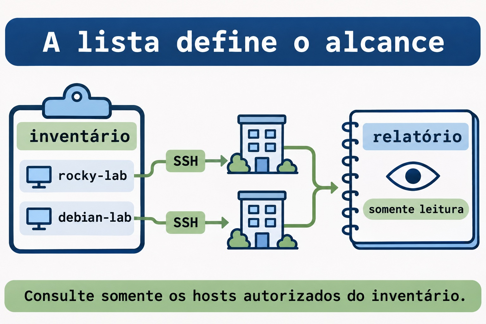
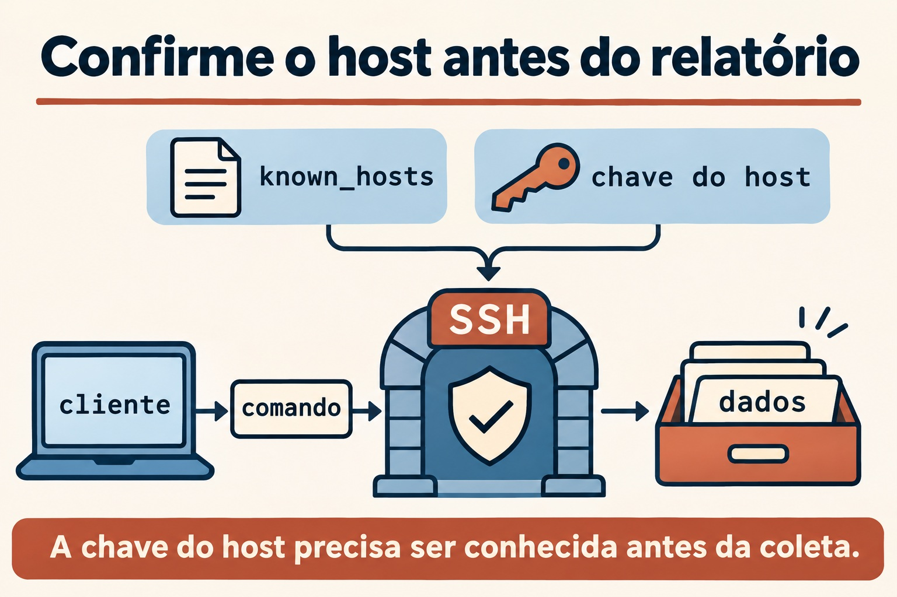
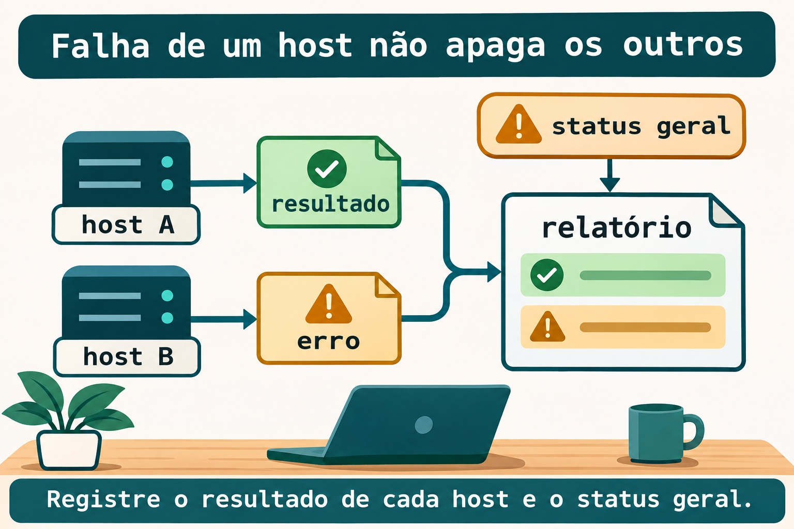

# Aula 15.3 · Scripts de administração

No Windows, uma consulta remota também precisa separar inventário, autenticação e resultado de cada host. Você vai montar um coletor Bash que usa SSH apenas para leitura nas duas VMs do curso. Uma falha será registrada sem apagar os resultados da outra máquina.

> **Núcleo desta aula:** inventário fechado, identidade do host conferida, comando remoto somente de leitura e status por host. O resto é aprofundamento.

| Ficha | |
| --- | --- |
| **Módulo** | M15 · Shell e ambiente, aula 3 de 5 |
| **Quando** | Semana 20 |
| **Ao final** | Você coleta dados dos dois hosts autorizados e preserva erros individuais |
| **Pré-requisitos** | Aulas 12.1, 15.1 e 15.2; SSH, chaves e noVNC nas VMs do curso |
| **Tempo** | Cerca de 90 minutos |
| **Snapshots** | `m15a3-inicio` e `m15a3-fim` nas VMs 201 e 202 |

## 1 · Aquecimento

1. Qual é a diferença entre a chave do host e a chave do usuário no SSH?
2. Por que stdout, stderr e código de saída precisam ser registrados separadamente?
3. Uma pipeline que termina em `awk` preserva automaticamente a falha anterior?

## 2 · Por que importa

Um relatório de vários servidores omite justamente a máquina que não respondeu. O arquivo final parece saudável porque contém apenas sucessos. Você vai registrar o inventário inteiro, inclusive falhas de transporte e de comando, para não confundir ausência de dado com saúde.

O coletor será a Rocky. Os alvos são somente `rocky-lab` e `debian-lab`, nos IPs do curso. A consulta roda como `student`, sem `sudo`, sem encaminhar agente e sem instalar um agente nos alvos.

## 3 · Modelo mental

O inventário é a lista de prédios onde a equipe pode entrar. O SSH confere a portaria e apresenta a autorização do usuário. A ordem de serviço só pede observações. O relatório mantém uma ficha para cada prédio, mesmo quando a visita falha.

```text
inventário fechado -> SSH verificado -> consulta de leitura
        |                  |                  |
      host A             host B         resultado ou erro
```



*Consulte somente os hosts autorizados do inventário.*

### Ponte Windows

| Ideia | Neste lab | Limite |
| --- | --- | --- |
| Inventário remoto | Lista fixa de dois aliases | Não descobrir hosts varrendo a rede |
| Autenticação do destino | `known_hosts` privado | Conferir impressão digital no console |
| Consulta remota | Bash por SSH | Somente leitura e sem privilégio elevado |

## 4 · O essencial

### Alvo faz parte do contrato

O coletor não aceita nomes arbitrários na linha de comando. A lista contém somente as VMs 201 e 202. Alterar essa lista é uma mudança de escopo, não uma simples preferência de execução.

### Host conhecido antes da coleta

`StrictHostKeyChecking yes` rejeita um host cuja chave não foi previamente conferida. `BatchMode yes` impede perguntas interativas durante o lote. Não use aceitação automática de chaves como correção de autenticação.



*A chave do host precisa ser conhecida antes da coleta.*

### Resultado por host

Cada consulta gera arquivos próprios de stdout e stderr. O status final do coletor é `0` quando todos responderam e `1` quando pelo menos um falhou. O status individual guarda a informação de transporte ou do comando remoto.

O SSH normalmente usa `255` para seus erros de conexão e autenticação. O limite externo de tempo pode devolver `124`. Não transforme todos esses códigos em “servidor desligado”.



*Registre o resultado de cada host e o status geral.*

### Rocky × Debian

| Item | Rocky 9 | Debian 13 |
| --- | --- | --- |
| Papel principal | Coletor e alvo `10.1.0.51` | Alvo `10.1.0.52` |
| Consulta local equivalente | Bash, `df`, `free` e `uname` | Bash, `df`, `free` e `uname` |
| Privilégio remoto | `student`, sem `sudo` | `student`, sem `sudo` |

## 5 · Lab guiado

As chaves existentes do Windows continuam intactas. Você cria uma chave exclusiva na Rocky e autoriza apenas sua parte pública nos dois alvos. Faça essa preparação por noVNC, sem encaminhamento do agente do Windows.

### Passo 1 · Proteger e preparar os registros

**Palpite:** uma falha em um alvo deveria apagar o registro do alvo que respondeu?

No host Proxmox:

```bash
qm snapshot 201 m15a3-inicio
qm snapshot 202 m15a3-inicio
```

Nas duas VMs, confirme que a pasta não existia antes de criá-la.

```bash
test ! -e "$HOME/m15a3"
mkdir -m 700 "$HOME/m15a3"
command -v bash ssh ssh-keygen df free uname
ssh-keygen -lf /etc/ssh/ssh_host_ed25519_key.pub
```

**Saída esperada:** ferramentas disponíveis e impressão digital pública de cada host. Guarde essas duas impressões obtidas diretamente do console para compará-las na primeira conexão.

**Verifique:** os IPs continuam sendo os do curso e a sessão SSH normal do Windows funciona. Não copie nenhuma chave privada existente.

### Passo 2 · Autorizar uma chave exclusiva

**Palpite:** o arquivo público permite autenticar sem possuir a chave privada correspondente?

Na Rocky, gere a chave do coletor com passphrase interativa.

```bash
ssh-keygen -t ed25519 -a 64 -f "$HOME/m15a3/id_ed25519" -C m15a3-collector
ssh-keygen -lf "$HOME/m15a3/id_ed25519.pub"
cat "$HOME/m15a3/id_ed25519.pub"
```

Copie somente a linha pública. No noVNC de cada VM, cole-a ao ser solicitado pelo comando seguinte. Confira a impressão digital antes de acrescentá-la ao acesso de `student`.

```bash
read -r -p 'Public key: ' LAB_PUBKEY
printf '%s\n' "$LAB_PUBKEY" > "$HOME/m15a3/authorized.pub"
ssh-keygen -lf "$HOME/m15a3/authorized.pub"
```

Depois da conferência, em cada alvo, use a pasta SSH já correta do M0. Não substitua seu conteúdo.

```bash
test -d "$HOME/.ssh"
test -f "$HOME/.ssh/authorized_keys" || install -m 0600 /dev/null "$HOME/.ssh/authorized_keys"
cp -p "$HOME/.ssh/authorized_keys" "$HOME/m15a3/authorized_keys.inicio"
grep -qxF -f "$HOME/m15a3/authorized.pub" "$HOME/.ssh/authorized_keys" || cat "$HOME/m15a3/authorized.pub" >> "$HOME/.ssh/authorized_keys"
```

**Saída esperada:** apenas a linha pública do exercício foi acrescentada; as autorizações anteriores continuam presentes.

**Verifique:** a impressão digital da linha em cada alvo é igual à da chave pública criada na Rocky. A chave privada ficou na Rocky.

### Passo 3 · Conferir os hosts e usar agente local

**Palpite:** desativar a conferência do host simplifica a coleta sem perder uma garantia de segurança?

Na Rocky, crie a configuração privada. Ela não modifica `~/.ssh/config`.

```bash
cat > "$HOME/m15a3/ssh_config" <<'EOF'
Host rocky-lab
    HostName 10.1.0.51
Host debian-lab
    HostName 10.1.0.52
Host *
    User student
    Port 22
    IdentityFile ~/m15a3/id_ed25519
    IdentitiesOnly yes
    UserKnownHostsFile ~/m15a3/known_hosts
    GlobalKnownHostsFile /dev/null
    HostKeyAlgorithms ssh-ed25519
    StrictHostKeyChecking yes
    ForwardAgent no
    RequestTTY no
    ConnectTimeout 3
    ConnectionAttempts 1
EOF
ssh-agent /bin/bash --noprofile --norc
```

No novo shell filho, carregue a chave e confira a primeira conexão de cada host. A pergunta interativa só pode ser aceita se a impressão digital coincidir com a observada no console.

```bash
ssh-add "$HOME/m15a3/id_ed25519"
ssh -F "$HOME/m15a3/ssh_config" -o StrictHostKeyChecking=ask rocky-lab true
ssh -F "$HOME/m15a3/ssh_config" -o StrictHostKeyChecking=ask debian-lab true
```

**Saída esperada:** as duas conexões verificadas executam apenas `true`. O agente pertence à sessão filha e não é encaminhado aos alvos.

**Verifique:** execute as duas conexões sem a exceção interativa e com `-o BatchMode=yes`. Ambas devem terminar com status `0`. Continue os passos seguintes nesse shell filho.

### Decida 1

Uma chave do host mudou inesperadamente. O que fazer antes de rodar o lote?

| Opção | Ação |
| --- | --- |
| A | Ignorar a identidade para terminar rápido |
| B | Conferir o host pelo console e investigar a mudança |
| C | Copiar a chave privada do servidor |

Escolha B. Um relatório não vale se você não sabe qual host respondeu.

### Passo 4 · Definir a consulta de leitura

**Palpite:** formatar a saída de `df` impede que uma falha dele seja mascarada pelo último filtro?

Na Rocky, escreva a consulta que será enviada ao Bash remoto.

```bash
cat > "$HOME/m15a3/query.sh" <<'EOF'
#!/bin/bash
set -u
set -o pipefail
export LC_ALL=C
printf 'kernel='
uname -r || exit 3
df -P / | awk 'NR==2 {printf "disk_used=%s\n", $5}' || exit 3
free -m | awk '/^Mem:/ {printf "memory_available_mb=%s\n", $7}' || exit 3
EOF
/bin/bash -n "$HOME/m15a3/query.sh"
/bin/bash "$HOME/m15a3/query.sh"
```

**Saída esperada:** dados reais da Rocky em campos fixos, sem números inventados. A mesma consulta funciona localmente na Debian e deve ser revisada ali antes do lote.

**Verifique:** confirme que o arquivo só consulta kernel, uso do disco e memória. Não há instalação, mudança de configuração ou comando com `sudo`.

### Passo 5 · Coletar os dois resultados

**Palpite:** se a Debian falhar, o coletor ainda deve preservar a resposta da Rocky?

```bash
cat > "$HOME/m15a3/coletar.sh" <<'EOF'
#!/bin/bash
set -u
base=$HOME/m15a3
set -o pipefail
[[ $# -eq 0 ]] || { printf 'no arguments allowed\n' >&2; exit 2; }
/bin/bash -n "$base/query.sh" || exit 2
run=$(mktemp -d "$base/run.XXXXXX") || exit 3
printf 'report_dir=%s\n' "$run"
failed=0
for host in rocky-lab debian-lab; do
    if timeout 12 ssh -F "$base/ssh_config" -o BatchMode=yes "$host" /bin/bash -s < "$base/query.sh" > "$run/$host.txt" 2> "$run/$host.err"; then
        rc=0
    else
        rc=$?
        failed=1
    fi
    printf 'host=%s status=%s\n' "$host" "$rc" | tee -a "$run/status.txt" || exit 3
done
exit "$failed"
EOF
chmod 0700 "$HOME/m15a3/coletar.sh"
/bin/bash -n "$HOME/m15a3/coletar.sh"
"$HOME/m15a3/coletar.sh"
printf 'collector_status=%s\n' "$?"
```

**Saída esperada:** pasta nova de resultados, uma linha de status para cada host e código geral `0` se os dois responderem. Cada execução conserva sua própria pasta.

**Verifique:** abra apenas os arquivos da pasta recém-informada. Não misture resultados antigos e atuais. Confira dados e arquivos de erro separadamente.

### Decida 2

Um alvo não entregou dados. Qual registro mantém o significado do relatório?

| Opção | Ação |
| --- | --- |
| A | Inventar o último valor conhecido como se fosse atual |
| B | Omitir o host e mostrar só os sucessos |
| C | Guardar status, erro e ausência de dado para esse host |

Escolha C. Ausência de dado precisa ficar visível.

### Passo 6 · Conferir o escopo e a repetição

**Palpite:** repetir uma coleta de leitura deveria mudar o uso do disco de um alvo por instalação de pacotes?

```bash
"$HOME/m15a3/coletar.sh"
printf 'collector_status=%s\n' "$?"
ssh -F "$HOME/m15a3/ssh_config" -o BatchMode=yes rocky-lab 'id -un'
ssh -F "$HOME/m15a3/ssh_config" -o BatchMode=yes debian-lab 'id -un'
```

**Saída esperada:** outra pasta de resultados e usuário remoto `student` nos dois hosts. Os números de memória podem variar entre consultas.

**Verifique:** o inventário do script tem só os dois aliases aprovados. A leitura usa o mesmo conteúdo de consulta nas duas famílias.

## 6 · Quebre e conserte

### Quebra 1 · Host ainda não conhecido

Na Rocky, preserve a lista privada e retire apenas o registro da Debian nessa cópia de exercício.

```bash
cp -p "$HOME/m15a3/known_hosts" "$HOME/m15a3/known_hosts.valid"
ssh-keygen -R 10.1.0.52 -f "$HOME/m15a3/known_hosts"
"$HOME/m15a3/coletar.sh"
printf 'collector_status=%s\n' "$?"
```

**Sintoma:** a Rocky responde e a Debian falha na conferência de identidade; o lote termina com `1`.

**Investigação:** leia o stderr da Debian na pasta nova e compare os dois status.

**Causa:** o modo estrito não permite confiar silenciosamente em um host desconhecido.

**Conserto:** restaure somente a lista privada previamente conferida.

```bash
cp -p "$HOME/m15a3/known_hosts.valid" "$HOME/m15a3/known_hosts"
```

**Verifique:** os dois alvos voltam a responder sem desativar a conferência de identidade.

**Prevenção:** confirme chaves antes do lote e registre a origem da impressão digital.

### Quebra 2 · Chave indisponível no agente

**Sintoma:** após retirar a chave do agente local, o lote não pode pedir a passphrase interativamente.

**Investigação:** retire somente a chave do exercício e confira o erro produzido.

```bash
ssh-add -d "$HOME/m15a3/id_ed25519"
"$HOME/m15a3/coletar.sh"
```

**Causa:** a chave privada cifrada não está pronta para assinatura no agente; `BatchMode` impede perguntas durante o lote.

**Conserto:** carregue novamente a chave com `ssh-add`, digitando a passphrase só no diálogo.

**Verifique:** o coletor volta a responder nos dois hosts sem encaminhar o agente.

**Prevenção:** separe a preparação de credenciais da execução não interativa do relatório.

### Quebra 3 · Consulta falha no alvo

Preserve a consulta válida e troque apenas uma opção de leitura na cópia do lab.

```bash
cp "$HOME/m15a3/query.sh" "$HOME/m15a3/query.valid.sh"
sed -i 's/df -P/df --m15-invalid/' "$HOME/m15a3/query.sh"
"$HOME/m15a3/coletar.sh"
```

**Sintoma:** o SSH funciona, mas os comandos remotos retornam `3`; o coletor resume falha geral com `1`.

**Investigação:** leia stdout parcial e stderr de cada host. O erro aconteceu no comando de leitura, não na identidade do host.

**Causa:** a opção inventada é inválida e a consulta preserva a falha da pipeline.

**Conserto:** restaure a consulta local validada antes de enviar outra coleta.

```bash
cp "$HOME/m15a3/query.valid.sh" "$HOME/m15a3/query.sh"
/bin/bash -n "$HOME/m15a3/query.sh"
```

**Verifique:** os dois hosts voltam a produzir todos os campos previstos.

**Prevenção:** valide o conteúdo da consulta nas duas famílias antes de ampliar o inventário.

### Limpeza

Em cada alvo, retire somente a linha pública acrescentada pelo exercício. Não restaure cegamente o arquivo inteiro, pois outras autorizações podem ter sido acrescentadas depois. Faça a limpeza sem edição concorrente de outro administrador.

```bash
if test -s "$HOME/m15a3/authorized.pub" && ssh-keygen -lf "$HOME/m15a3/authorized.pub"; then
    cp -p "$HOME/.ssh/authorized_keys" "$HOME/.ssh/authorized_keys.m15a3.tmp" &&
    awk 'NR==FNR {drop[$0]=1; next} !($0 in drop)' "$HOME/m15a3/authorized.pub" "$HOME/.ssh/authorized_keys" > "$HOME/.ssh/authorized_keys.m15a3.tmp" &&
    mv -- "$HOME/.ssh/authorized_keys.m15a3.tmp" "$HOME/.ssh/authorized_keys"
else
    printf 'cleanup stopped: invalid public key\n' >&2
fi
```

Confirme que a linha removida era só a chave do lab e que o acesso original do Windows continua funcionando. No coletor, saia do shell filho com `exit`; o agente iniciado para ele termina. Guarde o material privado sem exportar chave privada.

## 7 · Armadilhas

| Erro comum | O que fazer | Por quê |
| --- | --- | --- |
| Aceitar qualquer chave no lote | Conferir pelo console antes | Autentica o destino da consulta |
| Omitir o host sem resposta | Registrar erro e status | Ausência de dado não é sucesso |
| Encaminhar agente para facilitar | Manter assinatura no coletor | O alvo não precisa usar seu agente |
| Transformar relatório em varredura | Manter inventário fechado | O alcance precisa de autorização |

## 8 · Quiz

1. Qual chave privada precisa ficar no coletor?
2. Por que conferir a impressão digital pelo console?
3. O que `BatchMode` evita durante o lote?
4. Se o SSH retorna `3` do comando remoto, isso significa o mesmo que `255`?
5. Por que usar uma pasta nova para cada execução?
6. Por que a limpeza remove só a linha pública exata do exercício?

## 9 · Cola

| Tarefa | Comando |
| --- | --- |
| Validar a consulta | `/bin/bash -n "$HOME/m15a3/query.sh"` |
| Identidade do cliente | `ssh-keygen -lf "$HOME/m15a3/id_ed25519.pub"` |
| Identidade do host | `ssh-keygen -lf /etc/ssh/ssh_host_ed25519_key.pub` |
| Consulta do lote | `"$HOME/m15a3/coletar.sh"` |

**Flashcards:** crie cinco cartões sobre inventário, identidade, agente local, erro remoto e status geral. Revise em D+1, D+3, D+7 e D+21.

## 10 · Checklist e fechamento

- [ ] Consultei somente as VMs 201 e 202.
- [ ] Conferi as chaves dos dois hosts pelo console.
- [ ] Preservei sucesso e falha em arquivos separados por host.
- [ ] Retirei só a autorização temporária do lab e encerrei seu agente.

**Último exercício:** explique um relatório parcial sem chamar todos os hosts de “indisponíveis”. Identifique a evidência que diferencia transporte de comando remoto.

**Reboot de conferência:** após a limpeza, reinicie as duas VMs, uma por vez. Confirme o acesso original do Windows e a ausência de agente do lab. Os relatórios privados permanecem; a autorização temporária não deve voltar.

No host Proxmox:

```bash
qm snapshot 201 m15a3-fim
qm snapshot 202 m15a3-fim
```

## 11 · Na vida real

Revise, somente por leitura, um inventário e uma consulta autorizada. Não execute uma coleta nova em produção nesta missão. Identifique quais hosts estão aprovados, como suas identidades são conferidas e onde falhas aparecem.

O relatório distingue dados antigos e atuais? Há um host silenciosamente omitido? As credenciais ficam no coletor correto e fora dos relatórios?

## 12 · Aprofundar quando quiser

- [ssh](https://manpages.debian.org/trixie/openssh-client/ssh.1.en.html), [ssh_config](https://manpages.debian.org/trixie/openssh-client/ssh_config.5.en.html) e [ssh-agent](https://manpages.debian.org/trixie/openssh-client/ssh-agent.1.en.html): identidade, modo de lote e agente com comando filho.
- [timeout](https://www.gnu.org/software/coreutils/manual/html_node/timeout-invocation.html) e [Bash](https://www.gnu.org/software/bash/manual/bash.html): tempo limitado, heredoc, redirecionamentos e códigos.

**DeepTutor** (http://10.1.0.149:3782, KB "Curso Linux Sysadmin"):

- `!explica Compare erro de identidade do host, chave do usuário indisponível e comando remoto que falhou.`
- `!feynman Vou explicar por que um relatório deve mostrar também o host que não respondeu. Critique.`
- `!quiz Crie seis incidentes de coleta SSH somente de leitura em rocky-lab e debian-lab.`

## Gabarito comentado

### Aquecimento

1. A chave do host autentica o destino; a chave do usuário autoriza o acesso da conta.
2. Dado, diagnóstico e resultado operacional têm usos diferentes e não devem se esconder mutuamente.
3. Não. A consulta usa `pipefail` e tratamento explícito para preservar essa falha.

### Quiz

1. A chave exclusiva do usuário coletor, protegida por passphrase.
2. Para comparar com uma fonte que não dependa da mesma conexão ainda não confiável.
3. Perguntas de autenticação e interação que fariam o lote esperar pelo operador.
4. Não. Neste contrato, `3` indica falha de processamento remoto; `255` normalmente indica erro do SSH.
5. Para não sobrescrever a evidência anterior nem confundir momentos diferentes.
6. Para preservar autorizações legítimas que não pertencem ao exercício.

<!-- navegacao -->
[← Aula 15.2 · Scripts robustos](15.2-scripts-robustos.md) · [Índice de aulas](../01-aulas.md) · [Plano do curso: 15.4 em diante →](../00-plano-do-curso.md)
