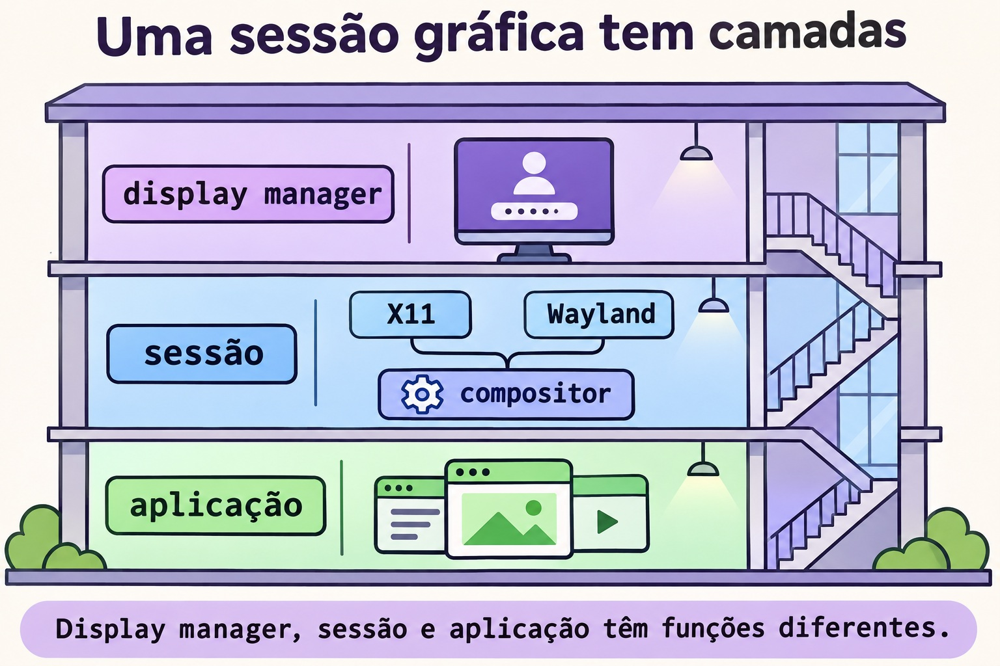
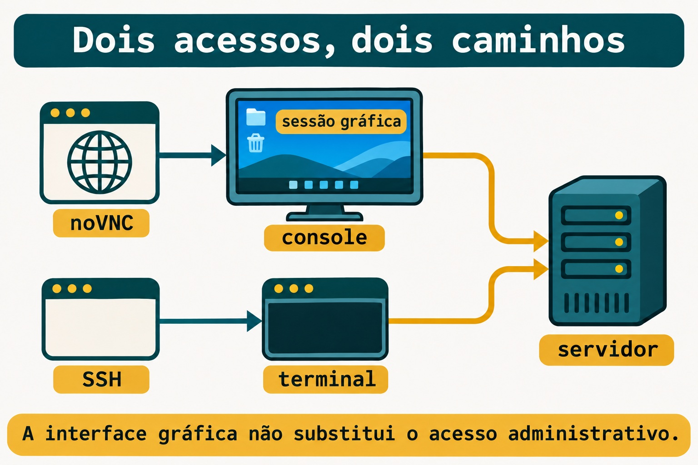
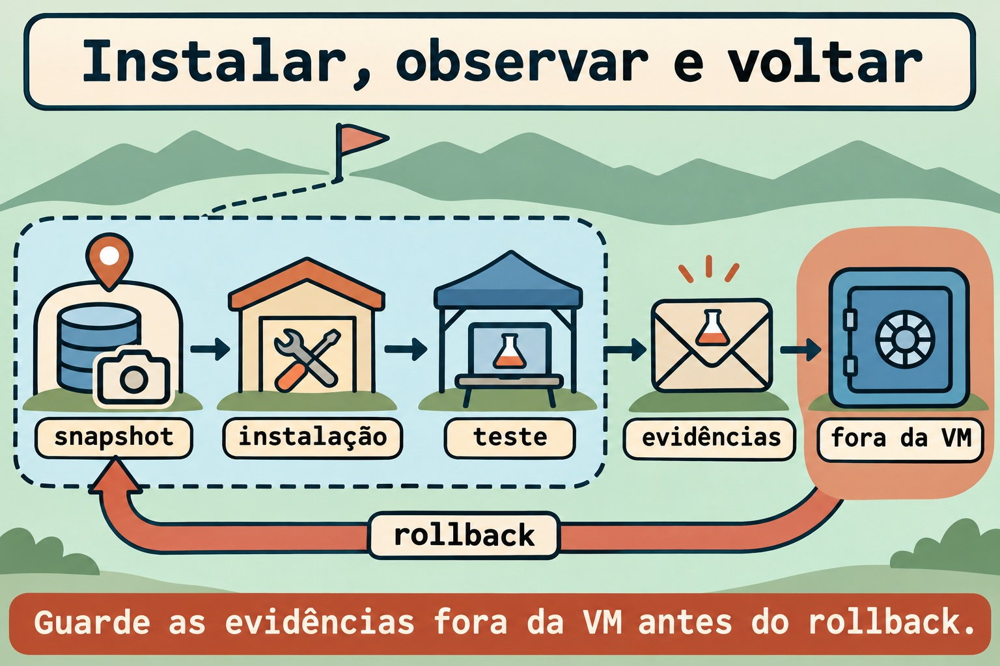

# Aula 15.4 · Interfaces gráficas

Um servidor pode oferecer interface gráfica sem que ela se torne requisito para administrar o sistema. Você vai observar GNOME, display manager, X11, Wayland e acessibilidade no console da VM. A instalação será temporária: as evidências saem da VM antes do rollback.

> **Núcleo desta aula:** display manager inicia o acesso gráfico; a sessão possui sua arquitetura; SSH continua sendo um caminho independente. Instale para estudar, registre e volte pelo snapshot. O resto é aprofundamento.

| Ficha | |
| --- | --- |
| **Módulo** | M15 · Shell e ambiente, aula 4 de 5 |
| **Quando** | Semana 21 |
| **Ao final** | Você identifica as camadas da sessão gráfica e recupera a base do servidor |
| **Pré-requisitos** | Proxmox, snapshots, SSH, noVNC e recursos livres para uma VM de exercício |
| **Tempo** | Cerca de 90 minutos, mais downloads e a repetição na outra distro |
| **Snapshots** | `m15a4-inicio` e `m15a4-fim` nas VMs 201 e 202 |

## 1 · Aquecimento

1. Qual é a diferença entre iniciar uma unidade agora e mudar o target padrão para o próximo boot?
2. Por que uma aplicação iniciada por uma sessão gráfica pode ter ambiente diferente do SSH?
3. Que alterações um rollback descarta dentro da VM?

## 2 · Por que importa

O console gráfico não aparece, mas SSH responde. Reiniciar tudo misturaria duas situações diferentes: o servidor continua operando e o caminho gráfico falhou. Você vai aprender a identificar a unidade, a sessão e a arquitetura antes de trocar configurações.

Acessibilidade também faz parte da administração. Uma sessão precisa permitir leitura, navegação e entrada ao usuário, sem depender apenas de aparência ou de um dispositivo de apontamento.

## 3 · Modelo mental

O display manager é o balcão de entrada do prédio. O desktop organiza a sala de trabalho. O protocolo gráfico e o compositor participam de como janelas e dispositivos são apresentados. Um terminal é apenas uma aplicação dessa sala.

```text
console -> display manager -> sessão gráfica -> aplicações
SSH -----------------------> shell remoto
```



*Display manager, sessão e aplicação têm funções diferentes.*

### Ponte Windows

| Windows Server | Linux | Separação útil |
| --- | --- | --- |
| Console da VM | noVNC do Proxmox | Mostra o console virtual |
| Ambiente de desktop | GNOME e outros desktops | Organiza a sessão do usuário |
| Administração remota por terminal | SSH | Não exige desktop instalado |

## 4 · O essencial

### Display manager e sessão

GDM apresenta o login gráfico e inicia uma sessão escolhida. GNOME fornece o ambiente de trabalho. Uma aplicação gráfica pode usar X11 ou Wayland; uma sessão Wayland também pode executar aplicações X11 por Xwayland.

Não conclua que a sessão é X11 apenas porque existe `DISPLAY`. Verifique o tipo da sessão gráfica no `loginctl` ou no ambiente do terminal aberto dentro dela.

### Console não é protocolo remoto de desktop

O noVNC mostra a tela virtual da VM. Esta aula não instala RDP, VNC dentro do convidado ou um serviço gráfico exposto à rede. O SSH existente continua sendo o canal administrativo de recuperação.



*A interface gráfica não substitui o acesso administrativo.*

### Recursos e reversibilidade

As VMs do curso começaram com 2 GB de RAM. Para este lab, exija 4 GB de RAM estável para a VM em teste, pelo menos 10 GB livres na raiz antes de planejar a instalação e espaço suficiente no storage para o snapshot. Confira a estimativa do gerenciador de pacotes: esses valores são uma margem do exercício, não garantia para qualquer desktop.

Faça uma VM por vez. Se o host não puder fornecer essa margem, não inicie a instalação. Não aumente recursos de outras VMs e não altere o cluster para satisfazer o lab.

### Rocky × Debian

| Item | Rocky 9 | Debian 13 |
| --- | --- | --- |
| Desktop escolhido | Ambiente `Server with GUI` | Pacotes `gnome-core` e `gdm3` |
| Display manager | `gdm.service` | `gdm3.service` |
| Caminho gráfico | Conferir a sessão disponível no GDM | Conferir a sessão disponível no GDM |
| Retorno da instalação | Rollback do snapshot inicial | Rollback do snapshot inicial |

## 5 · Lab guiado

Leia o procedimento inteiro antes de instalar. A pasta de evidências dentro da VM desaparecerá no rollback; você a copiará para o Windows antes de voltar.

### Passo 1 · Registrar a base e o limite de recursos

**Palpite:** um snapshot guardado no mesmo storage dispensa espaço livre ou backup?

No host Proxmox, leia a configuração e os recursos. Registre memória, balloon e storage num diário fora das VMs.

```bash
qm config 201
qm config 202
free -h
pvesm status
qm snapshot 201 m15a4-inicio
qm snapshot 202 m15a4-inicio
```

Nas duas VMs, crie a pasta somente se não existia.

```bash
test ! -e "$HOME/m15a4"
mkdir -m 700 "$HOME/m15a4"
systemctl get-default > "$HOME/m15a4/target.inicio"
free -h
df -h /
```

**Saída esperada:** snapshots disponíveis e base registrada. Se a margem de RAM ou disco não existir, pare o lab antes de instalar.

**Verifique:** confirme noVNC, SSH novo e o snapshot de cada ID com `qm listsnapshot 201` e `qm listsnapshot 202`.

### Passo 2 · Instalar numa VM de cada vez

**Palpite:** alocar mais RAM na configuração prova que o host tem essa RAM realmente disponível?

Comece pela Rocky. Se ela ainda tem 2 GB, desligue apenas a VM 201 de forma limpa, confirme `stopped` e, somente após conferir capacidade no host, configure a margem do lab.

```bash
qm shutdown 201 --timeout 120
qm status 201
qm set 201 --memory 4096 --balloon 0
qm start 201
```

Na Rocky, confira a estimativa antes de aceitar a instalação.

```bash
sudo env LC_ALL=C dnf group info 'Server with GUI'
sudo env LC_ALL=C dnf --assumeno group install 'Server with GUI'
sudo env LC_ALL=C dnf group install 'Server with GUI'
sudo dnf install orca
```

Depois de terminar todo o roteiro e fazer rollback da Rocky, repita na Debian. Se necessário, use o mesmo ajuste de memória somente no ID 202, com a VM parada e a capacidade novamente conferida.

```bash
sudo apt update
sudo apt-get -s install gnome-core gdm3 orca
sudo apt install -y gnome-core gdm3 orca
```

**Saída esperada:** instalação concluída sem esgotar a raiz ou a RAM do host. Na Debian, escolha GDM caso apareça uma seleção de display manager.

**Verifique:** confira a unidade real com `systemctl cat gdm.service` na Rocky ou `systemctl cat gdm3.service` na Debian. Não presuma o protocolo da sessão a partir do pacote instalado.

### Passo 3 · Abrir a sessão gráfica

**Palpite:** iniciar o display manager precisa encerrar a sessão SSH existente?

Na VM em teste, indique o target do próximo boot e inicie o caminho gráfico. Não use isolamento de target para este exercício.

Na Rocky, execute `sudo systemctl enable gdm.service` para criar o alias de entrada do display manager. No Debian, a seleção de GDM na instalação deve ter criado esse vínculo; confirme com `systemctl cat display-manager.service`. Se estiver ausente, execute `sudo dpkg-reconfigure gdm3`, selecione GDM e confirme de novo antes de continuar.

```bash
sudo systemctl set-default graphical.target
sudo systemctl start display-manager.service
systemctl status display-manager.service
```

Entre como `student` pelo noVNC. Se houver seleção de sessão no GDM, leia as opções oferecidas; não force X11 ou Wayland editando arquivos para imitar outra distro.

**Saída esperada:** sessão de desktop no console e SSH ainda funcional.

**Verifique:** abra um terminal dentro do desktop e compare seu ambiente com o terminal SSH, sem misturar os dois.

### Decida 1

O console gráfico falhou, mas SSH responde. Qual investigação mantém as camadas separadas?

| Opção | Ação |
| --- | --- |
| A | Reiniciar o host Proxmox |
| B | Alterar a rede do servidor |
| C | Conferir display manager, journal e sessões da VM |

Escolha C. O caminho administrativo já mostrou que o sistema ainda responde.

### Passo 4 · Identificar a arquitetura observada

**Palpite:** ver `DISPLAY` num terminal prova que a sessão inteira usa X11?

No terminal aberto dentro da sessão gráfica:

```bash
printf 'type=%s\n' "${XDG_SESSION_TYPE-unset}"
printf 'display=%s\n' "${DISPLAY-unset}"
printf 'wayland=%s\n' "${WAYLAND_DISPLAY-unset}"
loginctl list-sessions
```

Identifique a sessão de `student` que pertence ao console gráfico. Use seu ID real na consulta abaixo, digitando-o quando solicitado.

```bash
read -r -p 'SESSION_ID: ' SESSION_ID
loginctl show-session "$SESSION_ID" -p Name -p Type -p Remote -p State
```

**Saída esperada:** tipo realmente observado, como `wayland` ou `x11`. O terminal SSH corresponde a outra sessão, normalmente de terminal.

**Verifique:** explique por que uma aplicação X11 por Xwayland pode produzir `DISPLAY` dentro de uma sessão Wayland.

### Passo 5 · Conferir acessibilidade

**Palpite:** uma sessão utilizável depende apenas de resolução e tema?

No desktop, abra as configurações de acessibilidade. Observe tamanho de texto, contraste, ampliação, teclado de tela e leitor de tela. Mude uma opção por vez e anote como voltar ao valor anterior.

No terminal gráfico, confira se a preferência do leitor está habilitada.

```bash
gsettings get org.gnome.desktop.a11y.applications screen-reader-enabled
```

**Saída esperada:** a interface oferece as opções instaladas. O leitor de tela precisa também de saída de áudio funcional; um console virtual sem áudio não demonstra que a fala chegou ao usuário.

**Verifique:** navegue por um aplicativo usando teclado e restaure as opções testadas. Registre o que foi observado e o que não pôde ser comprovado no console.

### Decida 2

O teste gráfico terminou. Qual sequência protege os registros da aula?

| Opção | Sequência |
| --- | --- |
| A | Copiar as evidências para fora, conferir a cópia e fazer rollback |
| B | Deixar a instalação sem registrar a mudança |
| C | Rollback e depois procurar o relatório dentro da VM |

Escolha A. O rollback descarta a pasta criada depois do snapshot.

### Passo 6 · Registrar e preparar o retorno

**Palpite:** salvar o arquivo dentro da VM é suficiente para sobreviver ao rollback?

Na VM, registre target e sessões, sem guardar conteúdo privado das aplicações.

```bash
{
    printf 'initial_target='; cat "$HOME/m15a4/target.inicio"
    printf 'current_target='
    systemctl get-default
    systemctl is-active display-manager.service
    loginctl list-sessions
    free -h
    df -h /
} > "$HOME/m15a4/evidencias.txt"
```

No Windows, crie uma pasta local para a aula. Dentro dela, copie o arquivo da VM em teste. Use o segundo comando só quando repetir o roteiro na Debian.

```bash
scp rocky-lab:m15a4/evidencias.txt evidencias-rocky.txt
scp debian-lab:m15a4/evidencias.txt evidencias-debian.txt
```

**Saída esperada:** cópia legível fora da VM. O bloco usa o cliente OpenSSH já configurado no Windows; não o execute dentro da outra VM.

**Verifique:** abra a cópia no Windows antes do rollback. Atualize-a depois das quebras abaixo para conservar também seus resultados.

## 6 · Quebre e conserte

### Quebra 1 · Display manager parado

Pelo SSH da VM em teste, pare apenas o display manager. Isso encerra a sessão gráfica, não o host.

```bash
sudo systemctl stop display-manager.service
systemctl is-active display-manager.service
```

**Sintoma:** o desktop deixa de aparecer no console; SSH continua respondendo.

**Investigação:** consulte o estado e o journal da unidade real de GDM da distro.

**Causa:** a unidade que oferece o login gráfico foi parada.

**Conserto:** inicie novamente `display-manager.service` e entre pelo console.

**Verifique:** uma nova sessão gráfica aparece no `loginctl`; não foi necessário alterar SSH ou rede.

**Prevenção:** registre qual unidade oferece o caminho gráfico antes de reiniciar componentes.

### Quebra 2 · Medir a sessão errada

**Sintoma:** você tenta identificar o desktop com uma variável lida no terminal SSH e encontra um tipo de terminal ou variável ausente.

**Investigação:** compare o ID e o tipo das sessões no `loginctl`, sem mudar configurações gráficas.

**Causa:** o processo consultado pertence a outro caminho de acesso.

**Conserto:** abra um terminal dentro do desktop ou consulte o ID real da sessão gráfica.

**Verifique:** as duas observações passam a descrever corretamente sessões diferentes.

**Prevenção:** anote em qual sessão cada comando de diagnóstico foi executado.

### Quebra 3 · Target de boot diferente

Na VM em teste, troque apenas o target padrão e reinicie a própria VM.

```bash
sudo systemctl set-default multi-user.target
sudo systemctl reboot
```

**Sintoma:** o boot não traz o caminho gráfico que você esperava.

**Investigação:** confira `systemctl get-default`, estado do display manager e suas dependências.

**Causa:** mudar o padrão do próximo boot é diferente de iniciar uma unidade durante a sessão atual.

**Conserto:** volte a `graphical.target` e inicie o display manager durante o teste. O retorno definitivo à base será pelo snapshot.

**Verifique:** compare o target declarado e a unidade ativa; registre os dois sem tratá-los como a mesma evidência.

**Prevenção:** confira estado atual e intenção de boot separadamente.

### Limpeza

Atualize a cópia externa das evidências. No host Proxmox, desligue de forma limpa apenas a VM em teste e confirme que parou. Faça rollback da Rocky com a sequência abaixo.

```bash
qm shutdown 201 --timeout 120
qm status 201
qm rollback 201 m15a4-inicio
qm config 201
qm start 201
```

Compare memória, balloon e discos com o registro externo. Só depois de restaurar e conferir a Rocky, repita o lab na Debian. Ao terminar a Debian, use a sequência abaixo.

```bash
qm shutdown 202 --timeout 120
qm status 202
qm rollback 202 m15a4-inicio
qm config 202
qm start 202
```

Se algum recurso não voltou ao valor registrado, corrija somente a configuração desse ID, com a VM parada, antes de considerar o retorno concluído. O servidor não termina esta aula com o desktop instalado.



*Guarde as evidências fora da VM antes do rollback.*

## 7 · Armadilhas

| Erro comum | O que fazer | Por quê |
| --- | --- | --- |
| Instalar sem margem de recursos | Conferir host, raiz e estimativa dos pacotes | Evita saturar servidor e storage compartilhado |
| `DISPLAY` comprova X11 | Identificar a sessão real | Xwayland pode oferecer DISPLAY |
| Console sem áudio comprova leitor de tela | Conferir também o canal de áudio | Preferência ativa e experiência efetiva são diferentes |
| Rollback preserva o relatório novo | Copiar antes para fora da VM | Arquivos posteriores ao snapshot serão descartados |

## 8 · Quiz

1. Qual é a função do display manager?
2. GNOME e Wayland são nomes da mesma camada?
3. SSH exige desktop instalado?
4. Por que medir o tipo de sessão no terminal gráfico?
5. O que precisa sair da VM antes do rollback?
6. Por que a mudança de memória exige conferir a capacidade real do host?

## 9 · Cola

| Tarefa | Comando |
| --- | --- |
| Target padrão | `systemctl get-default` |
| Display manager atual | `systemctl status display-manager.service` |
| Lista de sessões | `loginctl list-sessions` |
| Tipo da sessão escolhida | `loginctl show-session "$SESSION_ID" -p Type -p Remote` |

**Flashcards:** crie cinco cartões sobre display manager, desktop, X11, Wayland e rollback. Revise em D+1, D+3, D+7 e D+21.

## 10 · Checklist e fechamento

- [ ] Fiz o teste em uma VM por vez, com recursos disponíveis.
- [ ] Diferenciei display manager, sessão e aplicação.
- [ ] Testei navegação e opções de acessibilidade.
- [ ] Copiei evidências para fora e restaurei as duas VMs.

**Último exercício:** desenhe os dois caminhos de acesso, noVNC e SSH, e explique em qual camada o defeito do display manager aconteceu.

**Reboot de conferência:** depois do rollback, reinicie cada VM e confirme target original, pacotes originais, RAM original e SSH. O arquivo externo de evidências precisa continuar disponível no Windows.

No host Proxmox, após essa conferência:

```bash
qm snapshot 201 m15a4-fim
qm snapshot 202 m15a4-fim
```

## 11 · Na vida real

Em uma máquina que você administre ou tenha autorização para observar, faça somente leitura das sessões e do target. Não instale desktop, não encerre sessões e não altere recursos nesta missão.

Existe necessidade real de desktop nesse servidor? Qual caminho administrativo funciona quando o desktop falha? Quais recursos de acessibilidade o usuário precisa e como você confirmou seu funcionamento?

## 12 · Aprofundar quando quiser

- [GNOME: acessibilidade](https://help.gnome.org/users/gnome-help/stable/a11y.html.en) e [Wayland no Debian](https://wiki.debian.org/Wayland).
- [RHEL 9: ambiente GNOME](https://docs.redhat.com/en/documentation/red_hat_enterprise_linux/9/html/getting_started_with_the_gnome_desktop_environment/index) e [GNOME no Debian](https://wiki.debian.org/Gnome).
- [Proxmox: qm](https://pve.proxmox.com/pve-docs/qm.1.html), [loginctl](https://manpages.debian.org/trixie/systemd/loginctl.1.en.html) e [targets](https://manpages.debian.org/trixie/systemd/systemd.target.5.en.html).

**DeepTutor** (http://10.1.0.149:3782, KB "Curso Linux Sysadmin"):

- `!explica Compare display manager, desktop, X11, Wayland e uma aplicação gráfica sem tratá-los como sinônimos.`
- `!feynman Vou explicar por que DISPLAY no ambiente não basta para identificar a sessão. Critique.`
- `!quiz Crie seis incidentes gráficos de laboratório com SSH preservado e retorno por snapshot.`

## Gabarito comentado

### Aquecimento

1. Iniciar muda o estado atual; o target padrão descreve o caminho do próximo boot.
2. Elas pertencem a sessões e cadeias de processos diferentes, com ambientes diferentes.
3. As mudanças posteriores ao snapshot no estado restaurado, incluindo a instalação do desktop e os registros internos novos.

### Quiz

1. Apresentar o acesso gráfico e iniciar a sessão selecionada.
2. Não. GNOME é um ambiente; Wayland é parte da arquitetura de apresentação da sessão.
3. Não. O servidor SSH funciona sem desktop.
4. Porque o terminal SSH pertence a outra sessão e não descreve automaticamente o desktop.
5. Relatórios, observações e outras evidências criadas depois do snapshot.
6. Configurar um limite maior não cria capacidade física nem libera recursos do storage.

<!-- navegacao -->
[← Aula 15.3 · Scripts de administração](15.3-scripts-de-administracao.md) · [Índice de aulas](../01-aulas.md) · [Plano do curso: 15.5 em diante →](../00-plano-do-curso.md)
