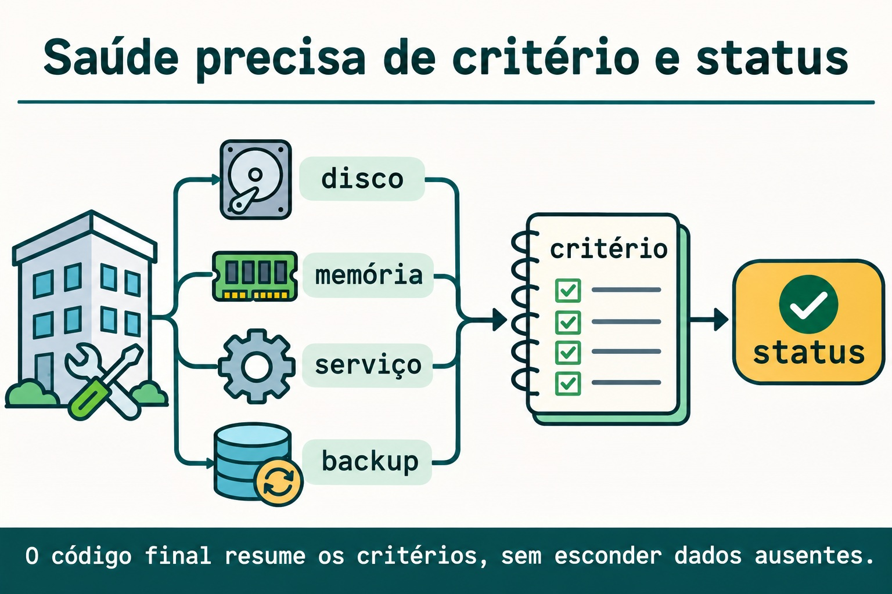

# Aula 15.5 · Idioma, teclado e fuso

Um acento ilegível pode ser um problema de codificação, de interpretação ou de apresentação. Você vai separar essas camadas, converter uma cópia com origem conhecida e fechar o módulo com um script de saúde que deixa explícitos seus critérios e suas incertezas.

> **Núcleo desta aula:** bytes não carregam sozinhos a explicação de como devem ser lidos. Locale, teclado e fuso atuam em camadas diferentes. Um script precisa controlar a interpretação e devolver um status documentado. O resto é aprofundamento.

| Ficha | |
| --- | --- |
| **Módulo** | M15 · Shell e ambiente, aula 5 de 5 |
| **Quando** | Semana 21 |
| **Ao final** | Você converte texto conhecido e produz um coletor com critérios explícitos |
| **Pré-requisitos** | M15.1 a M15.4, Bash, arquivos, serviços e snapshots |
| **Tempo** | Cerca de 90 minutos, incluindo o desafio |
| **Snapshots** | `m15a5-inicio` e `m15a5-fim` nas VMs 201 e 202 |

## 1 · Aquecimento

1. Uma variável prefixada a um comando altera o ambiente do shell pai?
2. O que acontece se entrada e saída de uma conversão apontarem para o mesmo arquivo?
3. Por que uma falha de leitura não deve aparecer como medição saudável?

## 2 · Por que importa

Um relatório vindo de outra máquina mostra acentos estranhos. Trocar o teclado não reconverte os bytes já gravados. Alterar o idioma global também não corrige automaticamente um arquivo salvo em outra codificação. A investigação começa pela origem e pelo caminho dos dados.

Na automação, a mesma confusão pode transformar uma data localizada ou uma vírgula decimal em entrada inválida. O contrato de um coletor deve ser previsível para máquinas e compreensível para quem investiga.

## 3 · Modelo mental

Codificação é a convenção que associa caracteres a bytes. Locale orienta aspectos como mensagens, classificação e formatos. O mapa de teclado transforma teclas em entrada. O fuso apresenta um instante em uma hora local. São quatro decisões distintas.

```text
tecla -> entrada -> bytes -> interpretação -> texto
instante UTC + fuso -> hora apresentada
```


*Converter exige conhecer a codificação de origem.*

### Ponte Windows

No Windows, a aparência de um arquivo no editor depende da codificação selecionada. No Linux também. Exportar CSV em UTF-8 e documentar separadores evita adivinhação. Horário exibido e instante armazenado continuam sendo coisas diferentes nos dois sistemas.

## 4 · O essencial

| Camada | O que observar | Alcance |
| --- | --- | --- |
| Locale do processo | `locale` | Ambiente desse processo |
| Locales disponíveis | `locale -a` | Locales utilizáveis na máquina |
| Padrões do sistema | `localectl status` | Configuração informada por localed |
| Fuso e relógio | `timedatectl status` | Apresentação e estado do relógio |
| Conversão | `iconv -f ORIGEM -t DESTINO` | Bytes de entrada e saída |

Na seleção de locale, um valor não vazio de `LC_ALL` prevalece sobre as categorias `LC_*`, que prevalecem sobre `LANG`. Use a substituição apenas no comando que precisa dela; não grave `LC_ALL=C` globalmente para esconder um problema de uma aplicação.

### Rocky × Debian

No Rocky 9, pacotes da família glibc-langpack fornecem dados de idiomas adicionais. No Debian 13, a seleção e geração de locales passa pelo pacote locales. Esta aula usa um locale UTF-8 que já exista; não instala idiomas nem altera arquivos globais.

Console textual, padrões X11 e fontes de entrada do desktop têm controles distintos. No Debian, a configuração de teclado também envolve keyboard-configuration e console-setup; nem toda operação de alteração do localectl é suportada. No Wayland, confira a fonte de entrada do compositor ou do desktop. Uma configuração X11 não comprova o mapa efetivo de toda sessão Wayland.

### Decida 1

Um arquivo Latin-1 conhecido foi aberto como UTF-8. Qual ação conserva melhor a evidência?

| Opção | Ação |
| --- | --- |
| A | Preservar a origem e converter para outro arquivo |
| B | Trocar o teclado e salvar por cima |
| C | Apagar todos os bytes que causarem erro |

**Resposta:** A. A cópia permite comparar os bytes e repetir a conversão sem destruir a origem.

## 5 · Lab guiado

Repita como student nas VMs 201 e 202, uma por vez. A aula 15.4 já voltou ao estado anterior ao desktop. Mantenha SSH e noVNC disponíveis. Não altere teclado, idioma padrão ou fuso global neste laboratório.

### Passo 1 · Preservar a base

**Palpite:** criar dados em uma pasta privada não exige alterar o ambiente de login.

No host Proxmox, confira os IDs antes dos snapshots:

```bash
qm snapshot 201 m15a5-inicio
qm snapshot 202 m15a5-inicio
```

Na VM:

```bash
umask 077
test ! -e "$HOME/m15a5"
mkdir -m 700 "$HOME/m15a5"
cd "$HOME/m15a5"
pwd
command -v iconv
```

**Saída esperada:** pasta privada do exercício e caminho do iconv. Se o programa faltar, pare e identifique o pacote da distro antes de continuar.

**Verifique:** nenhum arquivo de inicialização do shell foi editado.

### Passo 2 · Medir o ambiente do processo

**Palpite:** um locale fornecido no prefixo afeta somente aquele comando.

```bash
locale
locale -a
localectl status
LANG_ANTES=${LANG-}
LC_ALL=C locale
test "${LANG-}" = "$LANG_ANTES" && printf 'parent_unchanged=yes\n'
LAB_LOCALE=$(locale -a | awk 'tolower($0)=="c.utf8" || tolower($0)=="c.utf-8" {print; exit}')
test -n "$LAB_LOCALE" && LC_ALL="$LAB_LOCALE" locale charmap
```

**Saída esperada:** o pai conserva LANG e o locale selecionado informa UTF-8. Se a seleção ficar vazia, não use a variável: escolha um locale UTF-8 listado pela própria máquina.

**Verifique:** o estado do localectl descreve padrões do sistema; ele não substitui a observação do ambiente efetivo da aplicação. Uma consulta indisponível deve ser registrada, sem inventar valores.

### Passo 3 · Converter bytes de origem conhecida

**Palpite:** o mesmo texto pode ter representações diferentes sem que uma delas seja um arquivo corrompido.

```bash
printf 'caf\351\n' > latin1.txt
printf 'caf\303\251\n' > referencia-utf8.txt
od -An -tx1 latin1.txt
iconv -f ISO-8859-1 -t UTF-8 latin1.txt > convertido.txt
od -An -tx1 convertido.txt
cmp -- convertido.txt referencia-utf8.txt
```

**Saída esperada:** o acento passa de um byte para dois; cmp termina com status zero e não escreve diferenças. A origem foi definida pelo exercício, não adivinhada pelo nome do arquivo.

**Verifique:** `latin1.txt` continua preservado. O destino corresponde aos bytes conhecidos da referência.

### Passo 4 · Validar estrutura e significado

**Palpite:** um arquivo pode ser UTF-8 válido e ainda conter o texto errado.

```bash
iconv -f UTF-8 -t UTF-8 convertido.txt > /dev/null
printf 'utf8_validation_rc=%s\n' "$?"
iconv -f ISO-8859-1 -t UTF-8 referencia-utf8.txt > dupla.txt
iconv -f UTF-8 -t UTF-8 dupla.txt > /dev/null
printf 'double_conversion_utf8_rc=%s\n' "$?"
cmp -s -- dupla.txt referencia-utf8.txt
printf 'same_bytes_rc=%s\n' "$?"
```

**Saída esperada:** as duas validações UTF-8 dão zero, mas a comparação final dá um. A conversão duplicada interpretou cada byte UTF-8 como Latin-1 e mudou o conteúdo.

**Verifique:** validade estrutural e fidelidade ao texto original são perguntas diferentes. Não use descarte silencioso de caracteres como reparo automático.

### Passo 5 · Separar hora, idioma e entrada

**Palpite:** apresentar a mesma hora em outro fuso não muda o relógio da máquina.

```bash
timedatectl status
LC_ALL=C TZ=UTC date '+%Y-%m-%d %H:%M:%S %Z'
LC_ALL=C TZ=Europe/Rome date '+%Y-%m-%d %H:%M:%S %Z'
date +%s
printf 'session=%s\n' "${XDG_SESSION_TYPE-unset}"
```

**Saída esperada:** duas apresentações do instante, possivelmente com diferença de alguns segundos entre comandos. A diferença de fuso depende da data e do horário de verão; não fixe uma diferença universal de horas.

**Verifique:** SSH pode informar sessão textual. Para investigar teclado gráfico, observe a sessão gráfica correspondente, sua fonte de entrada e seu compositor. Não reinstale o desktop apenas para esta conferência.


*Confira a camada que controla o efeito observado.*

### Passo 6 · Publicar só uma conversão válida

**Palpite:** uma saída parcial não deve substituir o resultado anterior quando a conversão falha.

Crie um script que recebe origem, codificação conhecida e destino distinto. O temporário fica ao lado do destino; assim a troca final não precisa atravessar sistemas de arquivos.

```bash
cat > converter.sh <<'EOF'
#!/usr/bin/env bash
set -u
if (( $# != 3 )) || [[ -z $1 || -z $2 || -z $3 ]]; then exit 2; fi
src=$1; encoding=$2; dst=$3
if [[ ! -f $src || ! -r $src || $src == "$dst" ]]; then exit 3; fi
if [[ -L $dst || ( -e $dst && ! -f $dst ) ]]; then exit 3; fi
if [[ -e $dst && $src -ef $dst ]]; then exit 3; fi
tmp=$(mktemp -- "${dst}.tmp.XXXXXX") || exit 3
trap 'rm -f -- "$tmp"' EXIT
if ! iconv -f "$encoding" -t UTF-8 -- "$src" > "$tmp"; then exit 3; fi
if ! iconv -f UTF-8 -t UTF-8 "$tmp" > /dev/null; then exit 3; fi
mv -f -- "$tmp" "$dst" || exit 3
exit 0
EOF
bash -n converter.sh
bash converter.sh latin1.txt ISO-8859-1 publicado.txt
cmp -- publicado.txt referencia-utf8.txt
```

**Saída esperada:** destino válido, comparação silenciosa e temporário removido. O script aceita substituir um arquivo regular distinto; recusa diretórios, links simbólicos de destino e outros tipos existentes. Execute apenas na pasta privada, sem editores concorrentes.

**Verifique:** o teste de identidade evita o mesmo arquivo por outro nome. Não é uma garantia contra mudanças concorrentes de caminhos; esta pasta de laboratório tem um único operador.

### Decida 2

O coletor não conseguiu ler a evidência do último backup. Qual resposta representa melhor o que ele sabe?

| Opção | Resultado |
| --- | --- |
| A | Gravar a hora atual como se o backup tivesse terminado |
| B | Saudável, porque não encontrou erro |
| C | Desconhecido, com diagnóstico da leitura ausente |

**Resposta:** C. Ausência de evidência não comprova sucesso nem determina a idade real do backup.

## 6 · Quebre e conserte

### Quebra 1 · Origem declarada errada

**Palpite:** declarar UTF-8 não transforma um byte Latin-1 em UTF-8.

**Sintoma:** execute `bash converter.sh latin1.txt UTF-8 falha.txt` e capture imediatamente o status: ele deve ser três.

**Investigação:** compare a origem com `od -An -tx1 latin1.txt` e leia a mensagem do iconv.

**Causa:** a codificação declarada não corresponde aos bytes conhecidos da fixture.

**Conserto:** repita com `bash converter.sh latin1.txt ISO-8859-1 reparado.txt` e compare com a referência.

**Verifique:** a comparação termina com zero; a origem continua intacta e nenhuma saída parcial substituiu um destino válido.

**Prevenção:** registre a codificação na interface que produz ou exporta os dados.

### Quebra 2 · Sequência incompleta

**Palpite:** uma conversão interrompida não deve apagar o destino anterior.

**Sintoma:** crie `printf '\303' > truncado.txt`, preserve `cp -- publicado.txt antes.txt` e execute `bash converter.sh truncado.txt UTF-8 publicado.txt`; o status será três.

**Investigação:** execute `cmp -- publicado.txt antes.txt` e confira se a publicação anterior permaneceu intacta.

**Causa:** o byte inicial exige continuação; a entrada termina antes dela.

**Conserto:** reconstrua a cópia a partir da fonte completa, sem completar bytes por adivinhação.

**Verifique:** a publicação continua igual a `antes.txt`; só publique a cópia completa depois da validação e da comparação.

**Prevenção:** valide antes da publicação e conserve a origem.

### Quebra 3 · Conversão em duplicidade

**Palpite:** sucesso técnico da conversão não garante a escolha correta da origem.

**Sintoma:** `dupla.txt` passa na validação UTF-8, mas não corresponde ao texto de referência.

**Investigação:** compare as sequências de bytes e identifique em qual fronteira a conversão ocorreu duas vezes.

**Causa:** os bytes UTF-8 foram lidos segundo outra convenção e codificados novamente.

**Conserto:** volte à origem preservada e execute uma única conversão com origem documentada.

**Verifique:** os bytes coincidem com a referência; a validação UTF-8 sozinha não atende a esse critério.

**Prevenção:** defina qual etapa converte e qual etapa apenas transporta os dados.

### Desafio do módulo · Saúde com contrato

Produza um coletor somente de leitura para disco raiz, memória disponível, serviço SSH e idade do último registro de backup verificado. Os limites abaixo são didáticos, não uma política universal. No M27, um item ou adaptador do Zabbix consumirá um contrato documentado; um código de saída arbitrário não vira automaticamente uma métrica do Zabbix.

O contrato usa zero para saudável, um para aviso, dois para crítico e três para desconhecido. O maior código prevalece, portanto uma medição ausente não fica escondida por uma medição boa. Cada linha mantém seu estado individual, inclusive quando o resultado global é desconhecido.

O registro de backup contém somente um epoch decimal, escrito pelo trabalho responsável depois da verificação documentada do arquivo. A data sozinha não comprova restauração nem backup do PBS. M14.5 não deixou um marcador universal: aqui o modo fixture identifica dados sintéticos, e o modo record exige evidência de um trabalho real autorizado.

Crie a implementação de referência e leia cada bloco antes de executar. Ela não reinicia serviços, não cria backups e não instala agendamentos.

```bash
cat > saude.sh <<'EOF'
#!/usr/bin/env bash
set -u
set -o pipefail
export LC_ALL=C
if (( $# != 3 )); then exit 3; fi
mode=$1; unit=$2; record=$3
case $mode in --fixture|--record) ;; *) exit 3 ;; esac
case $unit in ssh.service|sshd.service) ;; *) exit 3 ;; esac
status=0
report() {
    local name=$1 code=$2 value=$3
    printf '%s code=%s value=%s\n' "$name" "$code" "$value" || exit 3
    if (( code > status )); then status=$code; fi
}
printf 'mode=%s\n' "$mode" || exit 3
if disk=$(df -P / | awk 'NR==2 {gsub(/%/,"",$5); print $5}') &&
   [[ $disk =~ ^[0-9]{1,3}$ ]] && (( 10#$disk <= 100 )); then
    code=0
    if (( 10#$disk >= 90 )); then code=2
    elif (( 10#$disk >= 80 )); then code=1; fi
    report disk "$code" "$disk"
else report disk 3 unavailable; fi
if mem=$(awk '$1=="MemAvailable:" {print $2}' /proc/meminfo) &&
   [[ $mem =~ ^[0-9]{1,12}$ ]]; then
    code=0
    if (( 10#$mem < 131072 )); then code=2
    elif (( 10#$mem < 262144 )); then code=1; fi
    report memory_kib "$code" "$mem"
else report memory_kib 3 unavailable; fi
if load=$(systemctl show "$unit" -p LoadState --value) && [[ $load == loaded ]]; then
    if systemctl is-active --quiet "$unit"; then report ssh 0 active
    else report ssh 2 inactive; fi
else report ssh 3 unavailable; fi
if now=$(date +%s) && [[ $now =~ ^[0-9]{1,10}$ ]] &&
   stamp=$(cat -- "$record") && [[ $stamp =~ ^[0-9]{1,10}$ ]] &&
   (( 10#$stamp > 0 && 10#$stamp <= 10#$now )); then
    age=$((10#$now - 10#$stamp))
    code=0
    if (( age > 172800 )); then code=2
    elif (( age > 86400 )); then code=1; fi
    report backup_age_seconds "$code" "$age"
else report backup_age_seconds 3 unavailable; fi
printf 'status=%s\n' "$status" || exit 3
exit "$status"
EOF
bash -n saude.sh
date +%s > backup-fixture.epoch
```

Disco usa porcentagem ocupada; memória usa KiB disponíveis. O serviço deve estar carregado e ativo. A leitura de um registro ausente, inválido ou futuro resulta em desconhecido. São observações sequenciais, não uma fotografia atômica do servidor.

Defina LAB_SSH como sshd.service no Rocky ou ssh.service no Debian, usando somente a linha correspondente. Depois execute a coleta. Não pare SSH para criar uma falha.

```bash
LAB_SSH=sshd.service
LAB_SSH=ssh.service
```

Com a variável correta para sua distro:

```bash
bash saude.sh --fixture "$LAB_SSH" backup-fixture.epoch
printf 'collector_rc=%s\n' "$?"
```

Teste uma cópia do registro com idade de três dias e outra ausente. A idade antiga produz crítico para backup; a ausente produz desconhecido. Outros critérios podem elevar o resultado global. Capture o status imediatamente, sem pressupor zero no servidor atual.

```bash
printf '%s\n' "$(( $(date +%s) - 259200 ))" > backup-antigo.epoch
bash saude.sh --fixture "$LAB_SSH" backup-antigo.epoch
printf 'old_backup_rc=%s\n' "$?"
if test -e ausente.epoch; then
    printf 'Choose an unused missing-record path.\n' >&2
else
    bash saude.sh --fixture "$LAB_SSH" ausente.epoch
    printf 'missing_backup_rc=%s\n' "$?"
fi
```

Como extensão, extraia os limiares para argumentos validados e escreva testes de fronteira em cópias do script. Entregue código, stdout, stderr, status capturado e a origem do registro. Não simule falta de memória ou disco cheio na VM.



*O código final resume os critérios, sem esconder dados ausentes.*

### Limpeza

Conserve os arquivos privados como evidência. Não houve mudança global de idioma, teclado, fuso, shell ou serviço. Verifique `localectl status` e `timedatectl status` contra o início. Nenhuma chave, unidade ou tarefa agendada foi criada pelo desafio.

## 7 · Armadilhas

| Erro | Correção | Motivo |
| --- | --- | --- |
| Idioma corrige bytes | Converter cópia de origem conhecida | Locale não reescreve o arquivo |
| UTF-8 válido prova fidelidade | Comparar conteúdo com referência | Uma conversão dupla pode ser válida |
| Usar o mesmo arquivo de saída | Temporário e publicação após sucesso | A abertura da saída pode truncar a origem |
| Data recente comprova backup | Exigir evidência do trabalho e verificação | Um timestamp manual pode ser fictício |

## 8 · Quiz

1. Qual variável prevalece sobre todas as categorias de locale?
2. O que os argumentos de origem e destino do iconv declaram?
3. Um arquivo UTF-8 válido sempre contém o texto original correto?
4. O prefixo TZ muda automaticamente o fuso global?
5. Um padrão X11 comprova a fonte efetiva de entrada de GNOME Wayland?
6. Por que o coletor devolve desconhecido quando falta o registro de backup?

## 9 · Cola

| Tarefa | Comando |
| --- | --- |
| Ambiente efetivo | `locale` |
| Locales instalados | `locale -a` |
| Dados de configuração | `localectl status` |
| UTF-8 estruturalmente válido | `iconv -f UTF-8 -t UTF-8 convertido.txt > /dev/null` |
| Instante decimal | `date +%s` |

**Flashcards:** crie cartões para codificação, locale, teclado, fuso e status desconhecido. Revise em D+1, D+3, D+7 e D+21.

## 10 · Checklist e fechamento

- [ ] Preservei a origem e comparei os bytes convertidos.
- [ ] Separei locale, teclado e fuso sem mudanças globais.
- [ ] Testei falha sem perder a publicação anterior.
- [ ] Registrei critérios, fixture e status do desafio nas duas distros.

**Último exercício:** explique por que um arquivo válido pode estar semanticamente errado e por que uma medição ausente não pode virar saudável. Use suas duas evidências para justificar.

**Reboot de conferência:** reinicie cada VM, entre novamente como student e confira locale, teclado informado e fuso. Entre na pasta privada, defina novamente LAB_SSH com a linha da sua distro e execute a conversão e o coletor fixture. Os scripts recebem seus parâmetros explicitamente; as variáveis da sessão anterior não sobrevivem ao reboot.

No host Proxmox, após conferir o retorno:

```bash
qm snapshot 201 m15a5-fim
qm snapshot 202 m15a5-fim
```

O bloco B termina com um dia de incidente misturando M10 a M15 e revisão do caderno de erros. Use somente o laboratório autorizado, registre hipótese, evidência e correção e restaure a base antes do M16.

## 11 · Na vida real

Em um sistema autorizado, observe somente a configuração de idioma, fuso e origem dos arquivos de intercâmbio. Não converta arquivos existentes nem mude preferências globais. Produza uma proposta indicando onde ocorre a conversão e quem confirma a codificação de origem.

O sistema de monitoramento distingue desconhecido de saudável? A evidência de backup vem do trabalho correto? Qual verificação foi feita e qual teste de restauração existe? Anote os limites do que seu coletor realmente prova.

## 12 · Aprofundar quando quiser

- [GNU: variáveis de locale](https://www.gnu.org/software/gettext/manual/html_node/Locale-Environment-Variables.html), [locale](https://manpages.debian.org/trixie/manpages/locale.1.en.html) e [iconv](https://manpages.debian.org/trixie/manpages/iconv.1.en.html).
- [localectl](https://manpages.debian.org/trixie/systemd/localectl.1.en.html), [teclado Debian](https://manpages.debian.org/trixie/keyboard-configuration/keyboard.5.en.html) e [limite de setxkbmap no Xwayland](https://manpages.debian.org/trixie/x11-xkb-utils/setxkbmap.1.en.html).
- [RHEL 9: tarefas básicas do sistema](https://docs.redhat.com/en/documentation/red_hat_enterprise_linux/9/html/configuring_basic_system_settings/index), [GNU Bash](https://www.gnu.org/software/bash/manual/bash.html) e [meminfo](https://manpages.debian.org/trixie/manpages/proc_meminfo.5.en.html).

**DeepTutor** (http://10.1.0.149:3782, KB "Curso Linux Sysadmin"):

- `!explica Separe codificação, locale, teclado e fuso usando um arquivo de origem conhecida.`
- `!feynman Vou explicar por que UTF-8 válido e timestamp recente não provam fidelidade e restauração. Critique.`
- `!quiz Crie seis incidentes de interpretação de texto e status desconhecido, sem mudar configuração global.`

## Gabarito comentado

### Aquecimento

1. Não. O prefixo altera o ambiente fornecido ao comando.
2. A abertura da saída pode truncar os dados antes que sejam lidos.
3. Porque falta informação para afirmar que o critério foi atendido.

### Quiz

1. LC_ALL, quando possui valor não vazio.
2. Como interpretar os bytes da entrada e como representar os caracteres na saída.
3. Não. A conversão duplicada demonstrou validade sem fidelidade.
4. Não. O ambiente fornecido ao comando altera aquela apresentação.
5. Não. O desktop ou compositor pode controlar a fonte efetiva da sessão.
6. Porque não conhece a idade real nem possui evidência suficiente para afirmar sucesso.

<!-- navegacao -->
[← Aula 15.4 · Interfaces gráficas](15.4-interfaces-graficas.md) · [Índice de aulas](../01-aulas.md) · [Plano do curso: M16 em diante →](../00-plano-do-curso.md)
