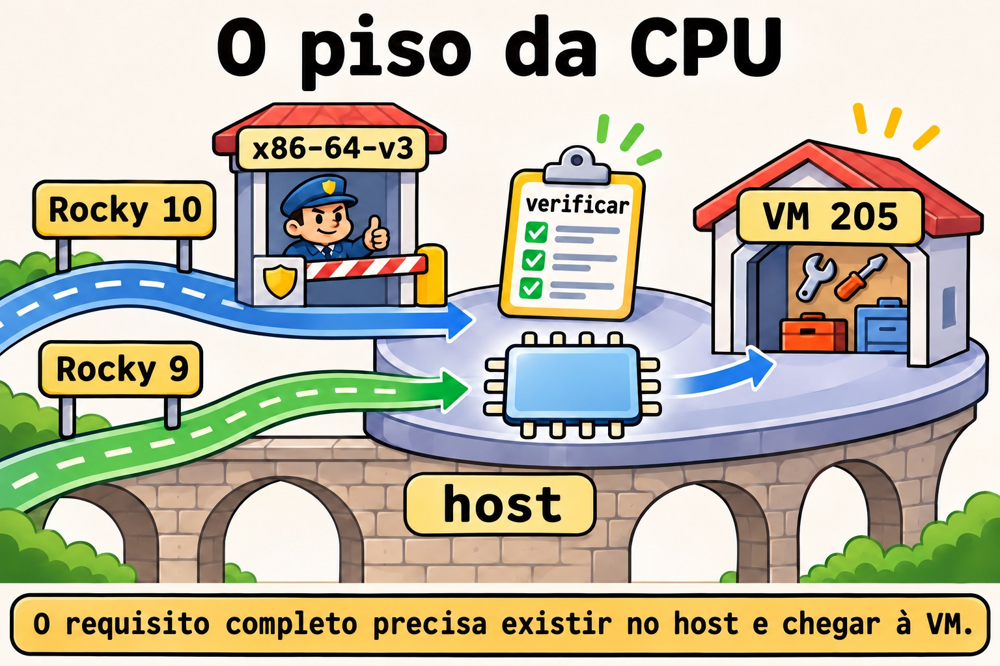
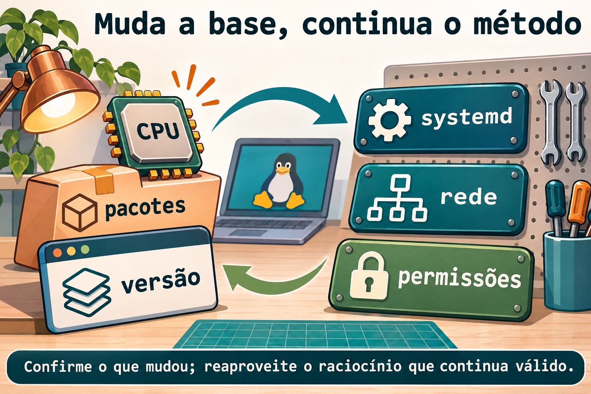
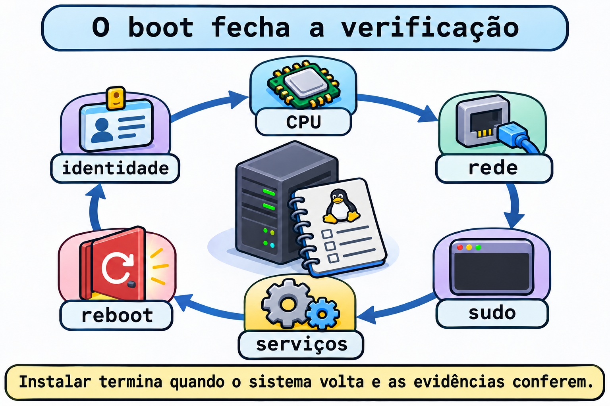

# Aula 16.1 · Rocky 10: o que muda

Você vai acrescentar uma máquina ao laboratório sem substituir a que já conhece. A VM 205 serve para comparar gerações do Rocky e praticar incidentes. A primeira tarefa é provar que a CPU e a instalação atendem aos requisitos.

> **Núcleo desta aula:** versão nova pede inventário novo; o método de diagnóstico continua baseado em evidência, escopo e persistência.

| Ficha |  |
| --- | --- |
| **Módulo** | M16 · Semana de incidentes no Rocky 10, aula 1 de 4 |
| **Quando** | Semana 21 |
| **Ao final** | Você valida a CPU completa, instala a VM 205 e confirma identidade, rede e acesso após o boot |
| **Pré-requisitos** | M0 a M15; noVNC, sudo, backup e diário de bordo |
| **Tempo** | 60 a 90 minutos; instalação e revisão podem pedir outra sessão |
| **Snapshots** | `m16a1-inicio` e `m16a1-fim`, VMs 205 e 202 |

## 1 · Aquecimento

Responda sem consultar. Compare com as soluções somente no fim.

1. Ver AVX2 na lista de flags confirma todo o requisito de CPU do Rocky 10?

2. O nome da VM informa com segurança qual distribuição está instalada?

3. Qual dado você precisa reservar antes de atribuir um IP estático à nova VM?

## 2 · Por que importa

Uma instalação recente para antes do login. O nome da CPU parece moderno, mas a máquina virtual recebeu um modelo que não fornece o conjunto de instruções exigido. Reinstalar a mesma imagem repetidamente não altera o requisito.

Você separa três perguntas: o host suporta, o modelo virtual oferece e o sistema convidado enxerga? Depois compara os serviços que já domina no Rocky 9 com a base nova, usando a VM 202 como referência Debian.

## 3 · Modelo mental

Pense numa oficina com uma bancada por incidente. A etiqueta da bancada delimita onde você pode mexer. O diário guarda as medições; a ferramenta de correção vem depois da medição.



*O requisito completo precisa existir no host e chegar à VM.*

### Ponte Windows

| Referência do Windows | Pergunta equivalente no Linux |
| --- | --- |
| Gerenciador de Serviços | A unit iniciou e pode iniciar no boot? |
| Visualizador de Eventos | Qual evento ocorreu nesta execução? |
| ACL e conta do serviço | O usuário efetivo consegue ler o dado? |
| Procedimento de mudança | Qual hipótese justifica esta alteração? |

## 4 · O essencial

### x86-64-v3 é um conjunto de requisitos

No Rocky 10 para x86, o nível mínimo é `x86-64-v3`. Encontrar apenas `avx2` no host não confirma o conjunto inteiro. O carregador glibc informa quais níveis reconhece como suportados e utilizáveis no ambiente atual.

O conjunto envolve instruções além de AVX2 e o suporte necessário do sistema operacional para usá-las. Você não transforma uma CPU incompatível em compatível escolhendo um rótulo no Proxmox.

Confira cada nó para o qual pretende migrar a VM. O nó atual passar não autoriza migrar para outro nó sem verificar o destino. Um modelo virtual comum deve caber em todos os destinos previstos.

### O que muda e o que permanece

Rocky 10 remove a compatibilidade de 32 bits em x86_64 e tem componentes de base mais recentes. Não suponha que todo pacote, módulo antigo ou guia de Rocky 9 continue aplicável. Confira requisitos do software antes de planejar migração.

Nesta aula você não faz atualização da VM 201 de uma versão principal para outra. Cria uma VM nova e mantém a base conhecida disponível para comparação e recuperação.

`systemd`, permissões, journal e raciocínio de rede continuam úteis. A experiência anterior fornece perguntas melhores; a documentação e o inventário respondem por esta versão.

### A alternativa faz parte do plano

Se algum destino previsto não suportar o requisito inteiro, use Rocky 9 na VM 205 com `x86-64-v2-AES`, depois de confirmar também esse modelo em todos os destinos. Se nem esse requisito estiver disponível, interrompa o lab. Registre a alternativa no diário e mantenha o VMID e o nome previstos para os scripts seguintes.

O nome `rocky10-lab` identifica a função da VM no curso; `/etc/os-release` revela o sistema realmente instalado. Não use o nome como prova de versão.

### Endereço é uma decisão do inventário

Não escolha um endereço só porque termina em um número parecido com o VMID. Reserve um IP livre fora da faixa DHCP, registre máscara, gateway e DNS reais e confirme a reserva antes da instalação.

Faça ajustes de endereço pelo noVNC. Não mude a conexão que sustenta a sua sessão SSH enquanto depende dela para recuperar o acesso.



*Confirme o que mudou; reaproveite o raciocínio que continua válido.*

### Rocky × Debian

| Camada | VM 205 | VM 202 |
| --- | --- | --- |
| Sistema | Rocky 10, ou Rocky 9 se a CPU exigir a alternativa | Debian 13 |
| Pacotes | `dnf` e `rpm` | `apt` e `dpkg` |
| Serviços e logs | `systemctl` e `journalctl` | `systemctl` e `journalctl` |
| Controle adicional | SELinux permanece ativo | AppArmor permanece ativo quando configurado |
| Incidentes deste módulo | Árvores próprias; nenhuma alteração em SSH ou firewall | Mesmo contrato de isolamento |

### Decida 1

O host atual atende ao nível exigido, mas outro destino de migração ainda não foi verificado. O que fazer?

| A | B | C |
| --- | --- | --- |
| Autorizar migração porque o nó atual passou | Trocar somente o nome da VM | Verificar o conjunto completo em todos os destinos previstos |

## 5 · Lab guiado

Use somente as VMs do contrato. Abra o noVNC antes de começar e confirme o backup. Os comandos de Proxmox pertencem ao host; os demais pertencem à VM indicada.

Na 16.1 crie e valide a VM 205 antes de tirar seu primeiro snapshot. Nas outras aulas ela já deve existir. Nunca aplique um rollback a uma VM diferente para recuperar esta bancada.

```bash
qm snapshot 202 m16a1-inicio
```

Se a recuperação exigir rollback, pare o exercício, abra o console e use o snapshot de início desta aula. Anote o que perdeu e não confunda restauração com diagnóstico concluído.

```bash
qm rollback 205 m16a1-inicio
qm rollback 202 m16a1-inicio
```

### Passo 1 · Conferir o hardware e os destinos

**Palpite:** uma linha com AVX2 basta para autorizar Rocky 10 em todos os nós?

Em cada host Proxmox previsto, use somente leitura. O caminho abaixo corresponde ao carregador de x86_64; em outra arquitetura interrompa esta variante do lab.

```bash
lscpu
/lib64/ld-linux-x86-64.so.2 --help
pvesh get /cluster/resources --type vm
pvesm status
```

**Saída esperada:** o relatório do carregador inclui `x86-64-v3` como suportado e pesquisado quando o host satisfaz o requisito. Leia a indicação completa, não apenas a existência do nome na lista.

**Verifique:** todos os destinos previstos passam, o VMID 205 está livre no cluster e o storage `vm-hdd` está disponível. Se não passar, registre Rocky 9 como alternativa; não force uma CPU fictícia.

### Passo 2 · Criar a VM 205 com o procedimento conhecido

**Palpite:** quais escolhas pertencem ao host e quais pertencem à instalação do sistema?

Repita o procedimento de criação e instalação da aula 0.1 com o contrato abaixo. Escolha o volume ISO realmente listado no storage de imagens, validado conforme o procedimento inicial; não invente um caminho de ISO.

| Campo | Valor |
| --- | --- |
| VMID e nome | `205`, `rocky10-lab` |
| Recursos | 2 vCPU, 2 GB de RAM, disco de 20 GB |
| CPU | `x86-64-v3`; alternativa `x86-64-v2-AES` com Rocky 9 |
| Máquina e firmware | `q35`, OVMF |
| Disco e rede | `vm-hdd`, virtio, `vmbr0` |
| Instalação | Sistema mínimo, usuário `student`, sudo e senha de root |
| Endereço | Reserva real fora do pool DHCP; sem IP inventado |

```bash
qm config 205
qm status 205
```

**Saída esperada:** configuração e sistema instalado correspondem ao contrato. O endereço aparece no console e não conflita com as outras VMs.

**Verifique:** a nova VM inicia pelo disco instalado depois de desconectar a ISO conforme a aula 0.1. Só então registre `m16a1-inicio` para a VM 205.

```bash
qm snapshot 205 m16a1-inicio
```

### Passo 3 · Confirmar o que o convidado recebeu

**Palpite:** o host suportar v3 garante que qualquer modelo virtual exponha v3?

No console da VM 205, leia o sistema e as capacidades entregues. Na VM 202, execute a mesma leitura para comparar sem alterar sua CPU.

```bash
cat /etc/os-release
uname -m
lscpu
/lib64/ld-linux-x86-64.so.2 --help
```

**Saída esperada:** a VM 205 com Rocky 10 reconhece v3 como utilizável. Se escolheu Rocky 9, a evidência e o diário declaram essa alternativa.

**Verifique:** copie para o diário a linha pertinente do carregador e a versão real. O Debian pode mostrar outros níveis suportados sem que você precise mudar sua configuração.

### Passo 4 · Estabelecer acesso e guest agent

**Palpite:** ter rede no console garante sudo e autenticação por chave?

Na 205, instale o agente e confira o estado, sem remover pacotes existentes. Ative a opção de guest agent no host conforme a aula 0.2. Configure sua chave de `student` pelo mesmo procedimento, preservando outras chaves.

```bash
sudo hostnamectl set-hostname rocky10-lab
sudo dnf install -y qemu-guest-agent
sudo systemctl enable --now qemu-guest-agent
hostnamectl
ip -br address
ip route
sudo -v
systemctl is-active qemu-guest-agent
```

**Saída esperada:** nome `rocky10-lab`, IP reservado, rota real e agente ativo com o canal virtio habilitado no host.

**Verifique:** abra uma segunda sessão com sua chave e execute `sudo -v` antes de fechar o console. Não habilite login de root por senha no SSH.

### Passo 5 · Comparar funções, não decorar versões

**Palpite:** o mesmo comando de serviço continua útil apesar de os pacotes mudarem?

Na 205 e na 202, registre a base instalada. Use o gerenciador correto em cada bloco. Não copie números de versão de uma saída de exemplo para sua ficha.

```bash
rpm -q glibc systemd NetworkManager
systemctl --failed --no-pager
getenforce
```

```bash
dpkg-query -W libc6 systemd network-manager
systemctl --failed --no-pager
sudo aa-status
```

**Saída esperada:** versões e disponibilidade refletem cada instalação. Ausência de `network-manager` no Debian exige reconhecer o gerenciador de rede realmente usado; não instalar outro só para igualar a tabela.

**Verifique:** explique duas funções que continuam e duas diferenças que precisam de conferência. Um pacote ausente não prova falha quando a instalação usa outra ferramenta.

### Passo 6 · Conferir depois de reiniciar

**Palpite:** quais evidências você espera reencontrar num boot novo?

**Reboot de conferência:** reinicie uma VM por vez pelo console. Depois repita identidade, endereço, rota, sudo e leitura de serviços nas duas.

```bash
sudo systemctl reboot
```

```bash
cat /etc/os-release
cat /proc/sys/kernel/random/boot_id
hostname -s
ip -br address
ip route
sudo -v
systemctl --failed --no-pager
```

**Saída esperada:** identificador do boot mudou, identidade e rede continuam corretas. Investigue falhas reais antes de guardar o snapshot final.

**Verifique:** a 205 está pronta para os scripts das aulas seguintes e a 202 continua acessível. Guarde versão, CPU, IP e ferramenta de rede no inventário do módulo.

### Decida 2

A VM se chama rocky10-lab, mas a alternativa instalada é Rocky 9. Como preencher o inventário?

| A | B | C |
| --- | --- | --- |
| Apagar a VM 201 para evitar confusão | Registrar Rocky 9 e a evidência do sistema instalado | Declarar Rocky 10 pelo nome |

## 6 · Quebre e conserte

Trabalhe um defeito por vez. Antes de consultar a correção, escreva o comando que sustentaria a sua hipótese. Não transforme uma dificuldade local numa mudança global.

### Quebra 1 · A etiqueta não prova a capacidade

**Sintoma:** um registro de inventário local diz que AVX2 basta para Rocky 10. Plante o erro somente no diário, nunca mudando a CPU de uma instalação já funcionando.

**Investigação:** confronte essa afirmação com o relatório do carregador no host e no convidado.

**Causa:** uma flag isolada foi confundida com o nível completo e utilizável.

**Conserto:** substitua a afirmação pela evidência de suporte ao nível completo ou pela alternativa Rocky 9 documentada.

**Verifique:** outra pessoa consegue decidir a compatibilidade usando o seu registro, sem adivinhar?

**Prevenção:** registre host, modelo virtual e leitura no convidado em campos separados.

### Quebra 2 · Um comando da família errada

**Sintoma:** você tenta consultar o banco de pacotes da outra família. O teste é somente leitura.

```bash
command -v dnf apt rpm dpkg-query
```

**Investigação:** leia `/etc/os-release` e descubra qual banco existe, sem instalar o outro para contornar a mensagem.

**Causa:** o nome do comando foi memorizado sem associar sua função à distribuição.

**Conserto:** refaça a consulta com `rpm -q` na Rocky ou `dpkg-query -W` no Debian.

**Verifique:** a consulta devolve dados do banco local, sem mudar pacotes.

**Prevenção:** comece um inventário desconhecido pela identidade do sistema.

### Quebra 3 · Um resultado antigo no diário

**Sintoma:** o diário identifica o boot anterior como se fosse o atual. Reproduza copiando o identificador anterior para uma nota marcada como tentativa.

**Investigação:** leia `/proc/sys/kernel/random/boot_id` e compare com a nota.

**Causa:** o resultado foi reaproveitado sem registrar quando foi obtido.

**Conserto:** refaça as consultas de prontidão no boot atual e registre o novo identificador.

**Verifique:** cada conclusão aponta para a medição correspondente.

**Prevenção:** separe resultado observado, horário e conclusão no diário.



*Instalar termina quando o sistema volta e as evidências conferem.*

## 7 · Armadilhas

- Mudar várias coisas entre duas medições apaga a relação entre causa e resultado.

- Uma mensagem antiga no journal não descreve necessariamente a última tentativa. Use o boot e a unit corretos.

- Um arquivo salvo não garante que o gerenciador tenha carregado a alteração.

- Um comando executado como root não mede as permissões da conta do serviço.

- O script de checagem cobre seu contrato declarado; não promete testar todo o servidor.

## 8 · Quiz

Responda antes de ler o gabarito. Explique o motivo, além do comando.

1. Quais três camadas precisam concordar para a VM receber a CPU exigida?

2. Por que encontrar o nome v3 na saída do carregador ainda exige ler sua indicação completa?

3. O que fazer se um destino não suporta v3, mas todos os destinos suportam o modelo alternativo?

4. Por que um endereço livre observado agora não substitui uma reserva fora do pool DHCP?

5. Como comparar Rocky e Debian quando o nome de um pacote de rede não existe em uma das instalações?

6. Quais evidências você repete depois de reiniciar a VM 205 antes de deixá-la pronta para a 16.2?

## 9 · Cola

| Pergunta | Ferramenta |
| --- | --- |
| Qual sistema foi instalado? | `cat /etc/os-release` |
| Qual arquitetura está em uso? | `uname -m` e `lscpu` |
| O nível completo é utilizável? | `/lib64/ld-linux-x86-64.so.2 --help` em cada host e no convidado |
| Qual CPU foi configurada? | `qm config 205` no host Proxmox |
| A rede permanece depois do boot? | `ip -br address` e `ip route`, confrontados com a reserva |

**Flashcards:** crie de 5 a 10 cartões. Inclua uma pergunta de método, uma de leitura de erro, uma de permissão, uma de persistência e uma sobre um erro seu. Revise em D+1, D+3, D+7 e D+21.

## 10 · Checklist e fechamento

### Limpeza e continuidade

Esta aula não cria bancadas descartáveis nem altera serviços das outras VMs. Apague somente as notas de tentativa que você marcou como descartáveis. Preserve o inventário validado, a VM 205 instalada e a VM 202 acessível para a 16.2.

Não apague a VM 201 para economizar recursos: ela continua sendo a referência Rocky 9 do curso. Se precisar liberar RAM, desligue uma VM do curso ociosa depois de conferir a atividade, sem destruir discos ou snapshots.

- [ ] Guardei a hipótese inicial e a evidência que a confirmou ou descartou.

- [ ] Confirmei o usuário efetivo, o caminho e o boot a que cada resultado pertence.

- [ ] Expliquei cada alteração e conferi o resultado depois do reboot.

- [ ] Mantive os serviços e arquivos fora da bancada intactos.

```bash
qm snapshot 205 m16a1-fim
qm snapshot 202 m16a1-fim
```

**Último exercício:** explique em voz alta uma hipótese que estava errada e a evidência que fez você mudar de ideia.

## 11 · Na vida real

Em um servidor que você administra ou tem autorização para observar, faça somente leitura. Identifique a versão, uma unit relevante e o journal do boot atual. Não plante defeitos nem copie os scripts de treino para esse servidor.

```bash
cat /etc/os-release
systemctl --failed --no-pager
journalctl -b -p warning --no-pager -n 30
```

Anote quais dados faltariam para autorizar uma mudança. Não registre senhas, chaves privadas nem conteúdo de usuários.

## 12 · Aprofundar quando quiser

- [Rocky Linux 10: mudanças da versão principal](https://docs.rockylinux.org/latest/releases/release_notes/10_0/).

- [systemd: serviço e ciclo de execução](https://www.freedesktop.org/software/systemd/man/latest/systemd.service.html).

- [systemd: conferir units antes da execução](https://www.freedesktop.org/software/systemd/man/latest/systemd-analyze.html).

- [GNU tar: comparar e verificar arquivos](https://www.gnu.org/software/tar/manual/html_node/compare.html).

- [Linux man-pages: carregador e capacidades de hardware](https://man7.org/linux/man-pages/man8/ld.so.8.html).

No próprio sistema, prefira também os manuais instalados e a documentação do pacote. As versões locais delimitam as opções que você realmente tem.

```bash
man systemctl
man journalctl
man systemd.service
man tar
ls /usr/share/doc
```

Com o DeepTutor, preserve o diagnóstico antes de pedir a solução. Os prompts permanecem iguais nas duas versões desta aula.

`!explica 16.1 diagnóstico com evidência e persistência depois do reboot`

`!feynman 16.1 vou explicar minha hipótese, a causa e como provei a correção`

`!quiz 16.1`

### Gabarito comentado

**Aquecimento:** AVX2 é apenas parte do requisito; confirme o nível completo utilizável. O hostname é uma etiqueta: leia a identidade do sistema instalado. Reserve um IP livre, fora do pool DHCP, com máscara, gateway e DNS reais registrados.

**Decida 1:** C. A capacidade do nó atual não comprova a dos outros nós; o modelo precisa caber em todos os destinos de migração previstos.

**Decida 2:** B. Registre a versão observada e a alternativa escolhida. O nome previsto pelos scripts não deve ser usado como prova de versão.

1. O hardware do host, o modelo virtual configurado e as capacidades utilizáveis vistas pelo convidado. Repita a conferência nos destinos de migração previstos.

2. A lista pode mencionar níveis que não são utilizáveis. Leia se o nível está suportado e pesquisado, sem aceitar apenas a presença do rótulo.

3. Instale Rocky 9 na VM 205 com o modelo alternativo confirmado, registre a decisão e preserve o nome do contrato. Se nem a alternativa servir, interrompa o lab.

4. Ausência de resposta não prova disponibilidade e o DHCP pode atribuir o mesmo endereço depois. A reserva e o inventário evitam conflito e documentam a decisão.

5. Descubra qual ferramenta realmente gerencia a rede e compare sua função. Não instale outro gerenciador apenas para obter nomes iguais nas duas famílias.

6. Identidade real, novo identificador de boot, hostname, IP, rota, sudo e falhas de serviços; confronte tudo com o inventário, preservando o acesso à VM 202.

[← Aula 15.5 · Idioma, teclado e fuso](15.5-idioma-teclado-e-fuso.md) · [Índice das aulas](../01-aulas.md) · [Plano do curso: 16.2 em diante →](../00-plano-do-curso.md)
