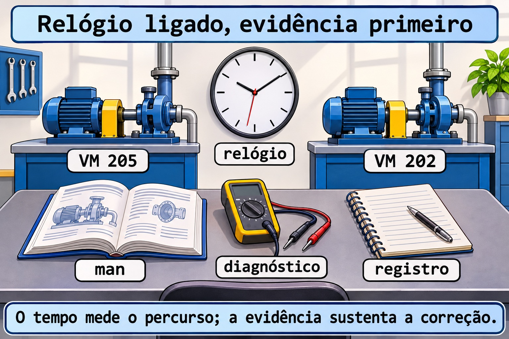
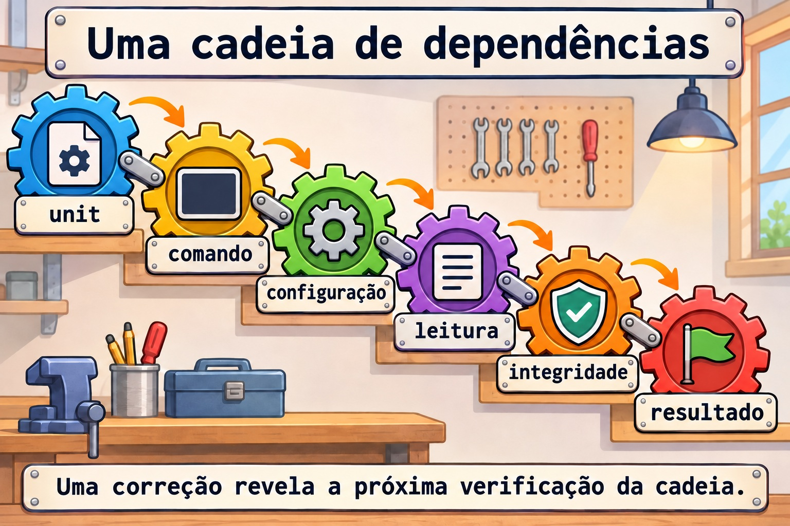

# Aula 16.3 · Incidente com relógio

Agora você resolve um conjunto integrado nas VMs 205 e 202 com o relógio ligado. Durante a janela de diagnóstico, use apenas `man` e `/usr/share/doc`. A aprovação depende do resultado depois do reboot e da explicação de cada correção.

> **Núcleo desta aula:** a rotina volta quando toda a cadeia de dependências está correta; o incidente termina quando isso continua verdadeiro num boot novo.

| Ficha |  |
| --- | --- |
| **Módulo** | M16 · Semana de incidentes no Rocky 10, aula 3 de 4 |
| **Quando** | Semana 22 |
| **Ao final** | Você investiga uma cadeia de falhas nas duas VMs, registra tentativas e comprova a correção após o boot |
| **Pré-requisitos** | M0 a M15; noVNC, sudo, backup e diário de bordo |
| **Tempo** | 60 a 90 minutos; instalação e revisão podem pedir outra sessão |
| **Snapshots** | `m16a3-inicio` e `m16a3-fim`, VMs 205 e 202 |

## 1 · Aquecimento

Responda sem consultar. Compare com as soluções somente no fim.

1. O primeiro erro de uma cadeia consegue revelar todas as causas ao mesmo tempo?

2. Quais evidências da base saudável você precisa guardar antes do plantio?

3. O que distingue uma tentativa interrompida por segurança de uma tentativa concluída?

## 2 · Por que importa

Uma rotina local produzia um resultado simples e verificável. Agora falha nas duas famílias. Você recebeu a configuração esperada e uma cópia dos critérios, mas precisa descobrir sozinho quais elos impedem a execução.

O ambiente continua acessível por SSH e noVNC. Nenhum defeito depende de quebrar rede, boot, firewall ou dados de outro exercício. A pressão vem do tempo e da relação entre falhas, sem exigir risco fora da bancada.

## 3 · Modelo mental

Pense numa oficina com uma bancada por incidente. A etiqueta da bancada delimita onde você pode mexer. O diário guarda as medições; a ferramenta de correção vem depois da medição.



*O tempo mede o percurso; a evidência sustenta a correção.*

### Ponte Windows

| Referência do Windows | Pergunta equivalente no Linux |
| --- | --- |
| Gerenciador de Serviços | A unit iniciou e pode iniciar no boot? |
| Visualizador de Eventos | Qual evento ocorreu nesta execução? |
| ACL e conta do serviço | O usuário efetivo consegue ler o dado? |
| Procedimento de mudança | Qual hipótese justifica esta alteração? |

## 4 · O essencial

### Uma cadeia para as duas famílias

A bancada se chama `m16a3` e usa o mesmo script da 16.2 com o argumento `a3`. A unit `m16a3-cadeia.service` executa como `student` e precisa iniciar no boot. O resultado termina em `cadeia.result`.

Uma falha inicial pode esconder outras. Corrigir o primeiro erro permite que a próxima validação seja executada. Isso não prova que a primeira correção estava errada.

### Contrato de funcionamento conhecido

| Objeto | Estado exigido |
| --- | --- |
| `/etc/systemd/system/m16a3-cadeia.service` | Unit dedicada, carregada e habilitada |
| `/usr/local/libexec/m16a3/run.sh` | Executor original, sem adaptação para ignorar erro |
| `/srv/m16a3/config` | Uma linha `MODE=ok` |
| `/srv/m16a3/conteudo.txt` | Uma linha `curso-m16-ok`, com quebra de linha |
| `/srv/m16a3/SHA256SUMS` | Manifesto original, não recalculado sobre dado errado |
| `/srv/m16a3/pacote.tar.gz` | Tar gzip completo e coerente com o conteúdo correto |
| `/var/lib/m16a3/cadeia.result` | Identificador do boot atual, gravado pela execução |

As permissões iniciais dos arquivos de conteúdo e configuração são `0644`, pertencentes a root. A pasta de resultados pertence a `student`; não transforme a árvore inteira em propriedade do aluno.

### Critérios antes do relógio

A checagem lê estado e habilitação, valida o comando carregado, repete verificações como `student` e compara o identificador do resultado com o boot atual. Ela não corrige arquivos nem reinicia a unit.

O retorno zero significa que todos esses critérios declarados passaram. Ainda falta sua explicação. Um script não confirma que você compreendeu a diferença entre causa e efeito.

### A janela de trabalho

Reserve até 60 minutos para diagnóstico, correções e reboot nas duas VMs, além de preparação e revisão. Marque o início e o fim no diário. Não mude o relógio do sistema para medir o exercício.

Durante a janela não consulte soluções, internet ou tutor. Se precisar parar por segurança, registre a pausa e o motivo. Isso conserva uma medição honesta sem premiar uma mudança arriscada.

### Decisão de parada

Se aparecer caminho externo à bancada, hostname inesperado ou dúvida sobre o disco correto, pare. O contrato não exige tocar nesses objetos. Restaure o snapshot quando necessário e marque a tentativa como interrompida.



*Uma correção revela a próxima verificação da cadeia.*

### Rocky × Debian

| Camada | VM 205 | VM 202 |
| --- | --- | --- |
| Sistema | Rocky 10, ou Rocky 9 se a CPU exigir a alternativa | Debian 13 |
| Pacotes | `dnf` e `rpm` | `apt` e `dpkg` |
| Serviços e logs | `systemctl` e `journalctl` | `systemctl` e `journalctl` |
| Controle adicional | SELinux permanece ativo | AppArmor permanece ativo quando configurado |
| Incidentes deste módulo | Árvores próprias; nenhuma alteração em SSH ou firewall | Mesmo contrato de isolamento |

### Decida 1

A base saudável não passa antes do plantio. Quando começa o cronômetro?

| A | B | C |
| --- | --- | --- |
| Imediatamente, para contar também o erro de preparação | Depois de forçar o checador a aceitar | Somente depois de corrigir e medir a base saudável nas duas VMs |

## 5 · Lab guiado

Use somente as VMs do contrato. Abra o noVNC antes de começar e confirme o backup. Os comandos de Proxmox pertencem ao host; os demais pertencem à VM indicada.

Na 16.1 crie e valide a VM 205 antes de tirar seu primeiro snapshot. Nas outras aulas ela já deve existir. Nunca aplique um rollback a uma VM diferente para recuperar esta bancada.

```bash
qm snapshot 205 m16a3-inicio
qm snapshot 202 m16a3-inicio
```

Se a recuperação exigir rollback, pare o exercício, abra o console e use o snapshot de início desta aula. Anote o que perdeu e não confunda restauração com diagnóstico concluído.

```bash
qm rollback 205 m16a3-inicio
qm rollback 202 m16a3-inicio
```

### Passo 1 · Confirmar o kit e o destino

**Palpite:** por que duas VMs com a mesma falha ainda exigem duas medições?

Antes do relógio, use a cópia de `m16-incidentes.sh` validada na 16.2 ou transfira a do pacote por SFTP. Confira o hash contra o manifesto e a sintaxe.

```bash
hostname -s
cat /etc/os-release
bash -n ~/m16-incidentes.sh
sha256sum ~/m16-incidentes.sh
```

**Saída esperada:** VM 205 com o Rocky realmente registrado e VM 202 com Debian 13; script intacto nas duas.

**Verifique:** noVNC aberto, snapshot confirmado e bancada `m16a2` já limpa. A 16.3 usa nomes próprios e não reaproveita as units anteriores.

### Passo 2 · Preparar e medir a base saudável

**Palpite:** qual comparação fica impossível se você não mede o estado inicial?

Prepare a bancada nas duas VMs. Registre a unit original e o resultado da checagem antes de introduzir qualquer defeito.

```bash
sudo bash ~/m16-incidentes.sh a3 setup
sudo bash ~/m16-incidentes.sh a3 check
systemctl cat m16a3-cadeia.service
sudo journalctl -b -u m16a3-cadeia.service --no-pager
```

**Saída esperada:** `PASS` e retorno zero em cada VM. Se a base não passa, a janela cronometrada ainda não começou.

**Verifique:** os dados conhecidos correspondem ao contrato. Não memorize mensagens: registre caminhos, conta e critérios.

### Passo 3 · Plantar e iniciar o relógio

**Palpite:** o primeiro erro do journal revela necessariamente todas as causas?

Plante o incidente nas duas VMs e marque o início imediatamente depois. A partir desse ponto, a ajuda permitida é local: `man` e `/usr/share/doc`.

```bash
sudo bash ~/m16-incidentes.sh a3 plant
date -Is
```

**Saída esperada:** a rotina falha e os serviços externos à bancada permanecem disponíveis. A mensagem de plantio não é confirmação de saúde.

**Verifique:** anote o sintoma inicial de cada VM e a primeira hipótese sem abrir a correção da 16.4.

### Passo 4 · Diagnosticar e corrigir sem receita

**Palpite:** que comando você escolhe para descartar sua hipótese mais provável?

Use as ferramentas aprendidas para observar a unit, a conta efetiva e os dados. Não rode novamente `setup` nem altere o checador ou executor para pular verificações.

```bash
man systemctl
man journalctl
man chmod
man sha256sum
man tar
ls /usr/share/doc
```

**Saída esperada:** cada correção justificada avança a execução ou elimina uma falha mensurável. Se o próximo erro muda, releia a cadeia antes de desfazer uma correção correta.

**Verifique:** a cada mudança registre hipótese, evidência, arquivo alterado e resultado. Não use a conta root como substituta permanente da conta do serviço.

### Passo 5 · Medir o candidato a solução

**Palpite:** uma unit ativa garante que o arquivo de resultado veio deste boot?

Quando considerar a cadeia recuperada, execute a checagem nas duas VMs. Um erro ainda faz parte do diagnóstico e não deve ser escondido com redirecionamento.

```bash
sudo bash ~/m16-incidentes.sh a3 check
printf 'check_rc=%s\n' "$?"
systemctl is-active m16a3-cadeia.service
systemctl is-enabled m16a3-cadeia.service
```

**Saída esperada:** retorno zero e `PASS` nas duas VMs, com o contrato original preservado.

**Verifique:** explique o que a checagem mediu. Esse resultado ainda precisa atravessar o reboot sem intervenção corretiva.

### Passo 6 · Reboot com o relógio ligado

**Palpite:** qual evidência distingue persistência de um reinício manual feito depois do login?

**Reboot de conferência:** reinicie uma VM por vez pelo console, aguarde e rode apenas a checagem. Não reinicie a unit manualmente antes da medição.

```bash
sudo systemctl reboot
```

```bash
sudo bash ~/m16-incidentes.sh a3 check
cat /proc/sys/kernel/random/boot_id
sudo journalctl -b -u m16a3-cadeia.service --no-pager
date -Is
```

**Saída esperada:** retorno zero com resultado do boot atual nas duas VMs. Marque o fim do relógio e só depois leia a revisão.

**Verifique:** registre tempo total, pausas, intervenções e causas. Se o prazo terminou antes, preserve o estado e descreva o ponto exato em que parou.

### Decida 2

Corrigir o executor faz aparecer um erro de conteúdo que antes não era mostrado. Como interpretar?

| A | B | C |
| --- | --- | --- |
| A primeira correção permitiu alcançar a próxima validação | O novo erro prova que o conteúdo estava correto | A correção anterior deve ser revertida sem leitura |

## 6 · Quebre e conserte

Trabalhe um defeito por vez. Antes de consultar a correção, escreva o comando que sustentaria a sua hipótese. Não transforme uma dificuldade local numa mudança global.

### Quebra 1 · O primeiro elo

Esta seção organiza sua revisão depois de parar o relógio; não libera dicas durante a tentativa. As correções concretas ficam na 16.4.

**Sintoma:** transcreva a primeira mensagem relevante da unit, sem substituir pela lembrança do que deveria ter ocorrido.

**Investigação:** mostre qual leitura distinguiu a configuração salva da configuração carregada.

**Causa:** escreva o mecanismo demonstrado pela sua evidência, não apenas o nome do arquivo.

**Conserto:** registre a alteração mínima e se precisou recarregar o gerenciador.

**Verifique:** associe a correção à nova tentativa do journal. Se não resolveu, mantenha a hipótese como não confirmada.

**Prevenção:** proponha uma validação anterior à próxima mudança de unit.

### Quebra 2 · O dado e a conta

**Sintoma:** registre o primeiro erro relacionado ao contrato do dado e à conta que tentou usá-lo.

**Investigação:** indique qual comando comparou conteúdo, formato e acesso efetivo, sem confundir essas perguntas.

**Causa:** descreva separadamente as condições que impediam a leitura e a validação.

**Conserto:** liste os arquivos realmente alterados e o estado esperado de cada um.

**Verifique:** demonstre que a conta original da rotina voltou a operar sem ampliação global de privilégios.

**Prevenção:** escolha uma verificação que teria detectado cada condição antes da execução.

### Quebra 3 · A evidência final

**Sintoma:** registre qualquer diferença entre o resultado anterior e o posterior ao reboot.

**Investigação:** relacione habilitação, journal do boot atual e identificador do resultado.

**Causa:** se houve falha, explique qual dependência persistente faltava; se não houve, explique por que esperava que passasse.

**Conserto:** registre somente mudanças que chegaram a ser necessárias; não invente uma correção para preencher o diário.

**Verifique:** preserve o retorno da checagem e o horário de fim para cada VM.

**Prevenção:** transforme uma lacuna demonstrada num treino pequeno para a 16.4.


*Só conclua quando a prova pertence ao boot atual.*

## 7 · Armadilhas

- Mudar várias coisas entre duas medições apaga a relação entre causa e resultado.

- Uma mensagem antiga no journal não descreve necessariamente a última tentativa. Use o boot e a unit corretos.

- Um arquivo salvo não garante que o gerenciador tenha carregado a alteração.

- Um comando executado como root não mede as permissões da conta do serviço.

- O script de checagem cobre seu contrato declarado; não promete testar todo o servidor.

## 8 · Quiz

Responda antes de ler o gabarito. Explique o motivo, além do comando.

1. Por que o cronômetro só começa depois do preparo e do plantio nas duas VMs?

2. Quais fontes de ajuda são permitidas durante a janela de diagnóstico desta aula?

3. Que quatro campos você registra a cada mudança para manter a relação entre hipótese e resultado?

4. Por que iniciar a unit à mão depois do login prejudica a prova de persistência?

5. O prazo terminou antes de a segunda VM passar. O que preservar e declarar?

6. Por que a bancada não deve ser limpa no fim da 16.3?

## 9 · Cola

| Pergunta | Ferramenta |
| --- | --- |
| Qual é a referência da tentativa? | Unit e contrato registrados antes de `a3 plant` |
| Qual falha apareceu agora? | `journalctl -b -u m16a3-cadeia.service` |
| O candidato passa inteiro? | `sudo bash ~/m16-incidentes.sh a3 check` e retorno zero |
| O resultado pertence a este boot? | `cat /proc/sys/kernel/random/boot_id` e resultado da bancada |
| Quando a tentativa terminou? | `date -Is`, pausas e estado das duas VMs no diário |

**Flashcards:** crie de 5 a 10 cartões. Inclua uma pergunta de método, uma de leitura de erro, uma de permissão, uma de persistência e uma sobre um erro seu. Revise em D+1, D+3, D+7 e D+21.

## 10 · Checklist e fechamento

### Continuidade para a correção

Não limpe `m16a3` ainda. A 16.4 usa exatamente esta evidência, com ou sem aprovação. Preserve diário, resultados e journal acessível. A bancada não expõe porta de rede e não exige manter uma sessão aberta.

**Critério para seguir:** a 16.3 passa inteira nas duas VMs depois do reboot e você explica cada correção. Se faltou algum critério, faça o reforço da 16.4 e repita a medição; não avance pelo tempo gasto.

Não há penalidade por parar para preservar o escopo. Há diferença entre não concluir a tempo e esconder a falha com uma modificação que invalida o contrato.

- [ ] Guardei a hipótese inicial e a evidência que a confirmou ou descartou.

- [ ] Confirmei o usuário efetivo, o caminho e o boot a que cada resultado pertence.

- [ ] Expliquei cada alteração e conferi o resultado depois do reboot.

- [ ] Mantive os serviços e arquivos fora da bancada intactos.

```bash
qm snapshot 205 m16a3-fim
qm snapshot 202 m16a3-fim
```

**Último exercício:** explique em voz alta uma hipótese que estava errada e a evidência que fez você mudar de ideia.

## 11 · Na vida real

Em um servidor que você administra ou tem autorização para observar, faça somente leitura. Identifique a versão, uma unit relevante e o journal do boot atual. Não plante defeitos nem copie os scripts de treino para esse servidor.

```bash
cat /etc/os-release
systemctl --failed --no-pager
journalctl -b -p warning --no-pager -n 30
```

Anote quais dados faltariam para autorizar uma mudança. Não registre senhas, chaves privadas nem conteúdo de usuários.

## 12 · Aprofundar quando quiser

- [Rocky Linux 10: mudanças da versão principal](https://docs.rockylinux.org/latest/releases/release_notes/10_0/).

- [systemd: serviço e ciclo de execução](https://www.freedesktop.org/software/systemd/man/latest/systemd.service.html).

- [systemd: conferir units antes da execução](https://www.freedesktop.org/software/systemd/man/latest/systemd-analyze.html).

- [GNU tar: comparar e verificar arquivos](https://www.gnu.org/software/tar/manual/html_node/compare.html).

- [Linux man-pages: carregador e capacidades de hardware](https://man7.org/linux/man-pages/man8/ld.so.8.html).

No próprio sistema, prefira também os manuais instalados e a documentação do pacote. As versões locais delimitam as opções que você realmente tem.

```bash
man systemctl
man journalctl
man systemd.service
man tar
ls /usr/share/doc
```

Com o DeepTutor, preserve o diagnóstico antes de pedir a solução. Os prompts permanecem iguais nas duas versões desta aula.

`!explica 16.3 diagnóstico com evidência e persistência depois do reboot`

`!feynman 16.3 vou explicar minha hipótese, a causa e como provei a correção`

`!quiz 16.3`

### Gabarito comentado

**Aquecimento:** uma falha inicial pode impedir as validações seguintes. Guarde unit original, contrato dos dados e retorno saudável das duas VMs. Uma interrupção preserva o estado e declara o motivo; conclusão exige todos os critérios pós-boot e explicação.

**Decida 1:** C. Sem uma base saudável medida, não há referência confiável para atribuir as falhas ao plantio. Corrija o preparo antes de cronometrar o diagnóstico.

**Decida 2:** A. A cadeia avançou e alcançou uma validação que a falha inicial escondia. Investigue a nova evidência sem desfazer uma correção já sustentada.

1. O tempo mede o diagnóstico do incidente contratado, com a mesma base conhecida nos dois sistemas. Preparação defeituosa ainda precisa ser corrigida antes dessa medição.

2. Apenas manuais locais e documentação instalada. Soluções, internet e tutor ficam para a revisão posterior; uma pausa necessária deve ser registrada.

3. Hipótese, evidência, arquivo alterado e resultado. Registre também a VM correspondente para não atribuir uma observação ao destino errado.

4. O início manual pode produzir um resultado novo e esconder que a ligação de boot falhou. Depois de reiniciar, meça antes de qualquer intervenção corretiva.

5. Preserve estado, diário, retornos e ponto de parada de cada VM. Declare a tentativa incompleta, as pausas e o tempo; não transforme uma aprovação parcial em conclusão.

6. A 16.4 precisa do estado e das evidências da tentativa para revisar as causas e escolher reforços. A limpeza vem depois dessa revisão e do fechamento técnico.

[← Aula 16.2 · Incidentes por área](16.2-incidentes-por-area.md) · [Índice das aulas](../01-aulas.md) · [Plano do curso: 16.4 em diante →](../00-plano-do-curso.md)
