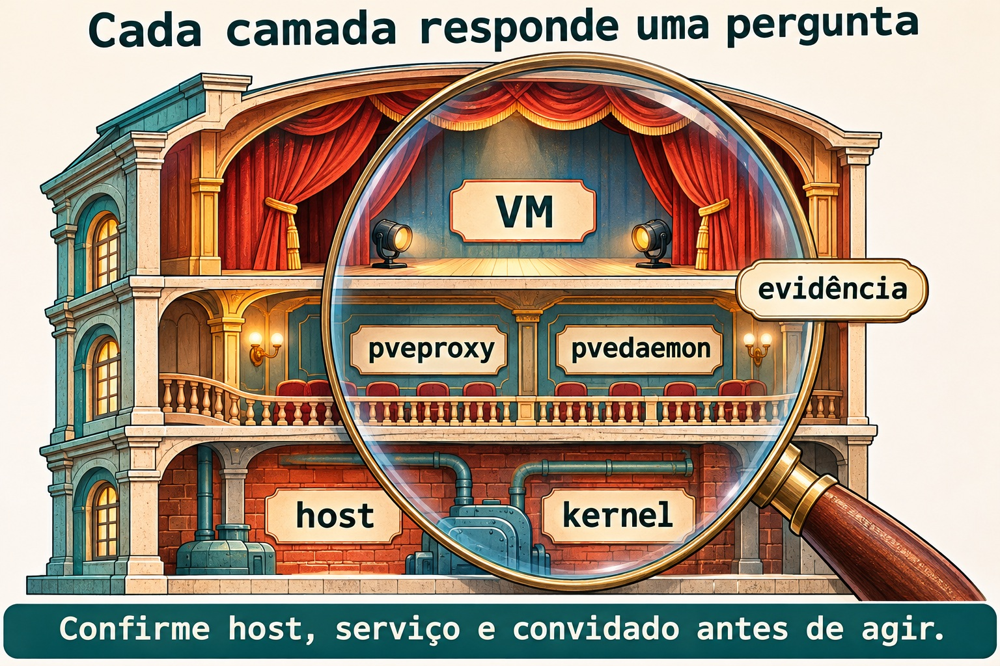
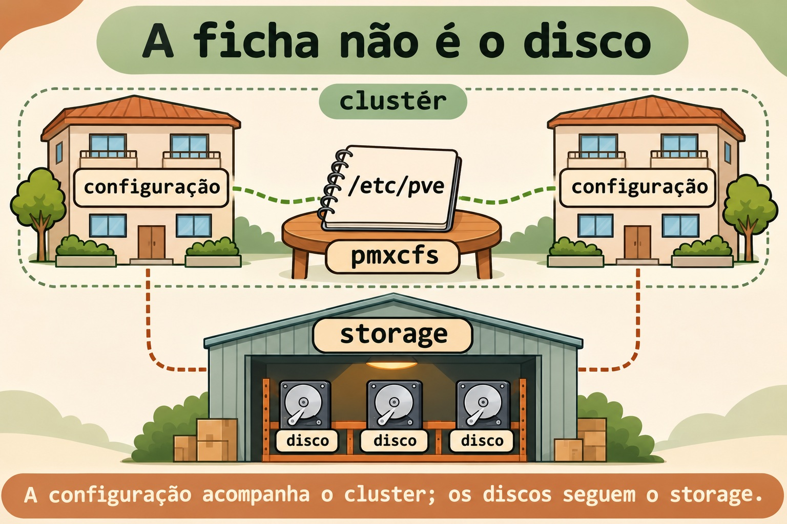
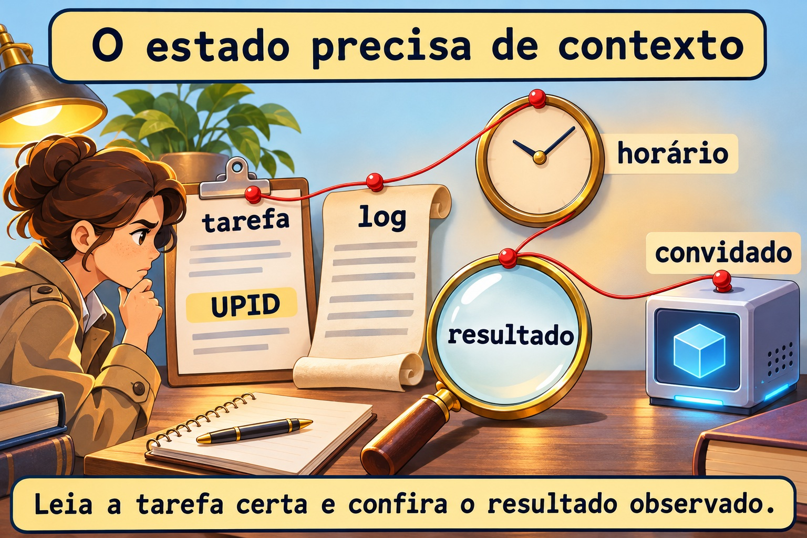

# Aula 17.1 · Proxmox por dentro

> **O coração desta aula:** encontre a camada da falha antes de alterar o host.

| Ficha | Plano de trabalho | 
|---|---| 
| Módulo | M17 · Proxmox na prática, aula 1 de 7 | 
| Quando | Semana 22 | 
| Ao final | Relacionar host, API, configuração, storage e tarefa | 
| Pré-requisitos | Acesso administrativo autorizado ao laboratório e console disponível | 
| Duração | 80–100 minutos | 
| Snapshot | Não se aplica: esta aula apenas consulta o host | 

Esta é a entrada no módulo: você vai administrar a bancada que sustenta as outras VMs.
Um comando no host tem alcance diferente do mesmo comando dentro de um convidado.
Mantenha a sessão de console aberta durante toda a investigação.
Os convidados existentes de 201 a 205 ficam preservados.
Os IDs 210, 211 e 212 só serão usados se estiverem livres no cluster inteiro.

## 1 · Aquecimento

Sem consultar o roteiro, anote uma resposta de duas linhas para cada pergunta.

1. A interface web não abre. Isso prova que as VMs estão paradas?
2. Uma configuração aparece em dois nós. Isso prova que o disco também está nos dois?
3. Um comando retorna erro de VM inexistente. O ID pode estar em outro nó?

### Diagnóstico de entrada

Escreva, sem executar, como criaria uma VM e provaria que ela funciona.
Acrescente como faria backup, restauração e migração.
Marque com uma interrogação cada etapa cuja evidência você ainda não sabe obter.
Guarde essa lista: você a retomará na última aula do módulo.
Não execute esse plano inicial; primeiro vamos descobrir o ambiente real.

**Palpite:** qual componente pode falhar sem desligar um processo de VM?

## 2 · Por que importa

Um hipervisor não é uma caixa que responde apenas pela página web.
Ele tem sistema operacional, processos, serviços, arquivos de configuração e caminhos de disco.
Uma falha de autenticação pede uma investigação diferente de um volume indisponível.
Reiniciar serviços às cegas mistura sintomas e pode interromper o que ainda funcionava.

Nesta aula você produz um mapa de evidências, sem mudar a configuração do host.
Esse mapa será a referência antes de criar a bancada nas aulas seguintes.
Registre horário, nó, comando e conclusão, sem copiar tokens ou arquivos privados.

### Ponte Windows

Pense na diferença entre um console de administração, um serviço e a VM que continua executando.
A janela que mostra um recurso não é o próprio recurso.
O mesmo cuidado vale ao interpretar a interface web do Proxmox.

## 3 · Modelo mental



*Confirme host, serviço e convidado antes de agir.*

| Camada | Pergunta útil | Evidência inicial | 
|---|---|---| 
| Host | Em qual sistema estou? | Versão e kernel | 
| Serviços | Quem atende a interface e a API? | Unidades e journal | 
| Configuração | Quem possui este convidado? | Recursos do cluster | 
| Storage | Onde estão os bytes? | Volume e disponibilidade | 
| Convidado | O sistema interno responde? | Console e serviços internos | 

O host usa Debian com pacotes, kernel e serviços próprios do Proxmox VE.
Não aplique nele automaticamente o procedimento que você usaria em uma VM Debian comum.
O proxy web atende conexões; o daemon privilegiado executa operações da API.
Um processo de VM pode continuar mesmo quando a página deixa de responder.

O sistema de arquivos de configuração do cluster não é um compartilhamento de discos de VM.
Ele organiza a configuração e sua replicação entre nós.
Em cluster sem quorum, fica somente leitura para proteger a consistência.
Isso não autoriza forçar quorum nesta aula.

## 4 · O essencial

| Ferramenta | Escopo | Uso aqui | 
|---|---|---| 
| `pveversion` | Software do host | Identificar versões | 
| `pvesh` | API local | Consultar objetos | 
| `qm` | VMs do nó | Consultar estado e ficha | 
| `pct` | Contêineres do nó | Distinguir tipos | 
| `pvesm` | Storage | Consultar disponibilidade | 
| `pvenode` | Nó e tarefas | Ler execução identificada | 

Use a ajuda da instalação antes de adaptar opções encontradas em outra versão.
Os comandos desta aula são de consulta.
Não há reinício de serviço, edição de arquivo nem criação de convidado no host.

```bash
pveversion --help
pvesh help get
qm help config
pvenode help task
```

Não confunda o estado atual com o resultado de uma tarefa antiga.
Não publique uma listagem completa de configuração que contenha dados sensíveis.
Anote apenas os campos necessários para justificar sua decisão.

## 5 · Lab guiado


### Passo 1 · Identificar o host

**Palpite:** Qual evidência liga este terminal ao nó correto?


Entre pelo console administrativo autorizado do nó.
Confirme que você não está dentro de uma das VMs do curso.

```bash
hostname
cat /etc/os-release
uname -r
pveversion -v
systemd-detect-virt
```

**Saída esperada:** identidade real do nó, base Debian e pacotes do Proxmox.
Os números dependem da atualização instalada; não copie números de uma captura antiga.
Um nó aninhado pode informar virtualização; isso não o transforma em convidado de exercício.

**Verifique:** qual evidência liga o terminal ao nó que a interface mostra?
Registre o nome do nó e a versão principal em seu diário local.
Não prossiga se você não consegue identificar o terminal com segurança.


### Passo 2 · Consultar o inventário do cluster

**Palpite:** a lista local mostra todos os convidados de todos os nós?

```bash
pvesh get /nodes --output-format json-pretty
pvesh get /cluster/resources --type vm --output-format json-pretty
qm list
pct list
```

**Saída esperada:** recursos com ID, nó proprietário, tipo e estado.
Compare a visão do cluster com as duas listas locais.
Uma VM de outro nó não precisa aparecer na lista local.
Um contêiner não passa a ser VM porque tem um número semelhante.

Registre se os IDs 210, 211 e 212 aparecem em qualquer nó.
Se algum estiver ocupado, marque a bancada bloqueada para criação e pare antes da próxima aula.
Não apague o objeto existente para liberar um número do roteiro.
O mesmo inventário será repetido imediatamente antes de criar objetos.

**Verifique:** identifique uma diferença concreta entre escopo local e escopo do cluster.


### Passo 3 · Separar serviço e convidado

**Palpite:** Um serviço ativo prova que a conexão remota chega até ele?


Não provoque uma indisponibilidade para aprender a reconhecê-la.
Leia o estado atual dos serviços e o intervalo recente do journal.

```bash
systemctl is-active pveproxy pvedaemon pvestatd pve-cluster
systemctl status pveproxy pvedaemon --no-pager
journalctl -b -u pveproxy -u pvedaemon --since '-20 min' --no-pager
```

**Saída esperada:** estados e mensagens reais, inclusive ausência de eventos no intervalo.
Um journal vazio nessa janela não prova que nunca houve erro.
Uma unidade ativa também não prova que um navegador remoto alcança a porta.

```bash
ss -ltnp 'sport = :8006'
```

Observe endereço de escuta e processo, sem alterar firewall ou certificado.
Se o serviço está ativo e escutando, o próximo passo pode estar no caminho de rede.
Isso não dispensa conferir a mensagem concreta do cliente.

**Verifique:** escreva uma afirmação que sua consulta prova e outra que ela não prova.

### Passo 4 · Encontrar a ficha sem editar

**Palpite:** A ficha contém os bytes do disco?



*A configuração acompanha o cluster; os discos seguem o storage.*

Escolha uma VM existente do inventário apenas para leitura.
Faça a consulta no nó proprietário e informe o ID real quando solicitado.

```bash
read -r -p 'VMID existente para leitura: ' VMID_LEITURA
qm status "$VMID_LEITURA"
qm config "$VMID_LEITURA"
findmnt /etc/pve
ls -ld /etc/pve/qemu-server /etc/pve/nodes
```

**Saída esperada:** configuração da VM escolhida e montagem do sistema de configuração.
Procure as linhas de disco, rede e boot na ficha.
Um identificador de volume não contém os próprios bytes do disco.
Não leia diretórios privados nem altere arquivos de configuração diretamente.

```bash
pvesm status
```

**Verifique:** associe uma linha de disco a um storage listado.
Se ele aparece indisponível, registre o fato; esta aula não repara o backend.
Não conclua que um volume está acessível só porque seu nome está na configuração.

### Passo 5 · Ler uma tarefa identificada

**Palpite:** Uma tarefa antiga descreve o estado atual do convidado?



*Leia a tarefa certa e confira o resultado observado.*

Consulte a ajuda local e uma lista curta de tarefas recentes do nó.

```bash
pvenode help task list
pvenode task list --limit 10
```

Escolha um UPID real da lista e copie o valor inteiro, sem inventar um exemplo.
Se não há tarefas, registre isso e use o journal do passo anterior como evidência disponível.
Só execute as próximas consultas se você selecionou uma tarefa existente.

```bash
read -r -p 'UPID real da lista: ' UPID_LEITURA
pvenode task status "$UPID_LEITURA"
pvenode task log "$UPID_LEITURA"
```

**Saída esperada:** estado e linhas da tarefa selecionada.
Relacione o tipo da tarefa, o ID afetado e o horário.
Uma tarefa concluída com sucesso prova o resultado daquela operação, naquele momento.
Não prova que o sistema interno do convidado continua saudável horas depois.

**Verifique:** encontre a primeira linha que explica uma falha, se houver.
Não invente uma falha quando o log mostra apenas sucesso.

### Passo 6 · Fechar o mapa de evidências

**Palpite:** Quais limites precisam acompanhar a conclusão?

No seu diário, complete uma linha por camada.

| Camada | Comando usado | Fato observado | Próxima pergunta | 
|---|---|---|---| 
| Host | Versão e kernel | Preencha com o dado real | O terminal é o nó certo? | 
| Serviços | Estado e journal | Preencha com o dado real | Há escuta e erro no intervalo? | 
| Configuração | Inventário e ficha | Preencha com o dado real | Quem possui o ID? | 
| Storage | Disponibilidade | Preencha com o dado real | O volume é acessível? | 
| Tarefa | Estado e log | Preencha com o dado real | O resultado ainda corresponde ao estado atual? | 

**Verifique:** outra pessoa consegue repetir sua conclusão sem abrir arquivos privados?
Se não, acrescente escopo e horário, em vez de acumular mais saídas sem contexto.

**Saída esperada:** mapa com nó, horário e limites de cada evidência.


## 6 · Quebre e conserte

As três quebras abaixo usam leitura ou raciocínio sobre anotações.
Não derrube serviços do host para fabricar o sintoma.

### Quebra 1 · O ID existe, mas não neste nó

**Sintoma:** uma consulta local informa que a configuração não existe.
**Investigação:** procure o ID no inventário completo e leia o campo do nó.
**Causa:** a ferramenta local foi usada no proprietário errado.
**Conserto:** conecte-se ao nó proprietário e repita somente a consulta.
**Verifique:** o mesmo ID e tipo aparecem no cluster e na consulta local correta.
**Prevenção:** registre nó, ID e tipo juntos antes de qualquer ação.

### Quebra 2 · O intervalo esconde o evento

**Sintoma:** o journal recente não mostra o erro anotado ontem.
**Investigação:** compare o horário da anotação com o boot e a janela consultados.

```bash
journalctl --list-boots --no-pager
```

**Causa:** a seleção temporal não inclui o evento; retenção também pode ter removido registros.
**Conserto:** selecione um boot e intervalo existentes, usando a ajuda do journal.
**Verifique:** a data da primeira linha coincide com o período investigado.
**Prevenção:** registre o instante do sintoma e preserve a evidência pertinente.

### Quebra 3 · A ficha foi confundida com o disco

**Sintoma:** uma anotação afirma que discos foram replicados porque a configuração aparece em outro nó.
**Investigação:** separe o caminho da ficha do identificador de volume e do backend.
**Causa:** configuração distribuída foi interpretada como cópia automática de dados.
**Conserto:** reescreva a conclusão e cite o tipo real de storage.
**Verifique:** sua explicação permite distinguir storage compartilhado de disco local.
**Prevenção:** trate ficha, volume e cópia de segurança como objetos diferentes.

## 7 · Armadilhas

### Decida 1

A página não abre, mas uma VM responde pelo serviço interno. O primeiro passo é:

A. Reiniciar todos os convidados.
B. Consultar serviço, escuta e mensagens da interface.
C. Apagar a configuração da VM que responde.

Escolha e justifique com duas evidências independentes.

### Decida 2

Um ID reservado aparece ocupado em outro nó. Você deve:

A. Criar o mesmo ID neste nó.
B. Apagar o objeto para seguir a numeração.
C. Interromper a criação e resolver a reserva com quem administra a bancada.

Uma numeração didática não autoriza substituir um recurso existente.

### Rocky × Debian

As VMs do curso podem usar distribuições diferentes.
O host Proxmox continua seguindo o procedimento próprio do hipervisor.
Escolha primeiro a máquina certa; só depois escolha o gerenciador de pacotes.

## 8 · Quiz

1. O que a versão do kernel acrescenta à identificação da base Debian?
2. Por que uma unidade ativa não prova acesso remoto à interface?
3. Qual consulta permite localizar um ID fora do nó atual?
4. O sistema de configuração do cluster replica automaticamente discos locais?
5. Por que guardar o UPID inteiro em vez de apenas o último texto do log?
6. O que fazer se não há registros no intervalo consultado?

Responda antes de abrir as soluções.

## 9 · Lembrete

**Flashcards:** complete a segunda coluna de memória.

| Frente | Verso | 
|---|---| 
| Página indisponível | Não determina sozinha o estado dos convidados | 
| Configuração do cluster | Descreve o convidado; não contém seu disco | 
| Consulta local | Depende do nó proprietário | 
| Tarefa | Tem identidade, tempo e resultado próprios | 

```text
!explica Por que uma interface indisponível não prova que a VM parou?
!feynman Explique configuração de cluster e disco de VM sem confundir os dois.
!quiz Faça uma pergunta por vez sobre escopo local, tarefa e journal.
```

Os três comandos de estudo acima ficam iguais nas duas versões da aula.

## 10 · Checklist e fechamento

- [ ] Identifiquei o terminal e o nó real.
- [ ] Comparei a visão local com o inventário do cluster.
- [ ] Registrei a situação dos IDs 210, 211 e 212.
- [ ] Li estados e logs sem reiniciar serviços.
- [ ] Separei configuração, volume e tarefa.
- [ ] Preservei os convidados existentes.

**Último exercício:** produza um relato de cinco frases sobre uma evidência real coletada.
Inclua sintoma ou pergunta, escopo, horário, observação e limite da conclusão.
Outra pessoa deve conseguir localizar a mesma informação sem receber acesso a segredos.

**Reboot de conferência:** não reinicie o host nem os convidados nesta aula de leitura.
A conferência é repetir uma consulta curta e verificar que você continua no mesmo nó.
Não há recurso criado para remover e não há snapshot a restaurar.
Guarde apenas seu diário; as consultas não exigem limpeza do host.

## 11 · Na vida real

Peça a um colega que descreva uma falha antiga sem revelar a solução.
Monte uma sequência de três consultas, todas de leitura.
Para cada uma, diga qual hipótese ela confirma ou enfraquece.
Se a evidência necessária contém segredo, peça uma versão reduzida e autorizada.
Não tente reproduzir uma interrupção no host real.

Um bom relato termina com uma próxima pergunta verificável.
Ele não termina com um reinício usado como substituto da investigação.

## 12 · Aprofunde quando quiser

Consulte a documentação correspondente à versão instalada.
O manual local é a referência imediata quando uma opção difere.

- [Configuração do cluster e quorum](https://github.com/proxmox/pve-docs/blob/master/pmxcfs.adoc).
- [Comandos de nó e tarefas](https://github.com/proxmox/pve-docs/blob/master/generated/pvenode.1-synopsis.adoc).
- [Manual de administração Proxmox VE](https://pve.proxmox.com/pve-docs/pve-admin-guide.html).

### Soluções comentadas

**Aquecimento 1:** não; interface, API e processo de VM são componentes diferentes.
**Aquecimento 2:** não; é preciso identificar o backend e a disponibilidade do volume.
**Aquecimento 3:** sim; a visão do cluster localiza o proprietário antes da consulta local.

**Decida 1: B.** Preserve o convidado que responde e investigue o caminho da interface.
O estado da unidade e a escuta são evidências diferentes; ainda pode existir falha de rede.
**Decida 2: C.** O ID é único no cluster e a reserva deve ser resolvida sem apagar objetos.

**Quiz 1:** ele identifica o kernel em uso, que pode ser específico do hipervisor.
**Quiz 2:** escuta, rota, firewall, cliente e autenticação são etapas distintas.
**Quiz 3:** consulte os recursos do cluster e observe o nó proprietário.
**Quiz 4:** não; configuração distribuída não equivale a replicação dos bytes.
**Quiz 5:** ele vincula a leitura à operação correta e evita misturar tarefas.
**Quiz 6:** confira janela, boot e retenção; registre ausência se o dado não está disponível.

[← Aula 16.4 · Correção e reforço](16.4-correcao-e-reforco.md) · [Índice das aulas](../01-aulas.md) · [Aula 17.2 · VM pela linha de comando →](17.2-vm-pela-linha-de-comando.md)
