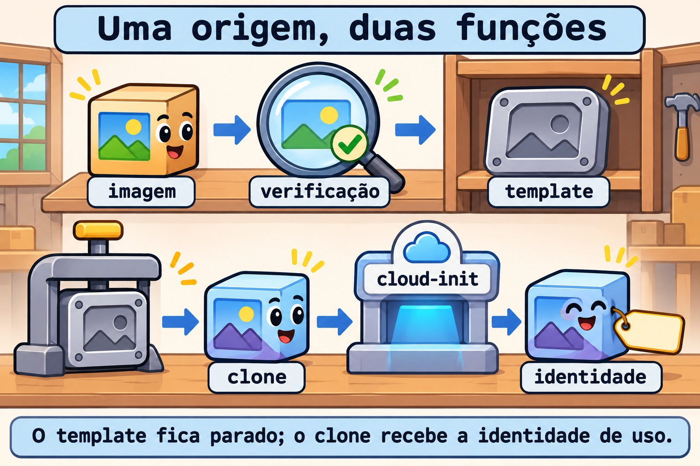
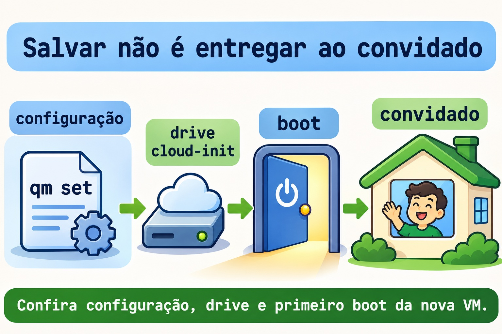
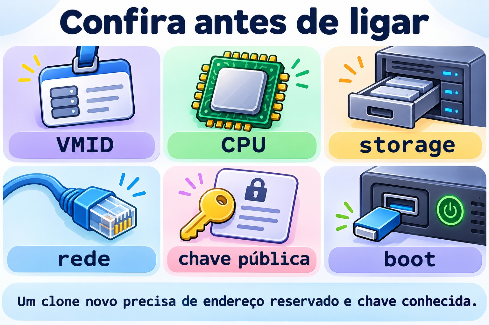

# Aula 17.2 · VM pela linha de comando

> **O coração desta aula:** transforme uma imagem verificada em template e entregue a identidade ao clone antes do primeiro boot.

| Ficha | Plano de trabalho | 
|---|---| 
| Módulo | M17 · Proxmox na prática, aula 2 de 7 | 
| Quando | Semana 22 | 
| Ao final | Criar template 210 e clone completo 211 com rede, chave e console conferidos | 
| Pré-requisitos | Aula anterior, IDs livres, storage e endereço reservados, chave pública disponível | 
| Duração | 120–150 minutos, além do download | 
| Snapshot | Criar somente na VM 211, depois do primeiro boot validado | 

A bancada usa template 210 e VM 211; o CT 212 fica reservado para a próxima aula.
Os nomes são `m17-template`, `m17-vm` e, mais adiante, `m17-ct`.
Os convidados 201 a 205 continuam intocados.
Os IDs temporários deste módulo serão liberados na limpeza final antes de seu uso futuro no M24.
Execute no host apenas os comandos explicitamente indicados; comandos internos têm seu próprio bloco.

## 1 · Aquecimento

1. Qual a diferença entre baixar uma imagem e verificar sua origem?
2. Se o template já foi ligado, que identidades ele pode ter deixado prontas para copiar?
3. Uma configuração de rede salva no host prova que o convidado a aplicou?

**Palpite:** o template será ligado em algum momento desta aula?
Responda antes de abrir o terminal.

## 2 · Por que importa

Uma VM criada com pressa pode funcionar uma vez e falhar quando você a clona ou migra.
O problema pode estar na CPU exposta, no disco de boot ou na identidade já gravada na origem.
Também pode ser um endereço escolhido sem reserva, em conflito com outro equipamento.

Você vai separar quatro provas: origem da imagem, configuração no host, dados de inicialização e resultado no guest.
Um comando bem-sucedido em uma camada não substitui a conferência da próxima.
Ao final, a VM 211 fica disponível para storage, rede e backup nas próximas aulas.

### Ponte Windows

Pense em uma imagem preparada para implantação e em uma instalação já usada por alguém.
Copiar o disco não garante limpar identidade, endereço e credenciais.
Aqui usamos uma imagem cloud oficial, preservando seu mecanismo de primeiro boot.

## 3 · Modelo mental



*O template fica parado; o clone recebe a identidade de uso.*

| Objeto | Papel nesta aula | O que não fazer | 
|---|---|---| 
| Imagem oficial | Origem verificada do disco | Substituir por arquivo sem procedência | 
| Template 210 | Molde desligado e nunca inicializado aqui | Dar boot para testar | 
| Clone 211 | Máquina de trabalho com cópia completa | Usar endereço sem reserva | 
| Drive de inicialização | Transporte dos dados do cloud-init | Confundir com disco do sistema | 

O clone completo possui volumes próprios; a origem continua parada.
Isso consome mais espaço que um clone ligado ao disco base, mas simplifica esta bancada.
As identidades são geradas no primeiro boot do clone a partir de uma origem preparada para isso.
Não limpe identidades do host nem dos convidados antigos.

## 4 · O essencial

| Decisão | Valor da bancada | Razão | 
|---|---|---| 
| CPU | `x86-64-v2-AES` | Contrato comum entre os nós compatíveis | 
| Firmware e máquina | `ovmf` e `q35` | Inicialização UEFI e hardware definido | 
| Controladora | `virtio-scsi-pci` | Disco VirtIO com caminho explícito | 
| Disco do sistema | `scsi0`, pelo menos 20 GiB | Separar dos discos futuros de exercício | 
| Storage | `vm-hdd`, backend RBD | Storage já preparado no plano | 
| Rede inicial | `net0`, bridge `vmbr0` | Endereço real reservado da bancada | 

Não substitua o modelo de CPU por passagem direta da CPU do host para contornar a conferência.
O conjunto completo de recursos deve existir em todos os nós candidatos à migração.
Conferir somente uma instrução, como AVX2, não valida esse contrato.

As variáveis de rede serão preenchidas com dados reais fornecidos por quem administra a rede.
Não há endereço inventado para colar e descobrir depois se estava livre.
O console deve continuar acessível mesmo quando o SSH ainda não funciona.

## 5 · Lab guiado


### Passo 1 · Conferir as condições de criação

**Palpite:** Qual condição ausente impede criar a bancada?


No host autorizado, repita o inventário de todos os nós.

```bash
pvesh get /cluster/resources --type vm --output-format json-pretty
pvesm status
pvesh get /storage/vm-hdd --output-format json-pretty
ip -br link show vmbr0
lscpu
grep '^flags' /proc/cpuinfo | sort -u
```

**Saída esperada:** IDs 210, 211 e 212 ausentes, bridge existente e storage RBD ativo.
Confirme conteúdo de disco de VM, espaço disponível e disponibilidade do storage nos nós planejados.
Se algum ID existe, não continue: a ausência na lista local não basta.
Não instale nem reconfigure Ceph para fazer esta aula caber em outro ambiente.

Em cada nó candidato à migração, confira o conjunto básico de x86-64-v2 e AES.
Além da base x86-64, procure estes recursos em todas as linhas de CPU.

```text
cx16 lahf_lm popcnt pni ssse3 sse4_1 sse4_2 aes
```

Use a referência oficial do modelo de CPU e registre cada nó conferido.
Se o conjunto não está presente, resolva a compatibilidade da bancada antes de criar a VM.
Confirme também RAM, espaço do host para o download e ausência de outra criação simultânea nesses IDs.

**Verifique:** obtenha a reserva de endereço fora do pool DHCP, gateway e DNS reais.
Uma tentativa de ping sem resposta não constitui reserva de endereço.
Tenha uma chave pública do cliente e mantenha a chave privada apenas no cliente.


### Passo 2 · Baixar e verificar a imagem oficial

**Palpite:** Um checksum basta para autenticar a origem?


Use uma pasta nova e exclusiva no host; se ela já existe, pare e examine seu conteúdo.
Não execute novamente o bloco de criação de pasta sobre um trabalho anterior.

```bash
test ! -e /root/m17-work || exit 1
install -d -m 0700 /root/m17-work || exit 1
cd /root/m17-work || exit 1
pwd
```

Só continue se a pasta acabou de ser criada e o caminho exibido é o esperado.
No diretório oficial, selecione a imagem GenericCloud Base de Rocky 9 para x86_64 com nome versionado.
Copie o nome exato, sem usar um apelido que possa mudar de conteúdo no futuro.
Não escolha a imagem de contêiner ou um disco específico de outro provedor.

```bash
BASE='https://dl.rockylinux.org/pub/rocky/9/images/x86_64'
read -r -p 'Nome versionado oficial da imagem qcow2: ' IMAGE
case "$IMAGE" in
  Rocky-9-GenericCloud-Base-*.x86_64.qcow2) ;;
  *) printf '%s\n' 'Nome inesperado; pare e confira.'; exit 1 ;;
esac
test "$IMAGE" != 'Rocky-9-GenericCloud-Base-latest.x86_64.qcow2' || exit 1
curl --fail --location --remote-name "$BASE/$IMAGE" || exit 1
curl --fail --location --remote-name "$BASE/$IMAGE.CHECKSUM" || exit 1
curl --fail --location --remote-name "$BASE/$IMAGE.CHECKSUM.asc" || exit 1
curl --fail --location --output RPM-GPG-KEY-Rocky-9 \
  'https://dl.rockylinux.org/pub/rocky/RPM-GPG-KEY-Rocky-9' || exit 1
```

Pare se algum download falhar; não reutilize um arquivo incompleto como se fosse imagem válida.
Compare a impressão digital com a página oficial de chaves por um canal independente do arquivo baixado.
Para a chave de lançamento Rocky 9 documentada, a impressão é a seguinte.

```text
21CB 256A E16F C54C 6E65 2949 702D 426D 350D 275D
```

Se a publicação oficial indicar rotação de chave, interrompa e valide a mudança antes de seguir.

```bash
install -d -m 0700 /root/m17-work/gnupg
export GNUPGHOME=/root/m17-work/gnupg
gpg --show-keys --with-fingerprint RPM-GPG-KEY-Rocky-9
gpg --import RPM-GPG-KEY-Rocky-9 || exit 1
gpg --verify "$IMAGE.CHECKSUM.asc" "$IMAGE.CHECKSUM" || exit 1
sha256sum --check "$IMAGE.CHECKSUM" || exit 1
qemu-img info "$IMAGE" || exit 1
```

**Saída esperada:** assinatura válida da chave conferida e verificação do arquivo aprovada.
Aviso de confiança local não substitui a comparação da impressão digital.
Se o algoritmo indicado no arquivo não for SHA256, use a ferramenta correspondente e registre isso.
Confira formato e tamanho virtual; esta bancada prevê aumentar o disco para pelo menos 20 GiB.
Não reduza uma imagem maior para adequá-la ao roteiro.

**Verifique:** guarde nome versionado, checksum conferido e impressão digital no diário.
Verificação de integridade sem assinatura não prova sozinha a origem do arquivo.


### Passo 3 · Criar o template sem dar boot

**Palpite:** Por que o template deve continuar desligado?


Repita a conferência dos IDs imediatamente antes de criar; outra pessoa pode ter usado a reserva.
Nos comandos seguintes, apenas o objeto 210 é criado ou alterado.

```bash
pvesh get /cluster/resources --type vm --output-format json > /root/m17-work/cluster-before-create.json || exit 1
python3 - /root/m17-work/cluster-before-create.json <<'PY'
import json, sys
items = json.load(open(sys.argv[1]))
assert not any(int(x.get('vmid', -1)) in (210, 211, 212) for x in items), 'STOP: ID occupied'
PY
test "$?" -eq 0 || exit 1
qm create 210 --name m17-template --memory 2048 --cores 2 \
  --cpu x86-64-v2-AES --machine q35 --bios ovmf \
  --scsihw virtio-scsi-pci --net0 virtio,bridge=vmbr0 \
  --agent enabled=1 --onboot 0 || exit 1
qm set 210 --efidisk0 vm-hdd:1,efitype=4m,pre-enrolled-keys=1 || exit 1
qm set 210 --scsi0 "vm-hdd:0,import-from=/root/m17-work/$IMAGE,discard=on" || exit 1
qm config 210
```

Pare e investigue se qualquer comando falhar; não siga para uma configuração parcialmente criada.
O volume importado deve aparecer em `scsi0`; anote seu tamanho atual.
Somente se ele for menor que 20 GiB, execute o aumento abaixo.

```bash
qm disk resize 210 scsi0 20G || exit 1
```

Se já é igual ou maior, pule o aumento e preserve seu tamanho.
Agora adicione o drive de inicialização e a console serial.

```bash
qm set 210 --ide2 vm-hdd:cloudinit || exit 1
qm set 210 --boot order=scsi0 || exit 1
qm set 210 --serial0 socket --vga serial0 || exit 1
qm config 210
qm status 210
qm template 210 || exit 1
qm config 210
```

**Saída esperada:** template marcado como tal, desligado, com disco, EFI e drive cloud-init.
Não ligue o template para conferir a tela; o teste será feito no clone.
Não injete senha, endereço de trabalho ou chave privada na origem.

**Verifique:** identifique onde a configuração registra firmware, CPU e ordem de boot.
Se a imagem oficial exigir outra console, consulte sua documentação antes de mudar apenas o clone.

### Passo 4 · Clonar e entregar os dados de primeiro boot

**Palpite:** O documento gerado prova que o convidado o aplicou?



*Confira configuração, drive e primeiro boot da nova VM.*

Copie somente a chave pública do cliente para `/root/m17-work/student.pub`.
Confira a impressão no cliente e no host; elas devem coincidir.

```bash
ssh-keygen -lf /root/m17-work/student.pub
qm clone 210 211 --name m17-vm --full 1 --storage vm-hdd || exit 1
test "$(qm config 211 | sed -n 's/^name: //p')" = m17-vm || exit 1
qm config 211
read -r -p 'CIDR real reservado para a VM 211: ' VM_CIDR
read -r -p 'Gateway real da VM 211: ' VM_GW
read -r -p 'DNS real da VM 211: ' VM_DNS
: "${VM_CIDR:?}" "${VM_GW:?}" "${VM_DNS:?}"
qm set 211 --ciuser student --sshkeys /root/m17-work/student.pub || exit 1
qm set 211 --ipconfig0 "ip=$VM_CIDR,gw=$VM_GW" --nameserver "$VM_DNS" || exit 1
qm cloudinit update 211 || exit 1
qm cloudinit dump 211 user
qm cloudinit dump 211 network
qm cloudinit dump 211 meta
```

**Saída esperada:** usuário, chave pública e rede correspondem aos valores reservados.
Os três documentos não provam que o convidado já os executou.
Não publique os documentos completos sem revisar seu conteúdo.
O clone deve continuar desligado até esta conferência terminar.

**Verifique:** o MAC do clone difere do MAC da origem e a chave é a esperada.
Confira o usuário e a regra de acesso administrativo no documento do usuário.
Se falta uma condição de acesso, corrija antes de ligar; não invente uma senha padrão.

### Passo 5 · Iniciar e conferir dentro do convidado

**Palpite:** Qual prova precisa ser obtida dentro do convidado?



*Um clone novo precisa de endereço reservado e chave conhecida.*

Mantenha a console do host aberta e abra também a console da VM 211.

```bash
qm start 211
qm status 211
qm terminal 211
```

A console serial permite acompanhar mensagens sem depender do endereço configurado.
Ela não elimina a necessidade de credenciais para entrar no sistema.
No cliente que possui a chave privada, use o IP reservado real para conectar como usuário de estudo.
Confira a identidade da VM pela console antes de aceitar sua chave SSH.
No primeiro boot, leia na console serial a impressão digital pública emitida pelo cloud-init e compare algoritmo e hash com o aviso do cliente SSH.
Se a imagem não emitir a impressão, interrompa o primeiro acesso: peça ao responsável uma leitura autenticada da chave pública pelo console de recuperação ou outro canal independente já confiável.
A console sem senha inicial serve para observar o boot, não para executar comandos autenticados. Não aceite a chave às cegas nem use a própria conexão ainda não validada como fonte de confiança.
Após entrar na VM, execute os próximos comandos dentro dela, nunca no host.

```bash
hostnamectl
sudo cloud-init status --wait --long
ip -br address
ip route
nmcli device status
cat /var/lib/cloud/data/instance-id
cat /etc/machine-id
sudo ssh-keygen -lf /etc/ssh/ssh_host_ed25519_key.pub
sudo dnf install -y qemu-guest-agent
sudo systemctl enable --now qemu-guest-agent
sudo passwd root
```

A senha de emergência é definida interativamente dentro do clone; não a registre no material.
Não habilite login remoto de root por senha como atalho.
Anote as identidades geradas para comparações futuras, sem copiá-las para outro convidado.
O término com erro do cloud-init exige investigação do log; não equivale a configuração concluída.

**Verifique:** use a console para confirmar acesso de emergência com a senha recém-definida.
Saia dessa sessão e volte ao usuário de estudo para continuar.
No host, consulte o agente somente depois de habilitá-lo dentro do clone.

```bash
qm agent 211 ping
qm config 211
```

**Saída esperada:** agente responde; a ficha corresponde à máquina que você acabou de verificar.
Uma resposta do agente não prova acesso à aplicação nem integridade de backup.

### Passo 6 · Reboot e ponto de retorno da bancada

**Palpite:** Quais identidades devem persistir no reboot?

Registre a configuração do clone e as identidades antes do reboot.
Não inclua senhas nem chave privada nessa evidência.
Dentro da VM 211, reinicie apenas ela.

```bash
sudo reboot
```

Reconecte e confira endereço, rota, agente e identidades.
Um reboot normal deve preservar as identidades já geradas; não limpe o cloud-init para testar.
Com a VM saudável, crie no host um ponto de retorno sem memória.

```bash
qm snapshot 211 m17a2-base --description 'M17 VM211 base'
qm listsnapshot 211
```

Se o storage rejeitar snapshot, investigue a capacidade antes das quebras abaixo.
O snapshot é um apoio de laboratório, não uma cópia independente de segurança.
O backup e a restauração serão trabalhados na aula própria.

**Saída esperada:** clone saudável após reboot e ponto de retorno listado.

**Verifique:** confira que o clone iniciou com as mesmas identidades e o agente responde.


## 6 · Quebre e conserte

Altere somente a VM 211 e conserve o template desligado.
Faça uma quebra de cada vez, com a correção correspondente antes da próxima.

### Quebra 1 · A chave pública não está no caminho informado

**Sintoma:** você quer informar um arquivo que não existe.
**Investigação:** teste a existência antes de enviar a alteração ao hipervisor.

```bash
test -r /root/m17-work/chave-ausente.pub
printf 'rc=%s\n' "$?"
```

**Causa:** o caminho do arquivo foi confundido com a própria chave.
**Conserto:** confira o arquivo público real e repita a leitura de sua impressão digital.
**Verifique:** a chave no documento do cloud-init corresponde à chave pública do cliente.
**Prevenção:** valide o arquivo e nunca copie a chave privada para o host.

### Quebra 2 · A ordem de boot aponta para o drive errado

Desligue o clone de forma limpa pelo sistema interno e confira seu estado no host.
Não use parada forçada para acelerar esta quebra.

```bash
qm shutdown 211 --timeout 120
qm status 211
```

Somente depois de confirmar que está desligada, altere a ordem e inicie a VM 211.

```bash
qm set 211 --boot order=ide2
qm start 211
```

**Sintoma:** o sistema não é carregado a partir do disco esperado.
**Investigação:** observe a console e compare a ordem de boot com o disco do sistema.
**Causa:** o drive cloud-init transporta dados; não é o sistema operacional.
**Conserto:** retorne a VM ao estado desligado pela console do firmware, sem instalação de sistema em execução, e corrija a ordem.
Se não há opção de desligamento no firmware, uma parada do processo 211 é admissível apenas após confirmar que nenhum sistema iniciou.

```bash
qm set 211 --boot order=scsi0
qm start 211
```

**Verifique:** o clone inicia pelo disco correto e as identidades permanecem as mesmas.
**Prevenção:** confira a ordem antes do primeiro boot; não reinstale um sistema para corrigir uma ordem errada.

### Quebra 3 · O agente foi habilitado só de um lado

Dentro da VM 211, pare temporariamente apenas o agente do convidado.

```bash
sudo systemctl stop qemu-guest-agent
```

**Sintoma:** a consulta do agente no host falha, embora a console continue funcionando.
**Investigação:** compare a opção da ficha com o estado do serviço dentro do clone.
**Causa:** habilitar o canal no hipervisor não mantém o programa interno em execução.
**Conserto:** inicie novamente o agente dentro da VM.

```bash
sudo systemctl start qemu-guest-agent
```

**Verifique:** repita no host a consulta de ping do agente da VM 211.
**Prevenção:** confira a opção do hipervisor e o serviço interno como condições separadas.

## 7 · Armadilhas

### Decida 1

O checksum confere, mas a assinatura não corresponde à chave oficial conferida. Você deve:

A. Importar porque o arquivo não está corrompido.
B. Ligar o template para ver se parece legítimo.
C. Parar e resolver a verificação de origem antes de importar.

### Decida 2

A rede foi alterada na ficha depois de o cloud-init já concluir o primeiro boot. Você deve:

A. Verificar o que foi entregue e corrigir a rede pelo console do clone, conforme o sistema interno.
B. Limpar identidades do host para forçar uma máquina nova.
C. Garantir que um reboot aplica qualquer alteração automaticamente.

### Rocky × Debian

O agente interno é instalado com o gerenciador de pacotes da imagem escolhida.
O host Proxmox não recebe comandos de instalação destinados à VM Rocky.
Não acrescente uma imagem Debian como segundo template só para comparar nesta aula.

## 8 · Quiz

1. Por que o template 210 não é iniciado antes da conversão?
2. O que a assinatura acrescenta ao checksum?
3. Qual a consequência de escolher clone completo?
4. Que três conferências separam configuração salva de configuração aplicada?
5. Por que uma CPU aceita no nó atual pode impedir migração?
6. Uma resposta do agente garante que um backup é restaurável?

## 9 · Lembrete

**Flashcards:** responda sem consultar os comandos do lab.

| Frente | Verso | 
|---|---| 
| Origem | Assinatura de chave conferida e checksum do arquivo | 
| Template | Molde parado, sem primeiro boot realizado aqui | 
| Clone | Volumes próprios e identidade de uso gerada nele | 
| Rede | Reserva real, dados entregues e resultado observado | 

```text
!explica Por que verificar a assinatura antes de importar uma imagem cloud?
!feynman Explique template, clone e identidade usando um molde e uma peça nova.
!quiz Faça perguntas sobre boot, cloud-init e agente sem inventar saídas.
```

## 10 · Checklist e fechamento

- [ ] Confirmei IDs livres no cluster e preservei 201 a 205.
- [ ] Validei CPU em todos os nós candidatos e o storage RBD existente.
- [ ] Conferi assinatura, impressão digital e checksum antes da importação.
- [ ] Mantive o template 210 desligado e criei clone completo 211.
- [ ] Conferi rede reservada, chave pública e dados do cloud-init.
- [ ] Confirmei console, agente e identidades após reboot apenas do clone.
- [ ] Corrigi as três quebras e preservei um ponto de retorno.

**Último exercício:** explique a criação a alguém que só tem o inventário e sua evidência reduzida.
Essa pessoa deve distinguir origem verificada, template, disco do clone e identidade interna.

**Reboot de conferência:** o reboot do passo 6 afetou somente a VM 211.
Após as quebras, confira novamente seu estado e o agente; não reinicie o host.
Mantenha template 210, VM 211 e pasta de origem para as próximas aulas.
Não libere os IDs ainda: a limpeza final será feita depois da entrega do módulo.
Feche as sessões administrativas extras e preserve apenas as evidências sem segredo.

## 11 · Na vida real

Escolha uma VM já autorizada apenas para leitura e examine sua ficha.
Relate firmware, CPU, origem conhecida do disco e mecanismo de inicialização.
Se a procedência não está registrada, trate isso como informação ausente.
Não recrie a VM nem modifique seu tipo de CPU para preencher a lacuna do relatório.
Proponha uma melhoria de documentação antes de propor mudança de infraestrutura.

## 12 · Aprofunde quando quiser

- [Cloud-init e templates no Proxmox](https://github.com/proxmox/pve-docs/blob/master/qm-cloud-init.adoc).
- [Comandos e modelos de CPU](https://github.com/proxmox/pve-docs/blob/master/generated/qm.1-synopsis.adoc).
- [Imagens oficiais Rocky 9](https://dl.rockylinux.org/pub/rocky/9/images/x86_64/).
- [Impressões digitais das chaves oficiais](https://rockylinux.org/resources/gpg-key-info).

- [Emissão de chaves SSH na console pelo cloud-init](https://cloudinit.readthedocs.io/en/stable/reference/yaml_examples/ssh.html).

### Gabarito comentado

**Aquecimento 1:** baixar obtém bytes; verificar assinatura e integridade liga esses bytes à origem conferida.
**Aquecimento 2:** identificador da máquina, chaves do host SSH e estado do cloud-init.
**Aquecimento 3:** não; é preciso conferir a entrega e o resultado dentro do convidado.
**Decida 1: C.** Não importe uma origem cuja assinatura ainda não foi validada.
**Decida 2: A.** A política de execução por instância impede presumir reaplicação completa a cada reboot.
**Quiz 1:** para preservar o estado preparado da imagem e gerar identidades no clone.
**Quiz 2:** vincula a lista de somas à chave cuja identidade você conferiu.
**Quiz 3:** os volumes são independentes do disco base e ocupam espaço próprio.
**Quiz 4:** ficha no host, documento entregue e estado observado dentro do clone.
**Quiz 5:** outro nó pode não oferecer as mesmas instruções; o contrato precisa ser comum.
**Quiz 6:** não; restaurabilidade exige verificar backup e executar uma restauração controlada.

[← Aula 17.1 · Proxmox por dentro](17.1-proxmox-por-dentro.md) · [Índice das aulas](../01-aulas.md) · [Aula 17.3 · Contêiner LXC →](17.3-conteiner-lxc.md)
