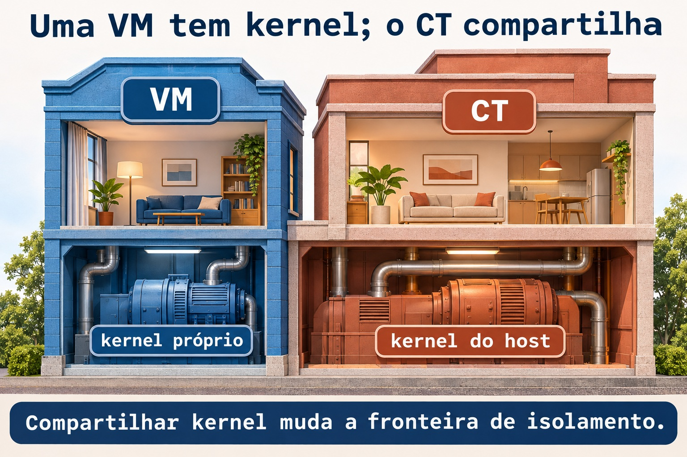
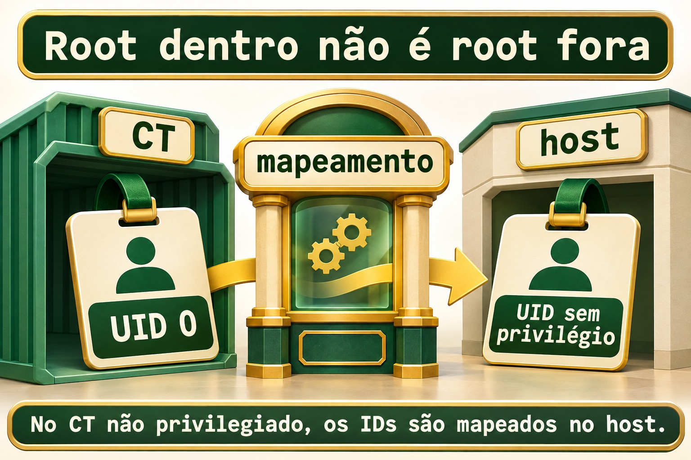
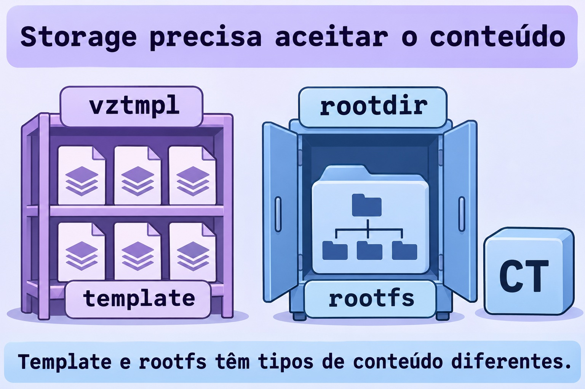

# Aula 17.3 · Contêiner LXC

Um processo dentro do CT mostra Debian, mas usa o kernel do host. Nesta aula você cria o CT 212 sem rede ativa, mede essa fronteira e aprende a entrar no ambiente certo sem tratar o contêiner como uma VM pequena.

> **Núcleo desta aula:** o CT isola processos e recursos; ele compartilha o kernel e depende do mapeamento de identidades.

| Ficha | |
| --- | --- |
| **Módulo** | M17 · Proxmox na prática, aula 3 de 7 |
| **Quando** | Semana 23 |
| **Ao final** | Você cria um CT não privilegiado, lê sua configuração e demonstra o kernel compartilhado |
| **Pré-requisitos** | 17.1 e 17.2; console e inventário do host |
| **Tempo** | 60 a 90 minutos, além do download do template |
| **Snapshot** | `m17a3-inicio` e `m17a3-fim`, somente CT 212 |

## 1 · Aquecimento

Responda sem consultar. Depois confronte com o gabarito.

1. Um nome de VM pode provar qual sistema está instalado?

2. Por que o ID precisa estar livre no cluster inteiro, não apenas neste nó?

3. Qual diferença existe entre arquivo de template e disco de uma instância?

## 2 · Por que importa

Uma aplicação funciona numa VM e falha num CT. O administrador tenta instalar outro kernel dentro do contêiner. O pacote muda, mas a chamada continua chegando ao mesmo kernel do host. A correção foi aplicada na camada errada.

Outro caso aparece no backup: um diretório do host é montado no CT, mas o proprietário parece estranho. Os números pertencem a espaços de identidade diferentes. Resolver com acesso total esconderia a causa e ampliaria o risco.

## 3 · Modelo mental

Uma VM é uma casa com sua própria sala de máquinas. Um CT é um apartamento: possui seus cômodos e regras, mas compartilha a infraestrutura do prédio. Nenhuma das duas metáforas garante isolamento absoluto.



*Compartilhar kernel muda a fronteira de isolamento.*

### Ponte Windows

| Referência | Relação útil, com limite |
| --- | --- |
| VM no Hyper-V | Kernel convidado distinto do host |
| Contêiner de processo | Compartilha kernel; não equivale a uma VM |
| Conta e ACL | A identidade efetiva importa; o mapeamento do CT acrescenta outra camada |

## 4 · O essencial

### O CT é gerenciado pelo host

Use `pct` no host Proxmox. Dentro do CT você administra o espaço de usuários: pacotes, arquivos e serviços disponíveis naquele ambiente. O comando do host não vira um comando do Debian do contêiner.

`pct enter` abre um shell dentro do CT a partir do host. `pct exec` executa um comando delimitado e devolve o resultado. Sempre identifique onde está antes de modificar qualquer arquivo.

### Não privilegiado é a escolha inicial

Na criação use `unprivileged=1`. O root interno é mapeado para uma identidade sem privilégio no host. Isso reduz o impacto de várias classes de falha, mas não transforma o kernel compartilhado numa fronteira de VM.

Não converta um CT existente entre privilegiado e não privilegiado editando uma linha. Os proprietários do rootfs e os mapeamentos precisam corresponder. Backup, restauração suportada e validação pertencem a um plano próprio de mudança.



*No CT não privilegiado, os IDs são mapeados no host.*

### Dois conteúdos, duas perguntas

O template baixado precisa de storage que aceite `vztmpl`. O volume de raiz criado para o CT precisa de `rootdir`. Um storage habilitado apenas para `images` não atende automaticamente a nenhuma dessas duas necessidades.

Não altere a definição global de um storage para fazer caber o exercício. Escolha um backend já autorizado, com espaço, conteúdo e suporte a snapshot adequados. Se não existir, pare a criação e registre o pré-requisito.

### Rocky × Debian

| Camada | VM 211 | CT 212 |
| --- | --- | --- |
| Espaço de usuários | Rocky, vindo da 17.2 | Debian 13 do template |
| Kernel | Próprio convidado | Compartilhado com o host |
| Ferramenta no host | `qm` | `pct` |
| Rede inicial desta aula | Mantida como estava | Placa com link desligado, sem DHCP |

O NS8 exige uma VM no contrato suportado do produto. Não tente adaptar este CT removendo AppArmor, ampliando capabilities ou habilitando recursos arbitrários para contornar esse requisito.

### Decida 1

Você precisa de outro kernel para a aplicação. Qual é a decisão correta?

| A | B | C |
| --- | --- | --- |
| Instalar o kernel no CT e reiniciar | Planejar uma VM compatível | Transformar o CT em privilegiado sem revisar nada |

## 5 · Lab guiado

Todos os comandos `pct`, `pveam`, `pvesm` e `pvesh` desta aula rodam no host de laboratório autorizado. Não execute o roteiro num host de cliente. As VMs 201 a 205 ficam intactas.

Mantenha o console do host disponível. O CT desta aula fica sem rede ativa: não precisa de IP, DHCP nem acesso externo para provar o modelo. A 17.5 usará sua placa na rede isolada.

### Passo 1 · Reservar o ID e escolher os storages

**Palpite:** uma busca apenas na lista de CTs deste nó basta para reservar o ID 212?

Leia o inventário inteiro e a configuração de storage. Não crie o CT se o ID já pertence a qualquer VM ou CT, mesmo desligado ou em outro nó.

```bash
pvesh get /cluster/resources --type vm
pvesm status
cat /etc/pve/storage.cfg
pct help create
```

**Saída esperada:** storages reais, seus conteúdos e o inventário real. Não há uma saída numérica modelo a copiar.

**Verifique:** escolha um storage de templates e outro de rootfs; podem ser o mesmo se suportarem ambos os conteúdos. O rootfs deve permitir snapshots de CT e ter margem para 4 GB de disco e cópias.

Preencha os nomes lidos; não adivinhe o ID do storage. Estas variáveis ficam nesta sessão do host e serão pedidas novamente após sair dela.

```bash
read -r -p 'Storage vztmpl: ' CT_TEMPLATES
read -r -p 'Storage rootdir: ' CT_STORE
test -n "$CT_TEMPLATES" && test -n "$CT_STORE"
```

### Passo 2 · Baixar um template do catálogo

**Palpite:** o nome de um template antigo salvo numa anotação prova que o arquivo ainda está no catálogo?

Atualize o catálogo no host de lab e liste a seção de sistemas. Escolha o Debian 13 padrão para a arquitetura do host. Copie exatamente o nome listado, sem inventar revisão ou extensão.

```bash
pveam update
pveam available --section system
read -r -p 'Template Debian 13 do catalogo: ' CT_TEMPLATE
test -n "$CT_TEMPLATE" && pveam download "$CT_TEMPLATES" "$CT_TEMPLATE"
pveam list "$CT_TEMPLATES"
```

**Saída esperada:** download concluído pelo gerenciador e volume de template visível na lista. Em falha de autenticação, transferência ou verificação, não use um arquivo parcial.

**Verifique:** anote o volume completo que será passado ao próximo comando. A existência do arquivo, sozinha, não substitui o sucesso registrado do download.

```bash
read -r -p 'Volume completo vztmpl listado: ' CT_VOLUME
test -n "$CT_VOLUME"
```

### Passo 3 · Criar o CT não privilegiado

**Palpite:** o root interno terá o mesmo ID efetivo no host?

A guarda abaixo recusa qualquer ID 212 existente no cluster. Se a consulta falhar ou houver disputa de criação, pare; nunca contorne o erro com remoção forçada.

```bash
set -o pipefail
pvesh get /cluster/resources --type vm --output-format json |
  perl -MJSON::PP -0777 -e '$r=decode_json(<>); exit((scalar grep { $_->{vmid} == 212 } @$r) ? 1 : 0)' &&
pct create 212 "$CT_VOLUME" --hostname m17-ct --unprivileged 1 \
  --cores 1 --memory 512 --swap 0 --rootfs "$CT_STORE:4" --features nesting=1 \
  --net0 name=eth0,bridge=vmbr0,ip=manual,ip6=manual,firewall=1,link_down=1 \
  --onboot 0 || { printf '%s\n' 'STOP: CT creation failed; do not continue' >&2; exit 1; }
pct config 212
```

**Saída esperada:** nome correto, limite de memória, `unprivileged: 1` e placa com link desligado. O armazenamento do rootfs é o que você escolheu.

**Verifique:** confirme o ID, o nome e todos os campos antes de iniciar. Uma falha de criação exige ler o erro e o estado parcial, não repetir cegamente a mesma criação.

```bash
ct_m17_confere() {
  local esperado="${1:-m17-ct}" config
  case "$esperado" in m17-ct|m17-ct-errado) ;; *) return 1 ;; esac
  config=$(pct config 212) || return 1
  test "$(printf '%s\n' "$config" | sed -n 's/^hostname: //p')" = "$esperado" || return 1
  test "$(printf '%s\n' "$config" | sed -n 's/^unprivileged: //p')" = '1' || return 1
}
ct_m17_confere || exit 1
pct start 212
pct status 212
pct exec 212 -- hostname
ct_m17_confere || exit 1
pct snapshot 212 m17a3-inicio
```

A função confirma nome e modo não privilegiado antes das alterações. Se você abriu outra sessão do host, defina-a novamente antes de continuar; uma falha de guarda exige parar e identificar o objeto.

O snapshot de início é tirado depois da criação, pois o CT antes não existia. Se o backend recusar snapshot, interrompa as alterações: resolva o pré-requisito ou recrie a bancada vazia num backend autorizado.

### Passo 4 · Medir kernel e identidade

**Palpite:** qual leitura deve coincidir entre host e CT, e qual deve identificar o Debian interno?

No host, compare estas três leituras. O arquivo de identidade interno não precisa corresponder ao do host; o release do kernel compartilhado corresponde ao que o host executa.

```bash
uname -r
pct exec 212 -- uname -r
pct exec 212 -- cat /etc/os-release
pct exec 212 -- id
pct exec 212 -- cat /proc/self/uid_map
```

**Saída esperada:** kernel compartilhado e sistema de usuários Debian 13. O root interno tem ID zero no CT; o mapa mostra a tradução para IDs externos.

**Verifique:** explique as colunas do mapa com a documentação local. Não presuma que todo host usa o mesmo início de faixa e não reescreva o mapa para igualar uma captura.

### Passo 5 · Entrar, sair e limitar o comando

**Palpite:** depois de sair do shell interno, onde o próximo comando será executado?

Entre pelo host. Os comandos entre entrada e saída pertencem ao CT; a consulta final pertence novamente ao host. Nenhum pacote extra é necessário.

```bash
pct enter 212
hostname
cat /etc/os-release
exit
pct status 212
```

**Saída esperada:** o shell volta ao host depois de `exit`. O CT continua ligado. Sair de uma sessão não equivale a desligar seu sistema.

**Verifique:** repita uma leitura com `pct exec` e diga por que é mais fácil registrar seu escopo num roteiro automático.

```bash
pct exec 212 -- sh -c 'printf "HOST=%s\n" "$(hostname)"; id; uname -r'
```

### Passo 6 · Reiniciar e conferir a fronteira

**Palpite:** reiniciar o CT troca o kernel do host?

**Reboot de conferência:** reinicie apenas o CT 212. Aguarde seu estado e repita a leitura do kernel, identidade e configuração, sempre a partir do host.

```bash
ct_m17_confere || exit 1
pct reboot 212
pct status 212
pct exec 212 -- uname -r
pct exec 212 -- cat /etc/os-release
pct config 212
```

**Saída esperada:** CT novamente ligado, kernel do host e modo não privilegiado preservados. A placa permanece desligada, sem aquisição de endereço.

**Verifique:** compare com o registro inicial. Não reinicie o host para corrigir um erro de serviço do CT sem uma causa demonstrada.

### Decida 2

O storage aceita discos de VM, mas rejeita o rootfs. Qual é a próxima ação?

| A | B | C |
| --- | --- | --- |
| Desabilitar o isolamento do CT | Alterar globalmente o storage sem revisar consumidores | Conferir tipo, conteúdo e backend autorizado para rootdir |

## 6 · Quebre e conserte

As três quebras abaixo ficam no CT descartável ou no seu diário. O snapshot protege o CT, não o host inteiro. Não toque em arquivos globais do Proxmox.

### Quebra 1 · Consulta no lugar errado

**Sintoma:** dentro do CT, você procura a ferramenta de administração do host e ela não existe. Reproduza somente com uma consulta.

```bash
pct exec 212 -- sh -c 'command -v pct || true'
```

**Investigação:** compare o hostname, o arquivo de identidade e o papel de cada ambiente.

**Causa:** um comando do gerenciador de contêiner foi procurado no espaço de usuários do contêiner.

**Conserto:** saia do shell interno se estiver nele; use `pct config 212` no host. Não instale Proxmox dentro do CT para esconder o erro de contexto.

**Verifique:** explique onde cada comando rodou e qual identidade ele consultou.

**Prevenção:** escreva host ou CT no diário antes do bloco executado.

### Quebra 2 · Memória configurada diferente do contrato

**Sintoma:** a configuração do CT mostra outro limite. Plante apenas esta diferença no CT 212.

```bash
ct_m17_confere || exit 1
pct set 212 --memory 384
pct config 212
```

**Investigação:** compare a configuração atual com a ficha de criação e as leituras internas, sem confundir limite com consumo.

**Causa:** o limite de memória foi alterado; não há evidência de vazamento de memória.

**Conserto:** restaure o valor do contrato, sem alterar outros CTs.

```bash
ct_m17_confere || exit 1
pct set 212 --memory 512
pct config 212
```

**Verifique:** o limite volta a 512 MB e permanece após o reboot do CT.

**Prevenção:** registre limite, utilização e fonte da medição em campos separados.

### Quebra 3 · Nome interno inesperado

**Sintoma:** a identificação do CT deixou de corresponder à ficha. Aplique o erro somente pelo gerenciador.

```bash
ct_m17_confere || exit 1
pct set 212 --hostname m17-ct-errado
pct config 212
pct exec 212 -- hostname
```

**Investigação:** compare nome configurado e nome observado. Se a versão ou o modo de inicialização exigir restart, registre isso; não invente uma alteração instantânea.

**Causa:** a configuração de identidade foi modificada, sem mudar o conteúdo do sistema Debian.

**Conserto:** restaure o nome previsto e reinicie o CT para confirmar o estado final.

```bash
ct_m17_confere m17-ct-errado || exit 1
pct set 212 --hostname m17-ct
ct_m17_confere || exit 1
pct reboot 212
pct exec 212 -- hostname
```

**Verifique:** o nome observado volta ao contrato. Esse nome continua sendo uma etiqueta, não prova de versão nem de isolamento.

**Prevenção:** confira configuração e observação juntas depois de mudanças e reinícios.



*Template e rootfs têm tipos de conteúdo diferentes.*

## 7 · Armadilhas

- Compartilhar kernel não significa compartilhar todos os arquivos; são fronteiras diferentes.

- Root no CT não justifica mapear root do host nem ampliar permissões de diretórios externos.

- Um bind mount pode levar dados do host para dentro do escopo do CT. Esta aula não cria nenhum.

- Não instale pacotes de kernel esperando trocar o kernel efetivamente usado pelo CT.

- O snapshot de um CT não protege mudanças na configuração global do host ou do cluster.

## 8 · Quiz

1. Qual leitura demonstra kernel compartilhado sem confundir isso com a versão Debian?

2. Por que `UID 0` dentro do CT não basta para afirmar privilégio de root no host?

3. Qual conteúdo de storage guarda o template e qual atende ao rootfs?

4. Quando você usa `pct exec` em vez de manter um shell interativo aberto?

5. Por que não habilitar privilégios adicionais para rodar NS8 neste CT?

6. O que precisa ser preservado para continuar a 17.5?

## 9 · Cola

| Pergunta | Leitura no host |
| --- | --- |
| O CT existe e está ligado? | `pct status 212` |
| O que o host configurou? | `pct config 212` |
| Qual kernel o CT usa? | `pct exec 212 -- uname -r` |
| Qual o espaço de usuários? | `pct exec 212 -- cat /etc/os-release` |
| Qual o mapa de identidade? | `pct exec 212 -- cat /proc/self/uid_map` |

**Flashcards:** faça de 5 a 10 cartões, incluindo kernel, contexto, conteúdo de storage e mapeamento. Revise em D+1, D+3, D+7 e D+21.

## 10 · Checklist e fechamento

### Limpeza e continuidade

Restaure nome e memória corretos. Preserve o CT 212 sem rede ativa para a aula 17.5; não o destrua aqui. Na 17.5 ele será removido após preservar evidências, liberando o ID para o ensaio de restauração da 17.6.

Não apague o template compartilhado só por ter terminado o download: ele pode ter consumidores fora do exercício. A aula não cria storage global, bind mount nem regra de firewall.

- [ ] Confirmei ID e nome do CT descartável no cluster.

- [ ] Comparei kernel e identidade sem trocar camadas.

- [ ] Demonstrei modo não privilegiado e mapa de IDs.

- [ ] Restaurei os três defeitos e confirmei depois do reboot.

```bash
pct config 212
ct_m17_confere || exit 1
pct snapshot 212 m17a3-fim
```

**Último exercício:** explique por que uma VM e um CT com o mesmo nome de distribuição podem ter kernels e fronteiras diferentes.

## 11 · Na vida real

Num host autorizado, faça apenas inventário: escolha um CT conhecido e leia sua configuração, sem entrar em dados de usuários nem alterar limites. Se não houver CT, registre essa ausência; não crie um em produção para completar o exercício.

Compare a política de isolamento com a necessidade da aplicação. Uma decisão de migração deve citar kernel, dispositivos, armazenamento, backup e suporte do fornecedor, não apenas consumo de RAM.

## 12 · Aprofundar quando quiser

- [Proxmox: administração de contêineres](https://github.com/proxmox/pve-docs/blob/master/pct.adoc).

- [Proxmox: opções e comandos pct](https://github.com/proxmox/pve-docs/blob/master/generated/pct.1-synopsis.adoc).

- [Proxmox: gerenciador de templates](https://pve.proxmox.com/pve-docs/pveam.1.html).

- [NethServer 8: requisitos de instalação](https://docs.nethserver.org/docs/administrator-manual/installation/install).

Confira também a ajuda instalada na versão do seu host; ela decide os nomes e opções disponíveis.

```bash
man pct
man pveam
man pvesm
```

`!explica 17.3 kernel compartilhado, CT não privilegiado e rootfs`

`!feynman 17.3 vou explicar onde pct roda e como o root interno é mapeado`

`!quiz 17.3`

### Gabarito comentado

**Aquecimento:** o nome é uma etiqueta; leia a identidade do sistema. VMIDs pertencem ao cluster e podem estar noutro nó. Template é a fonte; rootfs é o volume criado para uma instância.

**Decida 1:** B. Outra necessidade de kernel pede uma VM compatível; alterar o espaço de usuários do CT não troca o kernel compartilhado.

**Decida 2:** C. Confirme backend e conteúdo autorizado; uma correção global não justificada afetaria outros consumidores.

1. Compare `uname -r` no host com `pct exec 212 -- uname -r`; leia separadamente a identidade de usuários com `/etc/os-release`.

2. O CT não privilegiado usa um mapa de IDs. Root interno é traduzido para uma identidade externa sem privilégio; leia o mapa real.

3. `vztmpl` guarda arquivos de template; `rootdir` atende aos volumes de contêiner. Tipo de conteúdo não dispensa verificar suporte do backend.

4. Quando quer um comando delimitado, retorno observável e menos risco de perder o contexto. O shell interativo exige confirmar entrada e saída.

5. O requisito suportado é VM; ampliar privilégios não substitui suporte nem cria um kernel próprio.

6. O CT 212 correto, não privilegiado, sem rede ativa, com nome e memória restaurados e evidência de reboot.

[← Aula 17.2 · VM pela linha de comando](17.2-vm-pela-linha-de-comando.md) · [Índice das aulas](../01-aulas.md) · [Plano do curso: 17.4 em diante →](../00-plano-do-curso.md)
