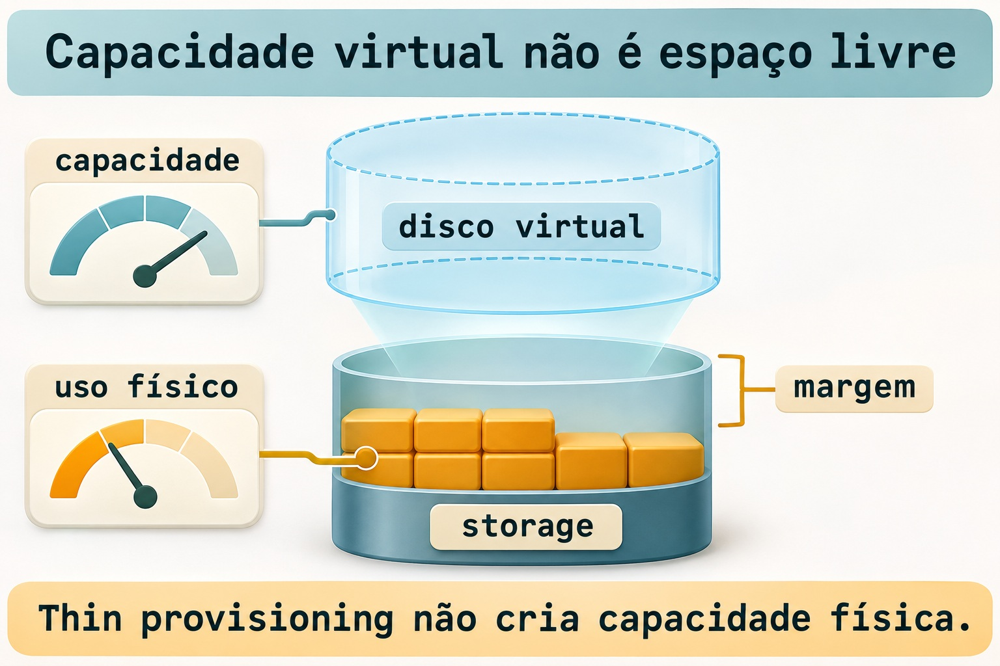

# Aula 17.4 · Storage: capacidade, crescimento e movimento

O disco aparece maior no Proxmox, mas a pasta de dados continua com o mesmo espaço. Nesta aula você separa capacidade virtual, consumo físico e tamanho do sistema de arquivos, trabalhando somente num disco novo da VM 211.

> **Núcleo desta aula:** crescer e mover discos exige conferir a referência no host e os dados dentro da VM.

| Ficha | |
| --- | --- |
| Módulo | M17 · Proxmox VE na prática, aula 4 de 7 |
| Quando | Semana 23 |
| Ao final | Criar um disco de dados, ampliar o ext4 e conferir um movimento entre storages |
| Pré-requisitos | Aulas 17.1–17.3; VM 211 disponível; backup autorizado e espaço físico |
| Duração | 100–130 min; o tempo de cópia depende do ambiente |
| Snapshot | Ponto anterior à mudança e backup independente no storage autorizado |

## 1 · Aquecimento

Você recebe um alerta de ocupação. Antes de ampliar, responda: acabou o espaço dentro da VM, a capacidade física do backend ou ambos?

- O tamanho configurado de um disco não informa sozinho quanto o backend já consumiu.
- Um filesystem menor pode existir dentro de um dispositivo maior.
- Um backup utilizável precisa continuar disponível se o storage de origem falhar.

Retome a configuração da VM 211 e marque o disco de boot, o drive de cloud-init e a interface de gerenciamento. Nenhum deles será substituído.

```bash
qm config 211
qm status 211
pvesm status
```

Estes comandos são do host Proxmox. Os comandos de filesystem desta aula pertencem ao terminal Linux **dentro da VM 211**.

## 2 · Por que importa

O storage pode atender muitas VMs. Um disco novo de laboratório continua consumindo recursos compartilhados; por isso você mede a margem antes de reservar ou escrever dados.

Thin provisioning permite apresentar uma capacidade virtual e alocar blocos físicos conforme o uso, segundo o backend. Não elimina limites, metadados, reservas nem alertas de ocupação.

Se a soma das promessas excede a capacidade real, várias VMs podem disputar o último espaço ao mesmo tempo. Apagar um arquivo no guest também não garante devolução imediata de blocos ao backend.



*Thin provisioning não cria capacidade física.*

### Ponte Windows

Aumentar o disco no hipervisor lembra aumentar um disco virtual e depois estender o volume no Windows. A primeira ação altera o dispositivo; a segunda adapta a estrutura que usa seus blocos.

Aqui o disco de dados terá ext4 diretamente no dispositivo, sem partição. Isso reduz as camadas do exercício; não descreve automaticamente o layout do disco de boot.

## 3 · Modelo mental

Pense em três perguntas, feitas em locais diferentes.

| Onde | Pergunta | Evidência |
| --- | --- | --- |
| Backend | Quanto espaço físico ainda posso usar com margem? | Estado, capacidade e alertas do storage |
| Proxmox | A qual volume este slot aponta e qual capacidade apresenta? | Configuração da VM e tarefa concluída |
| Guest | Qual dispositivo é esse e quanto cabe no filesystem? | Serial, montagem e tamanho do ext4 |

O nome do storage é um identificador de configuração. Ele não é necessariamente o caminho de uma pasta, nem prova que o mesmo conteúdo pode ser armazenado em outro backend.

**Decisão de segurança:** identificaremos o novo disco pelo serial `M17DATA`, nunca por adivinhar que ele será o segundo nome alfabético.

Uma mudança na ordem dos discos pode mudar o nome apresentado pelo kernel. O serial configurado permite ligar a identidade do host à observação dentro da VM.


*Confira cada camada antes de considerar o crescimento concluído.*

## 4 · Essencial

### Rocky × Debian

O host Proxmox continua responsável por criar e mover volumes. Dentro da VM, a ferramenta depende do filesystem: ext4 usa ferramentas diferentes de XFS.

O disco novo será ext4, mesmo que o sistema Rocky da VM use XFS no boot. Não aplique o procedimento ext4 a um volume XFS ou a uma camada LVM.

| Ação | Ferramenta ou evidência |
| --- | --- |
| Ver capacidade e disponibilidade do backend | `pvesm status` |
| Conferir slots e referências | `qm config 211` |
| Aumentar apenas o disco de dados | `qm disk resize 211 scsi1 +1G` |
| Crescer ext4 no disco identificado | `resize2fs` |
| Copiar e trocar a referência de storage | `qm disk move` |

**Antes de começar:** obtenha autorização para 4 GiB virtuais iniciais, crescimento de 1 GiB e consumo físico correspondente. Há ainda espaço para snapshots, backup e eventual segunda cópia.

O backend `vm-hdd` citado no plano precisa existir, estar ativo neste nó e aceitar imagens de VM. Se não estiver disponível, use outro storage real autorizado e registre a escolha.

Não crie um storage fictício para completar o roteiro. Um segundo backend é pré-requisito apenas para executar o movimento; sem ele, essa comparação permanece documental.

## 5 · Lab guiado

### Passo 1 · Inventariar e proteger

**Palpite:** quais linhas distinguem o disco de boot, o cloud-init e o slot livre?

No host, leia tudo antes de criar o disco. Confira também configurações pendentes na interface da VM. O slot `scsi1` precisa estar livre tanto na configuração atual quanto na pendente.

```bash
qm config 211
qm config 211 --current 1
qm pending 211
pvesm status
cat /etc/pve/storage.cfg
qm listsnapshot 211
```

**Saída esperada:** a VM se chama `m17-vm`; você identifica seus discos existentes e nenhum ocupa `scsi1`. Os storages reais e os tipos de conteúdo estão visíveis.

Registre as linhas completas de boot, cloud-init e rede; elas serão comparadas depois. Se houver estado pendente desconhecido, pare para resolvê-lo com quem administra o lab.

Crie um snapshot com nome ainda inexistente e faça backup no destino já autorizado. `PBS-LAB` precisa estar ativo, configurado e com permissão; não invente credenciais ou retenção.

```bash
qm snapshot 211 m17-pre-storage || exit 1
vzdump 211 --storage PBS-LAB --mode snapshot --remove 0 || exit 1
```

**Verifique:** ambas as tarefas terminaram sem erro; anote o identificador real do backup. Sem backend capaz de snapshot ou backup concluído, não siga com alterações neste lab.

### Passo 2 · Acrescentar somente o disco novo

**Palpite:** o que deve mudar na configuração quando você cria um disco de dados?

No host, escolha o storage de imagens validado no passo anterior; digite seu identificador real. Desligue a VM de forma limpa e confirme que parou antes de continuar.

```bash
read -r DATA_STORE
qm shutdown 211 --timeout 120
qm status 211
```

Só depois de confirmar o estado parado, execute a guarda. Ela recusa nome errado, variável vazia e slot existente; não substitui a conferência das pendências.

```bash
test -n "$DATA_STORE" &&
test "$(qm config 211 | sed -n 's/^name: //p')" = m17-vm &&
test "$(qm status 211)" = 'status: stopped' &&
! qm config 211 | grep -q '^scsi1:' &&
qm set 211 --scsi1 "$DATA_STORE:4,serial=M17DATA,discard=on" || { printf '%s\n' 'STOP: new disk creation not performed' >&2; exit 1; }
qm config 211
```

**Saída esperada:** surge uma única linha `scsi1` com o serial `M17DATA` e capacidade inicial de 4 GiB. As linhas registradas no Passo 1 continuam iguais.

**Verifique:** registre o identificador real do volume criado. Se a guarda recusou a operação, investigue; não remova um disco para liberar o slot.

```bash
qm start 211
```

### Passo 3 · Identificar, formatar e guardar uma prova

**Palpite:** um dispositivo sem filesystem é necessariamente o disco que acabamos de criar?

Entre na VM 211. Confira hostname, serial e árvore de dispositivos. Se as ferramentas de ext4 estiverem ausentes, instale o pacote `e2fsprogs` pelo gerenciador já conhecido da distribuição.

```bash
hostname
test "$(hostname -s)" = m17-vm || exit 1
lsblk -o NAME,TYPE,SIZE,FSTYPE,MOUNTPOINTS,SERIAL
ls -l /dev/disk/by-id/
```

Digite em `LAB_DISK` o caminho completo e real do disco com serial `M17DATA`, preferencialmente seu link persistente. Não copie um nome de outro terminal ou de outra VM.

```bash
read -r LAB_DISK
test -b "$LAB_DISK" || exit 1
SIGNATURES=$(sudo wipefs -n "$LAB_DISK") || exit 1
test ! -e /mnt/m17-data &&
test -b "$LAB_DISK" &&
test "$(lsblk -dnro SERIAL "$LAB_DISK")" = M17DATA &&
test "$(lsblk -dnro TYPE "$LAB_DISK")" = disk &&
test "$(lsblk -nrpo NAME "$LAB_DISK" | wc -l)" -eq 1 &&
test -z "$SIGNATURES" &&
! findmnt -rn -S "$LAB_DISK" &&
printf '%s\n' 'M17DATA: blank whole disk verified' || { printf '%s\n' 'STOP: new disk checks failed' >&2; exit 1; }
```

**Saída esperada:** a última frase aparece somente se serial, tipo, ausência de partições, assinaturas e montagem corresponderem. Revise visualmente `lsblk` e `wipefs` antes de formatar.

Se qualquer saída indicar dados anteriores, pare. O comando seguinte destrói estruturas existentes e só pertence ao disco novo já identificado; não use opção de força.

```bash
sudo mkfs.ext4 -L M17DATA "$LAB_DISK" || exit 1
sudo mkdir /mnt/m17-data || exit 1
sudo mount "$LAB_DISK" /mnt/m17-data || exit 1
printf '%s\n' 'm17-data: disposable evidence' | sudo tee /mnt/m17-data/evidence.txt
sudo sha256sum /mnt/m17-data/evidence.txt | tee "$HOME/m17-data.sha256"
findmnt /mnt/m17-data
df -hT /mnt/m17-data
```

**Verifique:** o filesystem é ext4 e contém a frase fictícia. A pasta deve ser nova e exclusiva deste lab; se já existir antes da criação, pare para conferir quem a usa.

### Passo 4 · Ampliar dispositivo e ext4

**Palpite:** depois de aumentar o disco no Proxmox, o ext4 já vai mostrar mais espaço?

Guarde a prova e desmonte na VM. Uma montagem ocupada precisa ser investigada; não force a desmontagem.

```bash
sudo sha256sum -c "$HOME/m17-data.sha256"
sync
sudo umount /mnt/m17-data || exit 1
```

No host, faça novo snapshot e backup com o disco de dados incluído. Confira se `scsi1` não está marcado para exclusão de backup e se a tarefa incluiu seu volume real.

```bash
qm snapshot 211 m17-pre-grow || exit 1
vzdump 211 --storage PBS-LAB --mode snapshot --remove 0 || exit 1
qm shutdown 211 --timeout 120
qm status 211
```

Com backup concluído, VM parada e espaço físico confirmado, aumente **somente** `scsi1`. A guarda verifica novamente nome e serial da configuração.

```bash
test "$(qm config 211 | sed -n 's/^name: //p')" = m17-vm &&
test "$(qm status 211)" = 'status: stopped' &&
qm config 211 | grep '^scsi1:' | grep -q 'serial=M17DATA' &&
qm disk resize 211 scsi1 +1G || { printf '%s\n' 'STOP: disk growth not performed' >&2; exit 1; }
qm config 211
qm start 211
```

Na VM, redigite o caminho em `LAB_DISK` e reconfirme serial, ext4 e ausência de montagem. Variáveis não sobrevivem à abertura de outro shell ou ao reboot.

```bash
read -r LAB_DISK
lsblk -o NAME,TYPE,SIZE,FSTYPE,MOUNTPOINTS,SERIAL "$LAB_DISK"
test "$(hostname -s)" = m17-vm || exit 1
test -b "$LAB_DISK" || exit 1
test "$(lsblk -dnro SERIAL "$LAB_DISK")" = M17DATA &&
test "$(lsblk -dnro TYPE "$LAB_DISK")" = disk &&
test "$(lsblk -dnro FSTYPE "$LAB_DISK")" = ext4 &&
! findmnt -rn -S "$LAB_DISK" &&
sudo e2fsck -f "$LAB_DISK"
FSCK_RC=$?
printf 'fsck exit: %s\n' "$FSCK_RC"
```

Se a checagem informar erro não corrigido, pare. Código 0 é íntegro; 1 indica correções realizadas e pede nova checagem antes de seguir. Não ignore um erro só porque o dispositivo cresceu.

Após uma checagem concluída com código 0, amplie o ext4 e monte novamente. Não há partição intermediária neste disco.

```bash
test "$FSCK_RC" -eq 0 && sudo resize2fs "$LAB_DISK" || { printf '%s\n' 'STOP: filesystem growth failed' >&2; exit 1; }
sudo mount "$LAB_DISK" /mnt/m17-data || exit 1
df -hT /mnt/m17-data
sudo sha256sum -c "$HOME/m17-data.sha256"
```

**Saída esperada:** dispositivo e ext4 apresentam a capacidade ampliada; a prova continua válida. O espaço utilizável difere da capacidade nominal por estruturas e reservas do filesystem.

**Verifique:** registre tamanho anterior e posterior, serial e resultado do hash. Não tente diminuir o disco de volta; uma redução exige outro planejamento e não faz parte deste exercício.

### Passo 5 · Mover quando existe destino real

**Palpite:** uma tarefa de cópia bem-sucedida prova que a VM usa o volume de destino?


*Só remova a origem antiga depois de conferir referência e dados.*

No host, examine um segundo storage autorizado que aceite imagens neste nó e tenha margem para a cópia. Verifique também a compatibilidade de snapshots entre os backends.

```bash
pvesm status
cat /etc/pve/storage.cfg
qm config 211
qm help disk move
```

**Sem segundo storage:** registre a origem real, a capacidade e quais requisitos faltam; explique onde mudaria a referência. Não execute o bloco de movimento e marque a prática como não realizada.

**Com segundo storage:** registre o volume de origem e digite em `TARGET_STORE` o identificador do destino, diferente da origem. Se snapshots impedirem a operação, pare; não apague sua proteção para forçar a cópia.

Na VM, desmonte a pasta; no host, desligue e confirme a parada. Execute o bloco somente depois da validação do destino e do backup do Passo 4.

```bash
read -r TARGET_STORE
qm shutdown 211 --timeout 120
qm status 211
```

```bash
test -n "$TARGET_STORE" &&
test "$(qm config 211 | sed -n 's/^name: //p')" = m17-vm &&
test "$(qm status 211)" = 'status: stopped' &&
qm config 211 | grep '^scsi1:' | grep -q 'serial=M17DATA' &&
qm disk move 211 scsi1 "$TARGET_STORE" --delete 0 || { printf '%s\n' 'STOP: disk move not performed' >&2; exit 1; }
qm config 211
```

**Saída esperada:** a tarefa conclui, `scsi1` aponta para o destino e o serial permanece. A origem preservada aparece como volume não usado; ela ainda ocupa espaço.

**Verifique:** compare as referências completas, confirme os discos protegidos do Passo 1 e confira a prova dentro da VM após iniciar. Se não executou o movimento, registre honestamente essa limitação.

A origem antiga fica preservada para revisão; este roteiro não manda excluir volumes não usados. Remover um deles pode apagar fisicamente seus dados.

### Passo 6 · Reboot e conferência completa

**Palpite:** depois do reboot, a falta de montagem significa perda dos dados?

No host, inicie a VM caso esteja parada; se já estiver ativa, faça reboot limpo. Não reinicie o nó Proxmox.

```bash
qm status 211
qm config 211
```

**Reboot de conferência:** escolha apenas a ação adequada ao estado que acabou de medir. Aguarde a inicialização e entre novamente na VM.

```bash
qm start 211
```

```bash
qm reboot 211
```

Na VM, identifique outra vez o disco por serial e monte a pasta. Não alteramos a configuração persistente de montagem; é esperado precisar montar manualmente após o reboot.

```bash
lsblk -o NAME,TYPE,SIZE,FSTYPE,MOUNTPOINTS,SERIAL
read -r LAB_DISK
test "$(lsblk -dnro SERIAL "$LAB_DISK")" = M17DATA &&
sudo mount "$LAB_DISK" /mnt/m17-data || exit 1
findmnt /mnt/m17-data
df -hT /mnt/m17-data
sudo sha256sum -c "$HOME/m17-data.sha256"
```

**Saída esperada:** o disco ampliado monta como ext4 e o hash confirma a mesma evidência. A referência no host corresponde ao backend atual, com ou sem movimento realizado.

**Verifique:** descreva três provas separadas: capacidade do dispositivo, capacidade do filesystem e integridade do arquivo. Uma não substitui as outras.

## 6 · Quebre e conserte

Todas as falhas abaixo ficam no disco fictício da VM 211. Não altere o disco do sistema, permissões do backend ou volumes de outras VMs.

### Quebra 1 · Pasta vazia depois de desmontar

**Sintoma:** a pasta existe, mas a prova parece ter sumido. Desmonte apenas a montagem do lab e olhe a pasta.

```bash
sudo umount /mnt/m17-data
ls -la /mnt/m17-data
findmnt /mnt/m17-data
```

**Investigação:** verifique a ausência de montagem e localize o disco pelo serial; não escreva uma nova prova na pasta vazia.
**Causa:** você está vendo a pasta do filesystem de boot, sem o disco de dados sobre ela.
**Conserto:** monte novamente o disco identificado.

```bash
test "$(lsblk -dnro SERIAL "$LAB_DISK")" = M17DATA &&
sudo mount "$LAB_DISK" /mnt/m17-data || exit 1
sudo sha256sum -c "$HOME/m17-data.sha256"
```

**Verifique:** o hash volta a conferir sem restaurar ou recriar o arquivo.
**Prevenção:** confira a montagem antes de interpretar uma pasta vazia como perda de dados.

### Quebra 2 · Dados visíveis, escrita recusada

**Sintoma:** ler funciona e escrever falha. Remonte somente a pasta do lab em leitura.

```bash
sudo mount -o remount,ro /mnt/m17-data
sudo touch /mnt/m17-data/probe.txt
```

**Investigação:** compare as opções de montagem com permissões de arquivo; o erro pode estar abaixo da permissão do usuário.

```bash
findmnt -no SOURCE,FSTYPE,OPTIONS /mnt/m17-data
```

**Causa:** a montagem está somente para leitura; mudar permissões de pasta não remove essa condição.
**Conserto:** restaure o modo de leitura e escrita apenas nessa montagem.

```bash
sudo mount -o remount,rw /mnt/m17-data
sudo touch /mnt/m17-data/probe.txt
sudo rm /mnt/m17-data/probe.txt
sudo sha256sum -c "$HOME/m17-data.sha256"
```

**Verifique:** a escrita funciona e a prova original mantém o hash.
**Prevenção:** diagnostique opções e saúde do filesystem antes de alterar permissões recursivamente.

### Quebra 3 · Medida certa na camada errada

**Sintoma:** alguém afirma que a pasta tem o tamanho do disco de boot. Produza a medida equivocada e compare.

```bash
df -hT /
df -hT /mnt/m17-data
lsblk -o NAME,SIZE,FSTYPE,MOUNTPOINTS,SERIAL
```

**Investigação:** associe cada caminho ao dispositivo realmente montado; confira o serial do disco de dados.
**Causa:** a medida da raiz foi usada como se representasse a montagem de dados.
**Conserto:** corrija o registro, usando o caminho montado e sua origem; nenhuma capacidade precisa ser alterada.
**Verifique:** seu relatório distingue a raiz do ext4 de dados, sem inventar números de saída.
**Prevenção:** escreva sempre qual objeto foi medido e em qual camada.

## 7 · Armadilhas

- Confundir espaço virtual disponível com margem física do backend.
- Usar o nome variável do kernel como prova de identidade do disco.
- Rodar uma ferramenta ext4 em XFS, ou esquecer uma camada de partição/LVM em outro layout.
- Apagar volumes não usados antes de conferir referência ativa, hash e backup.
- Prometer que um snapshot sempre desfaz um redimensionamento físico. O suporte e os limites dependem do backend; restauração do backup deve ser planejada.

### Decida 1

O disco cresceu no host, mas o ext4 continua menor. O que fazer?

A. Rodar novamente o comando de crescimento do disco até a pasta aumentar.
B. Formatar novamente o disco que contém os dados.
C. Conferir serial, layout e filesystem, depois ampliar a camada ainda menor.

### Decida 2

A tarefa de movimento concluiu e sobrou um volume não usado. Qual a próxima ação?

A. Conferir a referência ativa e os dados; tratar a exclusão antiga como ação separada.
B. Trocar o disco de boot para a cópia antiga.
C. Apagar todos os volumes não usados do storage.

## 8 · Quiz

1. Por que um disco virtual de 5 GiB não garante 5 GiB físicos livres no backend?
2. Qual identidade liga o disco novo configurado no host ao dispositivo no guest?
3. Qual camada intermediária foi deliberadamente omitida no disco de dados deste lab?
4. O que o resultado do hash prova depois do crescimento? O que ele não mede?
5. Por que manter a origem antiga aumenta temporariamente o consumo?
6. Sem segundo backend autorizado, como registrar o Passo 5 corretamente?

## 9 · Lembrete

**Flashcards:** capacidade virtual promete blocos; capacidade física limita o backend; filesystem organiza o espaço apresentado; hash compara o conteúdo da prova.

```text
!explica Por que aumentar um disco no Proxmox não amplia automaticamente todo filesystem?
!feynman Explique capacidade virtual, espaço físico e filesystem usando o disco M17DATA.
!quiz Faça perguntas sobre serial, resize, move e validação de dados na VM 211.
```

## 10 · Checklist e fechamento

- [ ] Registrei a configuração original e preservei boot, cloud-init e rede.
- [ ] Identifiquei o disco novo pelo serial antes de formatar.
- [ ] Ampliei o dispositivo e o ext4, conferindo o hash.
- [ ] Registrei se o movimento ocorreu ou ficou documental por falta de destino.
- [ ] Guardei o identificador do backup e as referências atuais de volume.
- [ ] Confirmei o reboot e restaurei montagem de leitura e escrita.

**Último exercício:** escreva um registro com identidade da VM, serial, origem, destino se usado, capacidades antes/depois, hash e limitações. Quem o ler deve distinguir uma cópia planejada de uma cópia executada.

Limpeza: remova apenas a prova temporária da Quebra 2, caso tenha sobrado. Preserve disco, evidência, hash e VM 211 para as próximas aulas; o CT 212 permanece para a 17.5.

Não apague o backup, o template 210, volumes não usados ou snapshots para ganhar espaço sem análise. A limpeza final dos recursos do módulo tem seu próprio ponto de conferência.

## 11 · Na vida real

Num atendimento real, primeiro observe: identifique a montagem afetada, o dispositivo, suas camadas e a política de storage. Uma solicitação de capacidade não autoriza formatar um volume existente.

Defina janela, responsáveis, backup restaurável, margem e critério de sucesso. Um filesystem com dados importantes pode exigir procedimento diferente, inclusive parada de aplicação.

A missão desta seção é somente de leitura: desenhe as camadas de um volume autorizado e indique onde mediria cada capacidade. Não execute o lab num servidor de cliente.

## 12 · Aprofundar quando quiser

- [Storage no Proxmox VE](https://pve.proxmox.com/pve-docs/chapter-pvesm.html): conteúdo, backends e capacidades.
- [Manual de qm](https://pve.proxmox.com/pve-docs/qm.1.html): confira a sintaxe instalada antes de mover ou redimensionar.
- [Documentação do kernel sobre ext4](https://docs.kernel.org/admin-guide/ext4.html): estrutura e características do filesystem.

Leia também os manuais locais de `resize2fs`, `e2fsck`, `lsblk` e `findmnt`; eles correspondem às ferramentas efetivamente instaladas.

## Gabarito comentado

**Decida 1: C.** A capacidade do dispositivo e a do filesystem são medidas distintas. Identificar o layout evita aplicar a ferramenta ao disco errado ou esquecer uma camada.

**Decida 2: A.** Conclusão da tarefa e referência ativa precisam concordar com a prova dentro da VM. A cópia antiga não deve ser excluída por uma regra genérica.

1. A capacidade virtual é apresentada ao guest; o backend possui consumo físico, reservas e outras cargas. Thin provisioning pode prometer mais do que o espaço disponível.
2. O serial `M17DATA`, conferido também no dispositivo que será formatado. Tamanho e ordem de nomes sozinhos não bastam.
3. A partição: ext4 foi criado diretamente no disco novo. Em outro layout seria preciso examinar partição e eventual LVM.
4. Prova que o conteúdo da evidência coincide com o hash registrado; não mede capacidade nem testa todos os arquivos da VM.
5. Há uma cópia no destino e o volume de origem preservado; até a exclusão aprovada, ambos continuam consumindo espaço.
6. Registrar pré-requisito ausente, origem real e comparação planejada; declarar que nenhum movimento foi executado.

Este material foi conferido documentalmente; os números e resultados devem ser obtidos no seu laboratório. Não há alegação de execução destas operações em VMs nesta entrega.

[← Aula 17.3 · Contêiner LXC](17.3-conteiner-lxc.md) · [Índice das aulas](../01-aulas.md) · [Plano do curso: 17.5 em diante →](../00-plano-do-curso.md)
