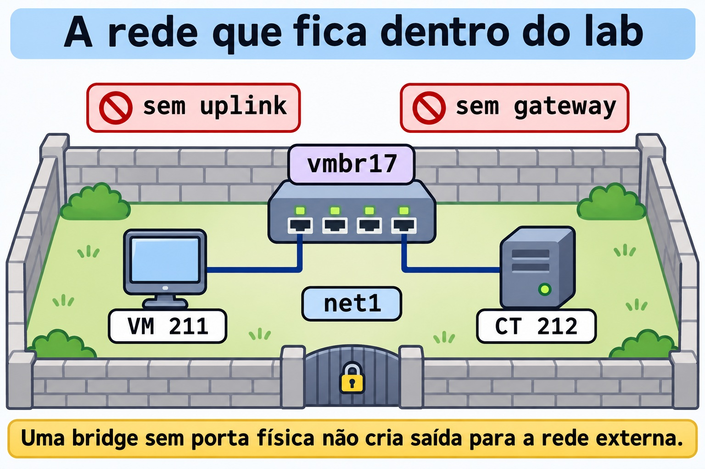
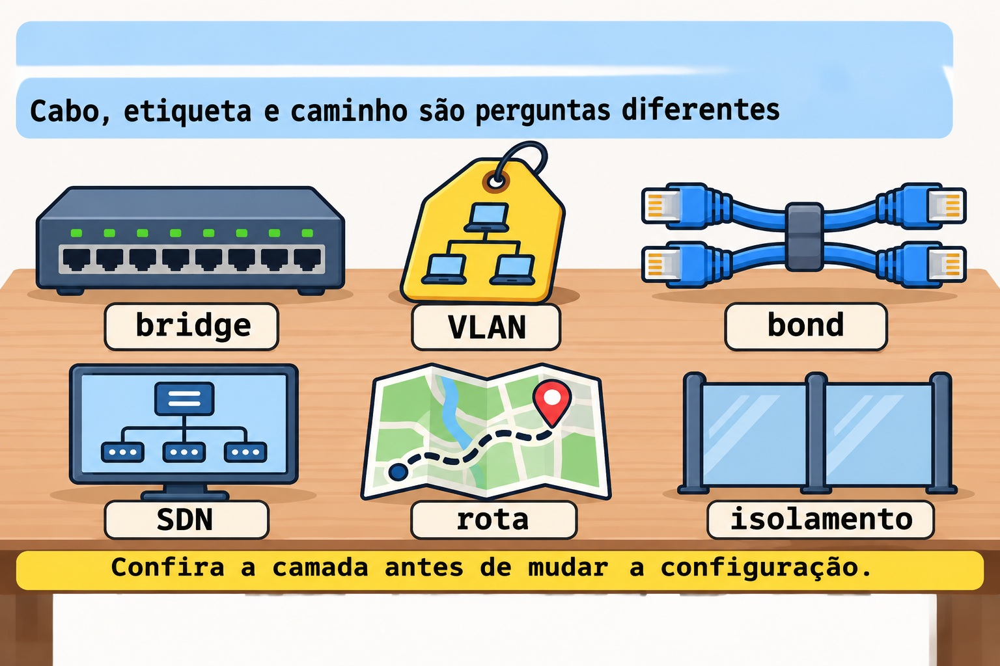
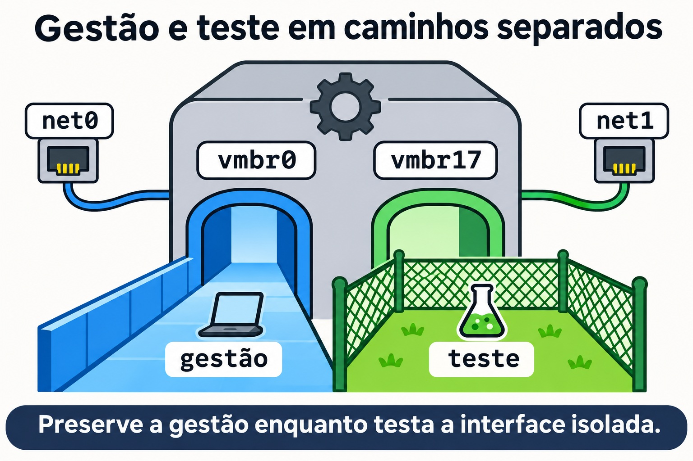

# Aula 17.5 · Rede: bridge, VLAN, bond e SDN

> **Núcleo desta aula:** montar uma rede isolada entre dois convidados sem alterar o caminho de gestão do host.

Uma VM tem endereço e mesmo assim não conversa com o vizinho. Antes de trocar IPs, você precisa distinguir porta, switch, etiqueta e rota.

| Ficha |  |
| --- | --- |
| **Módulo** | M17 · Proxmox no dia a dia, aula 5 de 7 |
| **Quando** | Semana 23 |
| **Ao final** | Criar uma bridge isolada, conectar duas interfaces e localizar a camada de uma falha |
| **Pré-requisitos** | 17.1 a 17.4; VM 211 e CT 212 do contrato; console do host de laboratório; `iproute2` e `iputils-ping` no CT |
| **Tempo** | 75 a 100 minutos |
| **Snapshot** | `m17a5-inicio` e `m17a5-fim` na VM 211; evidência do CT antes de removê-lo |

## 1 · Aquecimento

Responda antes de abrir o console.

1. Uma bridge sem porta física consegue ligar duas VMs do mesmo host?

2. Colocar duas interfaces em uma bridge cria automaticamente um gateway?

3. Uma VLAN e uma rota resolvem o mesmo problema?

## 2 · Por que importa

Você quer testar uma troca de arquivos entre a VM 211 e o CT 212. A gestão do host precisa continuar acessível, e a rede de testes não deve alcançar a rede externa.

Adicionar outra placa aos convidados permite separar os dois caminhos. A placa de gestão permanece onde estava; a placa nova entra num switch virtual sem saída física.

O resultado da aula é uma comunicação local demonstrável, não uma nova infraestrutura de produção. Não configure este exercício num host de cliente.

## 3 · Modelo mental

Pense numa sala com um switch e dois computadores. Sem cabo até outro switch, a sala fica no próprio domínio de camada 2. Um endereço IP organiza a conversa; não fabrica uma saída.



*Uma bridge sem porta física não cria saída para a rede externa.*

### Ponte Windows

| Referência | Equivalência útil |
| --- | --- |
| Switch virtual interno | Bridge sem interface física e sem endereço no host |
| Placa adicional da VM | Outra interface, com endereço e função próprios |
| Identificação de VLAN | Etiqueta que separa domínios de camada 2 |
| Agrupamento de interfaces | Bond; não é um sinônimo de bridge |

## 4 · O essencial

Uma Linux bridge encaminha quadros entre suas portas. Pode incluir interfaces virtuais e físicas, mas nenhuma porta física é obrigatória.

Uma bridge sem IP no host ainda conecta os convidados. O host não precisa participar da sub-rede para funcionar como switch.

VLAN identifica um domínio de camada 2. Roteamento conecta redes de camada 3. Um bond reúne links; suas propriedades dependem do modo e do switch.

SDN organiza configurações de rede em nível de datacenter. Sua existência não elimina a necessidade de conferir interfaces, bridges e conectividade.

Nesta bancada não criamos VLAN, bond, NAT, DHCP nem zona SDN. Comparamos esses recursos e alteramos somente a bridge nova.



*Confira a camada antes de mudar a configuração.*

### Rocky × Debian

| Camada | Rocky na VM 211 | Debian no CT 212 |
| --- | --- | --- |
| Placa | Dispositivo virtual reconhecido pelo kernel da VM | Interface criada no namespace do CT |
| Endereço do lab | Perfil dedicado do NetworkManager | Propriedade da configuração do CT |
| Inspeção | `ip -br address` e `ip route` | `ip -br address` e `ip route` |
| Gestão | `net0` permanece em `vmbr0` | `net0` permanece desligada em `vmbr0`; acesso pelo host |

### Decida 1

Você precisa de comunicação local entre dois convidados e nenhuma saída externa. Qual desenho atende ao pedido?

| A | B | C |
| --- | --- | --- |
| Bridge nova sem porta física e sem gateway | Mudar a bridge de gestão | Acrescentar uma rota padrão no host |

## 5 · Lab guiado

Comandos de host pertencem exclusivamente ao nó de laboratório autorizado. Os IDs 201 a 205 ficam fora desta aula.

Abra noVNC da VM 211 e console do host. Reserve uma janela para cada contexto; não cole comandos de host dentro do convidado.

Os endereços de documentação abaixo só são usados neste segmento isolado. Se já houver sobreposição nas rotas dos convidados, pare e escolha outro segmento isolado documentado antes de adaptar todas as linhas.

### Passo 1 · Identificar e guardar o estado

**Palpite:** os dois convidados têm nomes conhecidos, e o segundo slot de rede está livre.

No host, confira também o inventário do cluster, não apenas o nó atual.

```bash
pvesh get /cluster/resources --type vm
qm config 211
pct config 212
pct exec 212 -- sh -c 'command -v ip && command -v ping' || exit 1
test "$(qm config 211 | sed -n 's/^name: //p')" = m17-vm || exit 1
test "$(pct config 212 | sed -n 's/^hostname: //p')" = m17-ct || exit 1
! qm config 211 | grep -q '^net1:' || exit 1
! pct config 212 | grep -q '^net1:' || exit 1
umask 077
EVID=$(mktemp -d /root/m17a5.XXXXXX)
qm config 211 > "$EVID/vm211-antes.conf"
pct config 212 > "$EVID/ct212-antes.conf"
cp /etc/network/interfaces "$EVID/interfaces-antes"
qm snapshot 211 m17a5-inicio
printf '%s\n' "$EVID"
```

**Saída esperada:** os nomes batem com o contrato; não há `net1`; as ferramentas existem; o snapshot termina sem erro. Os caminhos temporários reais variam. Se faltar pacote no CT, pare e prepare uma imagem base autorizada com esses pacotes antes de refazer o CT; não ligue sua placa de gestão para improvisar uma instalação.

Nos consoles dos dois convidados, registre a gestão e confira sobreposição. Não prossiga se a rede escolhida já tiver outro uso.

```bash
ip -br address
ip route show table all
ip route get 192.0.2.211
ip route get 192.0.2.212
```

**Verifique:** a rota atual até esses endereços não é uma rede local já configurada. Uma rota padrão existente não é, sozinha, uma sobreposição.

A bridge é um recurso local do host. Antes deste passo, liste todos os nós com `pvecm nodes`. Repita os dois blocos de criação abaixo no console de **cada nó**, inclusive os possíveis destinos da 17.7, usando exatamente `/etc/network/interfaces.d/m17-lab`. Não basta criar no proprietário atual da VM.

### Passo 2 · Criar somente a bridge nova

**Palpite:** o host inclui arquivos adicionais, usa `ifupdown2` e não tem uma interface chamada `vmbr17`.

No host, leia o arquivo principal. A inclusão ativa precisa abranger exatamente o novo arquivo; comentário não conta.

```bash
dpkg-query -W ifupdown2
cat /etc/network/interfaces
grep -nE '^[[:space:]]*source(-directory)?[[:space:]]' /etc/network/interfaces
test ! -e /etc/network/interfaces.d/m17-lab || exit 1
! ip link show vmbr17 >/dev/null 2>&1 || exit 1
grep -Rns 'vmbr17' /etc/network/interfaces /etc/network/interfaces.d/
```

**Saída esperada:** inclusão ativa como `source /etc/network/interfaces.d/*` ou `source-directory /etc/network/interfaces.d`; nenhuma definição anterior de `vmbr17`.

Se a inclusão não existir ou tiver outro padrão, pare. A preparação autorizada do host vem antes desta aula; não acrescente uma linha de gestão por tentativa.

```bash
install -m 0644 /dev/null /etc/network/interfaces.d/m17-lab
cat > /etc/network/interfaces.d/m17-lab <<'EOF'
auto vmbr17
iface vmbr17 inet manual
    bridge-ports none
    bridge-stp off
    bridge-fd 0
    post-up sysctl -w net.ipv6.conf.vmbr17.disable_ipv6=1
EOF
ifquery vmbr17
ifup vmbr17
ip -br address show vmbr17
bridge link show master vmbr17
```

**Verifique:** a bridge existe sem endereço; ainda não há portas de convidados. Não execute uma recarga global nem desligue outra bridge.

Antes de conectar os convidados, confira o resultado em cada nó e registre seus nomes no diário. Uma bridge isolada com o mesmo nome em dois hosts não cria um enlace entre eles: na 17.7 ela permite iniciar a VM no destino, mas não estende automaticamente a LAN isolada entre nós.
```bash
hostname -s
ip -br link show vmbr17
```


### Passo 3 · Acrescentar interfaces sem tocar na gestão

**Palpite:** acrescentar `net1` mantém `net0` intacta.

Desligue os dois convidados de modo controlado antes da alteração. Se o desligamento não terminar, investigue pelo console; não force por conveniência.

```bash
qm shutdown 211 --timeout 60
pct shutdown 212 --timeout 60
qm status 211 | grep -qx 'status: stopped' || exit 1
pct status 212 | grep -qx 'status: stopped' || exit 1
qm set 211 --net1 virtio,bridge=vmbr17
pct set 212 --net1 name=eth1,bridge=vmbr17,ip=192.0.2.212/24,type=veth
qm config 211 > "$EVID/vm211-depois.conf"
pct config 212 > "$EVID/ct212-depois.conf"
diff <(grep '^net0:' "$EVID/vm211-antes.conf") <(qm config 211 | grep '^net0:')
diff <(grep '^net0:' "$EVID/ct212-antes.conf") <(pct config 212 | grep '^net0:')
qm start 211
pct start 212
```

**Saída esperada:** as duas comparações não mostram diferenças; as interfaces novas apontam para `vmbr17`.

**Verifique:** a gestão da VM continua acessível; o CT continua administrado por `pct exec` e com `net0` desligada. A placa nova ainda não dá endereço à VM.

### Passo 4 · Configurar o endereço na placa certa

**Palpite:** a MAC da interface nova identifica o dispositivo dentro da VM sem adivinhar seu nome.

No host, leia a MAC de `net1`. Na VM 211, compare essa MAC com a listagem e preencha a variável com o dispositivo correspondente.

```bash
qm config 211 | grep '^net1:'
```

Agora no console da VM 211, como administrador:

```bash
nmcli -f GENERAL.DEVICE,GENERAL.HWADDR,GENERAL.CONNECTION device show
read -r -p 'Interface net1: ' LAB_IF
ip link show dev "$LAB_IF" || exit 1
nmcli connection show
nmcli -g GENERAL.CONNECTION device show "$LAB_IF"
ACTIVE_PROFILE=$(nmcli -g GENERAL.CONNECTION device show "$LAB_IF") || exit 1
case "$ACTIVE_PROFILE" in ''|'--'|'Wired connection '*) ;; *) exit 1 ;; esac
! nmcli -g NAME connection show | grep -qx m17-isolada || exit 1
sudo nmcli connection add type ethernet ifname "$LAB_IF" con-name m17-isolada ipv4.method manual ipv4.addresses 192.0.2.211/24 ipv4.never-default yes ipv6.method disabled connection.autoconnect yes
sudo nmcli connection up m17-isolada
ip -br address show dev "$LAB_IF"
ip route show
```

**Saída esperada:** a interface escolhida tem `192.0.2.211/24`; a rota padrão continua na interface de gestão.

**Verifique:** não há gateway no perfil do lab. Se a MAC não bater, pare; não derrube o perfil da gestão para corrigir uma escolha errada. Se já existir perfil automático na placa nova, interrompa antes de criar outro e revise esse perfil isoladamente.

### Passo 5 · Demonstrar caminho, vizinho e persistência

**Palpite:** os dois endereços se encontram diretamente; a comunicação não usa a rota padrão.

Na VM 211, teste o vizinho. No CT, confira a volta pelo console ou pelo comando do host indicado.

```bash
ip route get 192.0.2.212
ping -c 3 192.0.2.212
ip neigh show dev "$LAB_IF"
```

No host:

```bash
pct exec 212 -- ip -br address show eth1
pct exec 212 -- ip route get 192.0.2.211
pct exec 212 -- ping -c 3 192.0.2.211
bridge link show master vmbr17
qm config 211 | grep '^net1:'
pct config 212 | grep '^net1:'
```

**Saída esperada:** a rota é direta pela placa nova; há respostas nos dois sentidos e portas virtuais na bridge. Nenhum tempo de resposta é predeterminado.

Se ICMP falhar, observe link, endereço, vizinho e regras existentes. Não desligue o firewall global para conseguir um resultado verde.

**Reboot de conferência:** reinicie apenas VM 211 e CT 212 pelo fluxo normal e repita os testes. Não reinicie o host nesta aula.

**Verifique:** os endereços reaparecem e a gestão permanece igual. Guarde comandos e resultados reais no diário.

### Passo 6 · Guardar evidências e liberar o ID 212

**Palpite:** o CT é descartável e suas evidências podem ser preservadas antes da remoção prevista no contrato.

Faça este passo somente depois das quebras da seção seguinte. Ele encerra o uso do CT e prepara a restauração da 17.6.

No host, volte a conferir nome e ID. Se existir qualquer dado não descartável no CT, interrompa a limpeza.

```bash
: "${EVID:?}"
test "$(pct config 212 | sed -n 's/^hostname: //p')" = m17-ct || exit 1
pct config 212 > "$EVID/ct212-final.conf"
pct exec 212 -- ip -br address > "$EVID/ct212-address.txt"
pct exec 212 -- ip route > "$EVID/ct212-route.txt"
pct exec 212 -- ping -c 3 192.0.2.211 > "$EVID/ct212-ping.txt"
read -r -p 'Confirmar descarte m17-ct 212: ' CONFIRMA
test "$CONFIRMA" = 'm17-ct 212' || exit 1
pct shutdown 212 --timeout 60
pct status 212 | grep -qx 'status: stopped' || exit 1
pct destroy 212
pvesh get /cluster/resources --type vm
qm snapshot 211 m17a5-fim
ip -br address show vmbr17
```

**Saída esperada:** o CT 212 desaparece do inventário; VM 211 e template 210 permanecem. A bridge continua sem IP.

**Verifique:** preserve o arquivo da bridge e a interface `net1` da VM. O segmento será reutilizado no desafio e no M19; não remova sua infraestrutura agora.

### Decida 2

A VM alcança a gestão, mas o endereço do CT usa a rota padrão. O que examinar primeiro?

| A | B | C |
| --- | --- | --- |
| O bond físico do host | O endereço e o perfil da interface nova | O DNS externo |

## 6 · Quebre e conserte

Execute antes da remoção do CT no Passo 6. Cada defeito afeta somente o segmento isolado. Repare um antes de criar o próximo.

### Quebra 1 · O cabo virtual foi desligado

No host, preserve a configuração original de `net1` e mude somente o estado do link.

```bash
NET1=$(qm config 211 | sed -n 's/^net1: //p')
test -n "$NET1" || exit 1
qm set 211 --net1 "$NET1,link_down=1"
```

**Sintoma:** o ping deixa de funcionar, embora o endereço continue configurado.

**Investigação:** compare `qm config 211` no host e `ip link` na VM; veja o estado do cabo virtual.

**Causa:** o hipervisor apresenta a placa com link desligado. Um IP não substitui o link.

**Conserto:** no mesmo shell do host, recoloque exatamente a configuração guardada.

```bash
qm set 211 --net1 "$NET1"
```

**Verifique:** a VM volta a alcançar o CT pela interface do lab.

**Prevenção:** registre o estado do link junto com bridge e endereço.

### Quebra 2 · O endereço ficou na placa errada?

Na VM 211, derrube apenas o perfil isolado. Não altere o dispositivo da gestão.

```bash
sudo nmcli connection down m17-isolada
ip route get 192.0.2.212
```

**Sintoma:** o teste local falha e a rota pode cair na saída padrão.

**Investigação:** confira o perfil ativo e o endereço do dispositivo cuja MAC corresponde a `net1`.

**Causa:** sem endereço e rota conectada, a presença da placa na bridge não basta.

**Conserto:** reative o perfil existente, sem criar um segundo perfil concorrente.

```bash
sudo nmcli connection up m17-isolada
ip route get 192.0.2.212
```

**Verifique:** a rota volta a indicar a interface do lab e o ping passa.

**Prevenção:** confira perfil, dispositivo e MAC como um conjunto.

### Quebra 3 · A etiqueta não combina

Esta quebra é uma análise de configuração, sem aplicar VLAN ao host. Leia o cenário e escreva a evidência necessária.

**Sintoma:** dois convidados no mesmo nome de bridge não se enxergam; um tem VLAN configurada e o outro não.

**Investigação:** compare as propriedades das placas, a configuração VLAN da bridge e o desenho esperado do segmento.

**Causa:** pertencer ao mesmo switch não garante pertencer ao mesmo domínio de camada 2.

**Conserto:** no cenário, alinhe as etiquetas ao desenho autorizado; na bancada atual, mantenha as duas placas sem etiqueta.

```bash
qm config 211 | grep '^net1:'
pct config 212 | grep '^net1:'
ifquery vmbr17
```

**Verifique:** não há `tag=` nas duas interfaces desta bancada. Não adicione uma VLAN apenas para reproduzir a história.

**Prevenção:** registre bridge e etiqueta; um nome isolado não descreve o caminho inteiro.



*Preserve a gestão enquanto testa a interface isolada.*

## 7 · Armadilhas

- Uma bridge isolada não impede um convidado de rotear tráfego se alguém configurar encaminhamento dentro dele. Não transforme a VM em roteador.

- Acrescentar IP ao host amplia a superfície do desenho e não é necessário para este teste.

- Bond não duplica automaticamente a velocidade de uma única conexão; depende do modo e da distribuição dos fluxos.

- VLAN depende da configuração coerente ao longo do caminho; não é criptografia.

- Recarregar toda a rede para criar uma bridge vazia envolve interfaces fora do exercício.

- O snapshot da VM não salva os arquivos de rede do host. A evidência do host precisa existir separadamente.

## 8 · Quiz

1. Por que a bridge do lab usa configuração manual sem endereço no host?

2. Como você prova que o ping não passou pela interface de gestão?

3. Se a MAC está correta e o link está ativo, qual camada você examina em seguida?

4. Por que o teste com o nome do CT exigiria uma investigação diferente do teste por IP?

5. O que precisa permanecer para a próxima aula e o M19?

6. Por que aceitar uma conexão automática desconhecida na placa nova exige revisão antes de criar o perfil do lab?

## 9 · Cola

| Pergunta | Observação |
| --- | --- |
| Qual bridge recebeu a placa? | `qm config 211` |
| Que portas estão no switch? | `bridge link show master vmbr17` |
| Qual caminho o IP usa? | `ip route get 192.0.2.212` |
| Há vizinho na placa do lab? | `ip neigh` |
| Qual perfil foi ativado? | `nmcli connection show --active` |

**Flashcards:** bridge encaminha quadros; gateway encaminha pacotes; VLAN separa domínios; bond reúne links; SDN organiza redes.

## 10 · Checklist e fechamento

- [ ] Confirmei inclusão ativa do arquivo adicional antes de criá-lo.

- [ ] Preservei a configuração de gestão e comparei `net0` antes e depois.

- [ ] Demonstrei rota direta e comunicação nos dois sentidos antes da limpeza.

- [ ] Repeti os testes após reiniciar os convidados.

- [ ] Guardei evidências do CT e liberei o ID 212 com a guarda de nome.

- [ ] Preservei VM 211, template 210, bridge e arquivo para a continuação.

**Último exercício:** desenhe o caminho de um quadro da VM até o CT e marque onde entrariam uma etiqueta VLAN e um roteador.

No DeepTutor, mantenha os comandos literais abaixo e acrescente sua explicação fora deles.

`!explica bridge VLAN bond SDN`

`!feynman bridge sem IP no host`

`!quiz rede isolada no Proxmox`

## 11 · Na vida real

Missão somente de leitura: escolha uma VM autorizada e rastreie a placa virtual até a bridge, o bond e a interface física, se existirem.

Registre quem é responsável por cada camada, quais VLANs são esperadas e onde fica o gateway. Não altere a gestão para completar o desenho.

Compare o estado observado com o inventário aprovado. Uma interface desconhecida é motivo para investigar com o responsável, não para apagá-la.

## 12 · Aprofundar quando quiser

Consulte [a documentação oficial de rede do Proxmox VE](https://github.com/proxmox/pve-docs/blob/master/pve-network.adoc) para exemplos de bridges, bonds e VLANs.

Confira os parâmetros das placas no [manual oficial de VM](https://github.com/proxmox/pve-docs/blob/master/generated/qm.1-synopsis.adoc) e no [manual oficial de CT](https://github.com/proxmox/pve-docs/blob/master/generated/pct.1-synopsis.adoc).

A documentação descreve recursos mais amplos que esta bancada. Aplicar uma mudança global exige um plano próprio e não faz parte dos passos acima.

## Gabarito comentado

**Aquecimento 1:** sim. As portas virtuais podem trocar quadros na mesma bridge sem interface física.

**Aquecimento 2:** não. Um gateway precisa existir e encaminhar tráfego; ligar placas não cria esse serviço.

**Aquecimento 3:** não. VLAN separa domínios de camada 2; uma rota escolhe o caminho entre redes.

**Decida 1:** A. O desenho atende à comunicação local e preserva a gestão.

**Decida 2:** B. A ausência da rota conectada aponta primeiro para endereço, perfil e dispositivo do lab.

**Quiz 1:** o host só precisa encaminhar quadros; não precisa de endereço nessa sub-rede.

**Quiz 2:** registre a rota escolhida, o dispositivo e o vizinho. A resposta do ping sozinha não identifica o caminho.

**Quiz 3:** confira endereço, prefixo e rota; depois avalie vizinhança e filtragem com evidências.

**Quiz 4:** nomes acrescentam a camada de resolução. Um erro de DNS não demonstra defeito da bridge.

**Quiz 5:** VM 211 com sua interface adicional, template 210 e infraestrutura da bridge. O CT 212 sai após guardar as evidências.

**Quiz 6:** um perfil existente pode já configurar endereço, gateway ou autoconexão; identifique seu dispositivo e escopo antes de modificá-lo, sem tocar na gestão.

[← Aula 17.4 · Storage](17.4-storage.md) · [Índice das aulas](../01-aulas.md) · [Aula 17.6 · Backup e restauração →](17.6-backup-e-restauracao.md)
