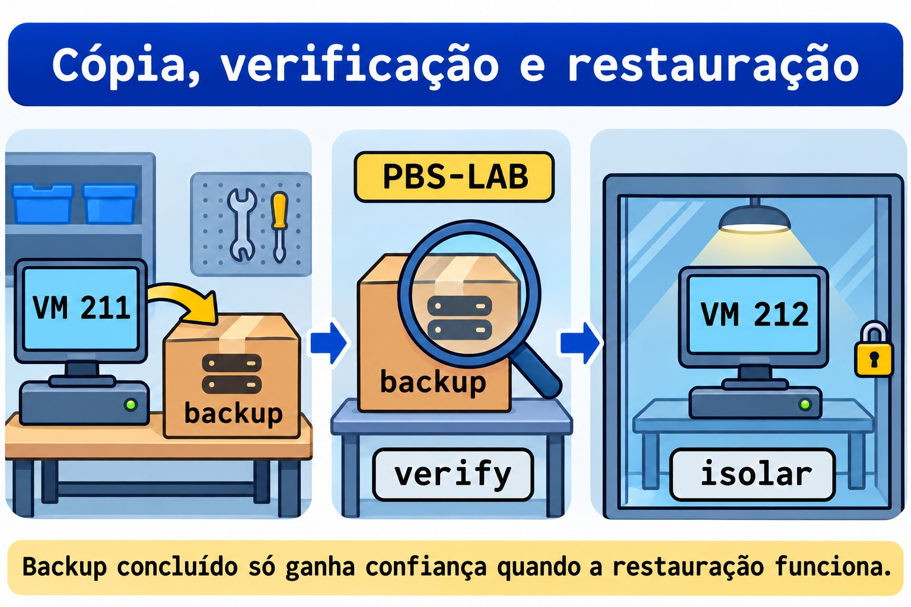
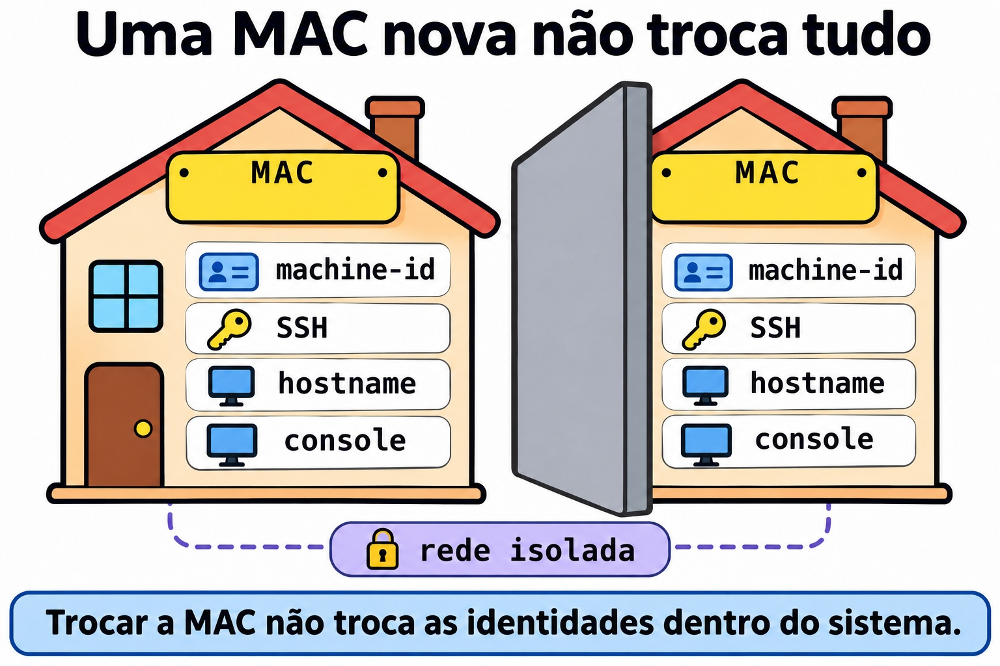
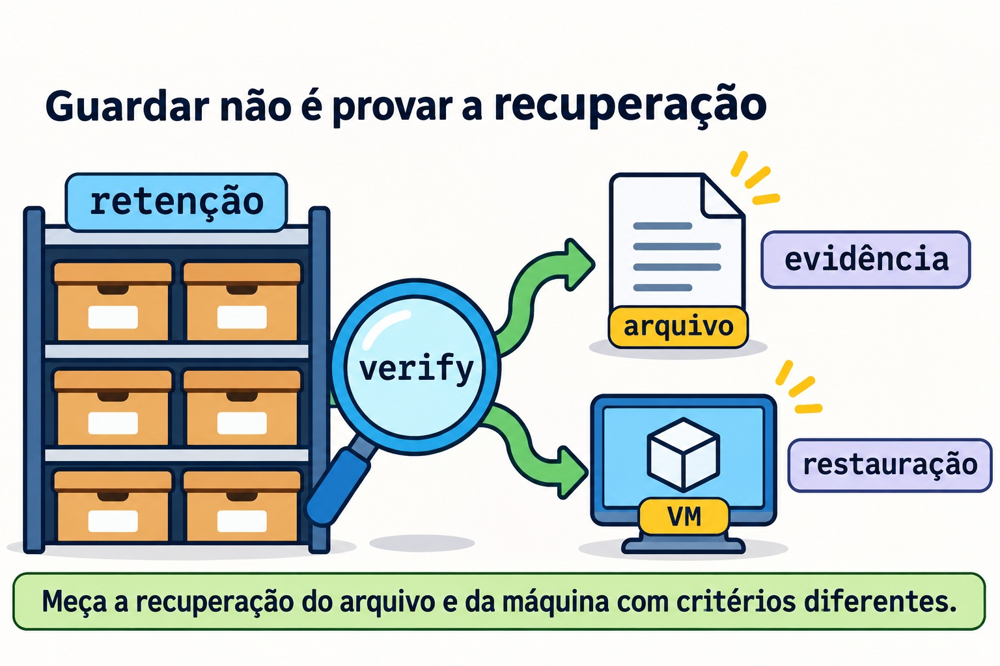

# Aula 17.6 · Backup e restauração com PBS

> **Núcleo desta aula:** produzir um backup da VM 211, verificar seu conteúdo e demonstrar a recuperação sem colocar uma cópia com identidade repetida na rede.

Um job verde confirma uma etapa. A confiança depende também de localizar a cópia, recuperar o que importa e registrar quanto tempo isso levou.

| Ficha |  |
| --- | --- |
| **Módulo** | M17 · Proxmox no dia a dia, aula 6 de 7 |
| **Quando** | Semana 23 |
| **Ao final** | Recuperar um arquivo e uma VM isolada a partir de uma cópia identificada |
| **Pré-requisitos** | 17.5 concluída; VM 211; ID 212 livre no cluster; storage `PBS-LAB` já preparado |
| **Tempo** | 90 a 120 minutos, mais transferência e verificação |
| **Snapshot** | `m17a6-inicio` e `m17a6-fim` na VM 211; backup externo identificado no diário |

## 1 · Aquecimento

1. Um snapshot guardado no mesmo storage resolve a perda desse storage?

2. A verificação de integridade demonstra que a aplicação inicia depois da restauração?

3. Uma MAC nova elimina o endereço IP, o nome e as chaves SSH que estavam no disco?

## 2 · Por que importa

O inventário mostra backups recentes, mas ninguém tentou recuperar um arquivo. Quando chega o pedido, faltam a identificação da cópia e a autorização para restaurar sem sobrescrever a máquina atual.

Você vai ensaiar os dois caminhos: arquivo individual e máquina completa. O original permanece ligado; a cópia restaurada só inicia sem conectividade.

Esta aula usa um PBS de laboratório já cadastrado. Implantar o servidor, distribuir credenciais e criar políticas globais exigiria outro contrato.

## 3 · Modelo mental

Pense numa caixa lacrada. Transportá-la, conferir o lacre e montar novamente o equipamento são operações diferentes. Uma pode dar certo e a seguinte falhar.



*Backup concluído só ganha confiança quando a restauração funciona.*

### Ponte Windows

| Referência | Pergunta equivalente |
| --- | --- |
| Recuperar uma versão de arquivo | Qual snapshot contém o conteúdo desejado? |
| Recuperar uma máquina inteira | Onde iniciar a cópia sem sobrescrever o original? |
| Histórico do job | O transporte terminou e qual foi a cópia produzida? |
| Ensaio de recuperação | O dado recuperado satisfaz o critério da operação? |

## 4 · O essencial

O Proxmox VE coordena o backup do convidado. O PBS armazena os dados e oferece verificação e políticas próprias. São serviços com interfaces e responsabilidades diferentes.

Uma cópia incremental deduplicada continua representando um ponto de recuperação completo. A quantidade transferida não é o tamanho lógico restaurável.

O modo de backup precisa combinar com a aplicação. Para esta bancada, usaremos desligamento controlado e modo parado, evitando escrever uma promessa de consistência que não medimos.

Retenção escolhe quais pontos conservar. Prune remove referências conforme a política; garbage collection recupera chunks sem referência posteriormente. Não execute nenhum dos dois globalmente para este exercício.

RPO pergunta quanto dado pode ser perdido; RTO pergunta quanto tempo a recuperação pode levar. Um backup recente e uma recuperação rápida respondem a perguntas diferentes.

Se transformar o ensaio em job agendado, documente primeiro seu escopo. Um job do lab deve selecionar explicitamente apenas a VM 211, não todos os convidados ou um pool compartilhado.

| Campo do plano | Decisão para esta bancada |
| --- | --- |
| Seleção | Somente VM 211; nunca todos os convidados |
| Destino | `PBS-LAB` já autorizado |
| Horário | Janela aprovada, sem competir com jobs existentes |
| Retenção | Simular os pontos conservados antes de permitir remoção |
| Verificação | Ensaio de arquivo e VM com periodicidade e responsável |

O comando manual desta aula não agenda jobs nem autoriza descarte. Uma política futura é uma mudança própria, com revisão e simulação antes de ativar.



*Trocar a MAC não troca as identidades dentro do sistema.*

### Rocky × Debian

| Camada | Rocky | Debian |
| --- | --- | --- |
| Identidade persistente | `machine-id`, hostname e chaves SSH no disco | Os mesmos tipos de identidade |
| Recuperação de arquivo | Comparar conteúdo e permissões | Comparar conteúdo e permissões |
| Recuperação de VM | Validar boot e serviço esperado | Validar boot e serviço esperado |
| Segurança da cópia | Rede desligada antes do primeiro boot | A mesma regra |

### Decida 1

Você só precisa de um arquivo removido ontem. Qual caminho preserva melhor o estado atual?

| A | B | C |
| --- | --- | --- |
| Recuperar o arquivo para um destino novo e compará-lo | Restaurar por cima da VM atual | Excluir a VM antes de procurar a cópia |

## 5 · Lab guiado

O CT 212 foi removido no fim da 17.5. Agora o mesmo número será usado temporariamente por uma VM chamada `m17-restore`. Não suponha que esteja livre: confira o cluster.

Não use restauração forçada, restauração ao vivo ou inicialização automática. O original 211 não será apagado nesta aula.

### Passo 1 · Fixar o critério de recuperação

**Palpite:** um arquivo conhecido permite distinguir recuperar uma máquina de apenas iniciar qualquer sistema.

No console da VM 211, confirme o login local com a credencial de emergência definida na 17.2; depois use um shell administrativo para criar o marcador. Se ele já existir, pare e leia o conteúdo antes de decidir reutilizá-lo.

```bash
sudo -i
test ! -e /var/lib/m17/evidencia.txt || exit 1
install -d -m 0750 /var/lib/m17
printf '%s\n' 'm17-vm 211: recuperacao ensaiada' > /var/lib/m17/evidencia.txt
chmod 0640 /var/lib/m17/evidencia.txt
sha256sum /var/lib/m17/evidencia.txt
stat -c '%a %U:%G %n' /var/lib/m17/evidencia.txt
cat /etc/machine-id
hostnamectl hostname
```

**Saída esperada:** o arquivo contém uma linha; guarde o hash real e seus metadados no diário. Não há hash de exemplo para copiar.

No host, confirme a origem e salve configuração e inventário numa pasta privada.

```bash
test "$(qm config 211 | sed -n 's/^name: //p')" = m17-vm || exit 1
umask 077
EVID=$(mktemp -d /root/m17a6.XXXXXX)
qm config 211 > "$EVID/vm211.conf"
pvesh get /cluster/resources --type vm --output-format json-pretty > "$EVID/inventario-antes.json"
qm snapshot 211 m17a6-inicio
pvesm status --storage PBS-LAB
pvesm status
cat /etc/pve/storage.cfg
read -r -p 'Storage de imagens autorizado para restore: ' RESTORE_STORE
test -n "$RESTORE_STORE" || exit 1
qm config 211 | grep -E '^(scsi|virtio|sata|ide)[0-9]+:'
```

**Verifique:** `PBS-LAB` está ativo e aceita backup. O destino escolhido suporta imagens e tem margem para todos os discos da cópia; use `vm-hdd` se validado ou outro backend real autorizado. Inclua o disco de dados `M17DATA` da 17.4: dado excluído do backup não pode ser prometido na recuperação.

### Passo 2 · Produzir uma cópia identificável

**Palpite:** desligar de forma controlada e copiar a VM parada produz um ponto conhecido para este exercício.

No host, liste antes e depois. Não acrescente opções de prune nem retenção ao comando desta cópia.

```bash
pvesm list PBS-LAB --content backup --vmid 211 > "$EVID/backups-antes.txt"
qm shutdown 211 --timeout 60
qm status 211 | grep -qx 'status: stopped' || exit 1
date -Is > "$EVID/backup-inicio.txt"
vzdump 211 --storage PBS-LAB --mode stop --remove 0 || exit 1
date -Is > "$EVID/backup-fim.txt"
pvesm list PBS-LAB --content backup --vmid 211 | tee "$EVID/backups-depois.txt"
qm start 211
```

**Saída esperada:** a tarefa termina com sucesso e surge um volume de backup com data real. Se a tarefa falhar, não avance usando um nome parecido.

Copie o identificador completo da linha nova, não o tamanho nem o identificador de uma cópia anterior.

```bash
read -r -p 'Volume ID do backup novo: ' BACKUP
case "$BACKUP" in PBS-LAB:backup/vm/211/*) ;; *) exit 1 ;; esac
printf '%s\n' "$BACKUP" > "$EVID/backup-volume.txt"
pvesm extractconfig "$BACKUP" | tee "$EVID/backup-config.conf"
```

**Verifique:** a configuração recuperada pertence à VM de origem e inclui os discos previstos. Guarde o horário e o resultado da tarefa.

### Passo 3 · Verificar no servidor correto

**Palpite:** a cópia recém-criada pode ser verificada no PBS sem iniciar uma verificação global do datastore.

Abra a interface do PBS de laboratório, não a tela de rede do Proxmox VE. No datastore correspondente a `PBS-LAB`, abra o conteúdo e selecione exatamente o snapshot da VM 211 anotado.

Execute a ação de verificação desse snapshot. Confirme o escopo mostrado antes de iniciar; se a interface selecionar o datastore inteiro, cancele e peça a execução pontual ao administrador do PBS.

Registre identificador da tarefa, snapshot selecionado, conclusão e horário. Não copie tokens, senhas ou configuração de credenciais para o diário.

**Saída esperada:** a verificação do ponto escolhido termina sem erro. Um resultado anterior de outra cópia não satisfaz este passo.

**Verifique:** explique a diferença entre integridade dos dados armazenados e boot funcional do sistema recuperado. A segunda ainda não foi demonstrada.

### Passo 4 · Recuperar um arquivo para um destino novo

**Palpite:** explorar a cópia permite obter o marcador sem substituir o arquivo da VM em uso.

No host de laboratório, confira a ferramenta. O repositório PBS autorizado e sua impressão digital vêm do inventário validado, nunca de uma aceitação cega do certificado.

```bash
command -v proxmox-file-restore
read -r -p 'Repositorio PBS autorizado: ' PBS_REPOSITORY
export PBS_REPOSITORY
SNAPSHOT=${BACKUP#PBS-LAB:backup/}
printf '%s\n' "$SNAPSHOT"
proxmox-file-restore list "$SNAPSHOT" / --repository "$PBS_REPOSITORY"
```

Autentique-se pelo mecanismo aprovado, sem colocar a senha na linha de comando. Se houver namespace ou criptografia, use o namespace e a chave de recuperação autorizados; sem eles, pare.

A raiz mostra arquivos de disco. Navegue pelo nome real do disco e pelas partições ou volumes exibidos. Não suponha uma partição fixa nem um layout igual ao de outra VM.

```bash
read -r -p 'Caminho de diretorio exibido: ' DIR_RESTORE
proxmox-file-restore list "$SNAPSHOT" "$DIR_RESTORE" --repository "$PBS_REPOSITORY"
```

Repita a listagem até localizar o marcador dentro do sistema de arquivos. Copie o caminho virtual completo exibido; ele inclui o disco e o caminho interno do convidado.

```bash
read -r -p 'Caminho completo do arquivo no backup: ' FILE_RESTORE
DEST=$(mktemp -d /root/m17-file-restore.XXXXXX)
proxmox-file-restore extract "$SNAPSHOT" "$FILE_RESTORE" - --repository "$PBS_REPOSITORY" --format plain > "$DEST/evidencia.txt"
RC=$?
test "$RC" -eq 0 || exit 1
sha256sum "$DEST/evidencia.txt"
cat "$DEST/evidencia.txt"
proxmox-file-restore status
```

**Saída esperada:** o conteúdo e o hash coincidem com os registrados no Passo 1. O arquivo recuperado está numa pasta nova do host.

**Verifique:** este fluxo mede os bytes do arquivo. Para devolver o dado à aplicação, ainda é preciso planejar proprietário, modo, contexto de segurança e aprovação do responsável.

### Passo 5 · Restaurar a máquina com todas as placas desligadas

**Palpite:** uma VM restaurada em outro ID pode ser examinada sem atingir a rede do original.

No host, comprove que nenhum nó do cluster usa 212. A consulta deve funcionar antes de confiar em um resultado vazio.

```bash
pvesh get /cluster/resources --type vm --output-format json > "$EVID/cluster-pre-restore.json" || exit 1
python3 - "$EVID/cluster-pre-restore.json" <<'PY' || exit 1
import json, sys
items = json.load(open(sys.argv[1]))
assert not any(int(x.get('vmid', -1)) == 212 for x in items), 'ID 212 ocupado'
PY
date -Is > "$EVID/restore-inicio.txt"
: "${RESTORE_STORE:?}" "${BACKUP:?}"
qmrestore "$BACKUP" 212 --storage "$RESTORE_STORE" --unique 1 --start 0 || exit 1
qm status 212 | grep -qx 'status: stopped' || exit 1
qm set 212 --name m17-restore --onboot 0 || exit 1
qm config 212 > "$EVID/restore-antes-isolar.conf" || exit 1
```

Não inicie ainda. O novo ID e as MACs novas não demonstram mudança das identidades internas. O cloud-init pode detectar uma instância nova e regenerar parte delas; confira o resultado pelo console, sem presumir preservação ou regeneração.

Desligue o link de todas as interfaces restauradas, inclusive a interface do segmento isolado. O laço preserva as demais propriedades de cada placa.

```bash
while IFS= read -r LINE; do
    KEY=${LINE%%:*}
    VALUE=${LINE#*: }
    VALUE=$(printf '%s' "$VALUE" | sed -E 's/(^|,)link_down=[01](,|$)/\1/; s/,$//')
    qm set 212 --"$KEY" "$VALUE,link_down=1" || exit 1
done < <(grep -E '^net[0-9]+:' "$EVID/restore-antes-isolar.conf")
qm config 212 > "$EVID/restore-isolado.conf" || exit 1
cat "$EVID/restore-isolado.conf"
awk '/^net[0-9]+:/ && $0 !~ /,link_down=1(,|$)/ {bad=1} END {exit bad}' "$EVID/restore-isolado.conf" || exit 1
qm start 212
```

**Saída esperada:** todas as linhas de placa exibem `link_down=1`; a VM inicia sem conectividade. Confira isso antes de pressionar iniciar.

Pelo console da VM 212, use a credencial local testada antes do backup e um shell administrativo. Se a VM usar console serial, abra a console correspondente; não configure uma rede para facilitar o acesso. Leia o marcador, o hash e a identidade.

```bash
cat /var/lib/m17/evidencia.txt
sha256sum /var/lib/m17/evidencia.txt
stat -c '%a %U:%G %n' /var/lib/m17/evidencia.txt
cat /etc/machine-id
hostnamectl hostname
ip -br link
journalctl -b -p err --no-pager
lsblk -o NAME,TYPE,SIZE,FSTYPE,MOUNTPOINTS,SERIAL
read -r -p 'Disco restaurado com serial M17DATA: ' LAB_DISK
test "$(lsblk -dnro SERIAL "$LAB_DISK")" = M17DATA || exit 1
mount "$LAB_DISK" /mnt/m17-data
sha256sum /mnt/m17-data/evidence.txt
```

**Verifique:** o marcador coincide com a origem; o hash do disco de dados coincide com o diário da 17.4; o boot chega ao login e os erros são interpretados. Falhas de rede são esperadas com cabos desligados; não esconda erros de disco entre elas.

### Passo 6 · Registrar o ensaio e remover só a cópia

**Palpite:** o resultado pode ser preservado sem manter duas máquinas com as mesmas identidades.

Faça este passo depois das análises de falha. Copie as observações do noVNC para o diário e registre tempos reais, inclusive investigação e autenticação.

No host, guarde a configuração final e confirme nome e ID antes de remover a VM descartável.

```bash
date -Is > "$EVID/restore-fim.txt"
test "$(qm config 212 | sed -n 's/^name: //p')" = m17-restore || exit 1
qm config 212 > "$EVID/restore-final.conf"
read -r -p 'Confirmar descarte m17-restore 212: ' CONFIRMA
test "$CONFIRMA" = 'm17-restore 212' || exit 1
qm shutdown 212 --timeout 60
qm status 212 | grep -qx 'status: stopped' || exit 1
qm destroy 212
qm status 211
qm snapshot 211 m17a6-fim
pvesh get /cluster/resources --type vm
```

**Saída esperada:** VM 212 removida; VM 211 e template 210 preservados; backup identificado continua disponível.

**Verifique:** não apague a cópia PBS que será usada no desafio. A bridge do laboratório também permanece para a continuação e para o M19.

### Decida 2

A restauração gerou MACs novas. Você pode ligar a cópia à rede de gestão imediatamente?

| A | B | C |
| --- | --- | --- |
| Só se o backup tiver menos de um dia | Não; primeiro valide e planeje as identidades internas | Sim, toda identidade mudou |

## 6 · Quebre e conserte

As falhas abaixo são ensaios de decisão e leitura. Não corrompa chunks, apague backups nem conecte a cópia para provocar o problema.

### Quebra 1 · A cópia era de outro horário

**Sintoma:** a VM restaurada inicia, mas não contém o marcador recém-criado.

**Investigação:** compare horário do marcador, conclusão do backup e identificador completo escolhido para restauração.

```bash
cat "$EVID/backup-volume.txt"
cat "$EVID/backup-inicio.txt" "$EVID/backup-fim.txt"
pvesm list PBS-LAB --content backup --vmid 211
```

**Causa:** uma cópia antiga pode ser íntegra e ainda assim não conter a versão necessária.

**Conserto:** identifique o ponto correto antes de repetir a restauração isolada; nunca substitua o original para testar uma suposição.

**Verifique:** associe marcador e snapshot com datas e conteúdo, não apenas com o número da VM.

**Prevenção:** registre o volume completo e o critério de recuperação junto com a tarefa.

### Quebra 2 · O caminho virtual foi adivinhado

**Sintoma:** a ferramenta lista o snapshot, mas não encontra o caminho usado para extrair o arquivo.

**Investigação:** volte à raiz da listagem e acompanhe disco, partição ou volume e diretórios.

```bash
proxmox-file-restore list "$SNAPSHOT" / --repository "$PBS_REPOSITORY"
```

**Causa:** o caminho de extração inclui a árvore virtual de discos; não é apenas o caminho absoluto dentro da VM.

**Conserto:** navegue com os nomes reais. Se houver criptografia interna ou layout não acessível, use restauração completa isolada e a chave autorizada.

**Verifique:** extraia para outro destino novo e compare o hash. Arquivo vazio criado pela redireção não significa extração bem-sucedida.

**Prevenção:** guarde a sequência de navegação e o código de saída; não copie caminhos de outra instalação.

### Quebra 3 · O backup passou, mas a rede seria perigosa

**Sintoma:** o plano de restauração propõe iniciar a cópia com IP estático igual ao original.

**Investigação:** leia a configuração das placas e a identidade pelo noVNC antes de considerar qualquer reconexão.

```bash
qm config 212 | grep -E '^net[0-9]+:'
```

**Causa:** o disco restaurado carrega hostname, perfis de rede, machine-id e chaves. MAC nova não resolve esse conjunto.

**Conserto:** mantenha todos os links desligados e valide a recuperação pelo console. Uma futura promoção exige um plano de identidade próprio.

**Verifique:** todas as placas da VM 212 continuam com `link_down=1`. Não basta isolar somente a placa da gestão.

**Prevenção:** inclua isolamento pré-boot no procedimento, antes da ação de iniciar.



*Meça a recuperação do arquivo e da máquina com critérios diferentes.*

## 7 · Armadilhas

- Transferência pequena pode representar uma VM grande pela deduplicação; tamanho transferido não mede a recuperabilidade.

- Uma política de retenção agressiva pode remover o único ponto que contém a versão desejada. Simule e aprove o escopo antes de alterar políticas.

- Não confunda o nome do storage no Proxmox VE com o nome real do datastore no PBS.

- Sem a chave de criptografia, a presença dos dados não garante acesso ao conteúdo. O plano de recuperação precisa incluir custódia e teste de acesso.

- O relógio da tarefa não inclui necessariamente o tempo de descobrir credenciais, caminho e autorização. Meça o ensaio inteiro.

- A cópia do backup fora do host e uma política de isolamento do PBS respondem a riscos que um snapshot local não cobre.

## 8 · Quiz

1. Qual evidência liga o marcador ao ponto de recuperação escolhido?

2. Por que uma verificação bem-sucedida não substitui o boot da cópia?

3. O que você confere antes de usar o ID 212?

4. Por que extrair os bytes do arquivo não devolve automaticamente todos os metadados da aplicação?

5. Qual diferença existe entre RPO, RTO e política de retenção?

6. Por que conferir só o marcador do disco de boot não prova a recuperação do disco M17DATA?

## 9 · Cola

| Pergunta | Ação de leitura |
| --- | --- |
| Que cópias existem? | `pvesm list PBS-LAB --content backup --vmid 211` |
| Qual configuração foi salva? | `pvesm extractconfig` com o volume anotado |
| Como explorar o arquivo? | `proxmox-file-restore list` antes de extrair |
| A cópia está isolada? | Todas as placas exibem `link_down=1` |
| O resultado vale para qual ponto? | Volume completo, horário e tarefa |

**Flashcards:** backup transporta; verify confere dados; restauração demonstra uso; retenção escolhe pontos; RTO mede recuperação; RPO limita perda.

## 10 · Checklist e fechamento

- [ ] Registrei conteúdo, hash e metadados do marcador antes da cópia.

- [ ] Guardei o volume completo e a configuração extraída.

- [ ] Registrei a verificação do snapshot correto no PBS.

- [ ] Recuperei o arquivo para um destino novo e comparei os bytes.

- [ ] Comprovei o ID livre e desliguei todos os links antes do primeiro boot.

- [ ] Validei boot, conteúdo e erros pelo console sem rede.

- [ ] Removi somente a VM temporária após guardar os resultados.

- [ ] Preservei o backup validado e a VM original para o desafio.

**Último exercício:** escreva um procedimento de recuperação com origem, ponto, destino, isolamento, critério e responsável pela aprovação.

**Reboot de conferência:** o boot da VM 212 isolada é a conferência desta aula; não reinicie o host nem conecte a cópia para acrescentar uma etapa.

Use os comandos literais do DeepTutor e explique com os dados do seu ensaio.

`!explica backup verify restauracao`

`!feynman restaurar sem duplicar identidade`

`!quiz RPO RTO retencao`

## 11 · Na vida real

Missão somente de leitura: escolha um serviço autorizado e localize sua política de backup, retenção, armazenamento e último teste documentado de recuperação.

Registre quem possui credenciais e chaves, como obter aprovação e onde restaurar sem interferir na produção. Não teste senhas nem inicie jobs sem autorização.

Compare o RPO e o RTO pedidos com a evidência disponível. A ausência de ensaio é uma lacuna a registrar, não um resultado que se possa supor.

## 12 · Aprofundar quando quiser

Leia a [sintaxe oficial de restauração de VM](https://github.com/proxmox/pve-docs/blob/master/generated/qmrestore.1-synopsis.adoc), especialmente destino, inicialização e geração de MACs.

Consulte a [referência oficial das ferramentas PBS](https://pbs.proxmox.com/docs/command-syntax.html) para exploração e extração de arquivos e o [cliente oficial](https://pbs.proxmox.com/docs/backup-client.html) para acesso ao repositório.

A [documentação de manutenção do PBS](https://pbs.proxmox.com/docs/maintenance.html) explica verificação, prune e garbage collection. São mecanismos diferentes; planeje cada escopo separadamente.

## Gabarito comentado

**Aquecimento 1:** não. A perda do storage pode levar os dados e seus snapshots; uma cópia independente responde a outro risco.

**Aquecimento 2:** não. Integridade armazenada e funcionamento da aplicação são critérios diferentes.

**Aquecimento 3:** não. Esses valores estão dentro do sistema restaurado e podem continuar iguais.

**Decida 1:** A. Recuperar para um destino novo permite comparar antes de substituir qualquer dado em uso.

**Decida 2:** B. O plano precisa tratar endereço, hostname e demais identidades, além da MAC.

**Quiz 1:** conteúdo e hash registrados antes do backup, volume completo e horário do ponto escolhido.

**Quiz 2:** ela verifica os dados armazenados; inicialização e serviço precisam de critérios observáveis na cópia recuperada.

**Quiz 3:** consulta bem-sucedida ao inventário do cluster demonstrando ausência de VM e CT com aquele número.

**Quiz 4:** o fluxo de saída simples entrega conteúdo; proprietário, modo e contextos exigem tratamento explícito no destino.

**Quiz 5:** RPO limita perda de dados, RTO limita duração da recuperação e retenção decide quais pontos continuam disponíveis.

**Quiz 6:** são volumes diferentes. O backup deve incluir o disco de dados, e o arquivo nele precisa ser montado e comparado com o hash anotado na 17.4.

[← Aula 17.5 · Rede](17.5-rede.md) · [Índice das aulas](../01-aulas.md) · [Aula 17.7 · Migração e quorum →](17.7-migracao-e-quorum.md)
