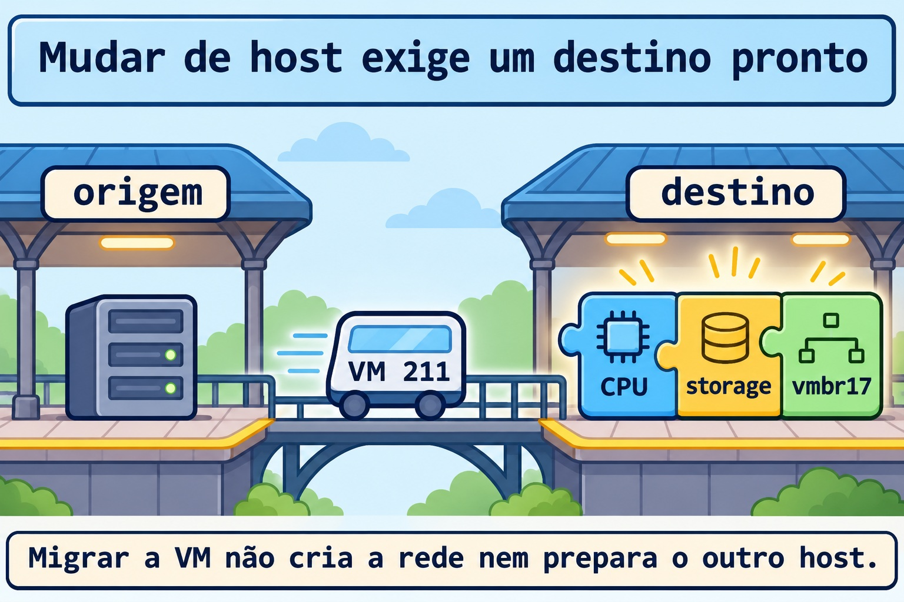
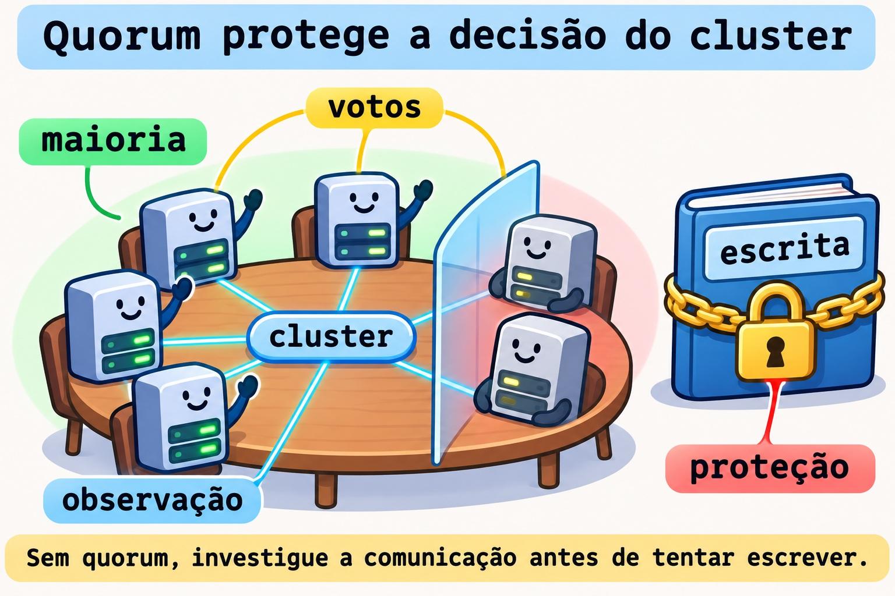
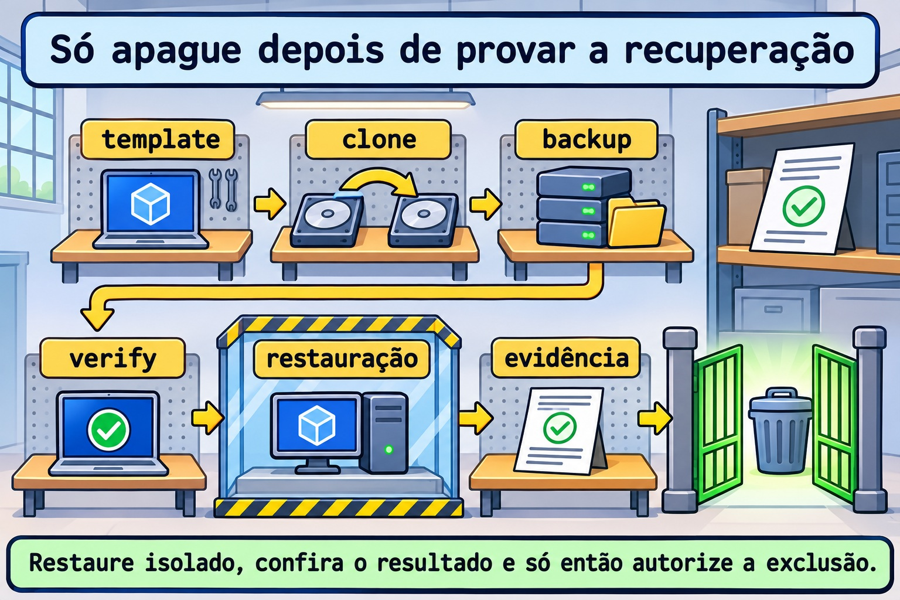

# Aula 17.7 · Migração e quorum

> **O coração desta aula:** migrar exige um destino preparado; apagar exige uma recuperação já demonstrada.

| Ficha | Plano de trabalho | 
|---|---| 
| Módulo | M17 · Proxmox na prática, aula 7 de 7 | 
| Quando | Semana 24 | 
| Ao final | Avaliar migração e quorum e provar recuperação da bancada | 
| Pré-requisitos | Aulas anteriores, PBS-LAB disponível, evidência externa e console | 
| Duração | 150–210 minutos, além das transferências | 
| Snapshot | Preservar o ponto de retorno existente; o desafio exige backup independente | 

Esta aula fecha o módulo e retoma seu diagnóstico inicial.
Primeiro você consulta o cluster e, se houver condições reais, migra a VM 211.
Depois realiza um ensaio de recuperação isolado, com barreiras antes de qualquer exclusão.
Os convidados 201 a 205 e a bridge isolada permanecem preservados.

## 1 · Aquecimento

1. Configuração replicada significa que o disco local está disponível no destino?
2. Um cluster sem maioria deve aceitar alterações concorrentes dos dois lados?
3. Backup concluído basta para autorizar a exclusão da única VM?

Recupere o plano que você escreveu na primeira aula.
Sublinhe o que agora consegue provar, em vez de apenas descrever.
Deixe explícito o que sua bancada não permite executar.

## 2 · Por que importa

Migração não instala rede, não cria storage e não acrescenta instruções à CPU do destino.
Ela depende dessas condições já existentes.
Uma tarefa aceita pode falhar depois por uma condição que você poderia ter conferido antes.

Quorum protege decisões de configuração; não é um indicador de velocidade da rede.
Sua ausência exige investigar membros, votos e comunicação.
Forçar uma maioria não é uma forma didática de reparar o cluster real.

O fechamento acrescenta outra disciplina: testar a recuperação antes de precisar dela.
O relatório deve continuar existindo quando o convidado original já não existe.

### Ponte Windows

Mover uma carga entre hosts exige compatibilidade de recursos e conectividade equivalente.
O nome da rede pode ser igual e representar uma ligação diferente no outro host.
Você precisa conferir significado e alcance, não somente o rótulo.

## 3 · Modelo mental



*Migrar a VM não cria a rede nem prepara o outro host.*

| Condição | Evidência | Se faltar | 
|---|---|---| 
| Destino no mesmo cluster | Inventário e membros | Não executar migração | 
| CPU compatível | Modelo, fabricante e recursos em ambos | Resolver antes da tentativa | 
| Discos compartilhados | Todos os volumes acessíveis nos dois nós | Não presumir transferência implícita | 
| Redes equivalentes | Bridge, portas e isolamento | Preparar fora desta operação | 
| Quorum | Maioria e comunicação saudáveis | Investigar somente por leitura | 

Migração e restauração são operações diferentes.
Na migração, a propriedade da VM muda dentro do cluster.
Na restauração, um backup reconstrói discos e configuração em um ID controlado.
Nenhuma delas autoriza colocar duas identidades iguais na mesma rede.

## 4 · O essencial

Esta aula usa migração convencional dentro do mesmo cluster.
Não configure migração remota entre clusters nem altere quorum para completar o roteiro.
Todos os volumes da VM 211 devem estar em storage compartilhado disponível no destino.
Isso inclui disco do sistema, EFI, cloud-init e o disco de dados acrescentado antes.

As versões do destino devem ser compatíveis e não anteriores às da origem para a operação planejada.
Use a matriz e as notas da versão instalada, com o mesmo fabricante de CPU para esta prática.
Se não consegue demonstrar compatibilidade, escolha o ramo não executado.

### Bancada de um único nó

Você fará as consultas disponíveis e documentará uma migração planejada, não realizada.
Não invente um destino nem crie um cluster temporário no host para preencher a evidência.
O ensaio de backup e restauração pode continuar no mesmo nó, se seus pré-requisitos estiverem atendidos.

## 5 · Lab guiado

### Passo 1 · Descobrir os membros e o quorum

**Palpite:** qual consulta diferencia um destino real de um nome escrito no diário?

```bash
pvesh get /nodes --output-format json-pretty
pvesh get /cluster/resources --type vm --output-format json-pretty
pvesh get /cluster/status --output-format json-pretty
pvecm status
```

**Saída esperada:** membros reais e estado de quorum, quando o nó pertence a um cluster.
Em um nó independente, a consulta do gerenciador de cluster pode indicar que não há configuração de cluster.
Registre essa condição; ela não é autorização para criar um cluster.



*Sem quorum, investigue a comunicação antes de tentar escrever.*

**Verifique:** há pelo menos dois nós reais no mesmo cluster e quorum saudável?
Se não, marque migração não realizada e pule os comandos de execução do passo 4.
Não desligue membros, bloqueie comunicação nem altere votos para simular perda de quorum.

### Passo 2 · Conferir os recursos do destino

**Palpite:** uma bridge com o mesmo nome possui necessariamente as mesmas ligações?

Nos nós de origem e destino, faça apenas as consultas abaixo.

```bash
pveversion -v
lscpu
pvesm status
ip -d link show vmbr0
ip -d link show vmbr17
bridge link
ip -br address show vmbr17
```

**Saída esperada:** recursos compatíveis e bridge isolada já existente nos dois nós.
A bridge isolada não recebe IP no host nem porta física, e não deve alcançar a rede de gestão.
Não crie ou reconfigure a bridge do destino dentro desta tentativa de migração.
Se ela falta, pare e obtenha a preparação autorizada antes de voltar a este passo.

**Verifique:** fabricante, modelo de CPU exposto, versões, RAM e storage servem ao destino escolhido?
Repita a conferência completa dos recursos de CPU feita na criação da bancada.
Registre quais condições foram demonstradas e quais ficaram pendentes.

### Passo 3 · Conferir a VM e todos os volumes

**Palpite:** qual disco pequeno costuma ser esquecido em uma avaliação de migração?

No nó proprietário da VM 211, consulte sua ficha e tarefas atuais.

```bash
qm status 211
qm config 211
qm pending 211
pvenode task list --limit 10
```

**Saída esperada:** VM da bancada sem outra operação concorrente e sem alteração pendente inexplicada.
Liste os identificadores de todos os volumes, incluindo EFI, cloud-init e dados.
Confirme o acesso aos mesmos backends em ambos os nós; não basta o nome estar cadastrado.
Dispositivo passado diretamente, mídia local ou recurso restrito ao nó exige análise fora deste roteiro.

Dentro do clone, registre endereço, rota, estado do agente e acesso ao dado da aula de storage.
Não formate nem substitua o disco de dados para simplificar a lista.

**Verifique:** a ficha identifica `m17-vm`, e nenhum volume depende somente da origem?
Se há tarefa ativa de backup, snapshot ou alteração de disco, espere sua conclusão e reavalie.
Não remova um bloqueio para forçar concorrência.

### Passo 4 · Migrar somente quando as condições permitem

**Palpite:** que evidência comprova a mudança de proprietário depois da tarefa?

Execute este bloco apenas no ramo com destino real, quorum e recursos conferidos.
Leia o nome de um nó que realmente apareceu no inventário e confira antes de confirmar.

```bash
read -r -p 'No de destino real no mesmo cluster: ' DESTINO
: "${DESTINO:?}"
test "$(qm config 211 | sed -n 's/^name: //p')" = m17-vm || exit 1
qm migrate 211 "$DESTINO" --online 1 || exit 1
```

**Saída esperada:** tarefa concluída sem erro e propriedade da VM no destino.
Não interprete uma linha de progresso como conclusão final.
Consulte o inventário do cluster e o log da tarefa que acabou de executar.

```bash
pvesh get /cluster/resources --type vm --output-format json-pretty
```

No nó destino, confira a VM pelo ID e pelo nome antes de usar a console.
Dentro dela, repita as provas de rede, agente e leitura do dado que registrou antes.
Se a sessão interrompeu, registre duração e sintoma real, sem prometer ausência de interrupção.

**Verifique:** a aplicação ou o dado observado continua acessível no novo proprietário?
No ramo de um nó, escreva quais condições faltaram e deixe a migração marcada não realizada.
Não use uma captura de outra bancada como prova da sua.

### Passo 5 · Ensaiar a recuperação sem apagar a origem

**Palpite:** o teste de restauração pode revelar algo que o sucesso do backup não revela?



*Restaure isolado, confira o resultado e só então autorize a exclusão.*

Use o fluxo da aula anterior para obter backup novo da VM 211 no storage já cadastrado.
O disco de dados deve estar incluído; confira sua participação na ficha antes de iniciar.

```bash
vzdump 211 --storage PBS-LAB --mode snapshot --remove 0 || exit 1
pvesm list PBS-LAB --vmid 211
```

Selecione o volume exato criado agora; não escolha apenas o primeiro item da lista.
No PBS, execute a verificação desse backup e espere o resultado final bem-sucedido.
Se você não tem acesso autorizado ao resultado, pare antes de qualquer exclusão.
O CT 212 da aula anterior deve já ter sido removido pelo procedimento de limpeza dela.
Se ainda existe qualquer objeto 212, não o sobrescreva: resolva primeiro sua preservação e limpeza autorizada.

```bash
pvesh get /cluster/resources --type vm --output-format json-pretty
read -r -p 'Volume exato do backup verificado: ' BACKUP_PREVIO
: "${BACKUP_PREVIO:?}"
case "$BACKUP_PREVIO" in PBS-LAB:backup/vm/211/*) ;; *) exit 1 ;; esac
set -o pipefail
pvesh get /cluster/resources --type vm --output-format json |
  perl -MJSON::PP -0777 -e '$r=decode_json(<>); exit((scalar grep { $_->{vmid} == 212 } @$r) ? 1 : 0)' || exit 1
pvesm status
read -r -p 'Storage de imagens autorizado para restore: ' RESTORE_STORE
: "${RESTORE_STORE:?}"
qmrestore "$BACKUP_PREVIO" 212 --storage "$RESTORE_STORE" --unique 1 --start 0 || exit 1
qm set 212 --name m17-restore --onboot 0 || exit 1
qm config 212
```

Antes de iniciar 212, desconecte todas as NICs restauradas na ficha da VM.
Preserve seus parâmetros e acrescente o estado desconectado; confira cada índice existente.
Não confunda MAC novo com identidade interna nova; a restauração mantém o conteúdo do backup.
Use esta função apenas nos dois IDs de restauração da bancada; ela preserva os demais parâmetros de cada NIC.

```bash
desconectar_nics_m17() {
  local id="$1" nic spec config nome nics
  case "$id" in 211|212) ;; *) return 1 ;; esac
  config=$(qm config "$id") || return 1
  nome=$(printf '%s\n' "$config" | sed -n 's/^name: //p')
  case "$id:$nome" in 211:m17-vm|212:m17-restore) ;; *) return 1 ;; esac
  nics=$(printf '%s\n' "$config" | sed -nE 's/^(net[0-9]+): .*/\1/p')
  test -n "$nics" || return 1
  while IFS= read -r nic; do
    spec=$(printf '%s\n' "$config" | sed -n "s/^$nic: //p")
    spec=$(printf '%s' "$spec" | sed -E 's/,link_down=[01]//g')
    test -n "$spec" || return 1
    qm set "$id" "--$nic" "$spec,link_down=1" || return 1
  done <<< "$nics"
  config=$(qm config "$id") || return 1
  printf '%s\n' "$config" | awk '/^net[0-9]+:/ && $0 !~ /,link_down=1(,|$)/ {bad=1} END {exit bad}' || return 1
}
desconectar_nics_m17 212 || { printf '%s\n' 'STOP: isolation failed' >&2; exit 1; }
qm config 212
```

Confira na saída real que cada NIC está desconectada; só depois execute a inicialização.

```bash
desconectar_nics_m17 212 || exit 1
qm start 212 || exit 1
qm terminal 212
```

Use somente a console para iniciar, entrar e ler o dado restaurado no disco da aula de storage.
Use a credencial local testada na 17.6, confirme o shell correto e identifique o disco pelo serial `M17DATA`. A montagem manual e o hash do arquivo devem coincidir com o diário da 17.4; o marcador da raiz não substitui essa prova.

**Saída esperada:** restauração 212 isolada com sistema e dado conferidos.
**Verifique:** registre backup, verify, restauração, leitura e isolamento fora dos convidados.
Sem essa sequência completa, a barreira de exclusão continua fechada.

### Passo 6 · Autorizar a preparação do desafio

**Palpite:** o que precisa sobreviver fora da VM antes de liberar seu ID?

Conserve o backup prévio, o dado de storage e o relatório externo do passo 5.
A evidência deve identificar o backup exato e a restauração 212 realmente testada.
Somente depois dessa prova você pode liberar a VM de exercício e sua restauração temporária.
Desligue os dois sistemas de forma limpa antes de remover seus objetos.

```bash
qm shutdown 211 --timeout 120
qm shutdown 212 --timeout 120
qm status 211
qm status 212
qm config 211
qm config 212
```

**Saída esperada:** ambos desligados; nomes correspondem exatamente à bancada e à restauração.
Se o desligamento não concluir, investigue pela console; não force para cumprir o tempo.
Antes das exclusões, outra pessoa deve conseguir localizar o relatório externo.
Execute cada comando abaixo somente depois de conferir nome, estado e a prova de recuperação.

```bash
test "$(qm config 211 | sed -n 's/^name: //p')" = 'm17-vm' && \
  test "$(qm status 211)" = 'status: stopped' && qm destroy 211
test "$(qm config 212 | sed -n 's/^name: //p')" = 'm17-restore' && \
  test "$(qm status 212)" = 'status: stopped' && qm destroy 212
```

**Verifique:** os IDs 211 e 212 ficaram livres no inventário completo, e 210 continua template desligado.
Os backups e a bridge isolada não são removidos.
Se você não concluiu a prova do passo 5, preserve tudo e marque o desafio bloqueado na preparação.

## 6 · Quebre e conserte

As quebras são decisões sobre a evidência; não provoque falhas no cluster real.

### Quebra 1 · A bridge falta no destino

**Sintoma:** o inventário de rede do destino não contém a bridge isolada.
**Investigação:** compare bridge, portas e endereços nos dois nós.
**Causa:** o nome da rede da origem foi tratado como recurso automaticamente criado no destino.
**Conserto:** suspenda a migração e solicite a preparação autorizada equivalente.
**Verifique:** repita a consulta depois da preparação; só então reavalie a migração.
**Prevenção:** rede integra a lista de pré-requisitos, não a lista de reparos após mover.

### Quebra 2 · A maioria não está disponível

**Sintoma:** uma evidência fornecida mostra cluster sem quorum e configuração somente leitura.
**Investigação:** relacione membros vistos, votos esperados e comunicação registrada.
**Causa:** a partição observada não reúne as condições para decidir alterações com segurança.
**Conserto:** preserve a evidência e encaminhe a recuperação da comunicação ao procedimento operacional.
**Verifique:** só retome alterações quando a condição normal estiver restaurada e documentada.
**Prevenção:** não altere votos nem remova membros para tornar uma tela verde.

### Quebra 3 · O backup não contém o dado esperado

**Sintoma:** a restauração isolada não apresenta o marcador ou o dado esperado.
**Investigação:** compare instante do backup, volumes incluídos e caminho conferido.
**Causa:** pode haver backup antigo, disco excluído ou leitura do lugar errado.
**Conserto:** preserve a origem e produza novo backup correto antes de repetir a restauração.
**Verifique:** compare conteúdo e checksum com a evidência externa; só sucesso de tarefa não basta.
**Prevenção:** leia um dado conhecido na restauração antes de autorizar qualquer exclusão.

## 7 · Armadilhas

### Decida 1

O disco principal é compartilhado, mas EFI está em storage local. Você deve:
A. Ignorar EFI porque o volume é pequeno.
B. Tratar a condição como pré-requisito não atendido e preparar o volume pelo procedimento autorizado.
C. Apagar EFI antes de migrar.

### Decida 2

O verify terminou bem, mas ninguém iniciou a restauração isolada. Você deve:
A. Preservar a origem até concluir a prova de restauração e registrar seu resultado fora dela.
B. Considerar a presença do arquivo equivalente ao teste.
C. Excluir a origem e descobrir depois.

### Rocky × Debian

O host permanece seguindo o procedimento do hipervisor; o convidado preserva seu próprio sistema.
Uma migração não converte a distribuição interna nem regenera suas identidades.

## 8 · Quiz

1. Quais volumes devem entrar na avaliação de migração?
2. O que escrever quando existe apenas um nó?
3. Por que o quorum bloqueia escrita em uma partição sem maioria?
4. O que um MAC novo não muda em uma restauração?
5. Qual evidência deve existir antes de excluir a VM original?
6. Por que preservar o bridge isolado no fechamento?

## 9 · Lembrete

**Flashcards:** relacione decisão e prova.

| Frente | Verso | 
|---|---| 
| Migrar | Destino, CPU, versões, volumes e redes demonstrados | 
| Sem quorum | Investigar comunicação sem alterar votos | 
| Excluir | Recuperação isolada comprovada e evidência externa | 
| Restaurar | Iniciar sem rede conectada até conferir identidade | 

```text
!explica Por que o quorum protege a configuração do cluster?
!feynman Explique por que mover uma VM não prepara o host de destino.
!quiz Pergunte sobre recuperação antes de exclusão, uma etapa por vez.
```

## 10 · Checklist e fechamento

### Desafio do módulo · Reconstruir sem depender da origem

Execute somente se os IDs 211 e 212 ficaram livres após o ensaio comprovado do lab.
O backup anterior continua preservando os dados das aulas de storage.
O novo clone deste desafio nasce do template e não contém aquele disco de dados.
Seu marcador novo será criado no disco do sistema e conferido separadamente.

1. Confirme template 210 desligado e IDs 211 e 212 livres no cluster inteiro.
2. Crie clone completo 211 e conecte sua única NIC apenas à bridge isolada.
Volte ao nó proprietário do template 210 antes de clonar. O clone será criado nesse nó; use-o também nas consultas locais e na restauração do desafio. Nesse shell, redefina a função de isolamento do Passo 5 se necessário; confira a bridge isolada, o storage real autorizado e a chave pública antes de criar.

```bash
test "$(qm config 210 | sed -n 's/^name: //p')" = m17-template || exit 1
test "$(qm config 210 | sed -n 's/^template: //p')" = 1 || exit 1
test "$(qm status 210)" = 'status: stopped' || exit 1
set -o pipefail
pvesh get /cluster/resources --type vm --output-format json |
  perl -MJSON::PP -0777 -e '$r=decode_json(<>); exit((scalar grep { $_->{vmid} == 211 || $_->{vmid} == 212 } @$r) ? 1 : 0)' || exit 1
pvesm status
read -r -p 'Storage de imagens autorizado para o clone: ' CLONE_STORE
: "${CLONE_STORE:?}"
qm clone 210 211 --name m17-vm --full 1 --storage "$CLONE_STORE" || exit 1
qm set 211 --net0 virtio,bridge=vmbr17,link_down=1 --onboot 0 || exit 1
test -s /root/m17-work/student.pub || exit 1
qm set 211 --ciuser student --sshkeys /root/m17-work/student.pub || exit 1
qm set 211 --ipconfig0 ip=192.0.2.211/24 || exit 1
qm set 211 --ciupgrade 0 || exit 1
qm config 211
```

3. Defina uma senha temporária de console por entrada interativa, sem colocá-la em linha de comando.
O comando recebe apenas o hash; a senha não aparece na lista de argumentos nem no histórico.
Não execute este bloco com rastreamento de comandos habilitado. A atualização de pacotes no primeiro boot está desativada porque a rede é isolada.

```bash
set +x
read -rs -p 'Senha temporaria forte para console de student: ' M17_SENHA
printf '\n'
test -n "$M17_SENHA" || exit 1
M17_HASH=$(printf '%s\n' "$M17_SENHA" | openssl passwd -6 -stdin) || exit 1
unset M17_SENHA
qm set 211 --cipassword "$M17_HASH" || { unset M17_HASH; exit 1; }
unset M17_HASH
qm cloudinit update 211 || exit 1
desconectar_nics_m17 211 || exit 1
qm start 211 || exit 1
qm terminal 211
```

Entre pela console com o usuário de estudo e a senha recém-definida.
Não disponibilize essa senha no relatório. A configuração de senha do cloud-init pode habilitar autenticação SSH por senha; por isso o primeiro boot acontece com todas as NICs desconectadas.
Mantenha os links desconectados durante todo o desafio. Antes de qualquer reconexão futura, configure a política SSH sem senha e confira o resultado efetivo dentro do convidado.

```bash
sudo sshd -T | grep -E '^(passwordauthentication|kbdinteractiveauthentication|pubkeyauthentication) '
```

Essa leitura apenas mostra a política; ela não a corrige. Não reconecte enquanto a autenticação por senha não estiver desabilitada e conferida.
Inicie pela console, confirme o isolamento e crie o marcador dentro do novo clone.

```bash
printf '%s\n' 'M17 recuperacao comprovada' | sudo tee /var/tmp/m17-desafio.txt
sha256sum /var/tmp/m17-desafio.txt
```

4. Copie o checksum para seu diário externo; faça backup novo de 211 no PBS-LAB e aguarde o verify correspondente.
5. Restaure esse backup em 212, nomeie `m17-restore`, deixe todas as NICs desconectadas antes de iniciar e confira o marcador pela console.
6. Registre tarefa, volume exato, verify, checksum restaurado e isolamento fora das VMs.
7. Só depois da prova, desligue 211, confira o nome e remova apenas a VM 211 com a guarda do lab.
8. Restaure o mesmo backup no ID 211 livre, sem iniciar automaticamente.

```bash
read -r -p 'Volume exato do backup do desafio ja verificado e testado: ' BACKUP_DESAFIO
: "${BACKUP_DESAFIO:?}"
case "$BACKUP_DESAFIO" in PBS-LAB:backup/vm/211/*) ;; *) exit 1 ;; esac
pvesh get /cluster/resources --type vm --output-format json |
  perl -MJSON::PP -0777 -e '$r=decode_json(<>); exit((scalar grep { $_->{vmid} == 211 } @$r) ? 1 : 0)' || exit 1
pvesm status
read -r -p 'Storage de imagens autorizado para restore do desafio: ' RESTORE_STORE
: "${RESTORE_STORE:?}"
qmrestore "$BACKUP_DESAFIO" 211 --storage "$RESTORE_STORE" --unique 1 --start 0 || exit 1
qm set 211 --name m17-vm --onboot 0 || exit 1
qm config 211
```

Desconecte todas as NICs restauradas antes de iniciar 211 e repita a leitura do marcador pela console.
Reutilize a função do passo 5; se abriu outra sessão de host, defina-a novamente antes de chamar.

```bash
desconectar_nics_m17 211 || { printf '%s\n' 'STOP: isolation failed' >&2; exit 1; }
qm config 211
```

Confira na saída real que todas as NICs continuam desconectadas antes de iniciar.

```bash
desconectar_nics_m17 211 || exit 1
qm start 211 || exit 1
qm terminal 211
```

Não ligue 211 e 212 à mesma rede para facilitar a comparação.
O desafio termina quando o checksum coincide e o relatório permite reconstruir a sequência.

**Último exercício:** compare seu diagnóstico inicial com a entrega agora comprovada.
Separe migração realizada, migração não realizada e recuperação realmente testada.

### Verificação pontual sem interface web

Para o desafio, use somente terminais, inclusive no PBS. No terminal administrativo autorizado do PBS de laboratório, identifique datastore e namespace reais correspondentes ao storage cadastrado no PVE.
Não execute este bloco no host PVE nem dentro do convidado. Copie a identidade exata do snapshot recém-criado; não escolha um grupo inteiro.

```bash
read -r -p 'Datastore PBS real do inventario: ' PBS_STORE
read -r -p 'Namespace PBS autorizado (vazio = raiz): ' PBS_NS
read -r -p 'Snapshot exato vm/211/data-UTC do backup: ' PBS_SNAP
: "${PBS_STORE:?}" "${PBS_SNAP:?}"
case "$PBS_STORE" in *[!A-Za-z0-9_-]*|'') exit 1 ;; esac
case "$PBS_SNAP" in vm/211/*) ;; *) exit 1 ;; esac
PBS_EPOCH=$(date -u -d "${PBS_SNAP#vm/211/}" +%s) || exit 1
PBS_EXTRA=()
test -z "$PBS_NS" || PBS_EXTRA=(--ns "$PBS_NS")
proxmox-backup-debug api usage "/admin/datastore/$PBS_STORE/verify" --verbose 1
```

Compare tipo, ID, instante UTC e namespace com o backup anotado. Confira a ajuda local; se os parâmetros não correspondem à versão instalada, pare antes da chamada de criação.

```bash
proxmox-backup-debug api create "/admin/datastore/$PBS_STORE/verify" \
  --backup-type vm --backup-id 211 --backup-time "$PBS_EPOCH" \
  --ignore-verified false "${PBS_EXTRA[@]}" || exit 1
read -r -p 'UPID real retornado pela verificacao: ' PBS_UPID
: "${PBS_UPID:?}"
proxmox-backup-manager task log "$PBS_UPID"
proxmox-backup-manager task list --all 1 --output-format json-pretty
```

O UPID inicia a observação, não prova a conclusão. Espere o término e leia o log e a tarefa parada correspondente: só aceite conclusão bem-sucedida do snapshot exato. Preserve esse resultado fora das VMs; não use uma verificação antiga ou global como substituta.
Repita esta verificação pontual para cada backup novo do desafio, antes de restaurar ou liberar a origem. Use autenticação autorizada sem senhas ou tokens nos comandos publicados.

### Limpeza final da bancada

Conserve backups, relatório e dados externos pelo período combinado com quem administra o curso.
Depois da entrega, desligue 211 e 212 de forma limpa e confira nomes e estados.
Remova apenas os objetos temporários 211 e 212 com as mesmas guardas do passo 6.
Antes de remover 210, confirme que é o template desligado desta bancada e que não há clones dependentes.

```bash
test "$(qm config 210 | sed -n 's/^name: //p')" = 'm17-template' && \
  test "$(qm config 210 | sed -n 's/^template: //p')" = '1' && \
  test "$(qm status 210)" = 'status: stopped' && qm destroy 210
pvesh get /cluster/resources --type vm --output-format json-pretty
```

Não remova a bridge isolada: ela será reutilizada no M19.
Os IDs 210 a 212 precisam ficar livres antes do uso previsto no M24.
Não apague backups ou a pasta de evidências como consequência automática da limpeza das VMs.

**Reboot de conferência:** não reinicie hosts nem membros do cluster para verificar a limpeza.
A conferência final é o inventário, a ausência dos objetos temporários e a preservação dos existentes.

- [ ] Registrei as condições reais de migração e quorum.
- [ ] Preservei a origem até demonstrar recuperação isolada.
- [ ] Conferi marcador e checksum fora da VM original.
- [ ] Mantive redes restauradas desconectadas até a conferência.
- [ ] Liberei somente os IDs temporários após a entrega.
- [ ] Preservei convidados 201 a 205, bridge e backups.

## 11 · Na vida real

Produza um parecer de migração sem executar mudança em uma carga real.
Liste dependências de CPU, versão, volumes, redes e capacidade.
Acrescente quem autorizaria a janela e como seria demonstrada a recuperação.
Uma condição desconhecida deve aparecer como pendência, não como aprovação presumida.

## 12 · Aprofunde quando quiser

- [Migração de VMs](https://github.com/proxmox/pve-docs/blob/master/qm.adoc).
- [Cluster, membros e quorum](https://github.com/proxmox/pve-docs/blob/master/pvecm.adoc).
- [Comandos de restauração](https://github.com/proxmox/pve-docs/blob/master/generated/qmrestore.1-synopsis.adoc).

- [API e ferramentas de verificação PBS](https://pbs.proxmox.com/docs/command-line-tools.html).

### Soluções comentadas

**Aquecimento 1:** não; configuração e bytes do disco possuem mecanismos distintos.
**Aquecimento 2:** não; decisões concorrentes sem maioria podem produzir estados incompatíveis.
**Aquecimento 3:** não; restauração isolada, leitura e evidência externa precisam vir antes.
**Decida 1: B.** O volume pequeno também participa da inicialização e precisa estar disponível.
**Decida 2: A.** Verify e restauração respondem perguntas diferentes; mantenha a origem.
**Quiz 1:** todos, incluindo sistema, EFI, cloud-init, dados e qualquer recurso restrito ao nó.
**Quiz 2:** migração planejada e não realizada, com os pré-requisitos ausentes explícitos.
**Quiz 3:** para impedir decisões de configuração concorrentes e inconsistentes.
**Quiz 4:** conteúdo do disco, identificador interno e chaves SSH podem continuar iguais.
**Quiz 5:** backup exato verificado, restauração isolada testada e dado comparado com evidência externa.
**Quiz 6:** a rede isolada é infraestrutura preparada para uma prática posterior, fora da limpeza dos convidados.

[← Aula 17.6 · Backup e restauração](17.6-backup-e-restauracao.md) · [Índice das aulas](../01-aulas.md) · [Plano do curso: M18 em diante →](../00-plano-do-curso.md)
