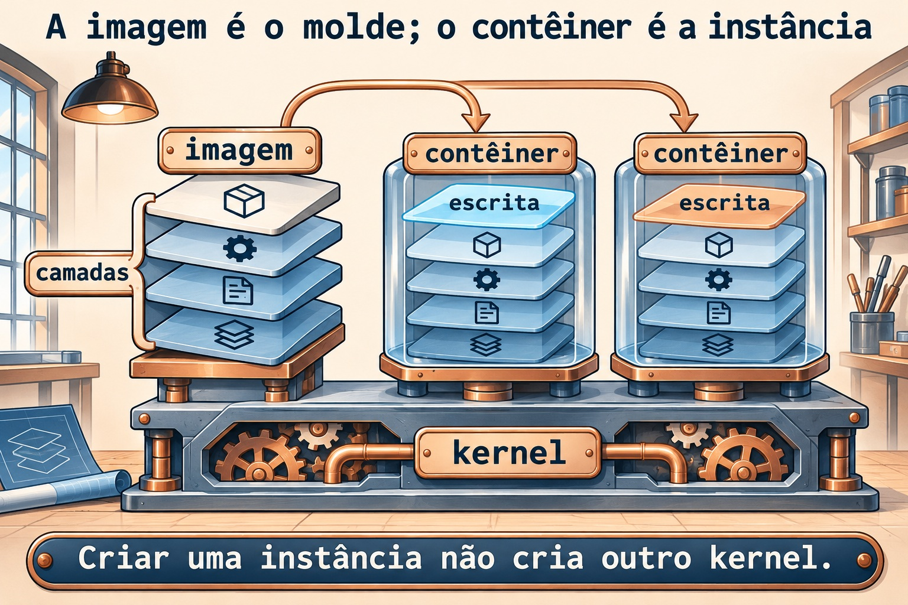
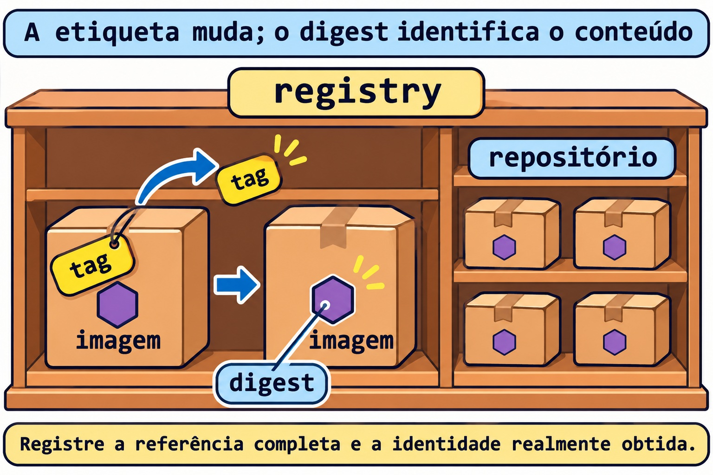
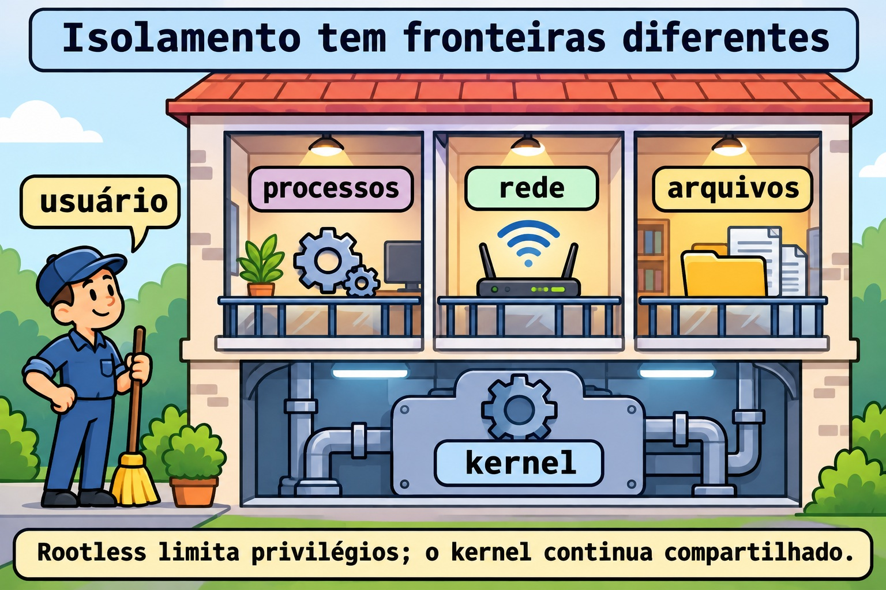

# Aula 18.1 · Contêiner não é VM

> **O coração desta aula:** identifique imagem, instância e usuário dono antes de executar qualquer contêiner.

| Ficha | Plano de trabalho |
| --- | --- |
| Módulo | M18 · Podman, aula 1 de 5 |
| Quando | Semana 24 |
| Ao final | Inspecionar imagem, camadas e digest sem confundir contêiner com VM |
| Pré-requisitos | VMs 201 e 202; usuário student já existente com sudo; acesso autorizado ao lab |
| Duração | 70–90 minutos, além do download |
| Snapshot | m18a1-inicio e m18a1-fim nas VMs usadas |

A VM 201 é a bancada principal; repita no Debian 202 quando indicado. Cada VM terá seu próprio cache e seu próprio digest registrado.

O Podman roda dentro das VMs, com o usuário `student`. O host Proxmox só recebe os comandos de snapshot explicitamente separados.

Antes de começar o módulo, o usuário `student` precisa existir nas duas VMs e ter acesso a sudo. Se faltar a conta ou a autorização, pare e complete a preparação com o administrador da VM; não execute o lab Podman como root.

## 1 · Aquecimento

Responda de memória e deixe a correção para o fim.

1. Qual componente distingue o kernel de uma VM do kernel compartilhado por um CT?

2. Um snapshot dentro do mesmo storage substitui uma cópia independente de segurança?

3. O mesmo nome de serviço em duas máquinas prova que você está consultando o mesmo objeto?

### Diagnóstico de entrada do módulo

Desenhe, sem comandos, um servidor web que guarda conteúdo após a remoção do contêiner e volta no boot sem login.

Marque o dono, a imagem, o dado, a porta e quem inicia o processo. Guarde o desenho para a última aula.

## 2 · Por que importa

O chamado diz que a aplicação sumiu. O processo continua no ar, mas o administrador entrou como root e consultou outro armazenamento de contêineres.

Outro chamado começa após uma atualização: a mesma tag aponta agora para bytes diferentes. Sem registrar a referência obtida, a comparação vira adivinhação.

Esta aula separa essas perguntas antes de publicar portas ou montar diretórios. Uma imagem baixada ainda não é um serviço executando.

### Ponte Windows

Uma imagem de implantação descreve uma origem; uma máquina instanciada acrescenta estado. A relação ajuda, mas um contêiner não recebe um kernel próprio como uma VM.

## 3 · Modelo mental



*Criar uma instância não cria outro kernel.*

| Objeto | Pergunta que responde |
| --- | --- |
| Registry | De qual serviço obtenho a imagem? |
| Repositório | Qual família de artefatos procuro? |
| Tag | Qual etiqueta foi solicitada? |
| Digest | Qual conteúdo foi identificado? |
| Contêiner | Qual instância tem estado e processo próprios? |

As camadas da imagem são reutilizáveis. A instância recebe uma camada gravável própria; mudar essa camada não publica uma imagem nova no registry.

Namespaces separam visões de processos, rede e outros recursos. Cgroups controlam recursos. Esses mecanismos não substituem um kernel independente.

## 4 · O essencial

### Nome completo antes de baixar

Use referência com registry e repositório explícitos. Um nome curto pode depender de aliases e da configuração local de busca.

A imagem escolhida vem do projeto NGINX Unprivileged. Seu servidor escuta na porta interna `8080`; isso será usado na próxima aula.

A tag seleciona uma versão publicada, mas pode ser atualizada. Depois do pull, registre o digest real obtido. Não copie um hash inventado desta página.



*Registre a referência completa e a identidade realmente obtida.*

Digest é identidade de conteúdo, não prova suficiente da reputação de quem publicou. Confirme também o projeto, o registry e a política de confiança.

### Um usuário, um escopo

O modo rootless usa o armazenamento e o ambiente do usuário dono. Executar o mesmo comando com outro usuário consulta outro escopo.

Root dentro de um namespace de usuário não equivale a root do host. O próprio processo da imagem também pode usar um UID sem privilégio.

Não use privilégios extras para mascarar uma configuração rootless incompleta. A documentação da versão instalada decide os pré-requisitos.

### Rocky × Debian

| Conferência | Rocky 201 | Debian 202 |
| --- | --- | --- |
| Pacote | podman | podman e uidmap |
| Proteção de arquivos | SELinux normalmente ativo | Verificar AppArmor e configuração local |
| Identidade | student | student |
| Cache e digest | Obtidos nesta VM | Obtidos nesta VM |

## 5 · Lab guiado

Use duas sessões claramente identificadas: console do Proxmox apenas para snapshots e shell da VM para Podman. Não copie blocos entre esses contextos.

### Passo 1 · Confirmar o ambiente e o ponto de retorno

**Palpite:** qual leitura impede confundir o host Proxmox com o sistema da bancada?

No Proxmox autorizado, confira ID e nome antes do snapshot. Faça somente nas VMs usadas pelo exercício.

```bash
qm config 201
qm config 202
qm snapshot 201 m18a1-inicio
qm snapshot 202 m18a1-inicio
```

Dentro de cada VM, entre diretamente com o usuário de estudo.

```bash
hostnamectl hostname
cat /etc/os-release
id
test "$(id -un)" = student || exit 1
sudo -v || exit 1
test "$(id -u)" -ne 0 || exit 1
printf 'HOME=%s\n' "$HOME"
```

**Saída esperada:** nome da VM correta e usuário de estudo sem UID zero. Não há saída numérica modelo a copiar.

**Verifique:** seu diário identifica máquina, usuário e instante. Uma consulta feita no lugar errado não serve como evidência.

### Passo 2 · Conferir o Podman rootless

**Palpite:** instalar o executável basta para validar o ambiente do usuário?

Se os pacotes faltam, instale dentro da VM apropriada. Estes são os únicos blocos administrativos de instalação; os comandos Podman continuam sem sudo.

Na VM Rocky:

```bash
sudo dnf install -y podman curl man-db || exit 1
```

Na VM Debian:

```bash
sudo apt update || exit 1
sudo apt install -y podman uidmap curl man-db || exit 1
sudo systemctl add-wants multi-user.target network-online.target || exit 1
```

No Debian minimal, `man-db` fornece o comando `man`. A dependência adicionada pertence ao gerenciador do sistema: chama `network-online.target` durante o boot, evitando que `podman-user-wait-network-online` espere desnecessariamente o timeout de 90 segundos. Ela não comprova acesso à Internet: o estado efetivo da rede depende do gerenciador e do respectivo serviço wait-online. A prova será feita após o reboot, na 18.3.

```bash
podman version
test -z "${CONTAINER_HOST-}${CONTAINER_CONNECTION-}" || exit 1
test "$(podman info --format '{{.Host.Security.Rootless}}')" = true || exit 1
grep "^$(id -un):" /etc/subuid /etc/subgid
findmnt -T "$HOME"
```

**Saída esperada:** Podman funcional em modo rootless e faixas subordinadas configuradas. Leia o erro inteiro se a inicialização falhar.

Home em NFS ou outro sistema distribuído pode não servir ao armazenamento rootless. Não mova o cache nem altere faixas sem um plano compatível com a versão.

**Verifique:** o campo rootless é verdadeiro. Se o pacote ou o helper exigido não está disponível no repositório autorizado, pare e resolva o pré-requisito.

### Passo 3 · Preparar um registro local novo

**Palpite:** uma pasta já existente pode conter uma bancada que você não deve substituir?

```bash
test ! -e "$HOME/m18-lab" || exit 1
umask 077
mkdir -m 0750 "$HOME/m18-lab" || exit 1
podman images
podman ps -a
M18_TAG=docker.io/nginxinc/nginx-unprivileged:stable-alpine
printf '%s\n' "$M18_TAG" > "$HOME/m18-lab/origem.txt"
```

**Saída esperada:** diretório novo e inventário do usuário atual, que pode estar vazio. Não remova objetos encontrados.

A pasta contém somente registros de estudo. Nenhuma chave de registry nem senha pertence ao arquivo de origem.

**Verifique:** o nome completo corresponde ao projeto conferido na documentação. Não aceite uma sugestão de registry para um nome abreviado.

### Passo 4 · Baixar e ler a configuração da imagem

**Palpite:** o pull inicia o servidor web?

```bash
podman pull "$M18_TAG" || exit 1
podman images
podman image inspect "$M18_TAG" > "$HOME/m18-lab/imagem-inspect.json" || exit 1
podman image inspect --format '{{.Os}} {{.Architecture}} {{.User}}' "$M18_TAG"
podman image inspect --format '{{json .RootFS.Layers}}' "$M18_TAG"
podman image inspect --format '{{json .Config.ExposedPorts}}' "$M18_TAG"
podman ps
```

**Saída esperada:** imagem local, metadados reais e nenhuma instância criada por esses comandos. O usuário padrão da imagem não é a identidade do dono no host.

Uma porta declarada nos metadados não é uma porta publicada pelo host. A próxima aula fará essa ligação explicitamente.

**Verifique:** encontre arquitetura, usuário e camadas na inspeção. Não conclua compatibilidade apenas pelo nome da tag.

### Passo 5 · Fixar a referência realmente obtida

**Palpite:** usar a mesma tag amanhã garante os mesmos bytes?

```bash
M18_IMAGE=$(podman image inspect --format '{{index .RepoDigests 0}}' "$M18_TAG") || exit 1
[[ "$M18_IMAGE" =~ ^docker\.io/nginxinc/nginx-unprivileged@sha256:[[:xdigit:]]{64}$ ]] || exit 1
podman image inspect "$M18_IMAGE" >/dev/null || exit 1
printf 'M18_IMAGE=%q\n' "$M18_IMAGE" > "$HOME/m18-lab/image.env"
chmod 0600 "$HOME/m18-lab/image.env"
cat "$HOME/m18-lab/image.env"
```

**Saída esperada:** referência completa com digest real, salva num arquivo criado por você. O ID local e o digest do manifesto não são nomes intercambiáveis.

Em imagens multiplataforma, índice e manifesto específico também têm identidades distintas. Registre o que o comando devolveu, junto com arquitetura e versão.

**Verifique:** a referência salva identifica este repositório e ainda pode ser inspecionada localmente. Se não existe RepoDigest, pare; não improvise um valor.

### Passo 6 · Conferir depois de uma nova sessão

**Palpite:** o cache desaparece quando você fecha o shell?

Feche apenas a sessão da VM e entre novamente como o mesmo usuário. Se o roteiro de operação permitir, faça o reboot da VM de estudo; não do Proxmox.

```bash
test "$(id -un)" = student || exit 1
source "$HOME/m18-lab/image.env" || exit 1
podman image inspect "$M18_IMAGE" --format '{{.ID}}'
podman ps -a
```

**Saída esperada:** referência e imagem disponíveis no mesmo escopo. Ainda não há serviço criado por esta aula.

**Verifique:** explique por que imagem persistente no cache e processo iniciado no boot são resultados diferentes.

## 6 · Quebre e conserte

As falhas abaixo ficam no diário ou em referências locais de consulta. Não apague o armazenamento do Podman para fabricar um erro.

### Quebra 1 · Referência incompleta

**Sintoma:** uma anotação contém apenas um nome curto e outra VM escolhe origem diferente.

**Investigação:** compare o registro local de origem com registry, repositório e tag esperados.

```bash
cat "$HOME/m18-lab/origem.txt"
podman image inspect --format '{{json .RepoTags}}' "$M18_IMAGE"
```

**Causa:** a resolução do nome dependia de configuração local ou de uma escolha interativa.

**Conserto:** reescreva a anotação com o nome completo conferido. Não faça pull de uma origem sugerida sem validar.

**Verifique:** a referência do diário e o repositório do digest correspondem.

**Prevenção:** registre nome solicitado e conteúdo obtido como campos separados.

### Quebra 2 · O usuário não é o dono

**Sintoma:** alguém informa cache vazio em uma sessão administrativa diferente. Não execute um segundo Podman com sudo para reproduzir.

**Investigação:** compare usuário, home e modo rootless com o registro do Passo 2.

```bash
id
printf '%s\n' "$HOME"
test -z "${CONTAINER_HOST-}${CONTAINER_CONNECTION-}" || exit 1
test "$(podman info --format '{{.Host.Security.Rootless}}')" = true || exit 1
```

**Causa:** armazenamento de outro usuário foi consultado como se fosse o mesmo.

**Conserto:** volte à sessão direta do dono e repita a inspeção da referência salva.

**Verifique:** identidade e imagem coincidem com o diário, sem copiar cache entre usuários.

**Prevenção:** registre o dono junto do nome do objeto em todo chamado.

### Quebra 3 · Confundir imagem com serviço

**Sintoma:** a imagem existe, mas não há servidor atendendo.

**Investigação:** compare as duas listagens no mesmo usuário.

```bash
podman images
podman ps -a
```

**Causa:** o pull armazenou a imagem, sem criar ou iniciar uma instância.

**Conserto:** corrija a conclusão do relatório; a execução será feita de modo controlado na 18.2.

**Verifique:** sua descrição distingue presença no cache de processo ativo.

**Prevenção:** peça evidência de estado do contêiner e resposta da aplicação, além da imagem.



*Rootless limita privilégios; o kernel continua compartilhado.*

## 7 · Armadilhas

### Decida 1

O digest coincide com uma anotação, mas a origem da anotação não foi validada. Você deve:

A. Tratar a coincidência como prova de procedência.

B. Conferir projeto, registry e política de confiança antes de executar.

C. Conceder privilégios para reduzir dúvidas.

### Decida 2

O aplicativo exige outro kernel. A melhor decisão é:

A. Renomear a imagem para representar outro sistema.

B. Instalar um kernel na camada gravável do contêiner.

C. Planejar uma VM compatível e validar os requisitos reais.

## 8 · Quiz

1. O que muda entre imagem e instância?

2. Por que usar nome completo no pull?

3. O que uma tag não garante ao longo do tempo?

4. Digest e origem confiável são a mesma prova?

5. Qual contexto deve acompanhar uma consulta rootless?

6. Imagem no cache prova inicialização automática?

## 9 · Lembrete

**Flashcards:** faça cartões para imagem, instância, tag, digest e dono. Revise em D+1, D+3, D+7 e D+21.

```bash
podman images
podman ps -a
podman image inspect "$M18_IMAGE"
```

`!explica 18.1 imagem, camadas, tag, digest e escopo rootless`

`!feynman 18.1 vou explicar por que um contêiner não recebe outro kernel`

`!quiz 18.1`

## 10 · Checklist e fechamento

- [ ] Confirmei VM e usuário antes do Podman.

- [ ] Li a configuração rootless e seus pré-requisitos.

- [ ] Obtive a imagem pelo nome completo validado.

- [ ] Registrei digest real sem inventar valores.

- [ ] Preservei dados locais para a próxima aula.

**Último exercício:** retome seu desenho inicial e acrescente o papel da camada gravável e do usuário dono.

**Reboot de conferência:** se reiniciou a VM, registre o retorno da sessão e a inspeção da referência. Se fez apenas nova sessão, marque reboot não executado.

Não há contêiner criado para remover. Preserve imagem, diretório e arquivo local de referência; não execute limpeza global do cache.

No Proxmox, após conferir novamente ID e nome, registre o ponto final das VMs usadas.

```bash
qm snapshot 201 m18a1-fim
qm snapshot 202 m18a1-fim
```

## 11 · Na vida real

Em um ambiente autorizado, peça somente o inventário reduzido de uma imagem e o usuário responsável. Não faça pull, atualização nem execução em produção.

Relate qual referência foi pedida, qual digest foi obtido e qual evidência de procedência existe. Informação ausente deve continuar marcada como ausente.

## 12 · Aprofunde quando quiser

- [Podman: pull e referências](https://docs.podman.io/en/latest/markdown/podman-pull.1.html).

- [Podman: inspeção de imagens](https://docs.podman.io/en/latest/markdown/podman-image-inspect.1.html).

- [Projeto NGINX Unprivileged](https://github.com/nginx/docker-nginx-unprivileged).

Leia também o manual instalado na VM. Uma opção ausente exige consultar a versão local, sem adivinhar uma substituição.

### Soluções comentadas

**Aquecimento:** a VM tem kernel próprio; o CT compartilha. Snapshot no mesmo backend não é backup independente. Nome igual não prova identidade do objeto.

**Decida 1: B.** Identidade de conteúdo e confiança na publicação são perguntas separadas.

**Decida 2: C.** Modificar o espaço de usuários não troca o kernel usado pelo contêiner.

1. A instância acrescenta estado e processo; a imagem continua sendo a origem reutilizável.

2. Para evitar que aliases e escolhas locais decidam a origem silenciosamente.

3. Ela não garante os mesmos bytes depois de uma atualização da publicação.

4. Não. O digest identifica conteúdo; a confiança exige uma política de origem.

5. Máquina, usuário dono, home, modo e versão das ferramentas.

6. Não. O cache é persistência de imagem; inicialização de serviço exige configuração própria.

[← Aula 17.7 · Migração e quorum](17.7-migracao-e-quorum.md) · [Índice das aulas](../01-aulas.md) · [Aula 18.2 · Rodar e persistir →](18.2-rodar-e-persistir.md)
