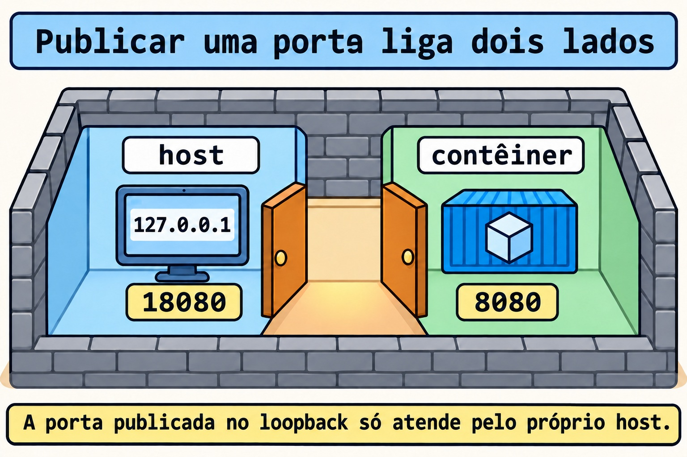
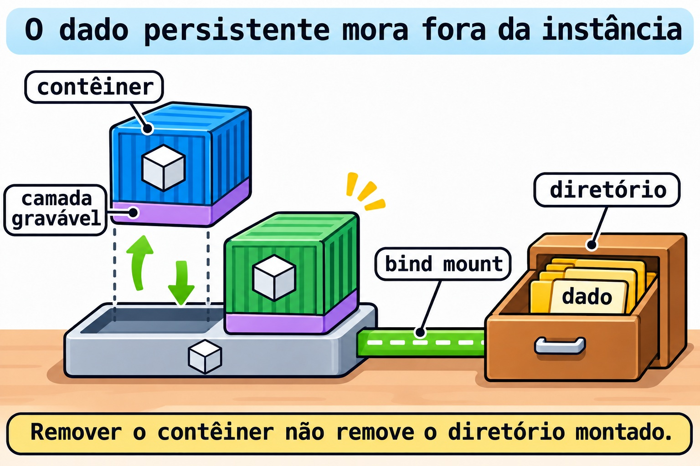
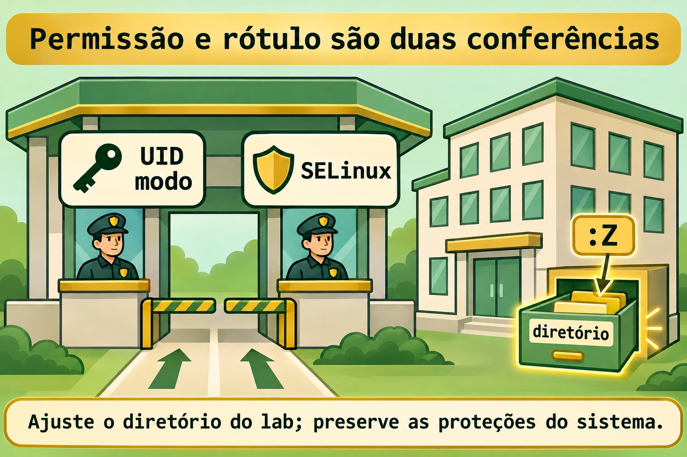

# Aula 18.2 · Rodar e persistir

> **O coração desta aula:** acompanhe processo, porta e dado como três provas diferentes.

| Ficha | Plano de trabalho |
| --- | --- |
| Módulo | M18 · Podman, aula 2 de 5 |
| Quando | Semana 24 |
| Ao final | Executar nginx rootless e demonstrar persistência fora da instância |
| Pré-requisitos | 18.1 concluída no mesmo usuário; curl e console da VM |
| Duração | 80–100 minutos |
| Snapshot | m18a2-inicio e m18a2-fim nas VMs usadas |

Use a VM 201 como bancada principal e repita a comparação na 202. O nome do contêiner é local a cada usuário em cada VM.

Tudo que usa Podman roda como `student` dentro da VM. A aplicação fica acessível apenas pelo loopback dessa VM, sem publicação na LAN.

## 1 · Aquecimento

1. O pull da aula anterior criou algum processo de nginx?

2. Qual referência local permite repetir a execução sem depender da tag atual?

3. Por que usar outro usuário pode mostrar uma lista diferente de contêineres?

Antes do lab, preveja onde um arquivo criado dentro do contêiner vai parar depois de remover a instância.

## 2 · Por que importa

O site funciona e o administrador atualiza a imagem recriando o contêiner. A página personalizada some porque estava na camada gravável da instância removida.

Em outro chamado, o processo está ativo, mas o teste de fora não alcança uma porta publicada apenas no loopback. A falha está na expectativa de alcance.

Você vai provar o conteúdo por HTTP, distinguir reiniciar de recriar e manter as proteções do sistema enquanto diagnostica acesso a arquivos.

### Ponte Windows

Separar disco de dados e máquina descartável ajuda a pensar na persistência. Porém um bind mount não é automaticamente uma cópia de segurança.

## 3 · Modelo mental



*A porta publicada no loopback só atende pelo próprio host.*

| Camada | Prova útil | Limite da conclusão |
| --- | --- | --- |
| Processo | Estado do contêiner | Não prova resposta HTTP |
| Porta | Publicação e endereço de escuta | Não prova conteúdo correto |
| Arquivo | Caminho e hash do dado | Não prova acesso pelo processo |
| Aplicação | Resposta HTTP esperada | Não prova início no boot |

A porta da esquerda pertence ao host da VM; a da direita pertence ao processo no contêiner. O mapeamento não muda a configuração de escuta do nginx.

## 4 · O essencial

### Reiniciar preserva a instância; recriar muda o objeto

Parar e iniciar o mesmo contêiner preserva sua camada gravável. Remover a instância descarta essa camada; um nome igual não traz o estado anterior de volta.

Um bind mount aponta para um caminho do host. O arquivo do site ficará em `~/m18-lab/site`, separado da camada gravável.



*Remover o contêiner não remove o diretório montado.*

O mount será somente leitura dentro do contêiner. Você editará a cópia do host com o dono correto, sem dar escrita ao processo web.

### Permissões e SELinux

Modo, identidade mapeada e rótulo de segurança são condições diferentes. Corrigir apenas uma delas pode deixar o acesso bloqueado.

O sufixo `:Z` solicita relabel privado para o contêiner. A opção compartilhada `:z` atende outro contrato; não as troque sem avaliar os consumidores.

Aplique relabel somente no diretório dedicado do exercício. Não monte nem relabele toda a home ou um diretório de sistema.

### Rocky × Debian

| Condição | Rocky 201 | Debian 202 |
| --- | --- | --- |
| Dono | student, rootless | student, rootless |
| Publicação | Apenas loopback | Apenas loopback |
| SELinux | Conferir modo e rótulos reais | Não presumir SELinux ativo |
| Acesso a arquivos | Modo, mapa e rótulo | Modo, mapa e políticas locais |

## 5 · Lab guiado

Antes de entrar nas VMs, confira ID e nome no Proxmox e faça snapshots apenas nas VMs que vai usar.

```bash
qm config 201
qm config 202
qm snapshot 201 m18a2-inicio
qm snapshot 202 m18a2-inicio
```

Daqui em diante, use o shell de estudo dentro da VM. Nunca execute Podman no Proxmox para substituir a bancada.

### Passo 1 · Validar dono, imagem e nomes livres

**Palpite:** uma referência registrada por outro usuário atende a esta sessão?

```bash
test "$(id -un)" = student || exit 1
test "$(id -u)" -ne 0 || exit 1
hostnamectl hostname
source "$HOME/m18-lab/image.env" || exit 1
: "${M18_IMAGE:?}"
[[ "$M18_IMAGE" =~ ^docker\.io/nginxinc/nginx-unprivileged@sha256:[[:xdigit:]]{64}$ ]] || exit 1
podman image inspect "$M18_IMAGE" >/dev/null || exit 1
test -z "${CONTAINER_HOST-}${CONTAINER_CONNECTION-}" || exit 1
test "$(podman info --format '{{.Host.Security.Rootless}}')" = true || exit 1
podman ps -a --format '{{.Names}}'
ss -ltn 'sport = :18080'
```

**Saída esperada:** imagem local no dono correto, nome de exercício ausente e porta ainda não usada. Se há qualquer consumidor de `18080`, pare.

O nome reservado é `m18-web-manual`. Não use substituição automática de um objeto existente.

**Verifique:** anote máquina, usuário, digest e ausência de conflito. Uma listagem que falhou não é uma listagem vazia.

### Passo 2 · Criar o dado no host da VM

**Palpite:** qual caminho vai continuar existindo depois da remoção da instância?

```bash
test ! -e "$HOME/m18-lab/site" || exit 1
mkdir -m 0755 "$HOME/m18-lab/site" || exit 1
printf '<h1>M18 persistente</h1>\n' > "$HOME/m18-lab/site/index.html"
chmod 0644 "$HOME/m18-lab/site/index.html"
stat -c '%a %U:%G %n' "$HOME/m18-lab/site" "$HOME/m18-lab/site/index.html"
sha256sum "$HOME/m18-lab/site/index.html"
command -v getenforce >/dev/null && getenforce
ls -Zd "$HOME/m18-lab/site"
```

**Saída esperada:** diretório dedicado legível e arquivo legível, pertencentes ao usuário de estudo. O rótulo depende do sistema real.

O conteúdo é público e didático. Os modos escolhidos permitem leitura pelo processo mapeado; não aplique esses modos a dados confidenciais.

**Verifique:** guarde o hash no diário. Você vai comparar bytes do arquivo e da resposta HTTP, sem copiar um resultado de exemplo.

### Passo 3 · Executar uma instância identificada

**Palpite:** publicar no loopback permite acesso de outro computador da LAN?

```bash
podman run -d --name m18-web-manual --label io.course.module=M18 \
  --pull=never --publish 127.0.0.1:18080:8080 \
  --volume "$HOME/m18-lab/site:/usr/share/nginx/html:ro,Z" \
  "$M18_IMAGE" || exit 1
podman ps --filter name=m18-web-manual
podman port m18-web-manual
podman inspect --format '{{json .Mounts}}' m18-web-manual
podman logs --tail 20 m18-web-manual
```

**Saída esperada:** contêiner ativo, publicação no loopback e mount do diretório dedicado em modo somente leitura.

A imagem já está local; o comando não faz atualização implícita. Um erro de nome ocupado deve interromper a criação, sem remover o objeto encontrado.

**Verifique:** o mount aponta exatamente para seu diretório e a porta interna é `8080`. Não teste pelo endereço do Proxmox.

### Passo 4 · Provar resposta e escopo de escrita

**Palpite:** um processo ativo basta para garantir a página correta?

```bash
curl --retry 10 --retry-delay 1 --retry-all-errors --max-time 5 --fail --silent --show-error http://127.0.0.1:18080/ --output "$HOME/m18-lab/resposta.html" || exit 1
cmp "$HOME/m18-lab/site/index.html" "$HOME/m18-lab/resposta.html" || exit 1
podman exec m18-web-manual id
podman exec m18-web-manual sh -c 'printf "estado da instancia\n" > /tmp/m18-volatil.txt' || exit 1
podman exec m18-web-manual cat /tmp/m18-volatil.txt || exit 1
podman exec m18-web-manual sh -c 'test ! -w /usr/share/nginx/html/index.html' || exit 1
```

**Saída esperada:** resposta idêntica ao arquivo, dado temporário criado na instância e conteúdo web sem escrita pelo processo.

A consulta interna usa o usuário padrão da imagem. Não acrescente root ou modo privilegiado para transformar a leitura em sucesso.

**Verifique:** explique os dois lugares onde agora existem dados: diretório montado e camada gravável do contêiner.

### Passo 5 · Comparar reinício com recriação

**Palpite:** o arquivo temporário sobrevive a parar e iniciar o mesmo objeto? E à remoção?

Defina uma guarda para todas as alterações destrutivas deste exercício. Um erro de inspeção deve impedir a alteração.

```bash
m18_manual_guard() {
  test "$(id -un)" = student || return 1
  local label
  label=$(podman inspect --type container --format '{{index .Config.Labels "io.course.module"}}' m18-web-manual) || return 1
  test "$label" = M18
}
m18_manual_guard || exit 1
podman stop m18-web-manual || exit 1
podman start m18-web-manual || exit 1
podman exec m18-web-manual cat /tmp/m18-volatil.txt || exit 1
m18_manual_guard || exit 1
podman stop m18-web-manual || exit 1
podman rm m18-web-manual || exit 1
```

Recrie usando exatamente o comando de execução do Passo 3, com a mesma referência e o mesmo diretório. Não use um comando que omita o mount.

```bash
podman exec m18-web-manual test ! -e /tmp/m18-volatil.txt || exit 1
curl --retry 10 --retry-delay 1 --retry-all-errors --max-time 5 --fail --silent --show-error http://127.0.0.1:18080/ --output "$HOME/m18-lab/resposta.html" || exit 1
cmp "$HOME/m18-lab/site/index.html" "$HOME/m18-lab/resposta.html" || exit 1
sha256sum "$HOME/m18-lab/site/index.html"
```

**Saída esperada:** o temporário persiste no simples reinício e desaparece na nova instância; a página montada continua igual.

**Verifique:** registre as duas operações com resultados distintos. Persistência do dado não significa existência de backup.

### Passo 6 · Reiniciar a VM e separar continuidade de automação

**Palpite:** um contêiner criado manualmente deve iniciar sozinho no boot sem configuração de serviço?

Após guardar o diário e corrigir as quebras abaixo, reinicie somente a VM de estudo. Não reinicie o Proxmox.

```bash
sudo reboot
```

Reconecte diretamente como o mesmo usuário e consulte o estado antes de iniciar qualquer coisa.

```bash
source "$HOME/m18-lab/image.env" || exit 1
podman ps -a --filter name=m18-web-manual
sha256sum "$HOME/m18-lab/site/index.html"
```

**Saída esperada:** dado do host preservado; a instância manual não possui garantia de início automático neste roteiro. Registre o estado real, não um estado desejado.

A próxima aula implementará serviço declarativo. Aqui, se precisar continuar o diagnóstico, redefina a guarda do Passo 5 e inicie apenas o contêiner identificado.

**Verifique:** a evidência distingue arquivo persistente, instância existente e serviço configurado para boot.

## 6 · Quebre e conserte

Faça uma falha por vez na bancada. Preserve o conteúdo e a configuração que você acabou de validar.

### Quebra 1 · O processo está parado

**Sintoma:** a página não responde, embora existam logs antigos de acesso bem-sucedido. Pare somente a instância identificada.

```bash
m18_manual_guard || exit 1
podman stop m18-web-manual
podman ps -a --filter name=m18-web-manual
curl --max-time 5 --fail http://127.0.0.1:18080/
```

**Investigação:** compare o horário dos logs com o estado atual e o teste HTTP.

**Causa:** registro de um acesso anterior foi interpretado como disponibilidade atual.

**Conserto:** inicie somente o objeto cuja guarda foi conferida.

```bash
m18_manual_guard || exit 1
podman start m18-web-manual
curl --retry 10 --retry-delay 1 --retry-all-errors --max-time 5 --fail http://127.0.0.1:18080/
```

**Verifique:** o HTTP volta com a página esperada, não apenas com uma linha de log nova.

**Prevenção:** acompanhe processo, porta e aplicação em consultas separadas.

### Quebra 2 · O arquivo perdeu a leitura

**Sintoma:** nginx está ativo, mas não entrega o conteúdo esperado. Altere somente o arquivo público dedicado.

```bash
test -f "$HOME/m18-lab/site/index.html" || exit 1
test "$(stat -c %U "$HOME/m18-lab/site/index.html")" = student || exit 1
chmod 000 "$HOME/m18-lab/site/index.html"
curl --max-time 5 --fail http://127.0.0.1:18080/
podman logs --tail 20 m18-web-manual
stat -c '%a %U:%G %n' "$HOME/m18-lab/site/index.html"
```

**Investigação:** compare o modo atual, o usuário interno e o erro de acesso; não conclua que toda negativa vem do SELinux.

**Causa:** o processo deixou de ter permissão de leitura pelo modo do arquivo.

**Conserto:** restaure o modo do arquivo público, sem ampliar escrita.

```bash
chmod 0644 "$HOME/m18-lab/site/index.html"
curl --retry 10 --retry-delay 1 --retry-all-errors --max-time 5 --fail http://127.0.0.1:18080/
```

**Verifique:** a resposta volta e o hash do arquivo continua igual.

**Prevenção:** registre o modo do diretório e do arquivo antes de alterar rótulos.

### Quebra 3 · O rótulo foi confundido com o modo

**Sintoma:** um caso de laboratório mostra modos corretos e negativa SELinux. Este diagnóstico usa leitura; não altere rótulos globais para fabricar o caso.

**Investigação:** na Rocky, confira modo, contexto e eventos recentes. Se SELinux não está ativo, marque esse ramo não aplicável.

```bash
command -v getenforce >/dev/null && getenforce
ls -Zd "$HOME/m18-lab/site" "$HOME/m18-lab/site/index.html"
podman inspect --format '{{json .Mounts}}' m18-web-manual
sudo journalctl -k --since '-10 min' --no-pager | grep -i avc
```

**Causa:** pode faltar o rótulo privado adequado ao processo; a negativa real precisa confirmar a hipótese. A ausência de evento nessa janela não confirma a causa.

**Conserto:** se o caso real aponta relabel ausente, remova somente a instância guardada e recrie pelo Passo 3 com o diretório dedicado e `:Z`. Não apague o dado.

**Verifique:** compare novo contexto, HTTP e ausência de nova negativa pertinente. Se o erro permanece, investigue antes de mudar outra camada.

**Prevenção:** não desative SELinux, não dê permissões totais e não relabele toda a home como correção genérica.



*Ajuste o diretório do lab; preserve as proteções do sistema.*

## 7 · Armadilhas

### Decida 1

O contêiner foi removido e o diretório montado continua no host. Você deve:

A. Concluir que o dado foi perdido porque o nome sumiu.

B. Recriar pelo contrato e comparar o conteúdo persistente.

C. Apagar a pasta para igualar a lista vazia.

### Decida 2

O acesso falha e há modos e rótulos diferentes do registro. A primeira ação é:

A. Executar tudo como root para esconder o erro.

B. Desativar toda proteção de arquivos.

C. Conferir cada condição e aplicar a correção mínima no diretório dedicado.

## 8 · Quiz

1. Quais são os dois lados da publicação da porta deste lab?

2. Por que uma declaração de porta da imagem não publica o host?

3. Que dado sobrevive a stop/start e qual sobrevive à remoção?

4. O que o sufixo privado de SELinux faz e onde deve ser aplicado?

5. Um bind mount já é um backup?

6. Por que a porta precisa ficar livre no fim desta aula?

## 9 · Lembrete

**Flashcards:** compare imagem, camada gravável, bind mount, modo, rótulo e publicação. Revise em D+1, D+3, D+7 e D+21.

```bash
podman ps -a
podman port m18-web-manual
podman logs --tail 20 m18-web-manual
podman exec m18-web-manual id
```

`!explica 18.2 porta publicada, camada gravável, bind mount e SELinux`

`!feynman 18.2 vou explicar por que recriar o contêiner não apaga o site montado`

`!quiz 18.2`

## 10 · Checklist e fechamento

Depois de corrigir as três falhas e guardar o diário, remova somente a instância manual. A próxima aula criará o serviço na mesma porta.

Se abriu outra sessão, redefina a função do Passo 5 antes deste bloco. Não substitua a guarda por uma remoção forçada.

```bash
m18_manual_guard || exit 1
podman stop m18-web-manual || exit 1
podman rm m18-web-manual || exit 1
podman ps -a --filter label=io.course.module=M18
ss -ltn 'sport = :18080'
sha256sum "$HOME/m18-lab/site/index.html"
```

Preserve o diretório do site, a imagem e `image.env`. Não faça prune global nem remova dados para limpar uma lista.

- [ ] Executei rootless com a referência fixada.

- [ ] Comparei resposta HTTP com o arquivo real.

- [ ] Separei reinício, recriação e persistência.

- [ ] Corrigi modo sem desligar proteções.

- [ ] Liberei a porta e preservei os dados para 18.3.

**Último exercício:** produza três evidências curtas: onde mora o dado, qual processo o lê e qual teste demonstra o conteúdo correto.

**Reboot de conferência:** registre somente o reboot da VM feito no Passo 6. Início automático sem login ainda não foi implementado.

No Proxmox, após conferir ID e nome, registre o ponto final das VMs usadas.

```bash
qm snapshot 201 m18a2-fim
qm snapshot 202 m18a2-fim
```

## 11 · Na vida real

Peça autorização para consultar a definição de mounts e publicação de um serviço conhecido. Reduza a saída antes de compartilhar; a inspeção pode conter variáveis sensíveis.

Relate quais dados estão fora da instância e qual é o plano real de backup. Não recrie um contêiner de produção para testar sua hipótese.

## 12 · Aprofunde quando quiser

- [Podman run: publicação, volumes e relabel](https://docs.podman.io/en/latest/markdown/podman-run.1.html).

- [Podman exec](https://docs.podman.io/en/latest/markdown/podman-exec.1.html).

- [Imagem NGINX Unprivileged](https://github.com/nginx/docker-nginx-unprivileged).

A ajuda local decide os campos de inspeção e as opções disponíveis na versão instalada. Não altere a política global para imitar uma captura.

### Soluções comentadas

**Aquecimento:** pull não iniciou nginx; a referência com digest está no arquivo local; outro usuário consulta outro armazenamento e ambiente.

**Decida 1: B.** O diretório montado é independente da camada gravável que foi removida.

**Decida 2: C.** Identidade, modo e política de segurança precisam ser conferidos separadamente.

1. Loopback da VM na porta publicada e processo nginx na porta interna; não há publicação na LAN.

2. Metadado descreve intenção; a publicação requer uma opção explícita da execução.

3. A camada gravável permanece no mesmo objeto; o diretório do host permanece após sua remoção.

4. Solicita um rótulo privado para aquele uso e deve ficar limitado ao diretório dedicado.

5. Não. Ele separa o ciclo de vida do dado; ainda exige cópia, retenção e ensaio de recuperação.

6. O serviço declarativo da próxima aula vai usar a mesma publicação, sem conflito com a instância manual.

[← Aula 18.1 · Contêiner não é VM](18.1-conteiner-nao-e-vm.md) · [Índice das aulas](../01-aulas.md) · [Aula 18.3 · Contêiner como serviço →](18.3-conteiner-como-servico.md)
