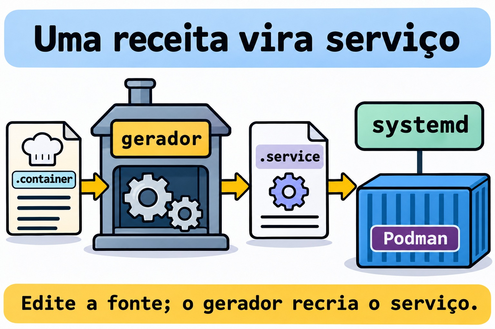
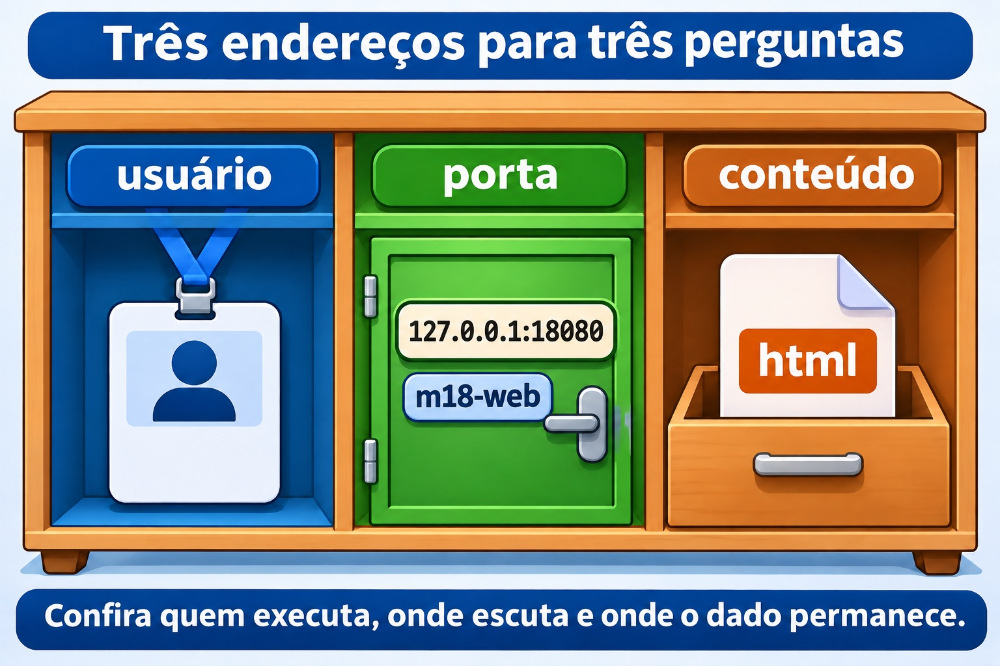
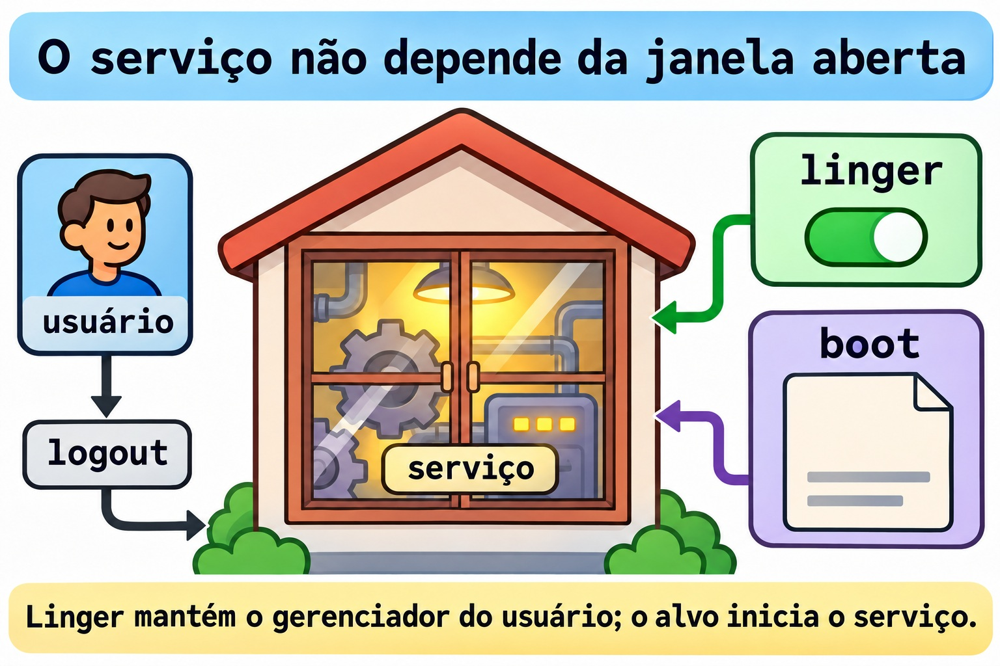

# Aula 18.3 · Contêiner como serviço

> **O coração desta aula:** o gerenciador do usuário inicia o serviço a partir do Quadlet; a sessão aberta não deve ser a sua dependência.

| Ficha | Plano de trabalho |
| --- | --- |
| Módulo | M18 · Podman, aula 3 de 5 |
| Quando | Semana 25 |
| Ao final | Criar e conferir um serviço rootless persistente após boot sem login do dono |
| Pré-requisitos | 18.1 e 18.2; imagem por digest, conteúdo persistente e porta liberada |
| Duração | 80–100 minutos |
| Snapshot | `m18a3-inicio` e `m18a3-fim` apenas nas VMs de laboratório |

Trabalhe como `student` na VM 201, `rocky-lab`, e repita na VM 202, `debian-lab`. Não execute Podman no host Proxmox.

Preserve o diretório de conteúdo e o arquivo de imagem das aulas anteriores. O contêiner manual já foi removido no fechamento da 18.2.

O serviço desta aula permanece para diagnóstico, construção de imagem e proxy reverso nos módulos seguintes. A limpeza aqui desfaz apenas os defeitos plantados.

Antes do laboratório, crie o snapshot da VM pelo procedimento conhecido e confira que o console da VM continua disponível. Não faça snapshot do host para proteger uma mudança no convidado.

## 1 · Aquecimento

Responda sem consultar os comandos. Volte às respostas depois do reboot de conferência.

1. Que parte do site sobrevive quando o contêiner é removido?

2. Publicar uma porta apenas no loopback permite acesso direto de outro computador?

3. Um processo iniciado pelo terminal possui automaticamente uma política de boot?

## 2 · Por que importa

O site funciona quando você está conectado. Depois de uma manutenção, ninguém entra como dono e o serviço não aparece. A imagem não mudou; faltou definir quem deve iniciar o trabalho e quando.

Um segundo erro é colocar um usuário dentro de uma unidade de sistema e chamar isso de rootless. O lugar da unidade, o gerenciador que a lê e a identidade do processo precisam corresponder.

Nesta aula você entrega uma fonte legível, um serviço gerado, dados fora do contêiner e uma evidência de início sem login. Esses quatro objetos respondem perguntas diferentes.

### Ponte Windows

Compare o gerenciador de serviços com uma janela de terminal. Fechar a janela não deve determinar o ciclo de vida de um serviço. Aqui o gerenciador pertence a um usuário, com seu próprio contexto.

## 3 · Modelo mental



*Edite a fonte; o gerador recria o serviço.*

O arquivo Quadlet é a receita. O gerador transforma essa receita numa unidade que o systemd entende. Você mantém a fonte; não corrige o arquivo gerado como se fosse a origem.

| Objeto | Pergunta |
| --- | --- |
| `.container` | O que deve ser executado? |
| `.service` | O que o gerenciador recebeu? |
| Gerenciador do usuário | Quem acompanha o serviço? |
| Conteúdo persistente | Onde permanece o dado? |

Linger permite que o gerenciador do usuário seja iniciado no boot e continue depois do logout. Ele não escreve o Quadlet nem escolhe sozinho qual serviço deve iniciar.

## 4 · O essencial

Quadlet exige cgroup v2 e uma versão instalada que ofereça o gerador e as opções usadas. Confira o manual local; se ele não existir, resolva o pré-requisito pelo repositório oficial da distribuição.

Não instale um pacote aleatório nem substitua o serviço por um comando de geração antigo para fazer a aula parecer concluída. Registre versão e lacuna.

A fonte rootless fica em `~/.config/containers/systemd/`. O nome desta bancada é `m18-web.container`; o serviço será `m18-web.service` e o contêiner será `m18-web`.

A imagem já foi obtida por digest. O arquivo de ambiente guarda essa referência, mas o campo de imagem do Quadlet precisa receber o valor literal renderizado; ele não expande uma variável de shell automaticamente.

Não use uma seção de serviço com outro usuário para simular uma unidade rootless. Use o gerenciador do próprio dono.

### Rocky × Debian

| Questão | Rocky | Debian |
| --- | --- | --- |
| Pacotes | Repositório oficial da família RPM | Repositório oficial da família DEB |
| Conteúdo montado | Permissões e rótulo SELinux | Permissões e controles ativos do sistema |
| Serviço rootless | Gerenciador de student | Gerenciador de student |

A opção `:Z` relabela somente o diretório exclusivo do exercício quando SELinux está ativo. Não a aplique à sua casa inteira nem a uma pasta compartilhada por outros serviços.

### Decida 1

O serviço gerado não aceita ser habilitado como uma unidade instalada comum. O que você faz?

A. Edita o arquivo gerado e insiste na habilitação.
B. Mantém a política de instalação na fonte Quadlet e recarrega o gerenciador.
C. Executa Podman como root para contornar o usuário.

## 5 · Lab guiado

Entre diretamente por SSH como o dono. Uma troca de usuário incompleta pode deixar o terminal sem o barramento e o diretório de execução corretos.

As guardas aceitam somente Podman local rootless e cgroup v2. Um caminho XDG personalizado exige um plano explícito: aqui é usado o caminho padrão da home.

### Passo 1 · Conferir dono, versão e contexto

**Palpite:** o inventário do usuário atual é o mesmo que o inventário do administrador?

```bash
test "$(id -un)" = student || exit 1
test "$(id -u)" -ne 0 || exit 1
test -z "${CONTAINER_HOST-}${CONTAINER_CONNECTION-}" || exit 1
test "$(podman info --format '{{.Host.Security.Rootless}}')" = true || exit 1
case "$(hostname -s)" in rocky-lab|debian-lab) ;; *) exit 1 ;; esac
id
printf '%s\n' "$XDG_RUNTIME_DIR"
podman version
podman info --format '{{.Host.CgroupsVersion}} {{.Host.Security.Rootless}}'
test "$(podman info --format '{{.Host.CgroupsVersion}}')" = v2 || exit 1
systemctl --user show-environment || exit 1
man podman-systemd.unit
podman ps -a --filter label=io.course.module=M18
```

**Saída esperada:** dono correto, contexto rootless e cgroup v2. O gerenciador do usuário responde. Se o manual ou uma opção faltar, interrompa a criação.

**Verifique:** a sessão pertence à VM certa e à identidade certa. O host Proxmox fica fora do roteiro.

### Passo 2 · Conferir conteúdo, imagem e porta

**Palpite:** um contêiner manual esquecido pode impedir o serviço de iniciar sem alterar a imagem?

```bash
test -z "${XDG_CONFIG_HOME-}" || test "$XDG_CONFIG_HOME" = "$HOME/.config" || exit 1
test -f "$HOME/m18-lab/image.env" && test -O "$HOME/m18-lab/image.env" || exit 1
. "$HOME/m18-lab/image.env" || exit 1
[[ "$M18_IMAGE" =~ ^docker\.io/nginxinc/nginx-unprivileged@sha256:[[:xdigit:]]{64}$ ]] || exit 1
podman image exists "$M18_IMAGE" || exit 1
test -r "$HOME/m18-lab/site/index.html" || exit 1
stat -c '%a %U:%G %n' "$HOME/m18-lab/site" "$HOME/m18-lab/site/index.html"
sha256sum "$HOME/m18-lab/site/index.html"
M18_LISTEN=$(ss -H -ltn 'sport = :18080') || exit 1
test -z "$M18_LISTEN" || { printf '%s\n' 'STOP: porta ocupada'; exit 1; }
if podman container exists m18-web; then
  printf '%s\n' 'STOP: nome ocupado' >&2; exit 1
else
  M18_RC=$?; test "$M18_RC" -eq 1 || exit 1
fi
if podman container exists m18-web-manual; then
  printf '%s\n' 'STOP: nome ocupado' >&2; exit 1
else
  M18_RC=$?; test "$M18_RC" -eq 1 || exit 1
fi
```

**Saída esperada:** conteúdo preservado, imagem disponível e nenhum ouvinte na porta. A existência de um nome ocupado fecha a etapa, não autoriza removê-lo sem conferir a origem.

**Verifique:** o diretório está em modo 755 e o documento em 644, ambos pertencentes ao dono previsto. Confira a reserva da porta no seu diário; pare se qualquer processo já a usa.

### Passo 3 · Escrever a fonte com valor literal

**Palpite:** recarregar o gerenciador cria a fonte ou lê uma fonte que você já escreveu?

```bash
systemctl --user daemon-reload || exit 1
M18_UNITS=$(systemctl --user list-unit-files --all --no-legend) || exit 1
if printf '%s\n' "$M18_UNITS" | awk '$1 == "m18-web.service" {found=1} END {exit !found}'; then
  printf '%s\n' 'STOP: m18-web.service already exists' >&2
  exit 1
fi
install -d -m 0700 "$HOME/.config/containers/systemd" || exit 1
UNIT="$HOME/.config/containers/systemd/m18-web.container"
test ! -e "$UNIT" || exit 1
umask 077
cat > "$UNIT" <<EOF || exit 1
[Unit]
Description=M18 rootless web

[Container]
Image=$M18_IMAGE
Pull=never
ContainerName=m18-web
Label=io.course.module=M18
PublishPort=127.0.0.1:18080:8080
Volume=%h/m18-lab/site:/usr/share/nginx/html:ro,Z
LogDriver=journald
NoNewPrivileges=true

[Service]
Restart=on-failure
TimeoutStartSec=900

[Install]
WantedBy=default.target
EOF
cat "$UNIT"
systemctl --user daemon-reload
systemctl --user cat m18-web.service
```

**Saída esperada:** a fonte contém o digest real, sem variável pendente; a unidade gerada aponta para a imagem e o diretório previstos.

**Verifique:** a fonte termina com a seção de instalação e o alvo do usuário. Não execute habilitação sobre a unidade gerada e não copie sua saída para substituir o Quadlet.

### Passo 4 · Iniciar e relacionar as três provas

**Palpite:** uma unidade ativa prova que o conteúdo HTTP é o arquivo montado?



*Confira quem executa, onde escuta e onde o dado permanece.*

```bash
systemctl --user start m18-web.service || exit 1
systemctl --user status m18-web.service --no-pager
podman inspect m18-web --format '{{index .Config.Labels "io.course.module"}}'
podman port m18-web
curl --retry 10 --retry-delay 1 --retry-all-errors --max-time 5 --fail --silent --show-error http://127.0.0.1:18080/
sudo journalctl _UID="$(id -u student)" _SYSTEMD_USER_UNIT=m18-web.service -b --no-pager -n 30
podman logs --tail 20 m18-web
```

**Saída esperada:** serviço ativo, rótulo da bancada, publicação no loopback e conteúdo conhecido. Os logs registram os eventos reais; não há linhas de sucesso inventadas para comparar.

**Verifique:** compare resposta, documento persistente e montagem. Se o serviço inicia com outro conteúdo, investigue o caminho antes de mudar permissões.

### Passo 5 · Registrar e habilitar linger

**Palpite:** linger sozinho escolhe o contêiner que deve subir?



*Linger mantém o gerenciador do usuário; o alvo inicia o serviço.*

```bash
test ! -e "$HOME/m18-lab/linger-before.txt" || exit 1
M18_LINGER=$(loginctl show-user student -p Linger --value) || exit 1
case "$M18_LINGER" in yes|no) ;; *) exit 1 ;; esac
printf '%s\n' "$M18_LINGER" > "$HOME/m18-lab/linger-before.txt" || exit 1
cat "$HOME/m18-lab/linger-before.txt"
sudo loginctl enable-linger student || exit 1
test "$(loginctl show-user student -p Linger --value)" = yes || exit 1
loginctl show-user student -p Linger -p State
systemctl --user is-active m18-web.service
```

**Saída esperada:** estado anterior preservado e linger habilitado para o dono. O serviço continua com a mesma identidade e o mesmo diretório de conteúdo.

**Verifique:** anote o UID do dono e a hora. A política de boot depende também do alvo na fonte. Fechar somente uma janela não prova ausência de todas as sessões do dono.

### Passo 6 · Provar boot antes do login do dono

**Palpite:** entrar por SSH como o dono antes da consulta estraga qual parte da evidência?

**Reboot de conferência:** encerre os trabalhos na VM, confira o console e reinicie somente a VM de estudo. Após o boot, não entre como o dono ainda.

```bash
case "$(hostname -s)" in rocky-lab|debian-lab) ;; *) exit 1 ;; esac
sudo reboot
```

No Debian 13, linger pode criar uma sessão de classe `manager`: é o gerenciador do usuário, não um login interativo. A conferência abaixo considera apenas a classe `user`, consultando cada sessão de student com `show-session`, disponível também no Rocky 9.

No console da VM, use a conta administrativa de emergência já preparada no curso, sem iniciar uma sessão de student. Se não dispõe desse acesso, prepare-o antes do reboot; não apresente uma sessão do dono como prova de início sem login.

```bash
M18_UID=$(id -u student)
loginctl list-sessions
loginctl show-user student --all -p Linger -p Sessions
M18_SESSIONS=$(loginctl show-user student --all -p Sessions --value) || exit 1
M18_USER_SESSIONS=
for M18_SESSION in $M18_SESSIONS; do
  M18_CLASS=$(loginctl show-session "$M18_SESSION" -p Class --value) || exit 1
  if test "$M18_CLASS" = user; then M18_USER_SESSIONS="$M18_USER_SESSIONS $M18_SESSION"; fi
done
test -z "$M18_USER_SESSIONS" || { printf '%s\n' 'STOP: student logged in' >&2; exit 1; }
systemctl status "user@$M18_UID.service" --no-pager
ss -ltnp 'sport = :18080'
curl --retry 10 --retry-delay 1 --retry-all-errors --max-time 5 --fail --silent --show-error http://127.0.0.1:18080/
journalctl -b _UID="$M18_UID" _SYSTEMD_USER_UNIT=m18-web.service --no-pager
```

**Saída esperada:** gerenciador do dono e resposta HTTP antes de qualquer login desse dono. A lista de sessões e o horário fazem parte da evidência.

**Verifique:** preserve a sequência temporal no diário externo. Só depois entre normalmente como student e confira serviço, imagem e documento novamente.

No Rocky, o journal persistente pode não ter um journal separado por usuário. Por isso as leituras do serviço usam sudo e filtram simultaneamente o UID de student e a unidade de usuário; Podman e `systemctl --user` continuam sendo executados pelo dono sem sudo.

## 6 · Quebre e conserte

Faça uma quebra por vez, como dono, apenas na fonte desta bancada. Antes, preserve uma cópia privada; se ela já existir, examine-a em vez de sobrescrever.

```bash
UNIT="$HOME/.config/containers/systemd/m18-web.container"
test ! -e "$HOME/m18-lab/m18-web.container.good" || exit 1
test -f "$UNIT" && test -O "$UNIT" || exit 1
grep -qxF 'ContainerName=m18-web' "$UNIT" || exit 1
grep -qxF 'Label=io.course.module=M18' "$UNIT" || exit 1
cp -- "$UNIT" "$HOME/m18-lab/m18-web.container.good" || exit 1
```

### Quebra 1 · Fonte inválida

**Sintoma:** o gerenciador não gera a unidade esperada depois de uma edição na seção de contêiner.

```bash
systemctl --user stop m18-web.service
sed -i 's/^Image=/ImageErrada=/' "$UNIT"
systemctl --user daemon-reload
systemctl --user status m18-web.service --no-pager
```

**Investigação:** leia a fonte, a ajuda local do Quadlet e as mensagens do gerenciador. A unidade anterior carregada pode confundir; não conclua apenas pela presença de um nome na lista.

**Causa:** uma chave obrigatória foi substituída por um nome que não descreve a imagem.

**Conserto:** restaure somente a fonte conhecida e recarregue o gerenciador.

```bash
cp -- "$HOME/m18-lab/m18-web.container.good" "$UNIT" || exit 1
systemctl --user daemon-reload
systemctl --user start m18-web.service
```

**Verifique:** a unidade aponta ao digest correto e o documento volta a responder.

**Prevenção:** confira a fonte e a unidade gerada antes de atribuir a falha à aplicação.

### Quebra 2 · Porta publicada no lugar errado

**Sintoma:** o serviço está ativo, mas a porta esperada não responde.

Confirme que a porta alternativa está livre antes de plantar a mudança; não use uma porta de outro serviço.

```bash
M18_LISTEN=$(ss -H -ltn 'sport = :18081') || exit 1
test -z "$M18_LISTEN" || exit 1
systemctl --user stop m18-web.service
sed -i 's/127.0.0.1:18080:8080/127.0.0.1:18081:8080/' "$UNIT"
systemctl --user daemon-reload
systemctl --user start m18-web.service
podman port m18-web
```

**Investigação:** compare publicação real, fonte e endereço do cliente.

**Causa:** o cliente e a publicação passaram a usar portas diferentes.

**Conserto:** restaure a fonte conhecida e reinicie somente o serviço da bancada.

```bash
systemctl --user stop m18-web.service
cp -- "$HOME/m18-lab/m18-web.container.good" "$UNIT" || exit 1
systemctl --user daemon-reload
systemctl --user start m18-web.service
curl --retry 10 --retry-delay 1 --retry-all-errors --max-time 5 --fail http://127.0.0.1:18080/
```

**Verifique:** a porta alternativa não ficou como dependência escondida.

**Prevenção:** registre endereço de escuta, porta publicada e porta interna separadamente.

### Quebra 3 · Confundir fonte e unidade gerada

**Sintoma:** uma anotação recomenda editar o arquivo gerado para tornar o conserto persistente.

**Investigação:** localize a origem e compare a unidade exibida pelo gerenciador. Esta quebra é documental; não edite o arquivo gerado.

```bash
systemctl --user cat m18-web.service
cat "$UNIT"
```

**Causa:** o resultado da geração foi tratado como fonte de configuração.

**Conserto:** reescreva a anotação com a edição da fonte e a recarga do gerenciador.

**Verifique:** outra pessoa consegue repetir a mudança sem depender de um arquivo transitório.

**Prevenção:** mantenha a fonte versionável e o estado observado como evidência separada.

## 7 · Armadilhas

A consulta ao serviço de sistema e a consulta ao serviço do usuário pertencem a gerenciadores diferentes. Uma resposta vazia de um deles não descreve todos os contêineres da máquina.

Não misture o contêiner manual antigo com o contêiner gerenciado. Nome e porta pertencem agora ao serviço; criar outro processo com os mesmos recursos fabrica concorrência.

### Decida 2

Depois do reboot, você entrou como dono antes de testar. Qual conclusão é honesta?

A. O teste precisa ser repetido sem login do dono antes da observação.
B. O conteúdo persistente foi apagado.
C. O serviço certamente iniciou sem login.

## 8 · Quiz

1. Por que a fonte deve conter o digest literal em vez de uma variável de shell não expandida?

2. Qual a função de linger e qual a função do alvo de instalação?

3. Por que a unidade gerada não deve ser editada como fonte?

4. O que a resposta HTTP prova além do estado ativo do serviço?

5. Por que o observador do reboot não deve entrar como student primeiro?

6. O que fica preservado para a aula seguinte?

## 9 · Lembrete

| Pergunta | Consulta |
| --- | --- |
| Fonte | `cat ~/.config/containers/systemd/m18-web.container` |
| Unidade | `systemctl --user cat m18-web.service` |
| Estado | `systemctl --user status m18-web.service` |
| Eventos | `sudo journalctl _UID="$(id -u student)" _SYSTEMD_USER_UNIT=m18-web.service -b` |
| Publicação | `podman port m18-web` |

**Flashcards:** crie cartões sobre fonte, gerador, serviço, dono, linger e prova de boot. Revise em D+1, D+3, D+7 e D+21.

```text
!explica 18.3 Quadlet, gerenciador do usuario e linger
!feynman 18.3 vou explicar por que editar a fonte e provar boot sem login
!quiz 18.3
```

## 10 · Checklist e fechamento

Restaure a fonte conhecida, recarregue e confirme a porta original. Preserve serviço, diretório do site, referência da imagem e evidência do estado anterior de linger.

Não desabilite linger no fechamento: o próximo laboratório depende do serviço. Quando o curso autorizar a remoção definitiva, examine os demais serviços do dono antes de voltar ao estado anterior.

Se linger já estava habilitado antes do módulo, a limpeza não deve desabilitá-lo. O arquivo de estado anterior evita que a configuração alheia seja tratada como sobra do exercício.

- [ ] Identifiquei a VM e o dono.
- [ ] Conferi cgroup v2 e o gerador instalado.
- [ ] Mantive o digest literal e o conteúdo persistente.
- [ ] Conferi o serviço e a resposta HTTP.
- [ ] Provei o início antes do login do dono.
- [ ] Desfiz as quebras sem alterar serviços alheios.

**Último exercício:** explique por que arquivo existente, serviço ativo e serviço iniciado sem login são três provas distintas. Cite o dado que você coletou para cada uma.

Crie o snapshot de fim somente após restaurar a bancada e registrar a evidência. Um snapshot da VM não substitui a cópia do conteúdo que você sabe restaurar.

## 11 · Na vida real

Num ambiente autorizado, faça apenas leitura: identifique o dono de um serviço rootless, localize sua fonte e descreva o caminho do dado. Não reinicie nem habilite linger em uma conta real para completar a observação.

Se a fonte ou a evidência de boot não está disponível, registre a lacuna. Não transforme uma suposição de disponibilidade em garantia de continuidade.

## 12 · Aprofunde quando quiser

- [Quadlet e unidades do usuário](https://docs.podman.io/en/latest/markdown/podman-systemd.unit.5.html).
- [Opções da unidade de contêiner](https://docs.podman.io/en/latest/markdown/podman-container.unit.5.html).
- [Gestão de sessões e linger](https://www.freedesktop.org/software/systemd/man/latest/loginctl.html).

Compare com o manual da versão instalada antes de adotar uma opção nova. Esta aula não afirma que qualquer versão antiga aceita todas as chaves documentadas na versão mais recente.

### Soluções comentadas

**Aquecimento:** o conteúdo montado permanece fora do contêiner; loopback não expõe diretamente a outros hosts; um processo manual não define uma política de boot.

**Decida 1: B.** A fonte guarda a política de instalação aplicada pelo gerador.

**Decida 2: A.** O login pode ter iniciado o gerenciador, então a sequência temporal precisa ser repetida.

**Quiz 1:** A expansão pertence à escrita da fonte; o Quadlet precisa receber uma referência de imagem válida.

**Quiz 2:** Linger mantém o gerenciador; o alvo de instalação liga a unidade à inicialização desejada.

**Quiz 3:** O gerador pode recriá-la, descartando uma alteração feita no resultado.

**Quiz 4:** Demonstra o caminho HTTP e permite comparar o documento realmente entregue.

**Quiz 5:** Porque esse login pode disparar o gerenciador e impedir atribuir o início ao boot.

**Quiz 6:** Fonte, serviço, imagem por digest, site e registro do estado anterior de linger.

[← Aula18.2 · Rodar e persistir](18.2-rodar-e-persistir.md) · [Índice das aulas](../01-aulas.md) · [Aula18.4 · Diagnosticar contêiner rootless →](18.4-diagnosticar-conteiner-rootless.md)
