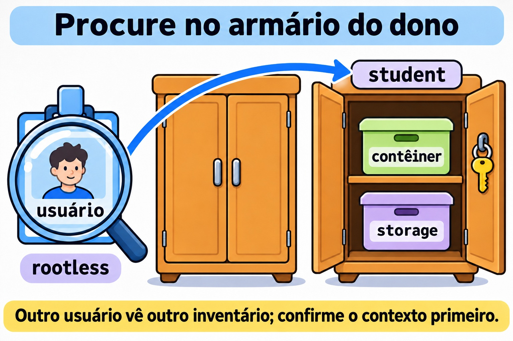
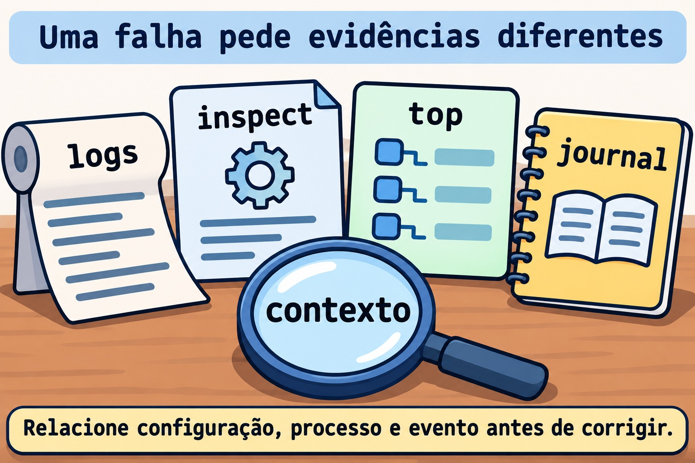
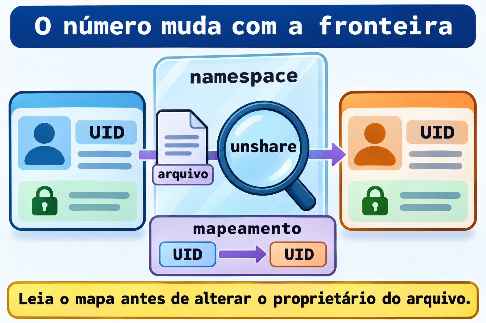

# Aula 18.4 · Diagnosticar contêiner rootless

> **O coração desta aula:** confirme o dono e relacione configuração, processo, arquivo e evento antes de corrigir o contêiner.

| Ficha | Plano de trabalho |
| --- | --- |
| Módulo | M18 · Podman, aula 4 de 5 |
| Quando | Semana 25 |
| Ao final | Localizar a camada de três falhas sem ampliar privilégios |
| Pré-requisitos | Serviço e conteúdo preservados da 18.3; acesso como dono |
| Duração | 80–100 minutos |
| Snapshot | `m18a4-inicio` e `m18a4-fim` somente nas VMs de estudo |

A bancada continua no usuário `student`, primeiro em `rocky-lab` e depois em `debian-lab`. Os comandos de Podman são sempre do dono, sem elevação.

A porta continua no loopback, e o conteúdo permanece fora do contêiner. Não conecte o serviço à rede externa para facilitar o diagnóstico.

Crie o snapshot da VM antes das quebras e confira o console. Os defeitos são restritos à bancada; nenhum mapa global de usuários será alterado.

## 1 · Aquecimento

Responda antes de consultar a unidade ou o inventário.

1. Por que uma lista vazia de contêineres não prova que a máquina não tem contêineres?

2. Qual a diferença entre serviço ativo e resposta HTTP válida?

3. O número de usuário dentro do contêiner precisa coincidir com o número no host?

## 2 · Por que importa

Um serviço rootless não aparece no terminal do administrador. A tentativa de recriá-lo em outra conta produz outra cópia, outro storage e outra disputa de porta, sem explicar a primeira falha.

Outro chamado parece falha de rede: a unidade está ativa, o processo existe, mas a requisição expira. Um processo congelado não é um processo inexistente.

Você vai manter essas distinções observáveis. O reparo precisa ser menor que o problema e permitir repetir a prova inicial.

### Ponte Windows

Uma ferramenta aberta com outra identidade pode mostrar outro perfil e outro conjunto de recursos. Confirme a identidade efetiva antes de interpretar uma ausência como perda de dados.

## 3 · Modelo mental



*Outro usuário vê outro inventário; confirme o contexto primeiro.*

Cada dono tem seu armário de imagens, contêineres e dados internos de Podman. Usar o nome correto no armário errado continua sendo uma pergunta feita ao lugar errado.

| Evidência | Pergunta |
| --- | --- |
| Identidade e ambiente | Quem está consultando? |
| Ficha do contêiner | O que foi configurado? |
| Processos | O que existe agora? |
| Eventos | O que aconteceu e quando? |
| Arquivo montado | Que dado foi entregue ao processo? |

A configuração do serviço pertence ao gerenciador; o estado do contêiner pertence à execução; o conteúdo pertence ao caminho montado. Compare os três.

## 4 · O essencial

O diretório de execução do usuário e o barramento de sua sessão não devem ser inventados para fazer um comando funcionar. Entre diretamente como o dono por um login completo.

Não use elevação para consultar Podman como se ela mostrasse automaticamente os contêineres do usuário. Isso pode trocar o inventário e produzir outro diagnóstico.

Os arquivos `/etc/subuid` e `/etc/subgid` descrevem faixas subordinadas. Ler o mapa é diferente de reatribuir faixas de uma conta em uso.

Uma mudança global nessas faixas pode tornar o storage existente incoerente. Esta aula não faz essa mudança nem usa limpeza global do armazenamento como conserto.

O comando `podman unshare` abre uma visão no namespace do próprio dono. Ele não fornece root global da VM. Use-o aqui somente para ler o mapa e comparar um arquivo conhecido.

### Rocky × Debian

| Leitura | Rocky | Debian |
| --- | --- | --- |
| Acesso ao arquivo | Modo, dono e SELinux ativo | Modo, dono e controles ativos |
| Journal do usuário | Contexto do dono | Contexto do dono |
| Faixas subordinadas | Ler, não reassinar cegamente | Ler, não reassinar cegamente |

### Decida 1

O inventário está vazio num terminal que não pertence ao dono. O primeiro passo é:

A. Recriar o serviço com privilégios globais.
B. Apagar os diretórios de storage que parecem antigos.
C. Confirmar identidade, contexto e VM, depois consultar como dono.

## 5 · Lab guiado

### Passo 1 · Fixar o contexto e o limite da mudança

**Palpite:** qual informação precisa vir antes do nome do contêiner numa investigação rootless?

```bash
test "$(id -un)" = student || exit 1
test "$(id -u)" -ne 0 || exit 1
test -z "${CONTAINER_HOST-}${CONTAINER_CONNECTION-}" || exit 1
test "$(podman info --format '{{.Host.Security.Rootless}}')" = true || exit 1
case "$(hostname -s)" in rocky-lab|debian-lab) ;; *) exit 1 ;; esac
id
printf 'HOME=%s\nXDG_RUNTIME_DIR=%s\n' "$HOME" "$XDG_RUNTIME_DIR"
podman info --format '{{.Host.Security.Rootless}} {{.Store.GraphRoot}}'
systemctl --user status m18-web.service --no-pager
loginctl show-user student --all -p Linger -p Sessions
```

**Saída esperada:** dono correto, inventário rootless e serviço conhecido. Um erro de conexão ao gerenciador é evidência de contexto, não motivo para criar outro serviço.

**Verifique:** escreva nome da VM, usuário, horário e recurso. Se um deles está incerto, pare antes das quebras.

### Passo 2 · Ler a configuração real

**Palpite:** um nome conhecido garante imagem, rótulo e montagem corretos?

```bash
podman inspect m18-web --format '{{index .Config.Labels "io.course.module"}}'
podman inspect m18-web --format '{{.ImageName}}'
podman inspect m18-web --format '{{json .State}}'
podman inspect m18-web --format '{{json .Mounts}}'
podman port m18-web
systemctl --user cat m18-web.service
```

**Saída esperada:** rótulo M18, imagem por referência conhecida, estado real, montagem do site e porta no loopback. Não publique uma ficha completa se ela contiver ambiente com segredos.

**Verifique:** a fonte do volume é o diretório persistente esperado, não uma pasta parecida nem o conteúdo interno da imagem. Compare com a fonte Quadlet.

### Passo 3 · Relacionar processos e eventos

**Palpite:** o usuário mostrado no processo interno precisa ter o mesmo número na visão da VM?



*Relacione configuração, processo e evento antes de corrigir.*

```bash
podman top m18-web user huser pid hpid args
podman logs --timestamps --tail 30 m18-web
sudo journalctl _UID="$(id -u student)" _SYSTEMD_USER_UNIT=m18-web.service -b --no-pager -n 40
systemctl --user show m18-web.service -p ActiveState -p SubState -p Result -p NRestarts
curl --max-time 3 --fail --silent --show-error http://127.0.0.1:18080/
```

**Saída esperada:** processos reais e registros do intervalo atual. Os campos de usuário do host e do contêiner podem diferir pelo mapeamento.

**Verifique:** relacione o momento da requisição com os eventos. Ausência de uma linha de aplicação não prova que nunca houve falha; confira intervalo, origem do log e retenção.

### Passo 4 · Ler o mapa sem mudar a identidade

**Palpite:** a mesma propriedade numérica de um arquivo pode aparecer com outro número em outro namespace?



*Leia o mapa antes de alterar o proprietário do arquivo.*

```bash
awk -F: '$1=="student" {print}' /etc/subuid /etc/subgid
command -v newuidmap newgidmap
podman unshare cat /proc/self/uid_map /proc/self/gid_map
stat -c '%u:%g %a %n' "$HOME/m18-lab/site/index.html"
podman unshare stat -c '%u:%g %a %n' "$HOME/m18-lab/site/index.html"
```

**Saída esperada:** faixas reais do dono e uma tradução observável no mapa. Não copie números de outra máquina para tentar igualar a saída.

**Verifique:** explique início, faixa e quantidade usando o mapa que você leu. Se faltar faixa ou helper, preserve o storage e trate a correção como mudança administrativa planejada.

### Passo 5 · Separar permissão, rótulo e montagem

**Palpite:** negar leitura por modo Unix é a mesma coisa que uma negação do SELinux?

```bash
namei -l "$HOME/m18-lab/site/index.html"
ls -ldZ "$HOME/m18-lab/site"
ls -lZ "$HOME/m18-lab/site/index.html"
podman exec m18-web id
podman exec m18-web sh -c 'test -r /usr/share/nginx/html/index.html'
printf 'rc=%s\n' "$?"
```

**Saída esperada:** o documento é legível pela identidade efetiva da aplicação. Um campo de contexto vazio ou indisponível exige interpretar os controles ativos da distribuição, não desabilitá-los.

No Rocky com SELinux ativo, procure uma negação no intervalo do sintoma pelo procedimento de auditoria já estudado, se houver. Não fabrique uma negação quando a causa está no modo do arquivo.

**Verifique:** a montagem permanece somente leitura no contêiner. Torná-la gravável não é um conserto para uma aplicação que só precisa ler o site.

### Passo 6 · Escrever uma conclusão reproduzível

**Palpite:** quantas saídas sem contexto equivalem a uma conclusão demonstrada?

Complete o quadro com o seu caso real. Registre apenas o necessário e preserve o horário.

| Campo | Sua evidência |
| --- | --- |
| Contexto | VM, dono e gerenciador |
| Configuração | Imagem, porta e montagem |
| Execução | Estado e processos |
| Evento | Instante e mensagem relevante |
| Dado | Caminho e leitura pelo processo |
| Limite | O que ainda não foi demonstrado |

**Saída esperada:** outra pessoa entende a hipótese e consegue repetir uma consulta curta que a testa.

**Verifique:** sua conclusão não depende de segredo, captura antiga ou número de UID presumido. Use esse quadro antes de cada reparo abaixo.

## 6 · Quebre e conserte

Faça uma quebra por vez e restaure antes da próxima. As guardas recusam um nome sem o rótulo da bancada. Se uma guarda falhar, pare; não remova recursos para fazê-la passar.

```bash
assert_m18() {
  test "$(id -un)" = student || return 1
  test -z "${CONTAINER_HOST-}${CONTAINER_CONNECTION-}" || return 1
  test "$(podman info --format '{{.Host.Security.Rootless}}')" = true || return 1
  test "$(podman inspect m18-web --format '{{index .Config.Labels "io.course.module"}}')" = M18 || return 1
}
assert_m18 || exit 1
UNIT="$HOME/.config/containers/systemd/m18-web.container"
test -f "$UNIT" && test -O "$UNIT" || exit 1
test -f "$HOME/m18-lab/site/index.html" && test -O "$HOME/m18-lab/site/index.html" || exit 1
test ! -e "$HOME/m18-lab/m18a4.container.good" || exit 1
cp -- "$UNIT" "$HOME/m18-lab/m18a4.container.good" || exit 1
```

### Quebra 1 · Documento sem leitura para a aplicação

**Sintoma:** o site deixa de entregar o documento, embora o serviço permaneça ativo.

```bash
assert_m18 || exit 1
chmod 0600 "$HOME/m18-lab/site/index.html"
curl --max-time 3 --fail http://127.0.0.1:18080/
podman logs --tail 20 m18-web
podman exec m18-web id
```

**Investigação:** compare dono e modo do documento com o usuário da aplicação. A resposta pode indicar acesso negado; registre a mensagem real e não atribua automaticamente ao firewall.

**Causa:** o arquivo ficou legível somente para o dono externo, enquanto a aplicação não usa essa identidade no namespace.

**Conserto:** restaure o modo de leitura previsto, sem conceder escrita e sem trocar o dono globalmente.

```bash
chmod 0644 "$HOME/m18-lab/site/index.html"
podman exec m18-web sh -c 'test -r /usr/share/nginx/html/index.html'
curl --retry 10 --retry-delay 1 --retry-all-errors --max-time 5 --fail http://127.0.0.1:18080/
```

**Verifique:** o mesmo documento volta a responder, com o volume ainda somente leitura.

**Prevenção:** compare a identidade do processo antes de ampliar modos ou mudar rótulos.

### Quebra 2 · Processo congelado

**Sintoma:** há processo e serviço ativo, mas o cliente não obtém resposta dentro do prazo.

```bash
assert_m18 || exit 1
podman pause m18-web || exit 1
podman inspect m18-web --format '{{.State.Status}} {{.State.Paused}}'
systemctl --user is-active m18-web.service
curl --max-time 3 --fail http://127.0.0.1:18080/
```

Se a versão ou o ambiente recusar pausa rootless, registre o impedimento e não aplique alterações globais para forçar a simulação. A bancada Quadlet exige cgroup v2, mas capacidades locais ainda precisam ser conferidas.

**Investigação:** compare estado do contêiner, estado do gerenciador e prazo do cliente.

**Causa:** a execução foi pausada; a existência do processo não demonstra progresso.

**Conserto:** retome somente o contêiner rotulado do exercício.

```bash
assert_m18 || exit 1
podman unpause m18-web || exit 1
podman inspect m18-web --format '{{.State.Paused}}'
curl --max-time 3 --fail http://127.0.0.1:18080/
```

**Verifique:** a pausa foi removida e a requisição volta a concluir.

**Prevenção:** tenha uma prova de resposta da aplicação além da existência de PID e unidade.

### Quebra 3 · Comando de aplicação substituído

**Sintoma:** o serviço tenta reiniciar, mas o processo principal termina em vez de servir HTTP.

```bash
assert_m18 || exit 1
systemctl --user stop m18-web.service
sed -i '/^LogDriver=/a Exec=/bin/sh -c "exit 23"' "$UNIT"
systemctl --user daemon-reload
systemctl --user start m18-web.service
sudo journalctl _UID="$(id -u student)" _SYSTEMD_USER_UNIT=m18-web.service -b --no-pager -n 35
systemctl --user show m18-web.service -p Result -p NRestarts
systemctl --user stop m18-web.service
```

**Investigação:** compare o comando na fonte e na unidade gerada com a causa de saída registrada. O número de reinícios depende do momento observado; não há contagem fixa para copiar.

**Causa:** um comando substituto encerra deliberadamente o processo; a política de restart não corrige um comando incorreto.

**Conserto:** restaure a fonte conhecida, recarregue e limpe apenas o estado de falha dessa unidade.

```bash
cp -- "$HOME/m18-lab/m18a4.container.good" "$UNIT" || exit 1
systemctl --user daemon-reload
systemctl --user reset-failed m18-web.service
systemctl --user start m18-web.service || exit 1
curl --retry 10 --retry-delay 1 --retry-all-errors --max-time 5 --fail http://127.0.0.1:18080/
```

**Verifique:** o comando original voltou e o site entrega o conteúdo persistente.

**Prevenção:** leia a primeira causa relevante da saída, não apenas a última tentativa de reinício.

## 7 · Armadilhas

Não altere as faixas subordinadas de uma conta para fazer uma saída numérica parecer com a apostila. A tradução real é o objeto do estudo.

Não use limpeza global, remoção de todos os contêineres ou mudança de usuário como primeiro reparo. Você perderia o contexto que precisa explicar.

Evite consultar apenas o último contêiner criado. Uma seleção explícita por nome, identidade e rótulo reduz o risco de investigar outro recurso.

### Decida 2

A aplicação não lê o documento, mas o administrador consegue lê-lo no terminal. Qual prova falta?

A. Leitura pela identidade e montagem efetivas da aplicação.
B. Desativação dos controles de segurança.
C. Permissão de escrita total para todos.

## 8 · Quiz

1. Por que consultar outro usuário pode mostrar outro inventário?

2. O que os campos de usuário do host e do contêiner ajudam a distinguir?

3. Qual a diferença entre arquivo ilegível por modo e negação de um controle adicional?

4. Por que serviço ativo não garante progresso da aplicação?

5. Por que mudar faixas subordinadas de uma conta existente exige um plano?

6. Qual evidência permite repetir o diagnóstico depois do reboot?

## 9 · Lembrete

| Camada | Consulta curta |
| --- | --- |
| Dono | `id` |
| Ficha | `podman inspect m18-web` |
| Processos | `podman top m18-web user huser pid hpid args` |
| Evento | `sudo journalctl _UID="$(id -u student)" _SYSTEMD_USER_UNIT=m18-web.service -b` |
| Mapa | `podman unshare cat /proc/self/uid_map` |

**Flashcards:** prepare cartões sobre contexto, faixa subordinada, dono efetivo, pausa e causa de saída. Revise em D+1, D+3, D+7 e D+21.

```text
!explica 18.4 contexto do dono, logs, inspect, top e unshare
!feynman 18.4 vou explicar por que processo existente pode nao responder
!quiz 18.4
```

## 10 · Checklist e fechamento

Restaure o documento em modo de leitura previsto, retire a pausa e confirme a fonte original. Preserve o site, o serviço e linger para a continuidade do módulo.

Não remova o inventário de imagens nem os backups privados das fontes como efeito automático desta limpeza. Registre quais cópias foram criadas para não confundi-las com configuração ativa.

**Reboot de conferência:** após corrigir as três quebras, repita o ensaio da 18.3: somente a VM, observação administrativa antes do login do dono e resposta no loopback.

```bash
case "$(hostname -s)" in rocky-lab|debian-lab) ;; *) exit 1 ;; esac
sudo reboot
```

Depois da evidência sem login, entre novamente como dono e compare a configuração e o conteúdo com seu registro inicial. Não use uma consulta de outro boot como se fosse atual.

```bash
systemctl --user is-active m18-web.service
podman inspect m18-web --format '{{.State.Paused}} {{.State.Status}}'
podman port m18-web
curl --retry 10 --retry-delay 1 --retry-all-errors --max-time 5 --fail http://127.0.0.1:18080/
sha256sum "$HOME/m18-lab/site/index.html"
```

- [ ] Confirmei VM, dono e contexto.
- [ ] Relacionei estado, processo e evento.
- [ ] Li o mapa sem alterar faixas globais.
- [ ] Separei modo de arquivo e controles adicionais.
- [ ] Corrigi os três defeitos e conferi após reboot.
- [ ] Preservei o serviço para a próxima aula.

**Último exercício:** entregue um relato de seis linhas com contexto, hipótese, consulta, observação, reparo e limite da conclusão. Cada linha precisa se apoiar numa evidência real.

Crie o snapshot de fim apenas com a bancada saudável e o diário atualizado. O snapshot não demonstra por si só que a causa foi compreendida.

## 11 · Na vida real

Com autorização, leia a documentação de operação de um serviço rootless. Identifique dono, origem da imagem, caminho do dado e fonte de logs. Não plante nenhum defeito fora da bancada.

Proponha uma consulta curta para cada lacuna encontrada. Se a informação contém segredo, peça uma versão reduzida em vez de copiar o ambiente inteiro para o relatório.

## 12 · Aprofunde quando quiser

- [Leitura de processos e identidades](https://docs.podman.io/en/latest/markdown/podman-top.1.html).
- [Namespace do usuário e unshare](https://docs.podman.io/en/latest/markdown/podman-unshare.1.html).
- [Inspeção de contêineres](https://docs.podman.io/en/latest/markdown/podman-inspect.1.html).
- [Quadlet e gerenciador do usuário](https://docs.podman.io/en/latest/markdown/podman-systemd.unit.5.html).

Use a documentação da versão instalada para interpretar os campos disponíveis. Um campo ausente exige adaptar a leitura, não inventar uma saída de referência.

### Soluções comentadas

**Aquecimento:** cada dono pode possuir outro inventário; serviço ativo não implica resposta válida; namespaces traduzem números de identidade.

**Decida 1: C.** A ausência só é interpretável depois de saber quem consultou e onde.

**Decida 2: A.** A leitura do administrador não representa automaticamente a leitura da aplicação.

**Quiz 1:** Porque armazenamento e recursos rootless pertencem ao contexto de cada dono.

**Quiz 2:** A identidade efetiva do processo nas duas visões e a tradução que precisa ser explicada pelo mapa.

**Quiz 3:** Modo, dono e controles adicionais são verificações independentes; uma hipótese não substitui a evidência da outra.

**Quiz 4:** O processo pode estar pausado ou não fazer progresso, embora o gerenciador continue considerando a unidade ativa.

**Quiz 5:** Porque dados existentes podem depender do mapa anterior; a mudança precisa considerar migração e recuperação.

**Quiz 6:** VM, dono, boot, horário, configuração, dado e resultado observável permitem repetir a hipótese.

[← Aula18.3 · Contêiner como serviço](18.3-conteiner-como-servico.md) · [Índice das aulas](../01-aulas.md) · [Aula18.5 · Construir imagens →](18.5-construir-imagens.md)
