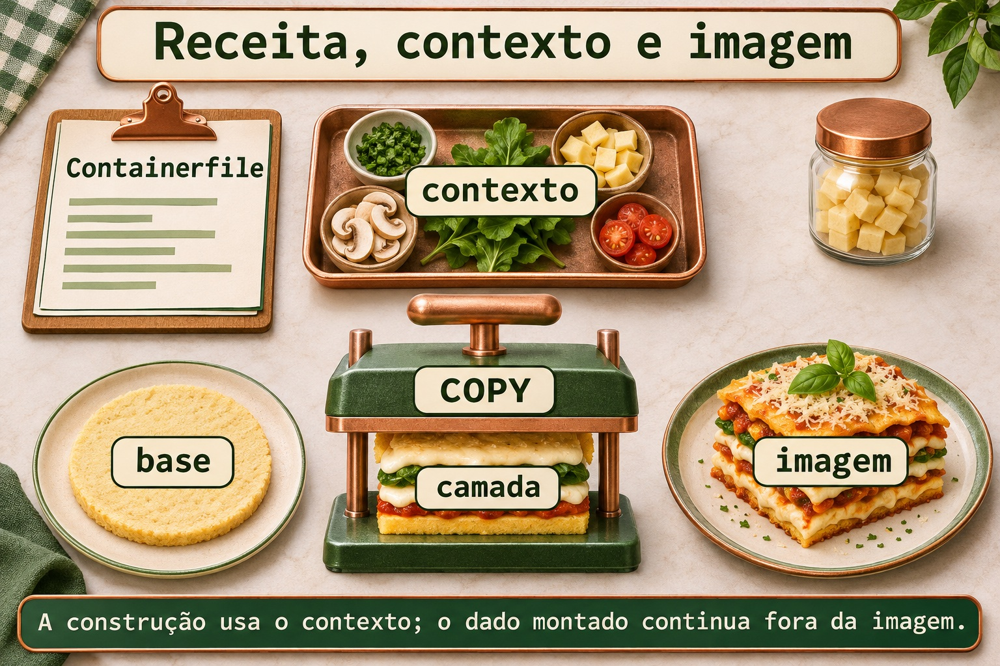
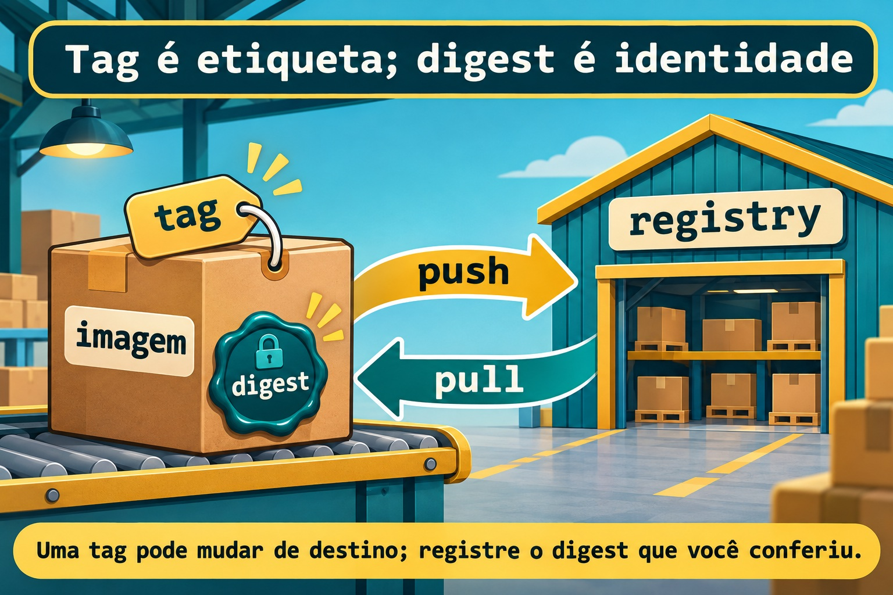
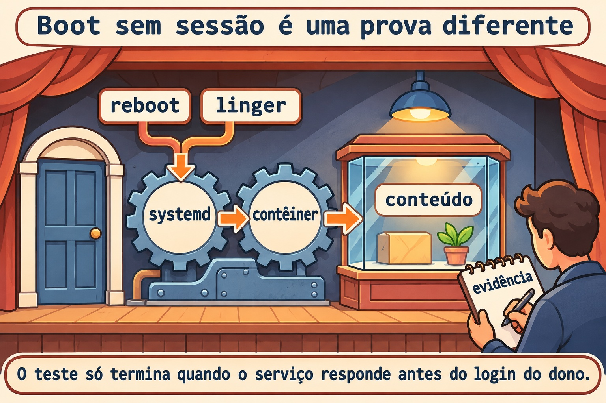

# Aula 18.5 · Construir imagens

> **O coração desta aula:** uma receita cria uma imagem; uma tag aponta para ela; o dado persistente continua sob outro contrato.

| Ficha | Plano de trabalho |
| --- | --- |
| Módulo | M18 · Podman, aula 5 de 5 |
| Quando | Semana 25 |
| Ao final | Construir, testar, publicar localmente e provar o serviço após reboot sem sessão do dono |
| Pré-requisitos | 18.1 a 18.4; VM 201, usuário `student`, serviço `m18-web` saudável |
| Duração | 100–140 minutos, além das transferências |
| Snapshot | `m18a5-inicio` e `m18a5-fim`, somente VM 201; na repetição Debian, VM 202 |

Execute como dono do laboratório numa sessão real da VM, nunca no host Proxmox. Os comandos administrativos aparecem separados. O comparativo Debian usa sua própria VM 202 e seus próprios objetos.

Antes do lab, encerre mudanças pendentes e crie o snapshot `m18a5-inicio` da VM201; na repetição Debian, use somente a VM202. Faça isso pelo procedimento de snapshot já estudado no Proxmox, confira ID e nome do convidado e volte à sessão de student na VM antes dos comandos abaixo.

## 1 · Aquecimento

1. Se uma imagem contém uma página, qual página aparece quando um diretório externo cobre o mesmo caminho?

2. Uma segunda tag copia todos os bytes de uma imagem?

3. Um serviço funcionando após seu login prova que ele iniciou antes do login?

## 2 · Por que importa

Você recebe uma imagem que funciona, mas ninguém consegue explicar sua origem. Um arquivo de receita e um contexto pequeno tornam a construção inspecionável. Eles não garantem, sozinhos, segurança nem reprodução byte a byte.

O laboratório publica apenas num registry local sem autenticação, ligado ao loopback da VM. Ele serve para aprender transporte e identidade; não é um registry para a rede da empresa.

O serviço persistente das aulas anteriores continua reservado para o proxy do M19. O teste da imagem usa outra porta e não monta o diretório do serviço.

## 3 · Modelo mental



*A construção usa o contexto; o dado montado continua fora da imagem.*

| Objeto | O que descreve |
| --- | --- |
| `Containerfile` | Instruções e base da construção |
| Contexto | Arquivos que a construção pode ler |
| Imagem | Resultado com configuração e camadas |
| Tag | Referência que pode ser movida |
| Digest | Identidade do manifesto conferido |
| Bind mount | Dado externo visível naquele caminho |

### Ponte Windows

Pense na diferença entre uma receita de implantação, seu pacote e um diretório de dados montado depois. Trocar o pacote não apaga nem substitui automaticamente esse diretório.

## 4 · O essencial

A base vem do digest real guardado na 18.1. A construção não baixa outra base por uma tag mutável. O arquivo de ambiente pertence ao usuário do lab; leia seu conteúdo antes de carregá-lo.

A receita usa apenas cópia de um arquivo local. Não há instalação de pacotes nem download durante a construção. Acrescentar essas operações exigiria controlar repositórios, versões e segredos separadamente.

Um segredo passado como argumento de construção pode aparecer em metadados ou logs. Nesta aula não há credencial, chave privada ou token no contexto.

Use nomes completos de registry. As exceções de verificação TLS ficam restritas às chamadas destinadas exclusivamente ao endpoint local definido aqui; não altere a configuração global de registries.

### Rocky × Debian

Na Rocky, mantenha SELinux em modo enforcing e aplique o rótulo privado somente ao diretório dedicado do registry. Na Debian, confira as políticas de segurança disponíveis; a ausência de SELinux não elimina permissões Unix nem namespaces.

## 5 · Lab guiado

Reserve as portas de loopback dos testes antes de criar qualquer objeto. Não troque a porta do serviço anterior para liberar uma porta deste exercício.

### Passo 1 · Fixar dono, base e área de trabalho

**Palpite:** uma referência por digest é suficiente para provar que o usuário atual possui a imagem local?

```bash
test "$(id -un)" = student || exit 1
case "$(hostname -s)" in rocky-lab|debian-lab) ;; *) exit 1 ;; esac
test "$(podman info --format '{{.Host.Security.Rootless}}')" = true || exit 1
cat "$HOME/m18-lab/image.env"
. "$HOME/m18-lab/image.env"
case "$M18_IMAGE" in docker.io/nginxinc/nginx-unprivileged@sha256:*) ;; *) exit 1 ;; esac
podman image inspect "$M18_IMAGE" > /dev/null || exit 1
systemctl --user is-active m18-web.service || exit 1
test "$(podman inspect m18-web --format '{{index .Config.Labels "io.course.module"}}')" = M18 || exit 1
PORTS=$(ss -H -ltn '( sport = :18081 or sport = :15000 )') || exit 1
test -z "$PORTS" || exit 1
for NAME in m18-build-test m18-registry; do
  if podman container exists "$NAME"; then exit 1
  else RC=$?; test "$RC" -eq 1 || exit 1; fi
done
for REF in localhost/m18-web:v1 localhost:15000/m18-web:v1; do
  if podman image exists "$REF"; then exit 1
  else RC=$?; test "$RC" -eq 1 || exit 1; fi
done
test ! -e "$HOME/m18-lab/build" || exit 1
mkdir -m 0750 "$HOME/m18-lab/build" || exit 1
EVID=$(mktemp -d "$HOME/m18-lab/evidence-18-5.XXXXXX") || exit 1
```

**Saída esperada:** dono correto, modo rootless verdadeiro, base disponível e duas portas livres. Se o hostname foi alterado num exercício anterior, resolva a identidade da bancada antes de adaptar a guarda.

**Verifique:** confira também a ausência dos nomes de teste e das tags novas na listagem completa. Se já existem, preserve-os e investigue; não use substituição automática.

```bash
podman ps --all
podman images
systemctl --user cat m18-web.service > "$EVID/service-before.txt"
```

### Passo 2 · Escrever a receita e limitar o contexto

**Palpite:** copiar um arquivo da imagem exige montar o diretório persistente do serviço durante a construção?

```bash
cd "$HOME/m18-lab/build" || exit 1
printf '%s\n' '<h1>M18 build v1</h1>' > index.html
chmod 0644 index.html
cat > Containerfile <<'EOF'
ARG M18_BASE
FROM ${M18_BASE}
LABEL io.course.module="M18"
COPY index.html /usr/share/nginx/html/index.html
EOF
cat > .containerignore <<'EOF'
*
!Containerfile
!index.html
!.containerignore
EOF
cat Containerfile
cat .containerignore
sha256sum Containerfile index.html .containerignore | tee "$EVID/context.sha256"
```

**Saída esperada:** uma receita curta e um contexto sem chaves ou credenciais. O usuário, a porta e o comando de execução continuam herdados da base.

**Verifique:** o arquivo copiado pertence ao contexto de construção. Ele não é o conteúdo persistente que o serviço atual monta depois.

### Passo 3 · Construir e testar sem o volume do serviço

**Palpite:** uma tarefa de construção bem-sucedida prova que a página HTTP contém os bytes esperados?

```bash
podman build --pull=never --network=none   --build-arg "M18_BASE=$M18_IMAGE"   --tag localhost/m18-web:v1 "$HOME/m18-lab/build" || exit 1
podman image inspect localhost/m18-web:v1 > "$EVID/built-image.json"
podman history --no-trunc localhost/m18-web:v1
podman run -d --name m18-build-test --label io.course.module=M18   --pull=never -p 127.0.0.1:18081:8080 localhost/m18-web:v1 || exit 1
podman logs m18-build-test
curl --retry 10 --retry-delay 1 --retry-all-errors --max-time 5 --fail --silent --show-error http://127.0.0.1:18081/ --output "$EVID/build-response.html" || exit 1
```

**Saída esperada:** após o servidor ficar pronto, a resposta coincide com o arquivo incorporado. Se a primeira consulta ocorrer antes da prontidão, leia os logs e repita apenas a consulta.

```bash
cmp "$HOME/m18-lab/build/index.html" "$EVID/build-response.html" || exit 1
podman inspect m18-build-test --format '{{json .Mounts}}'
podman inspect m18-build-test --format '{{json .HostConfig.PortBindings}}'
```

**Verifique:** o teste não possui bind mount do site anterior. Usar o mesmo diretório com rótulo privado em dois contêineres pode trocar sua categoria SELinux e quebrar o serviço que já o usava.

### Passo 4 · Abrir um registry exclusivamente local

**Palpite:** escutar apenas no loopback permite receber imagens de qualquer outra VM?

Confira no projeto Distribution a imagem de registry usada. A tag serve para a seleção inicial; leia o RepoDigest real e fixe-o antes de criar o contêiner.

```bash
podman pull docker.io/library/registry:3 || exit 1
podman image inspect docker.io/library/registry:3 --format '{{json .RepoDigests}}'
read -r -p 'RepoDigest real docker.io/library/registry@sha256:...: ' M18_REG_IMAGE
case "$M18_REG_IMAGE" in docker.io/library/registry@sha256:*) ;; *) exit 1 ;; esac
podman image inspect "$M18_REG_IMAGE" > /dev/null || exit 1
test ! -e "$HOME/m18-lab/registry-data" || exit 1
mkdir -m 0700 "$HOME/m18-lab/registry-data" || exit 1
podman run -d --name m18-registry --label io.course.module=M18   --pull=never -p 127.0.0.1:15000:5000   -e OTEL_TRACES_EXPORTER=none   -v "$HOME/m18-lab/registry-data:/var/lib/registry:Z"   "$M18_REG_IMAGE" || exit 1
podman logs m18-registry
podman port m18-registry
curl --retry 10 --retry-delay 1 --retry-all-errors --max-time 5 --fail --silent --show-error http://127.0.0.1:15000/v2/ || exit 1
```

**Saída esperada:** API local responde e a publicação está restrita ao endereço de loopback. Nenhuma porta de firewall da VM é aberta.

**Verifique:** o volume privado do registry é outro diretório. Não aponte esse volume para sua home inteira, para o site ou para dados existentes.

### Passo 5 · Publicar e ler pelo digest do destino

**Palpite:** o digest do manifesto publicado precisa ser adivinhado a partir do ID local da imagem?



*Uma tag pode mudar de destino; registre o digest que você conferiu.*

```bash
REG_REF=localhost:15000/m18-web
podman tag localhost/m18-web:v1 "$REG_REF:v1" || exit 1
podman push --tls-verify=false --digestfile "$EVID/pushed.digest"   "$REG_REF:v1" "docker://$REG_REF:v1" || exit 1
REG_DIGEST=$(cat "$EVID/pushed.digest") || exit 1
case "$REG_DIGEST" in sha256:*) ;; *) exit 1 ;; esac
podman pull --tls-verify=false "$REG_REF@$REG_DIGEST" || exit 1
podman image inspect "$REG_REF@$REG_DIGEST" > "$EVID/pulled-image.json"
printf '%s\n' "$REG_REF@$REG_DIGEST" > "$EVID/service-image.txt"
```

**Saída esperada:** transporte concluído, digest real gravado e referência do destino disponível no armazenamento do mesmo usuário. Mudanças de formato ou compressão podem alterar o manifesto; use o digest retornado pelo push.

**Verifique:** as exceções TLS se referem exclusivamente ao endpoint local. Um registry externo exige TLS e autenticação apropriados; não exporte essa exceção como configuração geral.

### Passo 6 · Repetir o teste com a referência publicada

**Palpite:** publicar e baixar uma imagem demonstra que o conteúdo HTTP continua correto?

```bash
test "$(podman inspect m18-build-test --format '{{index .Config.Labels "io.course.module"}}')" = M18 || exit 1
podman stop m18-build-test || exit 1
podman rm m18-build-test || exit 1
podman run -d --name m18-build-test --label io.course.module=M18   --pull=never -p 127.0.0.1:18081:8080 "$REG_REF@$REG_DIGEST" || exit 1
podman logs m18-build-test
curl --retry 10 --retry-delay 1 --retry-all-errors --max-time 5 --fail --silent --show-error http://127.0.0.1:18081/ --output "$EVID/pull-response.html" || exit 1
cmp "$HOME/m18-lab/build/index.html" "$EVID/pull-response.html" || exit 1
systemctl --user is-active m18-web.service
```

**Saída esperada:** a imagem publicada atende os mesmos bytes e o serviço anterior permanece saudável. Aguarde prontidão antes da comparação; resposta ausente não é arquivo aprovado.

**Verifique:** preserve receita, checksums, referência publicada e resultado HTTP. O desafio usará essa referência já baixada, com política de nunca puxar no boot.

## 6 · Quebre e conserte

Faça cada quebra no teste da imagem ou numa cópia da receita. Não altere a política global de TLS, o conteúdo do site ou o serviço persistente para fabricar um erro.

### Quebra 1 · O arquivo não está no contexto

**Sintoma:** a construção informa que não encontra o arquivo a copiar.

```bash
cd "$HOME/m18-lab/build" || exit 1
cp Containerfile Containerfile.broken
sed -i 's/COPY index.html/COPY missing.html/' Containerfile.broken
podman build --pull=never --network=none   --build-arg "M18_BASE=$M18_IMAGE" -f Containerfile.broken .
```

**Investigação:** leia a instrução que falhou e compare seus caminhos com a raiz do contexto e o arquivo de exclusões.

**Causa:** a receita pede um arquivo inexistente no contexto permitido. Não é falha do nginx em execução.

**Conserto:** volte ao arquivo original e repita a construção somente com uma nova tag de teste autorizada, sem substituir a tag aprovada.

**Verifique:** o arquivo solicitado existe e não foi excluído pelo contexto.

**Prevenção:** mantenha um contexto pequeno e explique cada arquivo incluído.

### Quebra 2 · A referência não existe no registry

**Sintoma:** o registry responde, mas não encontra a tag solicitada.

```bash
podman pull --tls-verify=false localhost:15000/m18-web:tag-ausente
```

**Investigação:** compare nome do repositório, tag, destino do push e digest registrado. A API responder não prova que qualquer tag existe.

**Causa:** o nome pedido não foi publicado nesse registry. Não desabilite mais controles para procurar uma tag inexistente.

**Conserto:** use a referência por digest realmente gravada no diário.

**Verifique:** a inspeção encontra a referência correta e o teste HTTP permanece aprovado.

**Prevenção:** publique e registre destino, tag e digest como três campos diferentes.

### Quebra 3 · O volume esconde a página da imagem

**Sintoma:** após trocar a imagem do serviço no desafio, aparece a página persistente anterior.

**Investigação:** compare os mounts do serviço com os do teste sem bind mount.

```bash
podman inspect m18-web --format '{{json .Mounts}}'
podman inspect m18-build-test --format '{{json .Mounts}}'
cat "$HOME/m18-lab/site/index.html"
cat "$HOME/m18-lab/build/index.html"
```

**Causa:** o dado externo cobre o caminho que contém a página incorporada. Isso é o contrato de persistência, não uma construção ignorada.

**Conserto:** mantenha o volume; compare o serviço com seu site persistente e o teste com a página incorporada. Não apague o dado para forçar a aparência esperada.

**Verifique:** os dois resultados correspondem às suas fontes diferentes.

**Prevenção:** registre quais caminhos vêm da imagem e quais são cobertos por mounts.

## 7 · Armadilhas

### Decida 1

Você quer incluir uma chave privada na construção para baixar um arquivo. Qual decisão preserva o escopo da aula?

A. Interromper e planejar um mecanismo de segredo apropriado fora deste exercício.
B. Copiar a chave para o contexto e apagá-la numa camada posterior.
C. Passar a chave como argumento comum de construção.

### Decida 2

O HTTP responde depois de você entrar como dono. Você quer afirmar que o serviço sobe sem login. O que falta?

A. Outra tag apontando para os mesmos bytes.
B. Uma captura da imagem local.
C. Reboot controlado e observação externa anterior a qualquer sessão do dono.

## 8 · Quiz

1. Qual diferença existe entre receita e contexto?

2. Por que guardar o digest retornado pelo push?

3. O teste da imagem deve montar o mesmo site privado do serviço?

4. O que a exceção TLS desta aula autoriza?

5. Por que o serviço pode mostrar outra página depois de trocar sua imagem?

6. Qual observação distingue boot autônomo de início causado pelo login?

## 9 · Lembrete

| Pergunta | Evidência |
| --- | --- |
| Como foi construída? | Receita, base fixa e contexto |
| O que foi publicado? | Destino e digest do manifesto |
| Qual página foi servida? | Resposta comparada com sua fonte |
| Quando o serviço iniciou? | Boot e evidência antes do login |

**Flashcards:** crie cartões sobre contexto, tag, digest, bind mount e observador externo. Revise sem abrir o terminal.

```text
!explica 18.5 receita, contexto, tag e digest
!feynman 18.5 vou explicar por que o mount esconde a página incorporada
!quiz 18.5
```

## 10 · Checklist e fechamento

### Desafio · Serviço sem login do dono



*O teste só termina quando o serviço responde antes do login do dono.*

Primeiro confirme que o serviço anterior está saudável, o site está preservado e sua imagem publicada está localmente disponível. Guarde uma cópia da definição antes de mudar apenas a referência de imagem e a política de pull.

```bash
UNIT="$HOME/.config/containers/systemd/m18-web.container"
test -f "$UNIT" && test -O "$UNIT" && test ! -L "$UNIT" || exit 1
test ! -e "$EVID/m18-web.before.container" || exit 1
cp -p "$UNIT" "$EVID/m18-web.before.container" || exit 1
podman image inspect "$REG_REF@$REG_DIGEST" > /dev/null || exit 1
python3 - "$UNIT" "$REG_REF@$REG_DIGEST" <<'PY'
import pathlib, sys
p = pathlib.Path(sys.argv[1]); lines = p.read_text().splitlines()
assert sum(x.startswith('Image=') for x in lines) == 1
assert 'ContainerName=m18-web' in lines
assert any('io.course.module=M18' in x for x in lines)
out = [x for x in lines if not x.startswith('Pull=')]
i = next(i for i,x in enumerate(out) if x.startswith('Image='))
out[i:i+1] = ['Image=' + sys.argv[2], 'Pull=never']
p.write_text('\n'.join(out) + '\n')
PY
test "$?" -eq 0 || exit 1
systemctl --user daemon-reload
systemctl --user restart m18-web.service || exit 1
systemctl --user status m18-web.service --no-pager
curl --retry 10 --retry-delay 1 --retry-all-errors --max-time 5 --fail --silent --show-error http://127.0.0.1:18080/ --output "$EVID/service-response.html" || exit 1
cmp "$HOME/m18-lab/site/index.html" "$EVID/service-response.html" || exit 1
loginctl show-user student -p Linger
```

Confira a chave de política na ajuda Quadlet instalada antes da edição. Se sua versão não suporta esse arquivo, preserve a definição e resolva o pré-requisito da 18.3. Não use uma imagem que depende de download no boot para provar um serviço offline.

O serviço deve continuar exibindo o site externo, pois o volume o cobre. A mudança de imagem não é autorização para editar o dado persistente.

Se a nova definição falhar, preserve os logs e retorne à cópia anterior neste mesmo shell, antes de tentar o reboot. O bloco seguinte é somente o caminho de recuperação, não deve ser executado quando o teste passou.

```bash
test -s "$EVID/m18-web.before.container" || exit 1
cp -p "$EVID/m18-web.before.container" "$UNIT" || exit 1
systemctl --user daemon-reload
systemctl --user restart m18-web.service || exit 1
curl --retry 10 --retry-delay 1 --retry-all-errors --max-time 5 --fail --silent --show-error http://127.0.0.1:18080/ || exit 1
```

No caminho aprovado, registre fora da VM o diretório de evidências, o hash do site e a referência de imagem. Isso permite localizar a prova depois que a sessão e suas variáveis desaparecerem.

```bash
printf '%s\n' "$EVID"
sha256sum "$HOME/m18-lab/site/index.html"
cat "$EVID/service-image.txt"
```

**Reboot de conferência:** mantenha disponível uma console administrativa independente. Reinicie somente a VM de laboratório e não entre como dono após o boot.

```bash
sudo reboot
```

Na console administrativa da mesma VM, entre como administrador autorizado. Antes de qualquer sessão do dono, faça apenas estas leituras; esse administrador não executa Podman no lugar do dono.

```bash
date -Is
uptime -s
loginctl show-user student --all -p Linger -p Sessions
systemctl status "user@$(id -u student).service" --no-pager
curl --retry 10 --retry-delay 1 --retry-all-errors --max-time 5 --fail --silent --show-error http://127.0.0.1:18080/ || exit 1
journalctl -b _UID="$(id -u student)" _SYSTEMD_USER_UNIT=m18-web.service --no-pager
```

O critério exige linger ativo, nenhuma sessão interativa de classe user do dono e resposta correta antes do login. Guarde horário e conteúdo fora da VM. Se o dono já entrou, essa tentativa não prova a condição: repita o reboot controlado.

Depois da observação, entre como dono, confira o serviço e os logs. O registry de teste não precisa estar ativo: a imagem foi baixada antes e a política do serviço proíbe pull.

**Último exercício:** entregue receita, referência publicada, checksum do site e relato do observador. Diferencie o teste da imagem incorporada do teste do dado persistente.

### Limpeza e continuidade

Remova somente os dois contêineres descartáveis, após conferir seus nomes e rótulos. Se abriu outra sessão, identifique novamente o dono e preserve as variáveis do diário; não adivinhe seus valores.

```bash
for NAME in m18-build-test m18-registry; do
  test "$(podman inspect "$NAME" --format '{{index .Config.Labels "io.course.module"}}')" = M18 || exit 1
  podman stop "$NAME" || exit 1
  podman rm "$NAME" || exit 1
done
systemctl --user is-active m18-web.service
curl --retry 10 --retry-delay 1 --retry-all-errors --max-time 5 --fail --silent --show-error http://127.0.0.1:18080/ || exit 1
```

Preserve o site, a definição Quadlet, a imagem do serviço e o linger para o M19. Preserve também evidências, receita e dados do registry até revisar a entrega. Não rode limpeza global de imagens ou volumes.

Depois da limpeza guardada e da prova de boot, crie o snapshot `m18a5-fim` apenas na VM de estudo correspondente. Registre o ponto de retorno; ele não substitui backup e recuperação do site persistente.

- [ ] Construí com base fixa e contexto delimitado.
- [ ] Comparei as respostas HTTP com suas fontes corretas.
- [ ] Publiquei somente no registry de loopback e registrei seu digest.
- [ ] Demonstrei o boot antes de qualquer sessão do dono.
- [ ] Preservei serviço e conteúdo para o módulo seguinte.

## 11 · Na vida real

Escolha uma imagem já autorizada e leia sua receita, origem da base e processo de publicação. Produza somente um parecer: quais dados ficam na imagem, quais ficam em volumes e onde se registra a identidade publicada?

Não construa nem publique uma imagem em nome da organização para preencher uma lacuna do relatório. Uma informação ausente deve continuar marcada como ausente.

## 12 · Aprofunde quando quiser

- [Podman: construir imagens](https://docs.podman.io/en/latest/markdown/podman-build.1.html).

- [Podman: publicar imagens e registrar digest](https://docs.podman.io/en/latest/markdown/podman-push.1.html).

- [Distribution: registry de laboratório e produção](https://distribution.github.io/distribution/about/deploying/).

- [Quadlet e unidades de usuário](https://docs.podman.io/en/latest/markdown/podman-systemd.unit.5.html).

### Soluções comentadas

**Aquecimento 1:** aparece o dado montado no caminho; ele cobre o arquivo da imagem.

**Aquecimento 2:** não; a tag acrescenta uma referência local.

**Aquecimento 3:** não; o próprio login pode iniciar o gerenciador do usuário.

**Decida 1: A.** Apagar um segredo depois não o retira necessariamente das camadas anteriores ou dos logs.

**Decida 2: C.** É preciso observar o efeito sem provocar a condição que se deseja excluir.

**Quiz 1:** a receita contém instruções; o contexto delimita os arquivos disponíveis para elas.

**Quiz 2:** identifica o manifesto realmente armazenado no destino; não se adivinha seu valor pelo ID local.

**Quiz 3:** não; além de esconder a página incorporada, outro rótulo privado pode afetar o serviço existente.

**Quiz 4:** somente transporte para o registry de loopback indicado; não autentica um registry externo nem muda a política geral.

**Quiz 5:** o bind mount cobre o caminho da página da imagem e oferece o dado persistente.

**Quiz 6:** observador autorizado consulta o serviço após reboot e antes de qualquer sessão do dono, com horário e resposta registrados.

[← Aula 18.4 · Diagnosticar contêiner rootless](18.4-diagnosticar-conteiner-rootless.md) · [Índice das aulas](../01-aulas.md) · [Plano do curso: M19 em diante →](../00-plano-do-curso.md)
