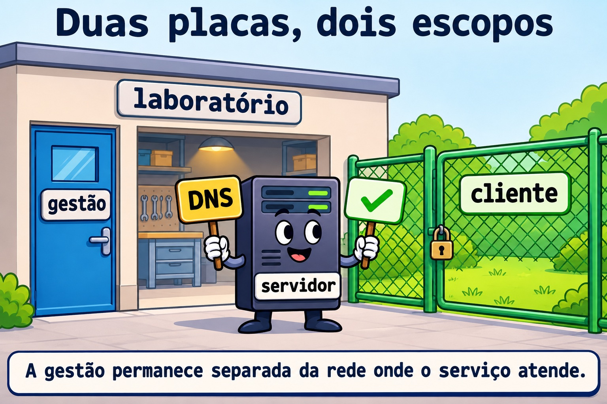

# Aula 19.1 · DNS autoritativo

> **O coração desta aula:** construa a VM 204 e prove respostas A, MX e PTR na rede isolada.

| Ficha | Plano de trabalho |
| --- | --- |
| Módulo | M19 · Serviços de rede, aula 1 de 9 |
| Quando | Semana 25 |
| Ao final | construa a VM 204 e prove respostas A, MX e PTR na rede isolada. |
| Pré-requisitos | M17, M18; VMs 201 e 202; usuário student; rede isolada vmbr17 |
| Duração | 150–180 minutos |
| Snapshot | m19a1-inicio e m19a1-fim; somente VMs indicadas |

O nó Proxmox recebe somente comandos identificados como host.

Os demais comandos pertencem à VM indicada, com Bash e usuário `student`.

Não execute blocos seguintes se uma verificação falhar.

Guarde a saída real no diário; esta aula não apresenta uma execução já realizada.

Antes das consultas pelos clientes, conclua o [guia de bancada M19](../GUIA_BANCADA_M19_PT.md) para as placas isoladas das VMs 201 e 202; a criação da VM 204 permanece nesta aula.

Nomes canônicos do módulo: o nome da VM no Proxmox e o hostname do sistema operacional devem corresponder ao papel antes de executar as guardas. Um nome DNS de serviço não muda o hostname. Se o inventário divergir, reconcilie-o pelo console antes de seguir; não ignore as guardas.

| VM | Hostname curto | Endereço isolado |
| --- | --- | --- |
| 201 | `rocky-lab` | `192.0.2.201` |
| 202 | `debian-lab` | `192.0.2.202` |
| 204 | `srv-deb` | `192.0.2.204` |
| 212 | `m19-client` | DHCP; somente desafio 19.9 |

## 1 · Aquecimento

1. Qual diferença existe entre o endereço usado para administrar uma VM e aquele em que um serviço atende ao lab?

2. Consultar um nome prova automaticamente que a consulta reversa funciona?

3. Como você provaria que a VM 204 está livre em todo o cluster?

Desenhe a VM 204 com duas placas.

Marque o único segmento onde DNS deve escutar e deixe a gestão fora dele.

## 2 · Por que importa

Um serviço de correio precisa localizar o destino MX e conferir os nomes associados aos endereços.

Um único registro A não resolve essas perguntas.

A VM 204 passa a sustentar os próximos serviços.

Criá-la com identidade, disco e rede conferidos evita carregar um erro de base pelo módulo inteiro.

### Ponte Windows

Uma zona DNS continua sendo um conjunto de registros autoritativos.

O cliente pode consultar esse servidor diretamente sem torná-lo o resolvedor padrão de toda a máquina.

## 3 · Modelo mental



*A gestão permanece separada da rede onde o serviço atende.*

A gestão usa a rede real existente.

A placa isolada usa `192.0.2.204/24`, sem gateway; `vmbr17` não possui porta física, IP no host, roteador nem NAT.

O prefixo `192.0.2.0/24` é didático e fica estritamente segregado.

Antes de atribuí-lo, confira sobreposição com rotas, gestão e VPN em todas as máquinas envolvidas.


*A zona direta responde pelo nome; a reversa responde pelo endereço.*

O servidor é autoridade de `lab.test` e da reversa `2.0.192.in-addr.arpa`.

Um PTR não nasce automaticamente de um A.

### Rocky × Debian

O servidor da aula é Debian 13; Rocky 201 permanece como cliente do segmento isolado.

Os nomes de serviços e caminhos BIND podem mudar entre distribuições: não copie os do servidor Debian para o cliente Rocky.

## 4 · O essencial

| Objeto | Contrato |
| --- | --- |
| 204 srv-deb | Debian 13; 2 vCPU; 2 GiB; disco 20 GiB em vm-hdd |
| Firmware | q35; OVMF; x86-64-v2-AES; QGA |
| net0 | vmbr0; gestão real reservada fora do pool DHCP real |
| net1 | vmbr17; 192.0.2.204/24; sem gateway |
| Clientes | 201 = 192.0.2.201; 202 = 192.0.2.202 |
| Serviço | TCP e UDP 53; somente loopback e placa isolada |

O host deve ter `vm-hdd` já validado no M17 e storage de arquivos que aceite ISO.

Não invente um storage local nem crie a VM sobre um ID ocupado.

### Decida 1

A VM 204 aparece como CT em outro nó.

O que fazer?

A. Criar 204 no nó atual porque o tipo é diferente.

B. Apagar o CT para liberar o número.

C. Parar e reconciliar o inventário antes de criar.

## 5 · Lab guiado

### Passo 1 · Criar a base com origem verificável

**Palpite:** Uma ISO que inicia já prova a autenticidade da origem?

Na VM 202, use a página oficial Debian de imagens DVD amd64 para escolher a versão 13 disponível.

Copie a URL versionada e o nome real do DVD-1; não use um nome ou hash ilustrativo.

```bash
sudo apt update && sudo apt install curl gpgv debian-keyring
mkdir -p ~/m19-iso && cd ~/m19-iso
read -r -p "URL versionada iso-dvd: " ISO_BASE
read -r -p "Nome Debian 13 amd64 DVD-1: " ISO_FILE
[[ "$ISO_BASE" == https://cdimage.debian.org/debian-cd/*/amd64/iso-dvd ]] || exit 1
[[ "$ISO_FILE" =~ ^debian-13[.][0-9]+[.][0-9]+-amd64-DVD-1[.]iso$ ]] || exit 1
for f in "$ISO_FILE" SHA512SUMS SHA512SUMS.sign; do
  curl -fLO "$ISO_BASE/$f" || exit 1
done
gpgv --keyring /usr/share/keyrings/debian-role-keys.pgp SHA512SUMS.sign SHA512SUMS || exit 1
awk -v f="$ISO_FILE" '$2==f || $2=="*"f {print}' SHA512SUMS > chosen.sha512
test "$(wc -l < chosen.sha512)" -eq 1 || exit 1
sha512sum -c chosen.sha512 || exit 1
```

Se a chave de assinatura vigente não estiver no keyring atualizado, pare e siga a página Debian de verificação para autenticar a chave.

Nunca ignore uma assinatura ruim ou importe uma chave aleatória para prosseguir.

Transfira o DVD verificado ao storage ISO do nó por seu fluxo autorizado.

No host, localize o volume com `pvesm list`, copie o identificador inteiro e compare seu SHA512 com o verificado na VM 202.

```bash
pvesm status
read -r -p "Storage ISO existente: " ISO_STORAGE
pvesm list "$ISO_STORAGE" --content iso
read -r -p "Volume completo do DVD verificado: " ISO_VOLUME
ISO_PATH=$(pvesm path "$ISO_VOLUME") || exit 1
test -f "$ISO_PATH" || exit 1
sha512sum "$ISO_PATH"
pvesh get /cluster/resources --type vm --output-format json > /tmp/m19-resources.json
python3 -c 'import json; assert not any(x["vmid"]==204 for x in json.load(open("/tmp/m19-resources.json")))' || exit 1
ip -4 route show table all
ip -d link show vmbr17
ip -br address show dev vmbr17
pvesm status --storage vm-hdd
```

Confirme visualmente bridge sem uplink e sem endereço no host, rota sem conflito e hash idêntico.

Registre nome do nó, storage, nome completo, hash e `ISO_VOLUME` no diário `~/m19-operador.env`; não o carregue como código.

Preserve o DVD para o desafio 19.9.

```bash
qm create 204 --name srv-deb --machine q35 --bios ovmf --cpu x86-64-v2-AES --cores 2 --memory 2048 --agent enabled=1 --scsihw virtio-scsi-single --scsi0 vm-hdd:20 --efidisk0 vm-hdd:1,efitype=4m,pre-enrolled-keys=1 --net0 virtio,bridge=vmbr0 --net1 virtio,bridge=vmbr17 --ide2 "$ISO_VOLUME",media=cdrom --boot order=ide2 || exit 1
qm config 204
```

Somente após a criação ter terminado sem erro, abra o console 204 e inicie a instalação manual pelo DVD.

Escolha somente o disco vazio de 20 GiB da nova VM.

Se o disco ou a identidade divergirem, pare.

Configure apenas a placa correspondente à MAC de net0 na gestão: endereço real reservado, máscara, gateway e DNS autorizados.

Defina hostname `srv-deb`, usuário `student` e senha de root de emergência guardada fora do material.

Selecione servidor SSH e utilitários padrão, sem ambiente gráfico.

Deixe net1 sem configuração no instalador.

Conclua no disco da VM e entre no console como root.

```bash
apt update && apt install sudo qemu-guest-agent ifupdown openssh-server || exit 1
usermod -aG sudo student
systemctl enable --now qemu-guest-agent
sshd -T | grep -E '^(permitrootlogin|passwordauthentication) '
```

Exija login SSH por chave de `student`, validado em segunda sessão, e root por senha somente no console; ajuste a política SSH pelo procedimento do M15 se necessário.

Não feche a sessão de emergência antes da prova.

Volte ao terminal root do nó Proxmox antes do bloco seguinte.

```bash
qm set 204 --agent enabled=1 --boot order=scsi0
qm agent 204 ping
qm snapshot 204 m19a1-inicio
```

**Saída esperada:** Uma VM nova instalada e administrável; nenhum DNS ou DHCP iniciado. QGA responde somente após o agente estar instalado e o canal ativado.

**Verifique:** Confronte MACs, gestão reservada, boot pelo disco e espaço livre. Não use NetworkManager na VM 204.

### Passo 2 · Conectar somente a placa isolada

**Palpite:** O segundo nome mostrado por `ip link` é necessariamente net1?

No host leia a MAC de net1 com `qm config 204`.

Na VM 204 compare com `ip -br link`, examine rotas e a configuração ifupdown existente.

Pare se o prefixo isolado conflitar com qualquer rota de gestão ou VPN.

```bash
ip -br link
ip -4 route show table all
cat /etc/network/interfaces
sudo grep -R -n . /etc/network/interfaces.d/
read -r -p "Interface da MAC de net1: " LAB_IF
[[ "$LAB_IF" =~ ^[a-zA-Z][a-zA-Z0-9_-]{0,14}$ ]] || exit 1
ip link show dev "$LAB_IF" || exit 1
grep -Eq '^[[:space:]]*source(-directory)?[[:space:]]+/etc/network/interfaces.d/' /etc/network/interfaces || exit 1
sudo test ! -e /etc/network/interfaces.d/m19-lab || exit 1
sudo test ! -L /etc/network/interfaces.d/m19-lab || exit 1
sudo test ! -e /etc/m19-lab.env || exit 1
```

Antes de gravar, confirme que nenhuma definição existente administra essa interface.

Se houver, reconcilie a configuração; não sobreponha o arquivo.

Net0 permanece intocada.

```bash
printf 'auto %s
iface %s inet static
    address 192.0.2.204/24
    pre-up /usr/sbin/sysctl -w net.ipv6.conf.%s.disable_ipv6=1
' "$LAB_IF" "$LAB_IF" "$LAB_IF" | sudo tee /etc/network/interfaces.d/m19-lab
printf 'LAB_IF=%q
LAB_IP=%q
LAB_NET=%q
LAB_DOMAIN=%q
' "$LAB_IF" 192.0.2.204 192.0.2.0/24 lab.test | sudo tee /etc/m19-lab.env
sudo chown root:root /etc/m19-lab.env /etc/network/interfaces.d/m19-lab
sudo chmod 0644 /etc/m19-lab.env /etc/network/interfaces.d/m19-lab
sudo ifup "$LAB_IF"
ip -4 address show dev "$LAB_IF"
ip -4 route
```

**Saída esperada:** A interface isolada tem `.204/24`; só a gestão possui rota padrão. IPv6 foi desativado somente nessa interface.

**Verifique:** Da placa isolada da VM 202 já configurada pelo guia de bancada M19, teste o alcance de `.204`. Se necessário, restaure `.202/24` em seu perfil isolado pelo procedimento de perfis do M11, nunca em net0.

### Passo 3 · Instalar sem abrir o serviço na gestão

**Palpite:** O pacote pode iniciar o daemon antes de você ajustar as interfaces?

Na VM 204 recém-criada, confirme que BIND ainda não está instalado.

A máscara antes da instalação impede o início com a configuração padrão.

```bash
if dpkg-query -W -f='${Status}' bind9 2>/dev/null | grep -q "install ok installed"; then exit 1; fi
sudo systemctl mask named.service
sudo apt update && sudo apt install bind9 bind9-utils dnsutils
sudo cp -a /etc/bind/named.conf.options /etc/bind/named.conf.options.m19-original
sudo cp -a /etc/bind/named.conf.local /etc/bind/named.conf.local.m19-original
sudo tee /etc/bind/named.conf.options >/dev/null <<'EOF'
acl m19_trusted { 127.0.0.1; 192.0.2.0/24; };
options {
    directory "/var/cache/bind";
    listen-on { 127.0.0.1; 192.0.2.204; };
    listen-on-v6 { none; };
    allow-query { m19_trusted; };
    allow-transfer { none; };
    recursion no;
    dnssec-validation auto;
};
EOF
sudo install -d -o root -g bind -m 0750 /etc/bind/m19
sudo tee /etc/bind/named.conf.local >/dev/null <<'EOF'
zone "lab.test" { type primary; file "/etc/bind/m19/db.lab.test"; };
zone "2.0.192.in-addr.arpa" { type primary; file "/etc/bind/m19/db.192.0.2"; };
EOF
```

**Saída esperada:** Serviço ainda mascarado; opções limitam sockets e consultas, sem recursão.

**Verifique:** Se o host ou a VM tiver firewall ativo, siga M16 para permitir TCP/UDP 53 apenas da rede isolada; preserve a política e a gestão. Não desative o firewall como diagnóstico.

Mascarar uma unidade antes de instalar o pacote pode mostrar um aviso de que ela ainda não existe: isso é esperado se a máscara for criada corretamente. Confira mesmo assim o resultado e a ausência de listeners; vale também para Kea, Postfix, Dovecot e Squid.

### Passo 4 · Escrever duas zonas independentes

**Palpite:** Sem ponto final, `mail.lab.test` permanece um nome absoluto dentro da zona?

```bash
sudo tee /etc/bind/m19/db.lab.test >/dev/null <<'EOF'
$TTL 300
@ IN SOA ns.lab.test. hostmaster.lab.test. (
  2026111701 3600 900 604800 300 )
@ IN NS ns.lab.test.
@ IN MX 10 mail.lab.test.
ns IN A 192.0.2.204
srv-deb IN A 192.0.2.204
mail IN A 192.0.2.204
web IN A 192.0.2.204
www IN A 192.0.2.204
proxy IN A 192.0.2.204
smb IN A 192.0.2.204
app IN A 192.0.2.201
rocky IN A 192.0.2.201
debian IN A 192.0.2.202
EOF
sudo tee /etc/bind/m19/db.192.0.2 >/dev/null <<'EOF'
$TTL 300
@ IN SOA ns.lab.test. hostmaster.lab.test. (
  2026111701 3600 900 604800 300 )
@ IN NS ns.lab.test.
204 IN PTR srv-deb.lab.test.
201 IN PTR rocky.lab.test.
202 IN PTR debian.lab.test.
EOF
sudo chown root:bind /etc/bind/m19/db.lab.test /etc/bind/m19/db.192.0.2
sudo chmod 0640 /etc/bind/m19/db.lab.test /etc/bind/m19/db.192.0.2
sudo named-checkconf && sudo named-checkzone lab.test /etc/bind/m19/db.lab.test && sudo named-checkzone 2.0.192.in-addr.arpa /etc/bind/m19/db.192.0.2
```

**Saída esperada:** Validadores terminam com sucesso; número serial é um valor escolhido para o arquivo, não uma saída observada.

**Verifique:** Confira cada A, o destino MX e os três PTR. A próxima mudança em uma zona exige serial maior nessa zona.

### Passo 5 · Carregar e perguntar ao servidor certo

**Palpite:** A opção que escolhe o servidor no `dig` muda o DNS global do cliente?


*Arquivo válido ainda precisa ser carregado e responder corretamente.*

```bash
sudo systemctl unmask named.service
sudo systemctl enable --now named.service
sudo systemctl --no-pager --full status named
sudo ss -lntup | grep ":53"
sudo journalctl -u named -b --no-pager -n 30
dig @192.0.2.204 app.lab.test A +norecurse
dig @192.0.2.204 lab.test MX +norecurse
dig @192.0.2.204 -x 192.0.2.204 +norecurse
dig @192.0.2.204 lab.test AXFR
```

**Saída esperada:** Consultas da VM 202 recebem A `.201`, MX `10 mail.lab.test.` e PTR `srv-deb.lab.test.` com flag AA; AXFR não é autorizado. Se a VM 202 ainda não tem `dig`, instale antes o cliente: `sudo apt install dnsutils` (na 201: `sudo dnf install bind-utils`).

**Verifique:** Não basta ver uma linha no journal: confira sockets somente nos endereços permitidos e repita A via TCP com `dig @192.0.2.204 app.lab.test A +tcp`.

### Decida 2

O A funciona; o PTR retorna NXDOMAIN.

Qual hipótese explica melhor?

A. A zona reversa ou o PTR não foi carregado corretamente.

B. O MX cria a reversa apenas depois de um reboot.

C. O cliente precisa apagar todos os perfis de rede.

### Passo 6 · Provar persistência e preservar a base

**Palpite:** Uma resposta antes do reboot garante que net1 e BIND voltarão?

**Reboot de conferência:** Reinicie somente a VM 204, com console disponível. Não reinicie o nó. Reabra o SSH de gestão e repita as consultas da VM 202.

```bash
sudo systemctl reboot
```

Após reconectar à VM 204:

```bash
ip -4 address
ip -4 route
sudo systemctl is-active named
sudo ss -lntup | grep ":53"
dig @192.0.2.204 lab.test MX +norecurse
```

**Saída esperada:** Gestão preservada, `.204/24` persistente e respostas autoritativas após o boot.

**Verifique:** No host, crie `qm snapshot 204 m19a1-fim` somente após todas as provas. Preserve ISO, diário e zonas para as próximas aulas.

## 6 · Quebre e conserte

### Quebra 1 · Nome relativo duplicado

**Sintoma:** O MX aponta para um nome terminado duas vezes em `lab.test`.

**Investigação:** Leia o destino completo com `dig @192.0.2.204 lab.test MX`.

**Causa:** Faltou o ponto final de um nome absoluto no arquivo.

**Conserto:** Em cópia de exercício, compare os dois formatos; corrija o original, incremente serial, valide e recarregue com `sudo rndc reload`.

**Verifique:** O destino MX agora é exatamente `mail.lab.test.`.

**Prevenção:** Confira nomes absolutos antes de carregar.

### Quebra 2 · Zona válida, resposta antiga

**Sintoma:** O arquivo mudou, a resposta autoritativa não.

**Investigação:** Compare serial do arquivo e `dig @192.0.2.204 lab.test SOA +norecurse`.

**Causa:** Faltou recarregar ou a nova zona foi recusada.

**Conserto:** Valide ambas as zonas, recarregue e leia o journal.

**Verifique:** SOA e consulta ao registro mostram a versão pretendida.

**Prevenção:** Use validar, carregar e consultar como três provas distintas.

### Quebra 3 · Pergunta no servidor errado

**Sintoma:** O sistema não resolve `app.lab.test`, mas a consulta explícita funciona.

**Investigação:** Compare `getent hosts app.lab.test` com `dig @192.0.2.204 app.lab.test A`.

**Causa:** O resolvedor padrão da gestão não conhece a zona do lab.

**Conserto:** Mantenha a consulta explícita nesta aula; não reconfigure a gestão para mascarar a diferença.

**Verifique:** Anote qual servidor respondeu em cada ferramenta.

**Prevenção:** Sempre registre o caminho da pergunta.

Com `recursion no`, alguns ambientes podem registrar mensagens de priming como FORMERR ou non-improving referral. Não as use sozinhas para diagnosticar defeito da zona local: compare configuração, estado e respostas A/MX/PTR com AA. Timeouts, erros de carga da zona ou respostas locais incorretas exigem investigação.

## 7 · Armadilhas

Antes de culpar o serviço, confirme em qual VM, interface e rede você está.

Uma resposta correta de outro servidor continua sendo a prova errada.

Um arquivo aceito pelo validador não prova que o processo o carregou.

Consulte também o estado, os sockets e a resposta do cliente.

Endereços de documentação usados aqui só pertencem ao segmento segregado.

Se houver sobreposição com gestão, VPN ou rota existente, pare.

## 8 · Quiz

1. Por que A não prova PTR?

2. O que AA demonstra?

3. Por que testar TCP além de UDP 53?

4. Que prova liga o DVD à origem?

Responda antes de abrir as soluções.

Para cada resposta, cite uma observação capaz de refutá-la.

## 9 · Cola

```bash
sudo named-checkconf
sudo named-checkzone lab.test /etc/bind/m19/db.lab.test
dig @192.0.2.204 lab.test MX +norecurse
dig @192.0.2.204 -x 192.0.2.204 +norecurse
```

**Flashcards:** Qual é o objeto? Quem responde? Qual observação distingue configuração de resultado?

`!explica`

`!feynman`

`!quiz`

## 10 · Checklist e fechamento

- [ ] 204 criada somente com ID livre e DVD autenticado.

- [ ] Net0 preservada; net1 segregada e persistente.

- [ ] A, MX, PTR, AA e TCP conferidos da VM 202.

- [ ] Recursão desativada; sockets fora da gestão.

- [ ] Diário ISO disponível para 19.9.

**Último exercício:** Refaça o desenho inicial usando somente evidências registradas no lab. Marque o que ainda não foi provado.

O snapshot final registra uma etapa coerente; não substitui o backup independente.

Não apague a VM 204 nem sua rede isolada: as próximas aulas dependem delas.

## 11 · Na vida real

Missão somente de leitura: em um ambiente autorizado, identifique o servidor consultado, a interface usada e o responsável pela configuração.

Não altere perfis, portas, concessões ou zonas.

Entregue três evidências com horário e contexto, uma hipótese e uma limitação.

Remova dados privados antes de compartilhar o relatório.

## 12 · Aprofundar quando quiser

[Debian: verificar imagens e assinaturas](https://www.debian.org/CD/verify)

[BIND: configuração e controles de acesso](https://bind9.readthedocs.io/en/stable/reference.html)

[Debian 13: arquivos do pacote BIND](https://packages.debian.org/trixie/amd64/bind9/filelist)

Use a documentação da versão instalada.

Confirme com o manual local antes de adaptar uma opção de outra versão.

## Soluções comentadas

Aquecimento: gestão e serviço têm escopos diferentes; A e PTR pertencem a zonas independentes; inventário deve abranger VMs e CTs do cluster.

Decida 1: C.

Um ID ocupado não pode ser reaproveitado sem reconciliar o inventário.

Decida 2: A.

O A não cria nem valida a reversa.

Quiz 1: são registros e zonas distintos; consulte ambos.

Quiz 2: AA indica resposta autoritativa para a pergunta.

Quiz 3: DNS também usa TCP; um bloqueio pode aparecer apenas nesse transporte.

Quiz 4: assinatura autenticada do manifesto mais SHA512 da ISO correspondente.

[← Aula 18.5 · Construir imagens](18.5-construir-imagens.md) · [Índice das aulas](../01-aulas.md) · [Plano do curso](../00-plano-do-curso.md)
