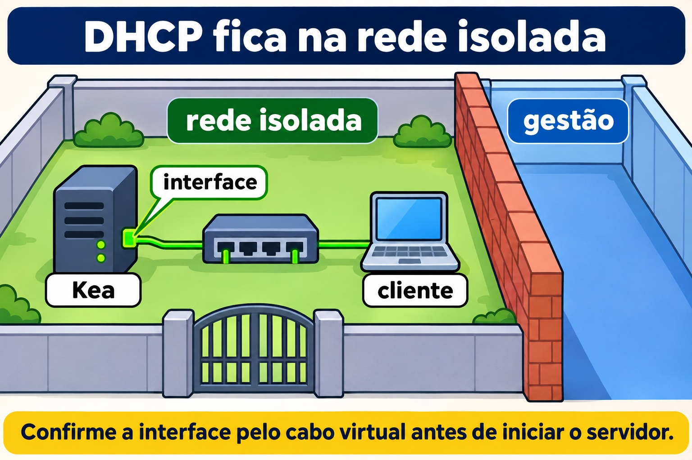
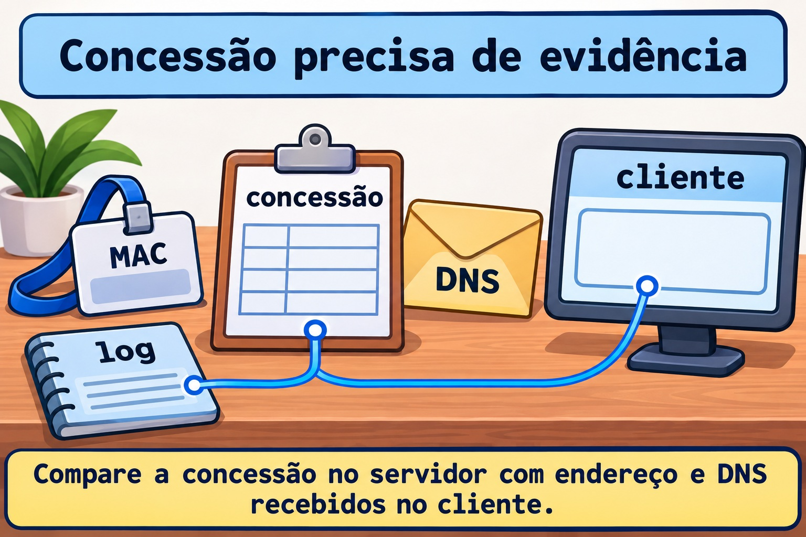

# Aula 19.3 · DHCP

> **O coração desta aula:** entregue concessões Kea somente na rede isolada e prove endereço, DNS e restauração do cliente.

| Ficha | Plano de trabalho |
| --- | --- |
| Módulo | M19 · Serviços de rede, aula 3 de 9 |
| Quando | Semana 25 |
| Ao final | entregue concessões Kea somente na rede isolada e prove endereço, DNS e restauração do cliente. |
| Pré-requisitos | M17, M18; VMs 201 e 202; usuário student; rede isolada vmbr17 |
| Duração | 80–110 minutos |
| Snapshot | m19a3-inicio e m19a3-fim; somente VMs indicadas |

O nó Proxmox recebe somente comandos identificados como host.

Os demais comandos pertencem à VM indicada, com Bash e usuário `student`.

Não execute blocos seguintes se uma verificação falhar.

Guarde a saída real no diário; esta aula não apresenta uma execução já realizada.

Conclua o [guia de bancada M19](../GUIA_BANCADA_M19_PT.md) e preserve o DNS da 19.2.

A VM 202 usa o perfil isolado `m19-isolada`, estático `.202/24`, separado da gestão.

Nomes canônicos do módulo: o nome da VM no Proxmox e o hostname do sistema operacional devem corresponder ao papel antes de executar as guardas. Um nome DNS de serviço não muda o hostname. Se o inventário divergir, reconcilie-o pelo console antes de seguir; não ignore as guardas.

| VM | Hostname curto | Endereço isolado |
| --- | --- | --- |
| 201 | `rocky-lab` | `192.0.2.201` |
| 202 | `debian-lab` | `192.0.2.202` |
| 204 | `srv-deb` | `192.0.2.204` |
| 212 | `m19-client` | DHCP; somente desafio 19.9 |

## 1 · Aquecimento

1. Por que um servidor DHCP na bridge de gestão pode afetar máquinas que você não administra?

2. Uma concessão inclui obrigatoriamente um gateway?

3. Quem precisa provar a identidade da interface antes de iniciar Kea?

Desenhe DORA com as direções das quatro mensagens.

Marque endereço oferecido, servidor escolhido e confirmação final.

## 2 · Por que importa

Um endereço manual que funciona pode esconder a ausência de DHCP.

Uma concessão registrada no servidor pode esconder um cliente que aplicou opções diferentes.

O lab exige prova dos dois lados e reversão do cliente à base estática.

Os próximos serviços não devem depender de um endereço temporário obtido por acaso.

### Ponte Windows

Escopo, concessão e reserva descrevem objetos diferentes.

Uma reserva identifica um cliente; não impede que ele configure manualmente outro endereço fora do seu controle.

## 3 · Modelo mental


*A concessão confirma uma conversa; o endereço sozinho não conta toda a história.*

Discover parte do cliente; Offer vem do servidor; Request escolhe a oferta; Ack confirma a concessão.

NAK e renovação são partes adicionais do protocolo.

O broadcast alcança o segmento local.

Neste lab não há relay nem roteador entre o cliente e o servidor.



*Confirme a interface pelo cabo virtual antes de iniciar o servidor.*

Kea escuta somente a interface real correspondente à MAC de net1 da VM 204.

Nunca use `*`, o nome da bridge do host ou a interface da gestão.

## 4 · O essencial

| Objeto | Contrato |
| --- | --- |
| Servidor | 204 srv-deb; 192.0.2.204/24 |
| Rede | vmbr17 isolada; sem porta física ou IP no host |
| Pool | 192.0.2.100–192.0.2.149 |
| DNS | 192.0.2.204 |
| Domínio | lab.test |
| Gateway | Nenhum; opção routers ausente |
| Cliente | 202 net1; teste temporário; volta a .202 |

Kea separa servidor, backend de concessões e opções.

Usaremos DHCPv4 e backend memfile persistente; não precisamos de banco externo nem painel.

### Rocky × Debian

O serviço principal roda em Debian 13 na VM 204.

A VM 201 pode servir de segundo cliente depois; os nomes de pacote e a política de firewall precisam ser conferidos por distribuição.

dnsmasq combina funções leves de DHCP e DNS; Kea é um servidor DHCP especializado.

A comparação é conceitual: não instale um segundo DHCP ativo nesta rede.

### Decida 1

Você ainda não relacionou a MAC de net1 ao nome no Linux.

Qual ação cabe?

A. Usar todas as interfaces por cinco minutos.

B. Manter Kea mascarado e concluir a identificação.

C. Escutar em vmbr0 para encontrar o cliente.

## 5 · Lab guiado

### Passo 1 · Conferir cabo virtual e preservar o estado

**Palpite:** O nome registrado em um arquivo basta para provar que o cabo virtual não mudou?

No host compare `qm config 204` e `qm config 202` com o guia de bancada.

Confirme net1 somente em vmbr17, sem uplink, sem outro DHCP ativo.

Não altere as NICs nesta aula.

```bash
qm snapshot 204 m19a3-inicio
qm snapshot 202 m19a3-inicio
```

Na VM 204 verifique arquivo não simbólico, dono e permissões antes de carregar as variáveis locais criadas na 19.1.

Não carregue arquivos baixados como configuração de shell.

```bash
test ! -L /etc/m19-lab.env || exit 1
test "$(stat -c %u:%g:%a /etc/m19-lab.env)" = 0:0:644 || exit 1
cat /etc/m19-lab.env
. /etc/m19-lab.env
[[ "$LAB_IF" =~ ^[a-zA-Z][a-zA-Z0-9_-]{0,14}$ ]] || exit 1
test "$LAB_IP" = 192.0.2.204 || exit 1
test "$LAB_NET" = 192.0.2.0/24 || exit 1
ip -br link
ip -4 address show dev "$LAB_IF"
ip -4 route
sudo ss -lunp | grep -E ":67[[:space:]]" || true
```

A ausência de socket UDP 67 na VM 204 não prova ausência de outro DHCP no segmento.

Confirme o inventário de serviços do lab e capture um Discover se houver dúvida.

Pare se surgir oferta de origem desconhecida.

**Saída esperada:** LAB_IF confere com a MAC real de net1 e tem `.204/24`; nenhuma concessão foi iniciada.

**Verifique:** Se houver divergência, corrija a documentação e a interface pelo guia antes de seguir. Não adapte Kea à gestão como atalho.

### Passo 2 · Instalar mascarado e preparar o escopo

**Palpite:** Validar JSON também garante que o socket abrirá na interface correta?

```bash
if dpkg-query -W -f='${Status}' kea-dhcp4-server 2>/dev/null | grep -q "install ok installed"; then exit 1; fi
sudo systemctl mask kea-dhcp4-server.service
sudo apt update && sudo apt install kea-dhcp4-server tcpdump
sudo cp -a /etc/kea/kea-dhcp4.conf /etc/kea/kea-dhcp4.conf.m19-original
sudo tee /etc/kea/kea-dhcp4.conf >/dev/null <<EOF
{
  "Dhcp4": {
    "interfaces-config": { "interfaces": [ "$LAB_IF" ] },
    "lease-database": {
      "type": "memfile",
      "persist": true,
      "name": "/var/lib/kea/kea-leases4.csv"
    },
    "valid-lifetime": 600,
    "renew-timer": 300,
    "rebind-timer": 450,
    "subnet4": [ {
      "id": 19,
      "subnet": "192.0.2.0/24",
      "pools": [ { "pool": "192.0.2.100 - 192.0.2.149" } ],
      "option-data": [
        { "name": "domain-name-servers", "data": "192.0.2.204" },
        { "name": "domain-name", "data": "lab.test" }
      ]
    } ],
    "loggers": [ {
      "name": "kea-dhcp4",
      "output-options": [ { "output": "stdout" } ],
      "severity": "INFO"
    } ]
  }
}
EOF
sudo chown root:_kea /etc/kea/kea-dhcp4.conf && sudo chmod 0640 /etc/kea/kea-dhcp4.conf || exit 1
sudo -u _kea kea-dhcp4 -t /etc/kea/kea-dhcp4.conf || exit 1
```

Os tempos acima são parâmetros escolhidos para observar renovação no lab, não durações medidas.

Não há opção de roteador: o segmento só precisa alcançar serviços locais.

O validador de Kea 2.6 verifica a configuração, mas não substitui inicialização, sockets, logs e uma concessão real.

Não edite o CSV de concessões manualmente.

**Saída esperada:** Configuração aceita pelo validador e daemon ainda mascarado. A única interface listada é a identificada pela MAC isolada.

**Verifique:** Leia arquivo completo: pool não inclui servidores estáticos, domínio correto, DNS `.204` e nenhuma opção routers.

O arquivo escrito pelo heredoc deve ser root:_kea 0640. O diretório /etc/kea pode pertencer a _kea:_kea com modo 0750; o perfil AppArmor pode negar dac_override até ao root. Por isso validamos como _kea, conferindo o acesso previsto sem desativar AppArmor. Após alterações e restaurações, preserve dono, grupo e modo.

### Passo 3 · Iniciar somente após a prova da interface

**Palpite:** Um firewall permissivo compensa escutar na interface errada?

Se há firewall ativo, aplique o procedimento M16 para DHCPv4 somente nessa interface: cliente UDP 68 para servidor UDP 67, incluindo broadcast local.

Preserve a gestão e a política existente.

```bash
sudo -u _kea kea-dhcp4 -t /etc/kea/kea-dhcp4.conf && sudo systemctl unmask kea-dhcp4-server.service && sudo systemctl enable --now kea-dhcp4-server.service
sudo systemctl --no-pager --full status kea-dhcp4-server
sudo journalctl -u kea-dhcp4-server -b --no-pager -n 50
sudo ss -lunp | grep -E ":67[[:space:]]"
sudo timeout 25 tcpdump -ni "$LAB_IF" -e -vv "udp port 67 or udp port 68"
```

Kea pode usar sockets raw; por isso uma única linha de `ss` não identifica todo o caminho.

Compare configuração, log de abertura da interface e captura no dispositivo real.

**Saída esperada:** O daemon inicia sem erro e informa somente a interface isolada. Sem cliente novo, pode não haver DORA durante a captura.

**Verifique:** Se o daemon abrir a interface errada, pare-o imediatamente, mantenha mascarado e corrija a origem. Nunca teste uma oferta na gestão.

### Passo 4 · Pedir uma concessão em um perfil temporário

**Palpite:** Trocar o método IPv4 do perfil de gestão seria equivalente a trocar o perfil isolado?

Na VM 202, mantenha uma sessão SSH pela gestão e o console disponíveis.

Relacione net1 à MAC, encontre o UUID de `m19-isolada` e registre a configuração antes da troca.

```bash
ip -br link
nmcli -f NAME,UUID,TYPE,DEVICE connection show
read -r -p "Interface da MAC de net1 da VM 202: " CLIENT_IF
read -r -p "UUID do perfil m19-isolada: " BASE_UUID
[[ "$CLIENT_IF" =~ ^[a-zA-Z][a-zA-Z0-9_-]{0,14}$ ]] || exit 1
[[ "$BASE_UUID" =~ ^[0-9a-fA-F-]{36}$ ]] || exit 1
test "$(nmcli -g connection.id connection show "$BASE_UUID")" = m19-isolada || exit 1
nmcli connection show "$BASE_UUID" > ~/m19a3-base-profile.txt
nmcli -f GENERAL,IP4 device show "$CLIENT_IF"
ip -4 route
```

Confirme perfil estático `.202/24`, interface exata e rota padrão somente pela gestão.

Se não conferirem, volte ao guia.

Verifique que não existe um perfil antigo chamado `m19-dhcp-test`.

Antes de ativar o perfil, abra uma segunda sessão na VM 204 e repita a captura tcpdump na LAB_IF isolada. Inicie a captura imediatamente antes de nmcli up na VM 202, para que a janela inclua DORA.

```bash
if nmcli -t -f NAME connection show | grep -Fxq m19-dhcp-test; then exit 1; fi
sudo nmcli connection add type ethernet ifname "$CLIENT_IF" con-name m19-dhcp-test connection.autoconnect no ipv4.method auto ipv4.never-default yes ipv4.dns-priority 200 ipv6.method disabled
TEST_UUID=$(nmcli -g connection.uuid connection show m19-dhcp-test)
[[ "$TEST_UUID" =~ ^[0-9a-fA-F-]{36}$ ]] || exit 1
printf '%s
%s
%s
' "$CLIENT_IF" "$BASE_UUID" "$TEST_UUID" > ~/m19a3-client-state.txt
sudo nmcli connection up uuid "$TEST_UUID" ifname "$CLIENT_IF"
nmcli -f GENERAL,IP4,DHCP4 device show "$CLIENT_IF"
ip -4 route
```

Prioridade DNS 200 mantém o DNS de gestão com preferência se sua prioridade for menor, conforme o guia.

Se a política real divergir, pare e registre antes de ativar; não cause uma troca global de DNS como efeito colateral.

**Saída esperada:** Apenas net1 recebe um endereço do pool; DHCP4 mostra DNS `.204` e domínio. A rota padrão de gestão permanece igual.

**Verifique:** Compare MAC do cliente, endereço recebido, servidor DHCP e opções. A seção DHCP4 contém valores reais: não copie uma concessão ilustrativa no diário.

### Passo 5 · Confrontar cliente, servidor e reserva

**Palpite:** Ver um endereço no cliente prova que veio deste Kea?



*Compare a concessão no servidor com endereço e DNS recebidos no cliente.*

Na VM 204 leia o journal e as concessões sem alterar o CSV.

Compare endereço e identidade com os dados reais da VM 202.

```bash
sudo journalctl -u kea-dhcp4-server -b --no-pager -n 80
sudo head -n 1 /var/lib/kea/kea-leases4.csv
sudo tail -n 15 /var/lib/kea/kea-leases4.csv
```

CSV memfile pode conter várias linhas históricas do mesmo endereço até a limpeza periódica.

Não conte linhas como se fossem clientes ativos; interprete cabeçalho, identidade e validade da concessão.

Na VM 202 faça consultas explícitas ao DNS recebido, preservando o resolvedor de gestão.

```bash
dig @192.0.2.204 app.lab.test A
dig @192.0.2.204 lab.test MX
ip -4 address show dev "$CLIENT_IF"
```

Agora aplique uma reserva controlada para o cliente 202: `.150` fica fora do pool dinâmico. Confira no inventário que está livre antes de atribuí-lo.

Na VM 202 leia a MAC real de net1 com `cat /sys/class/net/"$CLIENT_IF"/address`; compare com net1 no nó. Copie somente esse valor no pedido seguinte na VM 204.

```bash
read -r -p "MAC real de net1 da VM 202: " CLIENT_MAC
[[ "$CLIENT_MAC" =~ ^([0-9a-fA-F]{2}:){5}[0-9a-fA-F]{2}$ ]] || exit 1
sudo test ! -e /etc/kea/kea-dhcp4.conf.before-reservation || exit 1
sudo cp -a /etc/kea/kea-dhcp4.conf /etc/kea/kea-dhcp4.conf.before-reservation
sudo python3 - "$CLIENT_MAC" <<'PY'
import json,sys
p="/etc/kea/kea-dhcp4.conf"
with open(p) as f: c=json.load(f)
s=c["Dhcp4"]["subnet4"][0]
assert s["subnet"] == "192.0.2.0/24"
assert "reservations" not in s
s["reservations"]=[{"hw-address":sys.argv[1].lower(),"ip-address":"192.0.2.150"}]
with open(p,"w") as f: json.dump(c,f,indent=2); f.write("\n")
PY
sudo -u _kea kea-dhcp4 -t /etc/kea/kea-dhcp4.conf && sudo systemctl restart kea-dhcp4-server
sudo journalctl -u kea-dhcp4-server -b --no-pager -n 25
```

Se a validação falhar, não reinicie: restaure a cópia anterior e valide novamente. Confira que o arquivo preservou a única interface isolada e que o pool não mudou.

Na VM 202 reative apenas o perfil temporário; o perfil de gestão continua ativo. Uma nova aquisição deve agora receber `.150`, identificado pela MAC real.

```bash
sudo nmcli connection down uuid "$TEST_UUID"
sudo nmcli connection up uuid "$TEST_UUID" ifname "$CLIENT_IF"
nmcli -f GENERAL,IP4,DHCP4 device show "$CLIENT_IF"
```

Compare a nova concessão nos logs Kea e no cliente. Preserve a reserva para essa MAC; outros clientes continuam usando o pool e no Passo 6 o cliente 202 volta ao estático `.202`.

**Saída esperada:** A concessão real tem correspondência entre cliente e servidor. Você distingue pool dinâmico, reserva e endereço estático.

**Verifique:** DNS recebido e resposta correta são provas separadas. Um servidor DHCP pode entregar uma opção sintaticamente válida e semanticamente errada.

### Decida 2

O endereço está no pool, mas DNS aponta para outro servidor.

O que fazer?

A. Comparar opções da concessão, origem da oferta e configuração aplicada.

B. Dar um gateway qualquer ao cliente.

C. Aceitar porque obter um endereço prova tudo.

### Passo 6 · Restaurar o cliente e conferir o boot

**Palpite:** Apagar o perfil temporário garante que o perfil estático voltou a ficar ativo?

Na mesma sessão Bash da VM 202, use somente os UUIDs registrados.

Se reconectou, leia o diário e confira cada valor com `nmcli` antes de defini-lo; não execute o diário como script.

```bash
test "$(nmcli -g connection.id connection show "$BASE_UUID")" = m19-isolada || exit 1
test "$(nmcli -g connection.id connection show "$TEST_UUID")" = m19-dhcp-test || exit 1
sudo nmcli connection up uuid "$BASE_UUID" ifname "$CLIENT_IF"
nmcli -f GENERAL,IP4 device show "$CLIENT_IF"
ip -4 route
```

Só depois de conferir `.202/24` e gestão preservada, remova o perfil temporário pelo UUID exato.

Nunca use uma remoção por padrão amplo.

```bash
sudo nmcli connection delete uuid "$TEST_UUID"
dig @192.0.2.204 app.lab.test A
nmcli -f NAME,UUID,DEVICE connection show --active
```

**Reboot de conferência:** Reinicie 202 pelo console e prove gestão, perfil estático isolado e DNS explícito. Reinicie 204 separadamente e prove BIND e Kea na interface correta.

Na VM 204, após o reboot:

```bash
sudo systemctl is-active named kea-dhcp4-server
sudo -u _kea kea-dhcp4 -t /etc/kea/kea-dhcp4.conf
sudo journalctl -u kea-dhcp4-server -b --no-pager -n 35
ip -4 address
ip -4 route
```

**Saída esperada:** Kea permanece disponível apenas no isolamento. O cliente 202 terminou estático `.202`, pronto para as próximas aulas.

**Verifique:** No host faça os snapshots finais de 204 e 202. Preserve Kea para o desafio 19.9; não crie a VM 212 agora.

```bash
qm snapshot 204 m19a3-fim
qm snapshot 202 m19a3-fim
```

## 6 · Quebre e conserte

### Quebra 1 · JSON recusado antes de iniciar

**Sintoma:** A cópia de exercício não passa no validador.

**Investigação:** Copie o arquivo para `/tmp/m19-kea-broken.json`, remova uma vírgula só nessa cópia e execute `sudo kea-dhcp4 -t /tmp/m19-kea-broken.json`.

**Causa:** A estrutura JSON não representa a configuração pretendida.

**Conserto:** Reponha a vírgula na cópia e valide novamente; não carregue o arquivo quebrado no serviço.

**Verifique:** A configuração ativa continua respondendo e a cópia corrigida passa.

**Prevenção:** Valide antes de iniciar ou reiniciar.

### Quebra 2 · Cliente sem oferta

**Sintoma:** O perfil DHCP espera e não recebe endereço.

**Investigação:** Capture na interface isolada; compare Discover, journal Kea, MAC e bridge das duas VMs.

**Causa:** Pode haver cabo virtual errado, interface errada, daemon parado ou filtragem.

**Conserto:** Corrija somente a causa observada. Em interface incerta, pare Kea; nunca abra todas as interfaces.

**Verifique:** Uma oferta do servidor esperado é seguida por Request e Ack.

**Prevenção:** Relacione MAC e dispositivo antes da primeira oferta.

### Quebra 3 · Endereço certo, DNS errado

**Sintoma:** O cliente tem endereço do pool, mas os nomes do lab falham.

**Investigação:** Compare opções DHCP4 e consulta explícita ao endereço DNS recebido.

**Causa:** A opção DNS pode estar errada ou o serviço DNS pode estar inacessível.

**Conserto:** Corrija a opção no arquivo conhecido, valide e reinicie Kea somente após verificar a interface; renove o perfil de teste controlado.

**Verifique:** A nova concessão mostra `.204` e a consulta explícita responde.

**Prevenção:** Valide opções semânticas além do endereço do pool.

## 7 · Armadilhas

Antes de culpar o serviço, confirme em qual VM, interface e rede você está.

Uma resposta correta de outro servidor continua sendo a prova errada.

Um arquivo aceito pelo validador não prova que o processo o carregou.

Consulte também o estado, os sockets e a resposta do cliente.

Endereços de documentação usados aqui só pertencem ao segmento segregado.

Se houver sobreposição com gestão, VPN ou rota existente, pare.

## 8 · Quiz

1. Por que não existe opção routers nesta configuração?

2. O que distingue Offer de Ack?

3. O validador prova a abertura do socket?

4. Uma reserva pertence obrigatoriamente ao pool dinâmico?

5. Como o cliente deve terminar a aula?

Responda antes de abrir as soluções.

Para cada resposta, cite uma observação capaz de refutá-la.

## 9 · Cola

```bash
sudo -u _kea kea-dhcp4 -t /etc/kea/kea-dhcp4.conf
sudo journalctl -u kea-dhcp4-server -b --no-pager -n 40
ip -4 address
nmcli -f GENERAL,IP4,DHCP4 device show
```

**Flashcards:** Qual é o objeto? Quem responde? Qual observação distingue configuração de resultado?

`!explica`

`!feynman`

`!quiz`

## 10 · Checklist e fechamento

- [ ] MAC e interface real de net1 conferidas antes de iniciar.

- [ ] Kea sozinho no isolamento; nenhum DHCP na gestão.

- [ ] Concessão e DNS comparados nos dois lados.

- [ ] Cliente 202 restaurado ao perfil estático.

- [ ] Kea persistente e VM 212 ainda não criada.

**Último exercício:** Refaça o desenho inicial usando somente evidências registradas no lab. Marque o que ainda não foi provado.

O snapshot final registra uma etapa coerente; não substitui o backup independente.

Não apague a VM 204 nem sua rede isolada: as próximas aulas dependem delas.

## 11 · Na vida real

Missão somente de leitura: em um ambiente autorizado, identifique o servidor consultado, a interface usada e o responsável pela configuração.

Não altere perfis, portas, concessões ou zonas.

Entregue três evidências com horário e contexto, uma hipótese e uma limitação.

Remova dados privados antes de compartilhar o relatório.

## 12 · Aprofundar quando quiser

[Kea 2.6: configuração DHCPv4, concessões e reservas](https://kea.readthedocs.io/en/kea-2.6.5/arm/dhcp4-srv.html)

[Debian 13: pacote kea-dhcp4-server](https://packages.debian.org/trixie/kea-dhcp4-server)

[NetworkManager: propriedades IPv4](https://networkmanager.dev/docs/api/latest/settings-ipv4.html)

Use a documentação da versão instalada.

Confirme com o manual local antes de adaptar uma opção de outra versão.

## Soluções comentadas

Aquecimento: broadcast pode alcançar terceiros na mesma rede; gateway é uma opção e não uma obrigação; o operador deve conferir MAC e cabo virtual.

Decida 1: B.

Sem prova da interface, o servidor permanece mascarado.

Decida 2: A.

Endereço recebido não prova opções corretas nem origem da concessão.

Quiz 1: o segmento não tem roteador nem precisa de rota padrão.

Quiz 2: Offer propõe; Ack confirma a concessão solicitada.

Quiz 3: não; exige início, log da interface e conversa real.

Quiz 4: não; `.150` foi planejado fora do pool e deve estar livre.

Quiz 5: perfil `m19-isolada` estático `.202/24`, gestão preservada e perfil temporário removido pelo UUID exato.

[← Aula 19.2](19.2-dns-recursivo-e-diagnostico.md) · [Índice das aulas](../01-aulas.md) · [Plano do curso](../00-plano-do-curso.md)
