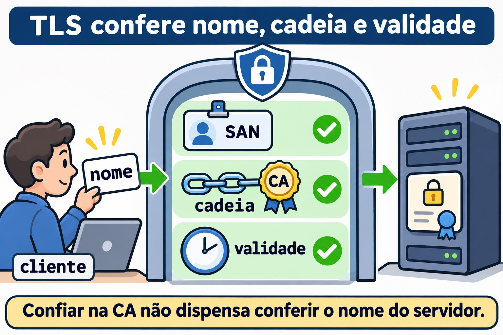
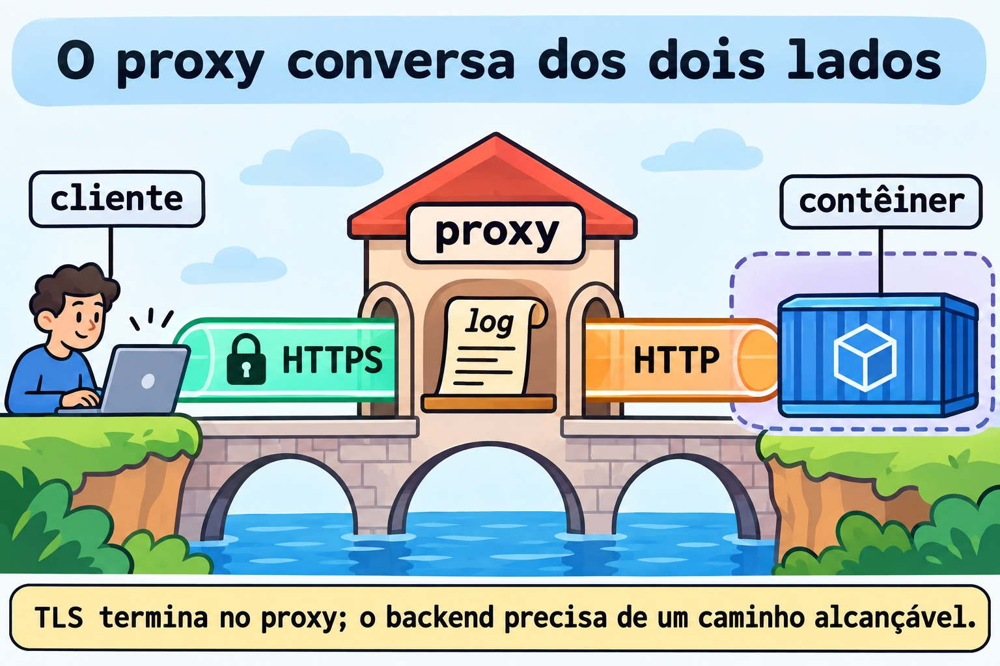

# Aula 19.5 · TLS e proxy reverso: identidade antes do cadeado

> **O coração desta aula:** validar nome, cadeia e validade, preservando a chave privada e a separação entre proxy e backend.

| Ficha | Plano de trabalho |
| --- | --- |
| Módulo | M19 · Serviços de rede, aula 5 de 9 |
| Quando | Semana 26 |
| Ao final | validar nome, cadeia e validade, preservando a chave privada e a separação entre proxy e backend. |
| Pré-requisitos | 19.4; serviço rootless persistente do M18 na VM 201 |
| Duração | 100–120 minutos |
| Snapshot | Apenas VMs do curso: `m19a5-inicio` e `m19a5-fim` |

A VM principal é `204`, `srv-deb`, Debian 13. A interface isolada tem `192.0.2.204/24` em `vmbr17`; a interface de gestão mantém seu endereço real.

A rede `192.0.2.0/24` foi reservada ao lab depois de conferir ausência de sobreposição com a gestão e a VPN. Não a roteie para a internet.

Os blocos indicam em qual máquina e identidade trabalhar. Crie o snapshot antes da mudança e mantenha o console disponível; não execute estas operações no host Proxmox.

Se encontrar configuração ou serviço anterior fora do roteiro, pare e reconcilie o inventário. As guardas evitam substituir um serviço desconhecido por uma configuração de aula.

A rede isolada da VM `201` deve estar pronta pelo [Guia de bancada](../GUIA_BANCADA_M19_PT.md). Ela usa `192.0.2.201`; a gestão continua intocada.

Nomes canônicos do módulo: o nome da VM no Proxmox e o hostname do sistema operacional devem corresponder ao papel antes de executar as guardas. Um nome DNS de serviço não muda o hostname. Se o inventário divergir, reconcilie-o pelo console antes de seguir; não ignore as guardas.

| VM | Hostname curto | Endereço isolado |
| --- | --- | --- |
| 201 | `rocky-lab` | `192.0.2.201` |
| 202 | `debian-lab` | `192.0.2.202` |
| 204 | `srv-deb` | `192.0.2.204` |
| 212 | `m19-client` | DHCP; somente desafio 19.9 |

## 1 · Aquecimento

1. Confiar na CA torna válido qualquer nome apresentado pelo servidor?

2. O loopback da VM `201` é alcançável usando o loopback da VM `204`?

3. O cliente precisa da chave privada da CA para conferir um certificado?

## 2 · Por que importa

Uma conexão cifrada com a máquina errada ainda entrega informação à máquina errada. TLS precisa vincular o pedido a um nome autorizado e a uma cadeia em que o cliente confia.

O proxy apresenta a identidade externa e abre outra conexão ao serviço. O segundo trecho precisa existir e ter seu acesso limitado; o certificado do primeiro trecho não o cria.

### Ponte Windows

Um certificado público pode ser copiado como um documento de identidade verificável. A chave privada é o meio de demonstrar posse; distribuí-la junto elimina a separação que você queria construir.

## 3 · Modelo mental



*Confiar na CA não dispensa conferir o nome do servidor.*

O cliente solicita um nome. O certificado de servidor apresenta nomes em `subjectAltName`; a CA assina esse certificado. O relógio participa da verificação de validade.

Nesta bancada a CA é privada ao curso, sem confiança pública. Você fornecerá seu certificado explicitamente ao cliente; não treinará o navegador a ignorar falhas.

O certificado será reutilizado pelo correio na 19.8. Inclua desde agora o nome de correio no SAN; copiar um certificado sem esse nome não corrige a identidade.

## 4 · O essencial

| Objeto | Local | Distribuição |
| --- | --- | --- |
| CA privada | `/root/m19-ca/ca.key` | Nunca sai da VM emissora |
| CA pública | `/etc/ssl/m19/ca.crt` | Clientes autorizados |
| Certificado servidor | `/etc/ssl/m19/server.crt` | Serviço que apresenta a identidade |
| Chave servidor | `/etc/ssl/private/m19-server.key` | Root, modo `600` |

### Rocky × Debian

O proxy principal fica no Debian `204`. Na VM Rocky `201`, o serviço rootless continua pertencendo a `student`, com SELinux preservado e conteúdo montado apenas na árvore do M18.

Mover um proxy para Rocky acrescentaria a investigação da política de conexão do processo web. Não ative uma permissão ampla preventivamente; este lab não precisa dessa mudança na VM `201`.

### Decida 1

O certificado foi assinado pela CA correta, mas falta o nome solicitado no SAN. O que resolve?

A. Desativar a verificação no cliente.
B. Emitir novamente com o nome correto e conferir o certificado apresentado.
C. Copiar a chave privada da CA ao cliente.

## 5 · Lab guiado

### Passo 1 · Conferir os dois extremos

**Palpite:** Uma publicação local do M18 pode virar upstream remoto sem mudança?

Na VM `204`, como root, confira o serviço da aula anterior e o relógio. Na VM `201`, entre diretamente como `student` para os comandos do usuário.

```bash
test ! -L /etc/m19-lab.env || exit 1
test "$(stat -c '%U:%G:%a' /etc/m19-lab.env)" = root:root:644 || exit 1
cat /etc/m19-lab.env
. /etc/m19-lab.env
test "$LAB_IP" = 192.0.2.204
ip -4 -o address show dev "$LAB_IF" | grep -F '192.0.2.204/24'
timedatectl status
nginx -t
curl --fail -H 'Host: www.lab.test' http://192.0.2.204/
```

Agora na VM `201`, como `student`:

```bash
test "$(id -un)" = student
ip -br -4 address
systemctl --user is-active m18-web.service
grep -F 'PublishPort=' ~/.config/containers/systemd/m18-web.container
curl --fail http://127.0.0.1:18080/
```

**Saída esperada:** O M18 responde no loopback da `201`, enquanto o nginx responde na rede isolada da `204`.

**Verifique:** Se o Quadlet não contém o serviço esperado ou o M18 não responde, resolva a continuidade antes de criar o proxy.

### Passo 2 · Autorizar somente o proxy no backend

**Palpite:** Qual máquina deve poder conectar na porta publicada da VM `201`?

Ainda na VM `201`, como `student`, identifique a interface pelo endereço já configurado. Primeiro instale as regras restritas; só depois altere o bind do Quadlet.

```bash
set -eu
LAB_IF=$(ip -4 -o address show | awk '$4 == "192.0.2.201/24" {print $2}')
test -n "$LAB_IF"
test "$(printf '%s\n' "$LAB_IF" | wc -l)" -eq 1
sudo firewall-cmd --state
ZONE=$(sudo firewall-cmd --get-zone-of-interface "$LAB_IF" || true)
if test -z "$ZONE" || test "$ZONE" = 'no zone'; then
  ZONE=$(sudo firewall-cmd --get-default-zone)
fi
ALLOW='rule priority="-20" family="ipv4" source address="192.0.2.204/32" destination address="192.0.2.201/32" port port="18080" protocol="tcp" accept'
DENY='rule priority="-10" family="ipv4" destination address="192.0.2.201/32" port port="18080" protocol="tcp" drop'
sudo firewall-cmd --zone="$ZONE" --add-rich-rule="$ALLOW"
sudo firewall-cmd --zone="$ZONE" --add-rich-rule="$DENY"
sudo firewall-cmd --permanent --zone="$ZONE" --add-rich-rule="$ALLOW"
sudo firewall-cmd --permanent --zone="$ZONE" --add-rich-rule="$DENY"
sudo firewall-cmd --zone="$ZONE" --list-rich-rules
install -d -m 700 ~/m19-lab
test ! -e ~/m19-lab/m18-web.before.container
cp -a ~/.config/containers/systemd/m18-web.container ~/m19-lab/m18-web.before.container
python3 - <<'PY'
from pathlib import Path
p = Path.home()/'.config/containers/systemd/m18-web.container'
s = p.read_text()
assert 'ContainerName=m18-web' in s
assert 'Label=io.course.module=M18' in s
old = 'PublishPort=127.0.0.1:18080:8080'
assert s.count(old) == 1
p.write_text(s.replace(old, 'PublishPort=192.0.2.201:18080:8080'))
PY
systemctl --user daemon-reload
systemctl --user restart m18-web.service
podman port m18-web
```

**Saída esperada:** A publicação fica em `192.0.2.201:18080`, com aceitação da origem `192.0.2.204` antes do descarte das demais origens.

**Verifique:** Na VM `204`, `curl --fail http://192.0.2.201:18080/` deve funcionar. Na VM `202`, use limite de tempo e confirme a negativa. Não conclua só pela lista de regras.

Na VM `202`, o pedido `curl --connect-timeout 3 --max-time 5 http://192.0.2.201:18080/` não deve obter a página. Se obtiver, pare e investigue regras anteriores de prioridade maior.

### Passo 3 · Criar uma CA de laboratório

**Palpite:** Qual objeto pode chegar aos clientes sem permitir emitir certificados?


*Distribua o certificado público; preserve a chave privada.*

Volte à VM `204`, como root. A senha da chave da CA será solicitada no terminal; não a coloque em argumento, histórico ou arquivo da aula.

```bash
set -eu
umask 077
test ! -e /root/m19-ca
test ! -e /etc/ssl/m19
test ! -e /etc/ssl/private/m19-server.key
install -d -m 700 /root/m19-ca
install -d -m 755 /etc/ssl/m19
openssl genpkey -algorithm RSA -aes-256-cbc   -pkeyopt rsa_keygen_bits:3072 -out /root/m19-ca/ca.key
openssl req -new -x509 -sha256 -days 3650   -key /root/m19-ca/ca.key -out /etc/ssl/m19/ca.crt   -subj '/CN=M19 Lab CA'   -addext 'basicConstraints=critical,CA:TRUE'   -addext 'keyUsage=critical,keyCertSign,cRLSign'
chmod 600 /root/m19-ca/ca.key
chmod 644 /etc/ssl/m19/ca.crt
openssl x509 -in /etc/ssl/m19/ca.crt -noout -subject -fingerprint -sha256
```

**Saída esperada:** A chave da CA permanece cifrada e restrita a root; o certificado público pode ser conferido sem a senha da CA.

**Verifique:** Registre a impressão digital do certificado público em canal confiável. A CA deste exercício não substitui uma política real de emissão, revogação e custódia.

### Passo 4 · Emitir a identidade com SAN

**Palpite:** O nome no pedido deve coincidir com qual extensão do certificado?

```bash
openssl genpkey -algorithm RSA -pkeyopt rsa_keygen_bits:3072   -out /etc/ssl/private/m19-server.key
chmod 600 /etc/ssl/private/m19-server.key
openssl req -new -key /etc/ssl/private/m19-server.key   -out /root/m19-ca/server.csr -subj '/CN=mail.lab.test'
cat > /root/m19-ca/server.ext <<'EOF'
basicConstraints=critical,CA:FALSE
keyUsage=critical,digitalSignature,keyEncipherment
extendedKeyUsage=serverAuth
subjectAltName=DNS:web.lab.test,DNS:www.lab.test,DNS:mail.lab.test,DNS:proxy.lab.test,DNS:srv-deb.lab.test
EOF
openssl x509 -req -sha256 -days 90   -in /root/m19-ca/server.csr -CA /etc/ssl/m19/ca.crt   -CAkey /root/m19-ca/ca.key -CAcreateserial   -extfile /root/m19-ca/server.ext -out /etc/ssl/m19/server.crt
chmod 644 /etc/ssl/m19/server.crt
openssl x509 -in /etc/ssl/m19/server.crt -noout -dates -ext subjectAltName
openssl verify -CAfile /etc/ssl/m19/ca.crt   -verify_hostname web.lab.test /etc/ssl/m19/server.crt
openssl verify -CAfile /etc/ssl/m19/ca.crt   -verify_hostname mail.lab.test /etc/ssl/m19/server.crt
```

**Saída esperada:** O certificado tem os cinco nomes SAN e serve aos nomes web e correio. A validade do certificado final é menor que a da CA.

**Verifique:** Confira os nomes emitidos, não apenas o pedido CSR. Uma extensão ausente na emissão não é acrescentada pelo nginx.

### Passo 5 · Terminar TLS e alcançar o backend

**Palpite:** O endereço de upstream pertence ao proxy ou à máquina que executa o contêiner?



*TLS termina no proxy; o backend precisa de um caminho alcançável.*

```bash
test ! -e /etc/nginx/conf.d/m19-tls.conf
cat > /etc/nginx/conf.d/m19-tls.conf <<'EOF'
server {
    listen 192.0.2.204:443 ssl;
    server_name web.lab.test www.lab.test proxy.lab.test;
    ssl_certificate /etc/ssl/m19/server.crt;
    ssl_certificate_key /etc/ssl/private/m19-server.key;
    ssl_protocols TLSv1.2 TLSv1.3;
    allow 192.0.2.0/24;
    deny all;
    access_log /var/log/nginx/m19-tls-access.log;
    error_log /var/log/nginx/m19-tls-error.log;
    location / {
        proxy_pass http://192.0.2.201:18080;
        proxy_set_header Host $host;
        proxy_set_header X-Forwarded-Proto $scheme;
        proxy_set_header X-Forwarded-For $remote_addr;
    }
}
EOF
nginx -t
systemctl reload nginx
ss -ltnp '( sport = :443 )'
curl --fail --cacert /etc/ssl/m19/ca.crt   --resolve web.lab.test:443:192.0.2.204 https://web.lab.test/
```

**Saída esperada:** O pedido HTTPS validado recebe o conteúdo do M18. O segundo trecho usa HTTP apenas na rede isolada e aceita a origem do proxy.

**Verifique:** Se houver firewall Debian preexistente, permita somente TCP 443 da rede isolada para o endereço isolado pelo plano da 19.1. Não substitua o conjunto de regras.

### Passo 6 · Conferir por um cliente independente

**Palpite:** Uma prova feita no próprio servidor demonstra a confiança de outro cliente?

Copie somente `ca.crt` para a VM `202`, por transferência autenticada e com impressão digital conferida. Crie ali `/etc/ssl/m19/ca.crt` com root, modo `644`; nunca copie a chave privada.

Na VM `204`, prepare uma cópia pública para a conta de transferência já autorizada. O arquivo temporário abaixo contém somente o certificado público.

```bash
install -o student -g student -m 644 /etc/ssl/m19/ca.crt /home/student/m19-ca-public.crt
openssl x509 -in /home/student/m19-ca-public.crt -noout -fingerprint -sha256
```

Na VM `202`, como `student`, use o destino de gestão real da VM `204`, conforme o inventário. Confira a chave SSH conhecida antes da transferência.

```bash
read -r -p 'SSH target of VM 204: ' SRV_SSH
scp "student@$SRV_SSH:m19-ca-public.crt" ./m19-ca-public.crt
openssl x509 -in ./m19-ca-public.crt -noout -fingerprint -sha256
sudo install -d -m 755 /etc/ssl/m19
sudo install -m 644 ./m19-ca-public.crt /etc/ssl/m19/ca.crt
curl --fail --cacert /etc/ssl/m19/ca.crt   --resolve web.lab.test:443:192.0.2.204 https://web.lab.test/
openssl s_client -connect 192.0.2.204:443 -servername web.lab.test   -CAfile /etc/ssl/m19/ca.crt -verify_hostname web.lab.test   -verify_return_error </dev/null
```

**Saída esperada:** O cliente comprova cadeia e nome sem desativar a verificação; a página vem do serviço rootless.

**Verifique:** Repita depois do reboot da `201` e da `204`. Confirme o bloqueio direto da `202` à porta `18080` e o acesso permitido ao HTTPS do proxy.

## 6 · Quebre e conserte

Os testes de nome e confiança não exigem corromper os arquivos do servidor. Faça-os no cliente com os mesmos certificados e compare os erros.

### Quebra 1 · Nome fora do SAN

**Sintoma:** Peça `https://wrong.lab.test/` com resolução explícita para `192.0.2.204` e a mesma CA.

**Investigação:** Compare o nome do pedido com `openssl x509 -ext subjectAltName`.

**Causa:** Confiar no emissor não autoriza um nome ausente do SAN.

**Conserto:** Volte ao nome `web.lab.test`; uma nova identidade exigiria emissão revisada.

**Verifique:** O nome autorizado passa e o nome incorreto continua falhando.

**Prevenção:** Inclua teste negativo de nome na entrega TLS.

### Quebra 2 · Cliente sem a CA

**Sintoma:** Repita o pedido sem `--cacert`, em cliente que não recebeu essa CA no repositório global.

**Investigação:** Compare o erro de confiança com o teste explícito da CA pública.

**Causa:** A CA privada ao lab não é automaticamente confiável em outro sistema.

**Conserto:** Informe a CA pública conferida ao cliente; não use opção de ignorar a validação.

**Verifique:** Repita com nome e CA corretos e confira a impressão digital.

**Prevenção:** Distribua confiança por procedimento explícito e com escopo conhecido.

### Quebra 3 · Upstream indisponível

**Sintoma:** Na VM `201`, como `student`, pare `m18-web.service`; HTTPS passa na validação mas retorna 502.

**Investigação:** Na VM `204`, leia o erro do proxy e teste o backend com limite de tempo.

**Causa:** O problema está depois da terminação TLS; o certificado não faz o serviço subir.

**Conserto:** Na VM `201`, como `student`, inicie `m18-web.service`.

**Verifique:** HTTPS volta a entregar o conteúdo e a `202` continua sem acesso direto ao backend.

**Prevenção:** Monitore separadamente validade TLS e resposta de aplicação.

## 7 · Armadilhas

Um certificado válido para DNS não autoriza automaticamente um pedido ao IP. O lab usa nomes SAN e não emite SAN de endereço IP.

A chave do servidor permanece sem senha para o serviço iniciar sem intervenção, protegida por root e modo `600`. A chave da CA permanece cifrada e não é carregada pelo nginx.

O arquivo da CA pública não deve ser confundido com a chave privada por ter o mesmo nome de diretório no cliente. Confira tipo, impressão digital e destino antes de transferir.

### Decida 2

TLS valida, mas a resposta é 502. Qual prova separa a hipótese principal?

A. Abrir a porta backend para toda a gestão.
B. Emitir outra CA imediatamente.
C. Testar o backend a partir do proxy e ler o erro do upstream.

## 8 · Quiz

1. Quais três verificações de identidade e confiança você separou?

2. Por que a chave privada da CA não chega ao cliente?

3. Qual mudança tornou o serviço do M18 alcançável pelo proxy?

4. Qual cliente deve falhar no acesso direto ao backend?

5. O que demonstra uma validação TLS seguida de 502?

## 9 · Para lembrar

**Flashcards:** responda em voz alta, sem procurar a linha de comando. Uma resposta boa nomeia a evidência que pode contrariar sua hipótese.

- Nome SAN, cadeia de confiança e validade temporal são provas independentes.

- A CA pública verifica a assinatura; a chave privada permitiria emitir identidades.

- O bind passou ao endereço isolado da VM 201, com firewall aceitando somente a VM 204.

Use o DeepTutor para justificar a ordem dos testes com os resultados que você mediu. Não envie senhas, chaves privadas nem dados de outros usuários.

```text
!explica Separe nome SAN, cadeia de confianca e validade temporal.
!feynman Explique as duas conexoes do proxy sem confundir seus enderecos.
!quiz Crie tres falhas de TLS ou backend e peca a prova que as separa.
```

## 10 · Checklist e fechamento

- [ ] Consigo apontar máquina, interface, identidade e arquivo responsável pela mudança.

- [ ] Registrei a hipótese, o resultado observado e uma verificação independente.

- [ ] Desfiz todos os defeitos plantados e repeti o acesso pelo cliente autorizado.

- [ ] Preservei a interface de gestão e as proteções de acesso do sistema.

**Reboot de conferência:** com os defeitos corrigidos, reinicie somente a VM do curso afetada. Pelo console, confirme a interface isolada e repita o pedido real a partir de outra VM.

Um estado ativo depois do reboot é só uma das provas. A resposta precisa vir do endereço correto, com o nome correto e a identidade esperada.

**Último exercício:** feche o terminal que fez a configuração. Em uma sessão nova, reconstrua o caminho do pedido usando seus registros, sem depender de variáveis da sessão anterior.

A limpeza desta aula remove arquivos temporários de teste e restaura os defeitos. Preserve serviços, dados e configuração dedicados ao M19 para o desafio integrado da 19.9.

Crie `m19a5-fim` apenas depois do teste externo. Anote o ponto de restauração anterior e não restaure uma VM sem avaliar os serviços que outras aulas já usam.

## 11 · Na vida real

Missão de observação: escolha um serviço já autorizado e acompanhe um único pedido nos registros disponíveis, sem alterar configuração, permissões, usuários ou firewall.

Entregue um desenho com cliente, nome, endereço, processo e arquivo. Marque o que foi medido e o que ainda é hipótese; não transforme ausência de evidência em autorização para mudar.

## 12 · Aprofunde quando quiser

[OpenSSL · emissão e inspeção de certificados](https://docs.openssl.org/3.5/man1/openssl-x509/)

[nginx · módulo de proxy HTTP](https://nginx.org/en/docs/http/ngx_http_proxy_module.html)

[curl · verificação de certificados](https://curl.se/docs/sslcerts.html)

Consulte também o manual instalado na VM: a sintaxe da versão presente tem prioridade sobre exemplos de outra distribuição ou de outra edição.

## Gabaritos comentados

1. Nome SAN, cadeia de confiança e validade temporal são provas independentes.

2. A CA pública verifica a assinatura; a chave privada permitiria emitir identidades.

3. O bind passou ao endereço isolado da VM 201, com firewall aceitando somente a VM 204.

4. Decida 1: B. A identidade emitida precisa conter o nome; ignorar o erro não a corrige.

5. Decida 2: C. TLS pode estar correto enquanto a conexão ao backend falha.

6. A VM 202 acessa HTTPS no proxy, mas não acessa diretamente a porta 18080 do backend.

### Quiz · Respostas por pergunta

1. Nome SAN, cadeia de confiança e validade temporal.

2. A chave da CA permite emitir certificados; a verificação exige apenas o certificado público confiável.

3. O Quadlet passou do loopback ao endereço isolado da VM 201, depois de restringir a origem no firewall.

4. A VM 202 deve falhar na porta 18080; somente a VM 204 é aceita.

5. A identidade TLS foi validada, mas o caminho do proxy ao backend falhou.

A resposta só está completa quando explica por que a alternativa rejeitada não resolve a causa observada. Se duas causas continuam possíveis, acrescente uma prova que as separe.

[← Índice das aulas](../01-aulas.md) · [Plano do curso →](../00-plano-do-curso.md)
