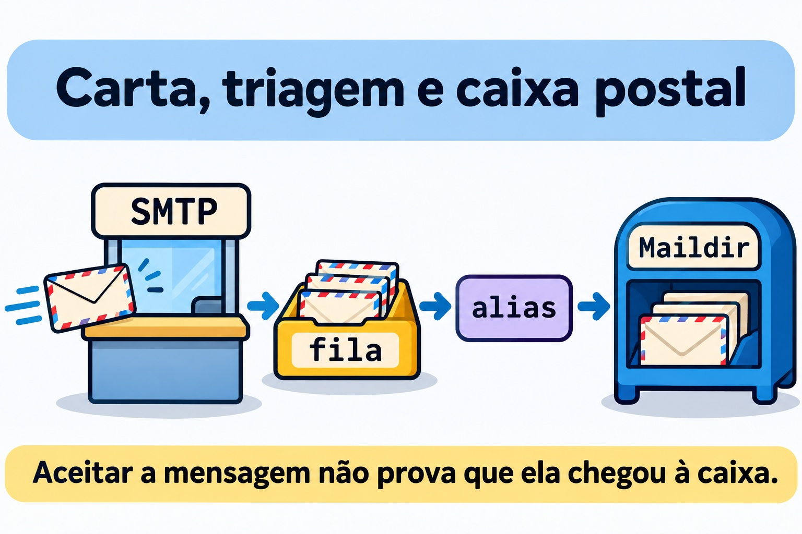
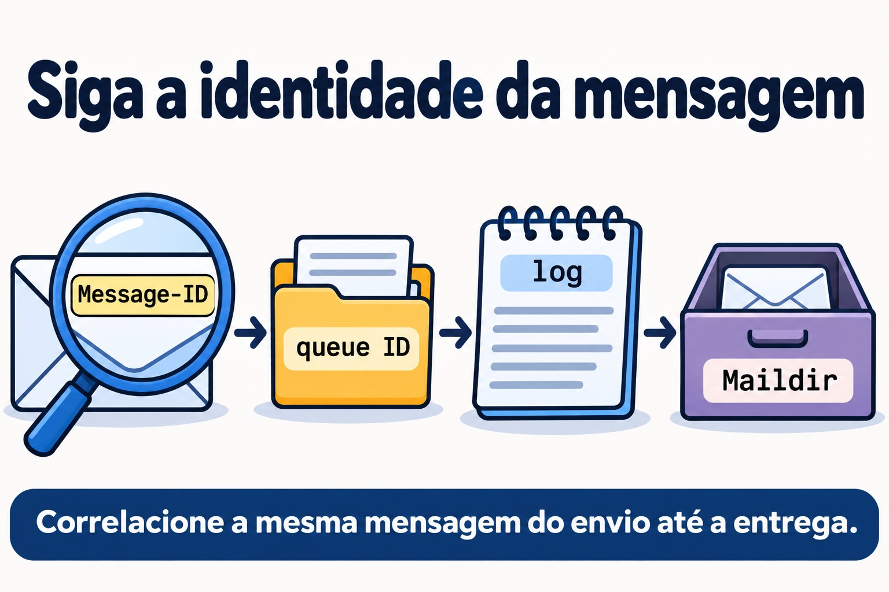

# Aula 19.7 · Postfix e correio local

> **O coração desta aula:** aceitar uma carta, escolher o destinatário e entregar na caixa são três provas diferentes.

| Ficha | Plano de trabalho |
| --- | --- |
| Módulo | M19 · Serviços de rede, aula 7 de 9 |
| Quando | Semana 27 |
| Ao final | Entregar correio local e provar a recusa de relay não autorizado |
| Pré-requisitos | 19.1–19.6; VM 204 `srv-deb`; DNS `lab.test` saudável |
| Duração | 100–140 minutos, além das instalações |
| Snapshot | `m19a7-inicio` e `m19a7-fim`, VM 204 |

Execute no convidado indicado, como `student` com `sudo`. O host Proxmox aparece somente no desafio explicitamente identificado. Não adapte os exemplos para um servidor de produção.

Confira o [guia comum da bancada](../GUIA_BANCADA_M19_PT.md) antes de mudar serviços; ele fixa rede, firewall e material de confiança.

Nomes canônicos do módulo: o nome da VM no Proxmox e o hostname do sistema operacional devem corresponder ao papel antes de executar as guardas. Um nome DNS de serviço não muda o hostname. Se o inventário divergir, reconcilie-o pelo console antes de seguir; não ignore as guardas.

| VM | Hostname curto | Endereço isolado |
| --- | --- | --- |
| 201 | `rocky-lab` | `192.0.2.201` |
| 202 | `debian-lab` | `192.0.2.202` |
| 204 | `srv-deb` | `192.0.2.204` |
| 212 | `m19-client` | DHCP; somente desafio 19.9 |

## 1 · Aquecimento

1. Um retorno SMTP positivo prova leitura pelo usuário?

2. O registro MX aponta diretamente para um endereço IP?

3. Permitir destinatários locais equivale a permitir relay para qualquer domínio?

## 2 · Por que importa

Um serviço precisa enviar um aviso e você encontra apenas uma fila crescendo. Saber separar aceitação, enfileiramento e entrega evita culpar o cliente errado.

A bancada trabalha apenas com correio de laboratório. Não publica MX na Internet, não configura entrega externa, antispam, reputação, SPF, DKIM ou DMARC. Esses contratos exigem outro projeto.

O mesmo endereço pode passar por um alias antes de alcançar uma conta Unix. O alias muda o destino local; não cria uma senha nem uma caixa independente.

## 3 · Modelo mental



*Aceitar a mensagem não prova que ela chegou à caixa.*

| Peça | O que prova |
| --- | --- |
| SMTP | Transporte e resposta de aceitação |
| MX | Nome do servidor de correio do domínio |
| queue ID | Identidade local na fila do Postfix |
| Message-ID | Cabeçalho para correlacionar o conteúdo |
| alias | Mapeamento de destinatário local |
| Maildir | Mensagens em arquivos individuais |

### Ponte Windows

Um cliente de correio separa o servidor de envio do servidor de leitura. Nesta aula você monta somente a entrega SMTP; a leitura por IMAPS entra na próxima.

## 4 · O essencial

O domínio é `lab.test`. O MX aponta para `mail.lab.test`, cujo registro A resolve para `192.0.2.204`. O destinatário do teste será `suporte@lab.test`.

O usuário novo é `aluno-mail`, com caixa em `~/Maildir/`. Não reutilize a conta `student`, não copie sua senha e não habilite login remoto para a conta de correio.

A confiança para relay inclui apenas `127.0.0.1/32` e `192.0.2.0/24`. O restante do loopback não é confiável nesta configuração: isso permite uma prova negativa local e controlada.

O SMTP escuta somente no loopback e no endereço isolado. Sem autenticação nesta porta, envie apenas conteúdo fictício da bancada; a senha do usuário não participa do SMTP deste exercício.

Aceitar relay da LAN não exige conectividade externa. Uma proteção adicional impede transporte SMTP de saída; só a entrega local é exercitada.

### Rocky × Debian

O servidor desta aula é Debian 13. O Postfix usa parâmetros semelhantes nas duas famílias, mas pacotes, unidades, políticas de firewall e logs precisam ser conferidos no sistema real.

Na Rocky, o SELinux continua enforcing e o serviço não recebe permissões amplas para compensar um caminho errado. Esta aula não instala um segundo MTA nas VMs 201 ou 202.

## 5 · Lab guiado

A rede do laboratório é `192.0.2.0/24`, isolada em `vmbr17`, sem gateway, NAT ou porta física. A VM 204 usa `192.0.2.204` nessa rede. A interface de gestão conserva seu endereço real e sua rota.

### Passo 1 · Conferir rede, DNS e ausência de outro MTA

**Palpite:** Um nome resolvido prova que a porta de correio já existe?

Leia o arquivo de ambiente antes de carregá-lo. Se aparecer algo além das quatro atribuições documentadas, pare. Preserve a política de firewall já validada na 19.1.

```bash
test "$(hostname -s)" = srv-deb || exit 1
cat /etc/os-release
test ! -L /etc/m19-lab.env || exit 1
test "$(stat -c %u:%g:%a /etc/m19-lab.env)" = 0:0:644 || exit 1
cat /etc/m19-lab.env
. /etc/m19-lab.env
test "$LAB_IP" = 192.0.2.204 || exit 1
test "$LAB_NET" = 192.0.2.0/24 || exit 1
ip -4 address show dev "$LAB_IF"
ip -4 route
dig @192.0.2.204 lab.test MX +noall +answer
dig @192.0.2.204 mail.lab.test A +short
dpkg-query -W postfix exim4-daemon-light exim4-daemon-heavy sendmail-bin 2>/dev/null
sudo ss -ltnp '( sport = :25 )'
if getent passwd aluno-mail > /dev/null; then exit 1; fi
sudo nft list ruleset
```

**Saída esperada:** MX para o nome correto, A para o endereço isolado, porta livre e usuário ausente. A listagem de pacotes pode retornar código não zero por pacotes ausentes.

**Verifique:** Se outro MTA ou a conta já existe, pare e investigue. Não aproveite sua configuração nem remova outro serviço para liberar a porta.

```bash
mkdir -p "$HOME/m19-lab"
EVID=$(mktemp -d "$HOME/m19-lab/evidence-19-7.XXXXXX") || exit 1
ip -4 address > "$EVID/address-before.txt"
ip -4 route > "$EVID/routes-before.txt"
sudo nft list ruleset > "$EVID/firewall-before.txt"
```

Na instalação escolha **Local only**, com mailname `mail.lab.test`; não escolha **No configuration**, que pode deixar ausentes os arquivos necessários. O bloco pré-semeia esses valores e confere os arquivos antes do backup.

### Passo 2 · Instalar sem publicar a configuração padrão

**Palpite:** Instalar um pacote garante que ele escute somente na rede certa?

A VM 204 foi preparada sem MTA anterior. A máscara temporária impede a partida automática durante a instalação. No diálogo do pacote escolha configuração local; a configuração final vem no próximo passo.

```bash
sudo systemctl mask postfix.service postfix@.service
sudo apt update
printf '%s\n' 'postfix postfix/main_mailer_type select Local only' 'postfix postfix/mailname string mail.lab.test' | sudo debconf-set-selections || exit 1
sudo apt install postfix swaks
systemctl is-enabled postfix.service
sudo ss -ltnp '( sport = :25 )'
sudo test ! -e /root/m19-backup-19-7 || exit 1
sudo install -d -m 0700 /root/m19-backup-19-7
sudo test -f /etc/postfix/main.cf && sudo test -f /etc/aliases || exit 1
sudo cp -a /etc/postfix/main.cf /root/m19-backup-19-7/main.cf
sudo cp -a /etc/aliases /root/m19-backup-19-7/aliases
sudo useradd --create-home --shell /usr/sbin/nologin aluno-mail
sudo install -d -o aluno-mail -g aluno-mail -m 0700   /home/aluno-mail/Maildir /home/aluno-mail/Maildir/cur   /home/aluno-mail/Maildir/new /home/aluno-mail/Maildir/tmp
getent passwd aluno-mail
sudo stat -c '%U %G %a %n' /home/aluno-mail/Maildir
```

**Saída esperada:** Pacote instalado, unidade mascarada, nenhuma escuta SMTP e diretórios pertencentes à conta nova.

**Verifique:** Não rode com instalação interrompida nem com listener inesperado. Guarde o backup fora do material publicado: ele pode conter parâmetros privados do ambiente.

### Passo 3 · Limitar identidade, escuta e relay

**Palpite:** Uma regra de relay deve autorizar todos os clientes que alcançam a porta?

```bash
sudo postconf -e 'myhostname = mail.lab.test'
sudo postconf -e 'mydomain = lab.test'
sudo postconf -e 'myorigin = $mydomain'
sudo postconf -e 'mydestination = $myhostname, localhost.$mydomain, localhost, $mydomain'
sudo postconf -e 'inet_interfaces = 127.0.0.1, 192.0.2.204'
sudo postconf -e 'inet_protocols = ipv4'
sudo postconf -e 'mynetworks = 127.0.0.1/32, 192.0.2.0/24'
sudo postconf -e 'smtpd_relay_restrictions = permit_mynetworks, reject_unauth_destination'
sudo postconf -e 'relay_domains ='
sudo postconf -e 'relayhost ='
sudo postconf -e 'home_mailbox = Maildir/'
sudo postconf -e 'default_transport = error:external delivery disabled in M19'
sudo postconf -e 'relay_transport = error:external relay disabled in M19'
sudo postconf -e 'smtpd_sasl_auth_enable = no'
sudo postconf -n
sudo postfix check
```

**Saída esperada:** Identidade local, escuta restrita e política explícita de relay. A validação deve terminar sem erro antes de iniciar.

**Verifique:** O domínio local continua entregável por transporte local. Os transportes de saída bloqueados evitam que uma mensagem de teste tente sair pela interface de gestão.

O teste não implementa submission autenticada nem relay para a Internet. Não transforme o exemplo em servidor externo apenas retirando as duas proteções de transporte.


*Uma rede autorizada não transforma o servidor em relay aberto.*

### Passo 4 · Mapear alias e iniciar o serviço

**Palpite:** Editar o arquivo de aliases atualiza imediatamente o mapa consultado?

```bash
if sudo grep -qE '^suporte[[:space:]]*:' /etc/aliases; then exit 1; fi
printf '%s
' 'suporte: aluno-mail' | sudo tee -a /etc/aliases
sudo newaliases
sudo postalias -q suporte hash:/etc/aliases
sudo postfix check || exit 1
sudo systemctl unmask postfix.service postfix@.service
sudo systemctl enable --now postfix.service
sudo postfix status
systemctl cat postfix.service
sudo ss -ltnp '( sport = :25 )'
sudo postconf mydestination mynetworks inet_interfaces
sudo journalctl --since '-5 min' --no-pager | grep -F postfix
```

**Saída esperada:** O alias retorna a conta nova. O processo mestre escuta somente em `127.0.0.1` e `192.0.2.204`, porta 25.

**Verifique:** Leia a unidade da versão instalada; a organização de instâncias mudou entre versões Debian. Use também o estado do Postfix e a escuta real, não apenas a linha do systemd.

Se a checagem falhar, mantenha o serviço mascarado, restaure os dois arquivos do backup e regenere o mapa. Não tente iniciar repetidamente para esconder a falha.

### Passo 5 · Enviar e seguir a mesma mensagem

**Palpite:** O identificador da fila e o cabeçalho da carta são o mesmo objeto?

Na VM 202, use a rede isolada validada e envie apenas texto fictício. O marcador é seu, não um número inventado de log; guarde o valor para a próxima aula.

```bash
test "$(hostname -s)" = debian-lab || exit 1
sudo apt install swaks
dig @192.0.2.204 lab.test MX +short
MID="m19-$(date +%s)-$(cat /proc/sys/kernel/random/uuid)@lab.test"
printf '%s
' "$MID"
swaks --server 192.0.2.204 --port 25   --from student@lab.test --to suporte@lab.test   --header "Message-ID: <$MID>" --header 'Subject: M19 prova local'   --body 'Mensagem ficticia para leitura na aula 19.8.'
printf '%s
' "$MID" > "$HOME/m19-message-id.txt"
```

**Saída esperada:** Aceitação da mensagem e identificador real da fila na resposta. Copie o identificador observado, sem substituir por um valor de exemplo.

**Verifique:** De volta à VM 204, procure o mesmo cabeçalho, acompanhe a entrega local e confira o arquivo da mensagem. Uma fila vazia sozinha também poderia significar descarte ou rejeição.

```bash
test "$(hostname -s)" = srv-deb || exit 1
read -r -p 'Message-ID observado: ' MID
sudo journalctl --since '-15 min' --no-pager | grep -F "$MID"
sudo postqueue -p
sudo find /home/aluno-mail/Maildir/new -maxdepth 1 -type f -printf '%f
'
sudo grep -rlF -- "$MID" /home/aluno-mail/Maildir/new/
# Leia apenas o arquivo encontrado; nao publique seu conteudo real.
```

### Passo 6 · Provar a recusa sem enviar correio externo

**Palpite:** Uma tentativa feita pela própria LAN prova a recusa a uma origem não confiável?

Este teste ocorre na VM 204. A origem de loopback escolhida não está em `mynetworks`; o comando encerra no destinatário, antes do corpo. O domínio reservado evita contato com um domínio real.

```bash
swaks --local-interface 127.0.0.2 --server 127.0.0.1 --port 25   --from origem@lab.test --to destinatario@outside.invalid   --quit-after RCPT
sudo journalctl --since '-5 min' --no-pager | grep -E 'postfix|Relay access denied'
sudo postqueue -p
sudo postconf -n > "$EVID/postconf-final.txt"
sudo ss -ltnp > "$EVID/listeners-final.txt"
ip -4 route > "$EVID/routes-after.txt"
diff -u "$EVID/routes-before.txt" "$EVID/routes-after.txt"
```

**Saída esperada:** Recusa de relay no comando de destinatário, sem aceitação de corpo nem criação de mensagem externa na fila.

**Verifique:** Se a origem local não puder ser usada, registre a prova como pendente e investigue a plataforma. Não amplie a rede confiável para fazer o teste passar.

### Decida 1 · A fila está vazia

A. Concluir que o usuário leu. B. Correlacionar resposta, log e arquivo. C. Reiniciar o cliente até aparecer algo.

### Decida 2 · O relay foi recusado

A. Conferir origem e destino antes de mudar a política. B. Desativar a restrição. C. Acrescentar todas as redes privadas.

## 6 · Quebre e conserte

Faça uma falha por vez e restaure antes da próxima. Mantenha a sessão de gestão aberta. Os defeitos abaixo não exigem apagar mensagens, usuários nem arquivos de outros serviços.

### Quebra 1 · Alias sem mapa atualizado

**Sintoma:** O arquivo mostra o alias, mas a consulta do mapa não reflete a alteração.

**Investigação:** Compare o arquivo de origem com a consulta ao mapa; não envie dezenas de cartas para testar.

**Causa:** O mapa compilado não foi regenerado após a edição.

**Conserto:** Rode a regeneração e consulte novamente antes de repetir um único envio.

**Prevenção:** Inclua a consulta do mapa na mudança documentada.

**Verifique:** A consulta do mapa retorna a conta local esperada.

```bash
sudo postalias -q suporte hash:/etc/aliases
sudo newaliases
sudo postalias -q suporte hash:/etc/aliases
```

### Quebra 2 · Domínio fora da entrega local

**Sintoma:** Uma carta do domínio do lab não chega à caixa e aparece como destino externo bloqueado.

**Investigação:** Leia os destinos locais efetivos e o log da mensagem.

**Causa:** Uma alteração de exercício retirou o domínio dos destinos locais.

**Conserto:** Restaure a linha validada do passo 3, confira e recarregue; envie uma carta nova com outro marcador.

**Prevenção:** Não compense removendo a proteção dos transportes externos.

**Verifique:** A carta nova registra entrega local e aparece na caixa.

```bash
sudo postconf mydestination default_transport relay_transport
sudo postfix check && sudo postfix reload
```

### Quebra 3 · Caixa com dono errado

**Sintoma:** A aceitação SMTP ocorre, mas a entrega local registra permissão negada.

**Investigação:** Confira apenas os diretórios da conta de laboratório e o log da entrega.

**Causa:** Um diretório específico de Maildir pertence a outra conta.

**Conserto:** Restaure dono e modo somente do diretório identificado; não use permissão universal nem alteração recursiva sobre todas as casas.

**Prevenção:** Crie os três subdiretórios com o dono correto desde o início.

**Verifique:** A nova entrega termina sem erro e o diretório mantém dono e modo restritos.

```bash
sudo namei -l /home/aluno-mail/Maildir/new
sudo stat -c '%U %G %a %n' /home/aluno-mail/Maildir/{cur,new,tmp}
```

## 7 · Armadilhas



*Correlacione a mesma mensagem do envio até a entrega.*

1. MX aponta para nome, não para texto contendo IP.

2. Confiança de rede não é autenticação do remetente.

3. Fila vazia não prova leitura nem sucesso por si só.

4. Um alias não cria um segundo usuário Unix.

5. Não apague toda a fila para limpar uma única falha de teste.

6. Um comando administrativo em modo de consulta também precisa de contexto certo.

## 8 · Quiz

1. Qual objeto permite correlacionar o conteúdo entre envio e arquivo?

2. Por que o teste negativo usa uma origem fora da rede confiável?

3. O que muda após editar o alias e antes de regenerar o mapa?

4. Qual evidência distingue aceitação SMTP de entrega local?

5. Por que a proteção de transporte externo continua necessária mesmo na bancada?

## 9 · Folha de bolso

```bash
sudo postconf -n
sudo postfix check
sudo postfix status
sudo postqueue -p
sudo postalias -q suporte hash:/etc/aliases
sudo journalctl --since '-15 min' --no-pager | grep -F postfix
sudo ss -ltnp '( sport = :25 )'
```

**Flashcards:** Aceitação → responsabilidade assumida para processamento, não leitura.

**Flashcards:** Alias → mapeamento de nome, sem senha própria.

**Flashcards:** Relay → encaminhamento para outro domínio sob política explícita.

## 10 · Checklist e fechamento

- [ ] DNS MX e A conferidos na rede isolada.

- [ ] Gestão e rotas preservadas.

- [ ] Escuta limitada e transportes externos bloqueados.

- [ ] Alias consultado no mapa efetivo.

- [ ] Uma mensagem correlacionada até Maildir.

- [ ] Relay não autorizado recusado antes do corpo.

- [ ] Conta de correio e evidências preservadas para a 19.8.

**Reboot de conferência:** agende somente a VM 204 quando a bancada permitir. Após o retorno, verifique endereço isolado, listeners, política e o teste funcional completo; um serviço ativo sozinho não fecha a prova.

Na janela combinada, reinicie pelo convidado; depois reconecte pela gestão e execute as verificações seguintes.

```bash
sudo systemctl reboot
```

```bash
sudo postfix status
sudo postconf inet_interfaces mynetworks
sudo ss -ltnp '( sport = :25 )'
sudo postqueue -p
```

**Último exercício:** Explique a uma pessoa onde a mensagem está em cada etapa e mostre três evidências da mesma carta.

## 11 · Na vida real

Em ambiente real, primeiro faça inventário somente de leitura: domínios, destinos locais, redes confiáveis, autenticação, transporte, retenção e monitoramento.

Um problema de reputação externa não se resolve ampliando relay. Um problema de armazenamento não se resolve apagando uma fila inteira sem identificar seus donos.

## 12 · Aprofunde quando quiser

[Postfix · configuração básica](https://www.postfix.org/BASIC_CONFIGURATION_README.html) explica identidade, destinos e interfaces.

[Postfix · exemplos de configuração](https://www.postfix.org/STANDARD_CONFIGURATION_README.html) documenta limites de relay.

[Postfix · parâmetros](https://www.postfix.org/postconf.5.html) é a referência para consultar os parâmetros usados.

As referências sustentam a leitura documental. Os comandos e resultados desta aula precisam ser executados na sua bancada; esta entrega não registra testes em VMs.

!explica Por que aceitar SMTP, entregar Maildir e ler IMAP sao tres provas diferentes?

!feynman Explique um alias sem confundi-lo com uma conta de usuario.

!quiz Crie tres casos de relay e peca origem, destino e regra aplicada.

### Gabarito comentado

Aquecimento: não; MX aponta para nome; entrega local e relay são decisões distintas.

Decida 1: B. Resposta, log e arquivo formam uma cadeia; nenhum deles sozinho prova leitura.

Decida 2: A. A recusa pode ser exatamente a proteção desejada.

Quiz 1: o cabeçalho da mensagem permite correlacionar conteúdo; o identificador de fila serve ao processamento local.

Quiz 2: uma origem confiável não exercita a recusa de relay a terceiros.

Quiz 3: o arquivo de origem muda, mas o mapa consultado ainda pode conter o valor anterior.

Quiz 4: log de entrega local e arquivo na caixa, correlacionados à mensagem aceita.

Quiz 5: a interface de gestão pode ter conectividade; o lab não autoriza correio externo por ela.

Guarde as evidências fora da VM antes de encerrar. Preserve os serviços do M19 para as aulas seguintes e não reverta o snapshot sobre trabalho posterior.

[← Aula 19.6 · Samba](19.6-samba-a-ponte-windows.md) · [Índice das aulas](../01-aulas.md) · [Aula 19.8 · Dovecot →](19.8-dovecot-e-imaps.md)
