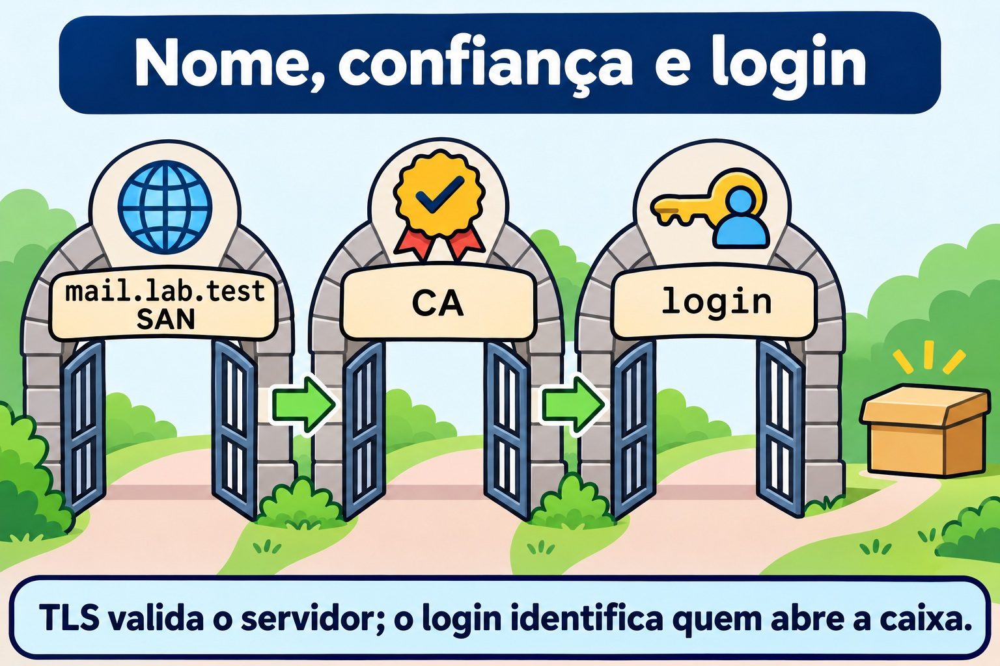
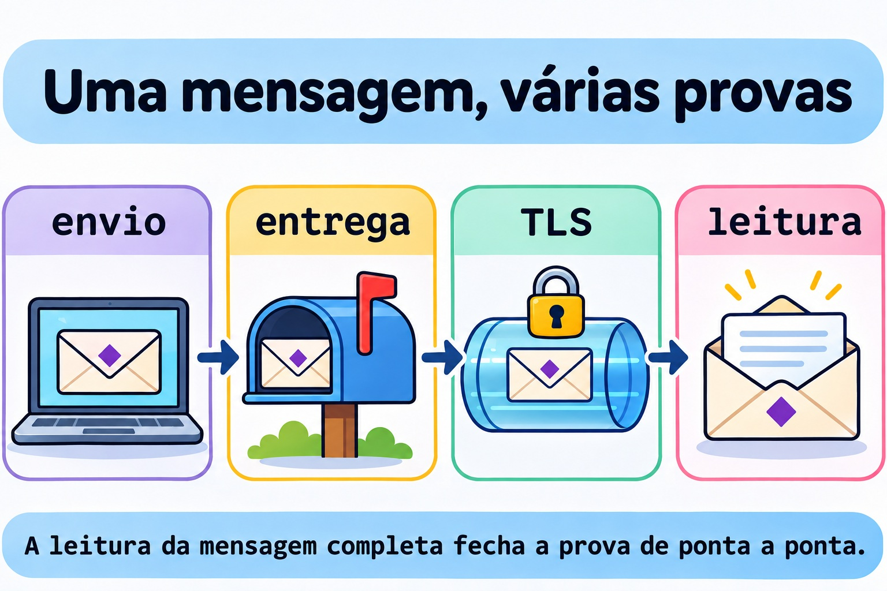

# Aula 19.8 · Dovecot e leitura por IMAPS

> **O coração desta aula:** a mesma mensagem só fecha a cadeia quando nome, confiança TLS, login e conteúdo são conferidos.

| Ficha | Plano de trabalho |
| --- | --- |
| Módulo | M19 · Serviços de rede, aula 8 de 9 |
| Quando | Semana 27 |
| Ao final | Ler por IMAPS a mensagem entregue pelo Postfix |
| Pré-requisitos | 19.5 e 19.7; CA do lab e conta `aluno-mail` |
| Duração | 100–140 minutos, além das instalações |
| Snapshot | `m19a8-inicio` e `m19a8-fim`, VM 204 |

Execute no convidado indicado, como `student` com `sudo`. O host Proxmox aparece somente no desafio explicitamente identificado. Não adapte os exemplos para um servidor de produção.

Confira o [guia comum da bancada](../GUIA_BANCADA_M19_PT.md) antes de mudar serviços; ele fixa rede, firewall e material de confiança.

Nomes canônicos do módulo: o nome da VM no Proxmox e o hostname do sistema operacional devem corresponder ao papel antes de executar as guardas. Um nome DNS de serviço não muda o hostname. Se o inventário divergir, reconcilie-o pelo console antes de seguir; não ignore as guardas.

| VM | Hostname curto | Endereço isolado |
| --- | --- | --- |
| 201 | `rocky-lab` | `192.0.2.201` |
| 202 | `debian-lab` | `192.0.2.202` |
| 204 | `srv-deb` | `192.0.2.204` |
| 212 | `m19-client` | DHCP; somente desafio 19.9 |

## 1 · Aquecimento

1. Quem deposita a mensagem na caixa: Postfix ou Dovecot?

2. Uma conexão TLS válida prova que a senha está correta?

3. Por que o nome usado pelo cliente precisa estar no SAN?

## 2 · Por que importa

Você encontra uma mensagem no disco, mas o cliente mostra uma caixa vazia. A mensagem pode estar em outra casa, noutro formato ou sob uma identidade diferente.

O Dovecot fornece acesso à caixa; ele não substitui a decisão de entrega já feita pelo Postfix. A prova atravessa ambos sem misturar suas responsabilidades.

O cliente deve confiar na CA privada do laboratório e conferir o nome. Desabilitar a verificação TLS transforma um sintoma de configuração em perda de identidade.

## 3 · Modelo mental


*O Postfix entrega; o Dovecot permite ler a caixa.*

| Peça | O que prova |
| --- | --- |
| Postfix | Entrega a carta na caixa local |
| Maildir | Armazena cada mensagem num arquivo |
| Dovecot | Abre a caixa conforme a identidade |
| IMAPS | IMAP dentro de TLS desde a conexão |
| SAN | Autoriza o nome apresentado pelo cliente |
| CA | Estabelece a cadeia de confiança |

### Ponte Windows

Num cliente gráfico, servidor de leitura, porta, segurança e usuário são campos distintos. Use o nome do certificado, IMAPS e a conta local; o endereço de correio do alias não é automaticamente o nome de login.

## 4 · O essencial

Esta aula exige Dovecot 2.4 no Debian 13. A configuração 2.3 usa nomes diferentes; não cole exemplos antigos de outra distribuição sem conferir a versão e a sintaxe.

O certificado vem da 19.5: `mail.lab.test` no SAN, CA em `/etc/ssl/m19/ca.crt`, certificado em `/etc/ssl/m19/server.crt` e chave em `/etc/ssl/private/m19-server.key`. A chave privada nunca vai ao cliente.

A única porta de leitura publicada é 993 no endereço isolado. A porta 143 fica desativada. O exemplo não habilita POP3, submission nem autenticação SMTP.

O mecanismo de autenticação pode chamar-se PLAIN e ainda estar protegido por TLS. O que esta bancada proíbe é transmitir a senha fora do túnel validado.

A senha será digitada em prompt interativo. Não a coloque numa URL, variável de ambiente, argumento de comando, captura de tela ou arquivo de evidência.

### Rocky × Debian

No Debian 13, confira explicitamente a série 2.4. Ela usa `mail_driver`, `mail_path`, `ssl_server_cert_file`, `ssl_server_key_file` e `auth_allow_cleartext`.

Uma Rocky com Dovecot 2.3 precisa de uma configuração própria dessa série. A aula não muda a VM 201 nem tenta tornar a mesma configuração compatível com as duas versões.

## 5 · Lab guiado

A rede do laboratório é `192.0.2.0/24`, isolada em `vmbr17`, sem gateway, NAT ou porta física. A VM 204 usa `192.0.2.204` nessa rede. A interface de gestão conserva seu endereço real e sua rota.

### Passo 1 · Conferir caixa, certificado e versão pretendida

**Palpite:** Um arquivo de certificado existente prova nome e validade?

```bash
test "$(hostname -s)" = srv-deb || exit 1
test ! -L /etc/m19-lab.env || exit 1
test "$(stat -c %u:%g:%a /etc/m19-lab.env)" = 0:0:644 || exit 1
cat /etc/m19-lab.env
. /etc/m19-lab.env
test "$LAB_IP" = 192.0.2.204 || exit 1
ip -4 address show dev "$LAB_IF"
getent passwd aluno-mail
sudo find /home/aluno-mail/Maildir -maxdepth 2 -type f -printf '%P
'
sudo postconf home_mailbox
openssl x509 -in /etc/ssl/m19/server.crt -noout -dates -ext subjectAltName
openssl verify -CAfile /etc/ssl/m19/ca.crt   -verify_hostname mail.lab.test /etc/ssl/m19/server.crt
sudo stat -c '%U %G %a %n' /etc/ssl/private/m19-server.key
sudo ss -ltnp '( sport = :143 or sport = :993 )'
apt-cache policy dovecot-core dovecot-imapd
systemctl list-unit-files 'dovecot*'
```

**Saída esperada:** Uma mensagem do teste anterior, chave restrita a root, nome aceito e portas ainda livres. A versão candidata pertence à série exigida.

**Verifique:** Se a caixa não existe, volte à entrega local. Se o nome falha, corrija o certificado na 19.5; não omita a verificação do nome.

```bash
mkdir -p "$HOME/m19-lab"
EVID=$(mktemp -d "$HOME/m19-lab/evidence-19-8.XXXXXX") || exit 1
ip -4 route > "$EVID/routes-before.txt"
openssl x509 -in /etc/ssl/m19/server.crt -noout -fingerprint -sha256   > "$EVID/server-fingerprint.txt"
```

### Passo 2 · Preparar conta e pacote sem escuta automática

**Palpite:** A senha do alias precisa ser criada separadamente?

A conta foi criada na 19.7. Defina agora uma senha exclusiva para ela, digitada duas vezes no prompt. Não altere a conta de gestão. Se já houver Dovecot configurado, pare antes da instalação.

```bash
sudo passwd aluno-mail
sudo systemctl mask dovecot.service
sudo apt install dovecot-imapd
dovecot --version
case "$(dovecot --version)" in 2.4.*) ;; *) exit 1 ;; esac
systemctl is-enabled dovecot.service
sudo ss -ltnp '( sport = :143 or sport = :993 )'
sudo test ! -e /root/m19-backup-19-8 || exit 1
sudo install -d -m 0700 /root/m19-backup-19-8
sudo cp -a /etc/dovecot /root/m19-backup-19-8/dovecot
sudo cat /etc/pam.d/dovecot
sudo passwd -S aluno-mail
getent passwd aluno-mail
```

**Saída esperada:** Senha definida sem aparecer na tela, unidade mascarada e versão 2.4 confirmada. A conta mantém a casa da entrega local.

**Verifique:** O arquivo PAM do pacote precisa existir e usar a autenticação local prevista. Não crie uma política PAM permissiva para resolver um login que ainda nem foi testado.

### Passo 3 · Escrever uma configuração mínima da série 2.4

**Palpite:** Copiar os nomes de parâmetros da série 2.3 será aceito silenciosamente?

Este servidor ainda não possui configuração Dovecot de trabalho. Guarde o diretório original e substitua apenas o arquivo principal por um exemplo mínimo completo; ele não inclui os fragmentos antigos do pacote.

```bash
cat > "$EVID/dovecot.conf" <<'EOF'
dovecot_config_version = 2.4.0
dovecot_storage_version = 2.4.0
protocols {
  imap = yes
}
listen = 127.0.0.1, 192.0.2.204
mail_driver = maildir
mail_path = ~/Maildir
first_valid_uid = 1000
auth_mechanisms = plain login
auth_allow_cleartext = no
ssl = required
ssl_min_protocol = TLSv1.2
ssl_server_cert_file = /etc/ssl/m19/server.crt
ssl_server_key_file = /etc/ssl/private/m19-server.key
passdb pam {
}
userdb passwd {
}
namespace inbox {
  inbox = yes
}
service imap-login {
  inet_listener imap {
    port = 0
  }
  inet_listener imaps {
    listen = 192.0.2.204
    port = 993
    ssl = yes
  }
}
EOF
sudo doveconf -c "$EVID/dovecot.conf" -n > /dev/null || exit 1
sudo install -o root -g root -m 0644 "$EVID/dovecot.conf" /etc/dovecot/dovecot.conf
sudo doveconf -n
```

**Saída esperada:** O parser aceita a sintaxe e mostra Maildir, TLS obrigatório, provedores locais e listener IMAPS isolado.

**Verifique:** Se qualquer validação falhar, não desmascare o serviço. Restaure o arquivo principal do backup e investigue a versão; não troque nomes de parâmetros por tentativa.

A conta local fornece UID, GID e casa. O exemplo não usa usuário virtual único nem define um dono global para todas as caixas.



*TLS valida o servidor; o login identifica quem abre a caixa.*

### Passo 4 · Iniciar e provar o túnel antes do login

**Palpite:** Uma porta aberta prova a identidade do servidor?

```bash
sudo doveconf -n > "$EVID/doveconf-final.txt" || exit 1
sudo systemctl unmask dovecot.service
sudo systemctl enable --now dovecot.service
sudo systemctl status dovecot.service --no-pager
sudo ss -ltnp '( sport = :143 or sport = :993 )'
sudo journalctl -u dovecot.service --since '-5 min' --no-pager
openssl s_client -connect 192.0.2.204:993 -servername mail.lab.test   -verify_hostname mail.lab.test -verify_return_error   -CAfile /etc/ssl/m19/ca.crt < /dev/null
```

**Saída esperada:** Somente 993 no endereço isolado, cadeia confiável e nome correto. O fechamento sem login é suficiente para esta prova TLS.

**Verifique:** Um banner IMAP não substitui o resultado da verificação. Não digite comandos de login em uma sessão TLS que apresentou erro.

Se o serviço não iniciar, recoloque a máscara antes de restaurar. Leia o erro do parser e o diário; a chave deve continuar restrita, sem permissão universal.

### Passo 5 · Ler a mensagem sem expor a senha

**Palpite:** O usuário de login é o alias do destinatário?

Na VM 202, a CA pública foi transferida e conferida na 19.5 em `/etc/ssl/m19/ca.crt`. Não transfira a chave do servidor. Confira o suporte IMAPS do cliente antes de autenticar.

```bash
test "$(hostname -s)" = debian-lab || exit 1
dig @192.0.2.204 mail.lab.test A +short
curl --version
openssl s_client -connect mail.lab.test:993 -servername mail.lab.test   -verify_hostname mail.lab.test -verify_return_error   -CAfile /etc/ssl/m19/ca.crt < /dev/null
MID=$(cat "$HOME/m19-message-id.txt") || exit 1
printf '%s
' "$MID"
curl --cacert /etc/ssl/m19/ca.crt --user aluno-mail   --url 'imaps://mail.lab.test/INBOX'   --request "UID SEARCH HEADER Message-ID <$MID>"
```

**Saída esperada:** O cliente pede a senha interativamente e retorna o UID real da mensagem procurada. O login usa `aluno-mail`, não o alias.

**Verifique:** Escolha o UID retornado pela busca, sem presumir que será 1. Uma caixa pode ter mensagens anteriores e números que não são consecutivos.

```bash
read -r -p 'UID observado: ' MAIL_UID
case "$MAIL_UID" in ''|*[!0-9]*) exit 1 ;; esac
curl --cacert /etc/ssl/m19/ca.crt --user aluno-mail   --url "imaps://mail.lab.test/INBOX/;UID=$MAIL_UID"
# A senha e digitada no prompt, nunca acrescentada ao nome do usuario.
```

### Passo 6 · Fechar a correlação de ponta a ponta

**Palpite:** Um login bem-sucedido prova que a mensagem desejada foi lida?

Volte à VM 204, na sessão original que mantém a pasta de evidências. Compare o cabeçalho e o corpo lidos com a carta enviada. Maildir pode mover uma mensagem de nova para já vista durante a leitura.

```bash
test "$(hostname -s)" = srv-deb || exit 1
read -r -p 'Message-ID observado: ' MID
sudo journalctl --since '-30 min' --no-pager | grep -F "$MID"
sudo journalctl -u dovecot.service --since '-15 min' --no-pager
sudo grep -rlF -- "$MID"   /home/aluno-mail/Maildir/new/ /home/aluno-mail/Maildir/cur/
sudo doveadm user aluno-mail
sudo postqueue -p
sudo ss -ltnp > "$EVID/listeners-final.txt"
ip -4 route > "$EVID/routes-after.txt"
diff -u "$EVID/routes-before.txt" "$EVID/routes-after.txt"
```

**Saída esperada:** A carta aceita e entregue corresponde ao conteúdo recuperado pelo cliente, com sessão IMAPS registrada e rotas de gestão preservadas.

**Verifique:** O diário pode não registrar o cabeçalho no evento de leitura. Use o UID e o conteúdo no cliente para essa etapa e o marcador no Postfix para a entrega; não invente um log único que contenha tudo.

### Decida 1 · O certificado não é confiável

A. Ignorar TLS para testar a senha. B. Trocar a senha imediatamente. C. Conferir CA, nome e validade antes de autenticar.

### Decida 2 · O login funciona e a caixa está vazia

A. Conferir usuário, casa, formato e entrega. B. Reinstalar os dois serviços. C. Apagar os índices de todas as caixas.

## 6 · Quebre e conserte

Faça uma falha por vez e restaure antes da próxima. Mantenha a sessão de gestão aberta. Os defeitos abaixo não exigem apagar mensagens, usuários nem arquivos de outros serviços.

### Quebra 1 · Nome errado no cliente

**Sintoma:** A conexão por IP falha na conferência de nome.

**Investigação:** Compare o nome solicitado com o SAN; não envie senha nessa conexão.

**Causa:** O certificado autoriza o nome DNS, não qualquer nome ou IP da máquina.

**Conserto:** Volte ao nome do SAN e confira sua resolução na rede isolada.

**Prevenção:** Registre nome e porta junto com a cadeia de confiança do cliente.

**Verifique:** A verificação do nome termina com sucesso antes de qualquer login.

```bash
openssl x509 -in /etc/ssl/m19/server.crt -noout -ext subjectAltName
dig @192.0.2.204 mail.lab.test A +short
```

### Quebra 2 · Alias usado como login

**Sintoma:** A carta chega ao alias, mas o login com esse nome não autentica.

**Investigação:** Compare o mapa de aliases, a conta Unix e o usuário informado pelo cliente.

**Causa:** O alias do Postfix não cria uma conta autenticável no Dovecot.

**Conserto:** Use a conta local criada, com sua senha exclusiva. Não crie contas duplicadas para encobrir o erro.

**Prevenção:** Documente endereço de correio e nome de login em campos diferentes.

**Verifique:** O login da conta local abre a caixa que recebe o alias.

```bash
sudo postalias -q suporte hash:/etc/aliases
getent passwd aluno-mail
sudo doveadm user aluno-mail
```

### Quebra 3 · Formato de caixa divergente

**Sintoma:** O arquivo existe na casa, mas a caixa aberta não corresponde a ele.

**Investigação:** Confira caminho efetivo, casa e formato dos dois serviços.

**Causa:** Uma alteração de exercício fez o leitor procurar outro formato ou caminho.

**Conserto:** Restaure os dois parâmetros Maildir do passo 3, valide e recarregue. Não converta nem apague mensagens.

**Prevenção:** Mantenha um contrato único entre entrega e leitura.

**Verifique:** O conteúdo da mensagem original pode ser recuperado novamente pelo cliente.

```bash
sudo postconf home_mailbox
sudo doveconf -n mail_driver mail_path
sudo doveadm user aluno-mail
sudo doveconf -n && sudo systemctl reload dovecot.service
```

## 7 · Armadilhas



*A leitura da mensagem completa fecha a prova de ponta a ponta.*

1. Certificado válido sem nome correspondente continua sendo erro de identidade.

2. A senha do cliente não deve aparecer no histórico do shell.

3. Não confunda UID IMAP, UID Unix e identificador de fila.

4. A caixa pode mover mensagens entre novas e já vistas.

5. Dovecot 2.4 não aceita automaticamente uma configuração 2.3.

6. A chave do servidor permanece no servidor; somente a CA pública vai ao cliente.

## 8 · Quiz

1. Que duas provas TLS são feitas antes da autenticação?

2. Por que o alias não é automaticamente usuário IMAP?

3. Qual formato os dois serviços precisam compartilhar nesta aula?

4. Por que buscar pelo cabeçalho antes de escolher o UID?

5. O que um login bem-sucedido ainda não prova?

## 9 · Folha de bolso

```bash
dovecot --version
sudo doveconf -n
sudo doveadm user aluno-mail
sudo ss -ltnp '( sport = :143 or sport = :993 )'
sudo journalctl -u dovecot.service --since '-15 min' --no-pager
openssl verify -CAfile /etc/ssl/m19/ca.crt   -verify_hostname mail.lab.test /etc/ssl/m19/server.crt
```

**Flashcards:** TLS → identidade do servidor e proteção do transporte.

**Flashcards:** Login → identidade que recebe acesso à caixa.

**Flashcards:** Leitura → conteúdo recuperado, correlacionado ao envio.

## 10 · Checklist e fechamento

- [ ] Série 2.4 e parser confirmados.

- [ ] Porta 143 fechada e 993 somente na rede isolada.

- [ ] CA, SAN e validade conferidos antes da senha.

- [ ] Conta local e Maildir correspondem à entrega.

- [ ] Senha digitada sem argumento nem URL.

- [ ] Mensagem original recuperada por UID observado.

- [ ] Evidências sem segredos e serviços preservados.

**Reboot de conferência:** agende somente a VM 204 quando a bancada permitir. Após o retorno, verifique endereço isolado, listeners, política e o teste funcional completo; um serviço ativo sozinho não fecha a prova.

Na janela combinada, reinicie pelo convidado; depois reconecte pela gestão e execute as verificações seguintes.

```bash
sudo systemctl reboot
```

```bash
sudo systemctl is-active dovecot.service
sudo ss -ltnp '( sport = :143 or sport = :993 )'
sudo doveadm user aluno-mail
sudo postfix status
```

**Último exercício:** Envie uma segunda carta com marcador novo e repita a leitura por busca, sem assumir um UID fixo.

## 11 · Na vida real

Antes de alterar um servidor existente, inventarie autenticação, casas, quotas, retenção, cópias e clientes. Uma migração de formato ou autenticação exige plano próprio e restauração ensaiada.

O usuário relata caixa vazia; a investigação começa pelo contrato efetivo e pela correlação, sem eliminar índices nem conceder leitura global das casas.

## 12 · Aprofunde quando quiser

[Dovecot 2.4 · configuração inicial](https://doc.dovecot.org/2.4.2/core/config/quick.html) documenta a sintaxe e os provedores locais usados.

[Dovecot 2.4 · TLS](https://doc.dovecot.org/2.4.0/core/config/ssl.html) separa certificado, chave e exigência de transporte seguro.

[curl · URLs IMAP](https://curl.se/docs/url-syntax.html) explica busca e seleção de UID.

As referências sustentam a leitura documental. Os comandos e resultados desta aula precisam ser executados na sua bancada; esta entrega não registra testes em VMs.

!explica Diferencie entrega SMTP, autenticacao IMAP e leitura do conteudo.

!feynman Explique por que confiar na CA nao dispensa conferir o nome.

!quiz Proponha tres falhas de IMAPS e peca a primeira evidencia de cada uma.

### Gabarito comentado

Aquecimento: Postfix entrega; TLS não prova senha; SAN vincula o nome à identidade do servidor.

Decida 1: C. Autenticar só depois de conferir a identidade evita entregar a senha a um destino não validado.

Decida 2: A. Login e localização da caixa são contratos distintos.

Quiz 1: cadeia até uma CA confiável e correspondência do nome ao SAN, além da validade temporal.

Quiz 2: aliases pertencem ao roteamento local do Postfix; PAM autentica contas locais.

Quiz 3: Maildir na casa da mesma conta.

Quiz 4: UID é atribuído à mensagem dentro da caixa e precisa ser observado.

Quiz 5: não prova a presença nem a leitura da mensagem desejada; ainda é preciso recuperar seu conteúdo.

Guarde as evidências fora da VM antes de encerrar. Preserve os serviços do M19 para as aulas seguintes e não reverta o snapshot sobre trabalho posterior.

[← Aula 19.7 · Postfix](19.7-postfix-e-correio-local.md) · [Índice das aulas](../01-aulas.md) · [Aula 19.9 · Squid →](19.9-squid-e-desafio-integrado.md)
