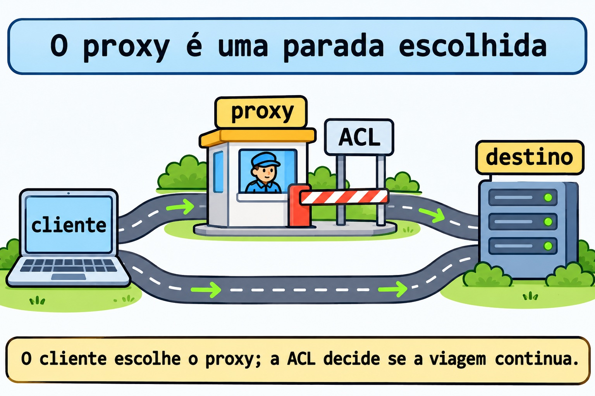
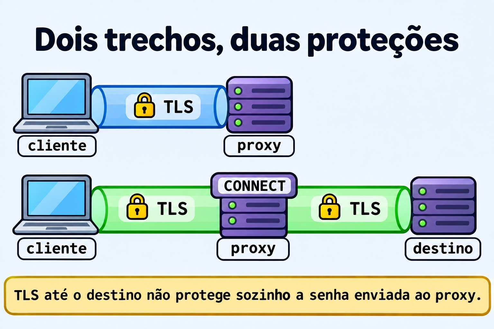

# Aula 19.9 · Squid e desafio integrado

> **O coração desta aula:** um proxy decide por política e registra a decisão; a senha do proxy exige proteção no trecho até ele.

| Ficha | Plano de trabalho |
| --- | --- |
| Módulo | M19 · Serviços de rede, aula 9 de 9 |
| Quando | Semana 27 |
| Ao final | Controlar proxy explícito e encadear DHCP, DNS, HTTPS e IMAPS num cliente novo |
| Pré-requisitos | 19.1–19.8; VM 204; DNS, CA, web e correio saudáveis |
| Duração | 100–140 minutos, além das instalações |
| Snapshot | `m19a9-inicio` e `m19a9-fim`, VM 204 |

Execute no convidado indicado, como `student` com `sudo`. O host Proxmox aparece somente no desafio explicitamente identificado. Não adapte os exemplos para um servidor de produção.

Confira o [guia comum da bancada](../GUIA_BANCADA_M19_PT.md) antes de mudar serviços; ele fixa rede, firewall e material de confiança.

Nomes canônicos do módulo: o nome da VM no Proxmox e o hostname do sistema operacional devem corresponder ao papel antes de executar as guardas. Um nome DNS de serviço não muda o hostname. Se o inventário divergir, reconcilie-o pelo console antes de seguir; não ignore as guardas.

| VM | Hostname curto | Endereço isolado |
| --- | --- | --- |
| 201 | `rocky-lab` | `192.0.2.201` |
| 202 | `debian-lab` | `192.0.2.202` |
| 204 | `srv-deb` | `192.0.2.204` |
| 212 | `m19-client` | DHCP; somente desafio 19.9 |

## 1 · Aquecimento

1. O proxy explícito recebe tráfego sem que o cliente o configure?

2. HTTPS no destino protege a senha enviada antes ao proxy HTTP?

3. Uma regra de domínio substitui uma regra de rede?

## 2 · Por que importa

Uma pessoa relata que o navegador abre um site, mas o acesso aparece negado no proxy. Primeiro é preciso provar que aquela tentativa realmente passou por ele.

Um proxy explícito não é uma barreira completa de saída: o cliente pode tentar uma rota direta quando ela existe. Nesta bancada, a rede isolada não tem saída externa.

A primeira fase usa HTTP sem credenciais apenas para estudar ACL. A segunda fecha essa porta e exige autenticação dentro de TLS até o proxy.

## 3 · Modelo mental



*O cliente escolhe o proxy; a ACL decide se a viagem continua.*

| Peça | O que prova |
| --- | --- |
| ACL | Condição que pode corresponder à tentativa |
| http_access | Decisão pela primeira regra correspondente |
| CONNECT | Túnel até o destino permitido |
| https_port | TLS entre cliente e proxy |
| proxy_auth | Identidade exigida pela política |
| access.log | Resultado real da tentativa observada |

### Ponte Windows

Num Windows 11 já existente e autorizado, use o ajuste de proxy manual apenas na fase sem autenticação e somente se essa máquina já participa da LAN isolada. Guarde a configuração anterior e restaure-a ao fim.

Não crie VM Windows nem altere placa de uma VM fora do inventário. O campo de proxy HTTP do navegador não garante suporte a proxy HTTPS; a fase autenticada usa o cliente de terminal validado abaixo.

## 4 · O essencial

O servidor usa o pacote `squid-openssl` do Debian 13, com suporte a `https_port`. Verifique versão e opções reais: uma compilação sem TLS não pode cumprir a segunda fase.

As portas são `192.0.2.204:3128` na fase sem senha e `192.0.2.204:3129` na fase autenticada. Não há listener na gestão, interceptação transparente ou inspeção do TLS do destino.

O certificado da 19.5 inclui `proxy.lab.test`. A chave recebe uma cópia restrita ao grupo do processo do Squid, sem abrir o arquivo privado compartilhado pelos outros serviços.

A autenticação usa uma conta exclusiva `proxy-aluno` num arquivo de hashes próprio. Ela não é a conta de correio nem a conta de gestão. A senha é digitada no prompt.

A ACL de horário usa a hora local do servidor. A janela inicial cobre o dia inteiro para permitir a bancada; o exercício de falha escolhe depois uma janela que exclui a hora observada, sem mudar o relógio.

### Rocky × Debian

Não trate o nome do pacote como prova da compilação. Leia a versão, procure o suporte OpenSSL e use o parser antes de publicar qualquer listener.

Numa Rocky, caminhos do helper, usuário de serviço e políticas de segurança podem mudar. Esta aula mantém a VM 204 como único proxy e não desativa controles para reaproveitar um caminho Debian.

## 5 · Lab guiado

A rede do laboratório é `192.0.2.0/24`, isolada em `vmbr17`, sem gateway, NAT ou porta física. A VM 204 usa `192.0.2.204` nessa rede. A interface de gestão conserva seu endereço real e sua rota.

### Passo 1 · Conferir destinos e instalar sem publicar

**Palpite:** O teste do site precisa passar pelo proxy para provar a ACL?

```bash
test "$(hostname -s)" = srv-deb || exit 1
test ! -L /etc/m19-lab.env || exit 1
test "$(stat -c %u:%g:%a /etc/m19-lab.env)" = 0:0:644 || exit 1
cat /etc/m19-lab.env
. /etc/m19-lab.env
test "$LAB_IP" = 192.0.2.204 || exit 1
ip -4 address show dev "$LAB_IF"
dig @192.0.2.204 proxy.lab.test A +short
dig @192.0.2.204 web.lab.test A +short
curl --cacert /etc/ssl/m19/ca.crt https://web.lab.test/
sudo ss -ltnp '( sport = :3128 or sport = :3129 )'
dpkg-query -W squid squid-openssl 2>/dev/null
# Pare se um proxy anterior ou configuracao propria ja existir.
sudo systemctl mask squid.service
sudo apt install squid-openssl apache2-utils
squid -v
test -x /usr/lib/squid/basic_ncsa_auth || exit 1
getent passwd proxy
getent group proxy
sudo test ! -e /root/m19-backup-19-9 || exit 1
sudo install -d -m 0700 /root/m19-backup-19-9
sudo cp -a /etc/squid/squid.conf /root/m19-backup-19-9/squid.conf
mkdir -p "$HOME/m19-lab"
EVID=$(mktemp -d "$HOME/m19-lab/evidence-19-9.XXXXXX") || exit 1
ip -4 route > "$EVID/routes-before.txt"
```

**Saída esperada:** Web e DNS funcionam diretamente; pacote com TLS e helper disponíveis; unidade mascarada e portas livres.

**Verifique:** Se a instalação oferece substituir outro serviço de trabalho, pare. A preparação é de um proxy novo, não uma migração improvisada.

### Passo 2 · Publicar a fase de ACL sem credenciais

**Palpite:** Uma condição definida sem regra de acesso altera a decisão?

```bash
cat > "$EVID/squid-acl.conf" <<'EOF'
http_port 192.0.2.204:3128
visible_hostname proxy.lab.test
dns_nameservers 192.0.2.204
acl lab src 192.0.2.0/24
acl destinos dstdomain web.lab.test www.lab.test
acl horario time SMTWHFA 00:00-23:59
acl Safe_ports port 80 443
acl SSL_ports port 443
acl CONNECT method CONNECT
http_access deny !Safe_ports
http_access deny CONNECT !SSL_ports
http_access allow lab horario destinos
http_access deny all
cache deny all
access_log stdio:/var/log/squid/access.log squid
EOF
sudo squid -f "$EVID/squid-acl.conf" -k parse || exit 1
sudo install -o root -g root -m 0644 "$EVID/squid-acl.conf" /etc/squid/squid.conf
sudo squid -k parse || exit 1
sudo systemctl unmask squid.service
sudo systemctl enable --now squid.service
sudo ss -ltnp '( sport = :3128 or sport = :3129 )'
sudo journalctl -u squid.service --since '-5 min' --no-pager
```

**Saída esperada:** Somente a porta 3128 no endereço isolado. A regra de permissão exige simultaneamente rede, horário e domínio.

**Verifique:** As recusas de porta vêm antes da permissão e a última regra recusa o restante. Não acrescente uma permissão geral antes delas.

### Passo 3 · Provar acesso, recusa e CONNECT

**Palpite:** Um certificado do destino correto prova que a senha do proxy estaria protegida?

Na VM 202, force o uso do proxy e remova apenas para este comando a influência de exclusões de proxy. A fase atual não pede nem recebe senha.

```bash
test "$(hostname -s)" = debian-lab || exit 1
curl --noproxy '' --proxy http://proxy.lab.test:3128   --fail-with-body http://web.lab.test/
curl --noproxy '' --proxy http://proxy.lab.test:3128   --fail-with-body http://mail.lab.test/
curl --noproxy '' --proxy http://proxy.lab.test:3128   --cacert /etc/ssl/m19/ca.crt --fail-with-body https://web.lab.test/
curl --noproxy '' --proxy http://proxy.lab.test:3128   --fail-with-body https://web.lab.test:22/
```

**Saída esperada:** Web autorizado funciona; domínio fora da lista é recusado; CONNECT para 443 funciona; CONNECT para porta não permitida é recusado. As recusas retornam código não zero ao cliente.

**Verifique:** Na VM 204, correlacione hora, origem, destino e decisão no registro. Não copie tempos ou tamanhos de uma saída de exemplo.

```bash
test "$(hostname -s)" = srv-deb || exit 1
sudo tail -n 30 /var/log/squid/access.log
date --iso-8601=seconds
sudo squid -k parse
```



*TLS até o destino não protege sozinho a senha enviada ao proxy.*

O lab mantém duas cópias da mesma chave de servidor: a original restrita a root e a cópia legível pelo grupo proxy. Comprometer o processo proxy amplia, portanto, a exposição da mesma identidade usada pelos demais serviços. Em um serviço real emita chave e certificado exclusivos do proxy, com SAN proxy.lab.test; controle renovação, backup e remoção de ambas as cópias. Nenhuma chave vai aos clientes.

### Passo 4 · Preparar TLS e senha exclusiva

**Palpite:** HTTPS no destino protege o primeiro trecho até um proxy HTTP?

A resposta é não. Antes de ativar autenticação, prepare TLS entre cliente e proxy. Verifique a correspondência do certificado e da chave e mantenha a cópia privada limitada ao processo necessário.

```bash
openssl verify -CAfile /etc/ssl/m19/ca.crt   -verify_hostname proxy.lab.test /etc/ssl/m19/server.crt
sudo install -d -o root -g proxy -m 0750 /etc/squid/m19-tls
sudo install -o root -g proxy -m 0644 /etc/ssl/m19/server.crt /etc/squid/m19-tls/server.crt
sudo install -o root -g proxy -m 0640 /etc/ssl/private/m19-server.key /etc/squid/m19-tls/server.key
sudo -u proxy test -r /etc/squid/m19-tls/server.key || exit 1
sudo stat -c '%U %G %a %n' /etc/squid/m19-tls/server.key
sudo stat -c '%U %G %a %n' /etc/ssl/private/m19-server.key
sudo test ! -e /etc/squid/m19.passwd || exit 1
sudo htpasswd -c /etc/squid/m19.passwd proxy-aluno
sudo chown root:proxy /etc/squid/m19.passwd
sudo chmod 0640 /etc/squid/m19.passwd
sudo stat -c '%U %G %a %n' /etc/squid/m19.passwd
```

**Saída esperada:** Cópia privada legível pelo grupo do Squid, chave original ainda restrita a root e senha criada interativamente num arquivo próprio.

**Verifique:** A opção de criação do arquivo de senhas só é usada porque o teste anterior confirmou sua ausência. Para trocar a senha depois, não use a opção que recria o arquivo.

### Passo 5 · Exigir login no proxy HTTPS e fechar HTTP

**Palpite:** Manter uma porta sem autenticação permitiria contornar a exigência da outra?

```bash
cat > "$EVID/squid-auth.conf" <<'EOF'
https_port 192.0.2.204:3129 tls-cert=/etc/squid/m19-tls/server.crt tls-key=/etc/squid/m19-tls/server.key
visible_hostname proxy.lab.test
dns_nameservers 192.0.2.204
auth_param basic program /usr/lib/squid/basic_ncsa_auth /etc/squid/m19.passwd
auth_param basic realm M19
acl autenticado proxy_auth REQUIRED
acl lab src 192.0.2.0/24
acl destinos dstdomain web.lab.test www.lab.test
acl horario time SMTWHFA 00:00-23:59
acl Safe_ports port 80 443
acl SSL_ports port 443
acl CONNECT method CONNECT
http_access deny !Safe_ports
http_access deny CONNECT !SSL_ports
http_access allow lab horario destinos autenticado
http_access deny all
cache deny all
access_log stdio:/var/log/squid/access.log squid
EOF
sudo squid -f "$EVID/squid-auth.conf" -k parse || exit 1
sudo install -o root -g root -m 0644 "$EVID/squid-auth.conf" /etc/squid/squid.conf
sudo squid -k parse || exit 1
sudo systemctl restart squid.service
sudo systemctl is-active squid.service
sudo ss -ltnp '( sport = :3128 or sport = :3129 )'
```

**Saída esperada:** 3128 fechada; somente 3129 no endereço isolado. Sem credencial, uma tentativa autorizável recebe desafio de autenticação.

**Verifique:** Se o parser não reconhece TLS, pare e confira o pacote. Não recue para senha em proxy HTTP nem desative a validação de certificado para concluir a aula.

Uma falha após instalar a configuração candidata exige restaurar o arquivo validado e verificar de novo antes de reiniciar. A recuperação da fase sem senha não autoriza enviar credenciais por ela.

### Passo 6 · Validar as duas cadeias e o registro

**Palpite:** O certificado do proxy substitui o certificado do destino?

Na VM 202, confira o suporte a proxy HTTPS do cliente. O primeiro arquivo de CA valida o proxy; o segundo valida o site dentro do túnel. Aqui ambos usam a mesma CA privada, mas são verificações diferentes.

```bash
curl --version
curl --noproxy '' --proxy https://proxy.lab.test:3129   --proxy-cacert /etc/ssl/m19/ca.crt   --cacert /etc/ssl/m19/ca.crt --fail-with-body https://web.lab.test/
curl --noproxy '' --proxy https://proxy.lab.test:3129   --proxy-cacert /etc/ssl/m19/ca.crt --proxy-user proxy-aluno   --cacert /etc/ssl/m19/ca.crt --fail-with-body https://web.lab.test/
curl --noproxy '' --proxy http://proxy.lab.test:3128   --connect-timeout 5 http://web.lab.test/
```

**Saída esperada:** Sem senha há desafio; com senha digitada no terminal o acesso funciona; a porta antiga recusa conexão. Nenhuma senha aparece nos argumentos.

**Verifique:** Na VM 204, o registro precisa mostrar origem, destino, decisão e usuário da tentativa aceita. O proxy não substitui nem inspeciona o certificado do destino.

```bash
sudo tail -n 40 /var/log/squid/access.log
sudo journalctl -u squid.service --since '-15 min' --no-pager
sudo squid -k parse
ip -4 route > "$EVID/routes-after.txt"
diff -u "$EVID/routes-before.txt" "$EVID/routes-after.txt"
```

### Decida 1 · Uma página abriu

A. Conferir proxy forçado e registro da tentativa. B. Declarar o proxy aprovado. C. Desabilitar as ACL para confirmar.

### Decida 2 · O cliente não suporta proxy HTTPS

A. Ignorar o certificado. B. Mandar a senha por HTTP. C. Usar cliente compatível ou registrar o requisito pendente.

## 6 · Quebre e conserte

Faça uma falha por vez e restaure antes da próxima. Mantenha a sessão de gestão aberta. Os defeitos abaixo não exigem apagar mensagens, usuários nem arquivos de outros serviços.

### Quebra 1 · Horário exclui a tentativa

**Sintoma:** O mesmo domínio autorizado deixa de abrir numa janela de teste restrita.

**Investigação:** Confira hora local e a janela da ACL; mantenha usuário e destino iguais.

**Causa:** A janela escolhida exclui a hora real do servidor.

**Conserto:** Restaure a janela original da configuração validada, execute o parser e recarregue.

**Prevenção:** Registre fuso e janela; não altere o relógio para contornar política.

**Verifique:** A mesma tentativa volta a ser aceita dentro da janela restaurada.

```bash
date --iso-8601=seconds
sudo grep -n '^acl horario ' /etc/squid/squid.conf
sudo squid -k parse && sudo systemctl reload squid.service
```

### Quebra 2 · Domínio fora da lista

**Sintoma:** O destino web funciona e outro nome da mesma VM é recusado.

**Investigação:** Compare nome solicitado e ACL de domínio; observe o registro.

**Causa:** A política decide pelo destino pedido, não por permitir todos os serviços daquele IP.

**Conserto:** Volte ao domínio autorizado. Amplie a lista só quando o contrato do serviço exigir.

**Prevenção:** Teste uma recusa conhecida após cada nova permissão.

**Verifique:** O domínio permitido funciona e o nome recusado continua recusado.

### Quebra 3 · Senha recusada

**Sintoma:** O túnel TLS é válido, mas o proxy continua pedindo autenticação.

**Investigação:** Confira usuário, helper, dono e modo do arquivo; não publique seu conteúdo.

**Causa:** Senha digitada errada, conta ausente ou helper sem acesso ao arquivo são hipóteses distintas.

**Conserto:** Corrija a causa observada. Para redefinir a senha use o arquivo existente, sem recriá-lo.

**Prevenção:** Mantenha credencial exclusiva e não ative log de cabeçalhos de autenticação.

**Verifique:** O acesso autenticado funciona com senha interativa e aparece com o usuário no registro.

```bash
sudo stat -c '%U %G %a %n' /etc/squid/m19.passwd
sudo -u proxy test -r /etc/squid/m19.passwd
sudo htpasswd /etc/squid/m19.passwd proxy-aluno
```

## 7 · Armadilhas


*Uma recusa precisa ter uma causa verificável no registro.*

1. CONNECT permitido não significa inspeção ou descriptografia do destino.

2. Uma porta HTTP sem autenticação aberta em paralelo permite contornar a segunda fase.

3. Definir uma ACL sem referenciá-la não aplica uma política.

4. Uma exclusão de proxy no cliente pode invalidar a prova.

5. O conteúdo HTTPS permanece cifrado até o destino, sem TLS bump.

6. O arquivo de hash também exige acesso restrito e cópia protegida.

## 8 · Quiz

1. Qual trecho fica desprotegido ao autenticar num proxy HTTP?

2. Por que a recusa de portas precisa preceder a permissão?

3. O que comprova a passagem real pelo proxy?

4. Qual é a diferença entre o certificado do proxy e o do destino?

5. Uma nova VM obter endereço prova que o DNS e o correio funcionam?

## 9 · Folha de bolso

```bash
sudo squid -k parse
sudo ss -ltnp '( sport = :3128 or sport = :3129 )'
sudo tail -n 20 /var/log/squid/access.log
sudo journalctl -u squid.service --since '-15 min' --no-pager
date --iso-8601=seconds
```

**Flashcards:** Proxy explícito → escolha do cliente e política do servidor.

**Flashcards:** TLS do proxy → protege também a autenticação nesse trecho.

**Flashcards:** CONNECT → túnel permitido, sem abrir o conteúdo TLS.

## 10 · Checklist e fechamento

- [ ] 3128 fechada após a fase autenticada.

- [ ] 3129 isolada e certificado validado pelo nome.

- [ ] Portas, domínio, rede e horário exercitados.

- [ ] Senha interativa exclusiva e arquivo restrito.

- [ ] Registro de sucesso e recusa correlacionado.

- [ ] Nenhuma interceptação TLS configurada.

**Reboot de conferência:** agende somente a VM 204 quando a bancada permitir. Após o retorno, verifique endereço isolado, listeners, política e o teste funcional completo; um serviço ativo sozinho não fecha a prova.

Na janela combinada, reinicie pelo convidado; depois reconecte pela gestão e execute as verificações seguintes.

```bash
sudo systemctl reboot
```

```bash
sudo systemctl is-active squid.service
sudo squid -k parse
sudo ss -ltnp '( sport = :3128 or sport = :3129 )'
sudo tail -n 10 /var/log/squid/access.log
```

**Último exercício:** Repita o acesso autenticado, um domínio recusado e a porta antiga fechada. Depois execute o desafio integrado abaixo.

### Desafio do módulo · Cliente novo

Reserve a VM temporária 212, nome `m19-client`, somente se o ID estiver livre no cluster. Ela ocupa temporariamente um ID futuro do M24. Se já existir qualquer VM ou CT com esse ID, pare; não escolha outro ID nem reutilize seus dados.

No host Proxmox, use o mesmo volume ISO DVD Debian 13 verificado na 19.1 e anotado no diário externo `~/m19-operador.env` como `ISO_VOLUME`. Leia e revalide o registro; não carregue o arquivo automaticamente. Confira o volume com o inventário real, sem adivinhar nome de arquivo.

A instalação é nova, feita pelo console com identidades próprias. Não clone a VM 202. A única placa é VirtIO em `vmbr17`, sem acesso à gestão e sem NAT.

```bash
# SOMENTE no host Proxmox, apos conferir o inventario.
pvesh get /cluster/resources --type vm
test "$(pvesh get /cluster/nextid --vmid 212)" = 212 || exit 1
read -r -p 'DVD_ISO_VOLUME do diario 19.1: ' DVD_ISO_VOLUME
DVD_PATH=$(pvesm path "$DVD_ISO_VOLUME") || exit 1
test -f "$DVD_PATH" || exit 1
read -r -p 'SHA512 autenticado do diario 19.1: ' DVD_SHA512
[[ "$DVD_SHA512" =~ ^[0-9a-fA-F]{128}$ ]] || exit 1
printf '%s  %s
' "$DVD_SHA512" "$DVD_PATH" | sha512sum -c - || exit 1
CLIENT_RECORD=$(mktemp "$HOME/m19-212-created.XXXXXX.conf") || exit 1
qm create 212 --name m19-client --memory 2048 --cores 2   --cpu x86-64-v2-AES --machine q35 --bios ovmf --ostype l26   --scsihw virtio-scsi-single --scsi0 vm-hdd:20   --efidisk0 vm-hdd:1,efitype=4m,pre-enrolled-keys=1   --net0 virtio,bridge=vmbr17   --ide2 "$DVD_ISO_VOLUME,media=cdrom" --boot 'order=ide2;scsi0' || exit 1
qm config 212 | tee "$CLIENT_RECORD"
test -s "$CLIENT_RECORD" || exit 1
printf 'Creation record: %s\n' "$CLIENT_RECORD"
qm start 212 || exit 1
```

No console, instale Debian 13 somente a partir do DVD, com usuário `student`, nome `m19-client`, senha root de emergência guardada fora do material e sem espelho de rede. Não habilite SSH de root. A interface recebe DHCP do Kea; não informe gateway nem adicione uma segunda placa.

Após instalar o sistema, no host ajuste a ordem do boot para disco antes de DVD com `qm set 212 --boot 'order=scsi0;ide2'`. Mantenha a mídia conectada para os pacotes offline. Os comandos seguintes são no convidado novo. Mantenha o DVD conectado e use-o como fonte local para os utilitários. Se um pacote não estiver no DVD escolhido, registre a dependência e prepare mídia offline verificada; não conecte a VM à gestão para baixar.

```bash
# Console root SOMENTE no cliente novo.
test "$(hostname -s)" = m19-client || exit 1
test "$(id -u)" -eq 0 || exit 1
apt-cdrom add || exit 1
grep -E '^[[:space:]]*deb[[:space:]]+cdrom:' /etc/apt/sources.list > /root/m19-dvd.list
test -s /root/m19-dvd.list || exit 1
apt -o Dir::Etc::sourcelist=/root/m19-dvd.list -o Dir::Etc::sourceparts=- install sudo curl openssl || exit 1
usermod -aG sudo student
exit
```

Entre de novo como student para receber o novo grupo sudo. Os comandos seguintes voltam ao usuário comum no cliente 212.

```bash
test "$(id -un)" = student || exit 1
sudo -v
ip -4 address
ip -4 route
cat /etc/resolv.conf
getent ahostsv4 web.lab.test
getent ahostsv4 mail.lab.test
cat /etc/machine-id
```

O endereço deve estar no pool `192.0.2.100–192.0.2.149`, o DNS deve ser `192.0.2.204` e não deve existir rota padrão. Correlacione MAC e concessão no Kea da VM 204. Compare o machine-id com as VMs existentes: uma instalação nova não reutiliza a identidade original.

Transfira somente o PEM público da CA pelo console. Compare a impressão digital com a da 19.5 obtida por canal confiável; não copie chaves privadas. Execute primeiro o bloco seguinte, cole apenas o PEM integral e termine com Ctrl+D.

```bash
CA_IN=$(mktemp "$HOME/m19-ca-public.XXXXXX.crt") || exit 1
cat > "$CA_IN"
```

Depois de terminar a entrada do PEM, execute o próximo bloco. A comparação da impressão digital precisa passar antes de instalar o certificado.

```bash
openssl x509 -in "$CA_IN" -noout -fingerprint -sha256 || exit 1
read -r -p 'SHA256 esperado da CA (somente hex, com ou sem dois-pontos): ' CA_EXPECTED
CA_EXPECTED=$(printf '%s' "$CA_EXPECTED" | tr -d ':')
[[ "$CA_EXPECTED" =~ ^[0-9a-fA-F]{64}$ ]] || exit 1
CA_ACTUAL=$(openssl x509 -in "$CA_IN" -noout -fingerprint -sha256 | cut -d= -f2 | tr -d ':') || exit 1
test "$(printf '%s' "$CA_ACTUAL" | tr 'A-F' 'a-f')" = "$(printf '%s' "$CA_EXPECTED" | tr 'A-F' 'a-f')" || exit 1
sudo install -d -m 0755 /etc/ssl/m19
sudo install -o root -g root -m 0644 "$CA_IN" /etc/ssl/m19/ca.crt
curl --cacert /etc/ssl/m19/ca.crt --fail-with-body https://web.lab.test/
curl --cacert /etc/ssl/m19/ca.crt --user aluno-mail \
  --url 'imaps://mail.lab.test/INBOX' --request 'UID SEARCH ALL'
read -r -p 'UID da mensagem observado: ' MAIL_UID
case "$MAIL_UID" in ''|*[!0-9]*) exit 1 ;; esac
curl --cacert /etc/ssl/m19/ca.crt --user aluno-mail \
  --url "imaps://mail.lab.test/INBOX/;UID=$MAIL_UID"
```

O desafio só termina com quatro evidências: concessão DHCP, resolução DNS, conteúdo web com TLS válido e conteúdo da mensagem lida por IMAPS. Acrescente o proxy HTTPS autenticado como prova extra, usando o comando do passo 6 e senha interativa.

Copie pelo console as saídas sem segredos para o diário externo do operador, anotando MAC, endereço, impressão digital e resultados; confira que estão legíveis fora da VM. Não crie uma segunda placa para exportá-las. Depois desligue pelo convidado e remova somente o cliente temporário, se nome, ID e discos ainda correspondem ao registro de criação. A exclusão elimina os dados dessa VM; os serviços 204 e 201 permanecem.

```bash
# No host, somente depois de exportar as evidencias e desligar o convidado.
read -r -p 'Caminho do Creation record impresso na criacao: ' CLIENT_RECORD
test -f "$CLIENT_RECORD" && test ! -L "$CLIENT_RECORD" || exit 1
test "$(stat -c %u "$CLIENT_RECORD")" = "$(id -u)" || exit 1
test "$(qm config 212 | sed -n 's/^name: //p')" = m19-client || exit 1
test "$(qm status 212)" = 'status: stopped' || exit 1
CURRENT_RECORD=$(mktemp "$HOME/m19-212-current.XXXXXX.conf") || exit 1
qm config 212 > "$CURRENT_RECORD" || exit 1
diff -u <(grep -E '^(name|scsi[0-9]+|efidisk0|net[0-9]+|smbios1|vmgenid):' "$CLIENT_RECORD") <(grep -E '^(name|scsi[0-9]+|efidisk0|net[0-9]+|smbios1|vmgenid):' "$CURRENT_RECORD") || exit 1
# Somente depois da exportacao e das guardas acima:
qm destroy 212 || exit 1
test "$(pvesh get /cluster/nextid --vmid 212)" = 212 || exit 1
```

Após remover, preserve as configurações 201/204 e o cliente 202 estático `.202`; repita uma consulta DNS e o teste HTTPS pelo cliente existente. A concessão da 212 pode permanecer até expirar: não altere o CSV Kea para apagá-la.

O agente de convidado pode ser instalado posteriormente por mídia offline e habilitado nos dois lados, mas não é requisito para provar estes quatro serviços. A remoção do cliente libera o ID para o M24.

## 11 · Na vida real

Uma política corporativa precisa definir autenticação, privacidade dos registros, retenção, exceções, disponibilidade e quem pode mudar as regras. O laboratório não autoriza interceptar tráfego de pessoas.

Colete evidências mínimas e sem segredos. Uma URL completa pode conter dados sensíveis; retenção e acesso ao registro fazem parte do serviço.

## 12 · Aprofunde quando quiser

[Squid · ACL](https://www.squid-cache.org/Doc/config/acl/) e [regras de acesso](https://wiki.squid-cache.org/SquidFaq/SquidAcl) descrevem condições e ordem de avaliação.

[Squid · porta HTTPS](https://www.squid-cache.org/Doc/config/https_port/) exige uma compilação com TLS; [autenticação](https://www.squid-cache.org/Doc/config/auth_param/) precisa de regra que use a identidade.

[curl · opções de proxy](https://curl.se/docs/manpage.html) documenta a CA do proxy e o prompt de senha.

[Proxmox · criação de VM](https://pve.proxmox.com/pve-docs/qm.1.html) documenta os parâmetros do cliente temporário.

As referências sustentam a leitura documental. Os comandos e resultados desta aula precisam ser executados na sua bancada; esta entrega não registra testes em VMs.

!explica Por que HTTPS no destino nao protege sozinho a senha do proxy HTTP?

!feynman Explique CONNECT sem dizer que o proxy le o conteudo cifrado.

!quiz Crie quatro recusas de proxy e peca a evidencia que separa cada causa.

### Gabarito comentado

Aquecimento: não; não; domínio e rede são condições diferentes que podem ser exigidas juntas.

Decida 1: A. É preciso forçar a passagem e encontrar o evento correspondente no registro.

Decida 2: C. Compatibilidade é um requisito, não motivo para enviar senha sem proteção.

Quiz 1: cliente até proxy, antes do túnel TLS com o destino.

Quiz 2: a primeira regra correspondente encerra a decisão; uma permissão ampla anterior pode contornar a recusa posterior.

Quiz 3: comando com proxy forçado e registro correlacionado por hora, origem e destino.

Quiz 4: cada certificado identifica uma ponta distinta; ambos precisam de nome e cadeia válidos.

Quiz 5: não. A concessão é só a primeira prova; nome, conteúdo web e mensagem precisam ser testados separadamente.

Guarde as evidências fora da VM antes de encerrar. Preserve os serviços do M19 para as aulas seguintes e não reverta o snapshot sobre trabalho posterior.

[← Aula 19.8 · Dovecot](19.8-dovecot-e-imaps.md) · [Índice das aulas](../01-aulas.md) · [Plano do curso: M20 →](../00-plano-do-curso.md)
