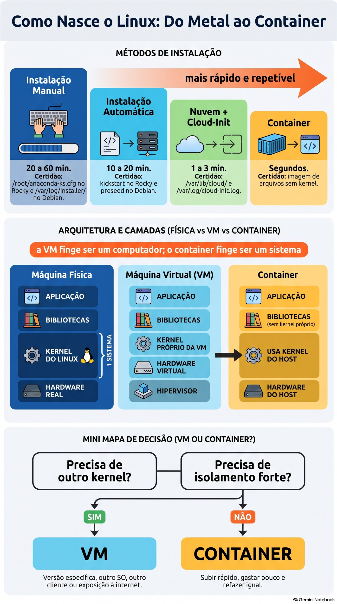
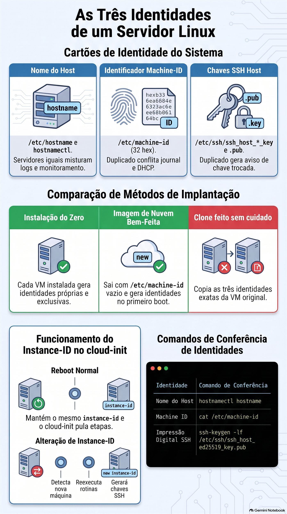
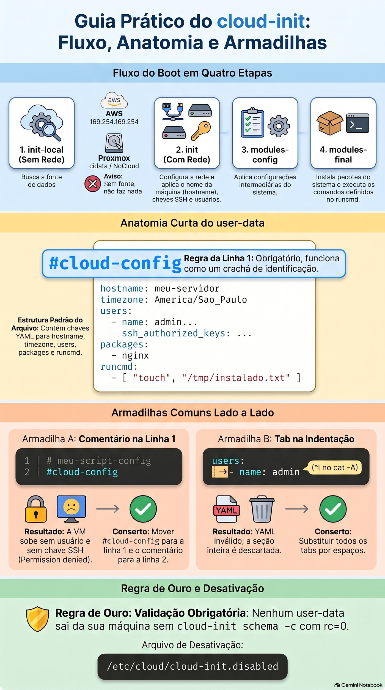

# Aula 2.1 · Instalação e provisionamento

Primeira aula do Módulo 2. Na Aula 0.1 você instalou o Rocky e o Debian à mão, tela por tela. Funcionou, e levou uma hora. Agora imagine o pedido de verdade: "preciso de seis servidores web iguais até amanhã, e daqui a três meses mais seis". Ninguém faz isso pelo instalador. Hoje você aprende as quatro formas de um Linux nascer (instalação manual, instalação automática, imagem de nuvem com cloud-init e container), descobre como cada uma deixa rastro no sistema e, principalmente, aprende a escolher. No fim, você olha para qualquer servidor e diz de onde ele veio.

| Ficha | Aula 2.1 |
| --- | --- |
| Módulo | M2 · Sistema, usuários e permissões, aula 1 de 8 |
| Quando | Semana 4 |
| Ao final você consegue | Dizer se um Linux roda em máquina física, VM ou container, e como ele foi instalado; ler o rastro do instalador no Rocky e no Debian; explicar por que hostname, machine-id e chaves SSH do host precisam ser únicos; escolher entre instalação manual, automática, imagem de nuvem e container para um pedido real; escrever e validar um user-data do cloud-init sem rodá-lo; mostrar, com um comando, que um container usa o kernel do host |
| Itens de prova | LE 014.1 (escolher um sistema, ciclo de vida das distribuições) · LE 011.4 (nuvem e virtualização) · LPIC-1 102.6 (Linux como convidado de virtualização: VM, container, cloud-init, machine-id, chaves SSH do host) · LPIC-1 102.1 (visão inicial do layout de disco) |
| Pré-requisitos | Aulas 0.1 e 0.2 (as VMs e o acesso SSH); Aula 1.10 (`systemd-detect-virt`) |
| Tempo | Cerca de 2h30 |
| Snapshots | m2a1-inicio e m2a1-fim nas duas VMs |

## 1 · Aquecimento

Três perguntas, de cabeça. Escreva as respostas; o Gabarito confere no fim.

1. Na Aula 1.10, o que o `systemd-detect-virt` mostrou nas suas VMs, e o que ele mostraria num servidor físico?
2. Na Aula 0.1, você escolheu no instalador do Rocky o disco, a rede, o fuso e os usuários. Palpite: o instalador guardou essas respostas em algum lugar depois de terminar?
3. Palpite: um container Debian rodando dentro da rocky-lab. O `uname -r` dentro dele mostra o kernel do Debian ou o do Rocky?

## 2 · Por que importa

Num cliente com 40 servidores, um dia alguém pergunta: "esse servidor foi instalado como? Se ele morrer, conseguimos refazer igual?". Se a resposta for "alguém instalou à mão em 2019 e foi mexendo", ninguém sabe refazer. Se for "nasceu de uma imagem com este arquivo de cloud-init, que está no Git", refazer leva dez minutos.

O mesmo vale para o erro mais comum de quem começa a usar virtualização: instalar uma VM caprichada e clonar dez vezes. As dez nascem com o mesmo machine-id, as mesmas chaves SSH do host e o mesmo nome. O monitoramento mistura as máquinas, o SSH do seu notebook grita `REMOTE HOST IDENTIFICATION HAS CHANGED` a cada servidor, e, dependendo do cliente DHCP, duas delas brigam pelo mesmo IP. Tudo isso tem nome, tem causa e tem conserto, e começa nesta aula.

E há a pergunta de todo projeto novo: "isso vira VM ou container?". O DeepTutor que você usa no curso roda num CT do Proxmox, um container. As suas VMs do lab são VMs. Hoje você entende por que cada um está onde está.

## 3 · Modelo mental

> Todo Linux nasce de um destes quatro jeitos, e cada jeito deixa uma certidão de nascimento no disco. Quanto mais para a direita, mais rápido e repetível, e menos você conversa com o instalador.

| Jeito | Como nasce | Quanto demora | Repetível? | Certidão que fica |
| --- | --- | --- | --- | --- |
| Instalação manual | ISO, instalador, você responde as telas | 20 a 60 min | Não: cada uma sai um pouco diferente | `/root/anaconda-ks.cfg` no Rocky, `/var/log/installer/` no Debian |
| Instalação automática | ISO + arquivo de respostas (kickstart no Rocky, preseed no Debian) | 10 a 20 min, sem ninguém olhando | Sim | As mesmas, com as respostas do arquivo |
| Imagem de nuvem + cloud-init | Um disco pronto e genérico; no primeiro boot, o cloud-init lê um arquivo e personaliza | 1 a 3 min | Sim, e é o padrão em nuvem | `/var/lib/cloud/`, `/var/log/cloud-init.log` |
| Container | Uma imagem de arquivos, sem kernel, que roda sobre o kernel do host | Segundos | Sim | `/run/.containerenv` (Podman) ou `/.dockerenv` (Docker); `systemd-detect-virt` diz `podman`, `docker` ou `lxc` |

E onde cada um roda:

```text
  máquina física                VM (KVM no Proxmox)              container
 ┌──────────────────┐        ┌─────────────────────────┐      ┌──────────────────────────┐
 │ aplicação        │        │ aplicação               │      │ aplicação  │ aplicação   │
 │ bibliotecas      │        │ bibliotecas             │      │ bibliotecas│ bibliotecas │
 │ KERNEL do Linux  │        │ KERNEL próprio da VM    │      │ (sem kernel próprio)     │
 │                  │        │ hardware virtual (virtio)│      ├──────────────────────────┤
 │                  │        ├─────────────────────────┤      │ KERNEL do host, um só    │
 │ hardware real    │        │ hipervisor + hardware   │      │ hardware (real ou VM)    │
 └──────────────────┘        └─────────────────────────┘      └──────────────────────────┘
  1 sistema                    vários kernels, isolados         um kernel, vários "mundos"
```

A frase para levar: **a VM finge ser um computador; o container finge ser um sistema**. A VM tem kernel próprio e pode rodar Windows ao lado de Linux. O container divide o kernel do host e só pode rodar Linux sobre Linux, mas sobe em segundos e gasta quase nada.


*Quanto mais à direita, mais rápido e repetível, e menos você conversa com o instalador.*

## 4 · Conceito em camadas

### Essencial

**Escolher um sistema.** Antes de instalar, alguém decidiu *qual* sistema. Para servidor, a pergunta não é "qual é o melhor Linux", e sim "quanto tempo esta versão recebe correções de segurança, e quem me ajuda se der problema":

| Sistema | Ciclo de vida | Quando faz sentido |
| --- | --- | --- |
| Rocky Linux 9 | Correções até maio de 2032, cerca de dez anos por versão maior | Servidores que precisam ficar anos iguais; programas certificados para RHEL |
| Debian 13 | Cerca de três anos de suporte normal e mais dois de LTS, até 2030 | Servidores enxutos, base do Proxmox, quem prefere a comunidade |
| Ubuntu LTS | Cinco anos grátis, mais com assinatura | Nuvem pública, onde é a imagem mais comum |
| Fedora, Arch | Lançamento a cada seis meses, ou contínuo (*rolling*) | Desktop e testes, raramente servidor |
| Windows Server, macOS | Ciclos do fabricante, licença paga | Active Directory e aplicações Windows; macOS quase só no desktop |

**LTS** quer dizer *Long Term Support*: uma versão que recebe correções por muitos anos, sem mudar de versão maior. **Rolling** quer dizer que não existe "versão": o sistema se atualiza continuamente. Em servidor de cliente, você quer LTS.

**As quatro formas de instalar**, na ordem em que você vai encontrá-las:

1. **Manual.** Você boota a ISO e responde o instalador: o Anaconda no Rocky, o `debian-installer` no Debian. Bom para a primeira vez, para um servidor físico único e para aprender. Ruim para fazer de novo igual.
2. **Automática.** O mesmo instalador, mas as respostas vêm de um arquivo. No Rocky, é o **kickstart**; no Debian, o **preseed**. O Anaconda até te dá o primeiro de presente: depois de toda instalação, ele grava as suas respostas em `/root/anaconda-ks.cfg`, pronto para repetir a instalação.
3. **Imagem de nuvem com cloud-init.** Alguém já instalou o sistema, limpou tudo o que é único (nome, chaves, machine-id) e guardou o disco como imagem genérica: `Rocky-9-GenericCloud.qcow2`, `debian-13-genericcloud-amd64.qcow2`. Você cria a VM a partir desse disco. No primeiro boot, o **cloud-init** procura as instruções (nome, usuário, chave SSH, pacotes, rede) e personaliza a máquina. É assim em AWS, Azure, Google Cloud, OpenStack, e também no Proxmox, com o drive de cloud-init que você vai usar no Módulo 29.
4. **Container.** Não se instala sistema. Você baixa uma imagem de arquivos (`debian:trixie`, `rockylinux:9`) e roda um processo isolado sobre o kernel que já existe. Com Podman ou Docker, é um container de **aplicação**: um processo principal, uma função. Com LXC, como os CTs do Proxmox, é um container de **sistema**: tem `systemd`, vários serviços e parece uma VM, mas o kernel continua sendo o do host.

**VM ou container?** Duas perguntas resolvem quase sempre:

- **Precisa de outro kernel?** Windows, um kernel de versão específica, módulos próprios, um firewall com regras de kernel só suas: VM.
- **Precisa de isolamento forte, porque é de outro cliente ou exposto à internet?** Na dúvida, VM. Um erro grave no kernel atinge todos os containers daquele host; numa VM, atinge só a VM.

Se as duas respostas forem "não", e você quer subir rápido, gastar pouco e refazer sempre igual, container.

### Intermediário

**A certidão de nascimento.** Cada forma de instalar deixa pistas. Você vai procurá-las no lab:

| Pista | Onde | O que diz |
| --- | --- | --- |
| `/root/anaconda-ks.cfg` | Rocky | As respostas do instalador, em formato kickstart: idioma, teclado, disco, rede, fuso, pacotes |
| `/var/log/anaconda/` | Rocky | Os logs da instalação, se algo deu errado nela |
| `/var/log/installer/` | Debian | Os logs do `debian-installer`, o resumo do hardware e as respostas |
| `/var/lib/cloud/instance/` | Qualquer um com cloud-init | A instância que o cloud-init configurou e o que ele recebeu |
| `/var/log/cloud-init.log` | Qualquer um com cloud-init | Tudo o que ele fez no boot, passo a passo |
| `stat -c '%w' /` | Qualquer um | A data em que o sistema de arquivos da raiz foi criado, ou seja, a instalação |

**As três identidades de uma instalação.** Todo Linux tem três coisas que precisam ser únicas na rede:

| Identidade | Onde fica | Criada quando | Se dois servidores tiverem a mesma |
| --- | --- | --- | --- |
| Nome (hostname) | `/etc/hostname`; `hostnamectl` mostra | Na instalação, ou pelo cloud-init | Monitoramento e logs misturam as duas máquinas |
| machine-id | `/etc/machine-id`, 32 caracteres hexadecimais | No primeiro boot, se o arquivo estiver vazio | O journal, o DHCP do `systemd-networkd` e outras ferramentas acham que são a mesma máquina; o Debian pode até pegar o mesmo IP |
| Chaves SSH do host | `/etc/ssh/ssh_host_*_key` e `.pub` | Na instalação, ou no primeiro boot | Quem conecta não sabe mais com quem está falando, e o aviso de chave trocada vira ruído que todos ignoram |

Uma imagem de nuvem bem feita sai de fábrica com o `/etc/machine-id` vazio e sem chaves SSH do host, para que cada VM gere as suas no primeiro boot. Um clone feito sem cuidado leva as três identidades da original. O desafio do Módulo 5 é justamente consertar um clone desses.

**Como o cloud-init trabalha.** Ele roda só no boot, em quatro etapas: `init-local` (antes da rede, procura a fonte de dados), `init` (com rede: nome, chaves SSH, usuários), `modules-config` (configurações) e `modules-final` (pacotes e os seus comandos do `runcmd`). A **fonte de dados** (*datasource*) é de onde ele lê as instruções: na AWS, um endereço especial, `169.254.169.254`; no Proxmox, um CD-ROM virtual chamado `cidata` (o tipo *NoCloud*). Se não acha fonte nenhuma, ele não faz nada.

As instruções são o **user-data**, quase sempre um YAML que começa obrigatoriamente com a linha `#cloud-config`:

```yaml
#cloud-config
hostname: web01
timezone: Europe/Rome
users:
  - name: rodrigo
    groups: [wheel]
    sudo: "ALL=(ALL) NOPASSWD:ALL"
    shell: /bin/bash
    ssh_authorized_keys:
      - ssh-ed25519 AAAAC3...sua-chave-publica rodrigo@notebook
packages:
  - chrony
runcmd:
  - [systemctl, enable, --now, chronyd]
```

Linha por linha: o nome da máquina; o fuso; um usuário `rodrigo`, no grupo `wheel` (o grupo do `sudo` no Rocky), com `sudo` sem senha e a sua chave pública; o pacote `chrony` instalado; e um comando no fim do primeiro boot. Repare que não há senha nenhuma: o acesso é só pela chave. É o padrão em nuvem, e é o motivo de o `NOPASSWD` aparecer: o usuário nasce sem senha, então um `sudo` que pedisse senha nunca funcionaria.

**Quando ele roda de novo?** O cloud-init guarda o *instance-id* da fonte de dados. Num reboot normal, o id é o mesmo, e ele pula quase tudo. Se o id muda, como num clone que recebe um drive de cloud-init novo, ele acha que é uma máquina nova e roda tudo de novo, inclusive gerando chaves SSH novas. É assim que imagens de nuvem nunca têm o problema dos clones.

### Ponte Windows

| No Windows | No Linux | O que muda |
| --- | --- | --- |
| Instalar pelo `setup.exe` da ISO | Anaconda ou `debian-installer` | Quase nada |
| `unattend.xml` (instalação automática) | Kickstart no Rocky, preseed no Debian | O formato. A ideia é a mesma: um arquivo de respostas |
| `sysprep /generalize` e uma imagem | Imagem de nuvem genérica + `cloud-init` | O Linux não tem SID; o problema equivalente são o machine-id e as chaves SSH do host |
| SID duplicado em clones | machine-id e chaves SSH duplicados | Mesma doença, mesmo remédio: limpar antes de virar imagem |
| Hyper-V | KVM, que o Proxmox usa | Os dois são hipervisores de tipo 1 |
| WSL2 | Uma VM leve com kernel Linux de verdade | Por isso o `uname -r` no WSL2 mostra um kernel `microsoft-standard` |
| Contêiner do Windows Server | Podman, Docker, LXC | No Linux, container é o dia a dia; no Windows, é raro |

### Avançado

**Tipos de hipervisor.** Tipo 1 roda direto no hardware: KVM (e portanto o Proxmox), VMware ESXi, Hyper-V, Xen. Tipo 2 roda como programa dentro de outro sistema: VirtualBox, VMware Workstation. O KVM é um módulo do kernel Linux; o kernel do host vira o hipervisor.

**Paravirtualização.** Uma VM pode fingir hardware antigo, que todo sistema conhece (uma placa de rede e1000, um disco IDE), ou usar dispositivos feitos para virtualização, os **virtio**, que exigem driver no convidado e são muito mais rápidos. O Linux já traz os drivers virtio no kernel. Esses drivers são os *guest drivers* da prova, junto com o **guest agent** (`qemu-guest-agent`), que você instalou na Aula 0.2 para o Proxmox conversar com a VM.

**O kickstart como documentação.** O `/root/anaconda-ks.cfg` é um arquivo de texto que reproduz a sua instalação. Servido por HTTP e passado no boot com `inst.ks=http://servidor/ks.cfg`, ele instala o próximo Rocky sozinho. No Debian, o equivalente é `preseed/url=http://servidor/preseed.cfg`. Em empresas com servidores físicos, é assim que se instala: boot pela rede (PXE) e um kickstart por tipo de servidor.

**O cloud-init no Proxmox.** O Proxmox gera o user-data a partir dos campos da VM (`ciuser`, `sshkeys`, `ipconfig0`) e grava num pequeno CD-ROM virtual. Para um user-data seu, completo, existe a opção `--cicustom`. Você monta isso no Módulo 29, com template e `qm clone`.

**Desligar o cloud-init.** Um arquivo vazio em `/etc/cloud/cloud-init.disabled` impede o cloud-init de rodar no boot, mesmo instalado. É o jeito seguro de ter o pacote numa VM que não deve ser reconfigurada, e você vai usá-lo no lab.

### O que cai na prova

- **LE 014.1**: diferenças entre Windows, macOS e Linux; distribuições; o que é LTS e ciclo de vida; quando escolher cada um.
- **LE 011.4**: nuvem e virtualização em linhas gerais; a diferença entre VM e container.
- **LPIC-1 102.6**: VM e container (de sistema e de aplicação); os elementos de uma VM na nuvem (computação, disco, rede); o que precisa mudar num clone (nome, machine-id, chaves SSH do host, e o D-Bus machine id, que é o mesmo `/etc/machine-id`); imagens; os drivers do convidado; o cloud-init.
- **LPIC-1 102.1**: você vai ver o layout que o instalador escolheu. O detalhe de partições e LVM fica para o Módulo 9.

## 5 · Rocky × Debian

| O quê | Rocky 9 | Debian 13 |
| --- | --- | --- |
| Instalador | Anaconda (gráfico ou texto) | `debian-installer` (texto ou gráfico) |
| Arquivo de respostas | Kickstart | Preseed |
| Rastro da instalação | `/root/anaconda-ks.cfg` e `/var/log/anaconda/` | `/var/log/installer/` |
| Layout padrão do disco | LVM: `rl-root`, `rl-swap`, `/boot` e `/boot/efi` | Partições simples, ou LVM se você escolheu |
| Grupo do `sudo` | `wheel` | `sudo` |
| Usuário padrão da imagem de nuvem | `rocky` | `debian` |
| Instalar o cloud-init | `sudo dnf install -y cloud-init` | `sudo apt install -y --no-install-recommends cloud-init` |
| Instalar o Podman | `sudo dnf install -y podman` | `sudo apt install -y podman` |

## 6 · Lab guiado

O roteiro: primeiro você descobre de onde as suas duas VMs vieram, como se fossem servidores de um cliente novo. Depois escolhe o jeito certo de instalar para um pedido real, prepara o cloud-init sem deixar que ele mexa em nada, escreve e valida um user-data, e termina vendo um container dividir o kernel com a VM.

### Passo 1 · Snapshot e a primeira pergunta: onde estou?

No nó Proxmox, antes de tudo:

```bash
qm snapshot 201 m2a1-inicio
qm snapshot 202 m2a1-inicio
```

Entre na rocky-lab por SSH e pergunte onde você está:

```bash
systemd-detect-virt; echo "rc=$?"
systemd-detect-virt --container; echo "rc=$?"
hostnamectl
```

Saída esperada: `kvm` com `rc=0`, depois `none` com `rc=1`. A primeira linha diz que há um hipervisor por baixo; a segunda, que você não está dentro de um container. No `hostnamectl`, procure três linhas: `Chassis: vm`, `Virtualization: kvm` e `Hardware Vendor: QEMU`. O "fabricante" do seu computador é o programa que o finge.

Faça o mesmo na debian-lab. As respostas são iguais: as duas são VMs do mesmo Proxmox.

### Passo 2 · A certidão de nascimento

Na rocky-lab:

```bash
sudo ls -l /root/anaconda-ks.cfg
sudo grep -E '^(lang|keyboard|timezone|network|ignoredisk|autopart|part|volgroup|logvol)' /root/anaconda-ks.cfg
sudo ls /var/log/anaconda/
stat -c '%w' /
```

O `ls -l` mostra `-rw-------`: só o root lê. O `grep` mostra as suas respostas da Aula 0.1, em formato kickstart: o idioma, o teclado, o fuso `Europe/Rome`, a placa `enp6s18`, o disco e o particionamento. A última linha mostra a data e a hora em que o sistema de arquivos da raiz foi criado: o dia da instalação.

Repare no que o `grep` **não** mostra: as linhas `rootpw` e `user`. Elas guardam o hash das senhas, e é por isso que o arquivo é só do root. Na vida real, quem copia um `anaconda-ks.cfg` para usar como modelo apaga essas linhas antes de colocá-lo num servidor web ou no Git.

Na debian-lab:

```bash
sudo ls /var/log/installer/
sudo cat /var/log/installer/lsb-release
sudo grep -i -m3 -E 'ethernet|scsi' /var/log/installer/hardware-summary
stat -c '%w' /
```

O `debian-installer` guarda outra coisa: não um arquivo para repetir a instalação, e sim o diário dela. O `syslog` tem tudo o que aconteceu; o `hardware-summary`, o hardware que ele achou, aqui as placas virtio do Proxmox; o `lsb-release`, a versão do instalador. A pasta `cdebconf/` tem as respostas, inclusive as senhas, e fica de fora deste passo pelo mesmo motivo do `rootpw`.

Se o `stat -c '%w' /` mostrar `-`, o sistema de arquivos não guarda a data de criação. Use a pasta do instalador: `ls -ld --time-style=long-iso /var/log/installer` no Debian, ou `rpm -qi basesystem | grep 'Install Date'` no Rocky.

### Passo 3 · As três identidades

Nas duas VMs, uma de cada vez:

```bash
hostnamectl hostname
cat /etc/machine-id
ssh-keygen -lf /etc/ssh/ssh_host_ed25519_key.pub
```

Anote as três respostas de cada VM, lado a lado. O nome é diferente, o machine-id é diferente (32 caracteres hexadecimais) e a impressão digital da chave SSH do host (`SHA256:...`) é diferente. É assim que deve ser: as duas foram instaladas do zero, e cada instalação gerou as suas.

Agora uma pergunta para pensar, sem comando: lembra da primeira vez que você entrou em cada VM por SSH, na Aula 0.2? O cliente perguntou `Are you sure you want to continue connecting (yes/no)?` e mostrou uma impressão digital. Era esta. O seu notebook guardou a chave em `~/.ssh/known_hosts`, e a partir dali confere a cada conexão.

### Passo 4 · O desafio, antes da solução

Sem olhar a seção 4, responda por escrito: se você desligar a debian-lab, clonar a VM no Proxmox e ligar o clone, quais das três identidades o clone terá **iguais** às da original? E o que o seu notebook vai dizer quando você entrar por SSH no IP do clone, se ele pegar o mesmo IP da original?

Confira com a tabela das três identidades, na seção 4. Você não vai clonar hoje: isso é o desafio do Módulo 5.

**Decida 1 · Os seis servidores.** Um cliente pede, para amanhã, seis servidores web Rocky iguais no Proxmox dele. Daqui a três meses, quer mais seis, iguais aos primeiros. Como você faz?

- **A)** Instala à mão pela ISO, seis vezes, com cuidado e uma lista do que escolher em cada tela.
- **B)** Instala um à mão, deixa redondo e clona cinco vezes no Proxmox.
- **C)** Usa a imagem de nuvem do Rocky e um user-data do cloud-init guardado no Git, com o nome de cada servidor mudando.
- **D)** Cria uma VM só e roda os seis servidores web como seis containers dentro dela.

Escolha a letra antes de olhar a tabela.

| Se você marcou | Resultado | Por quê |
| --- | --- | --- |
| A | ❌ Errada | Funciona, mas leva seis horas, e os seis saem um pouco diferentes: uma tela respondida de outro jeito, um pacote a mais. Daqui a três meses, ninguém lembra das escolhas. |
| B | ❌ Errada | Rápido, mas os seis clones nascem com o mesmo machine-id e as mesmas chaves SSH do host da original, e com o mesmo nome. Dá para consertar à mão, e é o que se esquece de fazer. |
| C | ✅ Certa | Cada VM nasce da mesma imagem limpa, gera identidades próprias no primeiro boot e recebe nome, usuário, chave e pacotes do mesmo arquivo. Daqui a três meses, o mesmo arquivo faz mais seis iguais em minutos. |
| D | ❌ Errada | Pode ser uma boa arquitetura um dia, mas não é o pedido: o cliente quer seis servidores. E os seis dividem um kernel e uma VM; se ela cair, caem todos. |

**Para fixar:** clonar copia tudo, até o que precisa ser único. Uma imagem de nuvem é um clone que sabe que é clone.


*Nome, machine-id e chaves SSH: três identidades que um clone descuidado copia junto.*

### Passo 5 · O cloud-init, com o cinto antes

Você vai instalar o cloud-init nas duas VMs para usar o validador dele. Mas as VMs já estão configuradas, e o cloud-init não deve mexer em nada nelas. Então, **antes** de instalar, o arquivo que o desliga.

Na rocky-lab:

```bash
sudo mkdir -p /etc/cloud
sudo touch /etc/cloud/cloud-init.disabled
sudo dnf install -y cloud-init
cloud-init --version
cloud-init status --long
```

Na debian-lab, as mesmas linhas, trocando o `dnf` por:

```bash
sudo apt install -y --no-install-recommends cloud-init
```

O `status` deve mostrar `status: disabled` e, nas linhas de baixo, o motivo: o arquivo `/etc/cloud/cloud-init.disabled`. Enquanto ele existir, o cloud-init fica instalado e não roda no boot. Sem ele, num boot futuro, o cloud-init procuraria uma fonte de dados; nas suas VMs não há nenhuma, e ele provavelmente não faria nada. "Provavelmente" não serve em servidor de cliente. O arquivo transforma o "provavelmente" em "com certeza".

### Passo 6 · Escrever e validar um user-data

Na rocky-lab:

```bash
mkdir -p ~/lab21
cd ~/lab21
cat > user-data.yaml <<'EOF'
#cloud-config
hostname: web01
timezone: Europe/Rome
users:
  - name: rodrigo
    groups: [wheel]
    sudo: "ALL=(ALL) NOPASSWD:ALL"
    shell: /bin/bash
    ssh_authorized_keys:
      - ssh-ed25519 AAAAC3NzaC1lZDI1NTE5AAAAIexemploexemploexemploexemploexemplo rodrigo@notebook
packages:
  - chrony
runcmd:
  - [systemctl, enable, --now, chronyd]
EOF
cloud-init schema -c user-data.yaml; echo "rc=$?"
```

A resposta tem `Valid schema` e `rc=0`. O validador confere o YAML e se cada chave existe e tem o tipo certo. Ele não confere se a chave SSH é de verdade: para isso, troque a linha do exemplo pela sua chave pública (o conteúdo do `.pub` do seu notebook, aquele da Aula 0.2). Chave pública pode ir para o Git; a privada, nunca.

O arquivo não foi usado por ninguém: o cloud-init está desligado, e o `schema` só lê. É assim que se trabalha: o user-data é escrito e validado na sua máquina, guardado no Git, e só depois entregue a uma VM nova.

**O seu desafio.** Faça agora o `user-data-debian.yaml`, para um servidor Debian chamado `web02`. O que muda? Pense no grupo do `sudo` (seção 5) e no nome do pacote do relógio, que no Debian também é `chrony`, mas o serviço se chama `chrony`, não `chronyd`. Valide com o `schema` até dar `rc=0`. A resposta está no Gabarito.

### Passo 7 · Um container ao lado da VM

Na rocky-lab:

```bash
sudo dnf install -y podman
uname -r
podman run --rm docker.io/library/debian:trixie uname -r
podman run --rm docker.io/library/debian:trixie grep PRETTY_NAME /etc/os-release
podman run --rm docker.io/library/debian:trixie ls -l /run/.containerenv
```

A primeira vez baixa a imagem do Debian, uns 50 MB; as outras sobem em menos de um segundo. Compare as duas primeiras linhas de saída: o `uname -r` da VM e o do container são **o mesmo**, um kernel `el9` do Rocky. O container diz que é `Debian GNU/Linux 13 (trixie)`, porque os arquivos dele são do Debian, mas quem roda tudo é o kernel da rocky-lab. O arquivo `/run/.containerenv` é a marca que o Podman deixa dentro de todo container; é nele que o `systemd-detect-virt` se baseia para responder `podman`.

Faça o espelho na debian-lab, se quiser ver o contrário:

```bash
sudo apt install -y podman
podman run --rm quay.io/rockylinux/rockylinux:9 grep PRETTY_NAME /etc/os-release
podman run --rm quay.io/rockylinux/rockylinux:9 uname -r
```

Um "Rocky" com kernel do Debian. O `--rm` apaga o container quando ele termina; a imagem fica guardada para a próxima vez. Imagens, camadas e registries são assunto do Módulo 18. Hoje basta a frase da seção 3: a VM finge ser um computador, o container finge ser um sistema.

## 7 · Quebre e conserte

### Quebra A · O user-data que ninguém leu

Um colega gosta de arquivos bem documentados e começou o user-data com um comentário. Faça como ele, na rocky-lab:

```bash
cd ~/lab21
{ echo '# user-data do web01 - mantido pela equipe'; cat user-data.yaml; } > user-data-colega.yaml
head -3 user-data-colega.yaml
```

**Observe.**

```bash
cloud-init schema -c user-data-colega.yaml; echo "rc=$?"
```

O validador recusa, com `rc=1`, e diz que o arquivo precisa **começar** com `#cloud-config`. O YAML está perfeito; o conteúdo, também.

**Diagnostique.** O `#cloud-config` parece um comentário, e para o YAML ele é. Para o cloud-init, é outra coisa: a primeira linha do user-data diz **que tipo de arquivo é aquele**. Pode ser `#cloud-config`, pode ser `#!/bin/bash` (um script, que ele só executa), pode ser outros formatos. O cloud-init lê a primeira linha, e só ela, para decidir. Com um comentário qualquer ali, ele não reconhece o tipo.

E aqui mora o perigo: o validador reclamou porque você perguntou a ele. Numa VM de verdade, ninguém pergunta. O cloud-init registra um aviso no log dele, a VM sobe normalmente, e sobe **sem o seu usuário, sem a sua chave e sem o nome**. Você tenta o SSH e leva `Permission denied`, sem nenhuma pista de por quê.

**Decida A · O conserto.** O que resolve?

- **A)** Mover o `#cloud-config` para a linha 1 e o comentário do colega para a linha 2.
- **B)** Renomear o arquivo para `user-data.yml`, que é a extensão que o cloud-init espera.
- **C)** Colocar `---`, o marcador de início de documento YAML, na primeira linha.
- **D)** Na VM nova, rodar `sudo cloud-init clean` e reiniciar, para ele ler de novo.

Escolha a letra antes de olhar a tabela.

| Se você marcou | Resultado | Por quê |
| --- | --- | --- |
| A | ✅ Certa | O tipo é decidido pela primeira linha, e só por ela. Depois do `#cloud-config`, pode haver quantos comentários você quiser. |
| B | ❌ Errada | O cloud-init não olha extensão. No Proxmox e no NoCloud, o arquivo nem tem extensão: chama-se `user-data`. |
| C | ❌ Errada | Agora a primeira linha é `---`, e o cloud-init continua sem saber o tipo. O YAML aceita o `---`, mas quem decide é a primeira linha. |
| D | ❌ Errada | Ele vai ler o mesmo arquivo e chegar à mesma conclusão. Rodar de novo um arquivo errado dá o mesmo erro, só que mais tarde. |

**Para fixar:** `#cloud-config` não é comentário, é crachá. Linha 1, sozinho, sem espaço antes nem depois.

**Conserte.**

```bash
{ echo '#cloud-config'; echo '# user-data do web01 - mantido pela equipe'; tail -n +3 user-data-colega.yaml; } > user-data-colega.ok
mv user-data-colega.ok user-data-colega.yaml
head -3 user-data-colega.yaml
cloud-init schema -c user-data-colega.yaml; echo "rc=$?"
```

O `tail -n +3` pega o arquivo a partir da linha 3, pulando o comentário e o `#cloud-config` antigo. Agora: `Valid schema` e `rc=0`. Repare que você escreveu num arquivo novo e só depois trocou: ler e escrever no mesmo arquivo, na mesma linha, apaga o arquivo antes de lê-lo.

### Quebra B · O tab invisível

Outro colega editou o user-data num editor que coloca tab quando se aperta a tecla Tab. Reproduza o estrago:

```bash
cp user-data.yaml user-data-tab.yaml
sed -i 's/^    shell:/\tshell:/' user-data-tab.yaml
cat user-data-tab.yaml
```

No `cat`, o arquivo parece igual; no máximo, a linha do `shell` um pouco desalinhada.

**Observe.**

```bash
cloud-init schema -c user-data-tab.yaml; echo "rc=$?"
```

`rc=1`. A mensagem diz que o arquivo não é um YAML válido e aponta `found character '\t' that cannot start any token`, com o número da linha.

**Diagnostique.** Peça para ver o invisível:

```bash
cat -A user-data-tab.yaml | grep -n '\^I'
```

O `cat -A` mostra todo caractere escondido: o tab vira `^I`, e o fim da linha vira `$`. A linha 8 começa com `^Ishell:`. O YAML usa **espaços** para dizer quem está dentro de quem, e proíbe tab na indentação. Não é implicância: um tab vale 4 colunas num editor e 8 no outro, e o YAML se recusa a adivinhar.

**Decida B · O conserto.** O que resolve?

- **A)** Trocar o tab por quatro espaços, alinhando o `shell:` com o `sudo:` de cima.
- **B)** Trocar a indentação das outras linhas por tabs também, para ficar tudo igual.
- **C)** Colocar o valor entre aspas: `shell: "/bin/bash"`.
- **D)** Ignorar o validador: o cloud-init é tolerante e se vira na hora.

Escolha a letra antes de olhar a tabela.

| Se você marcou | Resultado | Por quê |
| --- | --- | --- |
| A | ✅ Certa | Com espaços, e no mesmo nível das irmãs, o `shell` volta a ser parte do usuário `rodrigo`. |
| B | ❌ Errada | Tab é proibido em qualquer indentação YAML. Você multiplicou o erro. |
| C | ❌ Errada | O problema está antes do `shell`, no começo da linha. Aspas protegem valores, não indentação. |
| D | ❌ Errada | O cloud-init usa o mesmo leitor de YAML do validador. Se o arquivo não abre, a seção inteira é descartada: nenhum usuário, nenhum pacote, nada. |

**Para fixar:** YAML se indenta com espaço, nunca com tab. Quando um YAML "certo" é recusado, o primeiro comando é `cat -A`.

**Conserte.**

```bash
sed -i 's/^\t/    /' user-data-tab.yaml
cat -A user-data-tab.yaml | grep -c '\^I'
cloud-init schema -c user-data-tab.yaml; echo "rc=$?"
```

O `grep -c` conta `0` tabs, e o validador volta a `Valid schema`. Para não acontecer de novo no seu `vim`, o Módulo 3 mostra como configurar o editor para trocar tab por espaço sozinho.

### A lição

As duas quebras de hoje têm a mesma cara: um arquivo que **parece certo** e que o cloud-init, de verdade, ignoraria. E ele ignora em silêncio, porque roda no primeiro boot, sem ninguém olhando, numa VM que você ainda não consegue acessar. O preço de um user-data errado não é uma mensagem de erro; é uma VM inacessível e um diagnóstico pelo console do Proxmox. A regra prática: **nenhum user-data sai da sua máquina sem `cloud-init schema -c` com `rc=0`**. Leva um segundo. Na Aula 0.2 você aprendeu a testar a conexão antes de fechar a sessão; aqui é o mesmo instinto, antes de criar a VM.



*O cloud-init roda uma vez, sem ninguém olhando: valide o user-data antes, porque depois ele erra em silêncio.*

## 8 · Armadilhas

| Você digita ou vê | O que acontece | O certo |
| --- | --- | --- |
| Clonar uma VM pronta e ligar o clone | Mesmo machine-id, mesmas chaves SSH do host, mesmo nome | Usar imagem com cloud-init, ou limpar as identidades antes (Módulo 5) |
| `users:` sem a linha `- default` | O usuário padrão da imagem (`rocky`, `debian`) deixa de ser criado | Se quiser os dois, comece a lista com `- default` |
| `sudo: "ALL=(ALL) NOPASSWD:ALL"` em todo servidor | Quem roubar a sua chave SSH vira root sem senha nenhuma | Aceitável em lab e em VM descartável; em produção, discutir com a equipe |
| Comentário antes do `#cloud-config` | O cloud-init não reconhece o arquivo e a VM sobe sem nada | `#cloud-config` sempre na linha 1 |
| Tab na indentação do YAML | O arquivo inteiro é recusado | Só espaços; conferir com `cat -A` |
| Instalar o cloud-init num servidor já configurado | No próximo boot, ele pode tentar configurar a máquina | `touch /etc/cloud/cloud-init.disabled` antes de instalar |
| `rm /etc/machine-id` para "gerar outro" | Alguns serviços quebram no boot por falta do arquivo | Esvaziar com `truncate -s 0 /etc/machine-id`; o systemd gera no boot (Módulo 5) |
| Um container por cliente "para isolar" | Todos dividem o mesmo kernel; uma falha nele expõe todos | Isolamento forte entre clientes é VM |
| Distribuição rolling num servidor de cliente | Atualizações grandes a qualquer momento, sem janela | LTS: Rocky, Debian estável, Ubuntu LTS |
| `cat /root/anaconda-ks.cfg` colado num chamado ou no Git | Expõe o hash das senhas | Apagar as linhas `rootpw` e `user` antes de copiar |
| `uname -r` dentro de um container para saber o sistema | Mostra o kernel do host, não o do container | `cat /etc/os-release` |
| Achar que a chave privada vai no user-data | Vazamento: ela fica gravada na VM e no Git | No user-data, só a chave **pública** |

## 9 · Quiz

Dez perguntas, sem consultar. Escreva a letra ou a resposta de cada uma e só depois abra o Gabarito.

**1.** Num servidor Rocky instalado pela ISO, qual arquivo guarda as respostas da instalação, em formato kickstart, prontas para repetir?

- **A)** `/var/log/installer/syslog`
- **B)** `/etc/kickstart.conf`
- **C)** `/root/anaconda-ks.cfg`
- **D)** `/var/lib/cloud/instance/user-data.txt`

**2.** Você roda `uname -r` dentro de um container Debian, num host Rocky 9. O que aparece?

- **A)** O kernel do Debian 13
- **B)** O kernel do Rocky 9, porque o container usa o kernel do host
- **C)** Nada: containers não têm kernel e o comando falha
- **D)** A versão do Podman

**3.** Qual deve ser a primeira linha de um user-data no formato de configuração do cloud-init?

**4.** Quais destes são hipervisores do tipo 1, que rodam direto no hardware?

- **A)** VirtualBox e VMware Workstation
- **B)** KVM (no Proxmox), Hyper-V e VMware ESXi
- **C)** Podman e Docker
- **D)** WSL1 e Wine

**5.** O que `systemd-detect-virt` responde dentro de um container LXC do Proxmox?

- **A)** `kvm`
- **B)** `none`
- **C)** `lxc`
- **D)** `proxmox`

**6.** Cite as três identidades que um clone de VM herda da original e que precisam ser únicas.

**7.** Por que as imagens de nuvem oficiais do Rocky e do Debian vêm sem senha de root e sem usuário com senha?

**8.** Até quando o Rocky Linux 9 recebe atualizações de segurança, e por que isso pesa na escolha para um cliente?

**9.** Você precisa do validador do cloud-init num servidor que já está em produção. O que faz antes de instalar o pacote, e por quê?

**10.** *Which file holds the unique identifier used by systemd and D-Bus to identify a Linux installation, and must be regenerated when a VM is cloned?*

- **A)** `/etc/hostname`
- **B)** `/etc/machine-id`
- **C)** `/var/lib/cloud/instance-id`
- **D)** `/etc/ssh/ssh_host_ed25519_key`
- **E)** `/proc/sys/kernel/random/uuid`

## 10 · Flashcards e cola

### Para saber de cor

- `systemd-detect-virt` responde `kvm`, `lxc`, `podman`... ou `none`, com código 1, numa máquina física.
- A certidão: `/root/anaconda-ks.cfg` no Rocky, `/var/log/installer/` no Debian, `/var/lib/cloud/` numa VM de imagem.
- As três identidades únicas: nome (`hostnamectl`), `/etc/machine-id` e as chaves `/etc/ssh/ssh_host_*`.
- User-data: linha 1 é `#cloud-config`; indentação só com espaços; validar com `cloud-init schema -c arquivo`.
- `/etc/cloud/cloud-init.disabled` desliga o cloud-init antes que ele mexa em algo.
- A VM finge ser um computador (kernel próprio); o container finge ser um sistema (kernel do host).

### Para consultar

| Pergunta | Comando ou arquivo |
| --- | --- |
| Física, VM ou container? | `systemd-detect-virt`; `hostnamectl` |
| Quem fabricou o "hardware"? | `cat /sys/class/dmi/id/sys_vendor` |
| Quando foi instalado? | `stat -c '%w' /`; `ls -ld --time-style=long-iso /var/log/installer` |
| Como foi instalado (Rocky)? | `sudo grep -v -E '^(rootpw\|user)' /root/anaconda-ks.cfg` |
| Como foi instalado (Debian)? | `sudo ls /var/log/installer/` |
| Veio de imagem com cloud-init? | `cloud-init status --long`; `ls /var/lib/cloud/instance` |
| Qual user-data a VM recebeu? | `sudo cat /var/lib/cloud/instance/user-data.txt` |
| Impressão digital da chave do host | `ssh-keygen -lf /etc/ssh/ssh_host_ed25519_key.pub` |
| Estou num container Podman? | `ls /run/.containerenv` |
| Até quando a versão tem suporte? | Página de ciclo de vida da distribuição; `cat /etc/os-release` para saber a versão |

### Flashcards

| Frente | Verso |
| --- | --- |
| Quatro formas de instalar | Manual pela ISO, automática (kickstart/preseed), imagem + cloud-init, container |
| Kickstart é de quem? | Do instalador Anaconda: Rocky, RHEL, Fedora. Boot com `inst.ks=` |
| Preseed é de quem? | Do debian-installer. Boot com `preseed/url=` |
| Hipervisor tipo 1 × tipo 2 | Tipo 1 roda no hardware (KVM, ESXi, Hyper-V); tipo 2 roda sobre um sistema (VirtualBox, Workstation) |
| O que o container divide com o host? | O kernel. Tem os próprios arquivos, processos e rede, mas não o próprio kernel |
| Por que imagem de nuvem não tem senha? | Uma senha embutida seria igual em todas as cópias. O acesso vem pela chave do user-data |
| Datasource | Onde o cloud-init busca os dados: `169.254.169.254` na nuvem, disco `cidata` (NoCloud) no Proxmox |
| `instance-id` | Se muda, o cloud-init entende "máquina nova" e roda de novo os módulos de primeiro boot |
| LTS × rolling | LTS: versão fixa, só correções, por anos. Rolling: sempre a última, sem versão |
| `Valid schema` | Resposta do `cloud-init schema -c` quando o user-data está certo |

## 11 · Checklist de saída

- [ ] Digo, em qualquer servidor, se ele é físico, VM ou container, e com qual comando.
- [ ] Encontro a certidão de nascimento de um Rocky e de um Debian, e sei o que não copiar dela.
- [ ] Explico as três identidades e o que acontece com elas num clone.
- [ ] Escolho entre instalação manual, automática, imagem com cloud-init e container, e justifico.
- [ ] Escrevo um user-data com usuário, chave, fuso e pacote, e valido com `rc=0`.
- [ ] Reconheço na hora as duas quebras de hoje: crachá fora da linha 1 e tab na indentação.
- [ ] Mostro, com dois comandos, que um container usa o kernel do host.

**Último exercício, sem olhar.** Numa folha, ou no `vim` se já se sente à vontade, escreva do zero o `user-data-debian.yaml` do desafio do Passo 6: servidor `web02`, usuário `rodrigo` com a sua chave pública e sudo, fuso `Europe/Rome`, pacote `chrony` com o serviço ligado. Depois valide na debian-lab:

```bash
cloud-init schema -c ~/lab21/user-data-debian.yaml; echo "rc=$?"
```

Só abra o Gabarito depois do `rc=0`, ou depois de três tentativas.

**Snapshots de fechamento.** No nó Proxmox:

```bash
qm snapshot 201 m2a1-fim
qm snapshot 202 m2a1-fim
```

## 12 · Na vida real

**Missão da semana, só leitura.** Escolha três servidores reais que você administra ou acompanha: um físico, uma VM e, se houver, um container. Em cada um, sem `sudo` quando der e sem mudar nada:

1. `systemd-detect-virt` e `hostnamectl`: o que ele é, e quem é o "fabricante".
2. `ls -l /root/anaconda-ks.cfg /var/log/installer 2>/dev/null`: como nasceu. Sem acesso de root, o `ls` de `/root` falha, e isso também é uma resposta.
3. `cloud-init status 2>/dev/null` e `ls /var/lib/cloud/instance 2>/dev/null`: veio de imagem?
4. `stat -c '%w' /`: quando nasceu.
5. `grep PRETTY_NAME /etc/os-release`: qual versão, e até quando ela tem suporte.
6. No Proxmox do cliente, se tiver acesso de leitura: `qm list` e `pct list`, para ver quantas VMs e quantos containers convivem ali.

**Para o diário.** Uma linha por servidor, no formato: `nome · física/VM/container · como foi instalado · data · fim do suporte`. Se dois servidores tiverem o mesmo `machine-id`, anote com destaque: você acabou de achar um clone mal feito, e o Módulo 5 ensina a consertar. Não corrija nada esta semana; só registre.

**Desafio da semana.** De todos os servidores que você olhou, qual é o que tem o fim de suporte mais próximo? Escreva duas frases para o responsável: qual é a data e o que acontece se nada for feito até lá. Não envie ainda; guarde para quando o assunto aparecer.

**Amanhã, sem olhar.** Antes de abrir o terminal, responda de cabeça: qual comando diz se você está numa VM? Onde fica a certidão no Rocky, e no Debian? Quais são as três identidades de um servidor? Qual é a primeira linha de um user-data? Se errar alguma, volte à seção 10, não à aula inteira.

## 13 · Com o DeepTutor

Use o DeepTutor da sua rede local depois do lab, não no lugar dele. Os comandos começam com `!`:

- `!quiz Aula 2.1`: dez perguntas novas sobre instalação, VM, container e cloud-init.
- `!explica cloud-init`: o caminho do primeiro boot, do datasource ao `runcmd`, em linguagem simples.
- `!feynman VM e container`: você explica a diferença e ele aponta onde ficou vago.
- `!quebra user-data`: ele te entrega um user-data com um defeito escondido para você achar com `cat -A` e o `schema`.
- `!simulado LPIC-1 102.6`: questões no estilo da prova sobre Linux como sistema virtualizado.
- `!cartoes Aula 2.1`: os flashcards da seção 10, em ordem de revisão.
- `!erro`: cole uma mensagem do `cloud-init schema` e ele explica a linha.
- `!revisao`: o que rever desta aula e das anteriores, pelo que você errou até agora.

## Gabarito comentado

### Aquecimento

1. Nas suas VMs, `kvm`, com código 0. Numa máquina física, `none`, com código 1: o comando não "falha", ele responde que não há virtualização, e o código 1 é a forma de dizer "não" aos scripts. Num container LXC do Proxmox, `lxc`.
2. Sim. O Anaconda gravou `/root/anaconda-ks.cfg`, um kickstart pronto para repetir a instalação. O debian-installer gravou o diário em `/var/log/installer/`, com as respostas em `cdebconf/`.
3. O kernel da rocky-lab, um `el9`. O container tem os arquivos do Debian, mas quem roda os processos dele é o kernel do host. Foi o que você viu no Passo 7.

### Quiz

1. **C.** O `/var/log/installer/syslog` é do Debian; o `user-data.txt` é de VM criada por imagem; `/etc/kickstart.conf` não existe.
2. **B.** Um container não tem kernel próprio. O comando funciona e mostra o kernel do host.
3. `#cloud-config`, sozinho, na linha 1. Com qualquer outra coisa antes, o cloud-init não reconhece o arquivo.
4. **B.** VirtualBox e Workstation são tipo 2; Podman e Docker são containers; WSL1 e Wine traduzem chamadas, não virtualizam.
5. **C.** `lxc`. O `none` seria a resposta numa máquina física ou numa VM perguntada com `--container`.
6. O nome (hostname), o `/etc/machine-id` e as chaves SSH do host em `/etc/ssh/ssh_host_*`. Se o clone pegar o mesmo IP por DHCP, também o IP, porque alguns clientes DHCP usam o machine-id para se identificar.
7. Porque toda cópia da imagem teria a mesma senha, e ela estaria publicada na internet junto com a imagem. O acesso é entregue na criação, pela chave pública do user-data.
8. Até maio de 2032. Um servidor de cliente costuma viver cinco anos ou mais; escolher uma versão no fim do suporte é contratar uma migração para daqui a pouco.
9. Cria `/etc/cloud/cloud-init.disabled` com `sudo touch`. Assim o cloud-init fica instalado, o validador funciona, e no próximo boot ele não tenta configurar uma máquina que já está configurada.
10. Tabela abaixo.

| Se você marcou | Resultado | Por quê |
| --- | --- | --- |
| A | ❌ Errada | `/etc/hostname` é o nome, uma das três identidades, mas não é o identificador do systemd e do D-Bus. |
| B | ✅ Certa | O `/etc/machine-id` tem 32 caracteres hexadecimais gerados na instalação; o journal, o DHCP e outros serviços o usam. Num clone, esvazia-se o arquivo para o systemd gerar outro no boot. |
| C | ❌ Errada | O `instance-id` é do cloud-init e vem do datasource, de fora da VM; não é ele que o systemd usa. |
| D | ❌ Errada | É a chave privada do host SSH. Também precisa ser única num clone, mas é outra identidade. |
| E | ❌ Errada | Esse arquivo devolve um UUID novo a cada leitura. É um gerador, não um identificador. |

### Último exercício

```yaml
#cloud-config
# user-data do web02 (Debian)
hostname: web02
timezone: Europe/Rome
users:
  - name: rodrigo
    groups: [sudo]
    sudo: "ALL=(ALL) NOPASSWD:ALL"
    shell: /bin/bash
    ssh_authorized_keys:
      - ssh-ed25519 AAAAC3...sua-chave-publica rodrigo@notebook
packages:
  - chrony
runcmd:
  - [systemctl, enable, --now, chrony]
```

As duas diferenças em relação ao Rocky: o grupo é `sudo`, não `wheel`, e o serviço é `chrony`, não `chronyd`. O validador não pega nenhuma das duas: `wheel` é um nome de grupo válido, só que no Debian ele não dá poder nenhum; e o `runcmd` é texto livre para o `schema`. Erros assim só aparecem na VM, no primeiro boot. Por isso, quem mantém user-data para duas famílias mantém dois arquivos, e testa cada um uma vez numa VM descartável antes de usá-lo para valer.
