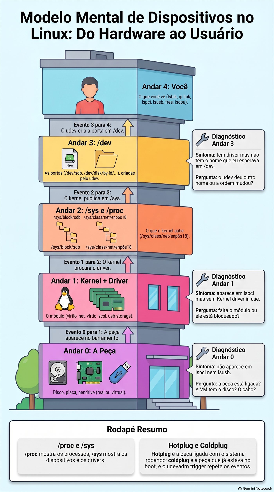
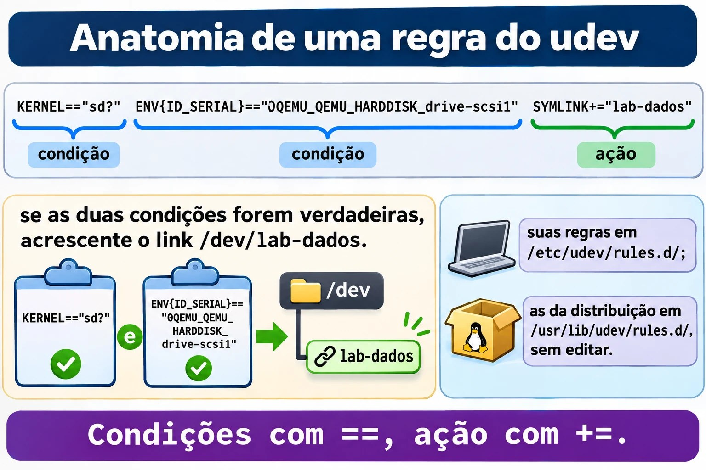
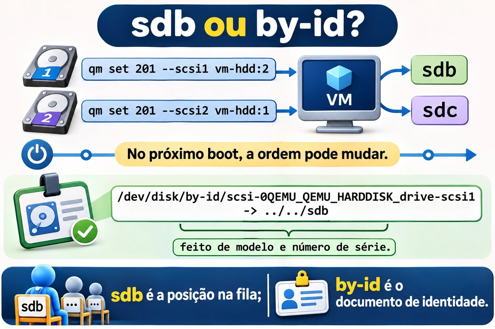
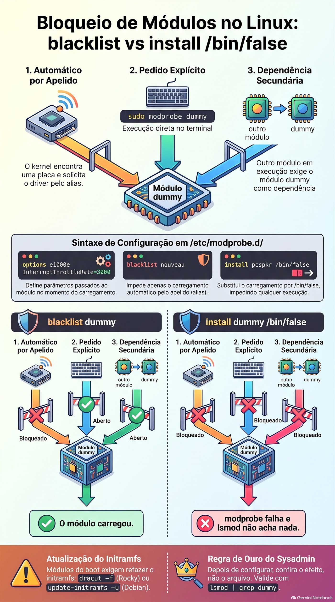

# Aula 2.2 · Hardware e dispositivos

Segunda aula do Módulo 2. O cliente liga: "colocamos um disco novo no servidor e ele não aparece", ou "qual dessas duas placas de rede é a da internet?", ou ainda "o servidor está lento, falta memória?". Nos três casos, a primeira coisa a fazer não é configurar nada, e sim **perguntar ao kernel o que ele está vendo**. Hoje você aprende a fazer esse inventário em dois minutos, entende como uma peça física vira um arquivo em `/dev`, liga um disco com a VM rodando e assiste ao kernel recebê-lo ao vivo. No fim, você dá ao disco um nome que não muda e bloqueia um driver do jeito certo, que não é o jeito que quase todo mundo usa.

| Ficha | Aula 2.2 |
| --- | --- |
| Módulo | M2 · Sistema, usuários e permissões, aula 2 de 8 |
| Quando | Semana 4 |
| Ao final você consegue | Fazer o inventário de CPU, memória, discos, placas e USB de qualquer servidor; dizer qual driver cuida de cada placa; acompanhar ao vivo a chegada de um dispositivo; explicar o caminho peça → kernel → `/sys` → udev → `/dev`; escolher um nome de disco que não muda entre boots; escrever uma regra do udev; carregar, remover e bloquear de verdade um módulo do kernel |
| Pré-requisitos | Aula 2.1 (VM × container, `systemd-detect-virt`); Aulas 1.5 e 1.6 (`grep` e pipes) |
| Tempo | Cerca de 2h |
| Snapshots | m2a2-inicio e m2a2-fim nas duas VMs |

## 1 · Aquecimento

Três perguntas, de cabeça. Escreva as respostas; o Gabarito confere no fim.

1. Na Aula 0.1, a placa de rede das VMs se chamava `enp6s18`. Palpite: por que um nome tão estranho, e não `eth0`, como nos tutoriais antigos?
2. No Linux, "tudo é arquivo". Palpite: se o disco é um arquivo, em que pasta ele está, e como se chama?
3. No Windows, onde você olha qual driver uma placa está usando? Palpite: qual é o equivalente no Linux, um programa ou uma pasta?

## 2 · Por que importa

Inventário é o trabalho mais subestimado do sysadmin. Num atendimento, as primeiras perguntas são sempre as mesmas: quantos processadores, quanta memória sobra, que discos existem e se são SSD, qual placa de rede está ligada no switch. Quem responde em dois minutos, pelo SSH, resolve antes de alguém precisar ir ao datacenter.

E há o erro que derruba servidor: o disco que muda de nome. Hoje o disco de backup é `/dev/sdb`. Alguém pluga um pendrive, ou troca uma controladora, ou o kernel simplesmente encontra os discos em outra ordem no boot, e o disco de backup vira `/dev/sdc`. O script de backup, que gravava em `/dev/sdb`, agora grava em outro disco. Ou o `/etc/fstab` não acha o disco e o servidor para no boot pedindo a senha de root no console. Nomes como `sdb` são posições numa fila, não identidades. A identidade é o número de série, e hoje você aprende a usá-la.

Por fim, drivers. Uma placa que "não funciona" quase sempre é um módulo que não carregou, ou que alguém bloqueou. Saber carregar, remover e bloquear um módulo é o que separa "vou reinstalar" de "resolvi em cinco minutos".

## 3 · Modelo mental

> Uma peça só existe para você depois de atravessar quatro andares. Quando algo "não aparece", você sobe os andares, um por um, até achar onde parou.

```text
 4. você            lsblk, ip link, lspci, lsusb, free, lscpu        "o que eu vejo"
                        ▲
 3. /dev            /dev/sdb, /dev/disk/by-id/...                    as portas, criadas pelo udev
                        ▲
 2. /sys e /proc    /sys/block/sdb, /sys/class/net/enp6s18           o que o kernel sabe, em arquivos
                        ▲
 1. kernel+driver   o módulo (virtio_net, virtio_scsi, usb-storage)  quem fala com a peça
                        ▲
 0. a peça          disco, placa, pendrive (real ou virtual)
```

Leia de baixo para cima. A peça aparece no barramento (PCI, USB, SCSI). O kernel procura um **driver** que saiba falar com ela; no Linux, quase todo driver é um **módulo**, um pedaço do kernel que se carrega e descarrega com ele ligado. O kernel publica o que encontrou em `/sys`, uma pasta de arquivos que não existem em disco. O **udev**, um serviço do systemd, recebe o aviso "chegou uma peça", lê os dados dela e cria a porta em `/dev`, junto com nomes extras e estáveis. Só então os programas a enxergam.

Os três diagnósticos que resolvem 90% dos casos:

| Sintoma | Andar | Pergunta |
| --- | --- | --- |
| Não aparece em `lspci` nem em `lsusb` | 0 | A peça está ligada? A VM tem o disco? O cabo? |
| Aparece em `lspci`, mas sem `Kernel driver in use` | 1 | Falta o módulo, ou ele está bloqueado |
| Tem driver, mas não tem o nome que eu esperava em `/dev` | 3 | O udev deu outro nome, ou a ordem mudou |



*Quando algo não aparece, suba os andares um por um até achar onde parou.*

## 4 · Conceito em camadas

### Essencial

**As peças.** O que o dia a dia espera que você reconheça:

| Peça | O que faz | Como o Linux mostra |
| --- | --- | --- |
| Processador (CPU) | Executa os programas; tem núcleos (*cores*) e, às vezes, dois fios por núcleo (*threads*) | `lscpu`, `nproc`, `/proc/cpuinfo` |
| Memória (RAM) | Guarda o que está em uso; some ao desligar | `free -h`, `/proc/meminfo` |
| Swap | Uma área do disco usada como memória de reserva, muito mais lenta | `swapon --show`, `free -h` |
| Disco HDD | Disco que gira; barato, grande e lento | `lsblk`, coluna `ROTA` = 1 |
| Disco SSD e NVMe | Sem partes móveis; o NVMe vai direto no barramento PCIe e é o mais rápido | `ROTA` = 0; o NVMe se chama `nvme0n1` |
| Placa de rede | Liga o servidor ao switch | `ip -br link`, `lspci` |
| Periféricos USB | Pendrive, teclado, token, nobreak | `lsusb` |
| Firmware (BIOS ou UEFI) | O programa da placa-mãe que liga tudo e chama o carregador do sistema | `ls /sys/firmware/efi` existe só em UEFI (Módulo 4) |

**Os nomes dos discos.** O nome diz como o disco está ligado, não o que ele é:

| Nome | Quem é |
| --- | --- |
| `/dev/sda`, `/dev/sdb`... | Discos SATA, SAS, USB e SCSI, inclusive o SCSI virtual do Proxmox |
| `/dev/sda1`, `/dev/sda2` | As partições do `sda` |
| `/dev/nvme0n1`, `/dev/nvme0n1p1` | O primeiro disco NVMe e a primeira partição dele (repare no `p`) |
| `/dev/vda`, `/dev/vdb` | Disco virtio-blk numa VM |
| `/dev/mmcblk0` | Cartão SD e memória eMMC, como num Raspberry Pi |
| `/dev/sr0` | O leitor de CD/DVD, inclusive o virtual |

A letra (`a`, `b`, `c`) é dada **na ordem em que o kernel encontra os discos**. Não é fixa.

**O inventário em seis comandos.** Decore esta sequência; ela abre todo atendimento:

```bash
lscpu | head -20        # processador: modelo, núcleos, virtualização
free -h                 # memória: olhe a coluna "available"
lsblk                   # discos, partições e onde estão montados
lspci                   # placas no barramento PCI
lsusb                   # o que está no USB
ip -br link             # placas de rede e se o cabo está "UP"
```

### Intermediário

**`/proc` e `/sys`, as duas janelas do kernel.** Nenhum dos dois existe no disco; o kernel inventa o conteúdo na hora em que você lê.

|  | `/proc` | `/sys` |
| --- | --- | --- |
| Nasceu para | Mostrar os processos (`/proc/1234`) | Mostrar os dispositivos e os drivers |
| Organização | Antiga e misturada: processos, memória, CPU, configurações | Uma árvore: barramento → dispositivo → driver |
| Exemplos | `/proc/cpuinfo`, `/proc/meminfo`, `/proc/partitions`, `/proc/modules` | `/sys/block/sda/size`, `/sys/class/net/enp6s18/address`, `/sys/module/` |
| Quem usa | Você, o `free`, o `top`, o `ps` | O udev, o `lsblk`, o `ip` |

**Os módulos do kernel.** O driver de uma placa quase sempre é um arquivo `.ko` em `/lib/modules/$(uname -r)/`. Os comandos:

| Comando | O que faz |
| --- | --- |
| `lsmod` | Lista os módulos carregados e quem depende de quem (lê `/proc/modules`) |
| `modinfo nome` | Mostra o arquivo, a descrição, os parâmetros e as dependências do módulo |
| `sudo modprobe nome` | Carrega o módulo **e as dependências dele** |
| `sudo modprobe -r nome` | Remove o módulo, se ninguém estiver usando |
| `lspci -k` | Mostra, para cada placa, o driver em uso (`Kernel driver in use`) e os que serviriam (`Kernel modules`) |

Existem também `insmod` e `rmmod`, que carregam e removem **um arquivo**, sem resolver dependências. Vale reconhecer; no dia a dia, use `modprobe`.

**Configurar módulos.** Arquivos `.conf` em `/etc/modprobe.d/`. Três linhas que você vai usar:

```text
options e1000e InterruptThrottleRate=3000   # parâmetro passado ao carregar
blacklist nouveau                            # não carregar AUTOMATICAMENTE
install pcspkr /bin/false                    # nunca carregar, nem se alguém pedir
```

A diferença entre `blacklist` e `install ... /bin/false` é a armadilha da aula. Você vai cair nela no lab, de propósito.

**O udev.** Quando chega uma peça, o kernel manda um evento (`add`); quando sai, outro (`remove`). O `systemd-udevd` recebe o evento, junta as informações da peça (fabricante, modelo, número de série) e aplica **regras**:

- `/usr/lib/udev/rules.d/`: as regras da distribuição. Não edite: a próxima atualização sobrescreve.
- `/etc/udev/rules.d/`: as suas. Um arquivo com o mesmo nome de um da distribuição o substitui.

As regras criam os nomes estáveis que você deve usar em scripts e configurações:

| Pasta | Nome baseado em | Muda se... |
| --- | --- | --- |
| `/dev/disk/by-id/` | Modelo e número de série do disco | Trocar o disco |
| `/dev/disk/by-uuid/` | O UUID do sistema de arquivos | Formatar de novo (Módulo 9) |
| `/dev/disk/by-path/` | O caminho físico: controladora e porta | Mudar o cabo de porta |
| `/dev/disk/by-label/` | O rótulo que você deu ao formatar | Mudar o rótulo |

**O nome da placa de rede.** O `enp6s18` é um nome **previsível**, dado pelo udev a partir da posição física: `en` = Ethernet, `p6` = barramento PCI 6, `s18` = slot 18. O antigo `eth0` era dado na ordem de descoberta, como o `sdb`, e com duas placas o `eth0` de hoje podia ser o `eth1` de amanhã. Num servidor físico você vai ver também `eno1` (placa onboard, numerada pelo firmware) e `ens1f0` (placa em slot, porta 0).

**Hotplug e coldplug.** Peça ligada com o sistema rodando é *hotplug*: o kernel manda o evento na hora. Peça que já estava lá no boot é *coldplug*: o udev, ao iniciar, pede ao kernel que repita os eventos de tudo o que já existe (`udevadm trigger`), e trata tudo do mesmo jeito.

### Ponte Windows

| No Windows | No Linux | O que muda |
| --- | --- | --- |
| Gerenciador de Dispositivos | `lspci -k`, `lsusb`, `lsblk` | Três comandos em vez de uma janela, e funcionam pelo SSH |
| Driver `.sys` instalado pelo fabricante | Módulo `.ko`, quase sempre já no kernel | Raramente se instala driver no Linux: ele vem com o kernel |
| "Desabilitar dispositivo" | `install modulo /bin/false` em `/etc/modprobe.d/` | Bloqueia o driver, não a peça |
| Letra de unidade `D:` | `/dev/sdb` e o ponto de montagem | A letra do Windows é o lugar onde se monta; o `sdb` é a peça |
| Disco > propriedades > número de série | `/dev/disk/by-id/` e `lsblk -o +SERIAL` |  |
| Gerenciador de Tarefas > Desempenho | `lscpu`, `free -h`, `top` |  |
| `msinfo32` | `sudo dmidecode`, `hostnamectl` | O `dmidecode` lê as tabelas do firmware: fabricante, modelo, série do servidor |

### Avançado

**`lspci -k` mostra dois andares.** Numa VM, a placa de rede aparece como `Virtio network device` com `Kernel driver in use: virtio-pci`. Mas o módulo de rede é o `virtio_net`. Não é contradição: o `virtio-pci` cuida da conversa com o barramento PCI; em cima dele, o `virtio_net` cuida da rede. O link `/sys/class/net/enp6s18/device/driver` aponta para o de cima.

**udev e D-Bus.** O udev cria os arquivos em `/dev`. Programas que precisam **reagir** a uma peça nova, como o ambiente gráfico que abre uma janela quando você pluga um pendrive, não leem o udev diretamente: escutam o **D-Bus**, o barramento de mensagens do sistema, onde serviços como o `udisks2` avisam "chegou um disco". Em servidor, quase não se usa; basta saber o papel de cada um.

**Regras do udev.** Uma regra é uma linha de pares chave-operador-valor. Chaves com `==` ou `!=` são **condições**; chaves com `=`, `+=` ou `:=` são **ações**:

```text
KERNEL=="sd?", ENV{ID_SERIAL}=="0QEMU_QEMU_HARDDISK_drive-scsi1", SYMLINK+="lab-dados"
└─ condição ─┘ └──────────────── condição ─────────────────────┘ └──── ação ─────────┘
```

Se todas as condições forem verdadeiras, as ações acontecem. O `udevadm info` mostra as variáveis que você pode usar, e o `udevadm monitor` mostra os eventos ao vivo.

**`dmesg` e `journalctl -k`.** As mensagens do kernel ficam num buffer na memória que o `dmesg` lê; o journal também as guarda, com data, e `journalctl -k` mostra só elas. No Debian, ler o buffer exige root (`kernel.dmesg_restrict = 1`). Use `sudo` nas duas distribuições e não pense mais nisso.



*Uma regra do udev se lê como um "se... então": condições com `==` e uma ação com `+=`.*

## 5 · Rocky × Debian

| O quê | Rocky 9 | Debian 13 |
| --- | --- | --- |
| `lspci` e `lsusb` | Pacotes `pciutils` e `usbutils`; podem faltar na instalação mínima | Os mesmos pacotes; podem faltar na instalação mínima |
| `dmesg` sem `sudo` | Funciona | Bloqueado (`dmesg_restrict = 1`) |
| `journalctl -k` sem `sudo` | Só para quem está no grupo `wheel` ou `systemd-journal` | Só para quem está no grupo `adm` ou `systemd-journal` |
| Módulos | `/lib/modules/$(uname -r)/` | `/lib/modules/$(uname -r)/` |
| Regras do udev da distribuição | `/usr/lib/udev/rules.d/` | `/usr/lib/udev/rules.d/` |
| Validar uma regra do udev | `udevadm test` (o systemd do Rocky 9 ainda não tem `verify`) | `udevadm verify arquivo.rules` |
| Primeiro disco das VMs do lab | `sda`, ou `vda` se a VM usa virtio-blk | `sda`, ou `vda` se a VM usa virtio-blk |

## 6 · Lab guiado

O roteiro: você faz o inventário das duas VMs como faria num cliente novo, descobre qual driver cuida de cada placa, liga um disco com a VM rodando e assiste à chegada dele, dá ao disco um nome que não muda e termina mexendo em módulos do kernel. O disco que você vai criar **fica** nas VMs: ele é o material do Módulo 9.

### Passo 1 · Snapshot e ferramentas

No nó Proxmox:

```bash
qm snapshot 201 m2a2-inicio
qm snapshot 202 m2a2-inicio
```

Nas VMs, garanta o `lspci` e o `lsusb`:

```bash
sudo dnf install -y pciutils usbutils        # rocky-lab
sudo apt install -y pciutils usbutils        # debian-lab
```

### Passo 2 · O inventário em dois minutos

Na rocky-lab:

```bash
lscpu | grep -E '^(Model name|CPU\(s\)|Thread|Core|Socket|Hypervisor|Virtualization)'
nproc
free -h
sudo swapon --show
lsblk -o NAME,SIZE,TYPE,ROTA,MOUNTPOINTS
```

O que ler em cada um:

- No `lscpu`, a linha `Hypervisor vendor: KVM` confirma o que você viu na Aula 2.1. O `CPU(s)` é o número de processadores que a VM recebeu, e é o mesmo do `nproc`.
- No `free -h`, olhe a coluna **`available`**, não a `free`. O Linux usa a memória sobrando como cache de disco; a coluna `free` parece baixa, e isso é bom. A `available` é o que os programas ainda podem usar.
- No `lsblk`, o Rocky mostra o disco, as partições e os volumes LVM (`rl-root`, `rl-swap`) que o instalador criou. A coluna `ROTA` diz `1` para disco que gira. Numa VM, o Proxmox costuma dizer `1` mesmo com SSD por baixo, a menos que a opção `ssd=1` esteja ligada no disco. O sistema só sabe o que o hardware conta a ele.

Agora as placas:

```bash
lspci
lsusb
ip -br link
```

O `lspci` lista as placas virtuais do QEMU: a controladora SCSI e a placa de rede, ambas `Virtio`, mais as pontes PCI. O `lsusb` mostra os barramentos USB e, provavelmente, um `QEMU USB Tablet`: o mouse do console do Proxmox. O `ip -br link` mostra o `lo` e o `enp6s18`, com `UP`.

Faça o mesmo na debian-lab. Anote as diferenças: o tamanho da memória, o layout do disco (o Debian costuma usar partições simples, sem LVM) e mais nada. As peças são as mesmas.

### Passo 3 · Quem dirige cada placa

Na rocky-lab:

```bash
lspci -k | grep -A3 -i -E 'ethernet|scsi'
readlink /sys/class/net/enp6s18/device/driver
lsmod | grep -E '^virtio|^Module'
sudo modinfo virtio_net | grep -E '^(filename|description|depends)'
```

O `lspci -k` mostra `Kernel driver in use: virtio-pci` nas duas placas. O `readlink` responde com um caminho que termina em `virtio_net`. Os dois estão certos: o `virtio-pci` conversa com o barramento, e o `virtio_net` faz a rede por cima dele (seção 4, Avançado). O `lsmod` mostra os módulos carregados e, na coluna `Used by`, quem depende de cada um. O `modinfo` mostra onde está o arquivo `.ko`.

Agora suba os andares do modelo mental para a placa de rede, de baixo para cima:

```bash
lspci | grep -i ethernet                         # andar 0: a peça existe
ls /sys/class/net/enp6s18/                       # andar 2: o kernel publicou
cat /sys/class/net/enp6s18/address               # o MAC, lido direto do kernel
cat /sys/class/net/enp6s18/operstate             # up ou down
ip -br link show enp6s18                         # andar 4: o que você vê
```

O `ip` não inventa nada: ele lê o que está em `/sys`. É por isso que, quando um comando "mente", o primeiro lugar onde você confere é `/sys`.

### Passo 4 · Um disco novo, com a VM ligada

Prepare duas janelas de SSH na rocky-lab. Na primeira, fotografe os discos e deixe o monitor do udev ouvindo:

```bash
lsblk -d -o NAME,SIZE,SERIAL > ~/discos-antes.txt
cat ~/discos-antes.txt
sudo udevadm monitor --kernel --udev --subsystem-match=block
```

Na segunda, deixe o kernel falando:

```bash
sudo journalctl -k -f
```

Agora, no nó Proxmox, crie um disco de 2 GB e ligue-o na VM. O `vm-hdd` é o storage Ceph da aula 0.1; se o seu tiver outro nome, `pvesm status` mostra:

```bash
qm set 201 --scsi1 vm-hdd:2,discard=on,iothread=1,ssd=1
```

Olhe as duas janelas. No `journalctl`, o kernel anuncia o disco: `sd ... [sdb] ... (2.15 GB/2.00 GiB)`, e a linha `Attached SCSI disk`. No monitor, chegam pares de linhas: `KERNEL[...] add` (o kernel avisou) e logo depois `UDEV [...] add` (o udev terminou de criar as portas). É o modelo mental acontecendo, andar por andar, em menos de um segundo.

Pare o monitor e o `journalctl` com `Ctrl+C` e compare:

```bash
lsblk -d -o NAME,SIZE,SERIAL > ~/discos-depois.txt
diff ~/discos-antes.txt ~/discos-depois.txt
```

O `diff` mostra a linha nova. Repare no nome: provavelmente `sdb`, mas pode ser outro, dependendo de como o disco principal está ligado. Se o disco do sistema for `vda` (virtio-blk), o novo, que entrou na controladora SCSI, vira `sda`. Esse é o ponto: **você não escolheu o nome**, e não deve contar com ele.

Faça o mesmo na debian-lab, com `qm set 202 --scsi1 vm-hdd:2,discard=on,iothread=1,ssd=1`.

### Passo 5 · O nome que não muda

Na rocky-lab:

```bash
ls -l /dev/disk/by-id/ | grep -v -- '-part'
udevadm info --query=property --name=/dev/sdb | grep -E '^(ID_SERIAL|ID_MODEL|ID_PATH|DEVLINKS)='
```

(Se o seu disco novo não for `sdb`, troque o nome aqui e nos próximos passos.)

O `ls -l` mostra links como `scsi-0QEMU_QEMU_HARDDISK_drive-scsi1 -> ../../sdb`. O nome do link vem do modelo e do número de série; o alvo, `sdb`, é só a posição atual. O `udevadm info` mostra de onde o udev tirou isso: a variável `ID_SERIAL`, com o valor `0QEMU_QEMU_HARDDISK_drive-scsi1`. Num servidor físico, no lugar disso aparecem o modelo e o número de série que estão impressos na etiqueta do disco.

Para ver por que isso importa, ligue um segundo disco, de 1 GB, e veja a fila andar:

```bash
qm set 201 --scsi2 vm-hdd:1                       # no nó Proxmox
```

```bash
lsblk -d -o NAME,SIZE,SERIAL                     # na rocky-lab
```

Agora há um `sdc` de 1 GB. Neste boot, a ordem é a de chegada. No próximo boot, o kernel encontra os discos ao mesmo tempo, e a ordem pode mudar. O `by-id` de cada um não muda nunca.

**Decida 1 · O disco do backup.** O cliente vai usar o disco de 2 GB como destino do backup noturno. O script precisa de um caminho para o disco. Qual você escreve nele?

- **A)** `/dev/sdb`, porque é o nome que o disco tem agora e está escrito no `lsblk`.
- **B)** `/dev/disk/by-id/scsi-0QEMU_QEMU_HARDDISK_drive-scsi1`.
- **C)** `/dev/disk/by-path/...`, o caminho da porta da controladora.
- **D)** Tanto faz: o Linux sempre dá os nomes na mesma ordem, desde que ninguém mexa no hardware.

Escolha a letra antes de olhar a tabela.

| Se você marcou | Resultado | Por quê |
| --- | --- | --- |
| A | ❌ Errada | Funciona até o primeiro boot em que a ordem mudar, ou até alguém plugar um pendrive. Aí o backup grava no disco errado, e ninguém percebe até precisar dele. |
| B | ✅ Certa | O nome vem do número de série. O disco pode mudar de porta, de controladora e de letra: o link continua apontando para ele. |
| C | ❌ Errada | Não muda com a ordem do boot, mas muda se alguém trocar o cabo de porta ou a controladora. É útil quando você quer "o disco que estiver na baia 3", não "este disco". |
| D | ❌ Errada | Os discos são encontrados em paralelo, e o primeiro a responder ganha a letra. Num servidor com vários discos, a ordem muda de um boot para outro sem ninguém mexer em nada. |

**Para fixar:** `sdb` é a posição na fila; `by-id` é o documento de identidade. Em script e configuração, use o documento.

Quando o disco tiver um sistema de arquivos, no Módulo 9, o nome preferido para o `/etc/fstab` vai ser o UUID. Hoje o disco está vazio e não tem UUID: o `ls /dev/disk/by-uuid/` não mostra nada dele.

Antes de seguir, desligue o disco de 1 GB, que foi só para a demonstração. No nó Proxmox:

```bash
qm set 201 --delete scsi2
```

Ele sai da VM e vira um disco "não usado" (`unused0`) na configuração. Apague-o pela interface do Proxmox, em *Hardware*, selecionando o `Unused Disk 0` e clicando em *Remove*. O de 2 GB fica.



*O nome `sdb` é a posição na fila; o link em `by-id` acompanha o disco.*

### Passo 6 · Uma regra do udev: o disco com o seu nome

Você vai fazer o udev criar `/dev/lab-dados` apontando para o disco de 2 GB, onde quer que ele esteja. Na rocky-lab, confirme o valor do `ID_SERIAL` do **seu** disco:

```bash
udevadm info --query=property --name=/dev/sdb | grep '^ID_SERIAL='
```

Escreva a regra, com o seu valor no lugar do exemplo:

```bash
sudo tee /etc/udev/rules.d/99-lab.rules <<'EOF'
# disco de dados do lab, pelo número de série
KERNEL=="sd?", ENV{ID_SERIAL}=="0QEMU_QEMU_HARDDISK_drive-scsi1", SYMLINK+="lab-dados"
EOF
sudo udevadm control --reload
sudo udevadm trigger /dev/sdb
ls -l /dev/lab-dados
```

O `ls -l` mostra `/dev/lab-dados -> sdb`. O `control --reload` faz o udev reler as regras; o `trigger` repete o evento do disco, como se ele tivesse acabado de chegar. Num boot, nada disso é preciso: as regras valem para todo evento.

Leia a regra em voz alta: "**se** o kernel chamou o dispositivo de `sd` mais uma letra, **e** o número de série é este, **então** acrescente o link `lab-dados`". Duas condições com `==`, uma ação com `+=`. O `+=` acrescenta à lista de links; com `=`, você apagaria os links que as regras da distribuição já tinham criado, como os de `by-id`.

Faça o mesmo na debian-lab. Lá, valide a regra com o verificador:

```bash
sudo udevadm verify /etc/udev/rules.d/99-lab.rules
```

### Passo 7 · Módulos: carregar, remover, ler

Você vai usar o módulo `dummy`, que cria uma placa de rede de mentira. Ele não toca em nada de verdade, e é seguro carregar e remover. Na rocky-lab:

```bash
lsmod | grep dummy; echo "rc=$?"
sudo modprobe dummy
lsmod | grep dummy
ip -br link show dummy0
sudo modinfo dummy | grep -E '^(filename|description|parm)'
sudo modprobe -r dummy
ip -br link show dummy0; echo "rc=$?"
```

O primeiro `grep` não acha nada (`rc=1`). Depois do `modprobe`, o módulo aparece no `lsmod` e uma placa `dummy0` aparece no `ip`. O `modinfo` mostra que ele aceita o parâmetro `numdummies`, que diz quantas placas criar. O `modprobe -r` remove o módulo, e a placa some (`Device "dummy0" does not exist`).

Agora com um parâmetro, do jeito que se configura um driver de verdade:

```bash
echo 'options dummy numdummies=3' | sudo tee /etc/modprobe.d/lab-dummy.conf
sudo modprobe dummy
ip -br link | grep dummy
sudo modprobe -r dummy
```

Três placas: `dummy0`, `dummy1`, `dummy2`. O `modprobe` leu o arquivo de `/etc/modprobe.d/` e passou o parâmetro sozinho. É assim que se ajusta um driver de placa de rede ou de controladora: um `options` num arquivo, e o ajuste vale em todo boot.

Repita na debian-lab, se quiser ver que é idêntico. Deixe o `lab-dummy.conf` nas duas: a Quebra B começa dele.

## 7 · Quebre e conserte

### Quebra A · A regra que o udev ignorou

Um colega "arrumou" a sua regra. Faça o que ele fez, na rocky-lab:

```bash
sudo sed -i 's/KERNEL=="sd?"/KERNEL="sd?"/' /etc/udev/rules.d/99-lab.rules
cat /etc/udev/rules.d/99-lab.rules
sudo udevadm control --reload
sudo udevadm trigger /dev/sdb
```

**Observe.**

```bash
ls -l /dev/lab-dados
```

`No such file or directory`. O link sumiu. Nenhum comando deu erro: o `reload` e o `trigger` voltaram calados.

**Diagnostique.** O udev não reclama no terminal; reclama no log dele:

```bash
sudo journalctl -u systemd-udevd --since '-5min' | tail -5
```

A mensagem aponta o arquivo e a linha, `99-lab.rules:2`, e fala em **operador inválido** para `KERNEL`. O colega trocou `==` por `=`. No udev, `KERNEL` só pode ser condição: o nome quem dá é o kernel, e o udev não pode mudá-lo. Uma condição escrita com o operador de ação não faz sentido, e o udev descarta a linha inteira. No trigger seguinte, como nenhuma regra pede mais o `lab-dados`, ele apaga o link.

Na debian-lab, o verificador pega antes, sem precisar do log: `sudo udevadm verify /etc/udev/rules.d/99-lab.rules` responde com a linha e o motivo.

**Decida A · O conserto.** O que resolve?

- **A)** Voltar o `KERNEL=` para `KERNEL==` e repetir o `reload` e o `trigger`.
- **B)** Reiniciar a VM: no boot, o udev lê as regras do zero.
- **C)** Renomear o arquivo para `10-lab.rules`, para ele rodar antes das regras da distribuição.
- **D)** Trocar o `SYMLINK+=` por `SYMLINK=`, para forçar a criação do link.

Escolha a letra antes de olhar a tabela.

| Se você marcou | Resultado | Por quê |
| --- | --- | --- |
| A | ✅ Certa | Com `==`, a linha volta a ter duas condições e uma ação, e o udev a aceita. |
| B | ❌ Errada | No boot, ele lê o mesmo arquivo com o mesmo erro e descarta a mesma linha. Reiniciar não corrige texto. |
| C | ❌ Errada | Com o nome `10-`, a regra roda **antes** das da distribuição, e o `ID_SERIAL` ainda não existe: são elas que o criam. A regra nunca bateria. O `99-` existe por isso. |
| D | ❌ Errada | O problema está na condição, não na ação. E o `SYMLINK=` apagaria os links da distribuição, como os de `by-id`. |

**Para fixar:** `==` pergunta, `=` manda. Regra do udev que "não faz nada" tem a resposta no `journalctl -u systemd-udevd`.

**Conserte.**

```bash
sudo sed -i 's/KERNEL="sd?"/KERNEL=="sd?"/' /etc/udev/rules.d/99-lab.rules
sudo udevadm control --reload
sudo udevadm trigger /dev/sdb
ls -l /dev/lab-dados
```

O link volta. Se quiser ver a regra sendo avaliada, linha por linha, sem mudar nada: `sudo udevadm test /sys/class/block/sdb 2>&1 | grep -i lab`.

### Quebra B · O módulo que não obedeceu

O cliente quer que o módulo `dummy` nunca seja carregado no servidor. Você faz o que se lê em todo fórum, na rocky-lab:

```bash
echo 'blacklist dummy' | sudo tee /etc/modprobe.d/lab-bloqueio.conf
sudo modprobe dummy
```

**Observe.**

```bash
lsmod | grep dummy
ip -br link | grep dummy
```

O módulo carregou. As três placas `dummy` estão lá, inclusive com o parâmetro do `lab-dummy.conf`. O `blacklist` não fez nada.

**Diagnostique.** Leia o que o próprio `modprobe` diz sobre isso:

```bash
man modprobe.d | grep -A6 -i '^ *blacklist'
```

O `blacklist` diz: não use os **apelidos** (*aliases*) deste módulo. Quando o kernel encontra uma placa, ele não pede "carregue o `e1000e`"; ele pede "carregue o driver para a placa de código `pci:v00008086d000015BC...`", e o `modprobe` procura qual módulo tem esse apelido. O `blacklist` corta só esse caminho, o automático. Um `modprobe dummy` pelo nome é um pedido explícito, e o `modprobe` obedece. Outro módulo que dependa do bloqueado também o puxa.

**Decida B · O conserto.** O cliente quer que o módulo não carregue **de jeito nenhum**. O que resolve?

- **A)** Trocar a linha por `install dummy /bin/false`.
- **B)** Apagar o arquivo `dummy.ko` de `/lib/modules/`.
- **C)** Colocar a linha `blacklist dummy` também em `/etc/modules-load.d/`.
- **D)** Dar `sudo modprobe -r dummy` sempre que alguém carregar.

Escolha a letra antes de olhar a tabela.

| Se você marcou | Resultado | Por quê |
| --- | --- | --- |
| A | ✅ Certa | O `install` troca o carregamento por um comando. Com `/bin/false`, qualquer pedido, automático, explícito ou por dependência, roda o `false` e falha. |
| B | ❌ Errada | Funciona até a próxima atualização do kernel, que traz o arquivo de volta numa pasta nova. E você mexeu num arquivo que pertence a um pacote. |
| C | ❌ Errada | Essa pasta diz quais módulos **carregar** no boot, não quais bloquear. A sintaxe é outra: uma lista de nomes. |
| D | ❌ Errada | Não é bloqueio, é faxina. Entre o carregamento e a sua remoção, o módulo esteve no kernel. |

**Para fixar:** `blacklist` bloqueia o automático; `install modulo /bin/false` bloqueia tudo. Na prática, os dois juntos, no mesmo arquivo.

**Conserte.**

```bash
sudo modprobe -r dummy
printf 'blacklist dummy\ninstall dummy /bin/false\n' | sudo tee /etc/modprobe.d/lab-bloqueio.conf
sudo modprobe dummy; echo "rc=$?"
lsmod | grep dummy; echo "rc=$?"
```

O `modprobe` falha, com uma mensagem sobre o comando de instalação `/bin/false`, e o `lsmod` não acha nada. O bloqueio é de verdade.

Agora desfaça o bloqueio, porque o lab não precisa dele, e confira:

```bash
sudo rm /etc/modprobe.d/lab-bloqueio.conf
sudo modprobe dummy && lsmod | grep dummy
sudo modprobe -r dummy
```

Um detalhe que pega muita gente: se o módulo bloqueado for de algo que sobe no boot, como o driver de vídeo, ele pode estar também dentro do **initramfs**, a imagem que o kernel carrega antes do disco. Aí é preciso refazer o initramfs (`dracut -f` no Rocky, `update-initramfs -u` no Debian) para o bloqueio valer desde o primeiro segundo. Isso é assunto do Módulo 4.



*O blacklist só fecha a porta automática; o install /bin/false fecha todas.*

### A lição

As duas quebras de hoje têm a mesma forma: **um comando que volta sem erro e não faz o que você pensou**. O udev aceitou o `reload` e descartou a regra em silêncio. O `blacklist` foi gravado e não bloqueou nada. Em hardware e drivers, quase nada reclama no terminal; o lugar da reclamação é o log (`journalctl -u systemd-udevd`, `journalctl -k`), e a confirmação é sempre ver o resultado: o link existe? o módulo está no `lsmod`? O hábito desta aula é o mesmo da 0.2 e da 2.1, só que mais exigente: **depois de configurar, confira o efeito, não o arquivo**.

## 8 · Armadilhas

| Você digita ou vê | O que acontece | O certo |
| --- | --- | --- |
| `/dev/sdb` num script ou no `fstab` | Um dia a ordem muda e o script grava no disco errado | `/dev/disk/by-id/...`, ou o UUID depois de formatar |
| `free` mostra pouca memória livre | Pânico à toa: é o cache de disco | Olhar a coluna `available` |
| `lspci` dá `command not found` | Falta o pacote numa instalação mínima | `pciutils`; para o `lsusb`, `usbutils` |
| `dmesg` dá `Operation not permitted` no Debian | Leitura do buffer do kernel restrita ao root | `sudo dmesg` ou `sudo journalctl -k` |
| `blacklist modulo` para "desligar" um driver | Ele ainda carrega quando pedido pelo nome ou por dependência | Acrescentar `install modulo /bin/false` |
| `sudo modprobe -r virtio_net` (ou o driver da sua placa) pelo SSH | A placa some e a sua sessão cai junto | Nunca remover o driver da placa por onde você está conectado; usar o console |
| Editar uma regra em `/usr/lib/udev/rules.d/` | A próxima atualização apaga a sua mudança | Copiar para `/etc/udev/rules.d/` com o mesmo nome e editar lá |
| `KERNEL="sd?"` numa regra do udev | A linha inteira é descartada, em silêncio | `==` em condição, `=` ou `+=` em ação |
| `SYMLINK="nome"` em vez de `SYMLINK+=` | Apaga os links que outras regras criaram | `SYMLINK+=` |
| Regra do udev com número baixo, como `10-` | Roda antes das regras que criam `ID_SERIAL` e nunca bate | Regras próprias com `99-` |
| `insmod arquivo.ko` | Falha se o módulo depender de outro ainda não carregado | `modprobe nome`, que resolve as dependências |
| `ROTA 1` numa VM e a conclusão "o disco é lento" | A VM só sabe o que o hipervisor conta a ela | Perguntar ao hipervisor; no Proxmox, a opção `ssd=1` do disco |

## 9 · Quiz

Dez perguntas, sem consultar. Escreva a letra ou a resposta de cada uma e só depois abra o Gabarito.

**1.** Qual comando mostra, para cada placa PCI, o driver do kernel em uso?

- **A)** `lsmod`
- **B)** `lspci -k`
- **C)** `lsusb -v`
- **D)** `modinfo`

**2.** Você escreveu `blacklist e1000e` e o módulo continua carregando quando um colega roda `modprobe e1000e`. Por quê, e o que bloqueia de verdade?

**3.** Onde o administrador coloca as próprias regras do udev?

- **A)** `/usr/lib/udev/rules.d/`
- **B)** `/etc/udev/rules.d/`
- **C)** `/dev/udev/`
- **D)** `/sys/udev/rules/`

**4.** No `lsblk -o NAME,ROTA`, um disco aparece com `ROTA` igual a `0`. O que isso diz?

**5.** Como o Linux chama a primeira partição do primeiro disco NVMe?

- **A)** `/dev/nvme1`
- **B)** `/dev/nvme0n1p1`
- **C)** `/dev/sda1`
- **D)** `/dev/nvme0p1`

**6.** Por que a placa de rede das VMs se chama `enp6s18` e não `eth0`? O que cada pedaço do nome quer dizer?

**7.** Qual comando carrega um módulo resolvendo as dependências dele?

- **A)** `insmod`
- **B)** `modprobe`
- **C)** `lsmod`
- **D)** `depmod`

**8.** O cliente diz que o servidor "está sem memória" porque o `free -h` mostra `free 180Mi` num total de 8 GiB. Qual coluna você olha antes de concordar?

- **A)** `shared`
- **B)** `buff/cache`
- **C)** `available`
- **D)** `used`

**9.** Você vai plugar um pendrive no servidor e quer ver, ao vivo, o que o kernel diz quando ele chega. Cite dois comandos que mostram isso.

**10.** *Which pseudo-filesystem exposes the kernel's view of devices, buses and drivers as a directory tree, and is the main source of information for udev?*

- **A)** `/proc`
- **B)** `/sys`
- **C)** `/dev`
- **D)** `/run/udev`
- **E)** `/etc/udev`

## 10 · Flashcards e cola

### Para saber de cor

- O inventário: `lscpu`, `free -h`, `lsblk`, `lspci`, `lsusb`, `ip -br link`.
- Os quatro andares: peça → kernel e driver → `/sys` e `/proc` → udev cria `/dev` → você.
- `lspci -k` diz qual driver cuida de cada placa.
- `sdb` é posição na fila; `/dev/disk/by-id/` é identidade.
- No udev, `==` é condição e `+=` é ação; as suas regras ficam em `/etc/udev/rules.d/99-*.rules`.
- `blacklist` bloqueia o automático; `install modulo /bin/false` bloqueia tudo.

### Para consultar

| Pergunta | Comando ou arquivo |
| --- | --- |
| Quantos processadores? É VM? | `lscpu`; `nproc` |
| Falta memória? | `free -h`, coluna `available`; `swapon --show` |
| Que discos existem, SSD ou HDD? | `lsblk -o NAME,SIZE,TYPE,ROTA,MODEL,SERIAL,MOUNTPOINTS` |
| Qual é o número de série do disco? | `lsblk -d -o NAME,SERIAL`; `ls -l /dev/disk/by-id/` |
| Que placas existem e com qual driver? | `lspci -k` |
| O que está no USB? | `lsusb`; `lsusb -t` mostra a árvore |
| Qual driver cuida da placa de rede? | `readlink /sys/class/net/enp6s18/device/driver` |
| O que o kernel disse no boot? | `sudo journalctl -k -b`; `sudo dmesg` |
| Ver uma peça chegar, ao vivo | `sudo journalctl -k -f`; `sudo udevadm monitor` |
| As variáveis do udev para um disco | `udevadm info --query=property --name=/dev/sdb` |
| Aplicar uma regra nova do udev | `sudo udevadm control --reload; sudo udevadm trigger /dev/sdb` |
| Por que a regra não funcionou? | `sudo journalctl -u systemd-udevd`; `udevadm verify` (Debian) |
| Módulos carregados | `lsmod` |
| Sobre um módulo | `modinfo nome` |
| Carregar e remover | `sudo modprobe nome`; `sudo modprobe -r nome` |
| Parâmetros e bloqueios | Arquivos `.conf` em `/etc/modprobe.d/` |
| Fabricante, modelo e série do servidor | `sudo dmidecode -t system`; `hostnamectl` |

### Flashcards

| Frente | Verso |
| --- | --- |
| `/proc` × `/sys` | `/proc`: processos e informações gerais do kernel. `/sys`: a árvore de dispositivos e drivers |
| Quem cria os arquivos em `/dev`? | O udev (`systemd-udevd`), a partir dos eventos do kernel |
| Para que serve o D-Bus? | Barramento de mensagens: avisa os programas, como o ambiente gráfico, que algo aconteceu |
| Hotplug × coldplug | Hotplug: peça ligada com o sistema rodando. Coldplug: já estava lá no boot; o udev repete os eventos |
| `modprobe` × `insmod` | O `modprobe` resolve dependências e lê `/etc/modprobe.d/`; o `insmod` só carrega um arquivo |
| `enp6s18` | Ethernet, barramento PCI 6, slot 18: nome previsível, dado pela posição |
| `nvme0n1p2` | Disco NVMe 0, namespace 1, partição 2 |
| `vda` | Disco virtio-blk numa VM |
| `ROTA` | `1`: disco que gira. `0`: SSD ou NVMe |
| `options` em `/etc/modprobe.d/` | Passa parâmetros ao módulo sempre que ele for carregado |

## 11 · Checklist de saída

- [ ] Faço o inventário de CPU, memória, discos, placas e USB de um servidor em dois minutos.
- [ ] Digo qual driver cuida de cada placa, com `lspci -k` e com `/sys`.
- [ ] Explico os quatro andares e sei em qual deles procurar quando algo "não aparece".
- [ ] Assisto à chegada de um disco com `journalctl -k -f` e `udevadm monitor`.
- [ ] Escolho `by-id` em vez de `sdb` e explico por quê.
- [ ] Escrevo uma regra do udev que cria um link pelo número de série, e diagnostico quando ela não funciona.
- [ ] Carrego, removo, configuro e bloqueio de verdade um módulo.

**Último exercício, sem olhar.** Na debian-lab, sem abrir esta aula, escreva do zero dois arquivos:

1. `/etc/udev/rules.d/99-lab.rules`, que cria `/dev/lab-dados` para o disco de 2 GB, pelo número de série.
2. `/etc/modprobe.d/lab-bloqueio.conf`, que impede o `dummy` de carregar de qualquer jeito.

Depois prove os dois: o `ls -l /dev/lab-dados` mostra o link, e o `sudo modprobe dummy` falha. Só abra o Gabarito depois disso, ou depois de três tentativas. No fim, apague o `lab-bloqueio.conf`.

**Snapshots de fechamento.** No nó Proxmox:

```bash
qm snapshot 201 m2a2-fim
qm snapshot 202 m2a2-fim
```

## 12 · Na vida real

**Missão da semana, só leitura.** Escolha três servidores reais: de preferência um físico, uma VM e um que esteja "com problema" ou "lento". Em cada um, sem mudar nada:

1. `lscpu | grep -E '^(Model name|CPU\(s\)|Hypervisor)'` e `free -h`: quanto processador e quanta memória, e quanto está `available`.
2. `lsblk -o NAME,SIZE,TYPE,ROTA,MODEL,MOUNTPOINTS`: quantos discos, de que tipo, e o que está montado onde.
3. `lspci -k | grep -A3 -i ethernet` (ou `ip -br link`, se não houver `lspci`): quais placas de rede, com qual driver, e quais estão `UP`.
4. `sudo journalctl -k -b -p warning | tail -20`: os avisos do kernel desde o último boot. Procure palavras como `I/O error`, `reset`, `link is down`, `temperature`.
5. `grep -r -v '^#' /etc/modprobe.d/ 2>/dev/null` e `ls /etc/udev/rules.d/`: alguém já mexeu em drivers ou regras neste servidor?
6. Num físico, se tiver `sudo`: `sudo dmidecode -t system | grep -E 'Manufacturer|Product|Serial'`. É o número de série que o suporte do fabricante vai pedir.

**Para o diário.** Uma linha por servidor: `nome · CPUs · RAM total/available · discos (SSD/HDD) · placas de rede e driver · avisos do kernel`. Se o passo 4 mostrar `I/O error` num disco, anote com destaque e avise o responsável: é o tipo de aviso que vem semanas antes de o disco morrer. Não tente consertar esta semana; só registre.

**Desafio da semana.** Procure, nos servidores que você acompanha, um `/etc/fstab`, um script de backup ou um agendamento que use `/dev/sdX` direto. Em duas frases, escreva o risco e o nome estável que você usaria no lugar. Não mude nada; guarde para a revisão do Módulo 9.

**Amanhã, sem olhar.** Antes de abrir o terminal, responda de cabeça: quais são os seis comandos do inventário? Qual comando mostra o driver de cada placa? Qual a diferença entre `blacklist` e `install ... /bin/false`? Por que `by-id` e não `sdb`? Se errar alguma, volte à seção 10, não à aula inteira.

## 13 · Com o DeepTutor

Use o DeepTutor da sua rede local depois do lab, não no lugar dele. Os comandos começam com `!`:

- `!quiz Aula 2.2`: dez perguntas novas sobre inventário, `/sys`, udev e módulos.
- `!explica udev`: o caminho do evento do kernel até o link em `/dev`, em linguagem simples.
- `!feynman blacklist e install`: você explica a diferença e ele aponta onde ficou vago.
- `!quebra regra do udev`: ele te entrega uma regra com um defeito escondido para você achar.
- `!quiz 2.2`: questões sobre hardware, `/proc`, `/sys`, udev e módulos.
- `!cartoes Aula 2.2`: os flashcards da seção 10, em ordem de revisão.
- `!erro`: cole uma mensagem do `journalctl -k` ou do `modprobe` e ele explica a linha.
- `!revisao`: o que rever desta aula e das anteriores, pelo que você errou até agora.

## Gabarito comentado

### Aquecimento

1. O nome é **previsível**: o udev o monta a partir da posição física da placa. `en` = Ethernet, `p6` = barramento PCI 6, `s18` = slot 18. O `eth0` era dado na ordem em que o kernel achava as placas, e com duas placas a ordem podia trocar de um boot para outro.
2. Em `/dev`. O primeiro disco SCSI/SATA é `/dev/sda` (ou `/dev/vda` com virtio-blk, ou `/dev/nvme0n1` num NVMe). Não é um arquivo com dados, e sim uma porta: ler e gravar nele é ler e gravar no disco.
3. No Windows, o Gerenciador de Dispositivos. No Linux, um programa, `lspci -k` (e `lsusb`, `lsblk`), e uma pasta, `/sys`, de onde esses programas leem.

### Quiz

1. **B.** O `lsmod` lista módulos, sem dizer de qual placa; o `lsusb -v` é só USB; o `modinfo` descreve um módulo que você já sabe o nome.
2. O `blacklist` só impede o carregamento **automático**, pelo apelido do hardware. Um `modprobe` com o nome é pedido explícito e é atendido. Para bloquear de verdade: `install e1000e /bin/false` num arquivo de `/etc/modprobe.d/`.
3. **B.** `/usr/lib/udev/rules.d/` é da distribuição e é sobrescrito nas atualizações; `/dev` e `/sys` são criados pelo sistema na hora.
4. Que o disco não é rotacional: SSD ou NVMe. Numa VM, é o que o hipervisor declara, não necessariamente o disco físico.
5. **B.** Controladora 0, namespace 1, partição 1. O `p` separa o número da partição, porque o nome do disco já termina em número.
6. Porque o udev dá nomes previsíveis, pela posição física: `en` (Ethernet), `p6` (barramento PCI 6), `s18` (slot 18). Assim, a mesma placa tem sempre o mesmo nome, mesmo que outra placa seja adicionada.
7. **B.** O `insmod` carrega um arquivo sem resolver dependências; o `lsmod` lista; o `depmod` gera o mapa de dependências que o `modprobe` usa.
8. **C.** A `available` estima quanto os programas ainda podem usar, contando o cache que o kernel libera quando preciso. Com `available` alta, o servidor não está sem memória: está usando a sobra como cache de disco, o que é bom.
9. `sudo journalctl -k -f` (ou `sudo dmesg -w`) para as mensagens do kernel, e `sudo udevadm monitor` para os eventos do kernel e do udev.
10. Tabela abaixo.

| Se você marcou | Resultado | Por quê |
| --- | --- | --- |
| A | ❌ Errada | O `/proc` também é do kernel, mas nasceu para os processos e mistura de tudo. A árvore de dispositivos fica no `/sys`. |
| B | ✅ Certa | O sysfs, montado em `/sys`, publica cada barramento, dispositivo e driver como pastas e arquivos. O udev lê dali os dados que usa nas regras. |
| C | ❌ Errada | O `/dev` é o resultado: as portas que o udev cria depois de ler o `/sys`. |
| D | ❌ Errada | É onde o udev guarda o próprio banco de dados, não a visão do kernel. |
| E | ❌ Errada | São as configurações e as regras do udev, escritas pelo administrador. |

### Último exercício

`/etc/udev/rules.d/99-lab.rules`, com o `ID_SERIAL` do seu disco:

```text
# disco de dados do lab, pelo número de série
KERNEL=="sd?", ENV{ID_SERIAL}=="0QEMU_QEMU_HARDDISK_drive-scsi1", SYMLINK+="lab-dados"
```

Aplicar e provar:

```bash
sudo udevadm verify /etc/udev/rules.d/99-lab.rules
sudo udevadm control --reload
sudo udevadm trigger /dev/sdb
ls -l /dev/lab-dados
```

`/etc/modprobe.d/lab-bloqueio.conf`:

```text
blacklist dummy
install dummy /bin/false
```

Provar e desfazer:

```bash
sudo modprobe dummy; echo "rc=$?"
sudo rm /etc/modprobe.d/lab-bloqueio.conf
```

Os erros mais comuns aqui: `KERNEL=` com um `=` só (a linha é descartada); `SYMLINK=` sem o `+` (apaga os links de `by-id`); e só o `blacklist`, sem o `install`, que passa no teste do boot e falha no teste do `modprobe`. Se a regra não funcionou e o `verify` não reclamou, confira o `ID_SERIAL`: um caractere diferente, e a condição nunca é verdadeira.

---

<!-- navegacao -->
[← Aula 2.1 · Instalação e provisionamento](2.1-instalacao-e-provisionamento.md) · [Índice de aulas](../01-aulas.md) · [Aula 2.3 · Processos e logs →](2.3-processos-e-logs.md)
