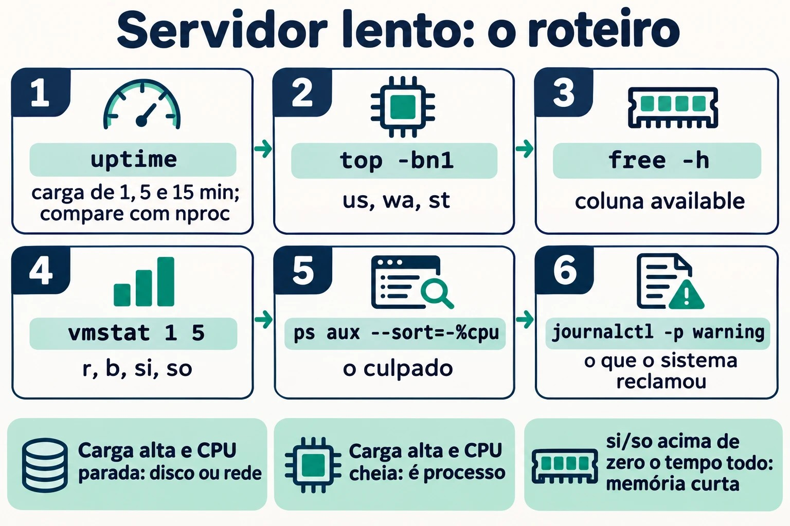

# Aula 2.3 · Processos e logs

Terceira aula do Módulo 2. O telefone toca: "o servidor está lento". É a frase mais comum do suporte e a mais vaga. Lento por quê? Um processo comendo processador? A memória acabou e o sistema está usando swap? Um disco engasgado segurando todo mundo? Hoje você aprende a responder em cinco minutos, pelo SSH, sem reiniciar nada: quem está rodando, quanto cada um consome, como pedir educadamente que um programa pare e como obrigá-lo, e onde o sistema anotou o que aconteceu antes de você chegar. No fim, você sabe ler o journal como quem lê o prontuário de um paciente.

| Ficha | Aula 2.3 |
| --- | --- |
| Módulo | M2 · Sistema, usuários e permissões, aula 3 de 8 |
| Quando | Semana 4 |
| Ao final você consegue | Listar e filtrar processos com `ps`, `pgrep` e `top`; ler as colunas que importam (PID, PPID, `%CPU`, `%MEM`, `STAT`); explicar o que é a carga média; enviar sinais com `kill` e saber quando usar cada um; mudar a prioridade com `nice` e `renice`; rodar trabalhos em segundo plano que sobrevivem ao logout; achar no journal o que aconteceu, quando e com quem; tornar o journal permanente |
| Pré-requisitos | Aula 2.2 (`free -h`, coluna `available`; `journalctl -k`); Aulas 1.5 e 1.6 (`grep` e pipes) |
| Tempo | Cerca de 2h |
| Snapshots | m2a3-inicio e m2a3-fim nas duas VMs |

## 1 · Aquecimento

Três perguntas, de cabeça. Escreva as respostas; o Gabarito confere no fim.

1. No Windows, você abre o Gerenciador de Tarefas e clica em "Finalizar tarefa". Palpite: o programa tem chance de salvar o que estava fazendo antes de fechar, ou ele simplesmente some?
2. Você roda um script longo pelo SSH, a sua conexão cai. Palpite: o script continua rodando no servidor ou morre junto?
3. O `top` mostra `load average: 4.00`. Palpite: isso é bom, ruim, ou depende de quê?

## 2 · Por que importa

"Está lento" e "parou" são metade dos chamados. Quem resolve não é quem sabe mais comandos; é quem tem um roteiro e o segue sempre na mesma ordem: carga → processador → memória → disco → o processo culpado → o que o log diz. Com esse roteiro, você chega no servidor, roda quatro comandos e diz ao cliente o que está acontecendo, antes de ele terminar de explicar.

E há o reflexo que faz estrago: `kill -9`. O programa travou, o administrador manda o `-9`, o programa some. Mas o banco de dados não teve tempo de gravar o que estava na memória, o arquivo de trava ficou para trás, e o serviço não sobe mais. Saber a diferença entre pedir para sair e arrancar da tomada é o que separa resolver de criar o próximo chamado.

Por fim, o log. Quando o cliente diz "ontem à noite caiu", você não estava lá. O journal estava. Mas só se ele for gravado em disco: na configuração padrão do Rocky, o journal fica na memória e some a cada boot. O "o que aconteceu antes de reiniciar?" morre junto. Hoje você conserta isso nas duas VMs.

## 3 · Modelo mental

> Todo processo é um filho. Ele tem um número (PID), um pai (PPID), um dono, um estado e uma caixa de correio de sinais. Você não manda num processo; você manda uma carta a ele.

```text
systemd (PID 1)                       ← o avô de todos; adota os órfãos
 ├─ sshd                              ← serviço
 │   └─ sshd: rodrigo                 ← a sua conexão
 │       └─ bash                      ← o seu shell
 │           ├─ sleep 600 &           ← um filho em segundo plano (job)
 │           └─ ps -ef --forest       ← o comando que você acabou de digitar
 ├─ chronyd
 └─ crond
```

Quatro ideias carregam a aula:

| Ideia | O que quer dizer | Consequência |
| --- | --- | --- |
| Árvore | Todo processo nasce de outro (`fork`); o primeiro é o `systemd`, PID 1 | Matar o pai pode levar os filhos junto, ou deixá-los órfãos, adotados pelo PID 1 |
| Estado | Rodando (`R`), dormindo esperando algo (`S`), preso esperando disco (`D`), parado (`T`), zumbi (`Z`) | Um `D` não responde a sinal nenhum, nem ao `-9`: ele espera o disco |
| Sinal | Uma mensagem numerada: 15 pede para sair, 9 mata, 1 avisa "o terminal sumiu" | O processo pode tratar o 15 e o 1; o 9 nunca chega até ele, o kernel age direto |
| Registro | Tudo o que o processo escreve na saída de erro, e tudo o que o kernel e o systemd veem, vai para o journal | Se não foi gravado em disco, sumiu no boot |


*Todo processo é filho de outro: PID, PPID, dono, estado e uma caixa de sinais.*

## 4 · Conceito em camadas

### Essencial

**Ver os processos.** Dois estilos de `ps` sobreviveram na prática; decore um de cada:

```bash
ps aux                       # estilo BSD: todos, com %CPU, %MEM, dono
ps -ef                       # estilo Unix: todos, com PPID (o pai)
ps -ef --forest              # a árvore
ps -o pid,ppid,user,stat,%cpu,%mem,cmd -p 1234     # só as colunas que você quer, de um PID
```

| Coluna | Quer dizer |
| --- | --- |
| `PID` | O número do processo; único enquanto ele vive |
| `PPID` | O número do pai |
| `USER` | O dono; é com as permissões dele que o processo age (Aula 2.7) |
| `%CPU` | Quanto do processador ele usou (média desde que começou, no `ps`; agora, no `top`) |
| `%MEM` e `RSS` | Quanto da memória física ele ocupa |
| `STAT` | O estado: `R`, `S`, `D`, `T`, `Z`, mais letras de detalhe (`s` = líder de sessão, `+` = em primeiro plano, `<` = prioridade alta, `N` = prioridade baixa) |
| `TTY` | O terminal; `?` quer dizer que não tem, como os serviços |

**Achar um processo pelo nome.** `pgrep` responde com o PID; `pidof` também; `ps` com `grep` funciona, mas aparece o próprio `grep` na lista:

```bash
pgrep -a sshd          # PID e linha de comando
pgrep -u rodrigo       # todos os processos do usuário
pidof chronyd
```

**O painel ao vivo: `top`.** Abra e aprenda cinco teclas: `P` ordena por processador, `M` por memória, `1` mostra cada núcleo, `k` manda um sinal, `q` sai. As cinco primeiras linhas são o resumo do servidor:

```text
top - 14:02:11 up 3 days,  2 users,  load average: 0.42, 0.30, 0.25   ← carga de 1, 5 e 15 minutos
Tasks: 128 total,   1 running, 127 sleeping,   0 stopped,   0 zombie
%Cpu(s):  2.0 us,  1.0 sy,  0.0 ni, 96.5 id,  0.5 wa,  0.0 hi,  0.0 si,  0.0 st
MiB Mem :   1967.4 total,    210.3 free,    612.9 used,   1144.2 buff/cache
MiB Swap:   2048.0 total,   2048.0 free,      0.0 used.   1354.5 avail Mem
```

Na linha `%Cpu(s)`, três números contam a história: `us` (programas trabalhando), `wa` (processador parado **esperando disco**) e `st` (tempo que o hipervisor roubou da VM para dar a outra). `id` alto e `wa` alto ao mesmo tempo: o problema é o disco, não o processador.

**A carga média.** O `load average` é o número médio de processos que querem o processador ou estão esperando disco (estados `R` e `D`). Compare com o número de núcleos (`nproc`): carga 4 numa máquina de 4 núcleos é cheia; numa de 16, é folga; numa de 1, é fila. Os três números, de 1, 5 e 15 minutos, dizem para onde vai: `4.0, 2.0, 0.5` está piorando agora; `0.5, 2.0, 4.0` está melhorando.

**Sinais.** `kill` não mata: manda um sinal. Os que você usa:

| Sinal | Número | O que faz | Quando |
| --- | --- | --- | --- |
| `SIGTERM` | 15 | Pede para terminar; o programa pode salvar, fechar arquivos, apagar o arquivo de trava | Sempre primeiro. É o padrão do `kill` |
| `SIGKILL` | 9 | O kernel remove o processo na hora; ele não fica sabendo | Só depois que o 15 falhou e você esperou |
| `SIGHUP` | 1 | "O terminal desligou". Muitos serviços entendem como "releia a configuração" | Recarregar um serviço antigo sem derrubar |
| `SIGINT` | 2 | O que o `Ctrl+C` manda | Interromper o que está no terminal |
| `SIGSTOP` e `SIGCONT` | 19 e 18 | Congelar e descongelar; o `Ctrl+Z` manda um primo do 19, o `SIGTSTP` | Pausar sem matar |

```bash
kill 1234              # manda o 15
kill -9 1234           # manda o 9
kill -l                # lista todos os sinais
pkill -u fulano sleep  # manda o 15 a todos os "sleep" do fulano
killall sleep          # manda o 15 a todos os "sleep", de todo mundo
```

**Onde ficam os logs.** Duas fontes, que hoje convivem:

| Fonte | O que é | Como ler |
| --- | --- | --- |
| Journal do systemd | Banco binário com tudo: kernel, serviços, login, com data, prioridade e unidade | `journalctl` |
| Arquivos em `/var/log` | Texto, gravado pelo `rsyslog` a partir do journal, e por programas que escrevem direto | `less`, `tail -f`, `grep` |

No Rocky, o `rsyslog` vem instalado e grava `/var/log/messages` e `/var/log/secure` (logins e `sudo`). No Debian 13, ele não vem: o journal é a fonte, e `/var/log` tem pouca coisa além dos logs do `apt` e do `dpkg`.

### Intermediário

**`journalctl`, os filtros que resolvem.** O journal é grande; o valor está em filtrar:

| Pergunta | Comando |
| --- | --- |
| O que aconteceu neste boot? | `journalctl -b` |
| E no boot anterior, antes de cair? | `journalctl -b -1` (só se o journal for permanente) |
| Que boots o journal conhece? | `journalctl --list-boots` |
| Só um serviço | `journalctl -u sshd` (Rocky) ou `-u ssh` (Debian) |
| Só erros e piores | `journalctl -p err` (níveis: `emerg`, `alert`, `crit`, `err`, `warning`, `notice`, `info`, `debug`) |
| Numa janela de tempo | `journalctl --since '2026-11-02 08:00' --until '09:30'`; ou `--since '-1h'`, `--since yesterday` |
| Ao vivo | `journalctl -f` |
| As últimas linhas | `journalctl -n 50` |
| De um programa, pelo nome | `journalctl -t sudo`; `journalctl _COMM=sshd` |
| De um PID | `journalctl _PID=1234` |
| Sem paginação, para usar com `grep` | `journalctl --no-pager` |
| Com a explicação do erro, quando existe | `journalctl -xe` |

Os filtros se somam: `journalctl -u sshd -p warning --since today` é "os avisos do SSH de hoje".

**O journal que some no boot.** O `systemd-journald` guarda em `/var/log/journal/` **se a pasta existir**; se não, guarda em `/run/log/journal/`, que fica na memória e some no boot. Quem decide é a opção `Storage=` em `/etc/systemd/journald.conf`:

| `Storage=` | Comportamento |
| --- | --- |
| `auto` (o padrão) | Grava em disco se `/var/log/journal/` existir; senão, só na memória |
| `persistent` | Cria a pasta e grava em disco |
| `volatile` | Só na memória |

No Rocky 9, a pasta não existe depois da instalação: o journal é volátil e o `rsyslog` é quem guarda o histórico em `/var/log/messages`. No Debian 13, a pasta é criada na instalação e o journal já é permanente. Você vai conferir as duas no lab, porque "o padrão" muda entre versões e o que vale é o que está na máquina.

**Prioridade: `nice` e `renice`.** O *nice* vai de `-20` (mais prioridade) a `19` (menos). O padrão é `0`. Um processo "gentil" (nice alto) cede o processador aos outros:

```bash
nice -n 10 tar czf /tmp/backup.tgz /etc     # começa já com nice 10
renice -n 15 -p 1234                        # muda um que já está rodando
ps -o pid,ni,cmd -p 1234                    # confere
```

Usuário comum só pode **aumentar** o nice dos próprios processos (ficar mais gentil). Diminuir, ou mexer nos dos outros, exige root. No `top`, a coluna `NI` mostra o valor, e `PR` mostra a prioridade que o kernel calculou a partir dele.

**Primeiro e segundo plano.** No shell, um comando com `&` no fim roda em segundo plano, como um *job*:

| Comando | O que faz |
| --- | --- |
| `comando &` | Roda em segundo plano; o shell mostra `[1] 4321` (número do job e PID) |
| `Ctrl+Z` | Pausa o que está em primeiro plano |
| `jobs -l` | Lista os jobs deste shell |
| `bg %1` | Continua o job 1 em segundo plano |
| `fg %1` | Traz o job 1 para o primeiro plano |
| `kill %1` | Manda o 15 ao job 1 |

Jobs são do **shell**: se o shell morre, ele manda `SIGHUP` aos filhos, e eles morrem junto. Para sobreviver ao logout:

| Jeito | Como | Quando |
| --- | --- | --- |
| `nohup comando &` | Ignora o `SIGHUP`; a saída vai para `nohup.out` | Um comando avulso, rápido de lembrar |
| `tmux` (ou `screen`) | Uma sessão de terminal que continua no servidor; você sai e volta com `tmux attach` | O jeito do dia a dia: atualização longa, cópia grande |
| `systemd-run --user` ou uma unidade de serviço | O systemd cuida do processo | Coisas que precisam rodar sempre (Módulo 4) |

### Ponte Windows

| No Windows | No Linux | O que muda |
| --- | --- | --- |
| Gerenciador de Tarefas, aba Processos | `top`, `ps aux` | O `top` funciona pelo SSH e mostra a carga média, que o Windows não mostra |
| "Finalizar tarefa" | `kill PID` (15) | O Linux pede primeiro; o programa pode se despedir |
| "Finalizar árvore de processos" | `kill -9`, ou `pkill -P PPID` para os filhos |  |
| Prioridade: "Abaixo do normal" | `renice -n 10` | A escala é invertida: número maior, prioridade menor |
| Visualizador de Eventos | `journalctl` | Filtros na linha de comando em vez de cliques |
| Logs de Aplicativo, Sistema, Segurança | `journalctl -u serviço`, `journalctl -k`, `/var/log/secure` ou `journalctl -t sudo` |  |
| Tarefa que continua depois do logoff | `tmux`, `nohup`, ou um serviço |  |

### Avançado

**`/proc/PID/`, o processo por dentro.** Cada processo tem uma pasta: `/proc/1234/cmdline` (a linha de comando), `/proc/1234/status` (estado, memória, dono), `/proc/1234/fd/` (os arquivos abertos, como links), `/proc/1234/cwd` (a pasta em que ele está). O `ps` e o `top` leem dali. Quando um disco está cheio e você não acha o arquivo, `ls -l /proc/*/fd 2>/dev/null | grep deleted` mostra o arquivo apagado que um processo ainda segura aberto: o espaço só volta quando o processo fecha.

**Zumbi e órfão.** Um processo que terminou fica na tabela como `Z` até o pai ler o código de saída dele. Um zumbi não gasta processador nem memória, só uma linha na tabela; não adianta mandar `kill` a ele, porque ele já morreu. Quem resolve é o pai: ou ele lê, ou ele morre, e aí o `systemd` adota e limpa. Um **órfão** é o contrário: o pai morreu e o filho continua vivo, adotado pelo PID 1.

**O estado `D`.** Um processo em `D` (*uninterruptible sleep*) está dentro do kernel esperando o disco ou a rede (um NFS que caiu, por exemplo). Nenhum sinal o tira de lá, nem o 9. Se você vê vários em `D` e a carga alta com o processador parado, o problema está no armazenamento. Reiniciar o servidor pode até travar no desligamento por causa deles.

**`systemd-cgls` e `systemd-cgtop`.** O systemd agrupa os processos de cada serviço num *cgroup*. O `systemd-cgls` mostra a árvore por serviço; o `systemd-cgtop` mostra o consumo por serviço, e não por processo. Num servidor com um serviço que abre cem processos, é ali que você vê quem é o culpado.

**`sudo journalctl` × grupos.** Sem `sudo`, o `journalctl` mostra só as mensagens do próprio usuário. Membros do grupo `wheel` (Rocky), `adm` (Debian) ou `systemd-journal` (os dois) leem tudo sem `sudo`.

## 5 · Rocky × Debian

| O quê | Rocky 9 | Debian 13 |
| --- | --- | --- |
| Journal em disco depois da instalação | Não: `/var/log/journal/` não existe, journal volátil | Sim: a pasta existe e o journal é permanente |
| `rsyslog` | Instalado e ativo; grava `/var/log/messages` e `/var/log/secure` | Não vem instalado; o journal é a fonte |
| Log de logins e `sudo` em texto | `/var/log/secure` | Não há; use `journalctl -t sudo` e `journalctl -u ssh` |
| Nome da unidade do SSH | `sshd` | `ssh` |
| Quem lê o journal inteiro sem `sudo` | Grupos `wheel` e `systemd-journal` | Grupos `adm` e `systemd-journal` |
| `tmux` | `dnf install tmux` | `apt install tmux` |
| `pstree` | Pacote `psmisc`, em geral instalado | Pacote `psmisc`, pode faltar |
| `killall` | Pacote `psmisc` | Pacote `psmisc` |

## 6 · Lab guiado

Faça tudo na rocky-lab primeiro e repita na debian-lab. Onde o Debian muda, o passo avisa. Abra **dois** terminais SSH na mesma VM: o terminal 1 para criar os processos, o terminal 2 para observar.


*Siga do primeiro ao sexto passo, sem pular.*


### Passo 0 · Snapshot

No Proxmox, tire o snapshot `m2a3-inicio` das duas VMs. Se algo der muito errado, você volta para cá.

### Passo 1 · A sua árvore

No terminal 1:

```bash
echo $$                          # o PID do seu shell
ps -o pid,ppid,user,stat,cmd -p $$
ps -ef --forest | grep -B3 -A1 "$$"
```

Siga o `PPID` para cima: o seu `bash` é filho de um `sshd: rodrigo`, que é filho de outro `sshd`, que é filho do `systemd`, PID 1. Agora confira o avô:

```bash
ps -o pid,user,cmd -p 1
nproc                            # quantos núcleos a VM tem
uptime                           # há quanto tempo está ligada e a carga
```

Anote o `nproc`. Você vai precisar dele para ler a carga daqui a pouco.

### Passo 2 · Primeiro e segundo plano

Ainda no terminal 1:

```bash
sleep 600 &                      # [1] e um PID
sleep 700                        # este prende o terminal
```

O segundo `sleep` prendeu o terminal. Aperte `Ctrl+Z`. O shell responde `[2]+ Stopped`. Agora:

```bash
jobs -l                          # o 1 rodando, o 2 parado
ps -o pid,stat,cmd -C sleep      # o parado aparece com STAT T
bg %2                            # o 2 volta a rodar, em segundo plano
jobs -l
fg %1                            # traz o 1 para a frente
```

O terminal está preso de novo, agora no `sleep 600`. Aperte `Ctrl+C`: ele recebe o `SIGINT` e termina. Limpe o outro:

```bash
kill %2
jobs -l                          # vazio
```

**Decida 1 · O terminal preso.** Você rodou pelo SSH uma cópia que vai levar uma hora, sem `&`. O terminal está preso e você precisa dele. O que faz sem perder a cópia?

- **A)** `Ctrl+C` e roda de novo com `&` no fim.
- **B)** `Ctrl+Z` e depois `bg`.
- **C)** Abre outro terminal e manda `kill -STOP` na cópia.
- **D)** Fecha a janela do SSH; a cópia continua sozinha.

Escolha a letra antes de olhar a tabela.

| Se você marcou | Resultado | Por quê |
| --- | --- | --- |
| A | ❌ Errada | O `Ctrl+C` interrompe a cópia, e você recomeça do zero. |
| B | ✅ Certa | O `Ctrl+Z` pausa e devolve o terminal; o `bg` faz a cópia continuar em segundo plano, do ponto em que estava. |
| C | ❌ Errada | O `SIGSTOP` congela a cópia, mas o terminal 1 continua preso esperando por ela. Você só trocou de problema. |
| D | ❌ Errada | Quando a conexão cai, o shell recebe `SIGHUP` e repassa aos filhos. A cópia morre. O Passo 5 mostra isso ao vivo. |

**Para fixar:** `Ctrl+Z`, `bg`. E, se ela precisar sobreviver ao logout, isso ainda não basta: veja o Passo 5.

### Passo 3 · Fazer barulho e achar o culpado

No terminal 1, crie um processo que come um núcleo inteiro:

```bash
yes > /dev/null &
```

No terminal 2, abra o `top`. Aperte `P` (ordena por processador). O `yes` vai para o topo, perto de 100%. Aperte `1` para ver os núcleos separados: um deles está cheio. Repare na linha `%Cpu(s)`: o `us` subiu. Espere um minuto e olhe a carga: o primeiro número caminha para 1.

Saia com `q` e confira a mesma coisa sem painel, do jeito que você cola num chamado:

```bash
uptime
ps aux --sort=-%cpu | head -5
top -bn1 | head -12              # um retrato do top, em texto
```

Agora baixe a prioridade dele. No terminal 2, como o seu usuário:

```bash
PID=$(pgrep -x yes)
ps -o pid,ni,pri,cmd -p $PID     # NI 0
renice -n 10 -p $PID
ps -o pid,ni,pri,cmd -p $PID     # NI 10
renice -n 0 -p $PID              # tente voltar
```

O último `renice` falha com `Permission denied`. Você conseguiu ficar mais gentil, mas não consegue voltar atrás sem ser root.

**Decida 2 · Quem pode o quê.** Um usuário comum roda um processo com nice `10`. Qual destes ele consegue fazer sozinho?

- **A)** `renice -n 5` (de volta para 5)
- **B)** `renice -n 15`
- **C)** `renice -n -5`
- **D)** `renice -n 15` num processo de outro usuário

Escolha a letra antes de olhar a tabela.

| Se você marcou | Resultado | Por quê |
| --- | --- | --- |
| A | ❌ Errada | Baixar o nice é pedir mais prioridade. Usuário comum só sobe. |
| B | ✅ Certa | Subir o nice do próprio processo é sempre permitido: ele está cedendo lugar aos outros. |
| C | ❌ Errada | Nice negativo é prioridade acima do normal, só root. |
| D | ❌ Errada | Processo de outro usuário, só root, nem que seja para deixar mais gentil. |

**Para fixar:** nice maior, prioridade menor. Usuário comum só sobe, e só nos seus.

Termine o `yes` do jeito educado e confira:

```bash
kill $PID
pgrep -x yes; echo "rc=$?"       # rc=1: não há mais nenhum
```

### Passo 4 · Pedir para sair e arrancar da tomada

Crie um "serviço" de mentira que se comporta como um de verdade: grava um arquivo de trava quando sobe, recusa subir se a trava existe e apaga a trava quando recebe `SIGTERM`.

```bash
cat > ~/lab-servico.sh <<'EOF'
#!/bin/bash
TRAVA=/tmp/lab-servico.lock
if [ -e "$TRAVA" ]; then
  echo "ERRO: já está rodando (PID $(cat "$TRAVA")). Saindo." >&2
  logger -t lab-servico "recusei subir: trava $TRAVA existe"
  exit 1
fi
echo $$ > "$TRAVA"
trap 'logger -t lab-servico "TERM recebido, trava removida"; rm -f "$TRAVA"; exit 0' TERM
logger -t lab-servico "iniciado, PID $$"
while true; do sleep 2; done
EOF
chmod +x ~/lab-servico.sh
```

No terminal 1:

```bash
~/lab-servico.sh &
cat /tmp/lab-servico.lock        # o PID dele
```

No terminal 2, acompanhe o que ele diz:

```bash
journalctl -t lab-servico -f
```

No terminal 1, mande o `SIGTERM`:

```bash
kill $(cat /tmp/lab-servico.lock)
ls /tmp/lab-servico.lock         # No such file
```

O terminal 2 mostrou `TERM recebido, trava removida`, uns dois segundos depois do `kill`. Essa demora é o programa terminando o que estava fazendo (o `sleep 2`) antes de tratar o sinal. É o que um banco de dados faz para gravar o que estava na memória. Deixe o terminal 2 aberto; você volta a usar a trava na Quebra B.

**Decida 3 · Os segundos de espera.** Você manda `kill` num serviço e ele não some na hora. O que faz?

- **A)** Manda `kill -9` imediatamente: ele travou.
- **B)** Espera alguns segundos e confere com `ps -p PID`; só se ele continuar vivo depois de um tempo razoável, `kill -9`.
- **C)** Reinicia o servidor.
- **D)** Manda `kill -1`, que é mais forte que o 15.

Escolha a letra antes de olhar a tabela.

| Se você marcou | Resultado | Por quê |
| --- | --- | --- |
| A | ❌ Errada | O programa está se despedindo: gravando, fechando, apagando a trava. O `-9` interrompe isso no meio e deixa sujeira. |
| B | ✅ Certa | O 15 é um pedido. Dê tempo. O `systemctl stop` faz exatamente isso: manda o 15, espera 90 segundos por padrão, e só então manda o 9. |
| C | ❌ Errada | Reiniciar manda o 15 a todo mundo, inclusive a ele, e derruba o resto junto. |
| D | ❌ Errada | O 1 não é "mais forte"; é outro recado ("o terminal sumiu", ou "releia a configuração"). Muitos serviços nem terminam com ele. |

**Para fixar:** 15, espere, confira; só então 9. É o que o próprio systemd faz.

### Passo 5 · Sobreviver à queda da conexão

Agora o teste que responde à pergunta 2 do Aquecimento. No terminal 1:

```bash
sleep 901 &                      # um job comum
nohup sleep 902 > /dev/null 2>&1 &   # um job imune ao SIGHUP
pgrep -a sleep
kill -HUP $$                     # simula a queda: o seu shell recebe o SIGHUP
```

A conexão do terminal 1 fecha, como se a rede tivesse caído. No terminal 2:

```bash
pgrep -a sleep
```

Só o `sleep 902` sobreviveu. Quando o shell recebe `SIGHUP`, ele o repassa a cada job, e o `sleep 901` morreu. O `nohup` fez o `902` ignorar esse sinal, e ele foi adotado pelo `systemd`: confira o pai dele.

```bash
ps -o pid,ppid,cmd -p $(pgrep -f 'sleep 902')
```

O `PPID` não é mais o seu shell, que morreu: é o `systemd --user` ou o PID 1. Um detalhe que engana: se você sair digitando `exit`, o Bash, por padrão, **não** manda `SIGHUP` aos jobs, e o `sleep 901` sobreviveria. O que mata é a queda, não o `exit`. Por isso o teste usou a queda.

Agora o jeito do dia a dia. Instale o `tmux` (`sudo dnf install -y tmux` no Rocky, `sudo apt install -y tmux` no Debian), reconecte o terminal 1 e:

```bash
tmux new -s lab
sleep 903                        # dentro do tmux, em primeiro plano mesmo
```

Aperte `Ctrl+B` e depois `D` (de *detach*). Você sai do tmux e o `sleep 903` continua lá dentro. Simule a queda de novo com `kill -HUP $$`, reconecte e:

```bash
tmux ls                          # a sessão "lab" continua
tmux attach -t lab               # você volta para dentro, com o sleep ainda rodando
```

Aperte `Ctrl+C` para terminar o `sleep`, saia do tmux com `exit` e limpe o outro: `pkill -f 'sleep 902'`.

### Passo 6 · Ler o journal

Grave uma mensagem sua e ache de volta:

```bash
logger -t lab-aula23 "teste de leitura do journal"
journalctl -t lab-aula23
```

Se algum `journalctl` desta aula vier vazio ou avisar que você não vê as mensagens dos outros, o seu usuário não está num grupo que lê o journal inteiro (veja o Avançado). Repita com `sudo` e anote no diário em que grupo o `rodrigo` está: `id rodrigo`.

Agora os filtros que você vai usar toda semana. Rode um por um e leia a saída:

```bash
journalctl -b -n 20                         # o fim deste boot
journalctl -u sshd --since today            # no Debian: -u ssh
journalctl -p err -b                        # só erros e piores, neste boot
journalctl -t sudo --since '-1h'            # quem usou sudo na última hora
journalctl --since '-10min' -o short-precise   # com milissegundos
journalctl -t lab-servico -o verbose -n 1   # todos os campos de uma linha
```

O último mostra que cada linha do journal é um registro com campos: `_PID`, `_UID`, `_COMM`, `_SYSTEMD_UNIT`, `_BOOT_ID`. É por esses campos que o `-u`, o `-t` e o `_PID=` filtram.

No Rocky, compare com o arquivo em texto:

```bash
sudo tail -5 /var/log/messages
sudo grep lab-aula23 /var/log/messages
sudo tail -5 /var/log/secure                # logins e sudo
```

No Debian, os dois arquivos não existem: confirme com `ls /var/log/messages /var/log/secure`.

### Passo 7 · O journal sobrevive ao boot?

```bash
ls -ld /var/log/journal /run/log/journal 2>&1
journalctl --list-boots
journalctl --disk-usage
```

Se `/var/log/journal` não existe e o `--list-boots` mostra uma linha só, mesmo com a VM já reiniciada antes, o journal é volátil. O resultado esperado é volátil no Rocky e permanente no Debian, mas o que vale é o que a sua máquina mostrou.

**Decida 4 · Tornar permanente.** No Rocky, você quer que o journal sobreviva ao boot, de um jeito que uma atualização do pacote `systemd` não desfaça. O que faz?

- **A)** Editar `/usr/lib/systemd/journald.conf` e pôr `Storage=persistent`.
- **B)** Criar `/etc/systemd/journald.conf.d/50-lab.conf` com `[Journal]` e `Storage=persistent`, e reiniciar o `systemd-journald`.
- **C)** `sudo cp -r /run/log/journal /var/log/`.
- **D)** Instalar o `rsyslog`: ele já guarda tudo.

Escolha a letra antes de olhar a tabela.

| Se você marcou | Resultado | Por quê |
| --- | --- | --- |
| A | ❌ Errada | Arquivos em `/usr/lib` pertencem ao pacote; a próxima atualização pode sobrescrever. A regra é a mesma da Aula 2.2 com o udev: o administrador escreve em `/etc`. |
| B | ✅ Certa | Um arquivo em `/etc/systemd/journald.conf.d/` é seu, sobrevive às atualizações e mostra a mudança num lugar só. Editar o `/etc/systemd/journald.conf` direto também funciona, e você vai encontrar isso em muito servidor. |
| C | ❌ Errada | Você copiou o que já existia, mas o journald continua gravando na memória. No próximo boot, nada novo foi para o disco. |
| D | ❌ Errada | O `rsyslog` já está instalado no Rocky e guarda o texto. Mas o `journalctl -b -1`, com os filtros por unidade e prioridade, continua vazio. |

**Para fixar:** `Storage=persistent` num arquivo de `/etc/systemd/journald.conf.d/`, reiniciar o journald, conferir com `--list-boots` depois de um boot.

Faça nas duas VMs, mesmo que o Debian já esteja permanente: assim fica explícito, e uma mudança de padrão no futuro não muda o seu servidor.

```bash
sudo mkdir -p /etc/systemd/journald.conf.d
printf '[Journal]\nStorage=persistent\n' | sudo tee /etc/systemd/journald.conf.d/50-lab.conf
sudo systemctl restart systemd-journald
ls -ld /var/log/journal
journalctl --disk-usage
```

A pasta `/var/log/journal` passou a existir. Reinicie a VM (`sudo systemctl reboot`), reconecte e:

```bash
journalctl --list-boots          # agora duas linhas, ou mais
journalctl -b -1 -n 5            # o fim do boot anterior: o desligamento
```

Você acabou de ler o que aconteceu antes de reiniciar. É isso que o cliente quer saber quando diz "ontem à noite caiu".

### Passo 8 · O roteiro "está lento"

Junte tudo num roteiro de cinco comandos e rode na ordem. Não há nada errado nas VMs agora; o objetivo é saber o que é normal nelas, para reconhecer o anormal depois.

```bash
uptime                                       # 1. a carga, comparada com o nproc
top -bn1 | head -5                           # 2. us, wa, st na linha %Cpu
free -h                                      # 3. a coluna available
vmstat 1 5                                   # 4. r (fila), b (presos em D), si/so (swap), wa
ps aux --sort=-%cpu | head -5                # 5. o culpado de processador
ps aux --sort=-%mem | head -5                #    e o de memória
journalctl -p warning --since '-1h' --no-pager | tail -20   # 6. o que o sistema reclamou
```

No `vmstat`, a primeira linha é a média desde o boot; leia da segunda em diante. As colunas que contam: `r` (processos querendo processador), `b` (presos em `D`), `si` e `so` (memória indo e voltando do swap: acima de zero o tempo todo é sinal de memória curta) e `wa`.

Copie a saída dos seis comandos das duas VMs para o seu diário, com a data. É a sua linha de base.

## 7 · Quebre e conserte

### Quebra A · O disco cheio que ninguém acha

O chamado: "o disco está cheio, mas apagamos o arquivo grande e não liberou nada". Reproduza na rocky-lab. No terminal 1:

```bash
df -h /var/tmp
dd if=/dev/zero of=/var/tmp/lab-grande.log bs=1M count=200
sleep 3600 < /var/tmp/lab-grande.log &      # um processo que segura o arquivo aberto
rm /var/tmp/lab-grande.log
```

**Observe.**

```bash
df -h /var/tmp                    # os 200 MB continuam ocupados
sudo du -sh /var/tmp              # mas a pasta não tem quase nada
ls -l /var/tmp/lab-grande.log     # No such file
```

O `df` diz que o espaço está ocupado; o `du` não acha quem ocupa. Os dois estão certos.

**Diagnostique.** No Linux, `rm` não apaga o conteúdo; apaga o **nome**. O conteúdo só é liberado quando nenhum nome aponta para ele **e** nenhum processo o mantém aberto. O `du` soma os nomes que encontra; o `df` pergunta ao sistema de arquivos quanto está ocupado. Quem segura o arquivo? A pasta `/proc/PID/fd/` de cada processo mostra os arquivos abertos, e o kernel marca os apagados com `(deleted)`:

```bash
sudo find /proc/[0-9]*/fd -lname '*(deleted)' -printf '%p -> %l\n' 2>/dev/null | grep -v memfd
```

Uma linha aponta `/var/tmp/lab-grande.log (deleted)`, e o número no meio do caminho é o PID do `sleep`. Se o `lsof` estiver instalado, `sudo lsof +L1` mostra o mesmo, com o nome do programa. No mundo real, esse processo é um serviço que escreve num log que alguém apagou na mão, em vez de usar o `logrotate`.

**Decida A · O conserto.** O que libera o espaço?

- **A)** Terminar ou reiniciar o processo que segura o arquivo.
- **B)** Reiniciar o servidor.
- **C)** Rodar `rm -f /var/tmp/lab-grande.log` de novo, com `-f`.
- **D)** Rodar `fsck` no sistema de arquivos.

Escolha a letra antes de olhar a tabela.

| Se você marcou | Resultado | Por quê |
| --- | --- | --- |
| A | ✅ Certa | Quando o processo fecha o arquivo, o kernel vê que não sobrou nome nem leitor e libera os blocos na hora. Num serviço de verdade, `systemctl restart` nele. |
| B | ⚠️ Funciona, mas | O espaço volta, porque todos os processos fecham. Só que você derrubou o servidor inteiro para resolver um processo. |
| C | ❌ Errada | Não há mais nome para apagar. O `rm` responde que o arquivo não existe, com ou sem `-f`. |
| D | ❌ Errada | Não há erro no sistema de arquivos: ele está fazendo exatamente o que deve. E `fsck` em sistema montado é perigoso. |

**Para fixar:** `df` cheio e `du` vazio = arquivo apagado e ainda aberto. `/proc/*/fd` ou `lsof +L1` mostram quem segura.

**Conserte.**

```bash
kill %1                           # ou o PID que o find mostrou
df -h /var/tmp                    # os 200 MB voltaram
```

Quando o processo não pode ser reiniciado (um banco de dados no meio do expediente, por exemplo), há um truque de emergência: esvaziar o arquivo pelo caminho em `/proc`, com `sudo truncate -s 0 /proc/PID/fd/N`. O processo continua com o arquivo aberto, mas agora vazio. Use com cuidado, e só em logs: num arquivo de dados, você acabou de apagar os dados.

### Quebra B · O serviço que não sobe depois do kill -9

O chamado: "o serviço travou, matei e agora ele não sobe mais". Use o `lab-servico.sh` do Passo 4. No terminal 2, deixe o journal aberto:

```bash
journalctl -t lab-servico -f
```

No terminal 1, suba o serviço e mate do jeito errado:

```bash
~/lab-servico.sh &
kill -9 $(cat /tmp/lab-servico.lock)
~/lab-servico.sh &
```

**Observe.**

```bash
jobs -l
cat /tmp/lab-servico.lock
```

O segundo início falhou com `ERRO: já está rodando`. O journal mostra `iniciado` e logo depois `recusei subir`, mas nenhum `TERM recebido`: o programa nunca soube que ia morrer.

**Diagnostique.** O `SIGKILL` não é entregue ao programa: o kernel o remove direto. O `trap` que apagava a trava nunca rodou, e a trava ficou com o PID de um processo morto. Confirme que ninguém tem esse PID:

```bash
PIDVELHO=$(cat /tmp/lab-servico.lock)
ps -p "$PIDVELHO" -o pid,cmd; echo "rc=$?"     # rc=1: não existe
pgrep -af lab-servico; echo "rc=$?"           # nenhum lab-servico rodando
```

É o mesmo que acontece com o `dnf` ("waiting for lock"), com um PostgreSQL que deixa o `postmaster.pid`, com qualquer serviço que usa arquivo de PID.

**Decida B · O conserto.** O que você faz?

- **A)** Conferir que o PID da trava não existe mais, apagar a trava e subir o serviço.
- **B)** Mandar `kill -9` de novo no PID da trava.
- **C)** Apagar a trava direto, sem conferir nada, e subir.
- **D)** Reiniciar o servidor para limpar o `/tmp`.

Escolha a letra antes de olhar a tabela.

| Se você marcou | Resultado | Por quê |
| --- | --- | --- |
| A | ✅ Certa | A trava existe para impedir duas cópias. Você provou que não há cópia nenhuma; agora ela é lixo e pode ir. |
| B | ❌ Errada | Não há processo com esse número. O `kill` responde `No such process`. Pior: se o número já foi reusado por outro processo, você acabou de matar um inocente. |
| C | ⚠️ Funciona, mas | Hoje funciona. No dia em que o serviço estiver mesmo rodando e "só lento", você sobe uma segunda cópia em cima da primeira, e as duas escrevem nos mesmos dados. |
| D | ❌ Errada | Derruba tudo para apagar um arquivo. E nem sempre resolve: no Debian 13 o `/tmp` é limpo no boot, no Rocky ele fica no disco e a trava sobrevive. |

**Para fixar:** depois de um `kill -9`, procure a sujeira: trava, PID, arquivo temporário. Confira que o dono morreu antes de limpar.

**Conserte.**

```bash
ps -p "$(cat /tmp/lab-servico.lock)" > /dev/null || rm -f /tmp/lab-servico.lock
~/lab-servico.sh &
kill %1                           # agora do jeito certo
ls /tmp/lab-servico.lock          # No such file: a trava saiu com ele
```

O journal, no terminal 2, mostra `iniciado` e `TERM recebido, trava removida`. O ciclo fechou limpo.

### A lição

As duas quebras são o mesmo tipo de problema: **o efeito continua depois que a causa sumiu da vista**. O arquivo apagado continuava ocupando o disco porque um processo o segurava. A trava continuava bloqueando porque o processo que devia apagá-la foi arrancado da tomada. Em processos, o que você vê no `ls` não é o estado inteiro: o resto está em `/proc`, no journal e nos arquivos que os programas deixam para trás. O hábito desta aula: **antes de matar, pergunte o que o processo segura; depois de matar, confira o que ele deixou**.

## 8 · Armadilhas

| Você digita ou vê | O que acontece | O certo |
| --- | --- | --- |
| `kill -9` como primeira tentativa | O programa não grava, não fecha, não limpa a trava | `kill PID`, esperar, conferir; `-9` só no fim |
| `kill` num processo em estado `D` | Nada: nem o 9 o tira de lá | Investigar o disco ou a rede que ele espera (`dmesg`, `journalctl -k`) |
| `kill` num zumbi (`Z`) | Nada: ele já morreu | Tratar o pai: reiniciar o serviço que o criou |
| `ps aux \| grep nginx` | Aparece o próprio `grep` na lista | `pgrep -a nginx`, ou `ps aux \| grep [n]ginx` |
| `killall` sem pensar | Mata todos os processos com esse nome, de todos os usuários (como root) | `pkill -u usuario nome`, ou o PID |
| `load average: 4.00` e a conclusão "está sobrecarregado" | Depende dos núcleos | Comparar com `nproc` |
| Carga alta e `%Cpu` quase parado | Não é processador: é disco ou rede (`wa` alto, processos em `D`) | `vmstat 1`, coluna `b`; `top`, linha `wa` |
| `comando &` e fechar o SSH | O job morre com a queda | `nohup`, `tmux` ou um serviço |
| `renice -n -5` como usuário comum | `Permission denied` | Só root baixa o nice |
| `journalctl -b -1` dá `Specified boot ID not found` | O journal é volátil: o boot anterior não foi guardado | `Storage=persistent` |
| Editar `/usr/lib/systemd/journald.conf` | A atualização sobrescreve | `/etc/systemd/journald.conf.d/*.conf` |
| `journalctl` sem filtro | Milhares de linhas, você desiste | `-u`, `-p`, `--since`, `-t`, `-b` |
| `rm` no log gigante de um serviço rodando | O espaço não volta | Reiniciar o serviço, ou `truncate -s 0` no arquivo **antes** de apagar |
| `journalctl -u sshd` no Debian | Vazio | No Debian a unidade é `ssh` |

## 9 · Quiz

Dez perguntas, sem consultar. Escreva a letra ou a resposta de cada uma e só depois abra o Gabarito.

**1.** Qual sinal o `kill` manda quando você não diz nenhum?

- **A)** `SIGKILL` (9)
- **B)** `SIGHUP` (1)
- **C)** `SIGTERM` (15)
- **D)** `SIGINT` (2)

**2.** Uma VM com 2 núcleos mostra `load average: 6.10, 3.20, 1.05`. O que você diz sobre a carga, agora e na tendência?

**3.** Qual comando mostra só os erros e piores do boot atual?

- **A)** `journalctl -b -p err`
- **B)** `journalctl --errors`
- **C)** `journalctl -b -1`
- **D)** `journalctl -k`

**4.** O `df` mostra o disco 100% cheio, mas o `du` na raiz soma muito menos. Qual é a causa mais provável, e com que comando você confirma?

**5.** Qual faixa de valores o *nice* aceita, e qual deles dá mais prioridade?

- **A)** 0 a 99; 99 é mais prioridade
- **B)** -20 a 19; -20 é mais prioridade
- **C)** -20 a 19; 19 é mais prioridade
- **D)** 1 a 10; 10 é mais prioridade

**6.** Você roda `tar` pelo SSH, a conexão cai, e o `tar` morreu. Cite dois jeitos de rodar de novo para que ele sobreviva à próxima queda.

**7.** Num `ps aux`, um processo aparece com `STAT` igual a `Z`. O que é, e por que `kill -9` não adianta?

**8.** Onde você coloca a configuração para tornar o journal permanente, de um jeito que a atualização do pacote não desfaça?

- **A)** `/usr/lib/systemd/journald.conf`
- **B)** `/etc/systemd/journald.conf.d/50-meu.conf`
- **C)** `/var/log/journal/journald.conf`
- **D)** `/run/systemd/journald.conf`

**9.** Escreva um comando que mostre as mensagens do serviço `sshd` desde as 8h de hoje.

**10.** *A process is in state `D` and ignores `kill -9`. What does the `D` state mean?*

- **A)** *The process is a daemon and is protected from signals*
- **B)** *The process has been stopped by `SIGSTOP`*
- **C)** *The process is in uninterruptible sleep, waiting for I/O inside the kernel*
- **D)** *The process is dead and waiting for its parent to collect the exit status*

## 10 · Flashcards e cola

### Para saber de cor

- O roteiro "está lento": `uptime` → `top` (us, wa, st) → `free -h` → `vmstat 1 5` → `ps aux --sort=-%cpu` → `journalctl -p warning`.
- Carga média se compara com `nproc`. Carga alta com processador parado é disco.
- `kill` manda o 15. Espere, confira, e só então o 9.
- Nice vai de `-20` (mais prioridade) a `19` (menos). Usuário comum só sobe, e só nos seus.
- Job morre na queda da conexão; `nohup` e `tmux` sobrevivem.
- Journal permanente: `Storage=persistent` em `/etc/systemd/journald.conf.d/`, reiniciar o journald, conferir com `--list-boots`.
- `df` cheio e `du` vazio: arquivo apagado e ainda aberto.

### Para consultar

| Pergunta | Comando |
| --- | --- |
| Todos os processos, com dono e consumo | `ps aux` |
| Com o pai, em árvore | `ps -ef --forest`; `pstree -p` |
| Colunas escolhidas | `ps -o pid,ppid,user,stat,ni,%cpu,%mem,cmd -p PID` |
| Os que mais gastam | `ps aux --sort=-%cpu \| head`; `ps aux --sort=-%mem \| head` |
| PID pelo nome | `pgrep -a nome`; `pidof nome` |
| Painel ao vivo | `top` (`P`, `M`, `1`, `k`, `q`); retrato em texto: `top -bn1` |
| Carga e núcleos | `uptime`; `nproc` |
| Fila, swap e espera de disco | `vmstat 1 5` |
| Pedir para sair | `kill PID`; `pkill -u usuario nome` |
| Arrancar da tomada | `kill -9 PID` |
| Recarregar configuração (serviço antigo) | `kill -HUP PID` |
| Prioridade | `nice -n 10 comando`; `renice -n 10 -p PID` |
| Jobs | `comando &`, `Ctrl+Z`, `jobs -l`, `bg %1`, `fg %1`, `kill %1` |
| Sobreviver ao logout | `nohup comando &`; `tmux new -s nome`, `Ctrl+B D`, `tmux attach -t nome` |
| Arquivos abertos de um processo | `ls -l /proc/PID/fd`; `lsof -p PID` |
| Apagados e ainda abertos | `sudo lsof +L1`; `sudo find /proc/[0-9]*/fd -lname '*(deleted)'` |
| Consumo por serviço | `systemd-cgtop`; árvore: `systemd-cgls` |
| Journal deste boot, do anterior, a lista | `journalctl -b`; `journalctl -b -1`; `journalctl --list-boots` |
| Por serviço, prioridade, tempo | `journalctl -u sshd -p warning --since '-1h'` |
| Por programa ou PID | `journalctl -t sudo`; `journalctl _PID=1234` |
| Ao vivo | `journalctl -f`; `journalctl -u nome -f` |
| Escrever no journal | `logger -t etiqueta "mensagem"` |
| Espaço do journal | `journalctl --disk-usage`; limpar: `sudo journalctl --vacuum-time=30d` |
| Logs em texto (Rocky) | `/var/log/messages`, `/var/log/secure` |

### Flashcards

| Frente | Verso |
| --- | --- |
| PID × PPID | O número do processo × o número do pai dele |
| Quem é o PID 1? | O `systemd`: pai de todos e quem adota os órfãos |
| `STAT` `R`, `S`, `D`, `T`, `Z` | Rodando, dormindo, preso esperando disco, parado, zumbi |
| Sinal 15 × 9 | 15 pede para sair e o programa pode limpar; 9 o kernel remove na hora |
| Sinal 1 | `SIGHUP`: o terminal sumiu; em muitos serviços, "releia a configuração" |
| O que o `Ctrl+C` manda? E o `Ctrl+Z`? | `SIGINT` (2); `SIGTSTP` (20), que pausa |
| Zumbi | Processo que já terminou e espera o pai ler o código de saída; não gasta recursos e não morre com `kill` |
| Órfão | Processo cujo pai morreu; o PID 1 o adota |
| Nice 19 × -20 | 19: o mais gentil, menos prioridade; -20: o mais prioritário, só root |
| `wa` alto no `top` | O processador está parado esperando disco |
| `st` alto no `top` | O hipervisor está tirando processador da VM |
| `Storage=auto` | Grava em disco só se `/var/log/journal` existir |
| Onde ver `sudo` e logins no Rocky? E no Debian? | `/var/log/secure`; `journalctl -t sudo` e `journalctl -u ssh` |
| Por que o `exit` não matou o job, mas a queda matou? | O Bash só manda `SIGHUP` aos jobs quando ele mesmo recebe `SIGHUP` (ou com `huponexit` ligado) |

## 11 · Checklist de saída

- [ ] Leio a árvore de processos e acho o pai de qualquer processo.
- [ ] Rodo o roteiro "está lento" na ordem e explico o que cada número diz.
- [ ] Comparo a carga com o número de núcleos e sei quando a culpa é do disco.
- [ ] Mando o sinal certo, na ordem certa, e explico por que o 9 é o último.
- [ ] Ajusto a prioridade com `nice` e `renice` e sei o que o usuário comum pode.
- [ ] Rodo um trabalho longo que sobrevive à queda da conexão, com `nohup` e com `tmux`.
- [ ] Filtro o journal por boot, serviço, prioridade, programa e tempo.
- [ ] Deixo o journal permanente e leio o que aconteceu antes do último boot.
- [ ] Acho o processo que segura um arquivo apagado.

**Último exercício, sem olhar.** Na debian-lab, sem abrir esta aula:

1. Suba dois processos que comem processador: `yes > /dev/null &` duas vezes.
2. Ache os dois pelo nome e mostre o PID, o nice e o `%CPU` de cada um num comando só.
3. Deixe um deles com nice 15 e confira no `top` que a coluna `NI` mudou.
4. Termine os dois com o sinal certo e prove que não sobrou nenhum.
5. Mostre, do journal, todas as vezes que você usou `sudo` hoje.
6. Mostre as cinco últimas linhas do boot anterior.

Só abra o Gabarito depois disso, ou depois de três tentativas.

**Snapshots de fechamento.** O journal permanente e o `~/lab-servico.sh` ficam: você volta a usar os dois no Módulo 4. No nó Proxmox:

```bash
qm snapshot 201 m2a3-fim
qm snapshot 202 m2a3-fim
```

## 12 · Na vida real

**Missão da semana, só leitura.** Escolha três servidores reais: de preferência um que alguém já chamou de "lento", um que reiniciou sozinho alguma vez e um que está tranquilo. Em cada um, sem mudar nada e sem matar nada:

1. `nproc; uptime`: a carga, comparada com os núcleos. Os três números estão subindo ou descendo?
2. `top -bn1 | head -12`: os valores de `us`, `wa` e `st`, e os três processos no topo.
3. `free -h` e `vmstat 1 5`: quanto está `available`, e se as colunas `si` e `so` passam de zero.
4. `ps aux --sort=-%mem | head -5`: quem ocupa mais memória. Você sabe o que é cada um? Se não sabe, descubra pelo nome do pacote: `rpm -qf $(command -v nome)` ou `dpkg -S $(command -v nome)`.
5. `journalctl --list-boots | tail -5` e `ls -ld /var/log/journal`: o journal é permanente? Quantos boots ele lembra? Quando foi o último?
6. `sudo journalctl -p err -b --no-pager | tail -20`: os erros deste boot. Escolha um que você não entende e pesquise.
7. Se você tem acesso a um que reiniciou sozinho: `sudo journalctl -b -1 -n 50 --no-pager`. O fim do boot anterior foi um desligamento normal, ou o journal simplesmente para?

**Para o diário.** Uma linha por servidor: `nome · núcleos · carga 1/5/15 · us/wa/st · available · swap em uso? · journal permanente? boots guardados · erro que mais apareceu`. No servidor "lento", escreva a sua hipótese em uma frase: processador, memória, disco ou nenhum deles. Se o journal de um servidor de cliente for volátil, anote e leve ao responsável como sugestão: quem decide a mudança é ele.

**Desafio da semana.** Nos servidores que você acompanha, procure um processo que alguém deixou rodando com `nohup` ou dentro de um `screen` ou `tmux` esquecido (`pgrep -a tmux`, `pgrep -a screen`, `ps -ef | grep -i nohup`). Em duas frases, escreva o que ele faz e por que deveria ser um serviço do systemd. Não mude nada; guarde para o Módulo 4.

**Amanhã, sem olhar.** Antes de abrir o terminal, responda de cabeça: quais são os passos do roteiro "está lento", na ordem? Qual a diferença entre o sinal 15 e o 9? Quem pode baixar o nice? O que torna o journal permanente? Por que o `df` e o `du` discordam? Se errar alguma, volte à seção 10, não à aula inteira.

## 13 · Com o DeepTutor

Use o DeepTutor da sua rede local depois do lab, não no lugar dele. Os comandos começam com `!`:

- `!quiz Aula 2.3`: dez perguntas novas sobre processos, sinais, prioridade e journal.
- `!explica carga média`: o que entra na conta, por que se compara com os núcleos e por que disco lento sobe a carga.
- `!feynman SIGTERM e SIGKILL`: você explica a diferença e ele aponta onde ficou vago.
- `!quebra servidor lento`: ele te entrega a saída de um `top` e de um `vmstat` para você achar o culpado.
- `!quiz 2.3`: questões sobre processos, sinais e jobs.
- `!cartoes Aula 2.3`: os flashcards da seção 10, em ordem de revisão.
- `!erro`: cole uma linha do `journalctl -p err` e ele explica o que ela diz e onde olhar a seguir.
- `!revisao`: o que rever desta aula e das anteriores, pelo que você errou até agora.

## Gabarito comentado

### Aquecimento

1. O "Finalizar tarefa" do Windows primeiro pede ao programa que feche (como o 15) e, se ele não responde, encerra à força (como o 9). No Linux, você escolhe: `kill` pede, `kill -9` encerra à força. A diferença é que aqui você controla o tempo de espera.
2. Depende de como você saiu. Se a conexão cai, o shell recebe `SIGHUP` e o repassa aos jobs, e o script morre. Se você sai com `exit`, o Bash, por padrão, não repassa o sinal, e um job em segundo plano costuma sobreviver. Para não depender disso: `nohup`, `tmux` ou um serviço.
3. Depende do número de núcleos. Carga 4 com 4 núcleos é cheia; com 16 é folga; com 1 é fila de 3 esperando. E depende do que está esperando: se é processador ou disco.

### Quiz

1. **C.** O padrão é o `SIGTERM`. O 9 é preciso pedir (`-9` ou `-KILL`); o 1 e o 2 são outros recados.
2. Agora está sobrecarregada: 6 processos querendo vez para 2 núcleos, uma fila de 4. E está piorando rápido: 1 em 15 minutos, 3 em 5, 6 no último minuto. Algo começou há poucos minutos. Próximo passo: `top`, olhando `us` e `wa`.
3. **A.** O `-b` é o boot atual, o `-p err` é a prioridade `err` e as piores. `--errors` não existe; `-b -1` é o boot anterior; `-k` é só o kernel.
4. Um arquivo apagado que algum processo ainda mantém aberto. Confirma com `sudo lsof +L1` ou `sudo find /proc/[0-9]*/fd -lname '*(deleted)'`. Resolve reiniciando o processo que o segura.
5. **B.** De `-20` a `19`; quanto menor, mais prioridade. Os valores de 0 a 99 são das prioridades de tempo real, outro assunto.
6. `nohup tar ... &` (ignora o `SIGHUP`, a saída vai para `nohup.out`) e rodar dentro do `tmux` ou do `screen`, saindo com `Ctrl+B D`. Um terceiro jeito, para coisas que se repetem: transformar em serviço ou rodar com `systemd-run` (Módulo 4).
7. É um zumbi: já terminou e só espera o pai ler o código de saída. O `kill -9` não adianta porque não há mais nada para matar. Quem resolve é o pai: ou ele lê, ou é reiniciado; quando ele morre, o `systemd` adota o zumbi e o limpa.
8. **B.** Arquivos em `/etc/systemd/journald.conf.d/` são do administrador e sobrevivem às atualizações. O `/usr/lib` é do pacote; `/var/log/journal` guarda os dados, não a configuração; o `/run` some no boot.
9. `journalctl -u sshd --since '08:00'` (ou `--since 'today 08:00'`). No Debian, `-u ssh`.
10. Tabela abaixo.

| Se você marcou | Resultado | Por quê |
| --- | --- | --- |
| A | ❌ Errada | Ser um serviço não protege de sinal nenhum. Um serviço em `S` morre com o 9 como qualquer outro. |
| B | ❌ Errada | Esse é o estado `T`. E um processo em `T` morre com o 9. |
| C | ✅ Certa | O `D` é o sono ininterruptível: o processo está dentro do kernel esperando uma operação de disco ou de rede terminar, e nenhum sinal é tratado até ela acabar. |
| D | ❌ Errada | Esse é o zumbi, estado `Z`. |

### Último exercício

```bash
yes > /dev/null & yes > /dev/null &
ps -o pid,ni,%cpu,cmd -C yes
renice -n 15 -p $(pgrep -x yes | head -1)
top                                   # P, coluna NI; q para sair
pkill -x yes                          # manda o 15 aos dois
pgrep -x yes; echo "rc=$?"            # rc=1
journalctl -t sudo --since today
journalctl -b -1 -n 5
```

Se o `journalctl -t sudo` veio vazio sem `sudo`, você não está num grupo que lê o journal inteiro: repita com `sudo`, ou confira com `id`. Se o `-b -1` respondeu `Specified boot ID not found`, o journal ainda não é permanente na debian-lab ou a VM não reiniciou desde o Passo 7: confira o `50-lab.conf` e o `--list-boots`.

---

<!-- navegacao -->
[← Aula 2.2 · Hardware e dispositivos](2.2-hardware-e-dispositivos.md) · [Índice de aulas](../01-aulas.md) · [Aula 2.4 · Rede no dia a dia →](2.4-rede-no-dia-a-dia.md)
