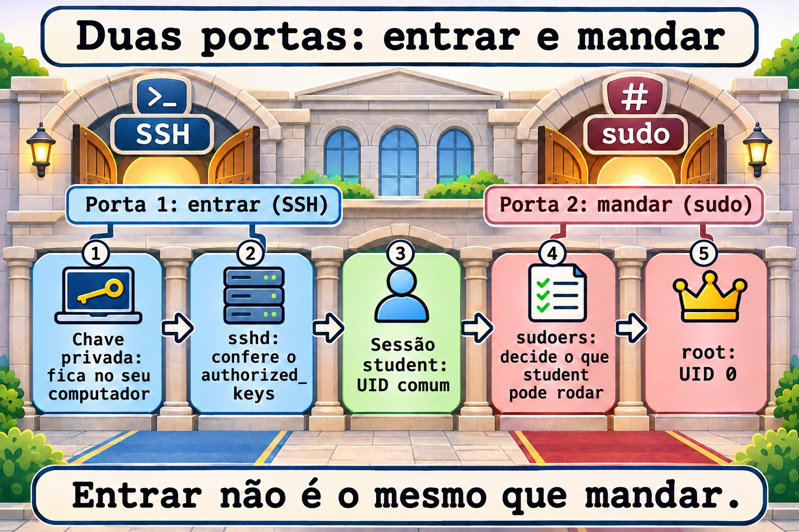
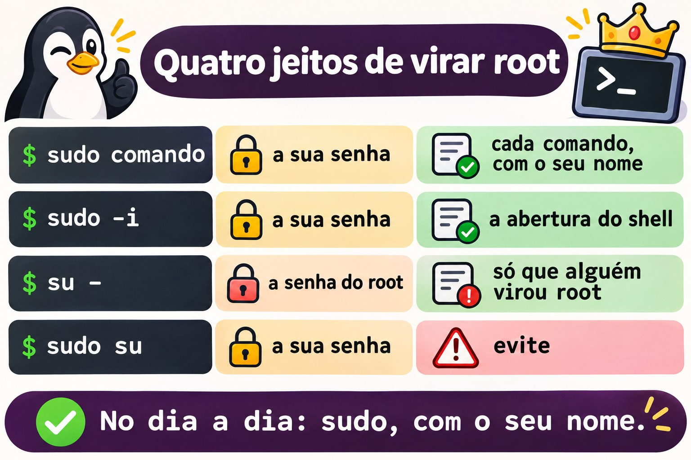
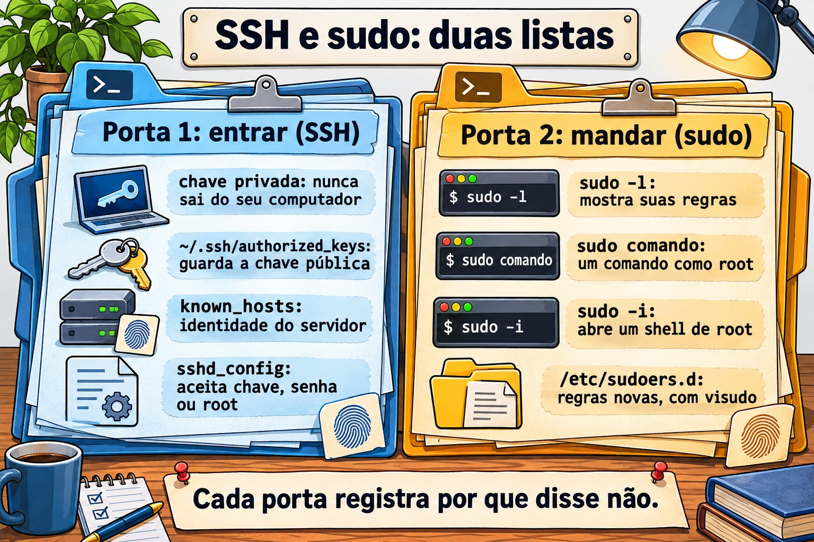
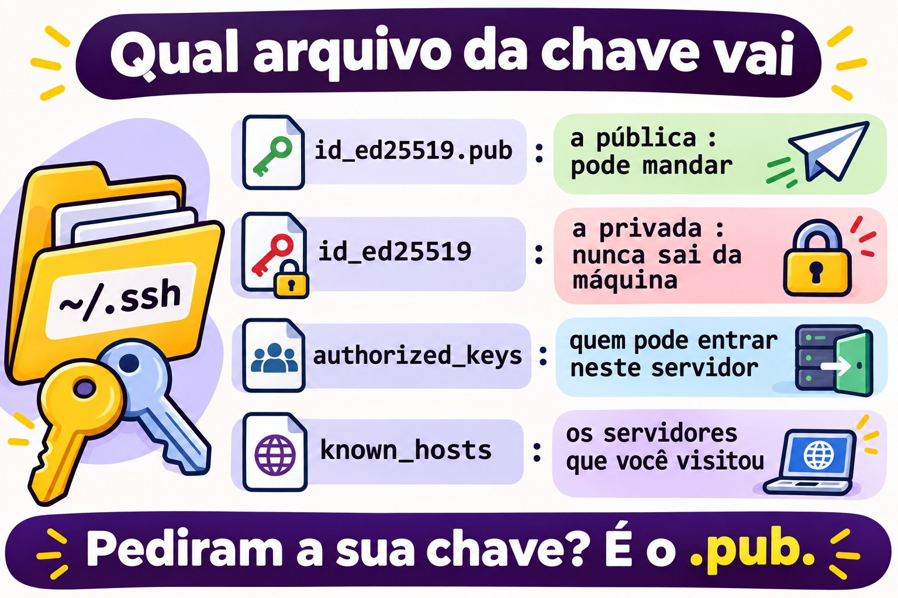
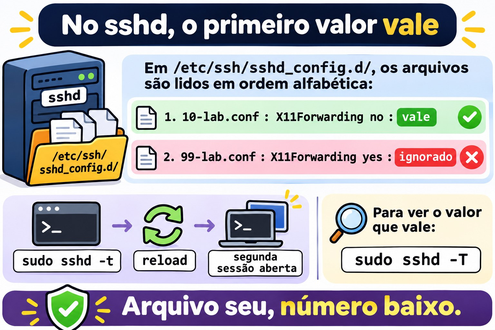
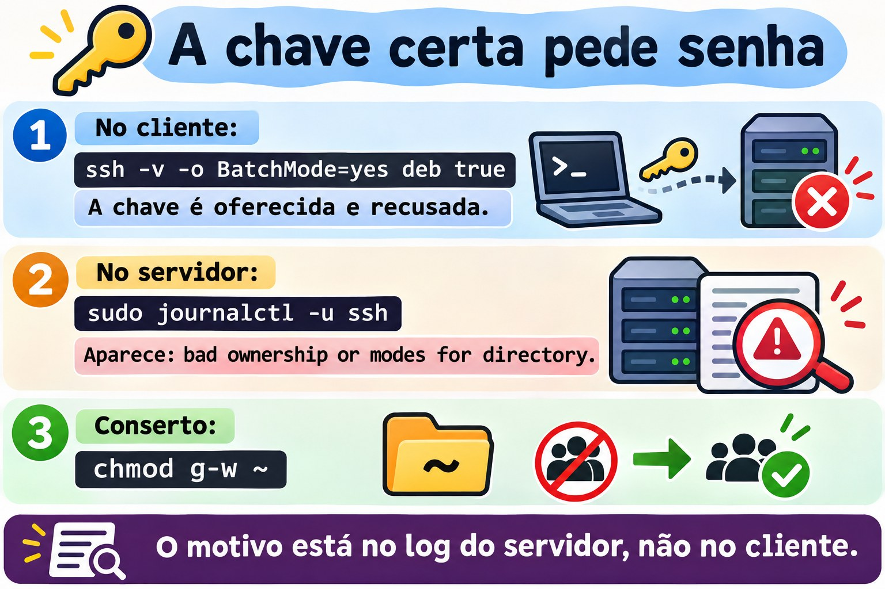

# Aula 2.5 · Acesso remoto e privilégios

Quinta aula do Módulo 2. Quase todo trabalho num servidor começa com duas coisas: entrar nele e ganhar o poder de mexer. As duas parecem simples até falharem. A chave que "sempre funcionou" passa a pedir senha porque alguém deu `chmod` na pasta errada. A regra de `sudo` criada ontem não vale porque o arquivo tem um ponto no nome. O aviso de que a identidade do servidor mudou aparece, e o técnico apaga sem pensar. Hoje você aprende como o SSH decide se deixa você entrar, como o `sudo` decide o que você pode fazer, e onde cada um deixa escrito o motivo quando diz não. No fim, você entra de uma VM na outra sem senha, com um apelido curto, e sabe ler o log quando isso para de funcionar.

| Ficha | Aula 2.5 |
| --- | --- |
| Módulo | M2 · Sistema, usuários e permissões, aula 5 de 8 |
| Quando | Semana 5 |
| Ao final você consegue | Dizer que tipo de conta é cada usuário pelo UID e pelo shell; usar `sudo`, `sudo -i` e `su -` sabendo o que cada um muda; ler e criar regras em `/etc/sudoers.d` com `visudo`; conferir a identidade de um servidor na primeira conexão; criar uma chave SSH, instalá-la em outro servidor e entrar sem senha; usar `~/.ssh/config` para apelidos; copiar arquivos com `scp` e `rsync`; mudar a configuração do `sshd` com um arquivo próprio, testar antes de aplicar e conferir o valor que vale; achar no log por que um login ou um `sudo` foi recusado |
| Pré-requisitos | Aula 2.4 (a escada de rede; as linhas `rocky-lab` e `debian-lab` no `/etc/hosts`); Aula 2.3 (`journalctl -u`); Aula 1.4 (permissões lidas com `ls -l`) |
| Tempo | Cerca de 2h30 |
| Snapshots | m2a5-inicio e m2a5-fim nas duas VMs |

## 1 · Aquecimento

Três perguntas, de cabeça. Escreva as respostas; o Gabarito confere no fim.

1. Você entra num servidor com chave SSH há meses. Hoje ele pede senha. Palpite: o problema está no seu computador ou no servidor?
2. No Windows, um administrador clica em "Executar como administrador". Palpite: no Linux, o `sudo` abre uma sessão de root ou roda só um comando como root?
3. Na primeira vez que você entra num servidor por SSH, ele pergunta `Are you sure you want to continue connecting (yes/no)?`. Palpite: o que essa pergunta protege?

## 2 · Por que importa

Senha por SSH é o primeiro alvo de qualquer servidor exposto. Basta olhar o log de um servidor com a porta 22 aberta para a internet: milhares de tentativas por dia, com `root`, `admin`, `test`, `oracle`. Chave SSH resolve isso, mas só para quem entende o que está fazendo. A chave privada copiada para o servidor errado, o `authorized_keys` com chaves de quem saiu da empresa há três anos e a pasta `.ssh` com permissão aberta são achados comuns em qualquer auditoria.

Com o `sudo` é igual. Uma regra boa diz quem pode fazer o quê, e o log mostra quem fez. Uma regra ruim dá `ALL` para todo mundo, ou é editada sem `visudo` e para de valer sem aviso. E o hábito de entrar como `root` direto apaga o rastro: no log aparece "root fez", e ninguém sabe qual dos cinco técnicos era.

O terceiro ponto é o aviso de identidade. Quando o SSH diz que a chave do servidor mudou, pode ser só uma reinstalação. Pode também ser outra máquina respondendo no lugar dele. Quem apaga o aviso sem conferir treina a si mesmo a ignorar o único alarme que o SSH tem.

## 3 · Modelo mental

> Entrar e mandar são duas portas diferentes. O SSH decide se você entra; o `sudo` decide o que você pode fazer depois. Cada um tem a sua lista, e cada um escreve no log por que disse não.

```text
Seu computador                         Servidor
──────────────                         ────────
~/.ssh/known_hosts   ◄── confere ───   /etc/ssh/ssh_host_*_key.pub   "é mesmo esse servidor?"
~/.ssh/id_ed25519    ─── prova ────►   ~/.ssh/authorized_keys        "você tem a chave privada
 (privada, fica aqui)                   (só as públicas)               de uma destas públicas?"
                                       sshd_config + sshd_config.d   "esse método é permitido?"
                                              │
                                              ▼  entrou como rodrigo
                                       /etc/sudoers + sudoers.d      "rodrigo pode rodar isto
                                                                       como root?"
                                       journal / /var/log/secure     "por que disse não"
```

Quatro ideias carregam a aula:

| Ideia | O que quer dizer | Consequência |
| --- | --- | --- |
| A chave tem duas metades | A privada fica com você e nunca sai; a pública vai para todo servidor onde você quer entrar | Se alguém pede a sua chave, a resposta é sempre o arquivo `.pub` |
| Os dois lados se conferem | O servidor confere a sua chave no `authorized_keys`; você confere a do servidor no `known_hosts` | O aviso de identidade mudada é o seu lado dizendo "não é quem era" |
| O `sshd` é desconfiado | Se a sua pasta pessoal, a `.ssh` ou o `authorized_keys` podem ser alterados por outros, ele ignora a chave | Chave que parou de funcionar é, quase sempre, permissão ou dono errado no servidor |
| `sudo` é por comando e deixa rastro | Cada `sudo` é conferido nas regras e anotado no log com o seu nome | Prefira `sudo comando` a ficar logado como root; o log conta quem fez |



*Entrar não é mandar: SSH e sudo são duas portas com listas e logs próprios.*

## 4 · Conceito em camadas

### Essencial

**Que tipo de conta é esta.** Toda conta tem um número, o UID. O sistema decide quem é quem pelo número, não pelo nome:

```bash
id                                     # você: UID, grupo principal, todos os grupos
id root
getent passwd root rodrigo chronyd     # a linha de cada um no /etc/passwd
```

```text
root:x:0:0:root:/root:/bin/bash
rodrigo:x:1000:1000:Rodrigo:/home/rodrigo:/bin/bash
chronyd:x:994:991:chrony system user:/var/lib/chrony:/sbin/nologin
```

| Campo | Exemplo | Quer dizer |
| --- | --- | --- |
| 1 · nome | `rodrigo` | O nome que você digita |
| 2 · senha | `x` | A senha está no `/etc/shadow`, que só o root lê |
| 3 · UID | `1000` | O número da conta |
| 4 · GID | `1000` | O grupo principal |
| 5 · descrição | `Rodrigo` | Texto livre, o nome completo |
| 6 · pasta pessoal | `/home/rodrigo` | Onde o login começa |
| 7 · shell | `/bin/bash` | O programa que roda no login. `/sbin/nologin` ou `/usr/sbin/nologin` = não entra |

Três tipos de conta, pelo UID:

| Tipo | UID | Para quê | Shell típico |
| --- | --- | --- | --- |
| root | 0 | O administrador. O kernel não confere permissão para o UID 0 | `/bin/bash` |
| Conta de sistema | 1 a 999 | Um serviço roda com ela (`chronyd`, `sshd`, `apache`), para não rodar como root | `nologin` |
| Usuário comum | 1000 em diante | Pessoas | `/bin/bash` |

O nome `root` não tem nada de especial: qualquer conta com UID 0 é root. Uma segunda linha com UID 0 no `/etc/passwd` é um dos primeiros sinais de invasão que uma auditoria procura.

**Quem está aqui.** Três comandos, do mais curto ao mais completo:

```bash
whoami                 # quem eu sou agora
who                    # quem está logado, de onde
w                      # quem está logado e o que está fazendo
last -n 10             # os últimos logins, inclusive os que já saíram
```

**`sudo`: um comando como root.** O `sudo` pede a **sua** senha, confere nas regras se você pode, roda o comando e anota no log:

```bash
sudo whoami            # root
sudo -l                # o que eu posso fazer com sudo
```

Depois da primeira senha, o `sudo` não pede de novo por alguns minutos (5, por padrão). `sudo -k` esquece a senha na hora.

**Entrar em outra máquina.** O SSH já é o que você usa para chegar às VMs:

```bash
ssh rodrigo@10.1.0.52          # usuário@máquina
ssh debian-lab                 # mesmo usuário que você é agora; nome do /etc/hosts
ssh debian-lab 'uptime'        # roda um comando lá e volta
exit                           # sai da sessão remota
```

### Intermediário

**`sudo -i`, `su -` e `sudo su`.** Os três abrem um shell de root, e não são iguais:

| Comando | Pede a senha de quem | Fica no log | Ambiente |
| --- | --- | --- | --- |
| `sudo comando` | A sua | Cada comando, com o seu nome | O seu, com `PATH` seguro |
| `sudo -i` | A sua | A abertura do shell, com o seu nome; o que você faz dentro, não | O do root, como num login |
| `su -` | **A do root** | Só que alguém virou root | O do root, como num login |
| `sudo su` | A sua | Que você rodou `su` | Herdado pela metade: evite |

`su -` exige que o root tenha senha e que você a conheça, o que quer dizer que todo técnico sabe a mesma senha. Em servidor bem configurado, a senha do root fica guardada e ninguém usa no dia a dia: todo mundo entra com o próprio nome e usa `sudo`. O `-` (ou `-l`) do `su` importa: sem ele, você vira root com o ambiente do seu usuário, e comandos de `/usr/sbin` podem não ser encontrados.

**Quem pode usar `sudo`.** As regras ficam em `/etc/sudoers` e nos arquivos de `/etc/sudoers.d/`. A linha que importa no Rocky:

```text
%wheel  ALL=(ALL)       ALL
```

E no Debian:

```text
%sudo   ALL=(ALL:ALL) ALL
```

| Pedaço | Quer dizer |
| --- | --- |
| `%wheel` | Quem: o `%` quer dizer grupo. Sem `%`, é um usuário |
| `ALL=` | Em quais máquinas a regra vale. Na prática, sempre `ALL` |
| `(ALL)` ou `(ALL:ALL)` | Como quem você pode rodar: qualquer usuário (e qualquer grupo) |
| `ALL` no fim | Quais comandos. Pode ser uma lista com caminho completo |

Para dar `sudo` a alguém, a regra prática é pôr no grupo, não escrever regra nova: `wheel` no Rocky, `sudo` no Debian. Para dar só um comando, crie um arquivo em `/etc/sudoers.d/`, **sempre** com `visudo`:

```bash
sudo visudo -f /etc/sudoers.d/backup
```

```text
backup  ALL=(root)  NOPASSWD: /usr/bin/systemctl restart chronyd
```

O `visudo` abre o editor, e ao salvar confere a sintaxe; se houver erro, ele pergunta antes de gravar. `sudo visudo -c` confere todos os arquivos de uma vez.

**A identidade do servidor.** Na primeira conexão, o SSH mostra a impressão digital da chave do servidor:

```text
The authenticity of host 'debian-lab (10.1.0.52)' can't be established.
ED25519 key fingerprint is SHA256:Qm3k...x9E.
Are you sure you want to continue connecting (yes/no/[fingerprint])?
```

O certo é comparar com a impressão digital que o próprio servidor mostra, por outro caminho (o console do Proxmox, a documentação):

```bash
ssh-keygen -lf /etc/ssh/ssh_host_ed25519_key.pub     # no servidor
```

Se baterem, `yes`. A chave vai para o seu `~/.ssh/known_hosts`, e daí em diante o SSH confere sozinho a cada conexão.

**Chave SSH em quatro comandos.**

```bash
ssh-keygen -t ed25519 -C "rodrigo@rocky-lab"     # cria o par; peça uma frase-senha
ls -l ~/.ssh/                                    # id_ed25519 (privada) e id_ed25519.pub (pública)
ssh-copy-id debian-lab                           # instala a pública lá; pede a senha uma última vez
ssh debian-lab                                   # entra com a chave
```

O `ssh-copy-id` acrescenta a chave pública ao `~/.ssh/authorized_keys` do outro lado e acerta as permissões. Cada linha desse arquivo é uma chave que pode entrar como aquele usuário.

A frase-senha protege a chave privada se alguém copiar o arquivo. Para não digitá-la a cada conexão, o `ssh-agent` guarda a chave aberta na memória enquanto a sessão dura:

```bash
eval "$(ssh-agent -s)"
ssh-add                    # pede a frase-senha uma vez
ssh-add -l                 # as chaves que o agente guarda
```

**Copiar arquivos.** O `scp` copia como o `cp`, com `máquina:` na frente do caminho remoto:

```bash
scp arquivo.txt debian-lab:/tmp/            # daqui para lá
scp debian-lab:/etc/os-release ./           # de lá para cá
```

Para pastas e cópias que se repetem, o `rsync` só copia o que mudou:

```bash
rsync -av pasta/ debian-lab:~/pasta/        # -a preserva permissões e datas; -v mostra
rsync -av --dry-run pasta/ debian-lab:~/pasta/   # mostra o que faria, sem fazer
```

A barra no fim de `pasta/` muda tudo: com barra, copia o **conteúdo** da pasta; sem barra, copia a pasta **dentro** do destino. Na dúvida, `--dry-run`.



*Quatro jeitos de virar root: de quem é a senha e o que fica no log.*

### Ponte Windows

| No Windows | No Linux | O que muda |
| --- | --- | --- |
| Grupo Administradores | Grupo `wheel` (Rocky) ou `sudo` (Debian) | Estar no grupo não faz nada sozinho: você ainda pede com `sudo` |
| "Executar como administrador" (UAC) | `sudo comando` | Um comando por vez, com a sua senha, anotado no log |
| `runas /user:outro` | `sudo -u outro comando` |  |
| Conta Administrator embutida | `root` | Em servidor bem configurado, ninguém entra como root direto |
| Área de Trabalho Remota, PowerShell Remoting | `ssh` | Texto, não tela; o mesmo protocolo para entrar e para copiar |
| PuTTY e Pageant | `ssh` e `ssh-agent` | O Windows 10 e 11 já trazem o OpenSSH: `ssh` funciona no PowerShell |
| WinSCP | `scp`, `sftp`, `rsync` |  |
| Chaves em `C:\Users\voce\.ssh\` | Chaves em `~/.ssh/` | Mesmo formato. No Windows não há `ssh-copy-id`: veja abaixo |

Do seu PC Windows para as VMs, sem `ssh-copy-id`, pelo PowerShell:

```text
ssh-keygen -t ed25519
type $env:USERPROFILE\.ssh\id_ed25519.pub | ssh rodrigo@10.1.0.51 "mkdir -p ~/.ssh && chmod 700 ~/.ssh && cat >> ~/.ssh/authorized_keys && chmod 600 ~/.ssh/authorized_keys"
```

### Avançado

**Por que o `sshd` recusa uma chave certa.** Com `StrictModes yes`, o padrão, o `sshd` confere o dono e as permissões da sua pasta pessoal, da `~/.ssh` e do `~/.ssh/authorized_keys`. Se qualquer um deles puder ser alterado pelo grupo ou por outros, ele ignora as chaves e passa para o próximo método, em geral a senha. O cliente não sabe por quê: só vê o pedido de senha. O motivo está no log do servidor:

```text
Authentication refused: bad ownership or modes for directory /home/rodrigo
```

| Caminho | Permissão segura |
| --- | --- |
| `~` (a pasta pessoal) | Sem escrita para grupo e outros: `700` ou `755` |
| `~/.ssh` | `700` |
| `~/.ssh/authorized_keys` | `600` |
| `~/.ssh/id_ed25519` (privada, no cliente) | `600`. Aberta demais, o próprio `ssh` recusa: `UNPROTECTED PRIVATE KEY FILE!` |
| `~/.ssh/config` (no cliente) | `600`. Aberto demais: `Bad owner or permissions` |

No Rocky há uma segunda causa: o SELinux. Um `authorized_keys` criado em `/tmp` e movido com `mv` leva junto o rótulo errado, e o `sshd` não consegue ler. `restorecon -Rv ~/.ssh` resolve. O SELinux tem um módulo próprio mais adiante; por ora, guarde que chave recusada no Rocky com permissões certas é o próximo suspeito.

**`ssh -v` mostra a conversa.** Do lado do cliente, o `-v` mostra cada método tentado:

```text
debug1: Offering public key: /home/rodrigo/.ssh/id_ed25519 ED25519 SHA256:...
debug1: Authentications that can continue: publickey,password
debug1: Next authentication method: password
```

"Offering" seguido de "can continue" quer dizer que o servidor recebeu a chave e não aceitou. Se a linha "Offering" nem aparece, o problema é do seu lado: a chave não existe, está em outro nome ou o `~/.ssh/config` aponta outra.

**A configuração do `sshd` vale pelo primeiro valor.** O `/etc/ssh/sshd_config` começa com `Include /etc/ssh/sshd_config.d/*.conf`, e os arquivos são lidos em ordem alfabética. Para a maioria das opções, **o primeiro valor encontrado vale**, e os seguintes são ignorados. Por isso o seu arquivo deve ter um número baixo, como `10-empresa.conf`: um `99-empresa.conf` perde para o `50-redhat.conf` do Rocky em tudo o que os dois definirem. O jeito de saber o que vale de verdade:

```bash
sudo sshd -t                                   # confere a sintaxe; sem saída = ok
sudo sshd -T | grep -i passwordauthentication  # o valor que vale, depois de ler tudo
```

Mudou? `sudo sshd -t` antes, `systemctl reload` depois, e uma segunda sessão aberta enquanto testa. Um erro no `sshd_config` com a única sessão fechada é ida ao console.

**`~/.ssh/config`, apelidos e padrões.** No cliente, um arquivo junta o que você digitaria toda vez:

```text
Host deb
    HostName debian-lab
    User rodrigo
    IdentityFile ~/.ssh/id_ed25519

Host *
    ServerAliveInterval 60
```

`ssh deb`, `scp arquivo deb:/tmp/` e `rsync ... deb:` passam a usar tudo isso. O `ServerAliveInterval` manda um sinal a cada 60 segundos e evita que firewalls derrubem a sessão parada.

**O `sudoers.d` ignora arquivos com ponto.** O `sudo` lê os arquivos de `/etc/sudoers.d/` mas pula os que têm `.` no nome ou terminam em `~`. Um `/etc/sudoers.d/backup.conf` é ignorado sem aviso nenhum. É a causa número um de "criei a regra e não funciona". E a linha `#includedir /etc/sudoers.d` no fim do `/etc/sudoers` do Rocky **não** é comentário, apesar do `#`: é a instrução que lê a pasta. No Debian 13 ela aparece como `@includedir`, que faz o mesmo.

**O log do `sudo` e do SSH.**

```bash
sudo journalctl _COMM=sudo -n 10          # os últimos sudo, nas duas
sudo journalctl -u sshd -n 20             # Rocky; no Debian, -u ssh
sudo tail -20 /var/log/secure             # Rocky: sudo, su e SSH no mesmo arquivo
```

## 5 · Rocky × Debian

| O quê | Rocky 9 | Debian 13 |
| --- | --- | --- |
| Grupo com `sudo` | `wheel` | `sudo` |
| Inclusão do `sudoers.d` | `#includedir /etc/sudoers.d` | `@includedir /etc/sudoers.d` |
| Unidade do SSH | `sshd.service` | `ssh.service` (o nome `sshd` também funciona, como apelido) |
| Arquivo extra do fabricante | `/etc/ssh/sshd_config.d/50-redhat.conf` | Nenhum por padrão |
| Log de `sudo`, `su` e SSH | `/var/log/secure` e o journal | Só o journal, porque o `rsyslog` não vem instalado |
| `known_hosts` | Nomes legíveis | Nomes embaralhados (`HashKnownHosts yes` no `/etc/ssh/ssh_config`): procure com `ssh-keygen -F nome` |
| `PermitRootLogin` padrão | `prohibit-password` (root só com chave), a não ser que você tenha marcado outra opção na instalação | `prohibit-password` |
| Shell das contas de sistema | `/sbin/nologin` | `/usr/sbin/nologin` |
| UID do primeiro usuário | 1000 | 1000 |
| Senha do root | Definida ou bloqueada, conforme a instalação: `sudo passwd -S root` | Se você deu senha ao root na instalação, o primeiro usuário não entra no grupo `sudo` |
| `last` | Já instalado | Se faltar, `sudo apt install wtmpdb` e use `wtmpdb last` |
| `rsync` | `dnf install rsync` se faltar | `apt install rsync` se faltar |
| SELinux olhando o `~/.ssh` | Sim | Não (o Debian não ativa SELinux) |

## 6 · Lab guiado

Neste lab as duas VMs conversam entre si: a rocky-lab é o "seu computador" e a debian-lab é o "servidor". Mantenha um terminal aberto em cada uma, a partir do seu PC, como nas aulas anteriores. Os passos dizem em qual VM rodar. Os nomes `rocky-lab` e `debian-lab` vêm do `/etc/hosts` que você ajustou na Aula 2.4; se `getent hosts debian-lab` vier vazio na rocky-lab, acrescente a linha antes de começar.


*Entrar não é o mesmo que mandar. Um usuário pode entrar por SSH e não ter sudo nenhum.*


### Passo 0 · Snapshot

No Proxmox, tire o snapshot `m2a5-inicio` das duas VMs. Neste lab você mexe no `sshd` e no `sudo`, as duas portas por onde você entra. Se fechar as duas, o console do Proxmox e o snapshot são a sua volta.

### Passo 1 · Quem é quem nas contas

Na rocky-lab:

```bash
id
whoami
getent passwd root "$USER"
awk -F: '$3 == 0 {print $1}' /etc/passwd                        # quem tem UID 0
awk -F: '$3 >= 1 && $3 < 1000 {print $1, $3, $7}' /etc/passwd   # contas de sistema
awk -F: '$3 >= 1000 && $3 < 60000 {print $1, $3, $7}' /etc/passwd   # pessoas
```

O primeiro `awk` deve listar só `root`. O segundo lista dezenas de contas, quase todas com `nologin` no fim: são os serviços. O terceiro deve listar só você. O limite de 60000 tira da lista a conta `nobody` (UID 65534), que é de sistema apesar do número alto.

Agora quem está na máquina:

```bash
who
w
last -n 5
```

O `who` mostra as suas sessões SSH, com o IP do seu PC entre parênteses. O `w` mostra, além disso, o que cada sessão está rodando e há quanto tempo está parada. O `last` lê o histórico: inclusive os logins que já saíram e os reboots.

Repita na debian-lab. Lá, o shell das contas de sistema aparece como `/usr/sbin/nologin`. Se o `last` não existir, instale o substituto: `sudo apt install wtmpdb` e use `wtmpdb last -n 5`.

**Decida 1 · A linha estranha.** Numa auditoria, o `getent passwd` de um servidor de cliente mostra, entre as contas normais, esta linha:

```text
suporte:x:0:1001:Suporte Externo:/home/suporte:/bin/bash
```

O que ela é?

- **A)** Um usuário comum: o nome não é `root`, e a pasta pessoal fica em `/home`.
- **B)** Uma segunda conta root, com outro nome. Precisa ser investigada.
- **C)** Uma conta de sistema, porque o nome é de um serviço.
- **D)** Inofensiva, porque o grupo principal é 1001, que é de usuário comum.

Escolha a letra antes de olhar a tabela.

| Se você marcou | Resultado | Por quê |
| --- | --- | --- |
| A | ❌ Errada | O sistema não olha o nome nem a pasta: olha o UID. Com UID 0, quem entra como `suporte` tem todo o poder do root. |
| B | ✅ Certa | UID 0 é root, qualquer que seja o nome. Pode ser um atalho criado por um técnico antigo ou uma porta dos fundos. Nos dois casos, não é correção que você faz sozinho: anote, mostre ao responsável e veja no `last suporte` quem tem usado. |
| C | ❌ Errada | Conta de sistema tem UID entre 1 e 999 e, em geral, `nologin`. Esta tem UID 0 e `/bin/bash`. |
| D | ❌ Errada | O grupo principal não limita nada. O kernel não confere permissão para o UID 0, seja qual for o grupo. |

**Para fixar:** quem manda é o número. `awk -F: '$3 == 0' /etc/passwd` deve listar só `root`.

### Passo 2 · `sudo` e `su`, e o rastro de cada um

Na rocky-lab:

```bash
getent group wheel           # você deve aparecer no fim da linha
sudo -l                      # o que você pode fazer
sudo -u nobody id            # rodar como outro usuário, não só como root
sudo -k                      # esquece a senha
sudo -n true; echo "rc=$?"   # -n = não pergunte; sem senha guardada, falha
```

O `sudo -l` termina com uma linha `(ALL) ALL`: vem da regra do grupo `wheel`. O `sudo -n` responde `a password is required` e `rc=1`. É assim que um script descobre, sem travar, que precisaria de senha.

Agora os três jeitos de virar root. Rode cada um, olhe a saída e saia com `exit`:

```bash
sudo -i
whoami; pwd; echo "$HOME"
exit
```

Você é root, em `/root`, com o ambiente do root. Agora o `su -`:

```bash
sudo passwd -S root
su -
```

O `passwd -S` mostra o estado da senha do root. Se aparecer `L` ou `LK`, a senha está bloqueada, e o `su -` vai falhar com `Authentication failure`. Esse é o normal num servidor bem configurado: ninguém usa a senha do root. Se aparecer `P` ou `PS` e você souber a senha, o `su -` funciona e pede a senha **do root**, não a sua. Não crie nem mude a senha do root para este passo.

Agora o rastro. Na rocky-lab:

```bash
sudo journalctl _COMM=sudo -n 6 --no-pager
sudo grep -E 'sudo|su:' /var/log/secure | tail -6
```

Cada `sudo` aparece com o seu nome, o diretório onde você estava e o comando completo: `rodrigo : TTY=pts/0 ; PWD=/home/rodrigo ; USER=nobody ; COMMAND=/usr/bin/id`. O `sudo -i` aparece como `COMMAND=/bin/bash`, e o que você fez dentro dele não aparece. Esse é o preço de ficar num shell de root.

Repita na debian-lab, trocando `wheel` por `sudo` no `getent group` e pulando o `grep` do `/var/log/secure`, que não existe lá: o journal guarda tudo.

**Decida 2 · Vinte minutos de root.** Você vai investigar um problema e precisa rodar uma sequência de comandos como root durante uns vinte minutos. A empresa exige saber quem fez cada manutenção. Qual você usa?

- **A)** `sudo -i`
- **B)** `su -`
- **C)** `sudo su`
- **D)** `su`, sem o hífen

Escolha a letra antes de olhar a tabela.

| Se você marcou | Resultado | Por quê |
| --- | --- | --- |
| A | ✅ Certa | Pede a sua senha, deixa no log que **você** abriu o shell de root, e dá o ambiente do root, como num login. Para o rastro ficar completo, o melhor de tudo é `sudo comando` a cada comando, mas para uma sessão longa o `sudo -i` é o padrão. |
| B | ⚠️ Funciona, mas | Você vira root, mas precisou da senha do root, que então é conhecida por mais gente. O log diz que alguém virou root a partir da sua sessão, mas a política "cada um com o seu nome" deixa de valer quando todos sabem a mesma senha. |
| C | ⚠️ Funciona, mas | O log mostra que você rodou `su`, então o rastro existe. Mas são dois programas para fazer o trabalho de um, e o ambiente fica herdado pela metade. `sudo -i` faz o mesmo, direito. |
| D | ❌ Errada | Pede a senha do root e mantém o seu ambiente. No Debian, o `PATH` do usuário não tem `/usr/sbin`, e comandos como `useradd` dão `command not found`. |

**Para fixar:** shell de root com rastro = `sudo -i`. Um comando só = `sudo comando`.

### Passo 3 · A primeira conexão e a identidade do servidor

Na **debian-lab**, descubra a impressão digital da chave do próprio servidor:

```bash
ssh-keygen -lf /etc/ssh/ssh_host_ed25519_key.pub
```

Anote o pedaço depois de `SHA256:`. Na **rocky-lab**, conecte:

```bash
ssh debian-lab
```

O SSH mostra `ED25519 key fingerprint is SHA256:...` e pergunta se você confia. Compare com o que você anotou. Se for igual, `yes`, e digite a senha do seu usuário na debian-lab. Dentro dela:

```bash
hostname
who                  # a sua sessão vinda de 10.1.0.51 (ou de rocky-lab)
exit
```

Se o SSH não perguntou nada, você já tinha conectado antes: `ssh-keygen -F debian-lab` mostra a linha guardada.

Agora veja o que ficou guardado, na rocky-lab:

```bash
cat ~/.ssh/known_hosts
ssh-keygen -F debian-lab
```

No Rocky, a linha começa com o nome `debian-lab`, legível. O SSH guarda o nome **que você digitou**: um `ssh 10.1.0.52` perguntaria de novo, porque para ele é outra entrada.

Agora o caminho contrário. Na rocky-lab, rode `ssh-keygen -lf /etc/ssh/ssh_host_ed25519_key.pub` e anote a impressão digital dela. Na debian-lab, conecte, compare antes do `yes` e digite a senha:

```bash
ssh rocky-lab hostname
cat ~/.ssh/known_hosts
ssh-keygen -F rocky-lab
```

No Debian, a linha do `known_hosts` começa com `|1|` seguido de letras: o nome está embaralhado (`HashKnownHosts yes`). Quem copiar o arquivo não descobre para onde você costuma ir. O `ssh-keygen -F rocky-lab` acha a linha mesmo assim.

### Passo 4 · Uma chave, instalada no outro lado

Na rocky-lab, crie o par de chaves. Quando pedir a frase-senha, use uma de verdade: é o que protege a chave se alguém copiar o arquivo.

```bash
ssh-keygen -t ed25519 -C "rodrigo@rocky-lab"
ls -l ~/.ssh/
cat ~/.ssh/id_ed25519.pub
```

O `ls -l` mostra a privada `id_ed25519` com `-rw-------` (600) e a pública `id_ed25519.pub` com `-rw-r--r--` (644). A pública é uma linha só: o tipo, a chave e o comentário.

**Decida 3 · O arquivo que vai.** Uma colega que administra a debian-lab escreve: "me manda a sua chave SSH que eu libero o seu acesso". Qual arquivo você manda?

- **A)** `~/.ssh/id_ed25519.pub`
- **B)** `~/.ssh/id_ed25519`
- **C)** `~/.ssh/known_hosts`
- **D)** O `~/.ssh/authorized_keys` da rocky-lab

Escolha a letra antes de olhar a tabela.

| Se você marcou | Resultado | Por quê |
| --- | --- | --- |
| A | ✅ Certa | A pública é feita para ser distribuída. Ela entra no `authorized_keys` do servidor, e só quem tem a privada correspondente consegue usá-la. |
| B | ❌ Errada | É a privada. Quem tiver esse arquivo entra como você em todo servidor que confia nessa chave. Se ela saiu da sua máquina, a resposta é gerar outra e trocar em todo lugar. |
| C | ❌ Errada | É a lista das impressões digitais dos servidores que **você** visitou. Não dá acesso a nada, e entrega para onde você costuma ir. |
| D | ❌ Errada | É a lista de quem pode entrar **na rocky-lab**. Não tem nada seu, a não ser que você tenha posto lá. |

**Para fixar:** a privada nunca sai da máquina onde foi criada. Pediram a chave? É o `.pub`.

Agora instale a pública na debian-lab. O `ssh-copy-id` pede a sua senha da debian-lab uma última vez:

```bash
ssh-copy-id debian-lab
```

Na **debian-lab**, confira o que ele fez:

```bash
ls -ld ~/.ssh ~/.ssh/authorized_keys
cat ~/.ssh/authorized_keys
```

A pasta com `drwx------` (700), o arquivo com `-rw-------` (600), e dentro dele a mesma linha do `cat ~/.ssh/id_ed25519.pub` da rocky-lab.

Volte à rocky-lab e entre:

```bash
ssh debian-lab hostname
```

Leia com atenção o que ele pede. Não é mais `rodrigo@debian-lab's password:`, a senha do servidor. É `Enter passphrase for key '/home/rodrigo/.ssh/id_ed25519':`, a frase-senha da sua chave, que nunca viaja pela rede. Para não digitar a frase a cada conexão, carregue o agente:

```bash
eval "$(ssh-agent -s)"
ssh-add
ssh-add -l
ssh debian-lab hostname          # agora sem perguntar nada
```

O agente vale para este terminal. Feche o terminal e ele vai embora, junto com a chave aberta na memória.



*Dos arquivos da pasta ~/.ssh, só o .pub pode ser enviado.*

### Passo 5 · Um apelido e comandos remotos

Na rocky-lab, crie o `~/.ssh/config`:

```bash
cat >> ~/.ssh/config <<'EOF'
Host deb
    HostName debian-lab
    User rodrigo
    IdentityFile ~/.ssh/id_ed25519

Host *
    ServerAliveInterval 60
EOF
chmod 600 ~/.ssh/config
```

Agora `deb` basta:

```bash
ssh deb hostname
ssh deb 'uptime; df -h /'
ssh -t deb 'sudo systemctl status ssh --no-pager | head -5'
```

O `-t` dá um terminal à sessão, e o `sudo` lá do outro lado precisa dele para perguntar a senha. Sem o `-t`, o `sudo` remoto reclama que não tem onde perguntar.

Agora o teste que os scripts usam. O `BatchMode=yes` proíbe o SSH de perguntar qualquer coisa: se ele precisaria pedir senha ou frase-senha, falha na hora em vez de travar.

```bash
ssh -o BatchMode=yes -o ConnectTimeout=5 deb true && echo "chave ok"
```

Com o agente carregado, responde `chave ok`. Num terminal novo, sem o agente, o mesmo comando falha com `Permission denied`: a chave existe, mas está fechada pela frase-senha. É assim que você confere, numa lista de servidores, onde a chave já funciona:

```bash
for h in deb; do
    printf '%-12s ' "$h"
    ssh -o BatchMode=yes -o ConnectTimeout=5 "$h" 'hostname' 2>&1 | head -1
done
```

Hoje a lista tem um nome só. Na vida real, ela tem vinte, e o laço mostra numa tela quais respondem.

### Passo 6 · Copiar arquivos

Na rocky-lab, prepare uma pasta:

```bash
mkdir -p ~/lab-copia/sub
echo um > ~/lab-copia/a.txt
echo dois > ~/lab-copia/sub/b.txt
```

O `scp`, para um arquivo:

```bash
scp ~/lab-copia/a.txt deb:/tmp/
ssh deb cat /tmp/a.txt
scp deb:/etc/os-release ~/os-release-debian
head -2 ~/os-release-debian
```

O `rsync` precisa estar instalado **nas duas pontas**. Na rocky-lab:

```bash
sudo dnf install -y rsync
ssh -t deb 'sudo apt install -y rsync'
```

Agora a cópia de pasta, primeiro mostrando o que faria:

```bash
rsync -av --dry-run ~/lab-copia/ deb:lab-copia/
rsync -av ~/lab-copia/ deb:lab-copia/
ssh deb 'find ~/lab-copia -type f'
```

Os dois arquivos aparecem lá, em `~/lab-copia/a.txt` e `~/lab-copia/sub/b.txt`. Rode o mesmo `rsync` de novo: ele lista a pasta e não copia nada, porque nada mudou. Mude um arquivo e rode outra vez:

```bash
echo um-mudado > ~/lab-copia/a.txt
rsync -av ~/lab-copia/ deb:lab-copia/       # só a.txt
sha256sum ~/lab-copia/a.txt
ssh deb sha256sum lab-copia/a.txt           # o mesmo hash
```

Agora o erro clássico, de propósito. Sem a barra no fim da origem:

```bash
rsync -av ~/lab-copia deb:lab-copia/
ssh deb 'find ~/lab-copia -type f'
```

Apareceu `~/lab-copia/lab-copia/a.txt`: sem a barra, o `rsync` copiou a **pasta** para dentro do destino. Com a barra, copia o **conteúdo**. Num backup de verdade, esse engano duplica dados, ou pior, com `--delete`, apaga o destino certo.

Limpe as duas pontas:

```bash
ssh deb 'rm -r ~/lab-copia /tmp/a.txt'
rm -r ~/lab-copia ~/os-release-debian
```

### Passo 7 · Mudar o `sshd` sem se trancar

Antes de mexer no `sshd`, a regra: **uma segunda sessão aberta na mesma VM**, que você não fecha até o fim do passo. Se a mudança der errado, é por ela que você desfaz.

Hoje você muda uma opção inofensiva, que não afeta o login: `X11Forwarding`, que permite abrir janelas gráficas pela conexão. **Não** mexa em `PasswordAuthentication` nem em `PermitRootLogin` no lab de hoje.

Na **debian-lab**:

```bash
grep -n -i -E '^include|x11forwarding' /etc/ssh/sshd_config
ls /etc/ssh/sshd_config.d/
sudo sshd -T | grep -i x11forwarding
```

O `Include` aparece no topo do arquivo, e o `X11Forwarding yes` mais abaixo. O `sshd -T` responde `x11forwarding yes`. Crie o seu arquivo:

```bash
echo 'X11Forwarding no' | sudo tee /etc/ssh/sshd_config.d/10-lab.conf
sudo sshd -t && sudo systemctl reload ssh
sudo sshd -T | grep -i x11forwarding
```

Agora responde `no`. O seu arquivo é lido pelo `Include`, no topo, antes da linha `X11Forwarding yes` do arquivo principal, e o primeiro valor vale. O `sshd -t` sem saída quer dizer sintaxe certa; o `&&` só faz o reload se ela passar.

Agora prove a regra do primeiro valor:

```bash
echo 'X11Forwarding yes' | sudo tee /etc/ssh/sshd_config.d/99-lab.conf
sudo sshd -T | grep -i x11forwarding
```

Continua `no`. O `99-lab.conf` foi lido, mas depois do `10-lab.conf`, e o valor dele foi ignorado. Agora na **rocky-lab**:

```bash
ls /etc/ssh/sshd_config.d/
grep -i x11 /etc/ssh/sshd_config.d/50-redhat.conf
echo 'X11Forwarding no' | sudo tee /etc/ssh/sshd_config.d/99-lab.conf
sudo sshd -t && sudo systemctl reload sshd
sudo sshd -T | grep -i x11forwarding
```

**Decida 4 · O valor que não pegou.** Na rocky-lab, o `sshd -t` passou, o reload foi feito, e o `sshd -T` continua respondendo `x11forwarding yes`. Por quê?

- **A)** O `50-redhat.conf` é lido antes do `99-lab.conf` e já define `X11Forwarding yes`; o primeiro valor vale. O arquivo precisa de um número menor, como `10-lab.conf`.
- **B)** O `reload` não basta: é preciso `systemctl restart sshd`.
- **C)** Há um erro de sintaxe no `99-lab.conf`.
- **D)** O certo é escrever a linha no fim do `/etc/ssh/sshd_config`, não em `sshd_config.d`.

Escolha a letra antes de olhar a tabela.

| Se você marcou | Resultado | Por quê |
| --- | --- | --- |
| A | ✅ Certa | O `grep` mostrou a linha no `50-redhat.conf`. Em ordem alfabética, `50` vem antes de `99`, e o `sshd` fica com o primeiro valor que lê. Renomeie para `10-lab.conf` e o `sshd -T` muda. |
| B | ❌ Errada | O `sshd -T` nem olha o processo que está rodando: ele lê os arquivos e mostra o resultado. Se o `-T` diz `yes`, os arquivos dizem `yes`, e nenhum restart muda isso. |
| C | ❌ Errada | O `sshd -t` teria mostrado o erro, e o `&&` teria impedido o reload. |
| D | ❌ Errada | O `Include` está no topo do `sshd_config`. Uma linha no fim do arquivo principal é lida **depois** de todos os arquivos de `sshd_config.d`, e perde para o `50-redhat.conf` do mesmo jeito. |

**Para fixar:** no `sshd`, o primeiro valor vale. Arquivo seu = número baixo. E quem diz o que vale é o `sshd -T`, não o arquivo que você editou.

Se o seu `grep` no `50-redhat.conf` não mostrou nenhuma linha `X11Forwarding`, a sua versão não define essa opção ali, e o `sshd -T` já respondeu `no`. A regra continua valendo para as opções que ele define: `grep -v '^#' /etc/ssh/sshd_config.d/50-redhat.conf` mostra quais.

Conserte e confira:

```bash
sudo mv /etc/ssh/sshd_config.d/99-lab.conf /etc/ssh/sshd_config.d/10-lab.conf
sudo sshd -t && sudo systemctl reload sshd
sudo sshd -T | grep -i x11forwarding        # no
```

Desfaça tudo nas duas VMs. Na rocky-lab:

```bash
sudo rm /etc/ssh/sshd_config.d/10-lab.conf
sudo sshd -t && sudo systemctl reload sshd
sudo sshd -T | grep -i x11forwarding        # yes, como antes
```

Na debian-lab:

```bash
sudo rm /etc/ssh/sshd_config.d/10-lab.conf /etc/ssh/sshd_config.d/99-lab.conf
sudo sshd -t && sudo systemctl reload ssh
sudo sshd -T | grep -i x11forwarding        # yes, como antes
```

Só agora feche a segunda sessão.



*No sshd, o primeiro valor lido vale: o arquivo com número baixo ganha.*

### Passo 8 · O roteiro de "não consigo entrar por SSH"

Quando alguém diz que não entra, a mensagem do cliente aponta o degrau. Os três primeiros são da Aula 2.4; os outros são desta aula.

| O cliente mostra | O degrau | O que olhar |
| --- | --- | --- |
| Fica parado até `Connection timed out` | Rede ou firewall descartando | A escada da Aula 2.4 |
| `No route to host` | Rede, ou firewall rejeitando | `sudo firewall-cmd --list-all` no destino |
| `Connection refused` | O `sshd` não escuta ali | `systemctl status sshd` (ou `ssh`); `sudo ss -tlnp \| grep :22` |
| `WARNING: REMOTE HOST IDENTIFICATION HAS CHANGED!` | A identidade do servidor | Confira a impressão digital por outro caminho antes de qualquer coisa |
| `Permission denied (publickey)` | O servidor só aceita chave, e nenhuma foi aceita | `ssh -v`; no servidor, o log e as permissões |
| Pede senha quando devia usar a chave | A chave foi oferecida e recusada | O log do servidor diz o motivo |
| `Permission denied (publickey,password)` depois da senha | Senha errada, ou o usuário não pode entrar | O log do servidor: `Failed password` ou `not allowed` |
| `UNPROTECTED PRIVATE KEY FILE!` | A sua chave privada, no cliente | `chmod 600 ~/.ssh/id_ed25519` |
| `Bad owner or permissions on ~/.ssh/config` | O seu `config`, no cliente | `chmod 600 ~/.ssh/config` |

Na rocky-lab, veja primeiro o caminho de sucesso, contado pelo `-v`:

```bash
ssh -v deb true 2>&1 | grep -E 'Offering|Authentications that|Authenticated to'
```

Você vê a chave oferecida e, no fim, `Authenticated to debian-lab ... using "publickey"`. Agora force uma falha, proibindo a chave e as perguntas:

```bash
ssh -o PubkeyAuthentication=no -o BatchMode=yes deb true
```

A resposta é `Permission denied (publickey,password)`: o servidor oferece os dois métodos, e você não pôde usar nenhum. Na **debian-lab**, veja como o servidor contou a mesma história:

```bash
sudo journalctl -u ssh -n 5 --no-pager
```

Aparece uma linha como `Connection closed by authenticating user rodrigo 10.1.0.51 port ... [preauth]`: o usuário, o IP de onde veio e o fato de que não chegou a entrar. Cliente e servidor, lado a lado, contam a mesma conexão. Esse é o hábito: **quando o SSH diz não, leia os dois lados**.

## 7 · Quebre e conserte

### Quebra A · A chave que voltou a pedir senha

O chamado: "ontem eu entrava sem senha no servidor, hoje ele pede". Ninguém mexeu na chave. Reproduza na **debian-lab**. Antes, garanta que o terminal da debian-lab que você abriu do seu PC continua aberto, e não o feche durante a quebra: sessões abertas não caem, mas conexões novas podem passar a pedir senha.

```bash
ls -ld ~                 # anote a permissão de agora
chmod g+w ~
ls -ld ~
```

Na rocky-lab, com o agente carregado:

```bash
ssh deb hostname
```

**Observe.** Em vez de responder `debian-lab`, o SSH pede `rodrigo@debian-lab's password:`. Aperte Ctrl+C. A chave está lá, o agente está carregado, nada mudou do seu lado.

**Diagnostique.** Primeiro o lado do cliente, sem deixar o SSH perguntar nada:

```bash
ssh -v -o BatchMode=yes deb true 2>&1 | grep -E 'Offering|Authentications that|denied'
```

A linha `Offering public key: ... ED25519` aparece, seguida de `Authentications that can continue: publickey,password`. O cliente ofereceu a chave e o servidor não aceitou. A causa está do outro lado. Na debian-lab:

```bash
sudo journalctl -u ssh -n 10 --no-pager | grep -i -E 'refused|bad'
```

```text
Authentication refused: bad ownership or modes for directory /home/rodrigo
```

O `sshd` encontrou a pasta pessoal com escrita para o grupo. Quem pode escrever em `~` pode trocar a `~/.ssh` inteira, inclusive o `authorized_keys`. Com o `StrictModes yes` padrão, o `sshd` não confia em nenhuma chave guardada ali e passa para a senha, sem contar nada ao cliente. Na vida real, isso aparece depois de alguém rodar `chmod -R 775 /home/fulano` para "liberar uma pasta compartilhada", ou de um script de deploy que acertou o dono e a permissão da pasta errada.

**Decida A · O conserto.** O que você faz?

- **A)** Tirar a escrita do grupo na pasta pessoal, voltando à permissão que você anotou.
- **B)** Pôr `StrictModes no` num arquivo em `/etc/ssh/sshd_config.d/`.
- **C)** Gerar uma chave nova e rodar o `ssh-copy-id` de novo.
- **D)** `chmod 777 ~/.ssh`, para o `sshd` conseguir ler a pasta.

Escolha a letra antes de olhar a tabela.

| Se você marcou | Resultado | Por quê |
| --- | --- | --- |
| A | ✅ Certa | O log apontou a pasta exata e o motivo. `chmod g-w ~` volta ao estado seguro, e a chave volta a funcionar sem mexer em mais nada. |
| B | ⚠️ Funciona, mas | A chave volta a funcionar, mas você desligou a conferência para **todos** os usuários do servidor. A pasta continua aberta, e agora qualquer um do grupo pode pôr uma chave dele no seu `authorized_keys` e entrar como você. |
| C | ❌ Errada | A chave nunca foi o problema. O `ssh-copy-id` não mexe na permissão da pasta pessoal, e a chave nova é recusada pelo mesmo motivo. |
| D | ❌ Errada | Piora: agora a `~/.ssh` também está aberta para todos, e o `sshd` continua recusando. O `sshd` lê tudo como root; ele nunca precisou de permissão a mais. |

**Para fixar:** chave certa que passou a pedir senha = permissão ou dono no servidor. O motivo exato está no log do `sshd`, nunca no cliente.

**Conserte.** Na debian-lab:

```bash
chmod g-w ~
ls -ld ~                 # igual ao que você anotou
```

Na rocky-lab:

```bash
ssh -o BatchMode=yes deb hostname        # debian-lab, sem pedir nada
```



*Quando a chave certa volta a pedir senha, o motivo está no log do servidor.*

### Quebra B · A regra de `sudo` que não vale

O chamado: "o colega criou uma regra para o monitoramento reiniciar o chronyd sem senha, e continua pedindo senha". Reproduza na **rocky-lab**, criando o arquivo do jeito que o colega fez:

```bash
echo 'rodrigo ALL=(root) NOPASSWD: /usr/bin/systemctl restart chronyd' | sudo tee /etc/sudoers.d/lab.conf
sudo chmod 440 /etc/sudoers.d/lab.conf
sudo visudo -cf /etc/sudoers.d/lab.conf
```

O `visudo -cf` confere a sintaxe de um arquivo só e responde `parsed OK`. A regra está certa. Agora teste como o monitoramento testaria, sem senha guardada e sem deixar o `sudo` perguntar:

```bash
sudo -k
sudo -n systemctl restart chronyd; echo "rc=$?"
```

**Observe.** `sudo: a password is required` e `rc=1`. A regra diz `NOPASSWD`, a sintaxe passou, o caminho do `systemctl` está certo.

**Diagnostique.** Pergunte ao `sudo` o que ele acha que você pode fazer:

```bash
sudo -l
```

A lista mostra a regra do `wheel`, `(ALL) ALL`, e não mostra a linha `NOPASSWD`. O `sudo` não leu o arquivo. Veja como a pasta é incluída e o que tem nela:

```bash
sudo grep -n includedir /etc/sudoers
ls -l /etc/sudoers.d/
```

A linha `#includedir /etc/sudoers.d` está lá, e o arquivo também. O que sobra é o nome: o `sudo` pula os arquivos de `sudoers.d` que têm um ponto no nome ou terminam em `~`. A ideia é ignorar as cópias que os editores e os gerenciadores de pacote deixam, como `backup.rpmsave` ou `regra~`. O efeito colateral é que `lab.conf`, que parece o nome mais natural do mundo, é ignorado sem nenhum aviso. Está escrito no `man sudoers`, na parte sobre `includedir`.

**Decida B · O conserto.** O que faz a regra valer?

- **A)** Renomear o arquivo para um nome sem ponto, como `/etc/sudoers.d/lab-chronyd`.
- **B)** Copiar a linha para o fim do `/etc/sudoers`, com `sudo visudo`.
- **C)** Mudar a permissão do arquivo para `600`.
- **D)** Reiniciar o serviço do `sudo`.

Escolha a letra antes de olhar a tabela.

| Se você marcou | Resultado | Por quê |
| --- | --- | --- |
| A | ✅ Certa | Sem o ponto, o `includedir` lê o arquivo. A regra continua isolada num arquivo com nome que diz o que faz, fácil de achar e de apagar. |
| B | ⚠️ Funciona, mas | A regra passa a valer, mas misturada ao arquivo do pacote. Numa atualização do `sudo`, o arquivo novo pode vir como `sudoers.rpmnew`, e alguém precisa juntar as mudanças à mão. Regra sua mora em `sudoers.d`. |
| C | ❌ Errada | A permissão não é o problema: `440` é o padrão. Permissão errada faz o `sudo` reclamar alto, com mensagem de erro. Aqui ele ficou em silêncio porque nem abriu o arquivo. |
| D | ❌ Errada | Não existe serviço do `sudo`. Ele lê as regras a cada vez que você o chama: se a regra valesse, já valeria no comando seguinte. |

**Para fixar:** em `/etc/sudoers.d/`, nome sem ponto. E o teste da regra é o `sudo -l`, não o `visudo -c`.

**Conserte.**

```bash
sudo mv /etc/sudoers.d/lab.conf /etc/sudoers.d/lab-chronyd
sudo visudo -c
sudo -l | grep -i nopasswd
sudo -k
sudo -n systemctl restart chronyd; echo "rc=$?"     # rc=0, sem senha
sudo journalctl _COMM=sudo -n 2 --no-pager
```

O `visudo -c` agora lista o `lab-chronyd` entre os arquivos lidos. O `sudo -l` mostra a linha `NOPASSWD`. O restart roda sem senha, e o log mostra que foi você.

Desfaça:

```bash
sudo rm /etc/sudoers.d/lab-chronyd
sudo visudo -c
```

### A lição

As duas quebras falham em silêncio. Na A, o `sshd` recusa a chave e oferece a senha como se nada tivesse acontecido. Na B, o `sudo` ignora o arquivo sem uma linha de aviso, e o `visudo -cf` ainda diz `parsed OK`. Em nenhum dos dois casos a mensagem que o usuário vê conta o motivo. O hábito desta aula: **confira o efeito, não o arquivo**. Para o SSH, `ssh -o BatchMode=yes` do lado do cliente e o log do lado do servidor. Para o `sudo`, `sudo -l` e `sudo -n`. Para o `sshd`, `sshd -T`. O arquivo diz o que você quis; esses comandos dizem o que o sistema entendeu.

## 8 · Armadilhas

| Você digita ou vê | O que acontece | O certo |
| --- | --- | --- |
| Mandar o `id_ed25519` quando pedem a sua chave | Quem recebe entra como você em todo lugar | Mande só o `.pub`. Se a privada saiu, gere outra e troque |
| Responder `yes` ao aviso de identidade sem conferir | Você aceita qualquer máquina que responda naquele nome | Compare com `ssh-keygen -lf` rodado no próprio servidor |
| `ssh-keygen -R servidor` no reflexo, ao ver `HOST IDENTIFICATION HAS CHANGED` | Apaga o único alarme do SSH | Descubra primeiro por que mudou: reinstalação, IP reaproveitado ou outra máquina |
| Chave sem frase-senha "para facilitar" | Quem copiar o arquivo usa a chave na hora | Frase-senha e `ssh-agent`. Sem frase, só chave de automação, com restrição no servidor |
| `chmod -R 775` na pasta pessoal | A chave para de funcionar, sem aviso no cliente | Pasta pessoal sem escrita para grupo e outros |
| Editar `/etc/sudoers` com `vim` ou `nano` direto | Um erro de sintaxe pode deixar o `sudo` recusando tudo, conforme a versão | `sudo visudo`, ou `sudo visudo -f /etc/sudoers.d/nome` |
| `/etc/sudoers.d/regra.conf` | Ignorado, sem aviso | Nome sem ponto: `/etc/sudoers.d/regra` |
| Apagar o `#` de `#includedir` "porque é comentário" | Vira uma linha inválida no Rocky; o `visudo` reclama | O `#includedir` é uma instrução. Deixe como está |
| `NOPASSWD: ALL` para "parar de pedir senha" | Qualquer um com acesso à sua sessão vira root | `NOPASSWD` só para comandos exatos, com caminho completo |
| `99-empresa.conf` em `sshd_config.d` | Perde para o `50-redhat.conf` no Rocky | Número baixo: `10-empresa.conf`. Confira com `sshd -T` |
| `systemctl reload sshd` sem `sshd -t` antes | Com erro, o `sshd` não recarrega; num restart, ele não sobe | `sudo sshd -t && sudo systemctl reload sshd` |
| Mudar o `sshd` com uma sessão só aberta | Se der errado, só o console resolve | Segunda sessão aberta até conferir que entra |
| `systemctl restart sshd` no Debian | `Unit sshd.service not found`, ou funciona pelo apelido, conforme a versão | No Debian, a unidade é `ssh` |
| `sudo` remoto sem `-t` | O `sudo` não tem onde pedir a senha | `ssh -t servidor 'sudo comando'` |
| `rsync -av pasta destino/` sem a barra na origem | Cria `destino/pasta/` | `pasta/` copia o conteúdo. Na dúvida, `--dry-run` |
| `su` sem o `-` | Root com o seu ambiente; no Debian, `useradd` some do `PATH` | `sudo -i`, ou `su -` se você precisar mesmo da senha do root |

## 9 · Quiz

Dez perguntas, sem consultar. Escreva a letra ou a resposta de cada uma e só depois abra o Gabarito.

**1.** O que faz uma conta ter os poderes do root?

- **A)** Chamar-se `root`.
- **B)** Ter UID 0.
- **C)** Estar no grupo `wheel` ou `sudo`.
- **D)** Ter `/bin/bash` como shell.

**2.** Qual é a diferença entre `sudo -i` e `su -` quanto à senha pedida e ao que fica no log?

**3.** Um colega criou `/etc/sudoers.d/backup.conf` com uma regra correta, e o `sudo -l` do usuário `backup` não a mostra. Por quê, e qual é o conserto?

**4.** Qual comando instala a sua chave pública no `authorized_keys` de outro servidor?

- **A)** `ssh-keygen -R servidor`
- **B)** `ssh-add servidor`
- **C)** `ssh-copy-id servidor`
- **D)** `scp ~/.ssh/id_ed25519 servidor:~/.ssh/`

**5.** Um usuário entrava com chave num servidor e hoje o SSH pede senha. Onde você olha primeiro, e qual comando mostra o motivo?

**6.** No Rocky, você criou `/etc/ssh/sshd_config.d/99-empresa.conf` com `X11Forwarding no`, rodou `sshd -t` e `reload`, e o `sshd -T` continua dizendo `x11forwarding yes`. Por quê, e o que você faz?

**7.** Qual é o shell típico de uma conta de sistema, e o que ele faz?

- **A)** `/bin/bash`: a conta entra normalmente.
- **B)** `/bin/sh`: a conta entra com um shell mais simples.
- **C)** `/sbin/nologin` ou `/usr/sbin/nologin`: recusa o login interativo.
- **D)** `/bin/false`: apaga a conta no próximo login.

**8.** Escreva o comando que copia o **conteúdo** de `/srv/site` para `/srv/site` no servidor `web01`, preservando permissões e datas, e mostrando antes o que faria.

**9.** Ao conectar num servidor que você usa todo dia, aparece `WARNING: REMOTE HOST IDENTIFICATION HAS CHANGED!`. Em ordem, o que você faz?

**10.** *Which file on the server lists the public keys that are allowed to log in as a given user?*

- **A)** `~/.ssh/known_hosts`
- **B)** `~/.ssh/authorized_keys`
- **C)** `/etc/ssh/ssh_host_ed25519_key.pub`
- **D)** `~/.ssh/id_ed25519`

## 10 · Flashcards e cola

### Para saber de cor

- Quem manda é o UID. 0 é root; 1 a 999, contas de sistema; 1000 em diante, pessoas.
- `sudo comando` = a sua senha, um comando, anotado com o seu nome. `sudo -i` = shell de root com rastro da abertura. `su -` = a senha do root.
- A chave tem duas metades: a privada fica; a pública vai para o `authorized_keys` de cada servidor.
- O servidor confere a sua chave no `authorized_keys`; você confere a do servidor no `known_hosts`.
- Chave certa que pede senha = permissão ou dono errado no servidor. Leia o log do `sshd`.
- No `sshd`, o primeiro valor vale. Arquivo seu em `sshd_config.d` com número baixo, e confira com `sshd -T`.
- Em `sudoers.d`, nome sem ponto. Edite com `visudo`, confira com `sudo -l`.
- Antes de mexer no `sshd`: `sshd -t`, segunda sessão aberta, só então `reload`.

### Para consultar

| Pergunta | Comando |
| --- | --- |
| Quem sou eu, meus grupos | `id`; `whoami` |
| A linha de uma conta | `getent passwd nome` |
| Contas com UID 0 | `awk -F: '$3 == 0' /etc/passwd` |
| Quem está logado | `who`; com o que está fazendo: `w` |
| Últimos logins | `last -n 10`; no Debian 13, se faltar: `wtmpdb last` |
| Tentativas que falharam | `sudo lastb -n 10` (Rocky); nas duas: `sudo journalctl -u sshd \| grep -i failed` |
| Estado da senha do root | `sudo passwd -S root` |
| O que eu posso com `sudo` | `sudo -l` |
| Esquecer a senha do `sudo` | `sudo -k` |
| Testar sem deixar perguntar | `sudo -n comando` |
| Rodar como outro usuário | `sudo -u nome comando` |
| Editar regras | `sudo visudo`; arquivo próprio: `sudo visudo -f /etc/sudoers.d/nome` |
| Conferir a sintaxe | `sudo visudo -c`; um arquivo: `sudo visudo -cf arquivo` |
| Log do `sudo` | `sudo journalctl _COMM=sudo -n 20`; Rocky: `/var/log/secure` |
| Impressão digital do servidor | `ssh-keygen -lf /etc/ssh/ssh_host_ed25519_key.pub` |
| Achar e apagar no `known_hosts` | `ssh-keygen -F nome`; `ssh-keygen -R nome` |
| Criar chave | `ssh-keygen -t ed25519 -C "comentário"` |
| Instalar a chave | `ssh-copy-id servidor`; do Windows: `type ...\id_ed25519.pub \| ssh servidor "cat >> ~/.ssh/authorized_keys"` |
| Agente | `eval "$(ssh-agent -s)"`; `ssh-add`; `ssh-add -l` |
| Testar a chave sem perguntas | `ssh -o BatchMode=yes -o ConnectTimeout=5 servidor true` |
| Ver a conversa | `ssh -v servidor` |
| Comando remoto com `sudo` | `ssh -t servidor 'sudo comando'` |
| Copiar arquivo | `scp origem servidor:/destino/`; de lá: `scp servidor:/arquivo ./` |
| Copiar pasta | `rsync -av --dry-run pasta/ servidor:pasta/`, depois sem o `--dry-run` |
| Configuração do `sshd` | `/etc/ssh/sshd_config` e `/etc/ssh/sshd_config.d/*.conf` |
| Sintaxe e valor que vale | `sudo sshd -t`; `sudo sshd -T \| grep -i opção` |
| Aplicar | Rocky: `sudo systemctl reload sshd`; Debian: `sudo systemctl reload ssh` |
| Log do SSH | Rocky: `sudo journalctl -u sshd`; Debian: `sudo journalctl -u ssh` |
| Permissões que o `sshd` exige | `ls -ld ~ ~/.ssh ~/.ssh/authorized_keys`; no Rocky, também `ls -Z ~/.ssh` |
| Rótulo SELinux do `~/.ssh` (Rocky) | `restorecon -Rv ~/.ssh` |

### Flashcards

| Frente | Verso |
| --- | --- |
| UID de root, contas de sistema e pessoas | 0; 1 a 999; 1000 em diante |
| Duas contas com UID 0 | Duas contas root. Investigue a que não se chama `root` |
| `sudo -i` × `su -` | O `sudo -i` pede a sua senha e registra o seu nome; o `su -` pede a senha do root |
| Para que serve o `-` do `su -` | Carregar o ambiente do root, como num login |
| Grupo do `sudo` no Rocky e no Debian | `wheel` e `sudo` |
| `#includedir` no `/etc/sudoers` | Não é comentário: é a instrução que lê `/etc/sudoers.d` |
| `/etc/sudoers.d/regra.conf` | Ignorado: nomes com ponto ou terminados em `~` são pulados |
| Por que usar `visudo` | Ele confere a sintaxe antes de gravar |
| `sudo -n` | Nunca pergunta; sem senha guardada ou `NOPASSWD`, falha |
| Arquivo que vai para o servidor | O `.pub`. A privada nunca sai |
| `authorized_keys` | No servidor: as chaves públicas que podem entrar como aquele usuário |
| `known_hosts` | No cliente: as impressões digitais dos servidores que você aceitou |
| `\|1\|...` no `known_hosts` | Nome embaralhado (`HashKnownHosts yes`, padrão no Debian). Procure com `ssh-keygen -F` |
| Permissões de `~/.ssh` e `authorized_keys` | 700 e 600 |
| `Authentication refused: bad ownership or modes` | O `StrictModes` recusou a chave por permissão ou dono errado |
| Frase-senha × senha | A frase-senha abre a sua chave privada e não viaja; a senha é do usuário no servidor |
| `BatchMode=yes` | O SSH não pergunta nada; se precisaria, falha |
| `sshd -t` × `sshd -T` | O `-t` confere a sintaxe; o `-T` mostra o valor que vale de cada opção |
| Qual valor vale no `sshd` | O primeiro lido. Os drop-ins vêm antes do resto do `sshd_config`, em ordem alfabética |
| Unidade do SSH no Rocky e no Debian | `sshd` e `ssh` |
| `rsync pasta/` × `rsync pasta` | Com barra copia o conteúdo; sem barra cria `pasta` dentro do destino |
| `scp` moderno | Usa o protocolo SFTP por baixo, desde o OpenSSH 9 |

## 11 · Checklist de saída

- [ ] Digo o tipo de uma conta olhando a linha do `/etc/passwd`, e acho contas com UID 0.
- [ ] Explico a diferença entre `sudo comando`, `sudo -i` e `su -`, e qual deixa rastro de quê.
- [ ] Crio uma regra em `/etc/sudoers.d` com `visudo`, com nome que funciona, e provo com `sudo -l` e `sudo -n`.
- [ ] Confiro a impressão digital de um servidor antes de responder `yes`.
- [ ] Crio uma chave com frase-senha, instalo em outro servidor e entro sem senha.
- [ ] Uso o `ssh-agent` e o `~/.ssh/config` com um apelido.
- [ ] Copio um arquivo com `scp` e uma pasta com `rsync`, acertando a barra.
- [ ] Mudo uma opção do `sshd` por um arquivo em `sshd_config.d`, testo, aplico e confiro com `sshd -T`.
- [ ] Quando o SSH diz não, leio o `ssh -v` no cliente e o log no servidor.

**Último exercício, sem olhar.** Desta vez, a debian-lab é o "seu computador" e a rocky-lab é o "servidor". Sem abrir esta aula:

1. Na debian-lab, crie uma chave Ed25519 com frase-senha e comentário `rodrigo@debian-lab`.
2. Instale a chave na rocky-lab e entre sem a senha do usuário.
3. Crie o apelido `rk` no `~/.ssh/config` da debian-lab, com as permissões certas, e rode `ssh rk 'hostname; id'`.
4. Prove, com uma linha que não pergunta nada, que a chave funciona.
5. Na rocky-lab, crie uma regra que deixe o seu usuário rodar `systemctl status chronyd` como root sem senha. Prove que ela vale, e apague.
6. Na rocky-lab, descubra o valor que vale de `PermitRootLogin` e de `PasswordAuthentication`, sem abrir nenhum arquivo.

Só abra o Gabarito depois disso, ou depois de três tentativas.

**Snapshots de fechamento.** A chave da rocky-lab instalada na debian-lab e o apelido `deb` ficam: você usa os dois na Aula 2.6, para criar usuários numa VM a partir da outra. Os arquivos de teste do `sshd` e do `sudoers.d` já foram apagados nos passos. No nó Proxmox:

```bash
qm snapshot 201 m2a5-fim
qm snapshot 202 m2a5-fim
```

## 12 · Na vida real

**Missão da semana, só leitura.** Escolha três servidores reais: de preferência um exposto à internet (web, e-mail, VPN), um interno e um que várias pessoas administram. Em cada um, sem mudar nada:

1. `sudo sshd -T | grep -E '^(permitrootlogin|passwordauthentication|pubkeyauthentication|port|allowusers|allowgroups) '`: o root entra? Entra com senha? Há restrição de quem entra?
2. `ls /etc/ssh/sshd_config.d/` e `grep -v -E '^#|^$' /etc/ssh/sshd_config.d/*.conf`: quem mudou o quê, e algum arquivo com número alto que pode estar perdendo para outro?
3. `sudo ls -l /etc/sudoers.d/` e `sudo grep -v -E '^#|^$' /etc/sudoers /etc/sudoers.d/*`, lembrando que as linhas `#includedir` não aparecem nesse filtro: quem tem `ALL`? Há `NOPASSWD: ALL`? Algum arquivo com ponto no nome, que nunca valeu?
4. `getent group wheel sudo` e `awk -F: '$3 == 0' /etc/passwd`: quem pode virar root, e há mais alguém com UID 0?
5. `last -n 20` e `sudo lastb -n 20` (ou, no Debian 13, `wtmpdb last`): quem entra, de onde, e quantas tentativas falham. No journal: `sudo journalctl -u sshd --since today | grep -c 'Failed password'` (no Debian, `-u ssh`).
6. Para cada usuário com pasta em `/home` e o root: `sudo wc -l /home/*/.ssh/authorized_keys /root/.ssh/authorized_keys 2>/dev/null` e `sudo awk '{print FILENAME": "$NF}' /home/*/.ssh/authorized_keys 2>/dev/null`. Quantas chaves, e o comentário de cada uma diz de quem é?

**Para o diário.** Uma linha por servidor: `nome · root entra? com senha? · arquivos em sshd_config.d · quem tem sudo · NOPASSWD? · UID 0 extra? · falhas de login hoje · chaves no authorized_keys (sem dono conhecido?)`. Chave sem comentário, de pessoa que saiu ou de origem desconhecida: anote e leve ao responsável. Quem decide tirar é ele.

**Desafio da semana.** Num dos servidores que você acompanha, escreva a recomendação de endurecimento do acesso em até cinco frases: o que você viu (senha aceita para o root? senha aceita pela internet? `NOPASSWD: ALL`? chaves sem dono?), o risco de cada ponto e o que mudaria, na ordem certa. A ordem importa: antes de recomendar `PasswordAuthentication no`, a recomendação precisa garantir que todo mundo que entra já tem chave funcionando, e que existe um console para quando der errado. Não mude nada; entregue ao responsável.

**Amanhã, sem olhar.** Antes de abrir o terminal, responda de cabeça: qual UID é root, qual é conta de sistema? Que senha o `sudo -i` pede, e que senha o `su -` pede? Que arquivo você manda quando pedem a sua chave? Onde o servidor guarda as chaves que podem entrar, e onde você guarda as impressões digitais dos servidores? A chave pede senha de repente: onde você olha? Por que `regra.conf` não vale em `sudoers.d`? Qual valor vale no `sshd`, o primeiro ou o último? Se errar alguma, volte à seção 10, não à aula inteira.

## 13 · Com o DeepTutor

Use o DeepTutor da sua rede local depois do lab, não no lugar dele. Os comandos começam com `!`:

- `!quiz Aula 2.5`: dez perguntas novas sobre contas, `sudo`, chaves SSH e o `sshd`.
- `!explica StrictModes`: por que o `sshd` recusa uma chave certa, e como ler o log quando isso acontece.
- `!feynman sudo -i e su -`: você explica a diferença e ele aponta onde ficou vago.
- `!quebra ssh pede senha`: ele descreve um servidor onde a chave parou de funcionar e te entrega as saídas de `ssh -v`, do log e do `ls -ld`, uma por vez, para você achar a causa.
- `!quiz 2.5 ssh`: tarefas práticas, como configurar chave entre duas máquinas e dar `sudo` a um grupo.
- `!cartoes Aula 2.5`: os flashcards da seção 10, em ordem de revisão.
- `!erro`: cole a mensagem de um `ssh`, `scp` ou `sudo` que falhou e ele diz o degrau e o que olhar a seguir.
- `!revisao`: o que rever desta aula e das anteriores, pelo que você errou até agora.

## Gabarito comentado

### Aquecimento

1. Quase sempre no servidor. A chave do seu lado é a mesma de ontem; o que mudou é que o `sshd` deixou de confiar nela. O motivo mais comum é permissão ou dono errado na pasta pessoal, na `~/.ssh` ou no `authorized_keys`, e ele está escrito no log do `sshd`: `Authentication refused: bad ownership or modes`. A segunda causa comum é alguém ter apagado ou sobrescrito o `authorized_keys`. O `ssh -v` do seu lado confirma que a chave foi oferecida e recusada.
2. Um comando só, como root. O `sudo` pede a sua senha, confere as regras, roda aquele comando e anota no log. Para uma sessão de root, existe o `sudo -i`, mas o uso normal é `sudo` comando a comando, o que é mais parecido com o UAC do que com entrar como Administrador.
3. Protege você de falar com a máquina errada. A pergunta mostra a impressão digital da chave do servidor; se você conferir com a que o próprio servidor mostra, garante que é ele. Daí em diante, o `known_hosts` guarda essa impressão, e o SSH avisa se ela mudar, que é o sinal de reinstalação ou de outra máquina no lugar.

### Quiz

1. **B.** O kernel decide pelo número. O nome `root` é só o nome da conta que tem UID 0; os grupos `wheel` e `sudo` só dão direito a **pedir** com `sudo`; o shell não dá poder nenhum.
2. O `sudo -i` pede a **sua** senha e registra no log, com o seu nome, que você abriu um shell de root. O `su -` pede a senha **do root** e o log registra só que alguém virou root a partir da sua sessão; além disso, exige que o root tenha senha e que ela seja conhecida.
3. Por causa do ponto no nome: o `sudo` ignora os arquivos de `sudoers.d` com `.` no nome ou terminados em `~`. Conserto: `sudo mv /etc/sudoers.d/backup.conf /etc/sudoers.d/backup`, `sudo visudo -c` e, como o usuário `backup`, `sudo -l` para ver a regra.
4. **C.** O `ssh-copy-id` acrescenta a sua chave pública ao `~/.ssh/authorized_keys` do servidor e acerta as permissões. O `ssh-keygen -R` apaga uma linha do `known_hosts`; o `ssh-add` carrega a chave no agente; o `scp` da opção D copia a sua chave **privada** para o servidor, que é exatamente o que nunca se faz.
5. No servidor, no log do `sshd`: `sudo journalctl -u sshd -n 20` no Rocky, `-u ssh` no Debian, procurando `Authentication refused`. Depois, `ls -ld ~ ~/.ssh ~/.ssh/authorized_keys` do usuário. Do lado do cliente, `ssh -v` confirma que a chave foi oferecida. No Rocky, se as permissões estiverem certas, `ls -Z ~/.ssh` e `restorecon -Rv ~/.ssh`.
6. O `50-redhat.conf` é lido antes do `99-empresa.conf` e já define `X11Forwarding yes`; no `sshd`, o primeiro valor vale. Renomeie para um número menor que 50, como `10-empresa.conf`, rode `sudo sshd -t && sudo systemctl reload sshd` e confira com `sudo sshd -T | grep -i x11forwarding`.
7. **C.** O `nologin` mostra uma mensagem e encerra, e a conta não ganha shell interativo, o que é o que se quer de um serviço. O `/bin/false` faz algo parecido, sem a mensagem, e não apaga nada.
8. `rsync -av --dry-run /srv/site/ web01:/srv/site/`, conferir a lista, e depois o mesmo comando sem o `--dry-run`. A barra no fim de `/srv/site/` é o que faz copiar o conteúdo; sem ela, o resultado seria `/srv/site/site/` no destino.
9. Pare e não responda nada ainda. Descubra por que a chave mudou: o servidor foi reinstalado? O IP passou a ser de outra máquina? Confira a impressão digital nova por outro caminho, rodando `ssh-keygen -lf /etc/ssh/ssh_host_ed25519_key.pub` pelo console ou perguntando a quem administra. Só se bater, apague a linha antiga com `ssh-keygen -R servidor` e conecte de novo, aceitando a nova. Se não houver explicação, trate como incidente.
10. Tabela abaixo.

| Se você marcou | Resultado | Por quê |
| --- | --- | --- |
| A | ❌ Errada | O `known_hosts` fica no cliente e guarda as chaves dos **servidores** que você aceitou. Não dá acesso a ninguém. |
| B | ✅ Certa | O `~/.ssh/authorized_keys` na pasta do usuário, no servidor, tem uma chave pública por linha. Quem provar ter a privada de uma delas entra como aquele usuário. |
| C | ❌ Errada | É a chave pública do próprio servidor, a que aparece na pergunta da primeira conexão. Identifica a máquina, não autoriza usuários. |
| D | ❌ Errada | É a chave privada de quem está no cliente. Ela nunca deveria estar no servidor. |

### Último exercício

Na debian-lab:

```bash
ssh-keygen -t ed25519 -C "rodrigo@debian-lab"
ssh-copy-id rocky-lab
ssh rocky-lab hostname
cat >> ~/.ssh/config <<'EOF'
Host rk
    HostName rocky-lab
    User rodrigo
EOF
chmod 600 ~/.ssh/config
eval "$(ssh-agent -s)"; ssh-add
ssh rk 'hostname; id'
ssh -o BatchMode=yes -o ConnectTimeout=5 rk true && echo "chave ok"
```

O `ssh rocky-lab hostname` logo depois do `ssh-copy-id` pede a frase-senha da chave, não a senha do usuário: é o sinal de que a chave foi aceita. Sem o agente carregado, o teste com `BatchMode` falha, porque a chave está fechada.

Na rocky-lab:

```bash
sudo visudo -f /etc/sudoers.d/lab-status
```

```text
rodrigo ALL=(root) NOPASSWD: /usr/bin/systemctl status chronyd
```

```bash
sudo -l | grep -i nopasswd
sudo -k
sudo -n systemctl status chronyd | cat; echo "rc=${PIPESTATUS[0]}"
sudo rm /etc/sudoers.d/lab-status
sudo visudo -c
sudo sshd -T | grep -E '^(permitrootlogin|passwordauthentication) '
```

Atenção ao teste da regra: o `sudo` só aceita sem senha o comando **exatamente** como está na regra. Um `sudo -n systemctl status chronyd --no-pager` pediria senha, porque o `--no-pager` não está na regra. O `| cat` evita o paginador sem mudar o comando que o `sudo` confere, e o `PIPESTATUS` mostra o código do `systemctl`, não o do `cat`. Na regra, você poderia escrever `/usr/bin/systemctl status chronyd *` para aceitar opções extras, mas cada `*` numa regra de `sudo` amplia o que ela permite; em produção, a preferência é o comando exato.

O `PermitRootLogin` deve vir `prohibit-password` e o `PasswordAuthentication` `yes`, a não ser que você tenha escolhido outra coisa na instalação. O nome do arquivo da regra não tem ponto, e o `visudo -f` conferiu a sintaxe ao salvar.

Se o `ssh rk` pediu a senha do usuário em vez da frase-senha, a chave não foi aceita: confira o log na rocky-lab com `sudo journalctl -u sshd -n 10` e as permissões com `ls -ld ~ ~/.ssh ~/.ssh/authorized_keys`. Se tudo estiver em `700` e `600`, rode `restorecon -Rv ~/.ssh` na rocky-lab: no Rocky, o SELinux é o próximo suspeito.

---

<!-- navegacao -->
[← Aula 2.4 · Rede no dia a dia](2.4-rede-no-dia-a-dia.md) · [Índice de aulas](../01-aulas.md) · [Aula 2.6 · Usuários e grupos →](2.6-usuarios-e-grupos.md)
