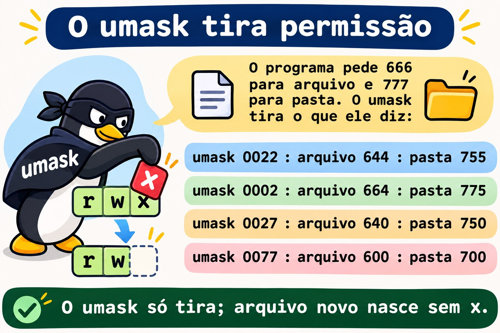
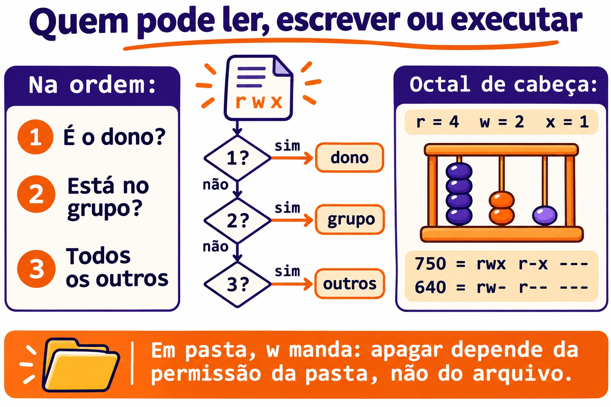
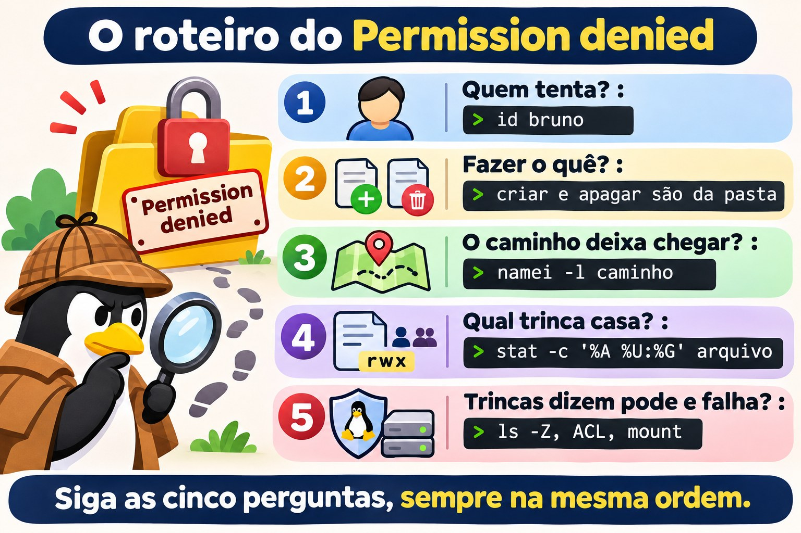

# Aula 2.7 · Permissões e dono

Sétima aula do Módulo 2. "Permission denied" é a mensagem de erro mais comum da vida de um sysadmin, e a resposta mais comum a ela é a pior: `chmod -R 777`. O problema some, e aparecem três: qualquer um apaga tudo, o SSH para de aceitar a chave e a próxima auditoria marca a pasta em vermelho. Hoje você aprende a ler as nove letras de um `ls -l` como o kernel lê, e a dar a cada pessoa exatamente o acesso que ela precisa. Você usa a Ana, o Bruno e o grupo `equipe` da Aula 2.6, com os mesmos números nas duas VMs, para testar quem lê, quem escreve e quem apaga, e por quê.

| Ficha | Aula 2.7 |
| --- | --- |
| Módulo | M2 · Sistema, usuários e permissões, aula 7 de 8 |
| Quando | Semana 5 |
| Ao final você consegue | Ler as permissões de arquivo e de pasta e dizer quem pode o quê; explicar o que `r`, `w` e `x` querem dizer numa pasta; usar `chmod` em modo simbólico e octal, inclusive em árvores inteiras sem estragar as pastas; trocar dono e grupo com `chown` e `chgrp`; prever e ajustar o `umask`; seguir um roteiro quando aparece "Permission denied" |
| Pré-requisitos | Aula 2.6 (Ana, UID 2001; Bruno, UID 2002; grupo `equipe`, GID 2000, nas duas VMs; os grupos valem no login); Aula 2.5 (`sudo`, o apelido `deb`); Aula 1.8 (permissão de execução num script) |
| Tempo | Cerca de 2h30 |
| Snapshots | m2a7-inicio e m2a7-fim nas duas VMs |

## 1 · Aquecimento

Três perguntas, de cabeça. Escreva as respostas; o Gabarito confere no fim.

1. O arquivo `relatorio.txt` é `-r--r--r-- root root` e está numa pasta `drwxrwxrwx`. Palpite: a Ana, que não é root, consegue apagá-lo?
2. Você criou `backup.sh` e ele está `-rw-r--r--`. Palpite: `./backup.sh` funciona? E `bash backup.sh`?
3. O arquivo `nota.txt` é `----rw---- ana equipe`, e a Ana está no grupo `equipe`. Palpite: a Ana consegue ler o próprio arquivo?

## 2 · Por que importa

Quase todo chamado de permissão cai num de quatro casos, e cada um tem uma resposta errada que parece funcionar:

| O chamado | A resposta errada | O que ela causa |
| --- | --- | --- |
| "O Bruno não consegue editar a planilha da Ana na pasta da equipe" | `chmod -R 777 /srv/equipe` | Qualquer conta da máquina, inclusive a do servidor web, lê, altera e apaga tudo |
| "O script de backup diz Permission denied" | `chmod 777 backup.sh` | Qualquer um pode trocar o conteúdo de um script que o root roda toda noite |
| "Fiz o upload do site e agora dá 403" | `chmod -R 644 /var/www/site` | As pastas perdem o `x` e ninguém entra nelas, nem o servidor web |
| "O SSH parou de aceitar a minha chave" | Gerar outra chave | O problema era uma pasta com escrita para o grupo; o `sshd` recusa a chave de propósito |

Nos quatro casos, quem resolve de verdade faz a mesma coisa: pergunta **quem** está tentando, **o que** está tentando fazer e **onde**, e lê as permissões do caminho inteiro. É isso que você treina hoje.

## 3 · Modelo mental

> Cada arquivo tem um dono, um grupo e três trincas de permissão. O kernel pergunta "quem é você?" e usa **uma** trinca só: a do dono, se você for o dono; senão a do grupo, se você estiver no grupo; senão a dos outros. A primeira que casa decide, e as outras nem são olhadas.

```text
  -rwxr-x---.  1  ana  equipe  2048  nov 3 09:12  fechamento.sh
  │└┬┘└┬┘└┬┘│     │    │
  │ │  │  │ │     │    └─ grupo do arquivo
  │ │  │  │ │     └────── dono do arquivo
  │ │  │  │ └─ "." = tem contexto SELinux (Rocky); "+" = tem ACL (Aula 8.5)
  │ │  │  └─── outros: quem não é o dono nem está no grupo   ---  = 0
  │ │  └────── grupo:  quem está no grupo equipe             r-x  = 5
  │ └───────── dono:   a ana                                 rwx  = 7
  └─────────── tipo: - arquivo, d pasta, l link
                                                           octal: 750

  Quem está pedindo?
     é o dono?  ── sim ──▶ usa rwx         (e para aqui)
        │ não
     está no grupo?  ── sim ──▶ usa r-x    (e para aqui)
        │ não
     usa ---
```

As mesmas letras querem dizer coisas diferentes num arquivo e numa pasta. Essa tabela resolve metade dos chamados:

| Letra | Num arquivo | Numa pasta |
| --- | --- | --- |
| `r` (4) | Ler o conteúdo | Listar os nomes que estão dentro |
| `w` (2) | Alterar o conteúdo | Criar, apagar e renomear o que está dentro, **qualquer que seja a permissão do arquivo** |
| `x` (1) | Executar como programa | Entrar na pasta e passar por ela para chegar a algo lá dentro |

Quatro ideias carregam a aula:

| Ideia | O que quer dizer | Consequência |
| --- | --- | --- |
| Uma trinca só | Dono, senão grupo, senão outros. Não soma | Um dono com menos permissão que o grupo fica com a do dono |
| Apagar é assunto da pasta | Apagar um arquivo muda a pasta, não o arquivo | Um arquivo `r--r--r--` numa pasta com `w` pode ser apagado |
| O caminho inteiro conta | Para chegar a `/srv/a/b/c.txt`, você precisa de `x` em `/`, `/srv`, `/srv/a` e `/srv/a/b` | Um arquivo `rw-rw-rw-` dentro de uma pasta sem `x` é inalcançável |
| O nascimento decide | Todo arquivo novo nasce com o grupo principal de quem criou e com o `umask` de quem criou | A maioria dos problemas de pasta compartilhada é o grupo ou o `umask` errado no momento da criação |


*A primeira trinca que casa decide; as outras nem são olhadas.*

## 4 · Conceito em camadas

### Essencial

**Ler.** O `ls -l` mostra as letras; o `stat` mostra também o número, que é o que você vai digitar no `chmod`.

```bash
ls -l /etc/passwd /etc/shadow
ls -ld /tmp /home/rodrigo
stat -c '%A %a %U:%G %n' /etc/passwd /etc/shadow /tmp
```

```text
-rw-r--r--. 1 root root 1532 nov  3 08:10 /etc/passwd
----------. 1 root root  987 nov  3 08:10 /etc/shadow
-rw-r--r-- 644 root:root /etc/passwd
---------- 0 root:root /etc/shadow
drwxrwxrwt 1777 root:root /tmp
```

O `-d` do `ls -ld` mostra a pasta em si, em vez do que está dentro dela. O `/etc/shadow` com `0` não é um erro: ninguém tem permissão, e só o root, que passa por cima das permissões de leitura e escrita, consegue ler. O `t` no fim do `/tmp` e o `1` na frente do `1777` são o sticky bit, assunto da Aula 2.8. O exemplo é da rocky-lab; na debian-lab o `ls -l` vem sem o `.` depois das permissões, e o `/etc/shadow` aparece como `-rw-r----- root shadow`.

**O número.** Cada trinca vira um dígito somando `r`=4, `w`=2, `x`=1:

| Letras | Conta | Dígito | Uso típico |
| --- | --- | --- | --- |
| `rwx` | 4+2+1 | 7 | Dono de pasta ou de script |
| `rw-` | 4+2 | 6 | Dono de arquivo comum |
| `r-x` | 4+1 | 5 | Grupo de pasta ou de script |
| `r--` | 4 | 4 | Só leitura |
| `---` | 0 | 0 | Nada |

Os números que você vai digitar quase sempre: `644` e `755` (padrão de arquivo e de pasta públicos), `640` e `750` (só o grupo lê), `600` e `700` (só o dono), `660` e `770` (o grupo trabalha junto).

**Mudar permissões: `chmod`.** Dois jeitos de dizer a mesma coisa:

```bash
chmod 750 fechamento.sh          # octal: define as três trincas de uma vez
chmod u=rwx,g=rx,o= fechamento.sh   # simbólico: o mesmo resultado
chmod u+x backup.sh              # simbólico relativo: acrescenta x ao dono, mexe em nada mais
chmod g-w,o-r planilha.csv       # tira w do grupo e r dos outros
chmod a+r leiame.txt             # a = all, as três trincas
```

| Parte | Quer dizer |
| --- | --- |
| `u`, `g`, `o`, `a` | Dono (*user*), grupo, outros, todos |
| `+`, `-`, `=` | Acrescenta, tira, define exatamente (o que não estiver escrito vira `-`) |
| `r`, `w`, `x` | As permissões |

O octal é bom para **definir** o estado inteiro. O simbólico relativo é bom para **mudar uma coisa** sem saber ou sem mexer no resto. Só o dono do arquivo e o root podem rodar `chmod` nele.

**Mudar dono e grupo: `chown` e `chgrp`.**

```bash
sudo chown ana planilha.csv            # muda o dono
sudo chown ana:equipe planilha.csv     # dono e grupo
sudo chown :equipe planilha.csv        # só o grupo
chgrp equipe planilha.csv              # só o grupo, sem sudo, se você for o dono e estiver no grupo
sudo chown -R ana:equipe /srv/projeto  # a árvore inteira
```

Só o root muda o dono de um arquivo. Um usuário comum pode mudar o grupo de um arquivo seu, mas só para um grupo de que ele faz parte.

### Intermediário

**O `umask`.** Programas que criam arquivos pedem, em geral, `666` para arquivos e `777` para pastas. O `umask` é a lista do que **tirar** desse pedido:

| `umask` | Arquivo novo | Pasta nova | Onde costuma aparecer |
| --- | --- | --- | --- |
| `0022` | `644` `rw-r--r--` | `755` `rwxr-xr-x` | O root; usuários comuns no Debian |
| `0002` | `664` `rw-rw-r--` | `775` `rwxrwxr-x` | Usuários comuns no Rocky, que têm um grupo pessoal só deles |
| `0027` | `640` `rw-r-----` | `750` `rwxr-x---` | Servidores endurecidos, scripts que geram dados internos |
| `0077` | `600` `rw-------` | `700` `rwx------` | Scripts que geram chaves, senhas, dumps de banco |

```bash
umask          # 0022, por exemplo
umask -S       # u=rwx,g=rx,o=rx: o que SOBRA, em letras
umask 027      # só para este shell e o que ele abrir
```

O `umask` nunca acrescenta permissão. Um arquivo novo não nasce com `x`, qualquer que seja o `umask`, porque o programa pediu `666`: é por isso que todo script novo precisa de `chmod u+x`. O `umask` vale para o processo e para tudo o que ele abrir; o padrão de cada login vem do `/etc/login.defs` e dos arquivos de inicialização do shell, e o seu `~/.bashrc` pode mudá-lo para você.

**Testar como outra pessoa.** Em vez de pedir à Ana para tentar de novo, pergunte ao kernel:

```bash
sudo -u ana cat /srv/equipe/planilha.csv
sudo -u ana test -w /srv/equipe/planilha.csv && echo "a Ana pode escrever"
namei -l /srv/equipe/planilha.csv
```

O `sudo -u ana` roda o comando como a Ana, com os grupos dela, sem pedir a senha dela. O `namei -l` mostra dono, grupo e permissões de cada pasta do caminho, de `/` até o arquivo. É a ferramenta número um quando o arquivo parece certo e o acesso falha mesmo assim.

**Outras ferramentas que poupam erro:**

```bash
install -m 640 -o ana -g equipe modelo.csv /srv/equipe/   # copia já com modo, dono e grupo
install -d -m 770 -o root -g equipe /srv/equipe           # cria pasta já com modo, dono e grupo
cp -p origem destino               # copia mantendo modo, dono (se for root) e datas
chmod --reference=modelo.csv novo.csv   # copia as permissões de outro arquivo
```

O `cp` sem `-p` cria o arquivo novo como **seu**, com o seu `umask`: é por isso que um arquivo copiado de outro servidor "perde" as permissões.



*O umask é a lista do que tirar de 666 (arquivo) e 777 (pasta).*

### Ponte Windows

| No Windows | No Linux | A diferença que pega |
| --- | --- | --- |
| Aba Segurança, lista de usuários e grupos | Três trincas: dono, um grupo, outros | No Linux padrão, um arquivo tem **um** grupo. Para mais, há as ACLs (Aula 8.5) |
| Permissões somam, e Negar vence | Usa a primeira trinca que casa, sem somar | O dono com menos permissão que o grupo fica com a do dono |
| "Todos: Controle total" | `777` | O mesmo erro, com o mesmo resultado |
| "Tomar posse" (*take ownership*) | `sudo chown` | No Linux, só o root muda o dono |
| Herança de permissões da pasta-mãe | Não existe; o `umask` e o grupo de quem cria decidem | Um arquivo novo **não** herda as permissões da pasta. O grupo pode ser herdado com o setgid (Aula 2.8) |
| Excluir é uma permissão do arquivo | Apagar é a permissão `w` da **pasta** | Um arquivo só leitura pode ser apagado por quem escreve na pasta |

### Avançado

**O root e o `x`.** O root passa por cima de `r` e `w` em qualquer arquivo, e de `r` e `x` em qualquer pasta. Mas, para **executar** um arquivo, mesmo o root precisa que pelo menos uma das três trincas tenha `x`. Por isso `sudo ./backup.sh` falha num script `644`.

**A permissão é conferida na abertura.** O kernel confere as permissões quando o processo abre o arquivo. Um processo que já estava com o arquivo aberto continua lendo e escrevendo depois de um `chmod 000`. Na vida real: tirar a permissão de um log não para o serviço que já está gravando nele.

**Sem `r` numa pasta, com `x`.** Uma pasta `711` (`rwx--x--x`) deixa os outros entrarem e abrirem um arquivo cujo nome **já sabem**, mas não deixa listar. É assim que servidores antigos deixavam `~/public_html` acessível ao servidor web sem expor a lista de arquivos da pasta pessoal.

**Os indicadores depois das letras.** Um `.` depois das permissões quer dizer que o arquivo tem um contexto SELinux, o normal na Rocky. Um `+` quer dizer que há uma ACL, permissões extras além das três trincas, que o `ls -l` não mostra; `getfacl arquivo` mostra. Se as três trincas dizem que pode e o acesso falha, a causa está numa dessas duas camadas: Aula 8.5 para ACL, Aula 12.3 para SELinux.

**O quarto dígito.** O `stat` às vezes mostra quatro dígitos, como o `1777` do `/tmp`. O primeiro é o das permissões especiais: setuid (4), setgid (2) e sticky (1). É a Aula 2.8.

## 5 · Rocky × Debian

| O quê | Rocky 9 | Debian 13 |
| --- | --- | --- |
| `umask` de um usuário comum | Em geral `0002` (cada um tem grupo pessoal, então o grupo pode ganhar `w`) | Em geral `0022` |
| `umask` do root | `0022` | `0022` |
| Modo da pasta pessoal criada pelo `useradd -m` | `700` (`HOME_MODE 0700` no `login.defs`) | Depende do `login.defs` da versão: `700` ou `755`. Confira com `ls -ld /home/*` |
| Indicador depois das permissões no `ls -l` | `.` (contexto SELinux) | Nada, ou `+` quando há ACL |
| `/etc/shadow` | `0` (`----------`), dono `root:root` | `640` (`-rw-r-----`), grupo `shadow` |
| Grupo de quem usa `sudo` | `wheel` | `sudo` |
| `namei`, `stat`, `install` | No pacote base (`util-linux`, `coreutils`) | Igual |
| Quando as trincas dizem "pode" e o acesso falha | Suspeite do SELinux (`ls -Z`, Aula 12.3) | Suspeite da ACL ou do AppArmor, que trabalha por programa e não por arquivo |

## 6 · Lab guiado

Neste lab você é o `rodrigo`, com `sudo`, e testa tudo **como a Ana e como o Bruno** com `sudo -u`. Ninguém precisa digitar senha de ninguém: o kernel responde por eles, com os grupos que eles têm de verdade. Os experimentos ficam em `/srv/lab27`, que você pode bagunçar à vontade. A pasta `/srv/equipe`, criada no Passo 5, fica para a Aula 2.8, que termina o desafio do módulo em cima dela.


*Em pasta, w manda: apagar depende da permissão da pasta, não do arquivo.*


### Passo 0 · Snapshot e o caminho até a debian-lab

No Proxmox, tire o snapshot `m2a7-inicio` das duas VMs. Na rocky-lab, confira o caminho até a debian-lab e as contas da Aula 2.6:

```bash
eval "$(ssh-agent -s)"; ssh-add
ssh -o BatchMode=yes deb 'hostname; id -un'
id ana; id bruno
ssh deb 'id ana; id bruno'
```

As quatro linhas de `id` têm que mostrar `uid=2001(ana)` e `uid=2002(bruno)`, os dois com `2000(equipe)` na lista de grupos, nas duas VMs. Se faltar o `equipe` em algum, volte ao Passo 4 da Aula 2.6: o lab inteiro depende disso.

### Passo 1 · Ler como o kernel lê

Nas duas VMs (na debian-lab, prefixe com `ssh deb`):

```bash
stat -c '%A %a %U:%G %n' /etc/passwd /etc/shadow /etc/sudoers /tmp /home/*
```

Para cada linha, responda em voz alta três perguntas: quem é o dono, qual é o grupo e o que a Ana, que não é nenhum dos dois, consegue fazer. Exemplo de resposta para `/home/bruno` com `drwx------ 700 bruno:bruno`: "o dono é o Bruno; a Ana não é o Bruno nem está no grupo `bruno`, então cai em outros, `---`; ela não entra, não lista, não lê nada lá dentro".

Agora confirme pelo kernel, em vez de confiar na sua leitura:

```bash
sudo -u ana ls /home/bruno
sudo -u ana cat /etc/shadow
sudo -u ana cat /etc/passwd | tail -2
```

As duas primeiras dão `Permission denied`; a terceira funciona. Anote as diferenças entre as VMs: o `/etc/shadow` (`0` no Rocky, `640 root:shadow` no Debian) e o modo das pastas pessoais.

### Passo 2 · `r`, `w` e `x` numa pasta, um de cada vez

Monte o banco de testes na rocky-lab:

```bash
sudo mkdir -p /srv/lab27/caixa
echo "conteúdo da nota" | sudo tee /srv/lab27/caixa/nota.txt >/dev/null
sudo chmod 755 /srv/lab27
sudo chmod 644 /srv/lab27/caixa/nota.txt
```

Para cada modo da tabela, rode o `chmod` e os dois testes como a Ana, e compare com a coluna "Esperado":

```bash
sudo chmod 755 /srv/lab27/caixa      # troque pelo modo da linha
sudo -u ana ls -l /srv/lab27/caixa
sudo -u ana cat /srv/lab27/caixa/nota.txt
```

| Modo da pasta | Trinca dos outros | `ls -l` como a Ana | `cat nota.txt` como a Ana | Esperado |
| --- | --- | --- | --- | --- |
| `755` | `r-x` | Lista normal | Funciona | Entra e lista |
| `754` | `r--` | Os nomes aparecem, mas com `?????????` e erros de `cannot access` | `Permission denied` | Lista os nomes, não entra |
| `751` | `--x` | `cannot open directory` | Funciona | Entra sem listar: quem sabe o nome, abre |
| `750` | `---` | `Permission denied` | `Permission denied` | Nada |

A linha `754` é a mais estranha e a mais importante: `r` sem `x` dá só a lista de nomes, porque ler os detalhes de um arquivo (dono, tamanho, modo) exige **entrar** na pasta. Quando você vir `?????????` num `ls -l`, a pasta tem `r` e falta `x`. Volte a pasta para `755` no fim.

### Passo 3 · Apagar é assunto da pasta

```bash
sudo mkdir /srv/lab27/aberta
sudo chmod 777 /srv/lab27/aberta
echo "relatório final" | sudo tee /srv/lab27/aberta/relatorio.txt >/dev/null
sudo chmod 444 /srv/lab27/aberta/relatorio.txt
stat -c '%A %U:%G %n' /srv/lab27/aberta /srv/lab27/aberta/relatorio.txt
sudo -u ana sh -c 'echo "editado" > /srv/lab27/aberta/relatorio.txt'
sudo -u ana rm -f /srv/lab27/aberta/relatorio.txt
ls -l /srv/lab27/aberta
```

A Ana **não consegue editar** o arquivo (`Permission denied`: o arquivo é `r--` para ela), mas **consegue apagá-lo**, e o `ls` volta vazio. Sem o `-f`, o `rm` teria perguntado `remove write-protected regular file?`, e um "y" bastaria. O arquivo é do root e só leitura para todos, e não fez diferença: apagar é escrever na pasta, e a pasta é `777`.

**Decida 1 · Proteger o relatório.** Você recria o `relatorio.txt` e quer que a Ana continue lendo o que está na pasta `aberta`, mas não consiga mais apagar nada lá. O que você muda?

- **A)** `sudo chmod 400 /srv/lab27/aberta/relatorio.txt`
- **B)** `sudo chmod 755 /srv/lab27/aberta`
- **C)** `sudo chown root:root /srv/lab27/aberta/relatorio.txt`
- **D)** `sudo chmod 1777 /srv/lab27/aberta`

Escolha a letra antes de olhar a tabela.

| Se você marcou | Resultado | Por quê |
| --- | --- | --- |
| A | ❌ Errada | Você mexeu no arquivo, e apagar depende da pasta. A Ana continua com `w` na pasta e apaga do mesmo jeito. E agora ela nem lê mais o relatório. |
| B | ✅ Certa | A pasta fica `rwxr-xr-x`: a Ana cai em outros, `r-x`, então lista e entra, mas não cria, não renomeia e não apaga. Era o pedido. |
| C | ❌ Errada | O arquivo já era do root. O dono do arquivo não importa para apagar; importa quem escreve na pasta. |
| D | ⚠️ Funciona, mas | O sticky bit (o `1` na frente) faz cada um só apagar o que é seu, e a Ana deixa de apagar o relatório do root. Mas ela continua podendo criar arquivos na pasta, o que não foi pedido. É a ferramenta certa para pastas onde todo mundo escreve, como o `/tmp`: Aula 2.8. |

**Para fixar:** "quem pode apagar?" se responde olhando a pasta, nunca o arquivo.

Aplique a B, recrie o relatório e confirme que o `sudo -u ana rm -f` agora dá `Permission denied`.

### Passo 4 · `chmod` nos dois idiomas

No seu `~`, como `rodrigo`:

```bash
printf '#!/bin/bash\necho "backup ok em $(hostname)"\n' > ~/backup.sh
stat -c '%A %a %n' ~/backup.sh
~/backup.sh
bash ~/backup.sh
```

O arquivo nasce sem `x` (`644` ou `664`, conforme o seu `umask`), e por isso o `~/backup.sh` dá `Permission denied`. O `bash ~/backup.sh` funciona porque quem executa é o `bash`, que só precisa **ler** o script. Agora, um comando de cada vez, prevendo o resultado **antes** de rodar o `stat`:

```bash
chmod u+x ~/backup.sh;        stat -c '%A %a' ~/backup.sh
chmod 750 ~/backup.sh;        stat -c '%A %a' ~/backup.sh
chmod g-x,o+r ~/backup.sh;    stat -c '%A %a' ~/backup.sh
chmod u=rw,go= ~/backup.sh;   stat -c '%A %a' ~/backup.sh
chmod a+x ~/backup.sh;        stat -c '%A %a' ~/backup.sh
```

As respostas, para conferir depois: `rwx` no dono e o resto como estava (`744` ou `764`); `rwxr-x---` `750`; `rwxr--r--` `744`; `rw-------` `600`; `rwx--x--x` `711`.

Por último, prove que o root também precisa de `x` para executar:

```bash
chmod 600 ~/backup.sh
sudo ~/backup.sh
chmod 700 ~/backup.sh && sudo ~/backup.sh
```

O primeiro `sudo` falha (conforme a versão do `sudo`, a mensagem é `command not found` ou `Permission denied`); o segundo funciona.

### Passo 5 · Dono, grupo e a pasta da equipe

A equipe quer uma pasta onde a Ana e o Bruno trabalhem juntos e ninguém mais entre. Na rocky-lab:

```bash
sudo mkdir /srv/equipe
sudo chown root:equipe /srv/equipe
sudo chmod 770 /srv/equipe
ls -ld /srv/equipe
ls /srv/equipe
```

O `ls -ld` mostra `drwxrwx--- root equipe`, e o seu `ls /srv/equipe` dá `Permission denied`: o `rodrigo` não está no `equipe`, então cai em outros, `---`. Para olhar lá dentro, você vai usar `sudo` a partir de agora. Agora a Ana cria a planilha, e o Bruno tenta acrescentar uma linha:

```bash
sudo -u ana sh -c 'echo "jan;100" > /srv/equipe/planilha.csv'
sudo ls -l /srv/equipe
sudo -u bruno sh -c 'echo "fev;200" >> /srv/equipe/planilha.csv'
```

O Bruno recebe `Permission denied`. O `ls -l` conta por quê: o arquivo nasceu `ana ana`, com o grupo **pessoal** da Ana, não com o `equipe`. O Bruno não é a Ana nem está no grupo `ana`, então cai em outros, `r--`. A pasta estava certa; o arquivo nasceu com o grupo errado, porque arquivo novo pega o grupo principal de quem criou.

**Decida 2 · O Bruno não consegue editar a planilha da Ana.** O chamado chegou. O que você faz?

- **A)** `sudo chmod -R 777 /srv/equipe`
- **B)** `sudo chgrp equipe /srv/equipe/planilha.csv && sudo chmod g+w /srv/equipe/planilha.csv`
- **C)** `sudo chown bruno /srv/equipe/planilha.csv`
- **D)** `sudo usermod -aG ana bruno`

Escolha a letra antes de olhar a tabela.

| Se você marcou | Resultado | Por quê |
| --- | --- | --- |
| A | ❌ Errada | Resolve o Bruno e abre a pasta para todas as contas da máquina, inclusive serviços. E não resolve nada para o próximo arquivo: ele nasce com o grupo errado de novo. |
| B | ✅ Certa | O arquivo passa a ser do grupo `equipe` e o grupo ganha `w`. O Bruno, que está no `equipe`, cai na trinca do grupo, `rw-`. A Ana poderia ter feito o mesmo sem `sudo`, porque é a dona e está no `equipe`. |
| C | ❌ Errada | Agora o Bruno edita e a Ana, que criou a planilha, cai na trinca dos outros. Você só trocou quem reclama. |
| D | ⚠️ Funciona, mas | O Bruno entra no grupo pessoal da Ana e passa a ter acesso a **tudo** o que ela criar com o grupo `ana`, em qualquer lugar da máquina, inclusive fora da pasta da equipe. Grupos pessoais existem justamente para não serem compartilhados. |

**Para fixar:** em pasta compartilhada, o arquivo tem que ser do grupo da equipe e ter `w` no grupo. Corrija o grupo, não abra os outros.

Aplique a B e confirme:

```bash
sudo -u bruno sh -c 'echo "fev;200" >> /srv/equipe/planilha.csv'
sudo cat /srv/equipe/planilha.csv
sudo -u bruno sh -c 'echo "rascunho" > /srv/equipe/notas-bruno.txt'
sudo ls -l /srv/equipe
```

Funcionou para a planilha, e o problema voltou no arquivo novo do Bruno: `notas-bruno.txt` nasceu `bruno bruno`. Corrigir arquivo por arquivo não escala. A solução definitiva é o bit setgid na pasta, que faz todo arquivo novo herdar o grupo `equipe`: é a primeira coisa da Aula 2.8. Por enquanto, deixe assim.


*A pasta da equipe estava certa; o arquivo da Ana nasceu com o grupo errado.*

### Passo 6 · O `umask` que você tem, e o que você quer

Meça o `umask` de cada um, nas duas VMs, com um login completo (o `su -` passa pelos mesmos arquivos de inicialização de um login de verdade):

```bash
umask
sudo su - ana -c umask
sudo su - root -c umask
ssh deb umask
ssh -t deb 'sudo su - ana -c umask'
```

Anote os cinco valores. A seção 5 diz o que costuma aparecer, mas o que vale é o que a **sua** VM respondeu: as duas distribuições decidem o `umask` de usuários com grupo pessoal por caminhos diferentes, e isso já mudou entre versões. Agora veja o efeito:

```bash
mkdir ~/umask-teste && cd ~/umask-teste
touch padrao; mkdir dpadrao
( umask 027; touch a027; mkdir d027 )
( umask 077; touch a077; mkdir d077 )
stat -c '%a %A %n' *
cd ~
```

Os parênteses rodam cada `umask` num subshell, e o seu shell volta ao normal na linha seguinte. Esperado: `a027` `640`, `d027` `750`, `a077` `600`, `d077` `700`; `padrao` e `dpadrao` seguem o `umask` que você anotou.

**Decida 3 · O dump com senhas.** Um script do root, rodado pelo cron, faz o dump do banco em `/backup/banco.sql`. O arquivo tem senhas de usuários da aplicação. Hoje ele nasce `644`. Qual é a correção certa?

- **A)** Um `chmod 600 /backup/banco.sql` logo depois do dump, no fim do script
- **B)** Um `umask 077` na primeira linha do script, antes do dump
- **C)** `sudo chmod 777 /backup`, para o arquivo herdar as permissões da pasta
- **D)** Um `umask 777` na primeira linha do script

Escolha a letra antes de olhar a tabela.

| Se você marcou | Resultado | Por quê |
| --- | --- | --- |
| A | ⚠️ Funciona, mas | Durante o dump inteiro, que pode levar minutos, o arquivo fica `644` e qualquer conta lê as senhas. E se o dump falhar no meio, o `chmod` do fim nem roda. |
| B | ✅ Certa | O arquivo já **nasce** `600`. Não existe janela nenhuma. Junto com uma pasta `/backup` em `700`, é o padrão para qualquer script que gera segredo. |
| C | ❌ Errada | No Linux, arquivo novo não herda as permissões da pasta. E agora qualquer conta apaga e troca os backups. |
| D | ❌ Errada | O arquivo nasce `000`. O root consegue gravar assim mesmo, porque passa por cima de `r` e `w`, mas qualquer outra ferramenta de restauração ou cópia que não rode como root quebra, e uma pasta criada pelo script também nasce `000`. Fechar tudo não é configurar. |

**Para fixar:** quem gera segredo define o `umask` antes de gerar. Corrigir depois é deixar a porta aberta enquanto você procura a chave.

### Passo 7 · `chmod -R` sem estragar as pastas

O site de teste, com o erro clássico do upload:

```bash
sudo mkdir -p /srv/lab27/site/img
echo '<h1>ok</h1>' | sudo tee /srv/lab27/site/index.html >/dev/null
sudo touch /srv/lab27/site/img/logo.png
sudo chmod -R 644 /srv/lab27/site
sudo -u ana cat /srv/lab27/site/index.html
sudo find /srv/lab27/site -printf '%M %p\n'
```

A Ana recebe `Permission denied`, mesmo com o `index.html` `rw-r--r--`. O `find` mostra o motivo: as pastas `site` e `img` ficaram `drw-r--r--`, sem `x`, e ninguém atravessa uma pasta sem `x`. É o "403 depois do upload" da seção 2.

**Decida 4 · Arrumar o site.** Você quer pastas `755` e arquivos `644`, na árvore inteira. Qual comando?

- **A)** `sudo chmod -R 755 /srv/lab27/site`
- **B)** `sudo chmod -R u=rwX,go=rX /srv/lab27/site`
- **C)** `sudo find /srv/lab27/site -type d -exec chmod 755 {} + -o -type f -exec chmod 644 {} +`
- **D)** `sudo chmod 755 /srv/lab27/site`

Escolha a letra antes de olhar a tabela.

| Se você marcou | Resultado | Por quê |
| --- | --- | --- |
| A | ⚠️ Funciona, mas | O site volta, e todo arquivo vira executável, inclusive `logo.png` e qualquer upload. Num servidor web, arquivo de dados com `x` é convite para executar o que não deveria. |
| B | ✅ Certa | O `X` maiúsculo dá `x` só a pastas e a arquivos que já tenham `x` em alguma trinca. Como o `-R 644` tirou o `x` de todos os arquivos, só as pastas ganham. Um comando, resultado exato. |
| C | ✅ Certa | Mais longo e mais explícito: pastas para um lado, arquivos para o outro. É o que você usa quando o `X` não basta, por exemplo quando algum arquivo tem um `x` indevido que você também quer tirar. |
| D | ❌ Errada | Só a pasta de cima é corrigida. A `img` continua sem `x` e o logo continua quebrado. |

**Para fixar:** em `chmod -R`, use `X` maiúsculo ou separe pastas e arquivos com `find`. `chmod -R` com um número só trata pastas e arquivos como se fossem a mesma coisa, e eles não são.

Rode a B, repita o `cat` como a Ana e o `find`, e confira `drwxr-xr-x` nas pastas e `-rw-r--r--` nos arquivos.

### Passo 8 · O roteiro do "Permission denied", e o mesmo na debian-lab

Quando o acesso falha, siga sempre a mesma ordem. Teste com o arquivo que o Bruno criou no Passo 5, que a Ana tenta editar:

```bash
sudo -u ana sh -c 'echo "revisado" >> /srv/equipe/notas-bruno.txt'
sudo namei -l /srv/equipe/notas-bruno.txt
sudo -u ana test -w /srv/equipe/notas-bruno.txt && echo "pode escrever" || echo "não pode"
```

O `namei` vai com `sudo` porque o `rodrigo` não atravessa a `/srv/equipe`: sem ele, o próprio diagnóstico daria `Permission denied`. A última linha do `namei` mostra `bruno bruno`, e a resposta sai da pergunta 4 da tabela.

| Pergunta | Comando | O que você procura |
| --- | --- | --- |
| 1. Quem está tentando? | `id bruno` (e o usuário do serviço, se for um serviço) | Os grupos de verdade, inclusive se o login é anterior à entrada no grupo |
| 2. Fazer o quê? | Ler, escrever, executar, entrar, criar ou apagar | Criar e apagar são permissões da **pasta** |
| 3. O caminho deixa chegar? | `namei -l caminho` | Uma pasta sem `x` para essa pessoa, em qualquer nível |
| 4. Qual trinca casa? | `stat -c '%A %U:%G' arquivo` | Dono, senão grupo, senão outros. Uma só |
| 5. As trincas dizem "pode" e falha? | `ls -l` (procure `+` ou `.`), `ls -Z`, `mount` | ACL, SELinux, sistema montado `ro` ou `noexec`: camadas das Aulas 8.5, 12.3 e 5.x |

Agora repita na debian-lab os Passos 5 e 7, que são os que deixam estado para a Aula 2.8:

```bash
ssh -t deb 'sudo mkdir -p /srv/equipe && sudo chown root:equipe /srv/equipe && sudo chmod 770 /srv/equipe'
ssh -t deb 'sudo -u ana sh -c "echo jan\;100 > /srv/equipe/planilha.csv" && sudo chgrp equipe /srv/equipe/planilha.csv && sudo chmod g+w /srv/equipe/planilha.csv'
ssh -t deb 'sudo -u bruno sh -c "echo fev\;200 >> /srv/equipe/planilha.csv" && sudo ls -l /srv/equipe && sudo cat /srv/equipe/planilha.csv'
ssh -t deb 'sudo namei -l /srv/equipe/planilha.csv'
```

O resultado tem que ser o mesmo da rocky-lab: `drwxrwx--- root equipe` na pasta, `-rw-rw-r-- ana equipe` na planilha, com as duas linhas dentro. Como os UIDs e o GID são iguais nas duas VMs (Aula 2.6), um `rsync` da pasta entre elas manteria os donos certos.



*Cinco perguntas, sempre na mesma ordem, levam do Permission denied à causa.*

## 7 · Quebre e conserte

### Quebra A · A chave SSH que parou de entrar

O cenário: alguém quis "facilitar" e deu escrita para o grupo na sua pasta pessoal da debian-lab. Antes de quebrar, **abra uma sessão na debian-lab a partir do seu PC e deixe-a aberta**: ela é o seu caminho de volta. Se tudo der errado, o console da VM no Proxmox também é. Depois, na rocky-lab:

```bash
ssh deb 'stat -c "%A %a %U:%G %n" ~ ~/.ssh ~/.ssh/authorized_keys'
ssh deb 'chmod g+w ~'
```

**Observe.** Tente entrar de novo, da rocky-lab:

```bash
ssh -o BatchMode=yes deb hostname
```

```text
rodrigo@10.1.0.52: Permission denied (publickey,password).
```

A chave é a mesma de cinco segundos atrás, o `authorized_keys` não mudou e o servidor recusa. A sessão que você deixou aberta continua funcionando: a permissão só é conferida em logins novos.

**Diagnostique.** O cliente não sabe o motivo; o servidor sabe. Na sessão aberta da debian-lab:

```bash
sudo journalctl -u ssh -n 20 --no-pager
ls -ld ~ ~/.ssh ~/.ssh/authorized_keys
```

```text
Authentication refused: bad ownership or modes for directory /home/rodrigo
```

O `sshd` tem uma regra chamada `StrictModes`, ligada por padrão: se a pasta pessoal, a `~/.ssh` ou o `authorized_keys` puderem ser alterados por outra pessoa além do dono, ele recusa a chave. O motivo é bom: quem escreve na sua pasta pessoal pode trocar a sua `~/.ssh` inteira e colocar a chave dele lá. Na Rocky, o serviço se chama `sshd` e o log diz o mesmo.

**Decida A · O conserto.** O que você roda na sessão aberta?

- **A)** `chmod g-w ~`
- **B)** Pôr `StrictModes no` no `/etc/ssh/sshd_config` e reiniciar o `ssh`
- **C)** Gerar uma chave nova na rocky-lab e copiá-la de novo para a debian-lab
- **D)** `chmod -R 777 ~/.ssh`

Escolha a letra antes de olhar a tabela.

| Se você marcou | Resultado | Por quê |
| --- | --- | --- |
| A | ✅ Certa | Tira exatamente o que foi acrescentado. A pasta volta ao modo de antes, e o `sshd` volta a aceitar a chave no login seguinte. |
| B | ⚠️ Funciona, mas | A chave volta a entrar, e você desligou uma proteção do servidor inteiro, para todas as contas, para não corrigir uma pasta. A pasta continua errada. |
| C | ❌ Errada | A chave nova cai no mesmo `authorized_keys`, dentro da mesma pasta com `g+w`, e é recusada pelo mesmo motivo. O problema nunca foi a chave. |
| D | ❌ Errada | Piora: agora a `~/.ssh` e o `authorized_keys` também são graváveis por todos, e o `sshd` tem três motivos em vez de um. |

**Para fixar:** quando o SSH recusa uma chave que funcionava, leia o log do servidor antes de mexer na chave. "bad ownership or modes" é permissão, e o conserto é na pasta.

**Conserte.** Na sessão aberta:

```bash
chmod g-w ~
ls -ld ~
```

E, da rocky-lab, o teste que falhou:

```bash
ssh -o BatchMode=yes deb hostname
```

A resposta `debian-lab` volta sem pergunta. Modos que o `sshd` aceita, para guardar: pasta pessoal sem `w` para grupo e outros (`700` ou `755`), `~/.ssh` em `700`, `authorized_keys` em `600`, tudo do próprio usuário.

### Quebra B · A pasta da equipe que ninguém mais alcança

O cenário: numa "revisão de segurança", alguém fechou a pasta de cima. Na rocky-lab, anote o modo atual e quebre:

```bash
stat -c '%a %U:%G %n' /srv /srv/equipe
sudo chmod 700 /srv
```

**Observe.** A Ana e o Bruno abrem chamado ao mesmo tempo:

```bash
sudo -u ana cat /srv/equipe/planilha.csv
sudo -u bruno ls /srv/equipe
```

As duas linhas dão `Permission denied`. Quem atende confere a pasta da equipe e o arquivo, e está tudo certo: `drwxrwx--- root equipe`, `-rw-rw-r-- ana equipe`, os dois no grupo.

**Diagnostique.** Quando o arquivo e a pasta dele estão certos, o problema está no caminho:

```bash
sudo namei -l /srv/equipe/planilha.csv
sudo -u ana namei -l /srv/equipe/planilha.csv
```

```text
f: /srv/equipe/planilha.csv
dr-xr-xr-x root root   /
drwx------ root root   srv
drwxrwx--- root equipe equipe
-rw-rw-r-- ana  equipe planilha.csv
```

Com `sudo`, o `namei` mostra a corrente inteira, e o elo partido aparece: `srv` em `drwx------`. A Ana cai em outros, `---`, e não atravessa. Rodado como a Ana, o `namei` para justamente na `srv`, com `Permission denied`, e mostra o mesmo ponto pelo outro lado. Nada abaixo dele importa.

**Decida B · O conserto.** O que você roda?

- **A)** `sudo chmod 755 /srv`
- **B)** `sudo chmod -R 755 /srv`
- **C)** `sudo chmod o+x /srv`
- **D)** `sudo usermod -aG root ana` e o mesmo para o Bruno

Escolha a letra antes de olhar a tabela.

| Se você marcou | Resultado | Por quê |
| --- | --- | --- |
| A | ✅ Certa | Devolve o modo que você anotou, que é o padrão das duas distribuições. Muda uma pasta, a que quebrou. |
| B | ❌ Errada | Conserta a `/srv` e estraga tudo abaixo dela: a `/srv/equipe` vira `755` (agora qualquer conta lê as planilhas) e todo arquivo vira executável. Um `-R` para consertar uma pasta só. |
| C | ⚠️ Funciona, mas | O `x` basta para atravessar, e a Ana e o Bruno voltam a trabalhar. A `/srv` fica `701`, diferente do padrão e do outro servidor: o próximo admin que comparar as duas vai perder tempo com isso. Se quem fechou queria esconder a lista de pastas, combine; senão, volte ao padrão. |
| D | ❌ Errada | Não funciona, e é perigoso. A `/srv` é `700`: o grupo `root` também tem `---`. E pôr usuários no grupo `root` dá a eles leitura de tudo o que for do grupo `root` na máquina. |

**Para fixar:** quando o arquivo e a pasta estão certos e o acesso falha, rode `namei -l`. O erro está num nível acima, e o conserto é nesse nível, sem `-R`.

**Conserte.**

```bash
sudo chmod 755 /srv
sudo -u ana cat /srv/equipe/planilha.csv
stat -c '%a %n' /srv /srv/equipe
```

A planilha aparece, e os modos voltam a `755` e `770`.

### A lição

As duas quebras têm a mesma raiz: as permissões do objeto estavam certas e o problema estava **em volta** dele. Na Quebra A, a chave estava certa e a pasta pessoal não. Na Quebra B, o arquivo estava certo e a pasta de cima não. Quem olha só para o arquivo do chamado não acha nenhuma das duas. O hábito desta aula: **leia o caminho inteiro, e leia o log do serviço que recusou**. O `namei -l` e o `journalctl` respondem em dez segundos o que o `chmod 777` esconde para sempre.

## 8 · Armadilhas

| Você digita ou vê | O que acontece | O certo |
| --- | --- | --- |
| `chmod -R 777 pasta` | Some o erro e qualquer conta da máquina lê, altera e apaga tudo | Corrigir dono, grupo e o `w` do grupo; `770` ou `775` na pasta, nunca `7` nos outros |
| `chmod -R 644 site` | Pastas sem `x`: ninguém entra, o site dá 403 | `chmod -R u=rwX,go=rX site`, ou `find` separando pastas de arquivos |
| `chmod -R 755 site` | Todos os arquivos viram executáveis | O mesmo `X` maiúsculo ou o `find` |
| `chmod 444 arquivo` para impedir que apaguem | Quem tem `w` na pasta apaga do mesmo jeito | Tirar o `w` da pasta, ou sticky bit na pasta (Aula 2.8) |
| `chmod g+w ~` ou `chmod 777 ~/.ssh` | O `sshd` recusa a chave: "bad ownership or modes" | Pasta pessoal sem `w` para grupo e outros, `~/.ssh` `700`, `authorized_keys` `600` |
| `chmod 600` depois de gerar um arquivo com segredo | O arquivo fica legível por todos enquanto é gerado | `umask 077` antes de gerar |
| `umask 777` ou achar que `umask` acrescenta permissão | O `umask` só tira; o arquivo novo nunca ganha `x` por causa dele | Escolher o `umask` pelo resultado: `022`, `002`, `027` ou `077` |
| `ls /srv/equipe` dá `Permission denied` como `rodrigo` | Você não está no grupo, e o erro é **seu**, não da pasta | `sudo ls -l`, ou testar como o usuário certo com `sudo -u` |
| `chown bruno arquivo` para o Bruno conseguir editar | A Ana, que criou, perde o acesso | `chgrp equipe` e `chmod g+w` |
| `?????????` no `ls -l` | A pasta tem `r` e não tem `x` para você | Dar `x` na pasta para quem precisa entrar |
| Trincas dizem "pode" e o acesso falha | ACL (`+`), SELinux (`.`), sistema montado `ro` ou `noexec` | `getfacl`, `ls -Z`, `mount`: Aulas 8.5, 12.3 e 5.x |
| `cp` de um arquivo de outra máquina "perdeu" as permissões | O `cp` cria o arquivo como **seu**, com o seu `umask` | `cp -p` como root, `install -m -o -g`, ou `rsync -a` |

## 9 · Quiz

Dez perguntas, sem consultar. Escreva a letra ou a resposta de cada uma e só depois abra o Gabarito.

**1.** Escreva em octal: `rwxr-x---`, `rw-r--r--`, `rw-------` e `rwxr-xr-x`.

**2.** O arquivo é `-rw-r--rw- ana equipe`. O Bruno está no grupo `equipe`. Ele consegue escrever no arquivo?

- **A)** Sim, porque os outros têm `rw-`
- **B)** Não, porque ele está no grupo, e a trinca do grupo é `r--`
- **C)** Sim, porque as permissões somam
- **D)** Não, porque só o dono escreve

**3.** Numa pasta, o que permite apagar um arquivo que está dentro dela?

**4.** Qual comando dá `x` ao dono, tira o `w` do grupo e não mexe em mais nada?

- **A)** `chmod 744 arquivo`
- **B)** `chmod u+x,g-w arquivo`
- **C)** `chmod u=x,g=w arquivo`
- **D)** `chmod +x -w arquivo`

**5.** Com `umask 027`, com que modo nascem um arquivo novo e uma pasta nova? Escreva em octal e em letras.

**6.** Uma pasta é `drwxr-xr--` e a Ana cai em outros. O que ela consegue fazer lá dentro?

- **A)** Listar os nomes, sem entrar nem ler os arquivos
- **B)** Entrar e ler os arquivos, sem listar
- **C)** Listar, entrar e ler
- **D)** Nada

**7.** Qual comando muda o dono para `ana` e o grupo para `equipe` de `/srv/projeto` e de tudo o que está dentro?

**8.** A Ana, sem `sudo`, quer passar o arquivo `relatorio.txt`, que é dela, para o Bruno. O que acontece com `chown bruno relatorio.txt`?

**9.** Num `chmod -R`, o que o `X` maiúsculo faz de diferente do `x` minúsculo?

**10.** *A file must be owned by user `ana` and group `equipe`, readable and writable by the owner and the group, and with no access for anyone else. Which commands achieve this?*

- **A)** *`chown ana:equipe file; chmod 660 file`*
- **B)** *`chown ana file; chmod 770 file`*
- **C)** *`chown equipe:ana file; chmod 660 file`*
- **D)** *`chown ana:equipe file; chmod 664 file`*

## 10 · Flashcards e cola

### Para saber de cor

- O kernel usa **uma** trinca: a do dono, senão a do grupo, senão a dos outros. Não soma.
- `r`=4, `w`=2, `x`=1. `644`/`755` públicos, `640`/`750` só o grupo, `600`/`700` só o dono, `660`/`770` o grupo trabalha junto.
- Numa pasta: `r` lista, `w` cria e apaga, `x` entra e atravessa.
- Apagar é escrever na pasta. O modo do arquivo não protege contra quem escreve na pasta.
- Para chegar a um arquivo, é preciso `x` em todas as pastas do caminho. `namei -l` mostra o caminho inteiro.
- Arquivo novo nasce com o grupo principal de quem criou e com o `umask` de quem criou. Não herda nada da pasta.
- O `umask` só tira. Arquivo novo nunca nasce com `x`.
- `chmod -R` com número estraga pastas ou arquivos. Use `X` maiúsculo ou `find`.
- Só o root muda o dono. O dono pode mudar o grupo, para um grupo seu.
- SSH recusando chave que funcionava: leia o log do servidor. "bad ownership or modes" é permissão de pasta.

### Para consultar

| Pergunta | Comando |
| --- | --- |
| Letras, octal, dono e grupo | `stat -c '%A %a %U:%G %n' caminho` |
| A pasta em si, não o conteúdo | `ls -ld pasta` |
| O caminho inteiro, nível a nível | `namei -l caminho` (com `sudo` se você não atravessa alguma pasta) |
| A pessoa consegue? | `sudo -u nome test -r arquivo`; `-w`; `-x`; ou rodar o próprio comando com `sudo -u nome` |
| Definir o modo inteiro | `chmod 640 arquivo` |
| Mudar uma coisa só | `chmod u+x`, `chmod g-w`, `chmod o=`, `chmod a+r` |
| Árvore: pastas `755`, arquivos `644` | `chmod -R u=rwX,go=rX pasta` |
| Árvore, separando com `find` | `find pasta -type d -exec chmod 755 {} + -o -type f -exec chmod 644 {} +` |
| Copiar o modo de outro arquivo | `chmod --reference=modelo novo` |
| Dono e grupo | `sudo chown ana:equipe arquivo`; árvore: `sudo chown -R ana:equipe pasta` |
| Só o grupo | `chgrp equipe arquivo` |
| Criar pasta já com dono e modo | `sudo install -d -m 770 -o root -g equipe /srv/pasta` |
| Copiar já com dono e modo | `sudo install -m 640 -o ana -g equipe origem destino/` |
| Copiar mantendo modo e dono | `sudo cp -p origem destino`; `sudo rsync -a origem/ destino/` |
| O `umask` atual | `umask`; em letras: `umask -S` |
| O `umask` de outra pessoa, num login completo | `sudo su - nome -c umask` |
| Mudar o `umask` só para um comando | `( umask 077; comando )` |
| Achar o que está aberto para todos | `sudo find /srv -xdev -perm -o+w ! -type l` |
| Achar arquivos de um grupo errado | `sudo find /srv/equipe ! -group equipe` |
| Por que o SSH recusou a chave | `sudo journalctl -u ssh -n 20` (Debian); `-u sshd` (Rocky) |
| ACL e SELinux, quando as trincas dizem "pode" | `getfacl arquivo`; `ls -Z arquivo` |

### Flashcards

| Frente | Verso |
| --- | --- |
| `rwxr-x---` em octal | `750` |
| `rw-r-----` em octal | `640` |
| `r` numa pasta | Listar os nomes |
| `w` numa pasta | Criar, apagar e renomear o que está dentro |
| `x` numa pasta | Entrar e atravessar |
| `?????????` no `ls -l` | A pasta tem `r` e não tem `x` para você |
| Pasta `751` para os outros | Entram e abrem o que conhecem pelo nome, sem listar |
| O dono tem menos que o grupo | O dono fica com a do dono. A primeira trinca que casa decide |
| Quem pode apagar um arquivo? | Quem tem `w` e `x` na pasta (o sticky bit restringe: Aula 2.8) |
| `umask 022` | Arquivo `644`, pasta `755` |
| `umask 002` | Arquivo `664`, pasta `775` |
| `umask 027` | Arquivo `640`, pasta `750` |
| `umask 077` | Arquivo `600`, pasta `700` |
| `X` maiúsculo no `chmod` | `x` só em pastas e em arquivos que já têm algum `x` |
| `chmod u=rw,go=` | `600` |
| `chown :equipe arquivo` | Muda só o grupo |
| `chown` sem ser root | `Operation not permitted` |
| O root executa um script `644`? | Não. Para executar, até o root precisa de um `x` em alguma trinca |
| `.` depois das permissões | Contexto SELinux (Rocky) |
| `+` depois das permissões | Tem ACL: `getfacl` |
| Modos que o `sshd` aceita | Pasta pessoal sem `w` para grupo e outros, `~/.ssh` `700`, `authorized_keys` `600` |
| Arquivo novo herda o grupo da pasta? | Não, a não ser que a pasta tenha setgid (Aula 2.8) |

## 11 · Checklist de saída

- [ ] Leio um `ls -l` ou um `stat` e digo, para qualquer pessoa, o que ela pode fazer e por qual trinca.
- [ ] Converto entre letras e octal de cabeça, nos dois sentidos.
- [ ] Explico o que `r`, `w` e `x` fazem numa pasta, e mostro na VM o caso `r` sem `x`.
- [ ] Explico por que alguém consegue apagar um arquivo só leitura, e como impedir.
- [ ] Uso `chmod` simbólico para mudar uma coisa só e octal para definir o estado inteiro.
- [ ] Arrumo uma árvore com pastas `755` e arquivos `644` sem deixar arquivo executável.
- [ ] Mudo dono e grupo com `chown` e `chgrp`, e sei quem pode fazer cada um.
- [ ] Meço o `umask` de uma pessoa nas duas VMs e prevejo o modo de um arquivo novo.
- [ ] Sigo o roteiro do "Permission denied" até achar o nível do caminho que falha.

**Último exercício, sem olhar.** Tudo na debian-lab, a partir da rocky-lab pelo `deb`, ou direto num terminal da debian-lab. Sem abrir esta aula:

1. Crie a pasta `/srv/lab27/entrega`, do root e do grupo `equipe`, onde o grupo cria e edita arquivos e mais ninguém entra.
2. Como a Ana, crie `entrega/proposta.txt`. Faça o Bruno conseguir editá-lo e os outros não conseguirem nem ler. Prove com `sudo -u bruno` e com o próprio `rodrigo`, sem `sudo`.
3. No seu `~`, crie o script `gera-token.sh`, que grava uma linha qualquer em `~/token.txt`. O arquivo tem que **nascer** `600`, e o script só pode ser executado por você. Rode e prove os dois modos.
4. Crie `/srv/lab27/publico` com uma subpasta e dois arquivos, estrague tudo com `chmod -R 600`, e conserte com **um** comando para pastas `755` e arquivos `644`. Prove com `find -printf`.
5. Diga, sem rodar, o que o `namei -l /srv/lab27/entrega/proposta.txt` vai mostrar em cada linha, e depois rode para conferir.

Só abra o Gabarito depois disso, ou depois de três tentativas.

**Snapshots de fechamento.** Ficam nas duas VMs: a pasta `/srv/equipe`, `drwxrwx--- root equipe`, com a `planilha.csv` (`ana equipe`, `664`) e as duas linhas dentro; a `/srv` de volta a `755`; a sua pasta pessoal da debian-lab sem `w` para o grupo. Na rocky-lab, sobra também o `notas-bruno.txt` com o grupo errado: deixe, ele é o ponto de partida da Aula 2.8. Confira:

```bash
sudo sh -c "stat -c '%A %U:%G %n' /srv /srv/equipe /srv/equipe/*"
ssh -t deb "sudo sh -c 'stat -c \"%A %U:%G %n\" /srv /srv/equipe /srv/equipe/*'"
ssh -o BatchMode=yes deb hostname
```

O `sh -c` é de propósito. Quem expande o `*` é o shell **antes** do `sudo` rodar, e o `rodrigo` não entra em `/srv/equipe` (`770`, ele não é do grupo `equipe`). Com `sudo stat ... /srv/equipe/*` o `*` chega literal e o `stat` reclama de um arquivo chamado `*`. Dentro do `sudo sh -c '...'`, quem expande é o root.

No nó Proxmox:

```bash
qm snapshot 201 m2a7-fim
qm snapshot 202 m2a7-fim
```

## 12 · Na vida real

**Missão da semana, só leitura.** Escolha três servidores reais: de preferência um servidor de arquivos ou web, um que várias pessoas administram e um que existe há anos. Em cada um, sem mudar nada:

1. `sudo find / -xdev -type d -perm -o+w ! -perm -1000 2>/dev/null`: pastas graváveis por todos **sem** sticky bit. Cada uma é um lugar onde qualquer conta apaga o arquivo de qualquer outra.
2. `sudo find / -xdev -type f -perm -o+w 2>/dev/null | head -20`: arquivos graváveis por todos. Algum script, configuração ou coisa que o root roda?
3. `stat -c '%a %U:%G %n' /home/* /root`: as pastas pessoais estão `700` ou `750`? Alguma `755` ou pior? Na vida real, quem lê a pasta pessoal do outro lê o histórico, as chaves públicas e, às vezes, senhas em scripts.
4. Para cada pessoa com conta: `sudo stat -c '%a %n' ~nome/.ssh ~nome/.ssh/authorized_keys 2>/dev/null`. Algum modo que o `sshd` recusaria, ou que outra pessoa poderia alterar?
5. As pastas compartilhadas da equipe (`/srv`, `/var/www`, `/opt`, onde estiverem): `sudo find PASTA ! -group GRUPO | head` e `sudo find PASTA -perm -o+r -type f | head`. Há arquivos com o grupo errado? Há arquivos que os outros leem sem precisar?
6. Os scripts do cron e os backups: `sudo ls -l /etc/cron.d /etc/cron.daily` e o modo dos arquivos de backup. Algum dump ou cópia de configuração legível por todos?
7. `umask` e `sudo su - root -c umask`. Bate com o que você esperava para aquele servidor?

**Para o diário.** Uma linha por servidor: `nome · pastas o+w sem sticky · arquivos o+w · pastas pessoais acima de 750 · .ssh ou authorized_keys errados · arquivos com grupo errado nas pastas da equipe · backups legíveis por todos · umask das pessoas e do root`. Ao lado de cada achado, o comando que você **rodaria** para corrigir, e quem precisaria saber antes. Não corrija nada nesta semana: a missão é ver.

**Desafio da semana.** Escreva, em até oito linhas, o roteiro de "Permission denied" da sua equipe: as perguntas na ordem certa (quem, fazer o quê, o caminho, qual trinca, as outras camadas), um comando para cada uma, e a regra de que `777` não é conserto. Teste o roteiro no próximo chamado de permissão que aparecer, antes de mexer em qualquer coisa.

**Amanhã, sem olhar.** Antes de abrir o terminal, responda de cabeça: quanto é `rwxr-x---` em octal? O que o `x` faz numa pasta, e o que acontece com `r` sem `x`? Por que alguém apaga um arquivo só leitura? Com `umask 027`, com que modo nasce um arquivo? Qual comando arruma uma árvore para pastas `755` e arquivos `644`? Depois, numa das VMs, rode `sudo sh -c "stat -c '%A %a %U:%G %n' /srv/equipe/*"` e diga, para a Ana, para o Bruno e para o `rodrigo`, o que cada um consegue fazer em cada arquivo.

## 13 · Com o DeepTutor

Use o DeepTutor da sua rede local depois do lab, não no lugar dele. Os comandos começam com `!`:

- `!quiz Aula 2.7`: dez perguntas novas sobre trincas, octal, `chmod`, `chown` e `umask`.
- `!explica r w x numa pasta`: o que cada letra permite, com os quatro modos do Passo 2 e o que aparece no `ls -l` em cada um.
- `!feynman apagar é assunto da pasta`: você explica por que um arquivo só leitura pode ser apagado, e ele aponta onde ficou vago.
- `!quebra Permission denied`: ele descreve um chamado de permissão e te entrega as saídas de `id`, `stat`, `namei -l` e do log, uma por vez, para você achar o nível que falha.
- `!quiz 2.7 permissões`: tarefas práticas, com dono, grupo e modo exatos, e o comando que confere cada uma.
- `!cartoes Aula 2.7`: os flashcards da seção 10, em ordem de revisão.
- `!erro`: cole a mensagem de um `chmod`, `chown`, `ssh` ou de um acesso que falhou, e ele diz a causa provável e o que olhar.
- `!revisao`: o que rever desta aula e das anteriores, pelo que você errou até agora.

## Gabarito comentado

### Aquecimento

1. Sim. Apagar um arquivo muda a lista de nomes da **pasta**, e a pasta é `rwxrwxrwx`. O modo `r--r--r--` e o dono `root` do arquivo não entram na conta. O `rm` ainda pergunta `remove write-protected regular file?`, e um "y" ou o `-f` resolvem. É o Passo 3.
2. `./backup.sh` dá `Permission denied`: o arquivo não tem `x` em trinca nenhuma, e o `umask` nunca acrescenta `x`. `bash backup.sh` funciona, porque quem executa é o `bash`, e ele só precisa **ler** o script. Para o primeiro funcionar: `chmod u+x backup.sh`.
3. Não. A Ana é a dona, então o kernel usa a trinca do dono, `---`, e para aí: a trinca do grupo, `rw-`, nem é olhada. Como é a dona, ela pode consertar sozinha com `chmod u+rw nota.txt`.

### Quiz

1. `750`, `644`, `600` e `755`. Cada trinca é a soma de `r`=4, `w`=2 e `x`=1.
2. **B.** O Bruno está no grupo, então a trinca dele é a do grupo, `r--`, e o kernel para aí. O `rw-` dos outros vale para quem **não** é o dono nem está no grupo. O A e o C pensam que as trincas somam; o D esquece que o grupo e os outros também podem ter `w`.
3. `w` e `x` na pasta: o `w` para mudar a lista de nomes, o `x` para entrar nela. O modo do arquivo e o dono do arquivo não importam. A exceção é o sticky bit, que faz cada um só apagar o que é seu: Aula 2.8.
4. **B.** O simbólico relativo mexe só no que você escreveu. O A define as três trincas e pode mudar o que já estava (por exemplo, dar `r` aos outros); o C define o dono como **só** `x` e o grupo como **só** `w`; o D não é uma sintaxe válida: o `chmod` tenta ler `-w` como opção ou como segundo modo e falha.
5. Arquivo `640`, `rw-r-----` (o pedido `666` menos `027`); pasta `750`, `rwxr-x---` (o pedido `777` menos `027`).
6. **A.** A Ana cai em outros, `r--`: lista os nomes, mas sem `x` não entra, não vê os detalhes e não lê nenhum arquivo. No `ls -l`, ela veria `?????????`.
7. `sudo chown -R ana:equipe /srv/projeto`. O `-R` leva a mudança à árvore inteira, e o `ana:equipe` muda dono e grupo de uma vez.
8. `chown: changing ownership of 'relatorio.txt': Operation not permitted`. Só o root muda o dono de um arquivo, para que ninguém consiga "dar" arquivos a outra pessoa, por exemplo para estourar a cota dela ou para culpá-la. Os caminhos possíveis: o root faz o `chown`, ou o Bruno **copia** o arquivo, e a cópia nasce dele.
9. O `X` maiúsculo dá `x` só às pastas e aos arquivos que já têm `x` em alguma trinca. Com `chmod -R u=rwX,go=rX`, as pastas ficam `755` e os arquivos de dados ficam `644`, num comando só. O `x` minúsculo daria `x` a tudo.
10. Tabela abaixo.

| Se você marcou | Resultado | Por quê |
| --- | --- | --- |
| A | ✅ Certa | Dono `ana`, grupo `equipe`, `rw-rw----`. Exatamente o pedido, e é o que o script de correção confere com algo como `stat -c '%U:%G %a'`. |
| B | ❌ Errada | O grupo não foi definido (fica o que estava), e o `770` dá `x` que ninguém pediu. Dois erros numa tarefa que é corrigida por script. |
| C | ❌ Errada | Inverte dono e grupo: o `chown` é sempre `dono:grupo`. O arquivo passa a ser do usuário `equipe`, se ele existir, e o comando falha se não existir. |
| D | ❌ Errada | O `664` dá `r` aos outros, e o pedido era nenhum acesso para mais ninguém. Um dígito, tarefa zerada. |

### Último exercício

Direto num terminal da debian-lab (pela rocky-lab, ponha cada linha dentro de `ssh -t deb '...'`):

```bash
sudo install -d -m 770 -o root -g equipe /srv/lab27/entrega
sudo -u ana sh -c 'echo "proposta v1" > /srv/lab27/entrega/proposta.txt'
sudo chgrp equipe /srv/lab27/entrega/proposta.txt
sudo chmod 660 /srv/lab27/entrega/proposta.txt
sudo -u bruno sh -c 'echo "revisado pelo Bruno" >> /srv/lab27/entrega/proposta.txt' && echo "Bruno escreveu"
cat /srv/lab27/entrega/proposta.txt
```

O `cat` como `rodrigo`, sem `sudo`, tem que dar `Permission denied`: você não está no `equipe`, então cai em outros, `---`, já na pasta. O `install -d` cria a pasta com dono, grupo e modo num comando; `mkdir`, `chown root:equipe` e `chmod 770` dão o mesmo resultado. Em vez do `chgrp` com `sudo`, a Ana poderia ter feito `chgrp` e `chmod` sozinha, porque é a dona e está no `equipe`.

O script:

```bash
cat > ~/gera-token.sh <<'EOF'
#!/bin/bash
umask 077
echo "token-$(date +%s)" > ~/token.txt
EOF
chmod 700 ~/gera-token.sh
~/gera-token.sh
stat -c '%a %n' ~/gera-token.sh ~/token.txt
```

O `stat` tem que mostrar `700` no script e `600` no `token.txt`. O `umask 077` vem **antes** de gravar, então o arquivo nasce fechado. Se o `token.txt` já existia, ele mantém o modo antigo: o `umask` só vale na criação. Apague e rode de novo para provar.

A árvore:

```bash
sudo mkdir -p /srv/lab27/publico/docs
sudo touch /srv/lab27/publico/index.html /srv/lab27/publico/docs/manual.txt
sudo chmod -R 600 /srv/lab27/publico
sudo chmod -R u=rwX,go=rX /srv/lab27/publico
sudo find /srv/lab27/publico -printf '%M %p\n'
```

O `find` tem que mostrar `drwxr-xr-x` nas duas pastas e `-rw-r--r--` nos dois arquivos. O comando com `find -type d ... -o -type f ...` também está certo.

O `namei -l /srv/lab27/entrega/proposta.txt`, rodado com `sudo`: `/` `dr-xr-xr-x root root` (ou `drwxr-xr-x`), `srv` `drwxr-xr-x root root`, `lab27` `drwxr-xr-x root root`, `entrega` `drwxrwx--- root equipe`, `proposta.txt` `-rw-rw---- ana equipe`. Rodado sem `sudo`, como `rodrigo`, ele para na `entrega` com `Permission denied`, e é exatamente o nível onde você é barrado.

---

<!-- navegacao -->
[← Aula 2.6 · Usuários e grupos](2.6-usuarios-e-grupos.md) · [Índice de aulas](../01-aulas.md) · [Aula 2.8 · Diretórios e arquivos especiais →](2.8-diretorios-e-arquivos-especiais.md)
