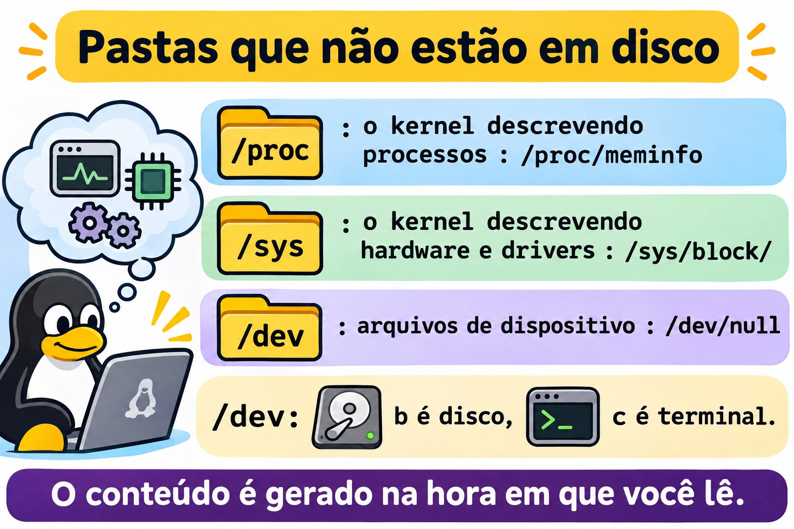
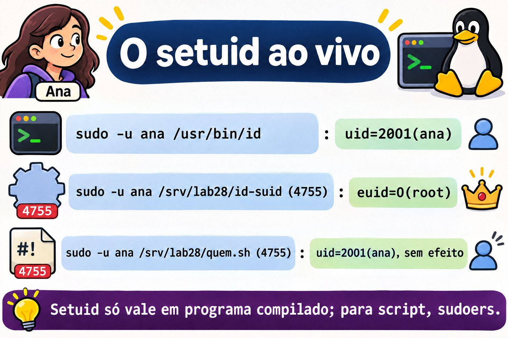
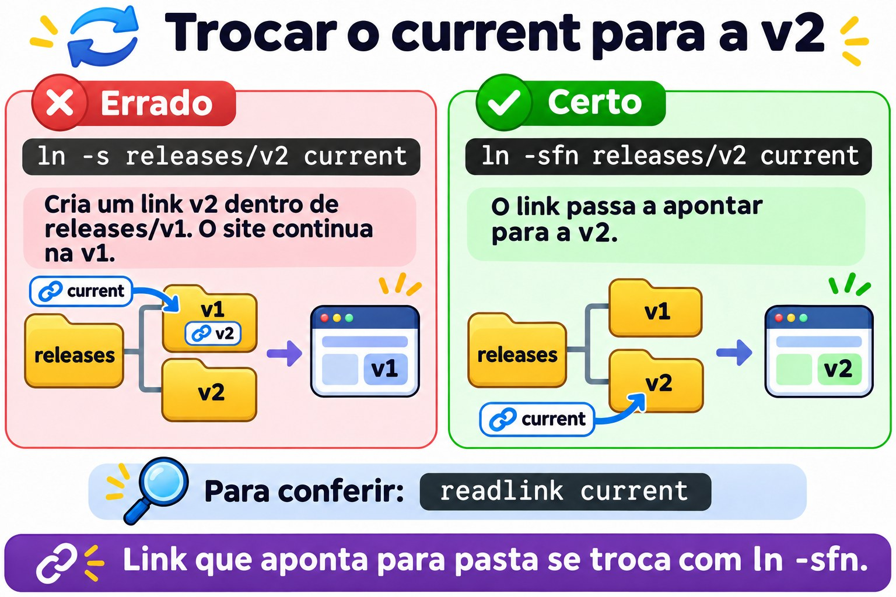
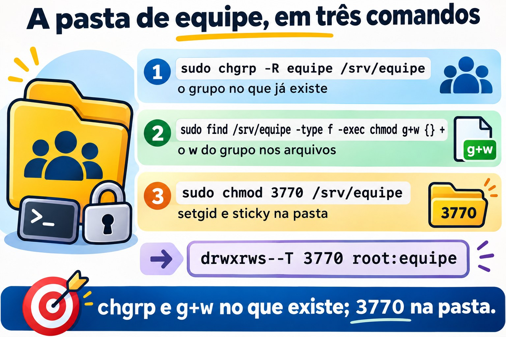

# Aula 2.8 · Diretórios e arquivos especiais

Oitava e última aula do Módulo 2. Na Aula 2.7, a pasta da equipe ficou quase pronta: a Ana e o Bruno entram, leem e escrevem, mas cada arquivo novo nasce com o grupo errado, e qualquer um dos dois pode apagar o trabalho do outro. Hoje você fecha isso com três bits que ficam escondidos no `ls -l`: o **setgid**, que faz a pasta dar o grupo aos arquivos novos, o **sticky**, que impede que um apague o arquivo do outro, e o **setuid**, que explica por que a Ana consegue trocar a própria senha num arquivo que só o root pode alterar. Depois você aprende os dois tipos de link, que estão por baixo de todo deploy com "rollback em um segundo", e passeia por `/proc`, `/sys` e `/dev`, as pastas que parecem arquivos e são o kernel falando. No fim, o desafio do módulo: a pasta `/srv/equipe` funcionando de verdade, nas duas VMs.

| Ficha | Aula 2.8 |
| --- | --- |
| Módulo | M2 · Sistema, usuários e permissões, aula 8 de 8 |
| Quando | Semana 5 |
| Ao final você consegue | Explicar e usar o sticky bit, o setuid e o setgid, em arquivos e em pastas; ler `s`, `S`, `t` e `T` num `ls -l`; montar uma pasta de colaboração em que todo arquivo novo é do grupo e ninguém apaga o arquivo do outro; achar os programas com setuid de um servidor; criar links físicos e simbólicos e prever o que acontece quando o original some; trocar um link de deploy sem janela; ler informações do sistema em `/proc`, `/sys` e `/dev` |
| Pré-requisitos | Aula 2.7 (trincas, octal, `chmod`, `chgrp`, `umask`, `namei -l`; a pasta `/srv/equipe` em `770 root:equipe` nas duas VMs e o `notas-bruno.txt` com o grupo errado na rocky-lab); Aula 2.6 (Ana, Bruno e o grupo `equipe`); Aula 2.5 (`sudo` e as regras do `sudoers`) |
| Tempo | Cerca de 2h30 |
| Snapshots | m2a8-inicio e m2a8-fim nas duas VMs |

## 1 · Aquecimento

Três perguntas, de cabeça. Escreva as respostas; o Gabarito confere no fim.

1. O `/tmp` é `drwxrwxrwt root root`, e a Ana deixou lá o arquivo `ana.txt` em `-rw-rw-rw-`. Palpite: o Bruno consegue apagá-lo?
2. O `ls -l /usr/bin/passwd` mostra `-rwsr-xr-x root root`, e o `/etc/shadow` só pode ser alterado pelo root. Mesmo assim, a Ana roda `passwd` e a senha dela muda no `/etc/shadow`. Palpite: como?
3. Você tem um arquivo `relatorio.txt` e cria um link para ele. Depois apaga o `relatorio.txt`. Palpite: o conteúdo continua acessível pelo link?

## 2 · Por que importa

Os três bits e os links aparecem em chamados que parecem não ter nada a ver com permissão:

| O chamado | A resposta errada | O que ela causa |
| --- | --- | --- |
| "Toda vez que o Bruno cria um arquivo na pasta da equipe, a Ana não consegue editar" | Um cron que roda `chmod -R 777` a cada minuto | Um minuto de janela, a pasta aberta para a máquina inteira e o problema de volta no arquivo seguinte |
| "Alguém apagou a planilha do financeiro na pasta compartilhada" | Tirar o `w` de todo mundo na pasta | Ninguém consegue mais criar nada; a equipe passa a mandar arquivo por e-mail |
| "O script de backup precisa rodar como root, mas quem roda é o operador" | `chmod u+s backup.sh` | Não funciona (o Linux ignora o setuid em scripts), e quem tentar de novo com uma cópia do `bash` cria uma porta dos fundos |
| "O site voltou para a versão antiga sozinho" ou "o site saiu do ar durante o deploy" | Apagar e recriar o link `current` à mão | Um instante sem link, ou um link criado **dentro** da pasta errada |
| "O disco encheu, mas o `du` não acha o arquivo" | Reiniciar o servidor | O arquivo apagado ainda estava aberto por um processo; o `/proc` mostrava qual |

Quem resolve de verdade sabe ler um `s` ou um `t` no lugar do `x`, sabe o que é um inode e sabe que `/proc` é o kernel respondendo perguntas. É isso que você treina hoje.

## 3 · Modelo mental

> O modo de um arquivo tem **quatro** dígitos em octal, não três. O primeiro, que quase sempre é `0` e por isso some, guarda três bits especiais: setuid (`4`), setgid (`2`) e sticky (`1`). Eles não têm coluna própria no `ls -l`: cada um aparece **no lugar do `x`** de uma trinca.

```text
            especiais   dono   grupo  outros
  octal:        3        7      7      0          chmod 3770
  bits:       0 1 1     rwx    rwx    ---
              │ │ └─ sticky (1) ──────────────┐
              │ └─── setgid (2) ───────┐      │
              └───── setuid (4) ─┐     │      │
                                 ▼     ▼      ▼
  ls -l:                 d  rwx   rws   --T      /srv/equipe
                                    │     │
            s minúsculo = bit + x ──┘     └── T maiúsculo = bit sem x
            S maiúsculo = bit sem x          t minúsculo = bit + x

  O que cada um faz:
                 num arquivo executável          numa pasta
  setuid (4)     roda com o UID do DONO          (ignorado no Linux)
  setgid (2)     roda com o GID do GRUPO         arquivo novo herda o GRUPO da pasta
  sticky (1)     (ignorado no Linux)             só o dono do arquivo apaga ou renomeia
```

O segundo modelo é para os links. Um nome de arquivo não **é** o arquivo: é uma entrada na pasta que aponta para um **inode**, e o inode aponta para os dados.

```text
  pasta /srv/lab28/links
  ┌──────────────────────┬────────┐
  │ nome                 │ inode  │
  ├──────────────────────┼────────┤        ┌──────────────┐     ┌───────────────┐
  │ config.conf          │ 131077 │──┬───▶ │ inode 131077 │───▶ │ dados:        │
  │ config-fisico.conf   │ 131077 │──┘     │ dono, modo,  │     │ porta=8080    │
  │ config-simbolico ────┼────────┼──┐     │ links: 2     │     └───────────────┘
  └──────────────────────┴────────┘  │     └──────────────┘
                                     │
                                     └──▶ um inode próprio, cujo conteúdo é só o
                                          TEXTO "config.conf": um caminho, procurado
                                          de novo a cada uso
```

O link físico é um **segundo nome** para o mesmo inode: apagar um dos nomes não apaga os dados, porque o kernel só libera o inode quando o contador de links chega a zero e nenhum processo o mantém aberto. O link simbólico é um **bilhete com um endereço**: se o endereço deixa de existir, o bilhete continua lá, apontando para o nada.


*O modo tem quatro dígitos: o primeiro guarda setuid, setgid e sticky.*

## 4 · Conceito em camadas

### Essencial

**O sticky bit, em pastas.** Numa pasta com `w` para várias pessoas, qualquer uma pode apagar ou renomear qualquer arquivo, porque apagar é escrever na pasta (Aula 2.7). Com o sticky bit, só três contas apagam ou renomeiam um arquivo: o **dono do arquivo**, o **dono da pasta** e o root. É o que protege o `/tmp`, onde todo mundo escreve:

```bash
stat -c '%A %a %U:%G %n' /tmp /var/tmp
```

```text
drwxrwxrwt 1777 root:root /tmp
drwxrwxrwt 1777 root:root /var/tmp
```

O sticky não muda quem **lê** ou **escreve** no conteúdo do arquivo: isso continua com as trincas do arquivo. Ele só muda quem apaga e quem renomeia.

**O setuid, em executáveis.** Normalmente, um programa roda com o UID de quem o chamou. Com o setuid, ele roda com o UID do **dono do arquivo**. O `passwd` é do root e tem setuid: quando a Ana o roda, o processo tem o UID efetivo do root e consegue gravar no `/etc/shadow`. O próprio `passwd` garante que ela só troque a senha dela. É por isso que um programa com setuid de root é um ponto sensível: qualquer falha nele vira acesso de root.

```bash
ls -l /usr/bin/passwd /usr/bin/sudo /usr/bin/su
```

Os três mostram `-rwsr-xr-x` e o dono `root`. O `s` no lugar do `x` do dono é o setuid.

**O setgid, em pastas.** Na Aula 2.7, cada arquivo novo na `/srv/equipe` nascia com o grupo pessoal de quem criou. Com o setgid na pasta, todo arquivo novo nasce com o **grupo da pasta**, e toda subpasta nova nasce com o grupo e com o próprio setgid. É o bit que transforma uma pasta comum numa pasta de equipe.

**O setgid, em executáveis.** O programa roda com o GID do grupo do arquivo. No Debian, o `crontab` é `-rwxr-sr-x root crontab`: ele roda com o grupo `crontab` e, por isso, consegue gravar na pasta onde ficam as tabelas de cron de cada pessoa, que só esse grupo alcança.

**Como ligar e desligar.** No modo simbólico, `u+s` é setuid, `g+s` é setgid, `o+t` (ou `+t`) é sticky; com `-` no lugar do `+`, desliga. No octal, o quarto dígito vem na frente:

| Comando | Resultado numa pasta `rwxrwx---` |
| --- | --- |
| `chmod g+s pasta` | `drwxrws---` (`2770`) |
| `chmod +t pasta` | `drwxrwx--T` (`1770`) |
| `chmod 3770 pasta` | `drwxrws--T`: setgid e sticky |
| `chmod g-s,-t pasta` | `drwxrwx---` (`770`) |

**Letra minúscula ou maiúscula.** O `s` e o `t` minúsculos dizem "o bit especial está ligado **e** o `x` dessa trinca também". O `S` e o `T` maiúsculos dizem "o bit está ligado e o `x` não". Num executável, `S` quase sempre é erro: um setuid sem `x` para o dono não serve para nada. Numa pasta de equipe como a `drwxrws--T`, o `T` é normal e o sticky funciona: os outros não têm `x`, mas o sticky protege quem está dentro, que é o grupo.

**Os dois links.**

```bash
ln config.conf config-fisico.conf          # link físico: outro nome para o mesmo inode
ln -s config.conf config-simbolico         # link simbólico: um arquivo que guarda um caminho
ls -li
```

O `ls -li` mostra o número do inode na primeira coluna e o contador de links depois do modo. O físico tem o **mesmo** inode do original e o contador sobe para `2`. O simbólico tem inode próprio, começa com `l` e mostra a seta: `config-simbolico -> config.conf`.

|  | Link físico | Link simbólico |
| --- | --- | --- |
| O que é | Outro nome para o mesmo inode | Um arquivo que guarda um caminho |
| Apagaram o original | Os dados continuam, pelo outro nome | O link fica quebrado: `No such file or directory` |
| Para pastas | Não pode | Pode |
| Entre sistemas de arquivos (outro disco, outra partição) | Não pode | Pode |
| Permissões | As do inode, que são as mesmas do original | O link é sempre `lrwxrwxrwx`; o que vale é o modo do destino |
| Uso típico | Backups incrementais que não duplicam arquivos iguais | `current -> releases/v2`, `/etc/localtime`, `/bin -> usr/bin` |

### Intermediário

**O setgid não conserta o passado.** Ligar o `g+s` numa pasta afeta só o que for criado **depois**. Arquivos e subpastas que já existiam continuam com o grupo e o modo que tinham. Ao converter uma pasta antiga em pasta de equipe, são quatro passos, sempre os mesmos:

```bash
sudo chgrp -R equipe /srv/equipe                                  # o grupo em tudo
sudo chmod -R g+rwX /srv/equipe                                   # o grupo lê e escreve; pastas atravessáveis
sudo find /srv/equipe -type d -exec chmod g+s {} +                # setgid em cada pasta, não só na de cima
sudo chmod +t /srv/equipe                                         # sticky, se ninguém pode apagar o do outro
```

**O setgid dá o grupo, e o `umask` dá o `w`.** O arquivo novo herda o **grupo** da pasta, mas o **modo** continua vindo do `umask` de quem criou. Com `umask 022`, o arquivo nasce `rw-r--r--`, do grupo `equipe`, e o resto do grupo só lê. A pasta de equipe só funciona por inteiro quando os membros têm `umask 002` (o comum para usuários com grupo pessoal, que você mediu na Aula 2.7) ou quando a pasta tem uma ACL padrão (Aula 8.5). Lembre também que o `sudo` junta o `umask` de quem chamou com `0022`: um arquivo criado com `sudo -u ana` nasce sem `w` para o grupo, a não ser que o comando defina o `umask`. É por isso que, no lab, os testes trazem `umask 002` explícito.

**O `chmod` numérico e os bits especiais em pastas.** No `chmod` do GNU, que é o das duas VMs, um modo numérico de três dígitos **não desliga** o setuid nem o setgid de uma **pasta**: `chmod 770` numa pasta `2770` deixa `2770`. O sticky, ao contrário, é desligado. Para desligar o setgid de uma pasta, use o simbólico (`chmod g-s`) ou um zero a mais na frente (`chmod 00770`). Em arquivos, o modo numérico vale exatamente como foi escrito. Na dúvida, confira com `stat` depois.

**O setuid é ignorado em scripts.** O kernel só respeita o setuid e o setgid em programas compilados. Num script (`#!/bin/bash`), o bit pode até estar ligado e aparecer `rws`, mas o interpretador roda com o UID de quem chamou. Para deixar uma pessoa rodar um script como root, o caminho é uma regra no `sudoers` para aquele script (Aula 2.5).

**Caminho relativo ou absoluto no link simbólico.** O link guarda o texto exato que você escreveu. Um link relativo (`ln -s releases/v2 current`) é resolvido a partir da pasta **onde o link está**, e continua funcionando se a árvore inteira mudar de lugar. Um link absoluto (`ln -s /srv/app/releases/v2 current`) funciona de qualquer lugar, mas quebra se `/srv/app` mudar de nome. O erro clássico é criar o link relativo pensando na pasta em que você está, e não na pasta do link:

```bash
cd /srv
ln -s app/releases/v2 app/current      # o link procura /srv/app/app/releases/v2: quebrado
ln -s releases/v2 app/current          # o link procura /srv/app/releases/v2: certo
```

**Trocar um link que aponta para pasta.** Se `current` é um link para uma pasta, `ln -s releases/v1 current` não troca o link: como `current` "é" uma pasta, o `ln` cria um link novo **dentro** dela, em `releases/v2/v1`. Para trocar o link em si, use `ln -sfn`: o `-f` substitui, e o `-n` diz para tratar `current` como o link, sem entrar nele.

**`/proc`, `/sys` e `/dev`.** As três pastas são sistemas de arquivos que não estão em disco:

| Pasta | Tipo (`findmnt`) | O que é | Exemplos |
| --- | --- | --- | --- |
| `/proc` | `proc` | O kernel descrevendo processos e o sistema | `/proc/cpuinfo`, `/proc/meminfo`, `/proc/<PID>/`, `/proc/sys/` (os parâmetros do `sysctl`) |
| `/sys` | `sysfs` | O kernel descrevendo hardware e drivers | `/sys/class/net/<placa>/address`, `/sys/block/` |
| `/dev` | `devtmpfs` | Arquivos de dispositivo: ler e escrever neles é falar com o hardware ou com o kernel | `/dev/sda`, `/dev/null`, `/dev/zero`, `/dev/urandom` |

Um `ls -l /proc/meminfo` mostra tamanho `0`, e um `cat` mostra dezenas de linhas: o conteúdo é gerado na hora em que você lê. Em `/dev`, a primeira letra do modo diz o tipo: `b` é dispositivo de bloco (discos), `c` é de caractere (terminais, `/dev/null`). Onde um arquivo comum mostraria o tamanho, o `ls -l` mostra dois números, o *major* e o *minor*, que dizem ao kernel qual driver e qual dispositivo.

**`/tmp` e `/var/tmp`.** Os dois têm sticky e `1777`. O `/var/tmp` existe para o que precisa sobreviver a um reboot; o `/tmp` pode ser um `tmpfs`, na memória, e é limpo no boot ou por idade. Quem limpa é o `systemd-tmpfiles`, com as regras de `/usr/lib/tmpfiles.d/tmp.conf`. Nunca guarde em `/tmp` o que você não aceita perder.



*/proc, /sys e /dev não estão em disco: são o kernel e o hardware vistos como arquivos.*

### Ponte Windows

| No Windows | No Linux | Diferença que importa |
| --- | --- | --- |
| Permissão NTFS "Excluir" separada de "Gravar" | O sticky bit na pasta | No Windows você nega "Excluir" por pessoa; no Linux, o sticky vale para todos de uma vez: cada um só apaga o que é seu |
| Herança de permissões de pasta para arquivos novos | O setgid na pasta (só o grupo) e a ACL padrão (Aula 8.5) | O NTFS herda a ACL inteira; o setgid herda só o grupo, e o modo vem do `umask` |
| "Executar como administrador" e o UAC | `sudo`, e o setuid em poucos programas do sistema | O setuid é do arquivo, não da pessoa: vale para todo mundo que rodar aquele programa |
| Atalho `.lnk` | Nada: o `.lnk` é um arquivo que só o Explorer entende | Um link simbólico funciona para qualquer programa, inclusive no terminal |
| `mklink /D` e junções | `ln -s` | Mesma ideia; no Linux qualquer usuário cria, sem privilégio especial |
| `mklink /H` | `ln` (link físico) | Mesma ideia: dois nomes, um arquivo |
| Gerenciador de Tarefas, WMI | `/proc` | No Linux, a informação é um arquivo que você lê com `cat` e `grep` |
| Gerenciador de Dispositivos | `/sys` e `/dev` | O dispositivo é um arquivo; `lsblk` e `ip link` leem `/sys` por você |

### Avançado

**As proteções do kernel em pastas com sticky.** Três parâmetros do `sysctl` endurecem o `/tmp` contra ataques clássicos, em que alguém cria antes um link ou um arquivo com o nome que um programa do root vai usar:

```bash
sudo sysctl fs.protected_symlinks fs.protected_hardlinks fs.protected_regular
```

Com `protected_symlinks = 1`, numa pasta com sticky e gravável por todos, um link simbólico só é seguido se for do mesmo dono de quem segue, ou do dono da pasta. Com `protected_hardlinks = 1`, ninguém cria um link físico para um arquivo de outra pessoa que não possa ler e escrever. Com `protected_regular = 1`, ninguém abre com criação (`>` ou `>>`) um arquivo de outra pessoa numa pasta com sticky e gravável por todos, como o `/tmp`, mesmo que o arquivo seja `666`. Com `2`, a regra vale também para pastas com sticky graváveis só pelo grupo, como a pasta de equipe desta aula. Anote os valores das duas VMs no Passo 0.

**Montar sem setuid.** A opção `nosuid` no `mount` (e no `/etc/fstab`) faz o kernel ignorar o setuid e o setgid de tudo o que está naquele sistema de arquivos. É a configuração certa para pendrives, `/tmp` em partição própria e pastas de upload. A Aula 5.x volta ao `fstab`.

**Capabilities, o setuid fatiado.** Em vez de dar root inteiro a um programa, o kernel permite dar só uma parte, como "abrir portas abaixo de 1024" ou "enviar pacotes ICMP". O `getcap -r /usr/bin 2>/dev/null` mostra quais programas usam isso. Uma auditoria de setuid de verdade olha as duas listas.

**O disco cheio que o `du` não acha.** Um arquivo apagado, mas ainda aberto por um processo, continua ocupando espaço: o inode só é liberado quando o último nome some **e** o último processo o fecha. O `/proc` mostra quem está segurando:

```bash
sudo find /proc/[0-9]*/fd -lname '*(deleted)' -printf '%p -> %l\n' 2>/dev/null
```

Reiniciar o serviço que segura o arquivo libera o espaço sem reiniciar o servidor.

## 5 · Rocky × Debian

| O quê | rocky-lab | debian-lab | Como conferir |
| --- | --- | --- | --- |
| `/tmp` | Costuma ser pasta no disco do sistema | Do Debian 13 em diante, `tmpfs` na memória; antes, pasta no disco | `findmnt /tmp` |
| Limpeza de `/tmp` e `/var/tmp` | Por idade, pelo `systemd-tmpfiles` | Depende da versão: no boot, por idade, ou os dois | `cat /usr/lib/tmpfiles.d/tmp.conf` |
| `crontab` | `-rwsr-xr-x root root`: setuid de root | `-rwxr-sr-x root crontab`: setgid do grupo `crontab` | `ls -l /usr/bin/crontab` |
| Quantidade de programas com setuid ou setgid | Algumas dezenas | Algumas dezenas, nem sempre os mesmos | `sudo find / -xdev -type f -perm /6000 \| wc -l` |
| `/bin`, `/sbin`, `/lib` | Links simbólicos para `usr/bin`, `usr/sbin`, `usr/lib` | Os mesmos links (o "/usr unificado") | `ls -ld /bin /sbin /lib` |
| `/etc/localtime` | Link simbólico para `/usr/share/zoneinfo/...` | Link simbólico para `/usr/share/zoneinfo/...` | `ls -l /etc/localtime` |
| Ponto depois do modo no `ls -l` | Aparece (contexto SELinux) | Não aparece | `ls -l /usr/bin/passwd` |
| Nome do disco | `sda` ou `vda`, conforme o controlador da VM no Proxmox | O mesmo critério | `lsblk` |

As regras dos três bits, dos links e de `/proc`, `/sys` e `/dev` são do kernel e do `coreutils`, e são as mesmas nas duas VMs. O que muda é qual programa do sistema usa cada bit, e como cada distribuição trata o `/tmp`.

## 6 · Lab guiado

O formato é o mesmo da Aula 2.7: você é o `rodrigo`, com `sudo`, e testa tudo **como a Ana e como o Bruno** com `sudo -u`. Os experimentos ficam em `/srv/lab28`. O Passo 7 é o desafio do módulo, na `/srv/equipe` de verdade, nas duas VMs. Lembre que o `rodrigo` não está no grupo `equipe`: para olhar dentro da `/srv/equipe` você usa `sudo`.


*Pasta de equipe: o setgid faz herdar o grupo, o sticky impede apagar o arquivo do outro.*


### Passo 0 · Snapshot, caminho e as proteções do kernel

No Proxmox, tire o snapshot `m2a8-inicio` das duas VMs. Na rocky-lab:

```bash
eval "$(ssh-agent -s)"; ssh-add
ssh -o BatchMode=yes deb hostname
sudo stat -c '%A %a %U:%G %n' /srv/equipe /srv/equipe/*
```

```text
drwxrwx--- 770 root:equipe /srv/equipe
stat: cannot statx '/srv/equipe/*': No such file or directory
```

A pasta aparece, e os arquivos não. O `sudo` está certo; o problema é **quem expande o `*`**. Quem troca `/srv/equipe/*` pela lista de arquivos é o seu shell, rodando como `rodrigo`, **antes** de o `sudo` começar. O `rodrigo` não está no grupo `equipe` e não lê a pasta, então o shell não acha nada e passa o texto `/srv/equipe/*` como está. O comando de conferência do fim da Aula 2.7 tropeça nisso também. Os dois jeitos certos: deixar o root expandir, com `sudo sh -c '...'`, ou não usar `*`, com um `find` rodado pelo root. Este lab usa o `find`, que mostra o modo de quatro dígitos com o `%m`:

```bash
sudo find /srv/equipe -maxdepth 1 -printf '%M %m %u:%g %p\n'
sudo sysctl fs.protected_symlinks fs.protected_hardlinks fs.protected_regular
ssh -t deb 'sudo sysctl fs.protected_symlinks fs.protected_hardlinks fs.protected_regular'
```

A `/srv/equipe` tem que aparecer como `drwxrwx--- 770 root:equipe`, com a `planilha.csv` em `ana:equipe`. Na rocky-lab também aparece o `notas-bruno.txt`, e ele está em `bruno:bruno`: é o problema que sobrou da Aula 2.7. Anote os três valores do `sysctl` nas duas VMs. O comum é `1`, `1` e `1`. Se o `protected_regular` vier `2`, guarde isso: ele muda um teste do Passo 7.

Crie a pasta dos experimentos:

```bash
sudo mkdir -p /srv/lab28
sudo chmod 755 /srv/lab28
```

### Passo 1 · O sticky bit no `/tmp`

A Ana deixa um arquivo no `/tmp`, aberto para todos:

```bash
sudo -u ana bash -c 'echo "rascunho da Ana" > /tmp/ana-lab28.txt; chmod 666 /tmp/ana-lab28.txt'
stat -c '%A %U:%G %n' /tmp /tmp/ana-lab28.txt
```

```text
drwxrwxrwt root:root /tmp
-rw-rw-rw- ana:ana /tmp/ana-lab28.txt
```

O arquivo é `666` e o `/tmp` dá `rwx` para todos. Pela regra da Aula 2.7, apagar é escrever na pasta, e todo mundo escreve no `/tmp`.

**Decida 1 · O Bruno roda `rm -f /tmp/ana-lab28.txt`. O que acontece?**

- **A)** O arquivo some, porque o `/tmp` é `rwx` para todos
- **B)** `Operation not permitted`, e o arquivo fica
- **C)** O `rm` pede confirmação, porque o arquivo não é dele
- **D)** O arquivo some, porque ele mesmo é `666`

Escolha a letra antes de olhar a tabela.

```bash
sudo -u bruno rm -f /tmp/ana-lab28.txt
ls -l /tmp/ana-lab28.txt
```

| Se você marcou | Resultado | Por quê |
| --- | --- | --- |
| A | ❌ Errada | Seria verdade sem o `t` no fim do modo. O sticky bit muda a regra de apagar: além de `w` na pasta, é preciso ser o dono do arquivo, o dono da pasta ou o root. |
| B | ✅ Certa | `rm: cannot remove '/tmp/ana-lab28.txt': Operation not permitted`. O sticky protege o arquivo da Ana, mesmo aberto para todos. Note que a mensagem não é `Permission denied`: é o sticky falando, não as trincas. |
| C | ❌ Errada | O `-f` desliga qualquer pergunta do `rm`. E a pergunta não decide nada: quem decide é o kernel, que recusa do mesmo jeito. |
| D | ❌ Errada | O modo do arquivo nunca decide quem apaga: isso é da pasta. O `666` deixa o Bruno **escrever no conteúdo**, se as proteções do kernel deixarem, mas não apagar. |

**Para fixar:** `Operation not permitted` ao apagar numa pasta onde você tem `w` quase sempre é sticky bit. Confira o `t` no fim do modo da pasta.

Agora o teste ao contrário: o dono da pasta e o root apagam qualquer coisa. Apague o arquivo da Ana como root, que é o dono do `/tmp`:

```bash
sudo rm -f /tmp/ana-lab28.txt
```

### Passo 2 · O setuid, ao vivo

Liste os programas com setuid de root nas pastas de programas do sistema, nas duas VMs:

```bash
find /usr/bin /usr/sbin -perm -4000 -user root -printf '%M %u %p\n' 2>/dev/null
ssh deb "find /usr/bin /usr/sbin -perm -4000 -user root -printf '%M %u %p\n' 2>/dev/null"
```

O `-perm -4000` quer dizer "com o bit `4000` ligado, sejam quais forem os outros". Você vai reconhecer `passwd`, `sudo`, `su`, `mount`, `umount`, `chage`, `newgrp`, `gpasswd`. Todos precisam fazer, para uma pessoa comum, uma única coisa que só o root pode, e cada um se encarrega de limitar o que ela faz com isso. Compare as duas listas: elas não são iguais, e a diferença é assunto da seção Rocky × Debian.

Agora veja o setuid mudar a identidade de um processo. Uma cópia do `id` com setuid de root, só para o experimento:

```bash
sudo cp /usr/bin/id /srv/lab28/id-suid
sudo chmod 4755 /srv/lab28/id-suid
ls -l /srv/lab28/id-suid
sudo -u ana /usr/bin/id
sudo -u ana /srv/lab28/id-suid
```

```text
-rwsr-xr-x. 1 root root ... /srv/lab28/id-suid
uid=2001(ana) gid=2001(ana) groups=2001(ana),2000(equipe)
uid=2001(ana) gid=2001(ana) euid=0(root) groups=2001(ana),2000(equipe)
```

O `euid=0(root)` é o UID **efetivo**, o que o kernel usa para decidir permissões. A Ana continua sendo a Ana no `uid`, mas aquele processo tem os poderes do root. Com o `id`, que só mostra informação, isso é inofensivo. Com uma cópia do `bash`, seria um shell de root para quem rodasse. É exatamente isso que um invasor procura num servidor.

Agora o mesmo bit num script:

```bash
printf '#!/bin/bash\nid\n' | sudo tee /srv/lab28/quem.sh >/dev/null
sudo chmod 4755 /srv/lab28/quem.sh
ls -l /srv/lab28/quem.sh
```

**Decida 2 · A Ana roda `/srv/lab28/quem.sh`. O que a linha mostra?**

- **A)** `euid=0(root)`, igual ao `id-suid`
- **B)** `uid=2001(ana)`, sem `euid`: o setuid não teve efeito
- **C)** `Permission denied`, porque o script é do root
- **D)** `uid=0(root)`: o script inteiro roda como root

Escolha a letra antes de olhar a tabela.

```bash
sudo -u ana /srv/lab28/quem.sh
```

| Se você marcou | Resultado | Por quê |
| --- | --- | --- |
| A | ❌ Errada | Seria uma falha grave de segurança, e foi por isso que o Linux deixou de respeitar o bit em scripts. O kernel roda o `/bin/bash`, que não tem setuid, e o `bash` lê o script. |
| B | ✅ Certa | O `ls -l` mostra `rws`, e o bit não faz nada. Para alguém rodar um script como root, a ferramenta é uma regra no `sudoers` (Aula 2.5), que ainda registra quem rodou e quando. |
| C | ❌ Errada | O script é `4755`: os outros têm `r-x`, e a Ana lê e executa. Ser do root não impede ninguém de rodar um programa. |
| D | ❌ Errada | Nem o UID real nem o efetivo mudam. O setuid em script é ignorado por inteiro. |

**Para fixar:** o setuid só funciona em programas compilados. Quando pedirem "um script que o operador rode como root", a resposta é `sudoers`, nunca `chmod u+s`.

Limpe o experimento. Um programa com setuid de root esquecido numa pasta é o tipo de coisa que uma auditoria acha, e com razão:

```bash
sudo rm /srv/lab28/id-suid /srv/lab28/quem.sh
```



*O setuid muda o UID efetivo de um programa; num script, o kernel o ignora.*

### Passo 3 · O setgid numa pasta

Uma pasta de projeto do grupo, ainda sem nenhum bit especial:

```bash
sudo mkdir /srv/lab28/proj
sudo chgrp equipe /srv/lab28/proj
sudo chmod 770 /srv/lab28/proj
sudo -u ana bash -c 'umask 002; touch /srv/lab28/proj/antes.txt'
sudo stat -c '%A %U:%G %n' /srv/lab28/proj /srv/lab28/proj/antes.txt
```

O `antes.txt` nasce `ana:ana`: o grupo pessoal da Ana. É o problema do `notas-bruno.txt` se repetindo. Agora ligue o setgid e crie outro arquivo e uma subpasta:

```bash
sudo chmod g+s /srv/lab28/proj
sudo -u ana bash -c 'umask 002; touch /srv/lab28/proj/depois.txt; mkdir /srv/lab28/proj/sub'
sudo find /srv/lab28/proj -printf '%M %m %u:%g %p\n'
```

```text
drwxrws--- 2770 root:equipe /srv/lab28/proj
-rw-rw-r-- 664 ana:ana /srv/lab28/proj/antes.txt
-rw-rw-r-- 664 ana:equipe /srv/lab28/proj/depois.txt
drwxrwsr-x 2775 ana:equipe /srv/lab28/proj/sub
```

Três coisas para ler aí. A pasta mostra `rws` no grupo: setgid com `x`. O `depois.txt` nasceu do grupo `equipe`, sem ninguém rodar `chgrp`. E a `sub` nasceu com o grupo **e** com o próprio setgid (`2775`): a regra desce sozinha pela árvore.

**Decida 3 · O Bruno precisa editar o `antes.txt`. O que acontece agora, com a pasta já em `2770`?**

- **A)** Funciona: o setgid corrigiu o grupo de todos os arquivos da pasta
- **B)** Falha: o `antes.txt` continua `ana:ana`, e o Bruno cai em outros, `r--`
- **C)** Funciona: o Bruno está no grupo da pasta, e isso basta
- **D)** Falha: com setgid, só o dono da pasta edita

Escolha a letra antes de olhar a tabela.

```bash
sudo -u bruno bash -c 'echo "linha do Bruno" >> /srv/lab28/proj/antes.txt'
```

| Se você marcou | Resultado | Por quê |
| --- | --- | --- |
| A | ❌ Errada | O setgid só age na **criação** de arquivos. O que já existia fica como estava. É o erro mais comum ao converter uma pasta antiga. |
| B | ✅ Certa | `Permission denied`. O arquivo é `664 ana:ana`, e o Bruno não é a Ana nem está no grupo `ana`. O conserto é no arquivo: `sudo chgrp equipe antes.txt`. |
| C | ❌ Errada | O grupo da **pasta** decide quem entra e cria; o grupo do **arquivo** decide quem escreve nele. São dois controles diferentes. |
| D | ❌ Errada | O setgid não restringe nada: ele só escolhe o grupo dos arquivos novos. |

**Para fixar:** depois do `chmod g+s`, sempre um `chgrp -R` no que já existe. O setgid cuida do futuro; o passado é com você.

Conserte e confirme:

```bash
sudo chgrp equipe /srv/lab28/proj/antes.txt
sudo -u bruno bash -c 'echo "linha do Bruno" >> /srv/lab28/proj/antes.txt'
sudo cat /srv/lab28/proj/antes.txt
```

Por último, veja o `umask` mandando no modo. O Bruno cria um arquivo com o `umask 022` que o `sudo` impõe:

```bash
sudo -u bruno touch /srv/lab28/proj/sem-umask.txt
sudo stat -c '%A %U:%G %n' /srv/lab28/proj/sem-umask.txt
```

O grupo veio certo, `equipe`, e o modo é `rw-r--r--`: a Ana lê e não escreve. O setgid deu o grupo; o `w` do grupo é com o `umask` de quem cria.

### Passo 4 · Link físico e link simbólico

Agora como você mesmo, numa pasta sua:

```bash
sudo install -d -o rodrigo -g rodrigo /srv/lab28/links
cd /srv/lab28/links
echo "porta=8080" > config.conf
ln config.conf config-fisico.conf
ln -s config.conf config-simbolico
ls -li
```

```text
131077 -rw-r--r--. 2 rodrigo rodrigo 11 ... config-fisico.conf
131079 lrwxrwxrwx. 1 rodrigo rodrigo 11 ... config-simbolico -> config.conf
131077 -rw-r--r--. 2 rodrigo rodrigo 11 ... config.conf
```

Os números do inode serão outros na sua VM; o que importa é a relação. `config.conf` e `config-fisico.conf` têm o **mesmo** inode e o contador `2`: são dois nomes para um arquivo só. O simbólico tem inode próprio, contador `1`, tamanho `11`, que é o número de letras de `config.conf`, e o modo `lrwxrwxrwx`.

Mude o conteúdo por um nome e leia pelos outros:

```bash
echo "porta=9090" > config-fisico.conf
cat config.conf config-simbolico
```

As duas linhas mostram `porta=9090`. Agora apague o original.

**Decida 4 · Depois de `rm config.conf`, o que mostram `cat config-fisico.conf` e `cat config-simbolico`?**

- **A)** Os dois mostram `porta=9090`
- **B)** O físico mostra `porta=9090`; o simbólico dá `No such file or directory`
- **C)** Os dois dão `No such file or directory`
- **D)** O físico dá erro; o simbólico mostra `porta=9090`, porque guardou uma cópia

Escolha a letra antes de olhar a tabela.

```bash
rm config.conf
cat config-fisico.conf
cat config-simbolico
ls -li
```

| Se você marcou | Resultado | Por quê |
| --- | --- | --- |
| A | ❌ Errada | O simbólico não aponta para o inode; ele guarda o texto `config.conf` e procura esse nome a cada uso. O nome sumiu. |
| B | ✅ Certa | O `rm` apagou um **nome**. O inode tinha dois; o contador caiu para `1` e os dados ficaram. O simbólico virou um link quebrado: o `ls` costuma mostrá-lo em vermelho piscando. |
| C | ❌ Errada | O físico não depende do nome original: os dois nomes eram iguais em tudo, e nenhum é "o original" para o kernel. |
| D | ❌ Errada | É o contrário. O simbólico nunca guarda conteúdo, só um caminho. |

**Para fixar:** `rm` apaga um nome, não um arquivo. Os dados só somem quando o último nome some e nenhum processo os mantém abertos.

Recrie o nome e veja o link quebrado voltar sozinho:

```bash
echo "porta=7070" > config.conf
cat config-simbolico
```

O simbólico mostra `porta=7070`, um arquivo **novo** com o mesmo nome. O físico continua mostrando `porta=9090`: ele é outro inode agora. Confira com `ls -li`.

Por fim, os dois limites do link físico:

```bash
ln /srv/lab28/proj pasta-fisica
ln /proc/version versao-fisica
```

O primeiro dá `hard link not allowed for directory`. O segundo dá `Invalid cross-device link`: o `/proc` é outro sistema de arquivos. Com `-s`, os dois funcionariam.

### Passo 5 · O deploy com link simbólico

É o padrão de quase todo deploy sério: cada versão numa pasta, e um link `current` que diz qual está no ar. Voltar uma versão é trocar o link.

```bash
sudo install -d -o rodrigo -g rodrigo /srv/lab28/app
mkdir -p /srv/lab28/app/releases/v1 /srv/lab28/app/releases/v2
echo "versao 1" > /srv/lab28/app/releases/v1/index.html
echo "versao 2" > /srv/lab28/app/releases/v2/index.html
cd /srv/lab28/app
ln -s releases/v1 current
cat current/index.html
```

O site, que leria `current/index.html`, mostra `versao 1`. Hora de publicar a v2. O colega roda o que parece óbvio:

```bash
ln -s releases/v2 current
cat current/index.html
ls -l current/ releases/v1/
```

O site continua na versão 1, e apareceu um link `v2` **dentro** de `releases/v1`. Como `current` aponta para uma pasta, o `ln` tratou `current` como pasta e criou o link novo lá dentro.

**Decida 5 · Qual comando troca o `current` para a v2 de uma vez só?**

- **A)** `rm current; ln -s releases/v2 current`
- **B)** `ln -sf releases/v2 current`
- **C)** `ln -sfn releases/v2 current`
- **D)** `cp -r releases/v2 current`

Escolha a letra antes de olhar a tabela.

| Se você marcou | Resultado | Por quê |
| --- | --- | --- |
| A | ⚠️ Funciona, mas | O link fica certo, e entre os dois comandos existe um instante sem `current`: num site de verdade, os acessos daquele instante dão erro. Num deploy automático, se o segundo comando falhar, o site fica fora do ar. |
| B | ❌ Errada | O `-f` substitui, mas sem o `-n` o `ln` continua entrando no `current` e cria (ou substitui) um `v2` dentro de `releases/v1`. O mesmo erro, agora sem mensagem. |
| C | ✅ Certa | O `-n` faz o `ln` tratar `current` como o link, sem seguir, e o `-f` substitui. Uma linha, e o link já aponta para a v2. |
| D | ❌ Errada | Com `current` sendo link para uma pasta, o `cp -r` copia a v2 para dentro da v1. E mesmo sem isso, cópia não é link: você perde o "voltar em um segundo". |

**Para fixar:** link que aponta para pasta se troca com `ln -sfn`. Sem o `-n`, o `ln` entra na pasta.

Conserte e teste o rollback:

```bash
rm releases/v1/v2
ln -sfn releases/v2 current
cat current/index.html
ln -sfn releases/v1 current
cat current/index.html
readlink current
```

`versao 2`, depois `versao 1`, e o `readlink` mostra o texto guardado no link: `releases/v1`. Em produção, ferramentas de deploy fazem isso sem nenhum instante sem link: criam um link novo com outro nome e o renomeiam por cima do `current` com `mv -T`, que troca o nome numa operação só.



*Para trocar um link que aponta para pasta, use ln -sfn.*

### Passo 6 · `/proc`, `/sys` e `/dev`

Nas duas VMs, sem `sudo`:

```bash
findmnt -n -o TARGET,FSTYPE /proc /sys /dev /tmp
ls -l /proc/meminfo
grep -E 'MemTotal|MemAvailable' /proc/meminfo
grep -c ^processor /proc/cpuinfo
cat /proc/loadavg
cat /proc/sys/kernel/hostname
```

O `ls -l` mostra tamanho `0`, e o `grep` acha as linhas: o kernel gera o conteúdo quando você lê. O número de processadores é o que você deu à VM no Proxmox. O `/proc/sys/kernel/hostname` é o mesmo parâmetro que `sysctl kernel.hostname`: o `sysctl` é só um jeito de ler e escrever em `/proc/sys`.

Cada processo tem uma pasta em `/proc` com o número dele. O `$$` é o número do seu shell:

```bash
echo $$
ls /proc/$$
readlink /proc/$$/cwd /proc/$$/exe
ls -l /proc/$$/fd
```

O `cwd` é a pasta em que o shell está, o `exe` é o programa, e o `fd` mostra os arquivos abertos: `0`, `1` e `2` apontam para o seu terminal (`/dev/pts/...`). É assim que o `ps`, o `top` e o `lsof` funcionam: lendo `/proc`.

Agora o hardware pelo `/sys`, e os dispositivos pelo `/dev`:

```bash
ls /sys/class/net/
cat /sys/class/net/*/address
ls -l /dev/null /dev/zero /dev/urandom
lsblk
ls -l /dev/sd* /dev/vd* 2>/dev/null
```

O `/sys/class/net` lista as placas de rede, e o `address` de cada uma é o MAC, o mesmo que aparece no hardware da VM no Proxmox. No `/dev`, o `/dev/null` é `crw-rw-rw-`: um dispositivo de caractere, aberto para todos, e no lugar do tamanho aparecem dois números (`1, 3`). Os discos aparecem como `brw-rw---- root disk`: dispositivo de bloco, só para o root e o grupo `disk`. Quem estiver no grupo `disk` lê o disco inteiro, por baixo de qualquer permissão de arquivo. É um dos grupos que nunca se dá a uma pessoa comum.

### Passo 7 · O desafio do módulo: a `/srv/equipe` de verdade

O pedido, desde a Aula 2.6: **a Ana e o Bruno criam e editam arquivos na `/srv/equipe`, e nenhum dos dois apaga o arquivo do outro**, nas duas VMs. Na rocky-lab, o estado agora:

```bash
sudo find /srv/equipe -maxdepth 1 -printf '%M %m %u:%g %p\n'
sudo -u ana bash -c 'echo "editado pela Ana" >> /srv/equipe/notas-bruno.txt'
sudo -u bruno rm -fv /srv/equipe/planilha.csv
sudo ls /srv/equipe
```

Atenção ao terceiro comando: ele **apaga** a planilha, se puder. Você tem o snapshot `m2a8-inicio`, e a planilha tem duas linhas que você recria em segundos. A Ana não consegue editar o `notas-bruno.txt` (`Permission denied`), e o Bruno consegue apagar a planilha da Ana. São os dois defeitos do pedido. Recrie a planilha:

```bash
printf 'jan;100\nfev;200\n' | sudo -u ana tee /srv/equipe/planilha.csv >/dev/null
sudo chgrp equipe /srv/equipe/planilha.csv
sudo chmod 664 /srv/equipe/planilha.csv
```

**Decida 6 · Qual sequência entrega o pedido inteiro?**

- **A)** `sudo chmod -R 777 /srv/equipe`
- **B)** `sudo chmod 3770 /srv/equipe`
- **C)** `sudo chgrp -R equipe /srv/equipe`, `sudo find /srv/equipe -type f -exec chmod g+w {} +` e `sudo chmod 3770 /srv/equipe`
- **D)** `sudo chmod 2770 /srv/equipe` e `sudo chgrp -R equipe /srv/equipe`

Escolha a letra antes de olhar a tabela.

| Se você marcou | Resultado | Por quê |
| --- | --- | --- |
| A | ❌ Errada | A Ana edita o `notas-bruno.txt`, e qualquer conta da máquina passa a ler, alterar e apagar tudo, inclusive o arquivo do outro. Quebra as duas metades do pedido e cria um problema novo. |
| B | ⚠️ Funciona, mas | Os arquivos novos nascem do grupo e ninguém apaga o do outro. Mas o `notas-bruno.txt`, que já existia, continua `bruno:bruno`: a Ana ainda não edita. É a lição do Passo 3. |
| C | ✅ Certa | Os três problemas, um comando para cada: o grupo dos arquivos que já existem, o `w` do grupo neles, e a pasta com setgid (arquivos novos do grupo) e sticky (ninguém apaga o do outro). |
| D | ❌ Errada | Acerta o grupo de tudo e dos arquivos novos, mas não dá `w` ao grupo onde ele falta: se o `notas-bruno.txt` nasceu `644`, a Ana continua sem editar. E, sem o sticky, o Bruno continua apagando a planilha da Ana. |

**Para fixar:** uma pasta de equipe é `chgrp` e `g+w` no que existe, e `2770` ou `3770` na pasta. O sticky entra quando o pedido diz "ninguém apaga o do outro".

Aplique na rocky-lab e confira:

```bash
sudo chgrp -R equipe /srv/equipe
sudo find /srv/equipe -type f -exec chmod g+w {} +
sudo chmod 3770 /srv/equipe
sudo find /srv/equipe -maxdepth 1 -printf '%M %m %u:%g %p\n'
```

```text
drwxrws--T 3770 root:equipe /srv/equipe
-rw-rw-r-- 664 bruno:equipe /srv/equipe/notas-bruno.txt
-rw-rw-r-- 664 ana:equipe /srv/equipe/planilha.csv
```

Agora o teste que um auditor faria, os seis casos do pedido:

```bash
sudo -u ana   bash -c 'umask 002; echo "pauta" > /srv/equipe/reuniao-ana.txt'
sudo -u bruno bash -c 'echo "mar;300" >> /srv/equipe/planilha.csv'
sudo -u ana   bash -c 'echo "visto pela Ana" >> /srv/equipe/notas-bruno.txt'
sudo -u bruno rm -f /srv/equipe/reuniao-ana.txt
sudo -u ana   rm -f /srv/equipe/notas-bruno.txt
sudo -u ana   rm -f /srv/equipe/reuniao-ana.txt
sudo find /srv/equipe -maxdepth 1 -type f -printf '%M %u:%g %p\n'
sudo cat /srv/equipe/planilha.csv
```

O esperado, linha a linha: a Ana cria; o Bruno edita a planilha da Ana; a Ana edita as notas do Bruno; o Bruno **não** apaga o arquivo da Ana (`Operation not permitted`); a Ana **não** apaga o do Bruno; a Ana apaga o próprio arquivo. No fim, a planilha tem três linhas. Se o Passo 0 mostrou `protected_regular = 2`, as duas edições com `>>` no arquivo do outro falham, porque o kernel trata a pasta de equipe com sticky como o `/tmp`. Com o valor padrão, `1`, elas funcionam.

Repita na debian-lab. Lá não existe o `notas-bruno.txt`, e os comandos são os mesmos: entre com `ssh deb` e rode o bloco de aplicação e o bloco de teste. No fim, compare as duas VMs:

```bash
sudo stat -c '%A %a %U:%G' /srv/equipe
ssh -t deb "sudo stat -c '%A %a %U:%G' /srv/equipe"
```

As duas linhas iguais, `drwxrws--T 3770 root:equipe`, fecham o desafio do Módulo 2.



*Três comandos entregam o pedido inteiro: o grupo, o w do grupo e o 3770 na pasta.*

## 7 · Quebre e conserte

### Quebra A · A "padronização" que apagou um bit

O cenário: um colega rodou um script de "padronização de permissões" que deixa toda pasta compartilhada em `770`. Na rocky-lab, a Ana deixa um arquivo e o script passa:

```bash
sudo -u ana bash -c 'umask 002; echo "pauta de segunda" > /srv/equipe/pauta-ana.txt'
sudo chmod 770 /srv/equipe
```

**Observe.** No dia seguinte, a Ana abre chamado: a pauta sumiu. O teste do Bruno:

```bash
sudo -u bruno rm -fv /srv/equipe/pauta-ana.txt
```

O `rm` responde `removed '/srv/equipe/pauta-ana.txt'`. Ontem, o mesmo comando dava `Operation not permitted`.

**Diagnostique.** O que mudou na pasta?

```bash
sudo stat -c '%A %a %U:%G %n' /srv/equipe
```

```text
drwxrws--- 2770 root:equipe /srv/equipe
```

O `T` do fim sumiu, e o modo é `2770`, não `770` como o script pediu. Duas coisas a ler aí. O sticky foi desligado: com ele foi embora a proteção contra apagar. E o setgid sobreviveu, porque o `chmod` do GNU não desliga o setgid de uma pasta com um modo numérico de três dígitos (seção Intermediário). O `ls -l` não ajudaria muito aqui: a diferença é um `T` virando `-` no último caractere.

**Decida A · O conserto.** O que você roda?

- **A)** `sudo chmod +t /srv/equipe`
- **B)** `sudo chmod -R 3770 /srv/equipe`
- **C)** `sudo chmod 2750 /srv/equipe`, para o grupo não poder apagar
- **D)** `sudo chattr +i /srv/equipe/*`, para ninguém apagar nada

Escolha a letra antes de olhar a tabela.

| Se você marcou | Resultado | Por quê |
| --- | --- | --- |
| A | ✅ Certa | Liga só o bit que sumiu. A pasta volta a `3770`, igual à debian-lab. Depois, conserte o script, ou a quebra volta na próxima execução. |
| B | ❌ Errada | Conserta a pasta e estraga os arquivos: todos viram `-rwxrws--T`, executáveis, com setgid e sticky sem sentido em arquivo. Um `-R` para consertar uma pasta só, como na Quebra B da Aula 2.7. |
| C | ❌ Errada | Sem `w` na pasta, o grupo não apaga, e também não cria nem renomeia nada. A Ana e o Bruno param de trabalhar. |
| D | ⚠️ Funciona, mas | Ninguém apaga os arquivos que existem agora, nem o root sem antes tirar o atributo. Mas também ninguém os **edita**, e os arquivos novos nascem sem a proteção. Resolve o chamado e cria outros dois. |

**Para fixar:** quando uma proteção some depois de um `chmod` numérico, compare o modo de **quatro** dígitos, com `stat -c %a`. Um `chmod` de três dígitos pode desligar o sticky sem que ninguém perceba.

**Conserte.**

```bash
sudo chmod +t /srv/equipe
sudo stat -c '%A %a %n' /srv/equipe
sudo -u ana bash -c 'umask 002; echo "pauta de segunda" > /srv/equipe/pauta-ana.txt'
sudo -u bruno rm -f /srv/equipe/pauta-ana.txt
sudo -u ana rm -f /srv/equipe/pauta-ana.txt
```

O modo volta a `drwxrws--T 3770`. O Bruno leva `Operation not permitted`, e a Ana apaga o próprio arquivo. Em script de padronização, escreva os quatro dígitos (`3770`, e não `770`) e termine com um `stat -c '%a %n'` das pastas, para o log mostrar o que ficou de verdade.

### Quebra B · O deploy que apontou para o nada

O cenário: a publicação da v2 foi feita por outra pessoa, de outra pasta. Na rocky-lab:

```bash
cd /srv/lab28
ln -sfn app/releases/v2 app/current
```

**Observe.** O site, que lê `/srv/lab28/app/current/index.html`, fica fora do ar:

```bash
cat /srv/lab28/app/current/index.html
ls -l /srv/lab28/app/current
```

```text
cat: /srv/lab28/app/current/index.html: No such file or directory
lrwxrwxrwx. 1 rodrigo rodrigo 15 ... /srv/lab28/app/current -> app/releases/v2
```

A pasta `app/releases/v2` existe, você a vê com `ls`. E o link diz que aponta para ela.

**Diagnostique.** O link guarda um texto; a pergunta é a partir de onde esse texto é lido:

```bash
readlink /srv/lab28/app/current
readlink -f /srv/lab28/app/current
namei /srv/lab28/app/current/index.html
```

O `readlink` mostra o texto, `app/releases/v2`. O `readlink -f` resolve o caminho e mostra `/srv/lab28/app/app/releases/v2`: um `app` a mais. O `namei` mostra a corrente e para no `app` que não existe. Um link relativo é lido a partir da pasta **onde o link está**, `/srv/lab28/app`, e não da pasta em que estava quem o criou.

**Decida B · O conserto.** O que você roda?

- **A)** `ln -sfn releases/v2 /srv/lab28/app/current`
- **B)** `ln -sfn /srv/lab28/app/releases/v2 /srv/lab28/app/current`
- **C)** `mkdir -p /srv/lab28/app/app/releases/v2` e copiar a v2 para lá
- **D)** `rm /srv/lab28/app/current` e `cp -r /srv/lab28/app/releases/v2 /srv/lab28/app/current`

Escolha a letra antes de olhar a tabela.

| Se você marcou | Resultado | Por quê |
| --- | --- | --- |
| A | ✅ Certa | O texto do link passa a ser relativo à pasta do link, que é o que ele precisava ser. Funciona de qualquer pasta em que você estiver, e continua funcionando se a árvore `app` mudar de lugar. |
| B | ⚠️ Funciona, mas | Um link absoluto não depende da pasta de quem criou, e o site volta. Mas, se a aplicação mudar de `/srv/lab28/app` para outro lugar, ou for copiada para outro servidor com outro caminho, todos os links quebram juntos. |
| C | ❌ Errada | Faz o link quebrado encontrar alguma coisa, e agora existem duas cópias da v2 em lugares diferentes. A próxima publicação vai atualizar uma e o site vai ler a outra. |
| D | ❌ Errada | Funciona até o próximo deploy, e acabou o "trocar o link". O `current` virou uma pasta comum, e o rollback de um segundo virou uma cópia. |

**Para fixar:** num link simbólico relativo, o caminho é contado a partir da pasta do **link**. Depois de criar um, confira com `readlink -f`.

**Conserte.**

```bash
ln -sfn releases/v2 /srv/lab28/app/current
readlink -f /srv/lab28/app/current
cat /srv/lab28/app/current/index.html
```

O `readlink -f` mostra `/srv/lab28/app/releases/v2`, e o site volta: `versao 2`.

### A lição

As duas quebras têm a mesma raiz: **o que você olhou não era o que o kernel usa**. Na Quebra A, o `770` que o script pediu não era o modo que ficou, e o bit que importava ficou escondido no quarto dígito. Na Quebra B, o texto do link fazia sentido para quem o digitou e não para o kernel, que o lê a partir de outra pasta. O hábito desta aula: **depois de mexer em bits especiais ou em links, confira com a ferramenta que mostra o que o kernel vê**: `stat -c %a` para os quatro dígitos, `readlink -f` e `namei` para os links.

## 8 · Armadilhas

| Você digita ou vê | O que acontece | O certo |
| --- | --- | --- |
| `chmod g+s` numa pasta e para por aí | Os arquivos que já existiam continuam com o grupo antigo | `chgrp -R` e `chmod -R g+rwX` no que existe, `g+s` em cada pasta |
| Pasta com setgid e a Ana ainda não edita o arquivo do Bruno | O grupo veio certo, mas o `umask 022` tirou o `w` do grupo | `umask 002` para quem trabalha na pasta, ou ACL padrão (Aula 8.5) |
| `chmod 770` num script de padronização | Desliga o sticky, e o setgid continua: o resultado é `2770`, e ninguém nota | Os quatro dígitos (`3770`), e conferir com `stat -c %a` |
| `chmod -R 3770 pasta` | Todos os arquivos viram executáveis, com setgid e sticky | Bits especiais só nas pastas: `find pasta -type d -exec chmod g+s {} +` |
| `chmod u+s script.sh` | O `ls` mostra `rws`, e o script roda como quem chamou | Regra no `sudoers` para o script |
| `chmod u+s` numa cópia do `bash` ou de um editor | Um shell ou editor de root para qualquer conta da máquina | Nunca. Se você achar um, é incidente de segurança |
| `S` maiúsculo num executável (`-rwSr--r--`) | Setuid sem `x` para o dono: o bit não faz nada | `chmod u+x`, ou tirar o setuid se ele não devia estar lá |
| `rm` dá `Operation not permitted` com `w` na pasta | É o sticky bit, não as trincas | Pedir ao dono do arquivo, ao dono da pasta ou ao root |
| `ln -s releases/v2 current` com `current` já apontando para uma pasta | Cria o link novo **dentro** da pasta antiga; o site não muda | `ln -sfn releases/v2 current` |
| `ln -s app/v2 app/current`, pensando na pasta onde você está | O link procura `app/app/v2` e fica quebrado | Caminho relativo à pasta do link, conferido com `readlink -f` |
| Apagar o original e esperar que o link simbólico guarde o conteúdo | O link fica quebrado | Link físico, se for no mesmo sistema de arquivos e não for pasta; ou cópia |
| `ln` para uma pasta ou para outro disco | `hard link not allowed for directory` ou `Invalid cross-device link` | `ln -s` |
| `chmod 777` num link simbólico, esperando abrir o link | O `chmod` segue o link e muda o **destino** | Mexa no destino de propósito; o modo do link nunca importa |
| Guardar algo que precisa durar em `/tmp` | Some no reboot ou na limpeza por idade | `/var/tmp` para temporários longos; uma pasta própria para o resto |
| Disco cheio e o `du` não acha o arquivo | Arquivo apagado ainda aberto por um processo | `find /proc/*/fd -lname '*(deleted)'` e reiniciar o serviço que o segura |

## 9 · Quiz

Dez perguntas, sem consultar. Escreva a letra ou a resposta de cada uma e só depois abra o Gabarito.

**1.** Escreva em octal, com quatro dígitos: `drwxrws--T`, `-rwsr-xr-x`, `drwxrwxrwt` e `-rwxr-sr-x`.

**2.** O `ls -l` mostra `-rwSr--r-- root root programa`. O que isso quer dizer?

- **A)** O setuid está ligado e funciona normalmente
- **B)** O setuid está ligado, mas o dono não tem `x`: o bit não tem efeito
- **C)** O arquivo é um socket
- **D)** O sticky está ligado no dono

**3.** Numa pasta com sticky bit e `w` para o grupo, quem pode apagar um arquivo do Bruno?

**4.** Qual comando lista todos os arquivos com setuid do sistema, sejam quais forem as outras permissões?

- **A)** `find / -perm -4000 -type f`
- **B)** `find / -perm 4000 -type f`
- **C)** `find / -type s`
- **D)** `ls -lR / | grep rws`

**5.** A pasta é `drwxrws--- root:equipe`. O Bruno, com `umask 022`, cria um arquivo nela. Com que modo, dono e grupo ele nasce?

**6.** Um arquivo tem contador de links `3`. Você apaga um dos nomes. O que acontece com os dados, e qual é o contador agora?

**7.** Você está em `/srv` e roda `ln -s app/v2 app/current`. Que caminho o link `/srv/app/current` vai procurar?

**8.** O que um link simbólico faz e um link físico não faz?

- **A)** Aponta para uma pasta, ou para um arquivo em outro sistema de arquivos
- **B)** Mantém os dados quando o original é apagado
- **C)** Tem as mesmas permissões e o mesmo inode do original
- **D)** Ocupa o mesmo espaço em disco que o original

**9.** Sem nenhum programa além de `cat` e `grep`, como você descobre quanta memória a máquina tem e quantos processadores ela vê?

**10.** *You need to configure `/shared` so that every new file created in it is automatically owned by the group `team`. The directory is already owned by group `team`. Which command achieves this?*

- **A)** *`chmod g+s /shared`*
- **B)** *`chmod u+s /shared`*
- **C)** *`chmod +t /shared`*
- **D)** *`chown -R :team /shared`*

## 10 · Flashcards e cola

### Para saber de cor

- O modo tem quatro dígitos. O primeiro soma setuid (`4`), setgid (`2`) e sticky (`1`).
- Os bits especiais aparecem no lugar do `x`: setuid no dono, setgid no grupo, sticky nos outros. Minúscula: com `x`. Maiúscula: sem `x`.
- Sticky numa pasta: só o dono do arquivo, o dono da pasta e o root apagam ou renomeiam. É o `t` do `/tmp`.
- Setgid numa pasta: arquivo novo herda o grupo da pasta, e subpasta nova herda o grupo e o setgid. Não conserta o que já existia.
- O setgid dá o grupo; o `w` do grupo vem do `umask` de quem cria.
- Setuid num programa: roda com o UID do dono do arquivo. Em script, é ignorado: a ferramenta é o `sudoers`.
- Pasta de equipe: `chgrp` e `g+w` no que existe, `2770` na pasta, `3770` se ninguém pode apagar o do outro.
- Link físico: outro nome para o mesmo inode. Não vale para pastas nem entre sistemas de arquivos.
- Link simbólico: um arquivo que guarda um caminho, lido a partir da pasta onde o link está. Quebra se o destino some.
- `rm` apaga um nome. Os dados somem com o último nome e o último processo que os mantém abertos.
- Link para pasta se troca com `ln -sfn`.
- `/proc` é o kernel falando de processos e do sistema; `/sys`, de hardware e drivers; `/dev`, os dispositivos.

### Para consultar

| Pergunta | Comando |
| --- | --- |
| Os quatro dígitos do modo | `stat -c '%A %a %U:%G %n' caminho` |
| Ligar e desligar o sticky | `chmod +t pasta`; `chmod -t pasta` |
| Ligar e desligar o setgid | `chmod g+s pasta`; `chmod g-s pasta` |
| Ligar e desligar o setuid | `chmod u+s programa`; `chmod u-s programa` |
| Pasta de equipe, de uma vez | `sudo install -d -m 3770 -o root -g equipe /srv/pasta` |
| Converter uma pasta antiga em pasta de equipe | `sudo chgrp -R equipe P`; `sudo chmod -R g+rwX P`; `sudo find P -type d -exec chmod g+s {} +` |
| Programas com setuid ou setgid | `sudo find / -xdev -type f -perm /6000 -printf '%M %u:%g %p\n'` |
| Só setuid | `sudo find / -xdev -type f -perm -4000` |
| Pastas graváveis por todos sem sticky | `sudo find / -xdev -type d -perm -0002 ! -perm -1000` |
| Programas com capabilities | `getcap -r /usr/bin /usr/sbin 2>/dev/null` |
| Criar link físico e simbólico | `ln alvo nome`; `ln -s alvo nome` |
| Inode e contador de links | `ls -li`; `stat -c '%i %h %n' arquivo` |
| Todos os nomes de um inode | `find /ponto-de-montagem -xdev -inum NÚMERO` |
| O texto e o destino real de um link | `readlink link`; `readlink -f link` |
| Trocar um link que aponta para pasta | `ln -sfn alvo-novo link` |
| Links quebrados numa árvore | `find pasta -xtype l` |
| O que é cada pasta especial | `findmnt -n -o TARGET,FSTYPE /proc /sys /dev /tmp` |
| Memória, CPUs, carga | `grep Mem /proc/meminfo`; `grep -c ^processor /proc/cpuinfo`; `cat /proc/loadavg` |
| Arquivos abertos de um processo | `ls -l /proc/PID/fd` |
| Arquivos apagados ainda abertos | `sudo find /proc/[0-9]*/fd -lname '*(deleted)' -printf '%p -> %l\n' 2>/dev/null` |
| As proteções do kernel | `sysctl fs.protected_symlinks fs.protected_hardlinks fs.protected_regular` |

### Flashcards

| Frente | Verso |
| --- | --- |
| `drwxrwxrwt` em octal | `1777` |
| `drwxrws--T` em octal | `3770` |
| `-rwsr-xr-x` em octal | `4755` |
| `-rwxr-sr-x` em octal | `2755` |
| `s` minúsculo | Bit especial ligado, com `x` |
| `S` ou `T` maiúsculo | Bit especial ligado, sem `x` |
| Sticky numa pasta | Só o dono do arquivo, o dono da pasta e o root apagam ou renomeiam |
| Setgid numa pasta | Arquivo novo nasce com o grupo da pasta; subpasta nova herda o setgid |
| Setuid num executável | Roda com o UID do dono do arquivo (`euid`) |
| Setuid num script | Ignorado |
| `passwd` com `-rwsr-xr-x root` | Grava no `/etc/shadow` em nome de quem chamou |
| `Operation not permitted` ao apagar, com `w` na pasta | Sticky bit |
| `chmod 770` numa pasta `3770` (GNU) | Fica `2770`: o setgid sobrevive, o sticky some |
| `find -perm -4000` | Arquivos com o setuid ligado, sejam quais forem os outros bits |
| Link físico | Outro nome para o mesmo inode; contador de links sobe |
| Link simbólico | Arquivo `l` que guarda um caminho |
| Apagaram o original | Físico: dados continuam. Simbólico: link quebrado |
| Link físico para pasta | `hard link not allowed for directory` |
| Link físico para outro disco | `Invalid cross-device link` |
| `ln -s releases/v2 current`, com `current` apontando para pasta | Cria `v2` dentro da pasta antiga |
| Caminho relativo num link simbólico | Contado a partir da pasta do link |
| `ls -l /proc/meminfo` mostra `0` | O conteúdo é gerado na leitura |
| `b` e `c` no início do modo | Dispositivo de bloco (disco) e de caractere (terminal, `/dev/null`) |
| `/tmp` ou `/var/tmp` para o que precisa sobreviver ao reboot | `/var/tmp` |
| Grupo `disk` | Lê os discos inteiros por baixo das permissões. Nunca para uma pessoa comum |

## 11 · Checklist de saída

- [ ] Leio `s`, `S`, `t` e `T` num `ls -l` e digo qual bit é e se ele tem efeito.
- [ ] Converto modos de quatro dígitos entre letras e octal, nos dois sentidos.
- [ ] Explico, com o `/tmp`, por que o Bruno não apaga o arquivo da Ana, mesmo `666`.
- [ ] Mostro na VM o `euid=0` de um programa com setuid, e explico por que um script com o mesmo bit não muda nada.
- [ ] Acho os programas com setuid de um servidor e reconheço os que deveriam estar lá.
- [ ] Monto uma pasta de equipe em que os arquivos novos são do grupo e ninguém apaga o arquivo do outro, e converto uma pasta antiga sem `-R` nos bits especiais.
- [ ] Crio links físicos e simbólicos, prevejo o que acontece quando o original some, e conserto um link relativo quebrado.
- [ ] Troco o link de um deploy com `ln -sfn` e explico o que o `-n` evita.
- [ ] Leio memória, CPUs, carga e os arquivos abertos de um processo direto do `/proc`.

**Último exercício, sem olhar.** Tudo na debian-lab, a partir da rocky-lab pelo `deb`, ou direto num terminal da debian-lab. Sem abrir esta aula:

1. Crie `/srv/lab28/entrega`, do root e do grupo `equipe`, onde o grupo cria e edita, ninguém mais entra, todo arquivo novo nasce do grupo `equipe` e ninguém apaga o arquivo do outro. Um comando só.
2. Prove os quatro comportamentos: a Ana cria, o Bruno edita o arquivo da Ana, o Bruno **não** apaga o arquivo da Ana, e o arquivo nasceu do grupo `equipe`.
3. Em `/srv/lab28/rel`, crie `releases/2026-11-01` e `releases/2026-11-03`, cada uma com um `index.html` diferente, e um link `atual` relativo para a primeira. Troque para a segunda e volte, sem nunca ficar sem link e sem criar link dentro de pasta. Prove com `readlink -f`.
4. Crie um arquivo, dois links físicos e um simbólico para ele. Apague o nome original e diga, **antes** de rodar `ls -li`, o contador de links de cada nome e quais funcionam.
5. Liste os programas com setuid de root da debian-lab e explique, em uma frase cada, por que três deles precisam do bit.

Só abra o Gabarito depois disso, ou depois de três tentativas.

**Snapshots de fechamento.** É o fim do Módulo 2, então o estado vale para os próximos módulos. Ficam nas duas VMs: a `/srv/equipe` em `drwxrws--T 3770 root:equipe`, com a `planilha.csv` (`ana:equipe`, `664`); na rocky-lab, também o `notas-bruno.txt` em `bruno:equipe`, `664`. A `/srv/lab28` pode ficar: ela não tem programa com setuid, porque você apagou o `id-suid` e o `quem.sh` no Passo 2. Confira, inclusive que não sobrou setuid nenhum fora do sistema:

```bash
sudo find /srv/equipe -maxdepth 1 -printf '%M %m %u:%g %p\n'
ssh -t deb "sudo find /srv/equipe -maxdepth 1 -printf '%M %m %u:%g %p\n'"
sudo find /srv -perm /6000 -type f
```

O último comando não pode mostrar nada. No nó Proxmox:

```bash
qm snapshot 201 m2a8-fim
qm snapshot 202 m2a8-fim
```

## 12 · Na vida real

**Missão da semana, só leitura.** Os mesmos três servidores reais da semana passada, ou outros três. Em cada um, sem mudar nada:

1. `sudo find / -xdev -type f -perm /6000 -printf '%M %u:%g %p\n' 2>/dev/null`: a lista de programas com setuid ou setgid. Compare com uma instalação limpa da mesma distribuição (as suas VMs servem). Tudo o que estiver fora de `/usr/bin`, `/usr/sbin`, `/usr/lib` e `/usr/libexec` é suspeito até prova em contrário. Uma cópia de `bash`, `python`, `find`, `vim` ou `less` com setuid é incidente.
2. Para os que estiverem fora do padrão: `rpm -qf CAMINHO` (Rocky) ou `dpkg -S CAMINHO` (Debian). Programa que não pertence a pacote nenhum e tem setuid de root precisa de um dono e de uma explicação.
3. `sudo find / -xdev -type d -perm -0002 ! -perm -1000 2>/dev/null`: pastas graváveis por todos sem sticky. Na Aula 2.7 você só contou; agora você sabe o conserto.
4. As pastas compartilhadas da equipe: `stat -c '%A %a %U:%G %n'` em cada uma. Têm setgid? Têm sticky? Algum arquivo dentro com o grupo errado (`sudo find PASTA ! -group GRUPO | head`)? É o "arquivo que a outra pessoa não consegue editar" esperando para virar chamado.
5. `findmnt -n -o TARGET,FSTYPE,OPTIONS /tmp /var/tmp /dev/shm`: o `/tmp` é `tmpfs` ou disco? Tem `nosuid` e `nodev`? E `ls -ld /tmp /var/tmp`: os dois com `t`?
6. Os links: `ls -l /etc/localtime`, e, nos servidores de aplicação, procure pastas `current` ou `releases` (`sudo find /srv /var/www /opt -maxdepth 3 -type l -printf '%p -> %l\n' 2>/dev/null`). Os links são relativos ou absolutos? Algum quebrado (`sudo find /srv /var/www /opt -xtype l 2>/dev/null`)?
7. `sudo find /proc/[0-9]*/fd -lname '*(deleted)' 2>/dev/null | wc -l`: quantos arquivos apagados ainda estão abertos? Algum grande, de log ou de backup, ocupando disco sem aparecer no `du`?

**Para o diário.** Uma linha por servidor: `nome · programas setuid/setgid fora do padrão · sem pacote · pastas o+w sem sticky · pastas da equipe sem setgid ou com grupo errado · /tmp tmpfs ou disco, com ou sem nosuid · links quebrados · arquivos apagados abertos`. Ao lado de cada achado, o comando que você **rodaria** para corrigir, e quem precisaria saber antes. Não corrija nada nesta semana: a missão é ver.

**Desafio da semana.** Escreva o procedimento de "pasta compartilhada nova" da sua equipe, em até dez linhas: o grupo, quem entra nele e como, o comando que cria a pasta com dono, grupo e modo de quatro dígitos, o `umask` de quem vai usar, e o teste de quatro linhas que prova que funciona (cria, edita o do outro, não apaga o do outro, grupo certo). Na próxima vez que alguém pedir uma pasta compartilhada, use o procedimento em vez de improvisar.

**Amanhã, sem olhar.** Antes de abrir o terminal, responda de cabeça: quanto é `drwxrws--T` em octal? O que o sticky faz numa pasta, e o que o setgid faz? Por que o setuid num script não funciona, e o que usar no lugar? O que acontece com um link físico e com um simbólico quando o original é apagado? Por que `ln -sfn` e não `ln -sf`? Depois, numa das VMs, rode `stat -c '%A %a %U:%G %n' /tmp /srv/equipe /usr/bin/passwd /etc/localtime` e explique cada linha em voz alta.

## 13 · Com o DeepTutor

Use o DeepTutor da sua rede local depois do lab, não no lugar dele. Os comandos começam com `!`:

- `!quiz Aula 2.8`: dez perguntas novas sobre sticky, setuid, setgid, links e `/proc`.
- `!explica setgid numa pasta`: o que muda num arquivo novo, o que não muda, e por que o `umask` ainda importa.
- `!feynman sticky bit`: você explica por que o Bruno não apaga o arquivo da Ana no `/tmp`, e ele aponta onde ficou vago.
- `!quebra pasta compartilhada`: ele descreve um chamado ("não consigo editar", "sumiu o meu arquivo") e te entrega as saídas de `stat`, `id` e `ls -l`, uma por vez, até você achar o bit ou o grupo errado.
- `!quiz 2.8 links e set-GID`: tarefas práticas, com nomes, destinos, grupo e modo exatos, e o comando que confere cada uma.
- `!cartoes Aula 2.8`: os flashcards da seção 10, em ordem de revisão.
- `!erro`: cole a mensagem de um `rm`, `ln`, `chmod` ou de um acesso que falhou, e ele diz a causa provável e o que olhar.
- `!revisao Módulo 2`: o que rever das oito aulas do módulo, pelo que você errou até agora, antes de começar o Módulo 3.

## Gabarito comentado

### Aquecimento

1. Não. O `t` no fim de `drwxrwxrwt` é o sticky bit: numa pasta com ele, só o dono do arquivo, o dono da pasta e o root apagam ou renomeiam. O `666` do arquivo deixa o Bruno escrever no conteúdo, se as proteções do kernel deixarem, mas não apagar. É o Passo 1.
2. Pelo `s` no lugar do `x` do dono: o setuid. O `passwd` é do root, então roda com o UID efetivo do root, seja quem for que o chamou, e consegue gravar no `/etc/shadow`. Quem garante que a Ana só troque a senha dela é o próprio `passwd`. É o Passo 2.
3. Depende do tipo de link. Com um link físico (`ln`), sim: o link é outro nome para os mesmos dados, e apagar um nome não apaga os dados. Com um link simbólico (`ln -s`), não: o link guarda o caminho `relatorio.txt`, que deixou de existir, e fica quebrado. É o Passo 4.

### Quiz

1. `3770`, `4755`, `1777` e `2755`. O primeiro dígito é a soma dos bits especiais: setgid e sticky dão `2 + 1 = 3`; setuid é `4`; sticky sozinho é `1`; setgid sozinho é `2`.
2. **B.** O `S` maiúsculo quer dizer "setuid ligado, sem `x` para o dono". Ninguém executa o programa pela trinca do dono, e o bit não tem efeito. O A ignora a diferença entre minúscula e maiúscula; o C confunde com o `s` do **primeiro** caractere, que marca um socket (`srwx...`); o D põe o sticky na trinca errada: ele aparece nos outros.
3. O Bruno, que é o dono do arquivo; o dono da pasta; e o root. O `w` do grupo na pasta deixa todos criarem arquivos, mas, com o sticky, apagar e renomear passam a exigir ser dono.
4. **A.** O `-perm -4000` exige que o bit `4000` esteja ligado e não liga para o resto. O B, sem o `-`, procura o modo **exatamente** `4000`, com setuid e nenhuma outra permissão, e quase não acha nada. O C procura sockets. O D acha `rws` em qualquer trinca, inclusive o setgid, e perde os `rwS`.
5. `-rw-r--r--`, dono `bruno`, grupo `equipe`. O setgid da pasta dá o grupo; o `umask 022` tira o `w` do grupo e dos outros. A Ana lê e não edita.
6. Nada acontece com os dados: eles continuam acessíveis pelos outros dois nomes. O contador cai para `2`. Os dados só são liberados quando o contador chega a `0` e nenhum processo mantém o arquivo aberto.
7. `/srv/app/app/v2`. O link guarda o texto `app/v2`, e um caminho relativo é lido a partir da pasta onde o link está, `/srv/app`. O certo seria `ln -s v2 app/current`.
8. **A.** Só o simbólico aponta para pastas e atravessa sistemas de arquivos, porque guarda um caminho e não um inode. O B e o C descrevem o link físico: dados que sobrevivem, mesmo inode e mesmas permissões. O D não vale para nenhum dos dois: o físico não ocupa espaço a mais, porque é só um nome, e o simbólico ocupa só o texto do caminho.
9. `grep MemTotal /proc/meminfo` para a memória e `grep -c ^processor /proc/cpuinfo` para os processadores. Os dois arquivos são gerados pelo kernel na hora da leitura; o `free` e o `nproc` leem os mesmos lugares.
10. Tabela abaixo.

| Se você marcou | Resultado | Por quê |
| --- | --- | --- |
| A | ✅ Certa | O setgid numa pasta faz todo arquivo novo nascer com o grupo da pasta, que já é `team`. É exatamente a frase da documentação: "files created in it are automatically owned by the group". |
| B | ❌ Errada | No Linux, o setuid numa pasta é ignorado. Ele não muda nem o dono nem o grupo dos arquivos novos. |
| C | ❌ Errada | O sticky decide quem apaga, não o grupo de quem cria. É o bit certo para outra frase da documentação: "users can only delete their own files". |
| D | ❌ Errada | Muda o grupo do que existe **agora**. O primeiro arquivo criado depois nasce com o grupo de quem criou, e o script de correção cria exatamente esse arquivo para conferir. |

### Último exercício

Num terminal da debian-lab. Pela rocky-lab, entre antes com `ssh deb` e cole as linhas lá: elas já têm aspas simples, e embrulhar cada uma em `ssh deb '...'` quebraria as aspas.

```bash
sudo install -d -m 3770 -o root -g equipe /srv/lab28/entrega
sudo -u ana bash -c 'umask 002; echo "proposta v1" > /srv/lab28/entrega/proposta.txt'
sudo -u bruno bash -c 'echo "revisado pelo Bruno" >> /srv/lab28/entrega/proposta.txt' && echo "Bruno editou"
sudo -u bruno rm -f /srv/lab28/entrega/proposta.txt
sudo stat -c '%A %a %U:%G %n' /srv/lab28/entrega /srv/lab28/entrega/proposta.txt
```

O `rm` do Bruno tem que dar `Operation not permitted`, e o `stat` tem que mostrar `drwxrws--T 3770 root:equipe` na pasta e `-rw-rw-r-- ana:equipe` no arquivo. Se o arquivo vier `-rw-r--r--`, faltou o `umask 002`, e o `>>` do Bruno falhou com `Permission denied`. `mkdir`, `chgrp equipe` e `chmod 3770` dão o mesmo resultado em três comandos.

Os links do deploy:

```bash
sudo install -d -o rodrigo -g rodrigo /srv/lab28/rel
mkdir -p /srv/lab28/rel/releases/2026-11-01 /srv/lab28/rel/releases/2026-11-03
echo "release 01" > /srv/lab28/rel/releases/2026-11-01/index.html
echo "release 03" > /srv/lab28/rel/releases/2026-11-03/index.html
cd /srv/lab28/rel
ln -s releases/2026-11-01 atual
ln -sfn releases/2026-11-03 atual
readlink -f atual; cat atual/index.html
ln -sfn releases/2026-11-01 atual
readlink -f atual; cat atual/index.html
find /srv/lab28/rel -type l
```

A primeira linha existe porque a `/srv/lab28` é do root: a `rel` fica sua, e o resto roda sem `sudo`. O `find` do fim tem que mostrar **um** link só, o `atual`: um segundo link dentro de alguma `releases/...` é o sinal de que faltou o `-n`.

Os links do arquivo:

```bash
cd /srv/lab28/rel
echo "dados" > a.txt
ln a.txt b.txt; ln a.txt c.txt; ln -s a.txt s.txt
rm a.txt
ls -li b.txt c.txt s.txt
```

Antes de rodar: `b.txt` e `c.txt` com contador `2`, o mesmo inode, e funcionando; `s.txt` com contador `1` e quebrado, porque procura `a.txt`.

O setuid: `find /usr/bin /usr/sbin -perm -4000 -user root`. Escolha três destas explicações: o `passwd` grava no `/etc/shadow`, que só o root altera; o `sudo` precisa virar root para rodar o comando autorizado; o `su` precisa trocar de identidade, o que só o root pode; o `mount` e o `umount` precisam montar, o que só o root faz, e eles próprios conferem o `/etc/fstab` para deixar a pessoa montar só o que está liberado lá com `user`; o `chsh` e o `chfn` gravam no `/etc/passwd`.

---

<!-- navegacao -->
[← Aula 2.7 · Permissões e dono](2.7-permissoes-e-dono.md) · [Índice de aulas](../01-aulas.md) · [Aula 3.1 · Fluxos a fundo →](3.1-fluxos-a-fundo.md)
