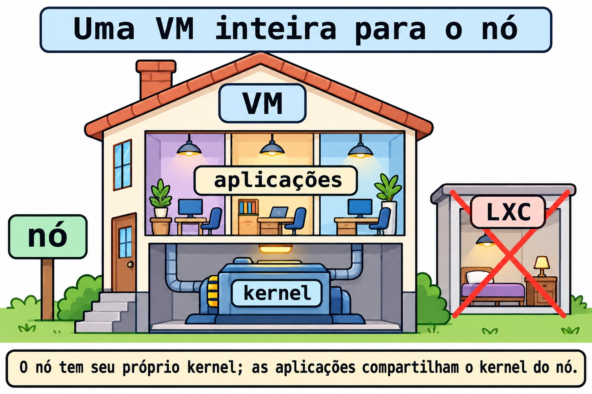
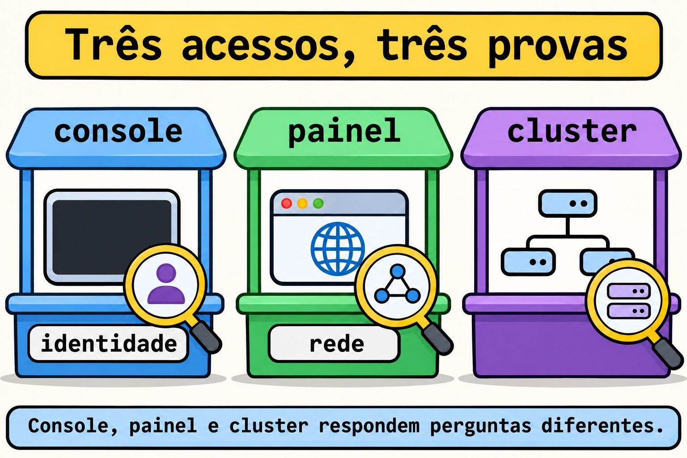

# Aula 20.1 · Instalar em uma VM nova

> **O coração desta aula:** criar um cluster identificado em uma VM limpa, com uma única rede de gestão.

| Ficha | Plano de trabalho |
| --- | --- |
| Módulo | M20 · NethServer 8 por dentro, aula 1 de 7 |
| Pré-requisitos | Inventário Proxmox e ISO Rocky 9 verificada |
| Bancada | VM 240 ns8-1; cliente 202 debian-lab; conta student |
| Rede | Uma placa na gestão, endereço estático real, gateway e DNS externos |

Use o [guia de bancada M20](../GUIA_BANCADA_M20_PT.md). Ele concentra os endereços editáveis, os nomes locais e o acesso do navegador. Nenhum comando deste texto foi executado nas VMs durante a elaboração.

## 1 · Aquecimento

1. Qual kernel pertence a uma VM e qual pertence a um contêiner?
2. Um endereço recebido hoje por DHCP é uma configuração estática?
3. Se o resolvedor depende do próprio serviço que você vai instalar, o que acontece antes de ele subir?

## 2 · Por que importa

O nó NS8 é uma máquina Linux completa. Preparar endereço, armazenamento e acesso de recuperação antes da instalação permite distinguir uma falha do sistema de uma falha da aplicação.

### Ponte Windows

A VM é o computador; o painel organiza os serviços que ele executa. Abrir o painel não substitui conferir em qual computador você entrou.

## 3 · Modelo mental



*O nó tem seu próprio kernel; as aplicações compartilham o kernel do nó.*

Um cluster NS8 pode começar com um único nó. Aqui o nó inicial é a VM `240`, nome `ns8-1`, hostname curto `ns8-1` e FQDN `ns8-1.lab.test`. A conta de acesso Linux é `student`.

## 4 · O essencial

| Item | Escolha nesta aula |
| --- | --- |
| Sistema | Rocky Linux 9 mínimo, instalado do zero |
| Recursos | 4 vCPU, 8 GiB RAM, disco 80 GiB e 4 GiB de swap |
| Rede | Uma interface em vmbr0, IP estático real de gestão |
| Resolução | DNS externo para Internet; nomes privados locais pelo guia |
| Acesso | Console do Proxmox e navegador alcançando a gestão |

### Rocky × Debian

A instalação NS8 desta aula ocorre na nova Rocky da VM 240. A Debian 202 será cliente. A Rocky 201 continua disponível para comparação; nenhuma das duas é convertida em nó NS8.

### Decida 1

O inventário mostra uma máquina já usando o ID 240. O que fazer?

A. Apagar a VM porque o nome do lab é conhecido.

B. Parar e reconciliar o inventário antes de criar ou alterar.

C. Criar um CT com o mesmo ID.

## 5 · Lab guiado

### Passo 1 · Criar somente a VM 240

**Palpite:** O inventário de um só host revela todas as VMs do cluster?

No host Proxmox autorizado, consulte o inventário global. Se o ID 240 estiver ocupado, resolva o conflito antes de continuar; não apague o ocupante.

```bash
pvesh get /cluster/resources --type vm --output-format json-pretty
```

Pela interface do Proxmox, crie a VM 240 com nome ns8-1, CPU do tipo host, 4 vCPU, 8 GiB de RAM e disco de 80 GiB no storage escolhido no inventário. Anexe a ISO Rocky 9 oficial cujo checksum você já comparou com a referência autenticada. Use uma única placa VirtIO na vmbr0.

**Saída esperada:** VM nova e inventário com proprietário, storage e ISO registrados.

**Verifique:** Confira a configuração antes de iniciar o instalador do sistema.

### Passo 2 · Preparar sistema e endereço

**Palpite:** O nome da VM também configura o hostname do Linux?

Instale Rocky 9 mínimo, com conta student, sudo e uma credencial de recuperação guardada fora do material. Defina o hostname como ns8-1.lab.test; hostname -s deve mostrar ns8-1. Planeje 4 GiB de swap durante a instalação.

Configure apenas a interface de gestão com IP estático reservado, prefixo, gateway e resolvedores reais do laboratório. Siga o guia para os nomes locais no próprio nó e na 202. O arquivo hosts não oferece DNS aos contêineres.

```bash
hostname -s
hostname -f
ip -br -4 address
ip -4 route
cat /etc/resolv.conf
getent ahostsv4 ns8-1.lab.test
getent ahostsv4 mirrorlist.nethserver.org
swapon --show
df -h / /home
timedatectl status
```

**Saída esperada:** Hostname curto ns8-1, FQDN privado e acesso externo funcionando.

**Verifique:** O resolvedor deve ser externo ao NS8; não use loopback ou o próprio nó como nameserver.

### Passo 3 · Obter e ler o instalador

**Palpite:** O hash local autentica sozinho quem publicou o arquivo?


*Endereço estável, DNS externo e Internet precisam funcionar antes da instalação.*

Entre como student e use sudo -i dentro da VM. O próximo bloco grava somente na pasta de trabalho nova; uma falha retorna da função, sem encerrar seu terminal.

```bash
m20_obter_instalador() {
  if [ "$(hostname -s)" != ns8-1 ] || [ "$(id -u)" -ne 0 ]; then
    printf '%s\n' 'Use root dentro da VM ns8-1.'
    return 1
  fi
  if [ -e /root/m20-lab ]; then
    printf '%s\n' 'A pasta já existe; confira a tentativa anterior antes de continuar.'
    return 1
  fi
  install -d -m 0700 /root/m20-lab || return 1
  dnf install -y curl less openssl || return 1
  curl --fail --show-error --location --proto '=https' --tlsv1.2 --retry 10 --retry-delay 1 --retry-all-errors https://raw.githubusercontent.com/NethServer/ns8-core/ns8-stable/core/install.sh --output /root/m20-lab/install.sh || return 1
  bash -n /root/m20-lab/install.sh || return 1
  sha256sum /root/m20-lab/install.sh > /root/m20-lab/install.sh.sha256
  chmod 0600 /root/m20-lab/install.sh /root/m20-lab/install.sh.sha256
}
m20_obter_instalador && less /root/m20-lab/install.sh
```

**Saída esperada:** Script baixado da origem oficial, legível e com hash local registrado.

**Verifique:** Compare a URL com a documentação e leia o script; sintaxe e checksum local não substituem essa conferência.

### Passo 4 · Instalar no convidado

**Palpite:** Um instalador incompleto deve ser repetido às cegas?

```bash
m20_instalar() {
  if [ "$(hostname -s)" != ns8-1 ] || [ "$(id -u)" -ne 0 ]; then
    printf '%s\n' 'Este instalador pertence somente à VM ns8-1.'
    return 1
  fi
  sha256sum -c /root/m20-lab/install.sh.sha256 || return 1
  bash /root/m20-lab/install.sh || return 1
  command -v runagent
}
m20_instalar
```

Se a função terminar sem erro, reinicie somente a VM pelo painel Proxmox. O instalador também atualiza pacotes do sistema. Não execute outra instalação em paralelo e não desligue o host.

**Saída esperada:** VM retorna ao disco instalado e oferece os componentes NS8.

**Verifique:** Entre novamente com student, use sudo -i e confira hostname, endereço e relógio.

### Passo 5 · Conferir o primeiro acesso

**Palpite:** Um aviso TLS identifica sozinho qual máquina respondeu?



*Console, painel e cluster respondem perguntas diferentes.*

```bash
runagent -l
ss -ltnp '( sport = :443 )'
openssl s_client -connect 127.0.0.1:443 -servername ns8-1.lab.test -showcerts < /dev/null 2>/dev/null | openssl x509 -noout -subject -issuer -dates -fingerprint -sha256
```

No navegador da VM 202, aberto pelo console conforme o guia, abra https://IP-DE-GESTAO/cluster-admin/, substituindo o marcador pelo endereço real do inventário. Compare o certificado mostrado com a impressão obtida no console independente. Só prossiga nesta bancada se coincidirem.

Use a conta inicial admin e a credencial indicada na documentação oficial da versão instalada. Troque essa senha imediatamente. A conta do painel é separada da conta Linux student. A 20.4 instalará confiança TLS normal para os nomes privados.

**Saída esperada:** Painel da VM esperada e nova senha funcionando em um segundo login.

**Verifique:** A exceção de bootstrap é pontual; não desative a verificação TLS do navegador inteiro.

### Passo 6 · Criar e registrar o cluster

**Palpite:** A rede da VPN pode sobrepor uma rede já usada?

Escolha Create cluster e confirme ns8-1.lab.test. Antes de aceitar a VPN proposta, compare o CIDR com as redes físicas, VPNs e redes de contêineres da bancada. Escolha um bloco sem sobreposição e registre-o.

No terminal root da VM, preencha os dois endereços reais abaixo antes de executar a função. Eles são os mesmos definidos no guia. O arquivo não contém senhas.

```bash
NS8_IP=''       # IP real reservado da VM 240
CLIENT_IP=''    # IP real da VM 202
NS8_FQDN=ns8-1.lab.test
WIKI_FQDN=wiki.lab.test
m20_registrar_cluster() {
  if [ "$(hostname -s)" != ns8-1 ] || [ "$(id -u)" -ne 0 ] || [ -z "$NS8_IP" ] || [ -z "$CLIENT_IP" ]; then
    printf '%s\n' 'Confira o nó e preencha os dois endereços reais.'
    return 1
  fi
  if [ -e /root/m20-lab/operador.env ]; then
    printf '%s\n' 'O inventário já existe; confira-o antes de substituir.'
    return 1
  fi
  NODE_ID=$(redis-cli --raw HGET cluster/environment NODE_ID) || return 1
  VPN_CIDR=$(redis-cli --raw GET cluster/network) || return 1
  if ! [[ "$NODE_ID" =~ ^[1-9][0-9]*$ ]] || [ -z "$VPN_CIDR" ]; then
    printf '%s\n' 'O cluster ainda não forneceu ID e VPN válidos.'
    return 1
  fi
  umask 077
  printf 'NS8_IP=%q\nCLIENT_IP=%q\nNS8_FQDN=%q\nWIKI_FQDN=%q\nNODE_ID=%q\nVPN_CIDR=%q\n' "$NS8_IP" "$CLIENT_IP" "$NS8_FQDN" "$WIKI_FQDN" "$NODE_ID" "$VPN_CIDR" > /root/m20-lab/operador.env
  chmod 0600 /root/m20-lab/operador.env
}
m20_registrar_cluster
redis-cli PING
systemctl --failed --no-pager
```

**Saída esperada:** Painel e arquivo concordam sobre o ID real do líder e a VPN.

**Verifique:** No Proxmox, crie o snapshot m20a1-cluster da VM 240 após a conferência. Esse é o ponto de partida da 20.2.

### Decida 2

O certificado do navegador diverge do console. O que fazer?

A. Parar e investigar nome, rota e certificado antes do login.

B. Desativar a verificação TLS globalmente.

C. Aceitar porque o endereço parece conhecido.

## 6 · Quebre e conserte

### Quebra 1 · Nome local ausente

**Sintoma:** O navegador da bancada não encontra o nome privado.

**Investigação:** Compare o nome solicitado e o mapeamento do guia.

**Causa:** O mapeamento local foi omitido ou usa outro endereço.

**Conserto:** Corrija somente a entrada M20 pelo guia.

**Prevenção:** Registre endereço real e nome separadamente.

**Verifique:** A resolução local aponta ao endereço do inventário.

### Quebra 2 · Origem não conferida

**Sintoma:** Você não consegue dizer de onde veio o script salvo.

**Investigação:** Compare URL e hash com o registro do download.

**Causa:** Um arquivo encontrado no disco não comprova a origem.

**Conserto:** Obtenha novamente da URL oficial em uma pasta nova, sem executar o arquivo desconhecido.

**Prevenção:** Leia e registre a origem antes de instalar.

**Verifique:** Você identifica os bytes efetivamente usados.

### Quebra 3 · Certificado diferente

**Sintoma:** A impressão do navegador difere da obtida no console.

**Investigação:** Compare endereço, nome e certificado da conexão nova.

**Causa:** Você pode ter alcançado outro endpoint.

**Conserto:** Interrompa o login e corrija o caminho de acesso.

**Prevenção:** Mantenha o console como canal independente.

**Verifique:** As impressões coincidem antes de usar credenciais.

## 7 · Armadilhas

- Nome da VM, hostname curto, FQDN e ID NS8 são referências diferentes.
- Um arquivo hosts local não substitui o resolvedor externo dos contêineres.
- Uma instalação interrompida exige diagnóstico, não repetição automática.
- O snapshot de um nó só não é um plano de retorno para um cluster de vários nós.

## 8 · Quiz

1. Por que LXC não atende a este roteiro?

2. Qual é a limitação de um checksum calculado localmente?

3. Por que o DNS do nó deve ser externo ao NS8?

4. Que prova diferencia o primeiro acesso TLS de uma aceitação cega?

5. O que deve ser verificado antes de escolher a VPN do cluster?

## 9 · Folha de bolso

```bash
hostname -s
hostname -f
runagent -l
redis-cli --raw HGET cluster/environment NODE_ID
redis-cli --raw GET cluster/network
```

## 10 · Checklist e fechamento

- [ ] VM 240 criada sem substituir outra máquina.
- [ ] Uma rede de gestão estática e Internet conferidas.
- [ ] Origem do instalador e primeiro certificado conferidos.
- [ ] Cluster criado e arquivo do operador protegido.
- [ ] Snapshot m20a1-cluster registrado.

**Reboot de conferência:** o reboot após a instalação já fez parte do lab. Confirme que o painel e o cluster voltaram antes de salvar o snapshot-base.

## 11 · Na vida real

Leia o inventário de um ambiente autorizado e identifique endereço estático, resolvedor externo e acesso de recuperação. Registre o que falta antes de planejar a instalação; esta atividade não pede alterações.

## 12 · Aprofundar quando quiser

- [Requisitos e resolução de nomes](https://docs.nethserver.org/docs/administrator-manual/installation/system_requirements)
- [Instalação oficial](https://docs.nethserver.org/docs/administrator-manual/installation/install)

## Gabarito comentado

Aquecimento: LXC compartilha o kernel do host; um lease não substitui configuração estática; dependência circular de DNS pode impedir o próprio início.

Decida 1: B. O inventário global vem antes de usar o ID, inclusive se o ocupante for CT.

Decida 2: A. O certificado divergente impede atribuir a conexão ao nó esperado.

Quiz 1: o deployment NS8 em LXC não é suportado; esta bancada requer VM com kernel próprio.

Quiz 2: o hash identifica os bytes recebidos; sem uma referência autenticada ele não comprova quem os publicou.

Quiz 3: o resolvedor do nó não pode depender de uma aplicação hospedada por ele, nem de loopback que os contêineres interpretariam localmente.

Quiz 4: conferir a impressão pelo console independente antes de usar credenciais; a confiança normal será instalada na 20.4.

Quiz 5: ausência de sobreposição com redes físicas, VPNs e contêineres, além da capacidade futura.

[Índice das aulas](../01-aulas.md) · [Plano do curso](../00-plano-do-curso.md)

