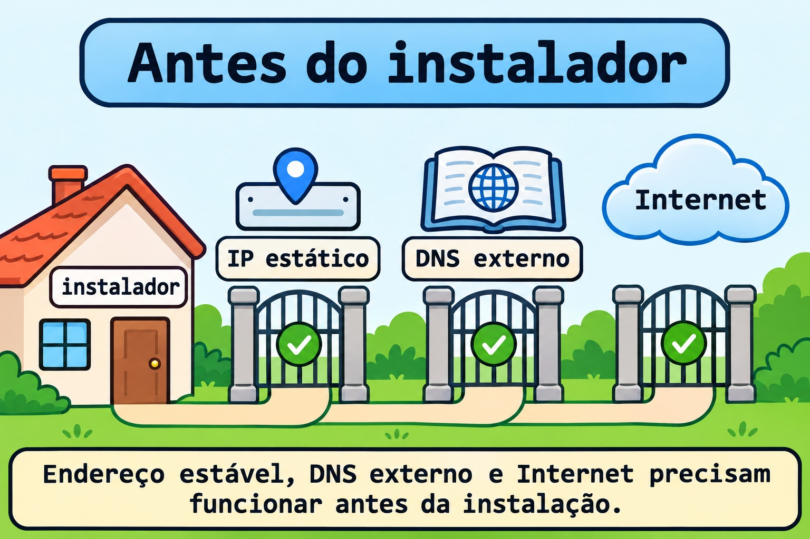

# Aula 20.1 · Instalar em uma VM limpa

> **O coração desta aula:** criar a VM 240, preparar seus pré-requisitos e abrir um cluster NS8 identificado.

| Ficha | Plano de trabalho |
| --- | --- |
| Módulo | M20 · NethServer 8 por dentro, aula 1 de 7 |
| Quando | Semana 27 |
| Ao final | criar a VM 240, preparar seus pré-requisitos e abrir um cluster NS8 identificado. |
| Pré-requisitos | M18 e M19 corrigidos; inventário e acesso ao console autorizados |
| Duração | 150–180 minutos, além dos downloads |
| Snapshot | m20a1-inicio e m20a1-fim; somente VM 240 |

A VM `240`, `ns8-1`, será o primeiro nó; a VM `241`, `ns8-2`, só entra na 20.7. Nome da VM, hostname, ID do nó e ID da aplicação são campos diferentes.

Os comandos do Proxmox estão marcados como HOST. Os comandos NS8 usam Bash como root na VM, após `sudo -i`; não são comandos para o host de virtualização.

Use o [Guia de bancada M20](../GUIA_BANCADA_M20_PT.md). O endereço isolado da 240 é `192.0.2.240`; a gestão tem endereço real reservado e saída para Internet.

Não execute o próximo bloco se uma guarda falhar. Resultados esperados abaixo não são uma alegação de laboratório já executado.

## 1 · Aquecimento

1. O kernel de um LXC pertence ao contêiner ou ao host?

2. Um endereço recebido por DHCP é uma reserva estática configurada no nó?

3. O DNS do nó pode depender de uma aplicação que só sobe depois do próprio NS8?

## 2 · Por que importa

NS8 usa um sistema Linux para coordenar aplicações em contêineres. Uma instalação sobre um servidor já ocupado mistura dependências e dificulta atribuir a causa de uma falha.

Aqui a VM é nova. Os serviços do M19 permanecem na 204, sem converter essa máquina em um nó NS8.

### Ponte Windows

Pense na VM como um servidor completo com seu próprio sistema operacional. O painel NS8 administra o que roda dentro dele; ele não substitui o console de recuperação nem o inventário do hipervisor.

## 3 · Modelo mental


*O nó tem seu próprio kernel; as aplicações compartilham o kernel do nó.*

A VM 240 possui kernel próprio; o NS8 e suas aplicações usam esse kernel. Instalar NS8 em Proxmox LXC não é uma implantação suportada.

Um nó sozinho já forma um cluster funcional. A palavra cluster aqui descreve o plano de controle, não uma promessa automática de alta disponibilidade.

## 4 · O essencial

| Item | Contrato do laboratório |
| --- | --- |
| VM 240 | ns8-1; Rocky Linux 9 limpo; 4 vCPU; 8 GiB RAM; disco 80 GiB |
| Máquina | q35; OVMF; VirtIO; CPU x86-64-v2-AES; vm-hdd |
| net0 | vmbr0; gestão com IP real estático e gateway |
| net1 | vmbr17; 192.0.2.240/24; sem gateway |
| DNS | externo ao NS8, alcançável em 192.0.2.204 |
| FQDN | ns8-1.lab.test; não é nome público para ACME |

### Rocky × Debian

O módulo usa Rocky Linux 9 nos dois nós. A documentação também contempla Debian 13, mas não misturaremos famílias em um cluster de estudo permanente.

O armazenamento do nó deve ser local ao sistema de arquivos XFS ou ext4, sobre o disco virtual. Não coloque a home dos módulos em NFS.

### Decida 1

A VM 240 já existe. Qual é a próxima ação?

A. Apagar a VM porque o nome do lab é conhecido.

B. Parar e reconciliar o inventário antes de criar ou alterar.

C. Criar um CT com o mesmo ID.

## 5 · Lab guiado

Faça uma ficha antes de abrir o instalador: operador, nó Proxmox, VMID, storage, ISO, endereço de gestão e janela de trabalho. O que faltar é uma dependência a resolver.

O bloco de criação não escolhe outro ID em caso de conflito. Um número livre em uma lista local não permite ignorar o inventário global.

A ponte isolada só existe nos nós em que foi preparada. As VMs 204, 240 e, depois, 241 precisam do mesmo segmento efetivo indicado pelo guia.

### Passo 1 · Reservar e criar somente a VM nova

**Palpite:** O ID livre no nó atual também está livre no cluster inteiro?

HOST Proxmox autorizado: confirme o inventário global e o nó escolhido. Use a ISO Rocky 9 oficial já autenticada no curso; não invente nome de volume nem checksum.

```bash
pvesh get /cluster/resources --type vm --output-format json-pretty || exit 1
test "$(pvesh get /cluster/nextid --vmid 240)" = 240 || exit 1
read -r -p 'Rocky 9 ISO volume: ' ISO_VOLUME
ISO_PATH=$(pvesm path "$ISO_VOLUME") || exit 1
test -f "$ISO_PATH" || exit 1
read -r -p 'Authenticated ISO SHA256: ' ISO_SHA256
[[ "$ISO_SHA256" =~ ^[0-9a-fA-F]{64}$ ]] || exit 1
printf '%s  %s
' "$ISO_SHA256" "$ISO_PATH" | sha256sum -c - || exit 1
test ! -e /root/m20-operador.env || exit 1
umask 077
printf 'ISO_VOLUME=%q\nISO_SHA256=%q\n' "$ISO_VOLUME" "$ISO_SHA256" > /root/m20-operador.env
chmod 0600 /root/m20-operador.env
qm create 240 --name ns8-1 --machine q35 --bios ovmf   --cpu x86-64-v2-AES --cores 4 --memory 8192   --ostype l26 --scsihw virtio-scsi-single --scsi0 vm-hdd:80   --efidisk0 vm-hdd:1,efitype=4m,pre-enrolled-keys=1   --net0 virtio,bridge=vmbr0 --net1 virtio,bridge=vmbr17,link_down=1   --ide2 "$ISO_VOLUME,media=cdrom" --boot 'order=ide2;scsi0' || exit 1
qm config 240
qm start 240 || exit 1
```

**Saída esperada:** Apenas a nova 240 é criada, com duas placas; a segunda começa desconectada.

**Verifique:** Registre configuração, storage e MACs. Se o ID estiver ocupado ou a ISO não corresponder, não contorne a guarda.

A saída de criação da VM é uma evidência de infraestrutura, não de instalação do sistema operacional. Guarde o estado antes de entrar no console do convidado.

Se a criação terminar parcialmente, pare. Não rode novamente o mesmo comando nem apague volumes sem comparar a configuração com o registro da tentativa.

O nome de volume ISO é uma referência do Proxmox. O caminho obtido por pvesm pertence ao host; esse caminho não deve ser usado dentro da VM.

### Passo 2 · Instalar o sistema e preparar a rede

**Palpite:** Trocar a etiqueta no Proxmox também configura hostname e DNS do convidado?

No console da 240, instale Rocky 9 minimal, sem serviços adicionais. Defina hostname `ns8-1.lab.test`, usuário `student` no grupo administrativo e senha root de emergência guardada fora da aula.

Configure net0 com o endereço reservado real, máscara e gateway do inventário. Inclua 4 GiB de swap no plano de particionamento já estudado, sem sobrescrever discos existentes.

Antes do instalador NS8, execute o guia M20: ele confere DNS, associa net1 pela MAC, aplica `.240` e ativa somente essa placa. A rota padrão deve continuar em net0.

```bash
sudo -i
test "$(id -u)" -eq 0 || exit 1
test "$(hostname -s)" = ns8-1 || exit 1
. /etc/os-release
test "$ID" = rocky || exit 1
case "$VERSION_ID" in 9|9.*) ;; *) exit 1 ;; esac
hostnamectl hostname
ip -br -4 address
ip -4 route
cat /etc/resolv.conf
getent ahostsv4 ns8-1.lab.test
swapon --show
lsblk -o NAME,SIZE,TYPE,FSTYPE,MOUNTPOINTS
findmnt -T /home
df -h / /home
timedatectl status
case "$(systemd-detect-virt)" in kvm|qemu) ;; *) exit 1 ;; esac
getenforce
```

**Saída esperada:** Rocky 9 limpo, FQDN resolvendo para `.240`, DNS externo, swap e disco identificados.

**Verifique:** Não use loopback ou o próprio nó como DNS. A 204 fornece resolução externa ao NS8, e alcança a Internet por sua gestão.

Mantenha aberto o console autorizado ao aplicar rede. Se perder a gestão, use esse console para comparar perfil, MAC, endereço e rota; não desative o firewall inteiro.

Confirme que o resolvedor externo responde por nomes públicos e pelos nomes privados do laboratório. Resolver apenas o nome do próprio nó não demonstra acesso aos repositórios.

A placa isolada não oferece gateway. Se uma segunda rota padrão aparecer, corrija o perfil antes da instalação, em vez de depender da métrica escolhida por acaso.

O relógio precisa estar sincronizado para avaliar certificados e correlacionar registros. Uma data errada não se corrige aceitando qualquer certificado.

No HOST Proxmox, depois de preparar o sistema limpo e antes do script NS8, crie o snapshot inicial:

```bash
test "$(qm config 240 | sed -n 's/^name: //p')" = ns8-1 || exit 1
qm set 240 --boot 'order=scsi0;ide2' || exit 1
qm snapshot 240 m20a1-inicio || exit 1
```

Volte à VM 240 e à sessão root para o próximo passo. O diário ISO `/root/m20-operador.env` fica no host, enquanto `/root/m20-lab/operador.env` será criado dentro da VM após configurar o cluster.

### Passo 3 · Registrar a origem do instalador

**Palpite:** Um SHA256 calculado depois do download autentica sozinho a origem?



*Endereço estável, DNS externo e Internet precisam funcionar antes da instalação.*

```bash
test "$(id -u)" -eq 0 || exit 1
test ! -e /root/m20-lab || exit 1
install -d -m 0700 /root/m20-lab
dnf install -y curl less openssl || exit 1
curl --fail --show-error --location --proto '=https' --tlsv1.2   https://raw.githubusercontent.com/NethServer/ns8-core/ns8-stable/core/install.sh   --output /root/m20-lab/install.sh || exit 1
test -s /root/m20-lab/install.sh || exit 1
bash -n /root/m20-lab/install.sh || exit 1
less /root/m20-lab/install.sh
sha256sum /root/m20-lab/install.sh > /root/m20-lab/install.sh.sha256
chmod 0600 /root/m20-lab/install.sh /root/m20-lab/install.sh.sha256
```

Compare a URL com a documentação oficial. Leia o arquivo e registre a data; o hash local identifica os bytes recebidos, sem constituir assinatura independente.

**Saída esperada:** Arquivo íntegro para leitura, sintaxe Bash aceita e hash registrado. O instalador ainda não executou.

**Verifique:** Se o arquivo contém HTML, está vazio ou a origem diverge, pare. Não rode uma resposta de erro como Bash.

A checagem de sintaxe aceita a gramática do arquivo; ela não audita todas as ações que o script realizará. Leia o conteúdo e a documentação antes de autorizar a execução.

O nome ns8-stable identifica a trilha estável, mas o conteúdo dessa trilha pode mudar. O hash e a data permitem identificar qual arquivo foi usado neste ensaio.

Não publique o log integral sem revisão: mensagens podem revelar endereços, credenciais temporárias ou informações internas. Copie ao diário somente o necessário.

### Passo 4 · Instalar e reiniciar apenas o convidado

**Palpite:** Uma saída longa de instalação prova que o comando terminou com sucesso?

```bash
test "$(hostname -s)" = ns8-1 || exit 1
test "$(id -u)" -eq 0 || exit 1
sha256sum -c /root/m20-lab/install.sh.sha256 || exit 1
date --iso-8601=seconds
bash /root/m20-lab/install.sh || exit 1
date --iso-8601=seconds
command -v runagent || exit 1
systemctl reboot
```

O instalador oficial também atualiza pacotes do sistema. Não feche o console, não execute outra instalação em paralelo e não repita o script sobre uma execução incompleta sem investigar.

Depois do reboot entre como `student`, use `sudo -i` e confira novamente hostname e endereços antes de continuar.

**Saída esperada:** Instalação concluída sem erro e VM reiniciada; o host Proxmox continua ligado.

**Verifique:** Leia falhas reais de download, espaço ou resolução antes de modificar qualquer serviço. SELinux e firewalld permanecem ativos.

No retorno, confirme que o disco virtual é a primeira opção de boot. Mantenha a ISO fora do caminho de inicialização normal depois da instalação.

Use o procedimento de boot do Proxmox somente no host autorizado e no ID 240; nenhum desses comandos pertence à sessão root do convidado.

Uma instalação interrompida por falha de DNS pode deixar alguns componentes presentes. Isso não autoriza tratar a máquina como um cluster já criado.

O console e a gestão devem continuar disponíveis mesmo se o navegador não abrir o painel. Diferencie indisponibilidade de rede, de processo e de confiança TLS.

### Passo 5 · Abrir o painel com identidade conferida

**Palpite:** O primeiro aviso TLS do navegador prova que você chegou à VM esperada?


*Console, painel e cluster respondem perguntas diferentes.*

```bash
test "$(id -u)" -eq 0 || exit 1
test "$(hostname -s)" = ns8-1 || exit 1
runagent -l
ss -ltnp '( sport = :443 )'
openssl s_client -connect 127.0.0.1:443 -servername ns8-1.lab.test   -showcerts < /dev/null 2>/dev/null |   openssl x509 -noout -subject -issuer -dates -fingerprint -sha256
```

No cliente 202, confirme pelo guia que o nome aponta para `.240`. Abra `https://ns8-1.lab.test/cluster-admin/`. O certificado inicial pode ser autoassinado.

Use a impressão digital obtida no console autorizado como canal independente para conferir o certificado mostrado pelo navegador. Só nessa bancada e para esse host, conclua o acesso inicial após a comparação; se divergir, pare.

A 20.4 substituirá esse acesso inicial por confiança TLS explícita. Não use `curl -k`, não torne o navegador permissivo globalmente e não envie credenciais por HTTP.

Entre com o usuário `admin` e a credencial inicial publicada na página oficial de instalação da versão usada. Troque-a imediatamente por uma senha exclusiva e guarde-a fora do diário.

**Saída esperada:** Painel da VM esperada, impressão conferida e senha inicial substituída.

**Verifique:** Saia e entre de novo com a senha nova. Diferencie conta administrativa do painel e usuário Unix usado no SSH.

O guia fornece o acesso do navegador Windows por encaminhamento SSH através do cliente 202. O FQDN permanece na URL e no SNI; a porta local não muda a identidade do servidor.

As entradas locais do Windows fazem parte somente desse caminho de acesso. Nos nós NS8, a resolução continua sendo feita por DNS real externo ao próprio NS8.

Se o túnel não estiver ativo, não substitua a URL pelo IP de uma máquina diferente para fazer a tela aparecer. Reconfira o encaminhamento e o alvo remoto.

Antes de fechar o primeiro acesso, confirme que a nova senha funciona em outra sessão do navegador. Mantenha um meio administrativo de recuperação sem expor a senha no material.

### Passo 6 · Criar o cluster e fechar o inventário

**Palpite:** Uma VPN escolhida sem olhar rotas pode ser corrigida depois com um simples alias?

No painel escolha Create cluster. Confirme FQDN `ns8-1.lab.test`. Compare o CIDR proposto para a VPN com todas as redes reais, VPNs, contêineres e `192.0.2.0/24`; só aceite um bloco sem sobreposição.

Registre a escolha: o CIDR inicial não é um campo que se muda livremente depois. Não copie um CIDR de uma saída ilustrativa.

```bash
test ! -e /root/m20-lab/operador.env || exit 1
NS8_IP=192.0.2.240
NS8_FQDN=ns8-1.lab.test
WIKI_FQDN=wiki.lab.test
NODE_ID=$(redis-cli --raw HGET cluster/environment NODE_ID) || exit 1
[[ "$NODE_ID" =~ ^[1-9][0-9]*$ ]] || exit 1
VPN_CIDR=$(redis-cli --raw GET cluster/network) || exit 1
test -n "$VPN_CIDR" || exit 1
umask 077
printf 'NS8_IP=%q
NS8_FQDN=%q
WIKI_FQDN=%q
NODE_ID=%q
VPN_CIDR=%q
'   "$NS8_IP" "$NS8_FQDN" "$WIKI_FQDN" "$NODE_ID" "$VPN_CIDR"   > /root/m20-lab/operador.env
chmod 0600 /root/m20-lab/operador.env
redis-cli PING
redis-cli ROLE
systemctl --failed --no-pager
```

**Saída esperada:** Cluster inicial com a 240 como líder, ID real e inventário sem credenciais.

**Verifique:** Compare NODE_ID e VPN no painel; preserve o arquivo para a 20.2. A VM 241 ainda não foi criada.

### Decida 2

A rede está correta, mas o certificado apresentado é diferente do console. O que fazer?

A. Parar e investigar nome, rota e certificado antes do login.

B. Desativar a verificação TLS globalmente.

C. Aceitar porque o endereço parece conhecido.

No HOST, depois de concluir a configuração e confirmar a identidade, registre o estado final da VM. O snapshot inicial do ensaio deve ser criado com o sistema limpo antes de executar o instalador; o snapshot final preserva o cluster criado.

Não restaure um snapshot antigo depois de haver aplicações ou outros nós dependentes dele. A regressão de configuração pode ser mais ampla que o problema que você quer desfazer.

No HOST, após as conferências do cluster e antes das quebras, registre o checkpoint final:

```bash
test "$(qm config 240 | sed -n 's/^name: //p')" = ns8-1 || exit 1
qm snapshot 240 m20a1-fim || exit 1
```

As quebras seguintes pertencem ao cliente ou a uma cópia de ensaio, não ao host Proxmox.

## 6 · Quebre e conserte

### Quebra 1 · Nome apontando para outra máquina

**Sintoma:** No cliente de teste, uma entrada local de ensaio para o FQDN aponta ao IP errado.

**Investigação:** Compare a consulta explícita ao DNS com a resolução do sistema e o certificado do console.

**Causa:** A resposta do arquivo local pode preceder o DNS; a VM correta continua funcionando.

**Conserto:** Remova somente a entrada marcada do ensaio, preservando o backup e as demais entradas.

**Prevenção:** Não crie a quebra no DNS usado pelos nós; faça-a apenas no cliente de teste.

**Verifique:** O cliente volta a resolver `.240` e a impressão coincide com o console.

### Quebra 2 · Instalador que não é Bash

**Sintoma:** Uma cópia local de teste contém uma resposta de erro em vez do script.

**Investigação:** Crie só a cópia de ensaio com uma linha incompleta e use `bash -n`; não execute a cópia.

```bash
test "$(id -u)" -eq 0 || exit 1
test "$(hostname -s)" = ns8-1 || exit 1
M20_BROKEN=$(mktemp /root/m20-lab/install-broken.XXXXXX.sh) || exit 1
printf '%s\n' 'if then' > "$M20_BROKEN"
if bash -n "$M20_BROKEN"; then exit 1; fi
rm -- "$M20_BROKEN"
sha256sum -c /root/m20-lab/install.sh.sha256 || exit 1
```

**Causa:** Baixar um arquivo não significa receber o conteúdo esperado.

**Conserto:** Apague apenas a cópia criada para a quebra; revalide o arquivo original e seu hash.

**Prevenção:** Separe download, inspeção e execução; não una tudo em uma linha cega.

**Verifique:** O original passa na checagem e a cópia inválida foi recusada sem execução.

### Quebra 3 · Confundir sessão e identidade

**Sintoma:** Um terminal administrativo está no host Proxmox, não na VM 240.

**Investigação:** Use hostname, virtualização e endereço antes de qualquer instalador. Não rode o script no host para testar.

**Causa:** Permissão root não identifica o alvo correto.

**Conserto:** Feche o terminal errado e volte ao console ou SSH autorizado da VM.

**Prevenção:** Escreva o alvo no diário e mantenha guardas explícitas antes da instalação.

**Verifique:** O hostname é `ns8-1`, o endereço isolado é `.240` e o contexto é a VM esperada.

## 7 · Armadilhas

Não conclua pelo ícone verde de uma tela. Compare identidade, tarefa concluída e resposta funcional no caminho usado pelo cliente.

O snapshot da VM inteira ajuda a voltar um ensaio local, mas não substitui o backup de aplicação e de configuração do cluster.

Uma senha ou token não pertence ao diário publicado. Registre nomes, horários e resultados; guarde os segredos em local separado.

Uma VM desligada e uma aplicação parada são falhas de camadas distintas. Guarde uma linha de tempo para não misturar o que foi observado antes e depois do reboot.

Não habilite um endpoint na Internet só para obter um certificado público neste laboratório. A 20.4 trabalha com confiança privada e separa a emissão pública condicional.

Se a resolução pública funciona mas a privada não, examine a zona e o caminho até a 204. Se ambas falham, comece pela placa, rota e acesso ao resolvedor.

Um endereço DNS correto não reserva memória ou disco. Confira recursos novamente antes de instalar aplicações que armazenam dados.

## 8 · Quiz

1. Por que LXC não atende a este roteiro?

2. Qual é a limitação de um checksum calculado localmente?

3. Por que o DNS do nó deve ser externo ao NS8?

4. Que prova diferencia o primeiro acesso TLS de uma aceitação cega?

5. O que deve ser verificado antes de escolher a VPN do cluster?

## 9 · Folha de bolso

```bash
hostnamectl hostname
ip -br -4 address
ip -4 route
cat /etc/resolv.conf
getenforce
runagent -l
```

**Flashcards:** Nó NS8 → sistema limpo, identidade e rede previsíveis.

**Flashcards:** Checksum local → registro do arquivo recebido, sem autenticar sozinho a origem.

## 10 · Checklist e fechamento

- [ ] VM 240 nova e isolada de serviços anteriores.

- [ ] DNS, rota padrão, IP estático e FQDN conferidos.

- [ ] Origem, conteúdo e hash do instalador registrados.

- [ ] Senha inicial substituída e prova TLS do primeiro acesso guardada.

- [ ] CIDR da VPN e ID real registrados sem segredos.

**Reboot de conferência:** Na janela combinada, reinicie somente a VM 240 e reconecte pela gestão. Não reinicie o host Proxmox.

```bash
systemctl reboot
```

Após o retorno, use novamente a sessão root na VM correta e repita a conferência:

```bash
test "$(id -u)" -eq 0 || exit 1
test "$(hostname -s)" = ns8-1 || exit 1
ip -br -4 address
ip -4 route
getent ahostsv4 ns8-1.lab.test
runagent -l
systemctl --failed --no-pager
```

Abra de novo o painel por nome, confira o nó e teste a aplicação se ela já foi instalada. Serviço iniciado não prova identidade TLS nem conteúdo correto.

**Último exercício:** Feche a sessão do painel, entre novamente e mostre qual evidência liga a URL à VM 240.

## 11 · Na vida real

Em um ambiente real, obtenha o inventário e o responsável antes de qualquer alteração. Nesta missão, apenas leia versões, resolução de nomes e estado; não instale, pare ou remova aplicações.

Registre três evidências sem credenciais e uma pergunta que ainda depende de confirmação. O limite do que você sabe faz parte do diagnóstico.

## 12 · Aprofundar quando quiser

[NS8: instalação atual](https://docs.nethserver.org/docs/administrator-manual/installation/install)

[NS8: requisitos, DNS e armazenamento](https://docs.nethserver.org/docs/administrator-manual/installation/system_requirements)

[NS8: rede do nó](https://docs.nethserver.org/docs/tutorial/os_network)

[NS8: banco de configuração](https://nethserver.github.io/ns8-core/core/database/)

Use a documentação da versão instalada e registre quando ela foi consultada. Rótulos do painel podem mudar; a prova técnica continua sendo a identidade e o comportamento observados.

```text
!explica
!feynman
!quiz
```

Use os três prompts para explicar o percurso, ensiná-lo com suas palavras e testar as decisões. Não cole senhas, tokens ou conteúdo privado.

## Gabarito comentado

Aquecimento: LXC compartilha o kernel do host; um lease não substitui configuração estática; dependência circular de DNS pode impedir o próprio início.

Decida 1: B. O inventário global vem antes de usar o ID, inclusive se o ocupante for CT.

Decida 2: A. O certificado divergente impede atribuir a conexão ao nó esperado.

Quiz 1: o deployment NS8 em LXC não é suportado; esta bancada requer VM com kernel próprio.

Quiz 2: o hash identifica os bytes recebidos; sem uma referência autenticada ele não comprova quem os publicou.

Quiz 3: o resolvedor do nó não pode depender de uma aplicação hospedada por ele, nem de loopback que os contêineres interpretariam localmente.

Quiz 4: conferir a impressão pelo console independente antes de usar credenciais; a confiança normal será instalada na 20.4.

Quiz 5: ausência de sobreposição com redes físicas, VPNs, contêineres e rede isolada, além da capacidade futura.

[← Aula 19.9 · Proxy e desafio](19.9-squid-e-desafio-integrado.md) · [Índice das aulas](../01-aulas.md) · [Plano do curso](../00-plano-do-curso.md)
