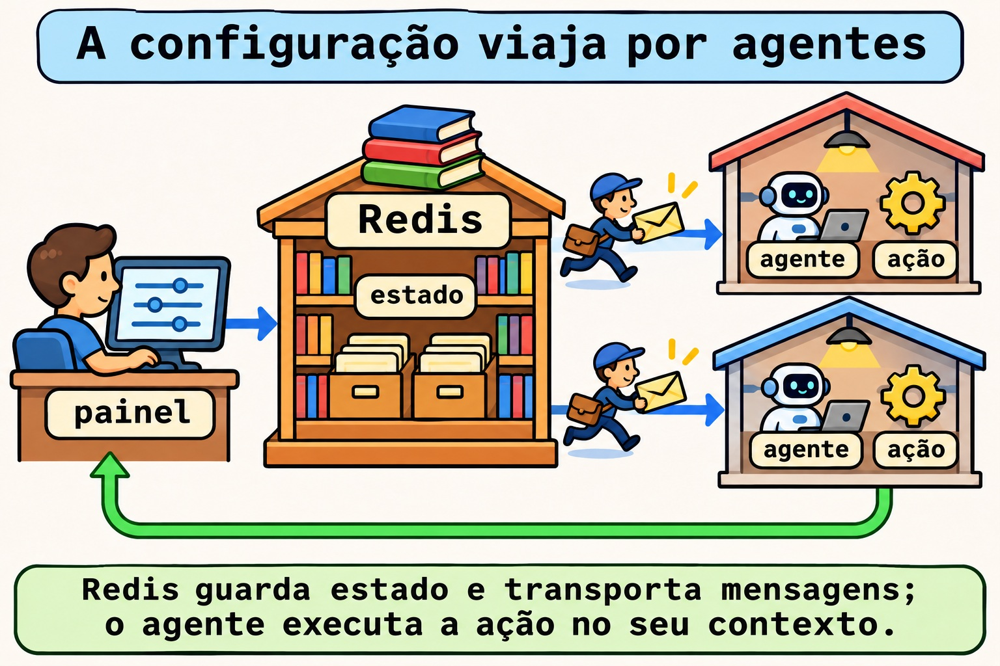

# Aula 20.2 · Cluster, nó e módulo

> **O coração desta aula:** localizar uma instância real e distinguir controle, execução e identidade.

| Ficha | Plano de trabalho |
| --- | --- |
| Módulo | M20 · NethServer 8 por dentro, aula 2 de 7 |
| Quando | Semana 27 |
| Ao final | localizar uma instância real e distinguir controle, execução e identidade. |
| Pré-requisitos | M18 e M19 corrigidos; inventário e acesso ao console autorizados |
| Duração | 90–120 minutos, além dos downloads |
| Snapshot | m20a2-inicio e m20a2-fim; somente VM 240 |

A VM `240`, `ns8-1`, é o primeiro nó; a VM `241`, `ns8-2`, só entra na 20.7. Nome da VM, hostname, ID do nó e ID da aplicação são campos diferentes.

Os comandos do Proxmox estão marcados como HOST. Os comandos NS8 usam Bash como root na VM, após `sudo -i`; não são comandos para o host de virtualização.

Use o [Guia de bancada M20](../GUIA_BANCADA_M20_PT.md). O endereço isolado da 240 é `192.0.2.240`; a gestão tem endereço real reservado e saída para Internet.

Não execute o próximo bloco se uma guarda falhar. Resultados esperados abaixo não são uma alegação de laboratório já executado.

## 1 · Aquecimento

1. O número da VM é necessariamente o número do nó NS8?

2. Um nome amigável identifica permanentemente os dados de uma aplicação?

3. Se duas telas exibem a mesma etiqueta, você já provou que mostram a mesma instância?

## 2 · Por que importa

Uma aplicação pode ter nome amigável, ID interno, UUID e nó associado. Misturá-los leva você a buscar logs no usuário errado ou a agir sobre outra instância.

Nesta aula instalamos uma única DokuWiki de laboratório. Ela continua sendo a mesma aplicação nas próximas aulas; não criaremos uma cópia para cada comando de demonstração.

### Ponte Windows

Uma etiqueta de servidor em um console não equivale ao SID de uma conta nem ao GUID de um objeto. Aqui também separam-se apresentação, identidade e local de execução.

## 3 · Modelo mental


*O papel de líder não transforma o ID do nó no ID da aplicação.*

O líder recebe o painel de administração do cluster. O nó executa os componentes que lhe foram atribuídos; uma instância reúne os recursos da aplicação escolhida.

Ainda existe somente a VM 240. Por isso a aplicação e o controle estão no mesmo lugar, mas esse arranjo não torna seus identificadores equivalentes.



*Redis guarda estado e transporta mensagens; o agente executa a ação no seu contexto.*

Redis participa da configuração e da comunicação entre agentes. O agente da instância recebe uma ação e trabalha no contexto próprio, que pode incluir um usuário Unix rootless.

Ler estado não é licença para editar o banco. Esta aula usa somente consultas Redis restritas, sem despejar variáveis que podem conter segredos.

## 4 · O essencial

| Identificador | Quem o atribui | Pergunta respondida |
| --- | --- | --- |
| VMID 240 | Proxmox | Qual máquina virtual? |
| NODE_ID | NS8 | Qual nó do cluster? |
| MODULE_ID | NS8 | Qual instância de aplicação? |
| MODULE_UUID | NS8 | Qual identidade de aplicação no controle? |
| Etiqueta | Operador no painel | Como apresentar a instância? |

### Rocky × Debian

Os dois nós previstos para este módulo usam Rocky 9. A identidade NS8 não é deduzida do gerenciador de pacotes nem da distribuição.

O comando Podman de root mostra o armazenamento de root. Para uma aplicação rootless, entre no contexto com `runagent`, sem criar uma segunda instalação paralela.

### Decida 1

O painel chama a aplicação de M20 wiki. Qual valor vai em runagent -m?

A. A etiqueta amigável, inclusive espaços.

B. O MODULE_ID real da instância, confirmado no inventário.

C. O VMID 240.

## 5 · Lab guiado

### Passo 1 · Conferir quem está no controle

**Palpite:** O ID do primeiro nó precisa ser copiado de um exemplo?

```bash
sudo -i
test "$(id -u)" -eq 0 || exit 1
test "$(hostname -s)" = ns8-1 || exit 1
test -f /root/m20-lab/operador.env && test ! -L /root/m20-lab/operador.env || exit 1
test "$(stat -c '%U:%G:%a' /root/m20-lab/operador.env)" = root:root:600 || exit 1
cat /root/m20-lab/operador.env
. /root/m20-lab/operador.env
test "$NS8_IP" = 192.0.2.240 || exit 1
test "$NS8_FQDN" = ns8-1.lab.test || exit 1
NODE_NOW=$(redis-cli --raw HGET cluster/environment NODE_ID) || exit 1
test "$NODE_NOW" = "$NODE_ID" || exit 1
redis-cli PING
redis-cli ROLE
runagent -l
```

No painel aberto pelo caminho do guia, consulte Nodes e confira FQDN, nó e recursos. A etiqueta Node não é a VMID do hipervisor.

**Saída esperada:** O papel de líder, o ID do arquivo e o nó do painel correspondem à VM 240.

**Verifique:** Se o ID lido divergir, pare: um arquivo de inventário de outra bancada não autoriza comandos nesta máquina.

### Passo 2 · Escolher uma origem de aplicação

**Palpite:** O catálogo mostra apenas aplicações já instaladas?

Abra Settings e Software repositories. Habilite o repositório `nethforge` já presente, inicialmente desativado. Atualize os metadados e volte ao Software center.

Localize DokuWiki. Abra os detalhes, confira origem, versão disponível e documentação. Não use uma imagem com nome parecido obtida de uma pesquisa fora do catálogo.

Registre que esta aplicação é mantida no repositório comunitário. A escolha de atualização e suporte deve considerar essa origem, não só o desenho do cartão.

Não adicione um repositório de teste nem altere a prioridade de outros repositórios para cumprir este exercício. Se o cartão não aparece, investigue metadados, DNS e acesso externo.

**Saída esperada:** DokuWiki disponível a partir da origem planejada e ainda não instalada por este passo.

**Verifique:** O registro distingue disponível de instalado; guarde versão e data observadas, sem inventar um número fixo.

### Passo 3 · Instalar uma única instância no nó certo

**Palpite:** Clicar duas vezes em instalar apenas repete a conferência?

Antes de instalar, procure instâncias DokuWiki existentes no painel. Se houver uma instância não prevista, reconcilie o inventário; não a substitua nem crie outra por tentativa.

No HOST, confira a VM 240 e crie o snapshot da janela antes da instalação. Volte depois à sessão root da VM para os comandos NS8.

```bash
test "$(qm config 240 | sed -n 's/^name: //p')" = ns8-1 || exit 1
qm snapshot 240 m20a2-inicio || exit 1
```

No Software center, instale DokuWiki no nó real conferido no Passo 1. Espere a tarefa terminar e abra a instância criada; não confunda download em andamento com aplicação pronta.

```bash
test "$(id -u)" -eq 0 || exit 1
test "$(hostname -s)" = ns8-1 || exit 1
test ! -L /root/m20-lab/operador.env || exit 1
test "$(stat -c '%U:%G:%a' /root/m20-lab/operador.env)" = root:root:600 || exit 1
. /root/m20-lab/operador.env
runagent -l
read -r -p 'Actual DokuWiki MODULE_ID: ' MODULE_ID
[[ "$MODULE_ID" =~ ^dokuwiki[0-9]+$ ]] || exit 1
test "$(redis-cli --raw HEXISTS cluster/module_uuid "$MODULE_ID")" = 1 || exit 1
MODULE_NODE=$(redis-cli --raw HGET cluster/module_node "$MODULE_ID") || exit 1
test "$MODULE_NODE" = "$NODE_ID" || exit 1
MODULE_UUID=$(redis-cli --raw HGET cluster/module_uuid "$MODULE_ID") || exit 1
[[ "$MODULE_UUID" =~ ^[0-9a-fA-F-]{36}$ ]] || exit 1
getent passwd "$MODULE_ID" || exit 1
```

**Saída esperada:** Uma instância real, ligada ao nó esperado, com UUID e usuário Unix identificados.

**Verifique:** Copie o ID observado, não um nome de exemplo. Se o formato ou a localização divergir, pare e confira a versão instalada e o painel.

### Passo 4 · Configurar a wiki sem misturar contas

**Palpite:** O administrador do painel NS8 é automaticamente o administrador da wiki?

Na configuração da instância, use host `wiki.lab.test`, nome `M20 Lab`, usuário administrativo `wikiadmin`, nome de exibição `Lab Admin` e contato fictício `wiki-admin@lab.test`. Defina uma senha exclusiva no formulário.

Não habilite Let’s Encrypt para `.test`. Ative a opção de redirecionamento HTTP para HTTPS e salve. A 20.4 instalará a confiança TLS privada apropriada para esse nome.

A conta da wiki é local à aplicação; não a confunda com student, root, o usuário Unix da instância ou o administrador do cluster. Domínios de usuário entram na 20.5.

```bash
getent ahostsv4 wiki.lab.test
curl --retry 10 --retry-delay 1 --retry-all-errors --max-time 5   --fail --silent --show-error --head http://wiki.lab.test/
openssl s_client -connect 127.0.0.1:443 -servername wiki.lab.test   -showcerts < /dev/null 2>/dev/null |   openssl x509 -noout -subject -issuer -dates -fingerprint -sha256
```

A consulta HTTP usa apenas HEAD e não envia credenciais. Confira o destino do redirecionamento. No navegador pelo guia, compare a impressão do certificado da wiki com o console antes de qualquer login, como no acesso inicial da 20.1.

**Saída esperada:** Tarefa de configuração concluída, host correto e redirecionamento para HTTPS.

**Verifique:** O primeiro acesso TLS é uma exceção pontual desta bancada após identidade conferida; não é uma declaração de confiança pública. Não envie senha por HTTP.

### Passo 5 · Ligar a identidade ao contexto do módulo

**Palpite:** Podman executado como root enxerga necessariamente os contêineres rootless da wiki?


*Registre a identidade observada antes de investigar, mover ou restaurar.*

```bash
runagent -m "$MODULE_ID" printenv MODULE_ID AGENT_ID
runagent -m "$MODULE_ID" id
runagent -m "$MODULE_ID" podman ps
runagent -m "$MODULE_ID" systemctl --user --type=service --state=running --no-pager
test ! -e /root/m20-lab/operador.before-20-2.env || exit 1
cp -a /root/m20-lab/operador.env /root/m20-lab/operador.before-20-2.env
ENV_NEW=$(mktemp /root/m20-lab/operador.XXXXXX) || exit 1
printf 'NS8_IP=%q
NS8_FQDN=%q
WIKI_FQDN=%q
NODE_ID=%q
VPN_CIDR=%q
MODULE_ID=%q
MODULE_UUID=%q
'   "$NS8_IP" "$NS8_FQDN" "$WIKI_FQDN" "$NODE_ID" "$VPN_CIDR"   "$MODULE_ID" "$MODULE_UUID" > "$ENV_NEW"
chmod 0600 "$ENV_NEW"
mv -f "$ENV_NEW" /root/m20-lab/operador.env
stat -c '%U:%G:%a %n' /root/m20-lab/operador.env
```

As consultas printenv pedem apenas duas variáveis de identidade. Não substitua por um despejo completo do ambiente, que pode carregar credenciais internas.

O arquivo do operador contém somente referências sem segredo. A cópia anterior preserva o estado antes de adicionar a identidade da aplicação.

**Saída esperada:** Contexto do módulo, usuário, contêineres e serviços correspondem à instância real.

**Verifique:** Se o comando depende de outra instância ou não encontra o usuário, pare. Não acrescente sudo dentro de runagent para fabricar um resultado.

### Passo 6 · Comparar painel e terminal depois de uma alteração de rótulo

**Palpite:** Uma etiqueta nova cria uma nova aplicação?

No painel, registre a etiqueta atual e altere somente o rótulo amigável da instância para `M20 wiki`. Não use a opção de clonar nem mude o FQDN neste exercício.

```bash
test "$(redis-cli --raw HGET cluster/module_node "$MODULE_ID")" = "$NODE_ID" || exit 1
test "$(redis-cli --raw HGET cluster/module_uuid "$MODULE_ID")" = "$MODULE_UUID" || exit 1
runagent -l
runagent -m "$MODULE_ID" podman ps
redis-cli PING
systemctl status agent@cluster.service agent@node.service --no-pager
```

Compare a posição do módulo no painel com o ID e o UUID do registro. A alteração da etiqueta não autoriza mudar um usuário Unix nem uma chave do Redis.

**Saída esperada:** Etiqueta atualizada, mesma identidade e mesmo nó; nenhuma segunda instância foi criada.

**Verifique:** Guarde o registro para as próximas aulas. Na 20.3 será criada uma página fictícia para acompanhar dados; na 20.6 haverá prova de restauração.

### Decida 2

O painel responde, mas o comando no contexto de outra instância não mostra a wiki. Qual conclusão é válida?

A. É necessário apagar o banco Redis.

B. O Podman perdeu todos os contêineres.

C. O teste consultou outro contexto; confirme MODULE_ID e nó antes de agir.

## 6 · Quebre e conserte

### Quebra 1 · ID que não existe

**Sintoma:** Uma referência de ensaio não pertence ao cluster.

**Investigação:** Confira a ausência com HEXISTS antes do comando e mantenha a ação somente de leitura.

**Causa:** O nome de uma família de aplicações não identifica uma instância real.

**Conserto:** Volte ao MODULE_ID registrado e confirme novamente o vínculo com o nó.

**Prevenção:** Valide a identidade antes de qualquer comando de parada, remoção ou restauração.

**Verifique:** O contexto real responde e a referência ausente é recusada.

```bash
M20_MISSING=dokuwiki999999
test "$(redis-cli --raw HEXISTS cluster/module_uuid "$M20_MISSING")" = 0 || exit 1
if runagent -m "$M20_MISSING" podman ps; then
  printf '%s
' 'STOP: unexpected existing context' >&2
  exit 1
fi
runagent -m "$MODULE_ID" podman ps
```

### Quebra 2 · Etiqueta confundida com identidade

**Sintoma:** Após mudar a etiqueta no painel, uma anotação antiga parece se referir a outra aplicação.

**Investigação:** Compare a etiqueta anterior, o MODULE_ID, o UUID e o nó; não renomeie arquivos do sistema.

**Causa:** A apresentação mudou, mas o objeto técnico não foi substituído.

**Conserto:** Atualize a etiqueta no diário ou restaure somente o rótulo antigo pelo painel.

**Prevenção:** Registre sempre ID e UUID junto do nome que uma pessoa lê.

**Verifique:** O mesmo UUID e o mesmo nó continuam associados ao MODULE_ID.

### Quebra 3 · Conta da wiki no painel de cluster

**Sintoma:** Uma única tentativa de entrar no painel NS8 com wikiadmin é recusada.

**Investigação:** Confirme qual URL e qual diretório de contas o formulário está usando; não repita tentativas de senha.

**Causa:** Administrador da aplicação e administrador do cluster pertencem a escopos distintos.

**Conserto:** Use o administrador do cluster para o painel NS8 e a conta local somente para a wiki.

**Prevenção:** Guarde credenciais separadas e não iguale senhas entre esses papéis.

**Verifique:** Cada conta funciona apenas no escopo previsto, por HTTPS com identidade conferida.

## 7 · Armadilhas

Não conclua pelo ícone verde de uma tela. Compare identidade, tarefa concluída e resposta funcional no caminho usado pelo cliente.

O snapshot da VM inteira ajuda a voltar um ensaio local, mas não substitui o backup de aplicação e de configuração do cluster.

Uma senha ou token não pertence ao diário publicado. Registre nomes, horários e resultados; guarde os segredos em local separado.

## 8 · Quiz

1. Por que a VMID não é o NODE_ID?

2. O que distingue etiqueta, MODULE_ID e UUID?

3. Qual é o papel de Redis neste modelo?

4. Por que não usar podman de root para concluir que a wiki desapareceu?

5. Mudar a etiqueta amigável deve mudar o UUID?

## 9 · Folha de bolso

```bash
runagent -l
redis-cli PING
redis-cli ROLE
redis-cli HGET cluster/environment NODE_ID
redis-cli HGET cluster/module_node "$MODULE_ID"
redis-cli HGET cluster/module_uuid "$MODULE_ID"
```

**Flashcards:** Cluster → controle; nó → local; instância → aplicação identificada.

**Flashcards:** UUID → acompanhe a identidade; confirme o ID e o nó após mover ou restaurar.

## 10 · Checklist e fechamento

- [ ] Uma única DokuWiki instalada pela origem escolhida.

- [ ] Painel e terminal concordam sobre identidade e nó.

- [ ] Inventário root:root 0600, sem senhas ou tokens.

- [ ] Nenhuma edição manual de Redis, usuário do módulo ou arquivo gerado.

- [ ] Wiki preservada para a 20.3 e backup futuro.

**Reboot de conferência:** Na janela combinada, reinicie somente a VM 240 e reconecte pela gestão. Não reinicie o host Proxmox.

```bash
systemctl reboot
```

Após o retorno, use novamente a sessão root na VM correta e repita a conferência:

```bash
test "$(id -u)" -eq 0 || exit 1
test "$(hostname -s)" = ns8-1 || exit 1
ip -br -4 address
ip -4 route
getent ahostsv4 ns8-1.lab.test
runagent -l
systemctl --failed --no-pager
```

Abra de novo o painel por nome, confira o nó e teste a aplicação se ela já foi instalada. Serviço iniciado não prova identidade TLS nem conteúdo correto.

**Último exercício:** Explique pelo terminal qual instância foi instalada e em qual nó ela roda, sem mostrar segredos.

## 11 · Na vida real

Em um ambiente real, obtenha o inventário e o responsável antes de qualquer alteração. Nesta missão, apenas leia versões, resolução de nomes e estado; não instale, pare ou remova aplicações.

Registre três evidências sem credenciais e uma pergunta que ainda depende de confirmação. O limite do que você sabe faz parte do diagnóstico.

## 12 · Aprofundar quando quiser

[NS8: Software center](https://docs.nethserver.org/docs/administrator-manual/installation/software_center)

[NS8: DokuWiki](https://docs.nethserver.org/docs/administrator-manual/nethforge/dokuwiki)

[NS8: agentes](https://nethserver.github.io/ns8-core/core/agents/)

[NS8: banco e chaves de identidade](https://nethserver.github.io/ns8-core/core/database/)

[NS8: arquivos e contextos](https://nethserver.github.io/ns8-core/core/filesystem/)

Use a documentação da versão instalada e registre quando ela foi consultada. Rótulos do painel podem mudar; a prova técnica continua sendo a identidade e o comportamento observados.

```text
!explica
!feynman
!quiz
```

Use os três prompts para explicar o percurso, ensiná-lo com suas palavras e testar as decisões. Não cole senhas, tokens ou conteúdo privado.

## Gabarito comentado

Aquecimento: os IDs são atribuídos por sistemas diferentes; nome amigável é apresentação; telas iguais exigem comparar identidade e nó.

Decida 1: B. runagent exige o ID interno real, não a etiqueta nem o número do Proxmox.

Decida 2: C. Uma consulta em outro contexto não demonstra perda de dados na instância alvo.

Quiz 1: o Proxmox identifica a VM, enquanto o NS8 atribui o nó dentro de seu próprio cluster.

Quiz 2: etiqueta apresenta; MODULE_ID seleciona o contexto; UUID acompanha a identidade no plano de controle.

Quiz 3: guarda configuração e participa da troca de tarefas e eventos entre componentes; não é só cache da aplicação.

Quiz 4: armazenamentos e gerenciadores de usuário são distintos; consulte o contexto rootless da instância real.

Quiz 5: não; neste ensaio apenas a apresentação muda. Depois de mover ou restaurar, redescubra os vínculos reais em vez de presumir continuidade por nome.

[← Aula 20.1 · Instalar NS8](20.1-instalar-nethserver-8.md) · [Índice das aulas](../01-aulas.md) · [Plano do curso](../00-plano-do-curso.md)
