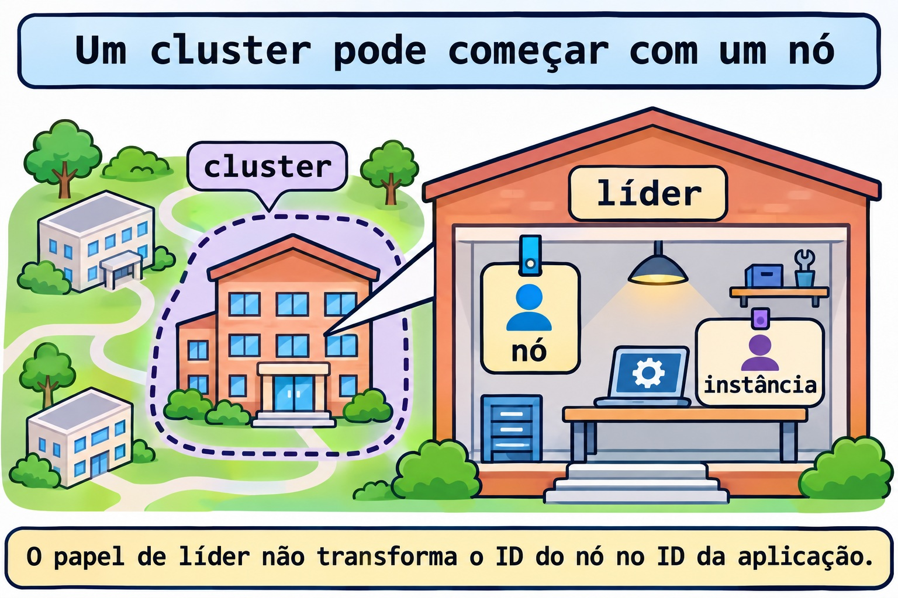

# Aula 20.2 · Cluster, nó e aplicação

> **O coração desta aula:** instalar uma Wiki e ligar a identidade do painel ao contexto real que a executa.

| Ficha | Plano de trabalho |
| --- | --- |
| Módulo | M20 · NethServer 8 por dentro, aula 2 de 7 |
| Pré-requisitos | Cluster da 20.1 ou snapshot m20a1-cluster |
| Bancada | VM 240 ns8-1; cliente 202 debian-lab; conta student |
| Rede | Uma placa na gestão, endereço estático real, gateway e DNS externos |

Use o [guia de bancada M20](../GUIA_BANCADA_M20_PT.md). Ele concentra os endereços editáveis, os nomes locais e o acesso do navegador. Nenhum comando deste texto foi executado nas VMs durante a elaboração.

## Antes de começar

Você precisa da VM 240 com cluster criado, arquivo /root/m20-lab/operador.env e acesso ao painel pelo guia. A Wiki ainda não deve estar instalada. Prepare essa base uma vez pela 20.1 ou retorne ao snapshot m20a1-cluster, se ele existir.

O retorno ao snapshot é uma escolha para a VM exclusiva do exercício, antes de ingressar outro nó. Confira o que será perdido; não faça rollback unilateral de um cluster com vários nós.

## 1 · Aquecimento

1. O ID da VM também é o ID do nó?
2. Uma etiqueta amigável identifica o contexto de execução?
3. Dois sites parecidos provam que são a mesma instância?

## 2 · Por que importa

Antes de olhar contêineres, você precisa saber qual aplicação o painel instalou e em qual nó. Isso evita investigar o usuário ou a instância errados.

### Ponte Windows

O nome de um atalho pode mudar sem trocar o programa para o qual aponta. A etiqueta do painel funciona de modo semelhante; o ID interno continua selecionando a instância.

## 3 · Modelo mental



*O papel de líder não transforma o ID do nó no ID da aplicação.*

O cluster coordena, o nó executa e a instância tem identidade própria. VMID, NODE_ID, MODULE_ID e UUID pertencem a camadas diferentes.


*Redis guarda estado e transporta mensagens; o agente executa a ação no seu contexto.*

## 4 · O essencial

| Referência | O que identifica |
| --- | --- |
| VMID | Máquina no Proxmox |
| NODE_ID | Nó no cluster NS8 |
| MODULE_ID | Contexto de uma instância |
| MODULE_UUID | Identidade usada por descoberta e backup |

### Rocky × Debian

A VM 240 hospeda NS8. A 202 é cliente: seu arquivo hosts e o acesso do navegador seguem o guia. Instalar DokuWiki não transforma a 202 em nó.

### Decida 1

Qual referência deve selecionar a instância em runagent?

A. O número da VM no Proxmox.

B. O MODULE_ID real observado.

C. A etiqueta amigável escolhida no painel.

## 5 · Lab guiado

### Passo 1 · Reconhecer o cluster de partida

**Palpite:** Você está no nó cujo inventário foi salvo?

Entre como student na VM 240, use sudo -i e consulte apenas os campos de identidade. O arquivo foi criado na 20.1, pertence a root e tem modo 0600.

```bash
hostname -s
stat -c '%U:%G:%a %n' /root/m20-lab/operador.env
. /root/m20-lab/operador.env
redis-cli --raw HGET cluster/environment NODE_ID
redis-cli --raw GET cluster/network
runagent -l
```

**Saída esperada:** Arquivo e painel indicam o mesmo líder e a mesma VPN.

**Verifique:** Se o inventário é de outra bancada, resolva a divergência antes de instalar.

### Passo 2 · Escolher a aplicação no catálogo

**Palpite:** Disponível no catálogo significa já instalado?

No painel, abra Settings, Software repositories e habilite nethforge, se estiver desabilitado. Volte ao Software Center e localize DokuWiki. Confira a origem, a versão oferecida e a documentação do cartão.

**Saída esperada:** DokuWiki disponível na origem comunitária planejada.

**Verifique:** Se não aparecer, confira metadados e acesso à Internet; não adicione um repositório de teste para contornar.

### Passo 3 · Instalar uma única instância

**Palpite:** Uma segunda instalação é a mesma instância repetida?

Confira se já existe uma Wiki. Se existir uma instância que você não esperava, inventarie-a em vez de criar outra. Instale DokuWiki no nó observado e espere a tarefa inteira terminar.

```bash
runagent -l
```

Copie o MODULE_ID real mostrado na lista e no painel para a variável abaixo. Não deduza o sufixo numérico pelo número da aula.

```bash
MODULE_ID=''    # preencha com o ID real observado
redis-cli --raw HGET cluster/module_node "$MODULE_ID"
redis-cli --raw HGET cluster/module_uuid "$MODULE_ID"
```

**Saída esperada:** Uma instância com ID real, nó e UUID anotados.

**Verifique:** O nó da aplicação deve corresponder ao líder desta bancada de um nó.

### Passo 4 · Configurar a Wiki e seu administrador

**Palpite:** A conta Linux student já é automaticamente uma conta da Wiki?

Na configuração da aplicação, use host wiki.lab.test, nome da Wiki M20 Lab, usuário administrativo student, nome de exibição student e contato fictício student@lab.test. Digite uma senha exclusiva no próprio formulário; não a grave em variáveis.

Mantenha Let’s Encrypt desativado para .test e habilite o redirecionamento HTTP para HTTPS. Salve e espere a configuração terminar. A conta student da Wiki é local à aplicação e separada da conta Linux, mesmo com o mesmo nome.

```bash
getent ahostsv4 wiki.lab.test
curl --connect-timeout 3 --max-time 10 --silent --show-error --head --resolve "wiki.lab.test:80:$NS8_IP" http://wiki.lab.test/
openssl s_client -connect 127.0.0.1:443 -servername wiki.lab.test < /dev/null 2>/dev/null | openssl x509 -noout -fingerprint -sha256
```

**Saída esperada:** Rota pelo nome privado, redirecionamento para HTTPS e certificado identificado no console.

**Verifique:** Use o acesso por nome descrito no guia e compare a impressão antes do login. O HEAD não envia senha.

### Passo 5 · Relacionar contexto e identidade

**Palpite:** O Podman do root reúne os contêineres de todas as contas?


*Registre a identidade observada antes de investigar, mover ou restaurar.*

```bash
runagent -m "$MODULE_ID" id
runagent -m "$MODULE_ID" podman ps
runagent -m "$MODULE_ID" systemctl --user list-units --type=service --no-pager
```

Registre a identidade sem apagar campos anteriores do arquivo. A função seguinte só aceita uma instância DokuWiki existente no nó anotado; uma divergência retorna ao terminal.

```bash
m20_registrar_wiki() {
  if [ "$(hostname -s)" != ns8-1 ] || [ "$(id -u)" -ne 0 ]; then
    printf '%s\n' 'Use root na VM ns8-1.'
    return 1
  fi
  if ! [[ "$MODULE_ID" =~ ^dokuwiki[0-9]+$ ]]; then
    printf '%s\n' 'Preencha MODULE_ID com a instância real.'
    return 1
  fi
  MODULE_UUID=$(redis-cli --raw HGET cluster/module_uuid "$MODULE_ID")
  MODULE_NODE_ID=$(redis-cli --raw HGET cluster/module_node "$MODULE_ID")
  if [ -z "$MODULE_UUID" ] || [ "$MODULE_NODE_ID" != "$NODE_ID" ]; then
    printf '%s\n' 'A identidade ou o nó não corresponde ao inventário.'
    return 1
  fi
  ENV_NEW=$(mktemp /root/m20-lab/operador.XXXXXX) || return 1
  awk '!/^MODULE_ID=/ && !/^MODULE_UUID=/' /root/m20-lab/operador.env > "$ENV_NEW"
  printf 'MODULE_ID=%q\nMODULE_UUID=%q\n' "$MODULE_ID" "$MODULE_UUID" >> "$ENV_NEW"
  chmod 0600 "$ENV_NEW"
  mv -f "$ENV_NEW" /root/m20-lab/operador.env
}
m20_registrar_wiki
```

**Saída esperada:** ID e UUID reais acrescentados; endereços, NODE_ID e VPN preservados.

**Verifique:** Não despeje o ambiente inteiro nem edite Redis para fazer a consulta combinar.

### Passo 6 · Mudar somente a etiqueta

**Palpite:** Trocar o nome amigável troca o UUID?

Mude apenas a etiqueta amigável da instância para M20 wiki. Consulte novamente os vínculos; não altere o host da aplicação nem clone a instância.

```bash
redis-cli --raw HGET cluster/module_uuid "$MODULE_ID"
redis-cli --raw HGET cluster/module_node "$MODULE_ID"
runagent -m "$MODULE_ID" podman ps
```

**Saída esperada:** Mesmos ID, UUID e nó; somente a apresentação mudou.

**Verifique:** Abra a Wiki no navegador conforme o guia, confira TLS de bootstrap e entre como student. Depois registre o snapshot m20a2-wiki da VM 240 no Proxmox.

### Decida 2

O painel responde, mas uma consulta em outra instância não mostra a Wiki. Qual conclusão é válida?

A. É necessário apagar o banco Redis.

B. O Podman perdeu todos os contêineres.

C. O teste consultou outro contexto; confirme MODULE_ID e nó antes de agir.

## 6 · Quebre e conserte

### Quebra 1 · Catálogo sem a aplicação

**Sintoma:** DokuWiki não aparece no catálogo.

**Investigação:** Confira o estado de nethforge e a atualização de metadados.

**Causa:** A origem comunitária pode estar desabilitada.

**Conserto:** Habilite apenas a origem prevista e atualize o catálogo.

**Prevenção:** Registre a origem junto da versão.

**Verifique:** O cartão aparece antes de iniciar a instalação.

### Quebra 2 · Campo de identidade vazio

**Sintoma:** A função pede o MODULE_ID real.

**Investigação:** Compare a variável editável com runagent -l e o painel.

**Causa:** O valor ainda não foi preenchido ou pertence a outra instância.

**Conserto:** Copie a referência observada e consulte novamente.

**Prevenção:** Não derive IDs do nome da aula.

**Verifique:** Nó e UUID correspondem à Wiki instalada.

### Quebra 3 · Etiqueta confundida com ID

**Sintoma:** Um nome amigável não seleciona a instância no terminal.

**Investigação:** Compare etiqueta, MODULE_ID e UUID.

**Causa:** Apresentação e identidade interna foram confundidas.

**Conserto:** Use o MODULE_ID real, sem renomear a conta Unix.

**Prevenção:** Anote os três campos separadamente.

**Verifique:** A mesma aplicação responde e mantém o UUID.

## 7 · Armadilhas

- student no Linux e student na Wiki são contas separadas.
- Um host .test não é elegível para emissão pública por Let’s Encrypt.
- Não envie senha por HTTP para contornar um aviso TLS.
- A camada de controle não deve ser alterada diretamente para consertar uma etiqueta.

## 8 · Quiz

1. Por que a VMID não é o NODE_ID?

2. O que distingue etiqueta, MODULE_ID e UUID?

3. Qual é o papel de Redis neste modelo?

4. Por que não usar podman de root para concluir que a wiki desapareceu?

5. Mudar a etiqueta amigável deve mudar o UUID?

## 9 · Folha de bolso

```bash
runagent -l
runagent -m "$MODULE_ID" id
runagent -m "$MODULE_ID" podman ps
redis-cli --raw HGET cluster/module_uuid "$MODULE_ID"
```

## 10 · Checklist e fechamento

- [ ] Instância única instalada pela origem prevista.
- [ ] Wiki com host privado, HTTPS e administrador student.
- [ ] ID, UUID e nó observados.
- [ ] Arquivo do operador atualizado sem perder campos.
- [ ] Snapshot m20a2-wiki registrado.

**Reboot de conferência:** se optar por reiniciar a VM dedicada, confira o retorno do painel e da Wiki antes de salvar a base. Não reinicie o host para testar uma aplicação.

## 11 · Na vida real

Em um painel autorizado, faça um inventário de aplicação, origem, versão, nó, ID e UUID sem alterar a configuração. Uma captura só do nome amigável não substitui esse mapa.

## 12 · Aprofundar quando quiser

- [Software Center e repositórios](https://docs.nethserver.org/projects/ns8/en/latest/software_center.html)
- [Módulo DokuWiki e campos de configuração](https://github.com/NethServer/ns8-dokuwiki)
- [Mapas públicos de identidade](https://nethserver.github.io/ns8-core/core/database/)

## Gabarito comentado

Aquecimento: os IDs são atribuídos por sistemas diferentes; nome amigável é apresentação; telas iguais exigem comparar identidade e nó.

Decida 1: B. runagent exige o ID interno real, não a etiqueta nem o número do Proxmox.

Decida 2: C. Uma consulta em outro contexto não demonstra perda de dados na instância alvo.

Quiz 1: o Proxmox identifica a VM, enquanto o NS8 atribui o nó dentro de seu próprio cluster.

Quiz 2: etiqueta apresenta; MODULE_ID seleciona o contexto; UUID acompanha a identidade no plano de controle.

Quiz 3: guarda configuração e participa da troca de tarefas e eventos entre componentes; não é só cache da aplicação.

Quiz 4: armazenamentos e gerenciadores de usuário são distintos; consulte o contexto rootless da instância real.

Quiz 5: não; neste ensaio apenas a apresentação muda. Depois de mover ou restaurar, redescubra os vínculos reais em vez de presumir continuidade por nome.

[← Aula 20.1 · Instalar NS8](20.1-instalar-nethserver-8.md) · [Índice das aulas](../01-aulas.md) · [Plano do curso](../00-plano-do-curso.md)

