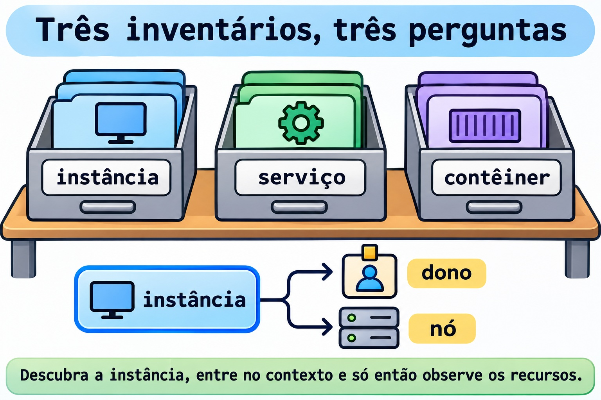
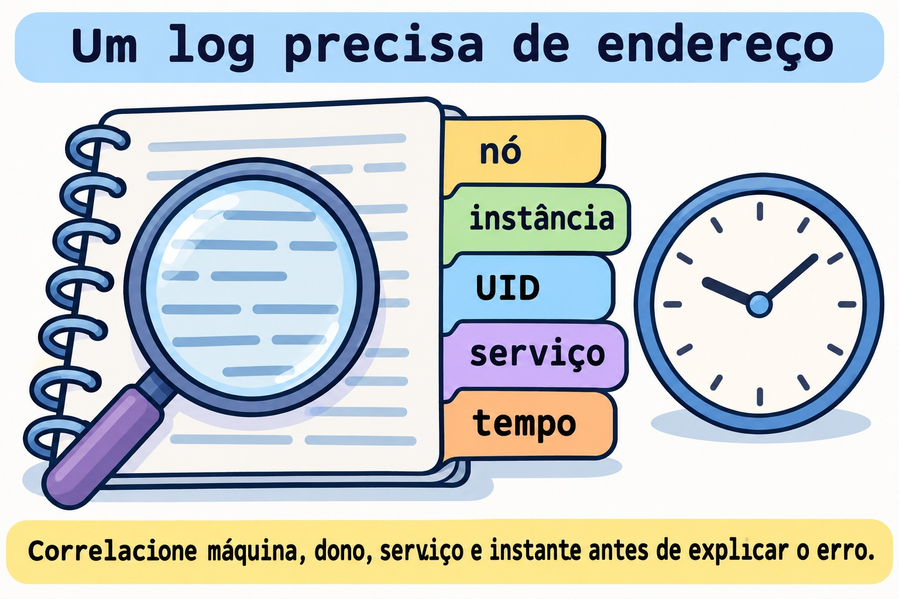

# Aula 20.3 · Um módulo por dentro

> **O coração desta aula:** relacionar a Wiki ao seu usuário Unix, serviço, contêiner, dados e logs.

| Ficha | Plano de trabalho |
| --- | --- |
| Módulo | M20 · NethServer 8 por dentro, aula 3 de 7 |
| Pré-requisitos | Wiki configurada na 20.2 ou snapshot m20a2-wiki |
| Bancada | VM 240 ns8-1; cliente 202 debian-lab; conta student |
| Rede | Uma placa na gestão, endereço estático real, gateway e DNS externos |

Use o [guia de bancada M20](../GUIA_BANCADA_M20_PT.md). Ele concentra os endereços editáveis, os nomes locais e o acesso do navegador. Nenhum comando deste texto foi executado nas VMs durante a elaboração.

## Antes de começar

Você precisa da VM 240 com a Wiki configurada, administrador local student e inventário /root/m20-lab/operador.env com MODULE_ID/UUID. Use a base m20a2-wiki, se esse snapshot existir, ou prepare a 20.1 e a 20.2 uma vez. Nenhum estado de outro módulo é necessário.

O acesso pelo nome privado e a comparação do certificado de bootstrap seguem o guia. Não substitua a rota da Wiki por uma URL de IP que seleciona outro site.

## 1 · Aquecimento

1. Root enxerga automaticamente todos os contêineres rootless?
2. Um módulo pode usar mais de um contêiner?
3. O nome no cartão revela a unidade systemd?

## 2 · Por que importa

Um processo pode estar saudável no usuário errado, e um log vazio pode pertencer ao filtro errado. A investigação precisa de endereço completo: nó, conta, serviço e instante.

### Ponte Windows

Abrir o gerenciador de tarefas em outra sessão não prova que um programa desapareceu. Os contextos rootless também precisam ser escolhidos antes de interpretar uma lista vazia.

## 3 · Modelo mental


*O painel coordena; a instância executa no contexto do seu dono.*

runagent prepara o ambiente da instância. O usuário Unix define privilégios; systemd gerencia o serviço; Podman descreve os contêineres e suas montagens. Uma dessas referências não substitui as outras.

## 4 · O essencial

| Pergunta | Ferramenta |
| --- | --- |
| Qual instância? | Painel, UUID e runagent -l |
| Qual conta? | runagent com id |
| Qual execução? | systemctl --user e podman no contexto real |
| Quais dados? | Inspeção das montagens |
| Qual ocorrência? | Journal filtrado e logs do contêiner |

### Rocky × Debian

A investigação do módulo acontece como root na VM ns8-1. O navegador e os testes de cliente ficam no acesso do guia; não é necessário instalar Podman na Debian para observar o servidor.

### Decida 1

O Podman do root não lista a Wiki. O que você conclui?

A. Todos os dados desapareceram.

B. É preciso consultar o contexto real da instância.

C. Deve reinstalar o cluster imediatamente.

## 5 · Lab guiado

### Passo 1 · Localizar a instância e seu dono

**Palpite:** A mesma etiqueta pode apontar para outro ID depois de uma restauração?

Na VM 240, entre como student e use sudo -i. Confira o inventário protegido antes de carregá-lo; ele deve pertencer a root e ter modo 0600.

```bash
hostname -s
stat -c '%U:%G:%a %n' /root/m20-lab/operador.env
. /root/m20-lab/operador.env
runagent -l
redis-cli --raw HGET cluster/module_uuid "$MODULE_ID"
runagent -m "$MODULE_ID" id
```

**Saída esperada:** ID, UUID, nó e usuário Unix correspondem à mesma Wiki.

**Verifique:** Se houve remoção, Move ou restore, reconcilie o mapa antes de continuar.

### Passo 2 · Descobrir serviço e contêiner

**Palpite:** Toda unidade ativa é o serviço web da Wiki?



*Descubra a instância, entre no contexto e só então observe os recursos.*

```bash
MODULE_UID=$(runagent -m "$MODULE_ID" id -u)
runagent -m "$MODULE_ID" systemctl --user list-units --type=service --all --no-pager
runagent -m "$MODULE_ID" podman ps --all --format '{{.ID}} {{.Names}} {{.Status}}'
```

Preencha os nomes observados abaixo. Escolha a unidade da aplicação, não apenas a unidade do agente; compare ExecStart e o contêiner antes de fixar a relação.

```bash
SERVICE_UNIT=''   # unidade .service real observada
CONTAINER_ID=''   # ID real do contêiner da Wiki
runagent -m "$MODULE_ID" systemctl --user cat "$SERVICE_UNIT"
runagent -m "$MODULE_ID" systemctl --user show "$SERVICE_UNIT" -p LoadState -p ActiveState -p SubState
runagent -m "$MODULE_ID" podman inspect --format '{{.Name}} {{.State.Status}}' "$CONTAINER_ID"
```

**Saída esperada:** Você distingue conta, unidade e contêiner observados.

**Verifique:** Não troque o shell da conta de serviço nem acrescente sudo dentro de runagent.

### Passo 3 · Mapear persistência sem editar

**Palpite:** A camada do contêiner tem o mesmo ciclo de vida de um volume?

```bash
runagent -m "$MODULE_ID" podman inspect --format '{{json .Mounts}}' "$CONTAINER_ID"
runagent -m "$MODULE_ID" podman volume ls
runagent -m "$MODULE_ID" podman info --format '{{.Store.GraphRoot}}'
runagent -m "$MODULE_ID" systemctl --user show "$SERVICE_UNIT" -p FragmentPath
```

Observe origem, destino e modo de cada montagem. A listagem não autoriza editar arquivos internos, copiar um banco em execução nem assumir que existe um backup. A restauração funcional será praticada na 20.6.

**Saída esperada:** Mapa com execução e dados persistentes separados.

**Verifique:** Compare a documentação do módulo antes de escolher o que preservar.

### Passo 4 · Criar uma prova funcional privada

**Palpite:** Uma resposta HTTP genérica comprova o conteúdo da Wiki?

Abra a Wiki pelo nome privado usando o acesso do guia, confira o certificado de bootstrap e entre como student. Crie a página privada m20:prova com o texto fictício M20 prova inicial. Não altere permissões de outras páginas.

Saia e entre novamente para conferir o conteúdo. Uma consulta anônima pode receber a tela de login; isso não comprova perda da página privada. Não coloque senha ou cookie em comandos do curso.

```bash
date --iso-8601=seconds
runagent -m "$MODULE_ID" systemctl --user is-active "$SERVICE_UNIT"
```

**Saída esperada:** Conteúdo reconhecido em sessão autenticada e serviço observado.

**Verifique:** Anote instante e página sem capturar credenciais.

### Passo 5 · Correlacionar registros

**Palpite:** Nenhuma linha no log prova que não houve requisição?



*Correlacione máquina, dono, serviço e instante antes de explicar o erro.*

```bash
date --iso-8601=seconds
journalctl _UID="$MODULE_UID" _SYSTEMD_USER_UNIT="$SERVICE_UNIT" --since '-15 min' --no-pager -n 60
runagent -m "$MODULE_ID" podman logs --since 15m --tail 40 "$CONTAINER_ID"
runagent -m "$MODULE_ID" systemctl --user show "$SERVICE_UNIT" -p ActiveEnterTimestamp -p ExecMainStatus
timeout 10 api-server-logs logs -e module -n "$MODULE_ID"
```

A consulta administrativa usa o UID e a unidade reais, sem depender de um journal separado por usuário. O timeout encerra a consulta contínua de logs; seu código 124, nesse caso, indica prazo atingido.

Nem toda aplicação registra acessos HTTP no canal que você consultou. Compare contexto, intervalo e logs do painel antes de concluir. Não invente uma linha de acesso esperada.

**Saída esperada:** Registros atribuídos ao nó, dono, serviço e intervalo corretos.

**Verifique:** Uma ausência de linhas só vale para o filtro consultado.

### Passo 6 · Salvar um mapa pequeno

**Palpite:** Um log integral é sempre a melhor evidência para compartilhar?

```bash
m20_salvar_mapa() {
  if [ "$(hostname -s)" != ns8-1 ] || [ "$(id -u)" -ne 0 ] || [ -z "$SERVICE_UNIT" ] || [ -z "$CONTAINER_ID" ]; then
    printf '%s\n' 'Confira o nó e preencha unidade e contêiner observados.'
    return 1
  fi
  EVID="/root/m20-lab/evidencias-20-3-$(date +%Y%m%d-%H%M%S)"
  install -d -m 0700 "$EVID" || return 1
  printf 'MODULE_ID=%s\nMODULE_UUID=%s\nMODULE_UID=%s\nSERVICE_UNIT=%s\nCONTAINER_ID=%s\n' "$MODULE_ID" "$MODULE_UUID" "$MODULE_UID" "$SERVICE_UNIT" "$CONTAINER_ID" > "$EVID/mapa.txt"
  runagent -m "$MODULE_ID" podman inspect --format '{{json .Mounts}}' "$CONTAINER_ID" > "$EVID/montagens.json"
  journalctl _UID="$MODULE_UID" _SYSTEMD_USER_UNIT="$SERVICE_UNIT" --since '-15 min' --no-pager -n 60 > "$EVID/journal.txt"
}
m20_salvar_mapa
```

**Saída esperada:** Mapa e recorte de evidência em pasta privada do exercício.

**Verifique:** Revise os registros antes de compartilhar; não exporte credenciais nem o ambiente completo.

### Decida 2

Qual conjunto permite encerrar a investigação?

A. Identidade coerente, serviço observado e conteúdo privado reconhecido.

B. Apenas o cartão verde do painel.

C. Apenas um comando que terminou sem imprimir erro.

## 6 · Quebre e conserte

### Quebra 1 · Contexto errado

**Sintoma:** Uma listagem no contexto de root não mostra a Wiki.

**Investigação:** Compare com o Podman executado por runagent na instância real.

**Causa:** São inventários de usuários diferentes.

**Conserto:** Volte ao MODULE_ID observado, sem migrar permissões.

**Prevenção:** Registre o dono junto do recurso.

**Verifique:** A instância e seus contêineres correspondem ao painel.

### Quebra 2 · Unidade não descoberta

**Sintoma:** Uma unidade digitada por memória não é encontrada.

**Investigação:** Liste as unidades no contexto real e confira ExecStart.

**Causa:** Nome do cartão e nome de unidade não são a mesma referência.

**Conserto:** Preencha SERVICE_UNIT com a unidade observada.

**Prevenção:** Redescubra a unidade depois de mudar a instância.

**Verifique:** LoadState e identidade correspondem ao objeto escolhido.

### Quebra 3 · Intervalo sem ocorrência

**Sintoma:** Um recorte de journal não mostra o acesso que você acabou de testar.

**Investigação:** Confira relógio, UID, unidade, intervalo e canal de log.

**Causa:** O evento pode estar fora do filtro ou não ser registrado nesse canal.

**Conserto:** Corrija o filtro e compare logs do contêiner e do painel.

**Prevenção:** Registre o instante antes da prova funcional.

**Verifique:** A conclusão descreve apenas o que a fonte realmente mostrou.

## 7 · Armadilhas

- Não transforme a conta de serviço em conta de login.
- Não edite volumes, unidades geradas ou Redis para fabricar uma prova.
- Serviço ativo e conteúdo reconhecido são evidências diferentes.
- A página m20:prova continua privada; tela de login anônima não é perda de dados.

## 8 · Quiz

1. Qual evidência liga o ID do painel ao usuário Unix?

2. Por que o Podman do root pode não mostrar o wiki?

3. O que diferencia serviço e contêiner?

4. Qual filtro evita misturar journals de usuários distintos?

5. Por que um mapa de ontem precisa ser reconciliado depois de mover?

## 9 · Folha de bolso

```bash
runagent -l
runagent -m "$MODULE_ID" id
runagent -m "$MODULE_ID" podman ps
journalctl _UID="$MODULE_UID" _SYSTEMD_USER_UNIT="$SERVICE_UNIT" --since '-15 min' --no-pager -n 60
```

## 10 · Checklist e fechamento

- [ ] ID e UUID ligados ao usuário real.
- [ ] Unidade, contêiner e montagens descobertos.
- [ ] Página privada reconhecida após autenticação.
- [ ] Logs atribuídos ao contexto e intervalo corretos.
- [ ] Evidências revisadas antes de compartilhar.

**Reboot de conferência:** se reiniciar a VM dedicada, carregue o inventário novamente e redescubra unidade e contêiner. Confira a página; não reutilize um ID de contêiner antigo por memória.

## 11 · Na vida real

Em uma instância autorizada, desenhe o vínculo entre painel, usuário, serviço, contêiner e dados usando somente consultas. Deixe explícito qual teste confirmou conteúdo e qual apenas descreveu estado.

## 12 · Aprofundar quando quiser

- [Contexto rootless e runagent](https://nethserver.github.io/ns8-core/modules/rootless_rootfull/)
- [Logs e api-server-logs](https://nethserver.github.io/ns8-core/core/logs/)
- [Filesystem e diretórios dos módulos](https://nethserver.github.io/ns8-core/core/filesystem/)

## Gabaritos comentados

Aquecimento: root não reúne automaticamente inventários rootless; uma instância pode ter vários contêineres; a unidade deve ser descoberta.

Decida 1: B. A ausência no contexto de root não significa ausência no contexto da instância.

Decida 2: A. Estado e conteúdo precisam apontar para o mesmo objeto.

Quiz 1: ID e UUID do painel, nó hospedeiro e `id` executado por `runagent` precisam ser coerentes.

Quiz 2: o armazenamento e o runtime rootless pertencem à conta da instância.

Quiz 3: systemd gerencia o ciclo de vida; Podman identifica processos, imagem e montagens de um contêiner.

Quiz 4: use o UID real junto da unidade real e do intervalo; um só nome pode aparecer em contextos diferentes.

Quiz 5: nó, UID, unidade ou contêiner podem mudar; descubra novamente sem perder o UUID e o conteúdo funcional.

[← Aula 20.2](20.2-cluster-no-e-modulo.md) · [Índice das aulas](../01-aulas.md) · [Aula 20.4 →](20.4-proxy-e-certificados.md)

