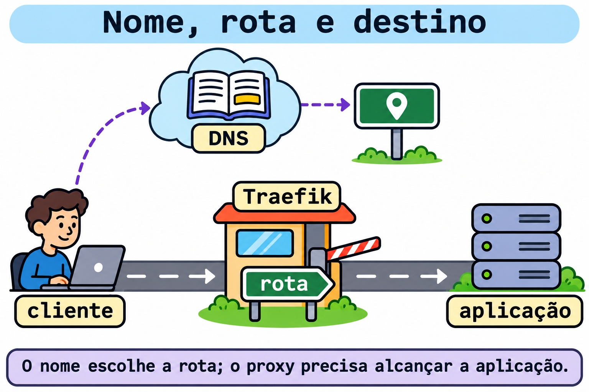
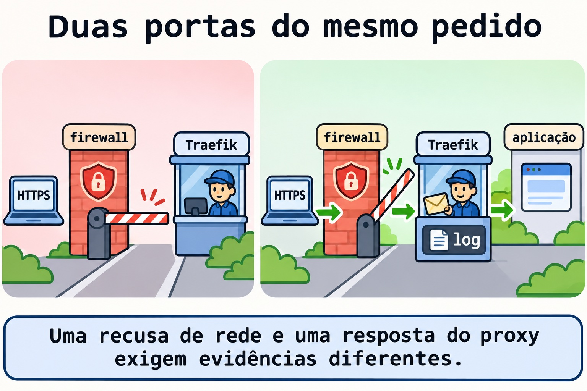

# Aula 20.4 · Proxy e certificados

> **O coração desta aula:** provar separadamente nome, identidade TLS, rota e aplicação.

| Ficha | Plano de trabalho |
| --- | --- |
| Módulo | M20 · NethServer 8 por dentro, aula 4 de 7 |
| Quando | Semana 28 |
| Ao final | emitir uma identidade privada e conferir a resposta do nó |
| Pré-requisitos | Wiki da 20.2; VM 202 com student e sudo; guia M20 |
| Duração | 70–100 minutos |
| Snapshot | base m20a2-wiki; saída m20a4-tls e m20a4-cliente202 |

## Antes de começar

Você precisa da VM 240 `ns8-1`, com cluster criado, DokuWiki instalada e nome `wiki.lab.test` configurado na 20.2. Use o estado `m20a2-wiki`, se foi salvo, ou execute somente a preparação da 20.1–20.2. A 20.3 não é obrigatória.

Na 202, trabalhe como `student`. O [guia M20](../GUIA_BANCADA_M20_PT.md) prepara endereços reais, nomes privados e acesso direto do navegador autorizado. A CA será criada nesta aula na própria 202. Não é necessário outro módulo.

No nó, `hostname -s` deve mostrar `ns8-1`; `ns8-1.lab.test` é o FQDN. Os comandos root rodam na VM após `sudo -i`, nunca no Proxmox. Nenhum laboratório foi executado durante esta revisão.

## 1 · Aquecimento

1. Nome resolvido significa certificado correto?
2. Um certificado válido mantém o backend funcionando?
3. Qual chave permite emitir outras identidades?

## 2 · Por que importa

O cliente precisa chegar ao nó certo e reconhecer a identidade esperada. Depois, o proxy ainda precisa encontrar a aplicação. Uma resposta TLS correta não prova as outras etapas.

### Ponte Windows

A URL escolhe o nome que o navegador verifica. Digitar o IP muda essa pergunta; não é equivalente a acessar o nome publicado.

## 3 · Modelo mental



*O nome escolhe a rota; o proxy precisa alcançar a aplicação.*

Cada nó tem seu proxy Traefik. A rota automática do módulo associa o nome ao backend local. Configure o nome pela aplicação; não edite arquivos gerados.

## 4 · O essencial

| Camada | Conferência |
| --- | --- |
| Nome | nome privado mapeado para o IP real da gestão |
| TLS | CA, SAN, validade e chave correspondente |
| Rota | Host da requisição e backend observado |
| Aplicação | resposta nova e conteúdo esperado |

### Rocky × Debian

A 202 emite a CA privada do laboratório. A 240 recebe apenas a CA pública e seu certificado de servidor. A chave privada da CA nunca sai da 202.

### Decida 1

O certificado cobre o nome, mas a CA é desconhecida. O que muda a prova corretamente?

A. Desligar a verificação para sempre.
B. Conferir a CA por canal confiável e fornecê-la ao cliente.
C. Usar o IP como nome para evitar SAN.

## 5 · Lab guiado

### Passo 1 · Conferir a rota

**Palpite:** O nome da Wiki está no nó em que ela roda?

No painel, abra Settings → HTTP routes. Confira nome, nó e backend da rota automática da Wiki. No terminal root da 240, consulte sem alterar:

```bash
hostname -s
runagent -l
ss -ltnp '( sport = :80 or sport = :443 )'
```

**Saída esperada:** Rota de `wiki.lab.test` no nó 240, com instância identificada.

**Verifique:** Confirme o endereço real da gestão no guia. O hosts do sistema não fornece DNS aos contêineres.

### Passo 2 · Criar a CA na 202

**Palpite:** O que deve permanecer privado na emissora?


*Confiar na CA não corrige um nome ausente no certificado.*

Na 202, como student, execute uma vez. O diretório precisa ser novo. O OpenSSL pede a frase secreta da chave da CA; digite-a no pedido próprio do programa e guarde-a separadamente.

```bash
m20_criar_ca() {
  [ "$(hostname -s)" = debian-lab ] && [ "$(id -un)" = student ] || return 1
  [ ! -e "$HOME/m20-pki" ] || { printf '%s\n' 'A pasta da CA já existe; confira antes de continuar.'; return 1; }
  sudo apt install -y openssl curl || return 1
  umask 077
  install -d -m 0700 "$HOME/m20-pki" || return 1
  openssl genpkey -algorithm RSA -aes-256-cbc -pkeyopt rsa_keygen_bits:3072 -out "$HOME/m20-pki/ca.key" || return 1
  openssl req -new -x509 -sha256 -days 365 -key "$HOME/m20-pki/ca.key" -out "$HOME/m20-pki/ca.crt" -subj "/CN=CA M20" -addext "basicConstraints=critical,CA:TRUE" -addext "keyUsage=critical,keyCertSign,cRLSign" || return 1
  openssl x509 -in "$HOME/m20-pki/ca.crt" -noout -dates -fingerprint -sha256
}
m20_criar_ca
```

**Saída esperada:** Chave cifrada e certificado da CA dentro da pasta 0700.

**Verifique:** Anote a impressão digital pública; não copie a chave da CA para upload.

### Passo 3 · Emitir e conferir o certificado do nó

**Palpite:** Quais nomes precisam aparecer no SAN?

Ainda na 202, use `M20_ALVO=240` nesta aula; a 20.7 reutiliza o bloco com `M20_ALVO=241`, sem recriar a CA. Emita uma chave de servidor nova. Ela fica sem senha porque o proxy precisa usá-la sem intervenção; a proteção é o diretório privado e o modo 0600.

```bash
M20_ALVO=240
m20_emitir_no() {
  [ "$(hostname -s)" = debian-lab ] && [ "$(id -un)" = student ] || return 1
  case "$M20_ALVO" in
    240) CERT_HOST=ns8-1.lab.test ;;
    241) CERT_HOST=ns8-2.lab.test ;;
    *) return 1 ;;
  esac
  CERT_BASE="$HOME/m20-pki/node$M20_ALVO"
  [ ! -e "$CERT_BASE.key" ] && [ ! -e "$CERT_BASE.crt" ] || return 1
  umask 077
  openssl genpkey -algorithm RSA -pkeyopt rsa_keygen_bits:3072 -out "$CERT_BASE.key" || return 1
  openssl req -new -key "$CERT_BASE.key" -out "$CERT_BASE.csr" -subj "/CN=$CERT_HOST" || return 1
  cat > "$CERT_BASE.ext" <<EOF
basicConstraints=critical,CA:FALSE
keyUsage=critical,digitalSignature,keyEncipherment
extendedKeyUsage=serverAuth
subjectAltName=DNS:wiki.lab.test,DNS:$CERT_HOST
EOF
  openssl x509 -req -sha256 -days 90 -in "$CERT_BASE.csr" -CA "$HOME/m20-pki/ca.crt" -CAkey "$HOME/m20-pki/ca.key" -CAcreateserial -extfile "$CERT_BASE.ext" -out "$CERT_BASE.crt" || return 1
  chmod 0600 "$CERT_BASE.key"
  openssl verify -CAfile "$HOME/m20-pki/ca.crt" -verify_hostname wiki.lab.test "$CERT_BASE.crt" || return 1
  openssl verify -CAfile "$HOME/m20-pki/ca.crt" -verify_hostname "$CERT_HOST" "$CERT_BASE.crt"
}
m20_emitir_no
```

**Saída esperada:** Cadeia e os dois nomes validam no certificado emitido.

**Verifique:** Na 20.7, outro nó precisa de outra chave e outro certificado; não copie a identidade da 240.

### Passo 4 · Instalar a confiança e fazer o upload

**Palpite:** Confiar na CA e instalar a chave do servidor são a mesma ação?

Na 202, preencha `NS8_IP` com o IP real do guia. Confira a chave SSH do nó pelo console antes do primeiro SCP. Transfira somente a CA pública:

```bash
NS8_IP=""
m20_enviar_ca() {
  [ -n "$NS8_IP" ] || return 1
  scp "$HOME/m20-pki/ca.crt" "student@$NS8_IP:m20-ca.crt"
}
m20_enviar_ca
```

No nó 240, após sudo -i, compare a impressão digital recebida com a leitura feita na 202 por canal independente. Só execute a instalação depois de confirmar a igualdade.

```bash
openssl x509 -in /home/student/m20-ca.crt -noout -fingerprint -sha256
m20_confiar_ca() {
  [ "$(hostname -s)" = ns8-1 ] && [ "$(id -u)" -eq 0 ] || return 1
  [ ! -L /root/m20-lab ] || return 1
  [ ! -e /etc/pki/ca-trust/source/anchors/m20-lab-ca.crt ] || return 1
  install -d -o root -g root -m 0700 /root/m20-lab || return 1
  install -o root -g root -m 0644 /home/student/m20-ca.crt /root/m20-lab/ca.crt || return 1
  install -o root -g root -m 0644 /root/m20-lab/ca.crt /etc/pki/ca-trust/source/anchors/m20-lab-ca.crt || return 1
  update-ca-trust extract
}
m20_confiar_ca
```

No navegador da 202, aberto pelo console local conforme o guia, abra o painel pelo IP com o bootstrap já conferido. Em Settings → TLS certificates → Upload certificate, escolha o nó 240. Envie `node240.crt` como Certificate, `node240.key` como Private key e `ca.crt` como Chain file. Esses três arquivos vêm da pasta privada da 202; `ca.key` nunca é enviado.

No Firefox da própria 202, importe somente `ca.crt` em autoridades certificadoras, após comparar a impressão digital; habilite a confiança para identificar sites. Depois do upload, reabra o painel em `https://ns8-1.lab.test/cluster-admin`, com o hosts do guia. O certificado não tem SAN de IP: continuar pelo IP não é uma prova válida de nome. A Wiki usa `https://wiki.lab.test/`.

**Saída esperada:** Certificado Uploaded vinculado ao nó 240.

**Verifique:** O upload exige confiança na CA também no sistema do nó. Certificados enviados não se replicam automaticamente.

### Passo 5 · Provar a resposta na 202

**Palpite:** O destino forçado muda o nome verificado no certificado?



*Uma recusa de rede e uma resposta do proxy exigem evidências diferentes.*

Na 202, como student, mantenha `NS8_IP` preenchido. O parâmetro `--resolve` usa o IP real preservando Host e SNI; não depende de DNS privado dentro de um contêiner.

```bash
m20_testar_tls() {
  [ -n "$NS8_IP" ] || return 1
  openssl x509 -in "$HOME/m20-pki/node240.crt" -noout -dates -ext subjectAltName
  curl --retry 10 --retry-delay 1 --retry-all-errors --max-time 10 --fail --cacert "$HOME/m20-pki/ca.crt" --resolve "wiki.lab.test:443:$NS8_IP" https://wiki.lab.test/
}
m20_testar_tls
```

Confira também a página privada `m20:prova` pelo navegador com o usuário local student da Wiki, se ela foi criada; caso contrário, crie uma página fictícia e reconheça o conteúdo. Não torne a Wiki inteira pública para facilitar curl.

**Saída esperada:** A cadeia e o nome validam; o usuário autorizado reconhece a página.

**Verifique:** Resposta HTTP pode ser login, conforme a ACL. Isso não equivale a conteúdo privado recuperado.

### Passo 6 · Registrar e salvar o estado-base

**Palpite:** O certificado Uploaded renova sozinho?

Anote emissor, SAN, validade, nó e local de custódia. Uploaded exige renovação manual. Para nomes `.test`, esta aula não solicita certificado público; ACME exige domínio público controlado e alcance ao desafio configurado.

Depois da conferência, salve pelo guia `m20a4-tls` na 240 e `m20a4-cliente202` na 202. Se eles não existem, as próximas aulas recompõem este estado executando 20.1, 20.2 e 20.4; não precisam da 20.3 ou 20.5.

**Saída esperada:** Base TLS documentada nas duas VMs.

**Verifique:** Snapshots da 202 contêm material privado; restrinja seu acesso. Não restaure apenas um nó após formar um cluster de dois nós.

### Decida 2

DNS e TLS estão corretos, mas o proxy mostra uma falha de backend. Qual evidência vem depois?

A. Trocar o DNS de todos os nós.
B. Aumentar a validade do certificado.
C. Conferir destino da rota e estado da instância no nó hospedeiro.

## 6 · Quebre e conserte

### Quebra 1 · IP no lugar do nome

**Sintoma:** No cliente, troque somente o nome da URL pelo IP real.

**Investigação:** Leia o erro TLS e o SAN do certificado.

**Causa:** Não foi emitido SAN para o IP.

**Conserto:** Volte ao FQDN e mantenha --resolve com o IP correto.

**Prevenção:** Registre nome e endereço em campos separados.

**Verifique:** O comando original valida a identidade.

### Quebra 2 · CA não fornecida

**Sintoma:** Numa cópia do comando, retire --cacert sem instalar a CA globalmente.

**Investigação:** Compare o erro com a mesma conexão usando a CA correta.

**Causa:** O cliente não conhece a CA privada.

**Conserto:** Forneça o certificado público conferido.

**Prevenção:** Nunca troque a conferência por ignorar erros TLS.

**Verifique:** Nome e cadeia passam no mesmo pedido.

### Quebra 3 · Destino do teste errado

**Sintoma:** Na 202, use --resolve com 127.0.0.1 numa cópia do teste.

**Investigação:** Confira qual máquina recebeu a tentativa.

**Causa:** O pedido foi enviado ao próprio cliente.

**Conserto:** Restaure apenas o IP real no comando.

**Prevenção:** Identifique a origem e o destino antes de alterar firewall.

**Verifique:** A requisição correta recebe a resposta do nó.

## 7 · Armadilhas

1. hosts não vira DNS dos contêineres.
2. Uploaded não renova automaticamente.
3. O certificado pertence ao nó, não ao cargo de líder.
4. A chave da CA não entra no formulário do servidor.

## 8 · Quiz

1. Por que TLS pode validar e a Wiki continuar indisponível?
2. Qual arquivo privado não sai da emissora?
3. O que precisa existir em outro nó antes de receber a Wiki?
4. Um nome .test pode receber certificado público nesta bancada?
5. O que diferencia Uploaded de um certificado gerenciado por ACME?

## 9 · Folha de bolso

```bash
openssl x509 -in "$HOME/m20-pki/node240.crt" -noout -dates -ext subjectAltName
getent ahostsv4 wiki.lab.test
ss -ltnp '( sport = :80 or sport = :443 )'
```

**Flashcards:** nome, cadeia e aplicação são provas separadas.

## 10 · Checklist e fechamento

- [ ] CA e chaves privadas em pasta 0700.
- [ ] Certificado do nó contém os dois nomes.
- [ ] CA pública conferida antes da instalação.
- [ ] Upload e teste HTTPS concluídos.
- [ ] Estado-base e validade registrados.

**Reboot de conferência:** numa janela da VM 240, reinicie pelo painel ou console, espere o retorno e repita o teste TLS da 202. Salve os snapshots somente depois dessa prova.

**Último exercício:** descreva uma falha de nome e outra de backend sem propor a mesma correção.

## 11 · Na vida real

Registre responsável, prazo de renovação e consumidores da CA. Um teste correto hoje não evita a expiração amanhã.

## 12 · Aprofundar quando quiser

[TLS e upload no NS8](https://docs.nethserver.org/docs/administrator-manual/configuration/certificates) · [OpenSSL req](https://docs.openssl.org/3.0/man1/openssl-req/) · [curl --resolve](https://curl.se/docs/manpage.html)

!explica Separe nome, TLS, rota e backend no NS8.
!feynman Explique por que um certificado confiável não inicia uma aplicação.
!quiz Crie uma falha de nome e outra de confiança.

## Gabarito comentado

Decida 1: B. A confiança vem da CA pública conferida.
Decida 2: C. Depois de TLS, investigue rota e backend.
Quiz 1: TLS verifica identidade, não disponibilidade do backend.
Quiz 2: ca.key.
Quiz 3: confiança na CA, certificado próprio e rota correta.
Quiz 4: Não; o laboratório usa CA privada.
Quiz 5: Uploaded exige renovação manual; ACME depende de requisitos públicos.

[← Aula 20.3](20.3-modulo-por-dentro.md) · [Índice](../01-aulas.md) · [Aula 20.5 →](20.5-dominios-de-usuario.md)
