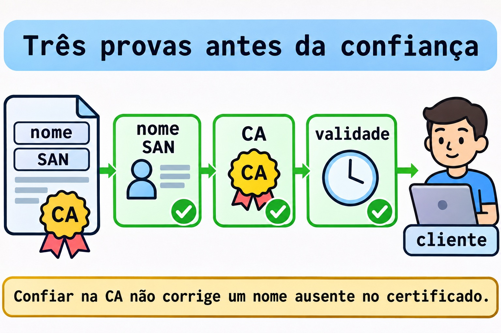

# Aula 20.4 · Proxy e certificados

> **O coração desta aula:** separar resolução, rota, identidade TLS e alcance do backend.

| Ficha | Plano de trabalho |
| --- | --- |
| Módulo | M20 · NethServer 8 por dentro, aula 4 de 7 |
| Quando | Semana 28 |
| Ao final | separar resolução, rota, identidade TLS e alcance do backend. |
| Pré-requisitos | 20.3; CA privada do M19 preservada na 204; acesso do navegador pelo guia |
| Duração | 100–120 minutos |
| Snapshot | VM 240: `m20a4-inicio` e `m20a4-fim` |

A VM `240`, `ns8-1`, roda Rocky Linux 9 e NS8. A gestão tem endereço real reservado; a segunda placa tem `192.0.2.240/24` em `vmbr17`, sem gateway. Internet sai somente pela gestão.

Confira o [guia da bancada](../GUIA_BANCADA_M20_PT.md), os nomes e as rotas antes de começar. O DNS M19 em `192.0.2.204` atende a rede isolada; não configure o loopback como DNS do nó.

Os comandos administrativos desta aula rodam em um shell root da VM indicada, obtido com `sudo -i`. O usuário root do nó não é automaticamente o dono dos contêineres da aplicação.

O nome de instância é descoberto na instalação real. Nunca substitua uma variável por um nome de exemplo só porque ele parece familiar. Não publique o arquivo de ambiente interno de um agente.

## 1 · Aquecimento

1. Um DNS correto prova que o certificado contém o nome?

2. O líder recebe obrigatoriamente todo HTTP do cluster?

3. Um certificado enviado ao nó é replicado automaticamente aos outros?

## 2 · Por que importa

Uma aplicação pode funcionar por um caminho e falhar pelo nome publicado. DNS, seleção de rota e confiança do cliente são provas independentes.

Cada nó possui seu Traefik. A rota automática da aplicação costuma apontar para um backend local; ser líder não transforma o nó em entrada universal de todo aplicativo.

### Ponte Windows

No navegador do operador, o guia pode mapear os nomes para loopbacks de um túnel SSH. Isso só entrega o pedido ao nó correto; o nome da URL e a verificação do certificado continuam intactos.

O DNS real dos nós e do cliente `202` continua apontando para os endereços isolados. Não copie os loopbacks da estação para o DNS do laboratório.

## 3 · Modelo mental


*O nome escolhe a rota; o proxy precisa alcançar a aplicação.*

O cliente resolve o nome e conecta ao destino. Traefik apresenta uma identidade TLS e escolhe uma rota compatível com Host e, quando configurado, caminho.

Depois existe outro trecho até a aplicação. Um certificado válido no primeiro trecho não mantém o backend ativo e não cria uma rota ausente.

Rotas marcadas como automáticas pertencem à aplicação. Altere o nome pela configuração suportada do módulo; não edite arquivos gerados do Traefik.

## 4 · O essencial

| Camada | Pergunta |
| --- | --- |
| DNS | O nome resolve para o nó esperado? |
| TCP | A porta aceita uma conexão desse cliente? |
| TLS | Nome, cadeia e validade conferem? |
| Rota | Host e caminho correspondem à aplicação? |
| Backend | A aplicação responde pelo destino da rota? |

### Rocky × Debian

Na VM NS8 Rocky, a CA pública confiável entra em `/etc/pki/ca-trust/source/anchors/`. No cliente Debian desta bancada, os testes usam explicitamente `/etc/ssl/m19/ca.crt`; nenhum cliente recebe a chave privada da CA.

### Decida 1

O certificado cobre o nome, mas a CA é desconhecida. O que muda a prova corretamente?

A. Desligar a verificação para sempre.
B. Conferir a CA por canal confiável e fornecê-la ao cliente.
C. Usar o IP como nome para evitar SAN.

## 5 · Lab guiado

### Passo 1 · Conferir nome, nó e rota

**Palpite:** O nome do wiki aponta para o nó em que a instância roda?

```bash
test "$(id -u)" -eq 0 || exit 1
test "$(hostname -s)" = ns8-1 || exit 1
test -f /root/m20-lab/operador.env || exit 1
test ! -L /root/m20-lab/operador.env || exit 1
test "$(stat -c '%u:%g:%a' /root/m20-lab/operador.env)" = 0:0:600 || exit 1
cat /root/m20-lab/operador.env
. /root/m20-lab/operador.env
test "$NS8_IP" = 192.0.2.240 || exit 1
test "$WIKI_FQDN" = wiki.lab.test || exit 1
case "$MODULE_ID" in dokuwiki[0-9]*) ;; *) exit 1 ;; esac
runagent -l
runagent -l | grep -Fx -- "$MODULE_ID" || exit 1
```

```bash
dig @192.0.2.204 wiki.lab.test A +short
dig @192.0.2.204 ns8-1.lab.test A +short
getent ahostsv4 wiki.lab.test
ss -ltnp '( sport = :80 or sport = :443 )'
firewall-cmd --get-active-zones
firewall-cmd --list-all-zones
```

No painel abra Settings, HTTP routes. Localize a rota automática do wiki, o nó e o destino real. Guarde esses valores no diário; não escreva um destino que você não observou.

As restrições do firewall e da rota são camadas distintas. A página Firewall não mostra necessariamente todas as rich rules; compare também a leitura pelo terminal.

**Saída esperada:** DNS do laboratório retorna `192.0.2.240`; a rota do wiki pertence ao nó que hospeda a instância.

**Verifique:** A estação com túnel pode resolver para loopback conforme o guia. Confirme o destino do encaminhamento antes de tratar essa resposta local como erro de DNS.

### Passo 2 · Emitir uma identidade de laboratório

**Palpite:** Qual chave pode ser enviada ao nó, e qual deve continuar na emissora?



*Confiar na CA não corrige um nome ausente no certificado.*

Agora trabalhe na VM `204`, como root. A CA do M19 precisa continuar válida e sob seu controle. Não substitua uma CA perdida emitindo outra com o mesmo nome e fingindo continuidade.

```bash
test "$(id -u)" -eq 0 || exit 1
test "$(hostname -s)" = srv-deb || exit 1
set -eu
test -f /etc/ssl/m19/ca.crt || exit 1
test -f /root/m19-ca/ca.key || exit 1
openssl x509 -in /etc/ssl/m19/ca.crt -noout -dates -fingerprint -sha256
read -r -p 'Target node: 240 or 241: ' CERT_NODE
case "$CERT_NODE" in
  240) CERT_HOST=ns8-1.lab.test ;;
  241) CERT_HOST=ns8-2.lab.test ;;
  *) exit 1 ;;
esac
umask 077
install -d -m 0700 /root/m20-pki
CERT_BASE="/root/m20-pki/node$CERT_NODE"
test ! -e "$CERT_BASE.key" && test ! -e "$CERT_BASE.crt" || exit 1
openssl genpkey -algorithm RSA -pkeyopt rsa_keygen_bits:3072 -out "$CERT_BASE.key"
openssl req -new -key "$CERT_BASE.key" -out "$CERT_BASE.csr" -subj "/CN=$CERT_HOST"
cat > "$CERT_BASE.ext" <<EOF
basicConstraints=critical,CA:FALSE
keyUsage=critical,digitalSignature,keyEncipherment
extendedKeyUsage=serverAuth
subjectAltName=DNS:wiki.lab.test,DNS:$CERT_HOST
EOF
openssl x509 -req -sha256 -days 90 -in "$CERT_BASE.csr" -CA /etc/ssl/m19/ca.crt -CAkey /root/m19-ca/ca.key -CAcreateserial -extfile "$CERT_BASE.ext" -out "$CERT_BASE.crt"
chmod 0600 "$CERT_BASE.key"
openssl verify -CAfile /etc/ssl/m19/ca.crt -verify_hostname wiki.lab.test "$CERT_BASE.crt"
openssl verify -CAfile /etc/ssl/m19/ca.crt -verify_hostname "$CERT_HOST" "$CERT_BASE.crt"
openssl x509 -in "$CERT_BASE.crt" -noout -dates -ext subjectAltName -fingerprint -sha256
```

Nesta aula escolha `240`. Na 20.7, repita este passo escolhendo `241` antes de mover o wiki: será outra chave, com o nome do segundo nó. Certificados do Traefik não são replicados automaticamente.

**Saída esperada:** O certificado é novo, tem SAN do wiki e do nó escolhido e é assinado pela CA já conferida. A senha da CA é digitada no prompt.

**Verifique:** Confira o certificado emitido, não só o CSR. Os dois arquivos privados dos nós devem ser diferentes; a chave da CA nunca sai da `204`.

### Passo 3 · Transferir somente o necessário

**Palpite:** Um arquivo PEM chamado certificado pode conter uma chave privada?

Ainda na `204`, prepare uma pasta temporária de transferência exclusiva da conta `student`. Ela contém a chave do servidor escolhido, não a chave da CA. O acesso à estação operadora precisa ser autenticado e protegido.

```bash
test ! -e /home/student/m20-tls || exit 1
install -d -o student -g student -m 0700 /home/student/m20-tls
install -o student -g student -m 0600 "$CERT_BASE.key" /home/student/m20-tls/server.key
install -o student -g student -m 0644 "$CERT_BASE.crt" /home/student/m20-tls/server.crt
install -o student -g student -m 0644 /etc/ssl/m19/ca.crt /home/student/m20-tls/ca.crt
openssl x509 -in /home/student/m20-tls/ca.crt -noout -fingerprint -sha256
openssl x509 -in /home/student/m20-tls/server.crt -noout -fingerprint -sha256
stat -c '%U:%G:%a %n' /home/student/m20-tls /home/student/m20-tls/server.key
```

Na estação onde roda o navegador do guia, use SCP ou SFTP da conta `student` da `204`, pela gestão autenticada, para uma pasta privada nova. Copie apenas `server.key`, `server.crt` e `ca.crt`; confira as impressões digitais com a leitura feita no console.

No nó escolhido, transfira somente a CA pública para `/root/m20-lab/ca.crt`. O arquivo público pode chegar via SCP da mesma pasta ou pelo console; a impressão digital precisa coincidir antes de instalar.

```bash
test "$(id -u)" -eq 0 || exit 1
read -r -p 'Target node: 240 or 241: ' CERT_NODE
case "$CERT_NODE:$(hostname -s)" in 240:ns8-1|241:ns8-2) ;; *) exit 1 ;; esac
openssl x509 -in /root/m20-lab/ca.crt -noout -fingerprint -sha256
read -r -p 'Expected CA SHA256, hex only: ' CA_EXPECTED
[[ "$CA_EXPECTED" =~ ^[0-9a-fA-F]{64}$ ]] || exit 1
CA_ACTUAL=$(openssl x509 -in /root/m20-lab/ca.crt -noout -fingerprint -sha256 | cut -d= -f2 | tr -d ':') || exit 1
test "$(printf '%s' "$CA_ACTUAL" | tr 'A-F' 'a-f')" = "$(printf '%s' "$CA_EXPECTED" | tr 'A-F' 'a-f')" || exit 1
test ! -e /etc/pki/ca-trust/source/anchors/m20-lab-ca.crt || exit 1
install -o root -g root -m 0644 /root/m20-lab/ca.crt /etc/pki/ca-trust/source/anchors/m20-lab-ca.crt
update-ca-trust extract
```

**Saída esperada:** Apenas a CA pública entra no trust store do nó. A chave da aplicação permanece em arquivos privados destinados ao upload autorizado.

**Verifique:** A documentação NS8 exige confiança na CA privada também no sistema do nó para aceitar o upload. Não corrija uma recusa de confiança desligando a validação.

### Passo 4 · Importar no nó correto

**Palpite:** Importar no líder configura o certificado de todos os nós?

Na estação operadora, abra o painel por HTTPS com o bootstrap já verificado. Vá a Settings, TLS certificates e Upload certificate. Selecione explicitamente o nó cujo hostname está no certificado.

Escolha `server.crt` como Certificate e `server.key` como Private key; forneça `ca.crt` como Chain file neste lab sem CA intermediária. Os arquivos são PEM e a chave do servidor não tem senha; o acesso ao arquivo é que precisa ficar restrito.

Confirme Upload e aguarde o resultado. Na lista, confira nó, nomes, tipo Uploaded e validade. Não apague o certificado anterior antes de provar que a substituição funciona.

O wiki usa o certificado enviado quando ele corresponde ao hostname configurado. Confira o certificado efetivamente apresentado ao cliente: a lista do painel não prova qual identidade chegou à conexão.

**Saída esperada:** O upload termina sem erro e a identidade do nó correto aparece na lista.

**Verifique:** Se a chave não corresponde, os nomes não coincidem ou a CA não é confiável, pare e corrija o material. Não substitua a chave privada da CA pela chave do servidor no formulário.

### Passo 5 · Provar pela rede do cliente

**Palpite:** Um teste feito só no próprio nó demonstra confiança do cliente?


*Uma recusa de rede e uma resposta do proxy exigem evidências diferentes.*

Os comandos seguintes rodam na VM `202`, como `student`. A CA pública já está em `/etc/ssl/m19/ca.crt` desde o M19; confira sua impressão digital antes de usá-la.

```bash
test "$(hostname -s)" = debian-lab || exit 1
test "$(id -un)" = student || exit 1
openssl x509 -in /etc/ssl/m19/ca.crt -noout -fingerprint -sha256
dig @192.0.2.204 wiki.lab.test A +short
openssl s_client -connect 192.0.2.240:443 -servername wiki.lab.test -verify_hostname wiki.lab.test -verify_return_error -CAfile /etc/ssl/m19/ca.crt </dev/null
curl --retry 10 --retry-delay 1 --retry-all-errors --max-time 10 --fail --cacert /etc/ssl/m19/ca.crt --resolve wiki.lab.test:443:192.0.2.240 https://wiki.lab.test/
curl --retry 10 --retry-delay 1 --retry-all-errors --max-time 10 --fail --cacert /etc/ssl/m19/ca.crt --resolve wiki.lab.test:443:192.0.2.240 'https://wiki.lab.test/doku.php?id=m20:prova'
```

O primeiro teste TLS deve validar nome e cadeia. A resposta da página pode exigir login, dependendo da ACL do wiki; nesse caso, complete a prova de conteúdo pelo navegador autenticado e não coloque senha ou cookie em argumento.

Na estação com navegador, importe apenas a CA pública no repositório de confiança apropriado, depois de conferir sua impressão digital. Reabra a URL original e verifique SAN, emissor e validade, sem ignorar avisos.

**Saída esperada:** TLS valida e a página mostra `M20 prova inicial` ao usuário autorizado. A prova não depende de desativar verificação.

**Verifique:** Depois de mover na 20.7, troque o destino explícito pelo endereço real do novo nó e confirme a nova identidade, além do DNS.

No Windows use a instalação do certificado público para o usuário atual no repositório de autoridades raiz confiáveis, depois de conferir a impressão digital. Não selecione arquivo de chave no importador de CA. Se o navegador usa repositório próprio, aplique o método documentado dele e confira o resultado.

### Passo 6 · Distinguir emissão pública e privada

**Palpite:** Um nome terminado em lab.test pode receber um certificado público só porque há Internet?

Para `lab.test`, a emissão pública não é executada. A prova obrigatória desta bancada usa a CA privada; registre o ramo público como não realizado se você não controla um domínio público e sua publicação.

No ramo público opcional, use somente um nome real sob seu controle. Confira A e AAAA públicos, NAT e firewall; o cliente ACME precisa alcançar o nó correto pela porta do desafio configurado.

Na página TLS certificates, ACME settings, confira o nó e Challenge type. Instalações atuais podem usar TLS-ALPN-01 em TCP 443; HTTP-01 usa TCP 80. Não abra portas por uma receita que pressupõe outro desafio.

O modo staging fornece certificados de teste que os clientes não confiam por padrão. Trocar a URL ACME não substitui instantaneamente certificados já emitidos.

Certificados Uploaded não renovam automaticamente. Anote responsável e prazo de renovação; Request e Automatic têm mecanismos distintos e continuam dependendo de DNS e acesso público corretos.

**Saída esperada:** Você consegue explicar qual CA emitiu a identidade atual e como ela será renovada.

**Verifique:** Apague as cópias temporárias da chave do servidor na pasta de transferência e na estação depois do upload confirmado, preservando as cópias de custódia autorizadas e a CA na emissora.

Na `204`, confira os nomes exatos antes de remover somente o staging. A pasta pode ser recriada na 20.7 para o certificado do segundo nó.

```bash
test "$(hostname -s)" = srv-deb || exit 1
stat -c '%U:%G:%a %n' /home/student/m20-tls
rm -- /home/student/m20-tls/server.key /home/student/m20-tls/server.crt /home/student/m20-tls/ca.crt
rmdir -- /home/student/m20-tls
```

### Decida 2

DNS e TLS estão corretos, mas o proxy mostra uma falha de backend. Qual evidência vem depois?

A. Trocar o DNS de todos os nós.
B. Aumentar a validade do certificado.
C. Conferir destino da rota e estado da instância no nó hospedeiro.

## 6 · Quebre e conserte

Faça somente os testes de cliente abaixo. Eles não alteram DNS global, firewall, rota automática ou o painel administrativo.

### Quebra 1 · Nome ausente

**Sintoma:** Na VM 202, solicite o IP literal com a CA correta.

**Investigação:** Compare a mensagem de nome com a requisição pelo FQDN e `--resolve`.

**Causa:** O certificado cobre os nomes DNS emitidos, não um IP SAN que você não incluiu.

**Conserto:** Volte ao FQDN publicado e preserve SNI e Host.

**Prevenção:** Registre nome e destino como campos separados.

**Verifique:** A conexão pelo nome valida sem dispensar a verificação.

```bash
curl --max-time 5 --cacert /etc/ssl/m19/ca.crt https://192.0.2.240/
```

### Quebra 2 · Confiança não fornecida

**Sintoma:** No cliente que ainda não confia globalmente na CA, retire somente `--cacert` de uma cópia do comando.

**Investigação:** Leia emissor, cadeia e o resultado TLS; não confunda isso com falha de DNS.

**Causa:** A identidade é de uma CA privada que esse contexto ainda não conhece.

**Conserto:** Forneça a CA pública conferida; não use uma opção para ignorar erros.

**Prevenção:** Documente onde a confiança foi instalada e onde é explícita por comando.

**Verifique:** Com a CA correta, nome e cadeia passam na mesma conexão.

### Quebra 3 · Nome aponta para o destino errado

**Sintoma:** Use uma cópia do comando com `--resolve wiki.lab.test:443:127.0.0.1` no cliente 202.

**Investigação:** Compare o destino forçado com a resposta A do DNS do laboratório.

**Causa:** O comando desviou a conexão para o próprio cliente; não é prova de queda do NS8.

**Conserto:** Restaure somente o destino do comando de teste, sem mudar o DNS global.

**Prevenção:** Identifique o ponto de observação e o encaminhamento antes de abrir portas.

**Verifique:** O comando correto recebe a resposta do nó esperado e o conteúdo conhecido.

## 7 · Armadilhas

1. Uma rota automática não deve ser editada em arquivo para resistir ao painel.

2. Certificados Uploaded exigem plano de renovação manual.

3. Certificados são locais ao nó; mover o módulo não prova que o destino tem a identidade necessária.

4. Restringir cluster-admin pode impedir gestão, ingresso de nós e eleição. Não é a quebra escolhida aqui.

5. Mudar ACME ou remover certificados pode reiniciar Traefik e interromper conexões.

6. O NS8 abre portas de serviços gerenciados; não substitua sua política por um flush de firewall.

## 8 · Quiz

1. Por que TLS pode validar e o wiki continuar indisponível?

2. Qual arquivo privado não sai da emissora?

3. O que precisa existir no nó 241 antes de receber o wiki?

4. Qual porta o ACME exige nesta instalação?

5. O que diferencia certificado Uploaded de certificado solicitado por ACME?

## 9 · Folha de bolso

```bash
dig @192.0.2.204 wiki.lab.test A +short
ss -ltnp '( sport = :80 or sport = :443 )'
firewall-cmd --get-active-zones
openssl x509 -in /etc/ssl/m19/ca.crt -noout -fingerprint -sha256
curl --cacert /etc/ssl/m19/ca.crt --resolve wiki.lab.test:443:192.0.2.240 https://wiki.lab.test/
```

**Flashcards:** nomeie a máquina, o contexto e a evidência antes de propor uma mudança.

```text
!explica Separe DNS, rota HTTP, TLS e backend no NS8.
!feynman Explique por que um certificado confiavel pode acompanhar uma aplicacao indisponivel.
!quiz Crie tres falhas de nome, confianca ou rota e peca uma prova distinta.
```

## 10 · Checklist e fechamento

- [ ] Nome resolve para o nó que hospeda a rota.

- [ ] Certificado apresentado contém o SAN e cadeia esperados.

- [ ] CA pública foi conferida antes de instalar.

- [ ] Rota automática não foi substituída por arquivo manual.

- [ ] Chave privada e cópias de transferência estão controladas.

**Reboot de conferência:** combine uma janela só para a VM `240`. Faça logout do módulo antes do reboot; preserve o console e o diário fora da VM. Não reverta snapshots por cima de trabalho posterior.

```bash
test "$(hostname -s)" = ns8-1 || exit 1
systemctl reboot
```

Após reconectar pela gestão, recarregue o registro conferido e repita os testes funcionais. O painel ativo sozinho não comprova que a página voltou.

**Último exercício:** registre horário, nó observado e conteúdo da página depois do reboot. Compare com a referência anterior e deixe a instância funcionando para as próximas aulas.

## 11 · Na vida real

Em um ambiente real, comece por inventário, janela e evidências de leitura. A autoridade para diagnosticar não autoriza reiniciar módulos de outras pessoas nem publicar seus registros.

A missão fora da bancada é somente de leitura: compare o procedimento com a documentação da versão instalada e anote o que precisaria confirmar com o responsável.

Não cole tokens, cookies, variáveis completas de agentes ou conteúdo de usuários no DeepTutor. Use o marcador fictício e o resumo da evidência.

## 12 · Aprofundar quando quiser

- [Rotas HTTP NS8](https://docs.nethserver.org/docs/administrator-manual/configuration/proxy)

- [Certificados TLS NS8](https://docs.nethserver.org/docs/administrator-manual/configuration/certificates)

- [Firewall NS8](https://docs.nethserver.org/docs/administrator-manual/configuration/firewall)

- [Proxy e certificados, arquitetura](https://nethserver.github.io/ns8-core/core/proxy_certificates/)

A documentação descreve mecanismos; a saída observada identifica a sua instância. Compare ambas antes de adaptar um comando de outra versão.

## Gabaritos comentados

Aquecimento: DNS não prova SAN; o líder não recebe todo HTTP; certificados não se replicam automaticamente.

Decida 1: B. A confiança precisa ser estabelecida pelo certificado público da CA conferido por outro canal.

Decida 2: C. Um erro posterior à validação TLS exige examinar rota e backend.

Quiz 1: TLS identifica o primeiro extremo; serviço e destino de rota ainda podem estar errados ou indisponíveis.

Quiz 2: a chave privada da CA, mantida na VM 204. A chave privada de servidor segue apenas para o nó e as transferências autorizadas.

Quiz 3: CA pública confiável e certificado/chave próprios para wiki e ns8-2, importados no Traefik daquele nó; depois é preciso provar DNS e conteúdo.

Quiz 4: confira Challenge type: TLS-ALPN-01 usa TCP 443; HTTP-01 usa TCP 80. Nome público e alcance externo são pré-requisitos adicionais.

Quiz 5: Uploaded não renova automaticamente; ACME pode renovar enquanto nomes, alcance e configuração continuam corretos.

[← Aula 20.3](20.3-modulo-por-dentro.md) · [Índice das aulas](../01-aulas.md) · [Aula 20.5 →](20.5-dominios-de-usuario.md)
