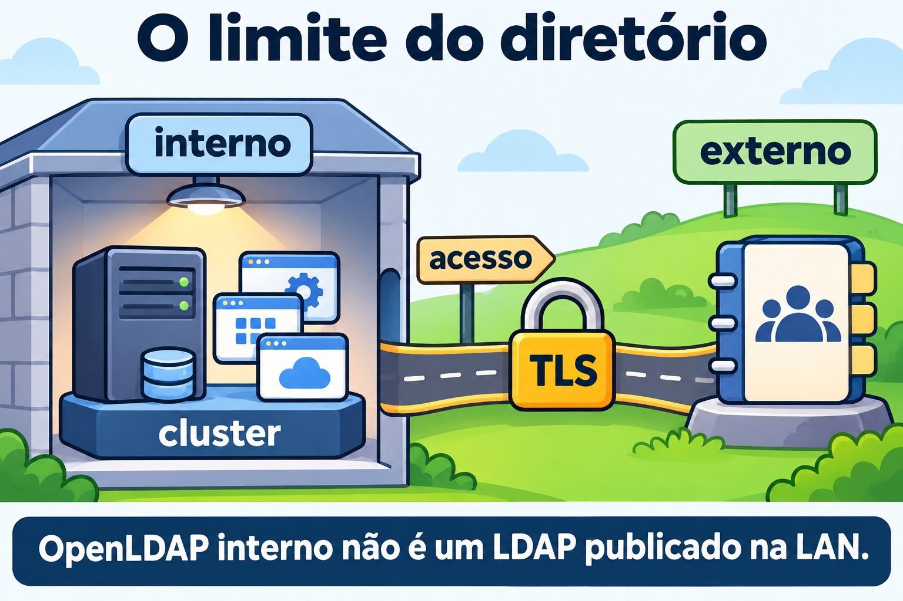

# Aula 20.5 · Domínios de usuário: identidade com fronteiras

> **O coração desta aula:** separar identidade, autenticação e permissão.

| Ficha | Plano de trabalho |
| --- | --- |
| Módulo | M20 · NethServer 8 por dentro, aula 5 de 7 |
| Quando | Semana 28 |
| Ao final | criar um domínio e provar autenticação sem supor autorização |
| Pré-requisitos | estado TLS da 20.4 e navegador da 202 |
| Duração | 60–90 minutos |
| Snapshot | base m20a4-tls na 240 e m20a4-cliente202 na 202 |

## Antes de começar

Use a 240 com cluster, DokuWiki e certificado da 20.4. Se você salvou `m20a4-tls` na 240 e `m20a4-cliente202` na 202, eles são a base desta aula. Se não, siga a preparação 20.1, 20.2 e 20.4; a 20.3 não é necessária.

O [guia M20](../GUIA_BANCADA_M20_PT.md) prepara o navegador da 202, os IPs reais de gestão e os nomes privados. Não é necessário um diretório anterior. O domínio `ldap20.test` ainda deve estar ausente.

O nó tem hostname curto `ns8-1` e FQDN `ns8-1.lab.test`. Comandos root são dentro da 240, após `sudo -i`. Nenhum laboratório foi executado durante esta revisão.

## 1 · Aquecimento

1. A conta do painel existe automaticamente no diretório?
2. Uma senha aceita permite abrir qualquer pasta?
3. LDAP interno significa LDAP acessível pela LAN?

## 2 · Por que importa

Uma falha de login pode estar no cadastro, no domínio consultado ou na política da aplicação. Trocar a senha sem localizar a fronteira pode esconder o problema.

### Ponte Windows

O cadastro identifica a pessoa; a permissão decide onde ela entra. A conta Unix `student`, a conta local student da Wiki e student em `ldap20.test` são identidades de escopos diferentes, mesmo com o mesmo nome.

## 3 · Modelo mental


*Entrar no domínio não autoriza todas as aplicações.*

O domínio guarda usuários e grupos. O provider oferece o diretório. A aplicação precisa suportar e configurar esse domínio; depois aplica suas regras de acesso.

## 4 · O essencial

| Escolha | Alcance |
| --- | --- |
| OpenLDAP interno | RFC2307 para consumidores dentro do cluster |
| Samba AD interno | Active Directory, com requisitos próprios |
| Diretório externo | serviço já existente, alcançável pelos nós |
| Conta local de aplicação | cadastro próprio da aplicação |

### Rocky × Debian

A 240 hospeda o provider. A 202 acessa o portal por HTTPS. Instalar um cliente LDAP na Debian não cria um domínio no NS8.

O OpenLDAP interno não oferece uma porta LDAP para clientes externos ao cluster. O lab usa o portal HTTPS do próprio provider; não é necessário publicar 389 nem fornecer DNS para contêineres.

### Decida 1 · O login chegou ao diretório?

O portal aceita `student`, mas uma aplicação não aceita esse nome.

A. Recriar o provedor. B. Publicar LDAP na Internet. C. Conferir domínio vinculado e suporte da aplicação.

## 5 · Lab guiado

### Passo 1 · Conferir o ponto de partida

**Palpite:** O domínio já existe ou será criado por este exercício?

```bash
hostname -s
runagent -l
getent ahostsv4 ns8-1.lab.test
```

No painel, abra `Domains and users`. Se `ldap20.test` já existe, identifique seu dono e use a base anterior do exercício; não apague um diretório existente para reutilizar o nome.

**Saída esperada:** Nó identificado e domínio novo disponível.

**Verifique:** O navegador da 202 consegue abrir o painel e confia no certificado da 20.4.

### Passo 2 · Criar o provider OpenLDAP

**Palpite:** Um domínio LDAP implica um controlador AD?


*O provedor responde; cada aplicação decide como usar a identidade.*

Em `Domains and users`, escolha `Create domain` → `Internal` → `OpenLDAP`. Instale no nó `ns8-1` e aguarde o fim da tarefa.

Configure `Domain` como `ldap20.test`. O formulário exige credenciais administrativas do diretório: use a conta técnica `admin` e uma senha exclusiva. Essa conta administrativa não é a conta comum student que será testada.

**Saída esperada:** Um domínio RFC2307, um provider e seu nó aparecem nos detalhes.

**Verifique:** Não mude o resolvedor do nó nem instale Samba AD para cumprir esta etapa.

### Passo 3 · Inspecionar o ID observado

**Palpite:** O nome do cartão é o ID interno do provider?

No terminal root da 240, liste os agentes. Copie o ID OpenLDAP real para a variável abaixo; o campo vazio é preenchido a partir do inventário, não por um sufixo adivinhado.

```bash
runagent -l
LDAP_ID=""
m20_ver_provider() {
  [ -n "$LDAP_ID" ] || return 1
  runagent -m "$LDAP_ID" podman ps
}
m20_ver_provider
```

**Saída esperada:** O contexto consultado corresponde ao domínio criado.

**Verifique:** Registre ID, domínio e nó juntos; não imprima o ambiente do agente.

### Passo 4 · Criar student e seu grupo

**Palpite:** Entrar no grupo já concede acesso a toda aplicação?

Nos detalhes de `ldap20.test`, abra `User and groups`. Crie `turma20` e o usuário `student`, com nome de exibição `student`, senha exclusiva e associação a `turma20`. Deixe desmarcada a função administrativa.

Não copie senhas da conta Unix, do painel ou da Wiki. O mesmo nome em sistemas diferentes não cria sincronização de credenciais.

**Saída esperada:** Conta comum e associação ao grupo aparecem no domínio certo.

**Verifique:** A conta de exercício não recebeu privilégios administrativos.

### Passo 5 · Provar autenticação no portal

**Palpite:** Que teste dispensa o vínculo de uma aplicação?

No navegador da 202, abra uma janela privada em `https://ns8-1.lab.test/users-admin/ldap20.test/`. O hosts e a CA pública do guia/20.4 devem permitir o nome e a confiança.

Entre com student e a senha do diretório. Saia, tente uma senha errada uma vez e confirme a recusa. Depois entre novamente com a correta. Não altere a senha pelo portal durante este teste.

**Saída esperada:** Sucesso e recusa se referem à mesma conta e domínio.

**Verifique:** O portal prova autenticação; não prova permissão na Wiki nem em pastas compartilhadas.

### Passo 6 · Desenhar os limites

**Palpite:** A Wiki mudou de diretório sem configuração?



*OpenLDAP interno não é um LDAP publicado na LAN.*

No diário, liste: conta do painel, conta Unix student, conta local student da Wiki e student em ldap20.test. Ao lado de cada aplicação, registre o mecanismo de autenticação realmente configurado. Uma lista de consumidores LDAP vazia é válida aqui.

Compare os outros ramos sem instalá-los: Samba AD exige domínio, DNS e clientes próprios; um diretório externo exige alcance e TLS a partir dos nós consumidores. Sem esses recursos, registre a análise como não executada.

**Saída esperada:** Mapa distingue identidade, provedor e aplicação.

**Verifique:** Samba File Server depende de AD; criar um grupo RFC2307 não atende esse requisito.

### Decida 2 · Um cliente externo quer LDAP

A. Escolher uma implementação e arquitetura que suportem esse cliente. B. Desligar o firewall do nó. C. Abrir 389 do provider interno.

## 6 · Quebre e conserte

### Quebra 1 · Domínio errado no endereço

**Sintoma:** Mude somente o domínio da URL para ldap20-errado.test.

**Investigação:** Compare a URL com o domínio listado no painel.

**Causa:** A solicitação foi para outro domínio.

**Conserto:** Restaure ldap20.test no caminho.

**Prevenção:** Anote o endereço completo do portal.

**Verifique:** Uma sessão nova aceita a conta correta.

### Quebra 2 · Conta desabilitada

**Sintoma:** Desabilite somente student no domínio e tente uma nova entrada.

**Investigação:** Confira estado da conta e horário do teste.

**Causa:** A política bloqueia a conta; a senha pode continuar correta.

**Conserto:** Reabilite a conta pelo painel e teste novamente.

**Prevenção:** Não apague dados para simular bloqueio.

**Verifique:** A conta habilitada autentica numa sessão nova.

### Quebra 3 · Associação removida

**Sintoma:** Retire student de turma20, mantendo a conta habilitada.

**Investigação:** Compare o login com a lista de grupos.

**Causa:** Autenticação e associação são estados diferentes.

**Conserto:** Reponha apenas a associação removida.

**Prevenção:** Descreva a permissão esperada antes de trocar senhas.

**Verifique:** Login e associação voltam a constar separadamente.

## 7 · Armadilhas

1. Criar o diretório não muda automaticamente a Wiki.
2. OpenLDAP interno não é um serviço LDAP da LAN.
3. Desabilitar uma conta não apaga seus dados de aplicação.
4. Réplicas no mesmo nó compartilham a perda desse nó.

## 8 · Quiz

1. Qual objeto guarda usuários e grupos?
2. Qual prova verifica a senha sem depender da Wiki?
3. Por que o provider interno não atende um cliente LDAP na LAN?
4. OpenLDAP atende ao requisito de Samba File Server?
5. Remover a conta apaga seus dados em todas as aplicações?

## 9 · Folha de bolso

```bash
hostname -s
runagent -l
runagent -m "$LDAP_ID" podman ps
date --iso-8601=seconds
```

**Flashcards:** cadastro, autenticação e autorização são perguntas diferentes.

## 10 · Checklist e fechamento

- [ ] Provider e nó observados.
- [ ] student criado sem função administrativa.
- [ ] Portal aceita senha correta e recusa a incorreta.
- [ ] Conta reabilitada e grupo restaurado.
- [ ] Credenciais fora das evidências.

**Reboot de conferência:** numa janela da 240, reinicie pelo painel ou console. Depois faça autenticação nova no portal e confira provider e grupo. A 20.6 usa a base TLS da 20.4 e não depende deste domínio.

**Último exercício:** explique por que remover um grupo pode mudar uma permissão sem alterar a senha.

## 11 · Na vida real

Registre usuário completo, domínio, aplicação e horário da recusa. Peça o resultado do teste, não a senha. Verifique os consumidores antes de alterar uma política compartilhada.

## 12 · Aprofundar quando quiser

[Domínios e portal NS8](https://docs.nethserver.org/docs/administrator-manual/installation/user_domains)

!explica Separe identidade, autenticação e autorização.
!feynman Explique o diretório como cadastro de uma biblioteca.
!quiz Crie um caso em que o portal funciona e a aplicação recusa.

## Gabarito comentado

Decida 1: C. O vínculo e o suporte da aplicação precisam ser conferidos.
Decida 2: A. A arquitetura precisa suportar o consumidor externo.
Quiz 1: O domínio.
Quiz 2: Login novo no portal do domínio.
Quiz 3: Esse provider foi projetado para consumidores do cluster.
Quiz 4: Não; Samba File Server exige AD.
Quiz 5: Não; os dados têm ciclo próprio em cada aplicação.

[← Aula 20.4](20.4-proxy-e-certificados.md) · [Índice](../01-aulas.md) · [Aula 20.6 →](20.6-backup-e-restauracao.md)
