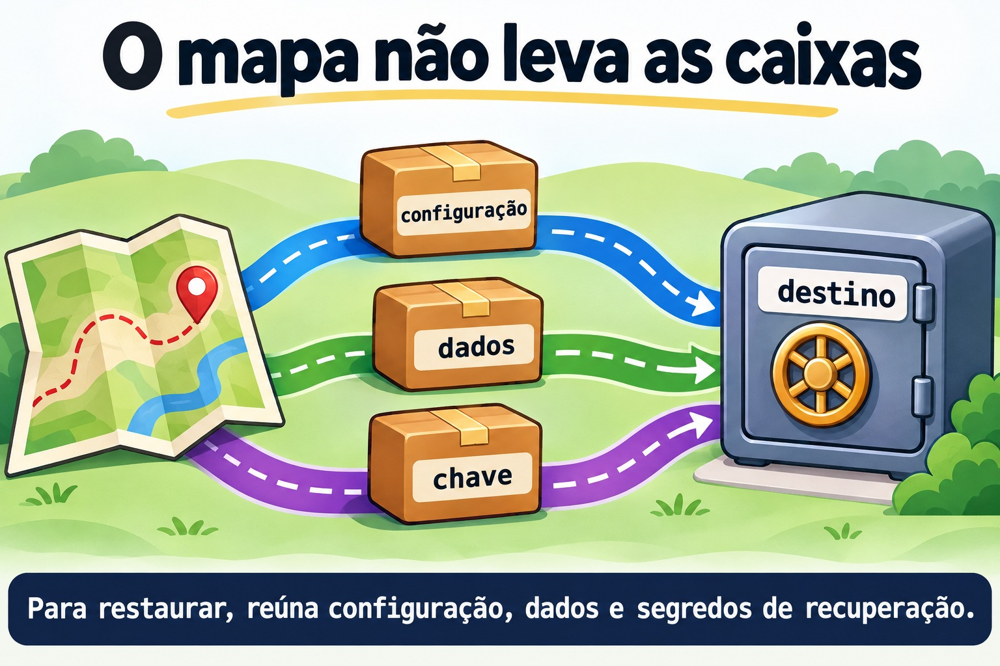

# Aula 20.6 · Backup e restauração: provar o conteúdo

> **O coração desta aula:** recuperar uma página conhecida e conferir identidade e local.

| Ficha | Plano de trabalho |
| --- | --- |
| Módulo | M20 · NethServer 8 por dentro, aula 6 de 7 |
| Quando | Semana 28 |
| Ao final | preparar um destino SMB e provar uma restauração |
| Pré-requisitos | Wiki e TLS da 20.4; student com sudo na 202 |
| Duração | 90–120 minutos |
| Snapshot | base m20a4-tls/m20a4-cliente202; saída m20a6-backup nas duas VMs |

## Antes de começar

A 240 precisa do cluster, da Wiki de teste e do certificado da 20.4. Na 202, o navegador e a CA ficam disponíveis na conta student. As bases são `m20a4-tls` na 240 e `m20a4-cliente202` na 202, se foram salvas. Caso contrário, prepare 20.1, 20.2 e 20.4; a 20.5 não é necessária.

Use o [guia M20](../GUIA_BANCADA_M20_PT.md) para os IPs reais de gestão. O destino será criado agora na 202, sem servidor anterior. Se há Samba personalizado nessa VM, pare e reconcilie a bancada; este exercício não substitui outra configuração.

Somente a Wiki fictícia participa da restauração. Comandos administrativos NS8 rodam dentro da 240 como root; os demais, na 202 como student. Nenhum laboratório foi executado durante esta revisão.

## 1 · Aquecimento

1. O arquivo do cluster contém todas as páginas?
2. Uma senha SMB abre também o conteúdo cifrado do backup?
3. O status de sucesso identifica o texto que voltou?

## 2 · Por que importa

Backup termina quando você consegue recuperar o conteúdo certo. O exercício grava um marcador, faz backup, muda a página e recupera o estado anterior.

### Ponte Windows

O mapa informa onde estão as caixas e como abri-las; não contém o conteúdo delas. O backup cifrado do cluster e os dados das aplicações têm papéis distintos.

## 3 · Modelo mental



*Para restaurar, reúna configuração, dados e segredos de recuperação.*

Uma agenda relaciona destino, retenção e instâncias. No destino, os dados são agrupados por tipo e UUID. O ID curto do painel pode mudar numa restauração; o UUID identifica o conjunto recuperado.

## 4 · O essencial

| Peça | O que guardar |
| --- | --- |
| Arquivo do cluster | cópia cifrada e senha em custódias separadas |
| Repositório | dados por instância e chave de cifragem original |
| Transporte SMB | servidor, share e credencial próprios |
| Prova | marcador, snapshot, UUID e nó |

### Rocky × Debian

A 240 executa o backup; a 202 guarda o destino SMB fora desse nó. Se ambas usam Ceph, esse destino não protege contra a perda do Ceph.

### Decida 1 · O status está verde

A. Apagar a instância imediatamente. B. Copiar somente o arquivo do cluster. C. Identificar snapshot, UUID e prova de conteúdo antes de substituir.

## 5 · Lab guiado

### Passo 1 · Criar uma prova recuperável

**Palpite:** Que texto diferencia o backup de uma Wiki vazia?

Na 240, após sudo -i, leia o inventário criado na 20.2. Confira ID, UUID e nó pelos valores reais, sem copiar nomes de exemplos.

```bash
m20_ver_wiki() {
  [ "$(hostname -s)" = ns8-1 ] && [ "$(id -u)" -eq 0 ] || return 1
  . /root/m20-lab/operador.env || return 1
  [ -n "$MODULE_ID" ] && [ -n "$MODULE_UUID" ] || return 1
  runagent -l
  redis-cli --raw HGET cluster/module_uuid "$MODULE_ID"
  runagent -m "$MODULE_ID" podman ps
}
m20_ver_wiki
```

Na 202, como student, gere o marcador uma vez. Se o arquivo já existe, preserve-o para continuar o mesmo ensaio.

```bash
m20_marcador() {
  [ "$(hostname -s)" = debian-lab ] && [ "$(id -un)" = student ] || return 1
  install -d -m 0700 "$HOME/m20-lab" || return 1
  if [ ! -e "$HOME/m20-lab/wiki-marker.txt" ]; then
    printf 'M20_BACKUP_%s\n' "$(cat /proc/sys/kernel/random/uuid)" > "$HOME/m20-lab/wiki-marker.txt" || return 1
  fi
  cat "$HOME/m20-lab/wiki-marker.txt"
}
m20_marcador
```

No navegador da 202, entre como student local da Wiki. Crie a página `m20_restore` com o marcador exibido. Na ACL, dê leitura anônima somente a essa página fictícia; mantenha o resto privado. Confira o marcador em janela privada.

**Saída esperada:** Página e diário identificam o mesmo marcador, UUID e nó.

**Verifique:** A existência da página precisa anteceder o backup escolhido.

### Passo 2 · Preparar Samba na 202

**Palpite:** O destino tem configuração anterior que precisa ser preservada?


*Um backup no mesmo nó compartilha a mesma perda.*

Preencha `CLIENT_IP` com o IP real da 202 e `NS8_IP` com o da 240. Execute na 202 como student. O bloco aceita apenas ausência de configuração Samba ou o arquivo padrão intacto do pacote; serviço ativo ou configuração alterada fazem parar antes de qualquer substituição.

```bash
CLIENT_IP=""
NS8_IP=""
m20_preparar_smb() {
  [ "$(hostname -s)" = debian-lab ] && [ "$(id -un)" = student ] || return 1
  [ -n "$CLIENT_IP" ] && [ -n "$NS8_IP" ] && [ "$CLIENT_IP" != "$NS8_IP" ] || return 1
  ip -o -4 addr show | awk '{split($4,a,"/"); print a[1]}' | grep -Fx "$CLIENT_IP" || return 1
  if systemctl is-active --quiet smbd; then
    printf '%s\n' 'Samba já está ativo; confira a configuração existente.'
    return 1
  fi
  if [ -e /etc/samba/smb.conf ]; then
    sudo cmp -s /etc/samba/smb.conf /usr/share/samba/smb.conf || { printf '%s\n' 'Configuração Samba personalizada; pare e reconcilie a bancada.'; return 1; }
  fi
  [ ! -e "$HOME/m20-samba" ] && [ ! -e "$HOME/m20-backup" ] || return 1
  sudo systemctl mask smbd.service nmbd.service || return 1
  sudo apt install -y samba smbclient || return 1
  umask 077
  install -d -m 0700 "$HOME/m20-samba" "$HOME/m20-backup" || return 1
  sudo cp -a /etc/samba/smb.conf "$HOME/m20-samba/smb.conf.original" || return 1
  cat > "$HOME/m20-samba/smb.conf.candidate" <<EOF
[global]
  workgroup = WORKGROUP
  server role = standalone server
  security = user
  map to guest = Never
  interfaces = lo $CLIENT_IP
  bind interfaces only = yes
  hosts allow = 127.0.0.1 $NS8_IP
  hosts deny = ALL
  disable netbios = yes
  smb ports = 445
  server min protocol = SMB2_02
[m20backup]
  path = /home/student/m20-backup
  valid users = student
  read only = no
  browseable = no
  guest ok = no
  create mask = 0600
  directory mask = 0700
EOF
  testparm -s "$HOME/m20-samba/smb.conf.candidate" || return 1
  sudo install -o root -g root -m 0644 "$HOME/m20-samba/smb.conf.candidate" /etc/samba/smb.conf || return 1
}
m20_preparar_smb
```

Uma máscara de serviço ainda não instalado pode gerar um aviso de unit ausente; confira a máscara antes de continuar. A comparação verifica apenas o modelo de configuração fornecido pelo pacote, não a integridade do backup.

Só depois de o bloco terminar sem erro, defina uma senha SMB exclusiva para student no pedido próprio do comando. A conta Unix já existe; não troque sua senha de login.

```bash
sudo smbpasswd -a student
```

Depois da confirmação da senha, inicie o serviço e prove escrita, leitura e remoção de um arquivo fictício. O comando smbclient também pede a senha sem gravá-la no histórico.

```bash
sudo systemctl unmask smbd.service
sudo systemctl enable --now smbd.service
printf 'M20_SMB\n' > "$HOME/m20-samba/prova.txt"
smbclient //127.0.0.1/m20backup -U student -c "put $HOME/m20-samba/prova.txt prova.txt; get prova.txt $HOME/m20-samba/retorno.txt; del prova.txt"
cmp "$HOME/m20-samba/prova.txt" "$HOME/m20-samba/retorno.txt"
sudo ss -ltnp '( sport = :445 )'
```

**Saída esperada:** Share privado gravável por student, escuta somente nos endereços configurados.

**Verifique:** A 240 deve alcançar TCP 445 da 202. Se uma política existente bloquear, autorize apenas essa origem no lab; não apague o firewall.

### Passo 3 · Cadastrar o destino e executar o backup

**Palpite:** O snapshot pertence à Wiki que será substituída?

No painel NS8, abra `Backup and restore`. Defina a senha do arquivo cifrado do cluster e guarde-a fora das VMs. Em `Add destination`, escolha `Windows file share`: servidor = IP real da 202, share = `m20backup`, usuário = `student`. Digite a senha SMB somente no formulário.

Para um destino vazio, deixe a chave de cifragem de dados ser gerada. Registre sua custódia pelo mecanismo do painel; ao reutilizar um destino, a chave original é obrigatória.

Crie a agenda `m20-wiki-test` incluindo somente a DokuWiki fictícia. Execute `Run backup now`, espere a tarefa terminar e anote destino, horário, UUID e snapshot disponível na aba Restore.

**Saída esperada:** Snapshot da instância certa aparece para restauração.

**Verifique:** Validação do destino e conclusão do backup são duas provas. Sem snapshot identificável, não substitua a aplicação.

### Passo 4 · Guardar o mapa e mudar a página

**Palpite:** O backup do cluster substitui os dados da aplicação?

Baixe o backup cifrado do cluster pelo navegador da 202 e mantenha uma cópia fora da 240. Guarde senha desse arquivo, senha SMB e chave de dados em custódias separadas. Não inclua esses valores no diário de evidências.

Depois do backup confirmado, troque somente o conteúdo de `m20_restore` por `M20_DEPOIS_DO_BACKUP`. Confira numa requisição nova que o texto novo aparece e o marcador antigo desapareceu.

**Saída esperada:** Você distingue os dois estados antes de restaurar.

**Verifique:** Anote a hora da mudança para não escolher um snapshot posterior por engano.

### Passo 5 · Restaurar a Wiki de teste

**Palpite:** A substituição remove dados atuais?

Na aba `Restore`, selecione o tipo e o UUID registrados e o snapshot anterior à mudança. Escolha o nó 240. Marque `Replace existing app` apenas depois de confirmar que a instância existente é a Wiki fictícia deste exercício.

Aguarde a tarefa completa. O ensaio substitui dados atuais por um estado anterior; não instale outra Wiki manualmente para esconder uma falha. Confira a rota e o certificado do nó após a operação.

**Saída esperada:** Uma única instância volta ao snapshot escolhido.

**Verifique:** TLS pertence ao proxy do nó. Restaurar a Wiki não distribui certificados a outro nó nem substitui a CA da 202.

### Passo 6 · Provar conteúdo e identidade

**Palpite:** Que evidência fecha o restore?


*Tarefa concluída não substitui conteúdo recuperado e identidade conferida.*

Na 240, liste novamente os agentes. Preencha `NEW_MODULE` com o ID real da Wiki restaurada. A função compara o UUID e altera somente o ID curto no inventário, preservando os outros campos.

```bash
runagent -l
NEW_MODULE=""
m20_registrar_restore() {
  [ "$(hostname -s)" = ns8-1 ] && [ "$(id -u)" -eq 0 ] || return 1
  [[ "$NEW_MODULE" =~ ^dokuwiki[0-9]+$ ]] || return 1
  . /root/m20-lab/operador.env || return 1
  OBS_UUID=$(redis-cli --raw HGET cluster/module_uuid "$NEW_MODULE") || return 1
  [ -n "$MODULE_UUID" ] && [ "$OBS_UUID" = "$MODULE_UUID" ] || return 1
  runagent -m "$NEW_MODULE" podman ps || return 1
  M20_NEXT=$(mktemp /root/m20-lab/operador.env.XXXXXX) || return 1
  sed "s/^MODULE_ID=.*/MODULE_ID=$NEW_MODULE/" /root/m20-lab/operador.env > "$M20_NEXT" || return 1
  [ "$(grep -c '^MODULE_ID=' "$M20_NEXT")" -eq 1 ] || return 1
  chmod 0600 "$M20_NEXT" || return 1
  mv -f "$M20_NEXT" /root/m20-lab/operador.env
}
m20_registrar_restore
```

Na 202, preencha `NS8_IP` caso tenha aberto outro terminal. Faça o pedido novo pelo nome, com TLS válido; o arquivo só é analisado se curl terminar com sucesso.

```bash
m20_provar_restore() {
  [ -n "$NS8_IP" ] || return 1
  M20_MARKER=$(cat "$HOME/m20-lab/wiki-marker.txt") || return 1
  [ -n "$M20_MARKER" ] || return 1
  curl --retry 10 --retry-delay 1 --retry-all-errors --max-time 10 --fail --silent --show-error --cacert "$HOME/m20-pki/ca.crt" --resolve "wiki.lab.test:443:$NS8_IP" 'https://wiki.lab.test/doku.php?id=m20_restore' --output "$HOME/m20-lab/wiki-restored.html" || return 1
  grep -F -- "$M20_MARKER" "$HOME/m20-lab/wiki-restored.html" || return 1
  if grep -F 'M20_DEPOIS_DO_BACKUP' "$HOME/m20-lab/wiki-restored.html"; then
    printf '%s\n' 'Ainda é o estado posterior ao backup.'
    return 1
  fi
  printf '%s\n' 'Marcador restaurado; confira UUID e nó no diário.'
}
m20_provar_restore
```

**Saída esperada:** Marcador antigo presente, mudança posterior ausente, UUID e nó conferidos.

**Verifique:** Registre somente resultados realmente observados; status de tarefa não substitui conteúdo.

### Decida 2 · O Ceph ficou indisponível

A. Exigir dados e mapa recuperáveis fora desse storage. B. Usar apenas o snapshot da VM. C. Declarar que o share da VM 202 é independente.

## 6 · Quebre e conserte

### Quebra 1 · Credencial do destino errada

**Sintoma:** Num formulário ainda não salvo, digite uma senha SMB errada uma vez.

**Investigação:** Confira IP, share, conta e resultado da validação.

**Causa:** A autenticação do transporte falhou.

**Conserto:** Corrija a senha no formulário; mantenha a chave de dados existente.

**Prevenção:** Separe credencial SMB e chave de cifragem.

**Verifique:** A validação correta permite um backup novo identificável.

### Quebra 2 · Ponto no tempo errado

**Sintoma:** Selecione outro snapshot na tela, sem confirmar restauração.

**Investigação:** Compare o horário com a criação do marcador e a mudança posterior.

**Causa:** A seleção não corresponde ao conteúdo esperado.

**Conserto:** Volte ao snapshot comprovado antes de confirmar.

**Prevenção:** Anote marcador e snapshot juntos.

**Verifique:** A seleção final representa o estado anterior à mudança.

### Quebra 3 · Pedido para o destino errado

**Sintoma:** Numa cópia do teste da 202, use 127.0.0.1 em --resolve.

**Investigação:** Confira destino forçado, nome e certificado.

**Causa:** O pedido não chegou à Wiki restaurada.

**Conserto:** Reponha somente o IP real da 240 no teste.

**Prevenção:** Associe o resultado ao ponto de observação.

**Verifique:** Nome, TLS e marcador passam no mesmo pedido.

## 7 · Armadilhas

1. Não use prune/forget para corrigir uma listagem incompreendida.
2. Não gere outra chave sobre um destino que contém dados.
3. Não copie senhas para o diário.
4. Não execute duas cópias independentes do mesmo UUID em clusters diferentes.
5. Não restaure snapshots antigos da VM como limpeza da aplicação.

## 8 · Quiz

1. O arquivo do cluster substitui as páginas da Wiki?
2. Por que o marcador antecede o backup?
3. Qual identificador separa instâncias do mesmo tipo?
4. O que falta se as duas VMs usam o mesmo storage?
5. Qual prova fecha o restore?

## 9 · Folha de bolso

```bash
runagent -l
runagent -m "$MODULE_ID" restic-wrapper --show
date --iso-8601=seconds
```

O wrapper é consultado no nó, com o ID atual da instância. Não instale outro Restic para reproduzir o motor do NS8.

**Flashcards:** mapa, dados e segredos têm funções distintas.

## 10 · Checklist e fechamento

- [ ] SMB preparado e candidato validado.
- [ ] Backup e snapshot identificados.
- [ ] Mapa do cluster fora da 240.
- [ ] Marcador antigo recuperado; mudança posterior ausente.
- [ ] UUID e nó correspondem ao ensaio.

**Reboot de conferência:** numa janela da 240, reinicie pelo painel ou console. Depois repita a prova na 202. Confira também que o share continua disponível após reiniciar a 202.

Salve `m20a6-backup` nas VMs 240 e 202 pelo guia, após parar tarefas e conferir o estado. Essa é a base opcional da 20.7. Os snapshots não substituem o backup de aplicação.

**Último exercício:** descreva como recuperar apenas a Wiki e como trataria a perda de toda a VM. Para um NS8 novo, o ramo Restore cluster exige arquivo cifrado, senhas, chave de dados e destino acessível; não apague a 240 para simular esse ramo.

## 11 · Na vida real

Combine retenção e tempo de retorno com o responsável pelo serviço. Guarde uma cópia consistente dos dados e do mapa fora do storage compartilhado, com segredos recuperáveis por canal separado.

## 12 · Aprofundar quando quiser

[Backup e restauração NS8](https://docs.nethserver.org/docs/administrator-manual/configuration/backup) · [Samba smb.conf](https://www.samba.org/samba/docs/current/man-html/smb.conf.5.html)

!explica Por que mapa e dados não são o mesmo backup?
!feynman Explique a restauração como reconhecer uma caixa pelo conteúdo.
!quiz Crie um status verde com o snapshot errado.

## Gabarito comentado

Decida 1: C. Identifique o que será recuperado antes de substituir.
Decida 2: A. Dados e mapa precisam sobreviver ao storage perdido.
Quiz 1: Não; os dados ficam nos repositórios.
Quiz 2: Para vincular o texto ao snapshot escolhido.
Quiz 3: O UUID.
Quiz 4: Uma cópia recuperável fora do storage compartilhado.
Quiz 5: Pedido novo com TLS válido, marcador recuperado e UUID/nó corretos.

[← Aula 20.5](20.5-dominios-de-usuario.md) · [Índice](../01-aulas.md) · [Aula 20.7 →](20.7-atualizar-mover-e-falhar.md)
