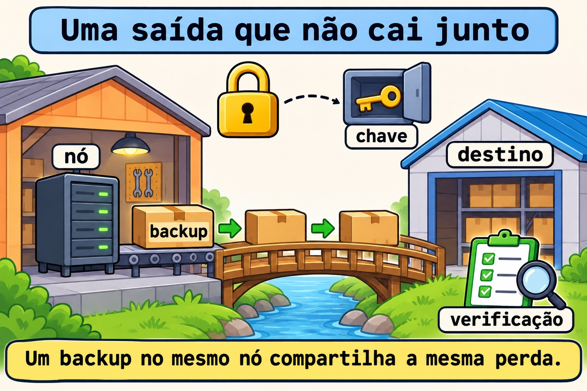
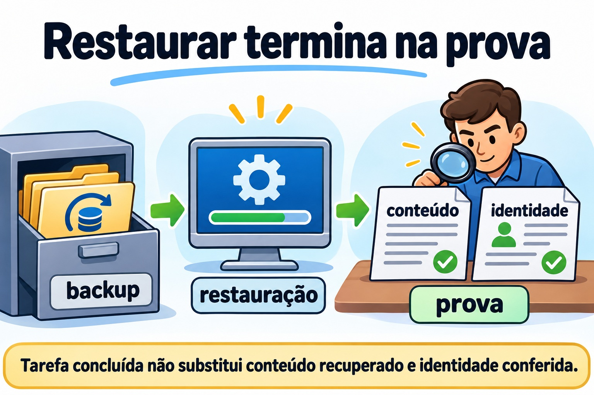

# Aula 20.6 · Backup e restauração: provar o retorno

> **O coração desta aula:** restaurar a Wiki de teste com conteúdo, identidade e destino conferidos.

| Ficha | Plano de trabalho |
| --- | --- |
| Módulo | M20 · NethServer 8 por dentro, aula 6 de 7 |
| Quando | Semana 28 |
| Ao final | restaurar a Wiki de teste com conteúdo, identidade e destino conferidos. |
| Pré-requisitos | Aulas anteriores do M20; M18 e M19 corrigidos; console e inventário do lab |
| Duração | 100–140 minutos, além de downloads e janelas |
| Snapshot | m20a6-inicio e m20a6-fim, somente nas VMs desta aula |

A bancada principal é a VM `240`, hostname `ns8-1.lab.test`, Rocky Linux 9 com NS8. A VM `241`, `ns8-2.lab.test`, só entra na 20.7.

A gestão em `net0` usa endereço real reservado e acesso à Internet. A `net1` fica na bridge isolada `vmbr17`, sem gateway; a rede de laboratório não fornece Internet.

Use o [guia de bancada M20](../GUIA_BANCADA_M20_PT.md). Todos os comandos do NS8 indicados como root são dentro do nó, após `sudo -i`, e nunca no host Proxmox.

Nenhum laboratório deste material foi executado durante a elaboração. As saídas descritas são critérios para você observar e registrar, não resultados medidos.

## 1 · Aquecimento

1. Um backup do cluster contém todos os arquivos das aplicações?

2. Saber o endereço do repositório basta sem sua chave de dados?

3. Um status verde prova que o texto correto voltou?

Liste o que precisaria sobreviver à perda da VM: dados, configuração, segredos de recuperação e um lugar onde ler tudo novamente.

## 2 · Por que importa

A prova de backup não é a criação de um arquivo. É a capacidade de reconstruir o serviço e reconhecer o conteúdo certo no instante escolhido.

O exercício usa somente a DokuWiki fictícia da 20.2. A substituição de uma instância pode remover seus dados atuais; não inclua uma aplicação real no ensaio.

### Ponte Windows

Uma lista de impressoras não contém os documentos impressos. Do mesmo modo, o mapa do cluster não substitui os repositórios de conteúdo de cada instância.

## 3 · Modelo mental


*Para restaurar, reúna configuração, dados e segredos de recuperação.*

O backup do cluster preserva configurações de recuperação, incluindo destinos e chaves de dados. Os dados das aplicações ficam em repositórios separados por tipo e UUID.

Uma tarefa relaciona destino, agenda e instâncias. O UUID identifica a instância; não escolha uma pasta apenas porque seu nome parece com o ID curto mostrado no painel.

A senha que cifra o arquivo do cluster e a chave que abre os dados do destino têm papéis diferentes. A recuperação exige custódia de ambos, fora do nó perdido.

## 4 · O essencial

| Objeto | Prova necessária |
| --- | --- |
| Backup do cluster | Arquivo cifrado guardado fora do nó e senha custodiada |
| Dados da Wiki | Snapshot da instância e UUID identificados |
| Destino SMB | Escrita validada, espaço e ACL coerentes |
| Restauração | Conteúdo correto, nome, certificado e nó conferidos |

### Rocky × Debian

A VM NS8 é Rocky; a VM Debian `204` oferece o destino SMB independente do nó. A VM Debian `202` confere a resposta HTTPS como cliente.

As três VMs podem usar o mesmo storage Ceph. O destino fora do nó protege este ensaio de perda de instância ou VM, mas não prova recuperação de perda do Ceph.

Para esse segundo risco, é pré-requisito uma cópia completa cifrada do repositório, do arquivo do cluster e dos segredos em armazenamento fora do Ceph. Sem isso, registre a limitação.

### Decida 1 · O status está verde

A. Apagar a instância imediatamente. B. Copiar somente o arquivo do cluster. C. Identificar snapshot, UUID e prova de conteúdo antes de substituir.

## 5 · Lab guiado

### Passo 1 · Criar um marcador recuperável

**Palpite:** Qual conteúdo distinguirá o backup de uma página recém-criada?

```bash
test "$(id -u)" -eq 0 || exit 1
test "$(hostname -f)" = ns8-1.lab.test || exit 1
test -f /root/m20-lab/operador.env && test ! -L /root/m20-lab/operador.env || exit 1
test "$(stat -c '%U:%G:%a' /root/m20-lab/operador.env)" = root:root:600 || exit 1
. /root/m20-lab/operador.env
test -n "$MODULE_ID" && test -n "$MODULE_UUID" || exit 1
runagent -l
```

```bash
install -d -m 0700 /root/m20-lab/evidence-20-6
date --iso-8601=seconds > /root/m20-lab/evidence-20-6/start.txt
runagent -m "$MODULE_ID" podman ps
printf 'M20_BACKUP_%s\n' "$(cat /proc/sys/kernel/random/uuid)"
```

Copie o marcador gerado para o diário externo. Na Wiki, como administrador da aplicação, crie apenas a página `m20_restore` e coloque nela essa única linha.

Na ACL da Wiki, permita leitura anônima somente dessa página fictícia para o teste HTTP. Não abra o restante da Wiki. Confira a página em janela privada.

Na VM `202`, como `student`, guarde o marcador e a primeira resposta. A CA pública já foi conferida na 20.4.

```bash
test "$(hostname -s)" = debian-lab || exit 1
install -d -m 0700 "$HOME/m20-lab"
read -r -p 'Marcador exato gerado no no: ' M20_MARKER
[[ "$M20_MARKER" =~ ^M20_BACKUP_[0-9a-f-]+$ ]] || exit 1
printf '%s\n' "$M20_MARKER" > "$HOME/m20-lab/wiki-marker.txt"
curl --retry 10 --retry-delay 1 --retry-all-errors --max-time 10 --fail --silent --show-error --cacert /etc/ssl/m19/ca.crt 'https://wiki.lab.test/doku.php?id=m20_restore' --output "$HOME/m20-lab/wiki-before.html" || exit 1
grep -F -- "$M20_MARKER" "$HOME/m20-lab/wiki-before.html" || exit 1
```

**Saída esperada:** A página fictícia contém o marcador observado e responde com TLS válido.

**Verifique:** O diário externo identifica marcador, horário, ID, UUID e nó. Não use apenas uma imagem da página.

### Passo 2 · Conferir o destino fora do nó

**Palpite:** O destino sobreviverá à remoção desta aplicação?



*Um backup no mesmo nó compartilha a mesma perda.*

Conclua a seção de backup SMB do guia de bancada. Ela prepara na VM `204` o share `m20backup`, diretório `/srv/samba/m20-backup` e conta exclusiva `backup20`.

No painel NS8, abra `Backup and restore`, defina a senha de cifragem do backup do cluster e guarde-a fora das VMs. Adicione um destino do tipo compartilhamento Windows, por SMB.

Informe o servidor `192.0.2.204`, o share `m20backup` e a conta `backup20`; digite sua senha no formulário. Use um caminho dedicado ao cluster quando o formulário oferecer esse campo.

Para destino novo deixe a chave de dados ser gerada. Guarde sua chave de recuperação pelo mecanismo do painel; não a coloque no diário público. Reutilizar um destino existente exige sua chave original.

**Saída esperada:** Validação do destino aceita e credenciais de recuperação custodiadas.

**Verifique:** Não reutilize o share `curso` do M19 nem a senha de outro serviço. O limite Ceph continua explícito.

### Passo 3 · Executar um backup identificado

**Palpite:** A agenda selecionou exatamente a instância fictícia?

Crie uma agenda chamada `m20-wiki-test`, incluindo somente a DokuWiki de teste. Selecione o destino preparado e retenção suficiente para manter o snapshot que será usado no ensaio.

Use `Run backup now`. Aguarde o fim e abra os detalhes por aplicação: anote horário, resultado, instância e destino. Uma tarefa de outro módulo não fecha esta prova.

```bash
test "$(hostname -f)" = ns8-1.lab.test || exit 1
test "$(id -u)" -eq 0 || exit 1
runagent -m "$MODULE_ID" restic-wrapper --show
runagent restic-wrapper --help
date --iso-8601=seconds
```

O comando de inventário não substitui o status da tarefa. Use o ID e o snapshot que o painel realmente mostra; não copie UUIDs de exemplos.

**Saída esperada:** O snapshot da Wiki está identificável no destino e na aba de restauração.

**Verifique:** Se o painel não oferece esse snapshot, não prossiga para nenhuma substituição.

### Passo 4 · Guardar o mapa de recuperação

**Palpite:** Os segredos ainda estariam disponíveis sem acesso ao nó?

Baixe o backup cifrado do cluster pelo painel para o computador do operador. Guarde sua senha separadamente. O arquivo não deve depender da home da VM `240`.

Confira tamanho e hash do arquivo no computador que o recebeu. Isso prova a transferência, não a completude dos dados das aplicações.

No registro de recuperação, separe senha do arquivo do cluster, credencial SMB e chave de dados. O registro público aponta para o local de custódia, sem revelar os valores.

Para comprovar recuperação fora do Ceph, pause as agendas e espere todas as tarefas terminarem antes da cópia externa completa do repositório. Não copie um conjunto em mutação e o declare consistente.

**Saída esperada:** Mapa cifrado fora do nó e segredos recuperáveis por canal separado.

**Verifique:** Se não houver cópia dos dados fora do Ceph, declare apenas o alcance do teste de restauração de instância.

### Passo 5 · Restaurar um estado reconhecível

**Palpite:** O conteúdo retornará ao instante escolhido?

Depois do backup confirmado, mude somente a página fictícia para o texto `M20_DEPOIS_DO_BACKUP`. Confira que esse texto aparece e que o marcador anterior deixou de aparecer.

Abra `Restore`, escolha a aplicação pelo tipo e UUID registrados e o snapshot anterior à mudança. Selecione o nó `240` e marque `Replace existing app` somente após comparar a instância existente.

A substituição remove a instância anterior ao fim do procedimento. Aguarde a tarefa inteira; não instale uma segunda Wiki manualmente para contornar um erro de restauração.

Confira nome e certificado da rota após a operação. Certificados públicos ACME não fazem parte do backup de aplicação; nesta bancada o certificado personalizado do nó já está instalado.

**Saída esperada:** Uma única Wiki operacional volta ao estado do snapshot escolhido.

**Verifique:** Não aceite duas cópias independentes da mesma identidade em clusters diferentes.

### Passo 6 · Provar conteúdo, identidade e nó

**Palpite:** Qual evidência fechará a restauração?



*Tarefa concluída não substitui conteúdo recuperado e identidade conferida.*

No nó `240`, redescubra o ID instalado e confira o UUID. O ID curto pode ser diferente; o valor observado deve corresponder à identidade restaurada.

```bash
runagent -l
read -r -p 'ID real da Wiki restaurada: ' NEW_MODULE
[[ "$NEW_MODULE" =~ ^dokuwiki[0-9]+$ ]] || exit 1
OBS_UUID=$(redis-cli --raw HGET cluster/module_uuid "$NEW_MODULE") || exit 1
test -n "$OBS_UUID" && test "$OBS_UUID" = "$MODULE_UUID" || exit 1
runagent -m "$NEW_MODULE" podman ps
runagent -m "$NEW_MODULE" podman volume ls
MODULE_ID=$NEW_MODULE
M20_NEXT=$(mktemp /root/m20-lab/operador.env.XXXXXX) || exit 1
sed "s/^MODULE_ID=.*/MODULE_ID=$NEW_MODULE/" /root/m20-lab/operador.env > "$M20_NEXT" || exit 1
test "$(grep -c '^MODULE_ID=' "$M20_NEXT")" -eq 1 || exit 1
grep -qx "MODULE_ID=$NEW_MODULE" "$M20_NEXT" || exit 1
chmod 0600 "$M20_NEXT"
mv -f "$M20_NEXT" /root/m20-lab/operador.env
```

O candidato muda apenas o ID curto, preservando todos os outros campos, inclusive `VPN_CIDR`. O UUID já foi comparado e o nó deste restore continua na 240.

Na VM `202`, faça uma nova requisição sem reutilizar HTML anterior.

```bash
M20_MARKER=$(cat "$HOME/m20-lab/wiki-marker.txt") || exit 1
curl --retry 10 --retry-delay 1 --retry-all-errors --max-time 10 --fail --silent --show-error --cacert /etc/ssl/m19/ca.crt 'https://wiki.lab.test/doku.php?id=m20_restore' --output "$HOME/m20-lab/wiki-restored.html" || exit 1
grep -F -- "$M20_MARKER" "$HOME/m20-lab/wiki-restored.html" || exit 1
if grep -F 'M20_DEPOIS_DO_BACKUP' "$HOME/m20-lab/wiki-restored.html"; then exit 1; fi
```

**Saída esperada:** Marcador original presente, mudança posterior ausente, UUID e nó registrados.

**Verifique:** Copie as evidências sem segredos para o diário externo e mantenha o snapshot de backup identificado para a 20.7.

### Decida 2 · O Ceph ficou indisponível

A. Exigir dados e mapa recuperáveis fora desse storage. B. Usar apenas o snapshot da VM. C. Declarar que o share da VM 204 é independente.

## 6 · Quebre e conserte

### Quebra 1 · Destino não gravável

**Sintoma:** No formulário de um destino ainda não salvo, informe uma senha SMB errada uma vez.

**Investigação:** Confira servidor, share, conta e resultado da validação sem exibir a senha.

**Causa:** A credencial do destino falhou; isso não demonstra corrupção do Restic.

**Conserto:** Corrija no formulário a credencial da conta exclusiva. Não recrie o destino com nova chave sobre dados existentes.

**Prevenção:** Separe credencial de transporte e chave de cifragem no inventário.

**Verifique:** Validação aceita e backup novo concluído pertencem ao mesmo destino.

### Quebra 2 · Snapshot errado

**Sintoma:** Na seleção de restore, escolha provisoriamente um snapshot anterior à criação do marcador, sem confirmar.

**Investigação:** Compare horário do conteúdo, horário do backup e UUID da aplicação.

**Causa:** Você selecionou outro ponto no tempo; o sistema pode restaurá-lo corretamente e ainda faltar o texto esperado.

**Conserto:** Selecione o snapshot comprovado e só então prossiga no ensaio.

**Prevenção:** Registre o instante do marcador junto do snapshot usado.

**Verifique:** A seleção final corresponde à prova de conteúdo anotada antes da mudança.

### Quebra 3 · Nome aponta para outro lugar

**Sintoma:** Na VM 202, faça um pedido com nome de teste errado, mantendo o servidor e os dados intactos.

**Investigação:** Compare resolução, rota HTTP e certificado antes de culpar o restore.

**Causa:** O cliente não chegou à identidade restaurada pelo nome previsto.

**Conserto:** Volte ao nome `wiki.lab.test`; corrija apenas o mapeamento do lab se estiver divergente.

**Prevenção:** Use nome, TLS e marcador juntos como critério de conclusão.

**Verifique:** O pedido correto apresenta certificado válido e o marcador antigo.

### O que não copiar do exemplo

Não instale um Restic separado no sistema para imitar o motor do NS8. O wrapper prepara contexto, credenciais e volumes para a infraestrutura existente.

Evite listar a configuração completa de Rclone: ela pode conter credenciais mesmo quando o objetivo era apenas conferir um destino. Use o inventário e o painel sem exportar campos privados.

As pastas cifradas não devem ser reorganizadas manualmente. Tipo e UUID fazem parte da forma como o sistema encontra o backup da instância.

Uma agenda que se sobrepõe a outra pode atrasar o trabalho. Confira tarefas em andamento antes de uma cópia externa ou manutenção do destino.

A recuperação de Traefik tem escopo próprio: rotas personalizadas e certificados enviados são diferentes de certificados ACME emitidos pela autoridade pública.

Loki restaurado pode servir apenas para buscar logs antigos, sem substituir a instância ativa. Não aplique o comportamento observado na Wiki a todos os componentes.

Em Samba, o estado do domínio AD existente participa da decisão de restauração. Leia a nota específica antes de restaurar identidade e arquivos juntos.

O diário de recuperação deve conter a hora de início, a hora da primeira resposta correta e as provas que ainda faltam. Não invente uma duração com base em exemplos.

## 7 · Armadilhas

1. Nunca execute prune ou forget no repositório para resolver uma listagem que você ainda não entendeu.

2. Trocar a chave de um destino existente pode tornar os backups anteriores inacessíveis.

3. O arquivo cifrado do cluster inclui segredos e merece custódia restrita.

4. Um destino aceito por um nó não comprova acesso direto de todos os outros.

5. O backup do app não restaura automaticamente um certificado ACME.

6. Um snapshot de VM no mesmo storage não substitui o plano fora do storage.

## 8 · Quiz

1. O arquivo do cluster substitui os dados da Wiki?

2. Por que o marcador precisa existir antes do backup?

3. Qual identificador separa instâncias do mesmo tipo no destino?

4. O que falta quando o share está fora da VM, mas dentro do mesmo Ceph?

5. Qual prova fecha o ensaio após status de sucesso?

## 9 · Folha de bolso

```bash
runagent -l
runagent -m "$MODULE_ID" restic-wrapper --show
runagent restic-wrapper --help
runagent -m "$MODULE_ID" podman volume ls
date --iso-8601=seconds
```

**Flashcards:** Mapa do cluster → configuração e acesso à recuperação.

**Flashcards:** Repositório por UUID → dados da instância.

**Flashcards:** Restore fechado → conteúdo, identidade e local conferidos.

## 10 · Checklist e fechamento

- [ ] Marcador anterior e alteração posterior distinguíveis.

- [ ] Destino SMB exclusivo com chave custodiada.

- [ ] Backup do cluster baixado fora do nó.

- [ ] Snapshot, UUID e destino anotados.

- [ ] Uma instância restaurada, sem cópia independente duplicada.

- [ ] Limite de perda do Ceph descrito no relatório.

**Reboot de conferência:** na janela da VM 240, reinicie pelo convidado; depois confira o ID atualizado, a Wiki e o mesmo marcador a partir da VM 202.

```bash
systemctl reboot
```

Não restaure o snapshot antigo da VM como limpeza: isso poderia desfazer outros serviços ou a identidade que você acabou de provar.

**Último exercício:** descreva o que faria se perdesse a VM e, separadamente, se perdesse o Ceph. A segunda resposta precisa citar uma cópia realmente fora dele.

### Recuperação de cluster: ramo condicionado

O desastre de cluster único exige um NS8 novo, espaço livre suficiente, arquivo cifrado do cluster e seus segredos. Não apague a VM 240 para simular esse ramo durante o módulo.

Na instalação nova, troque a senha inicial, escolha `Restore cluster`, envie o arquivo de backup e informe sua senha no formulário. Selecione as aplicações e valide dados e rotas depois da conclusão.

Esse ramo só pode ser marcado como executado em bancada de recuperação autorizada com recursos próprios. Leia a documentação da versão e das aplicações antes de um desastre real.

## 11 · Na vida real

Planeje tempo máximo de perda de dados e tempo de retorno com o dono do serviço. Uma política de retenção sem teste de recuperação não informa quanto tempo o serviço levará para voltar.

Numa revisão autorizada, faça inventário por leitura dos destinos, agendas, último resultado e custódia. Não revele chaves ao preparar o relatório.

## 12 · Aprofundar quando quiser

- [Destinos e restauração no painel](https://docs.nethserver.org/docs/administrator-manual/configuration/backup)

- [Arquitetura de backup e restic-wrapper](https://nethserver.github.io/ns8-core/core/backup_restore/)

- [Contrato de backup de módulos](https://nethserver.github.io/ns8-core/modules/backup_restore/)

!explica Por que mapa, dados e segredos têm papéis diferentes numa restauração?

!feynman Explique o limite de um backup fora da VM, mas dentro do mesmo storage.

!quiz Crie um restore com status verde e conteúdo do snapshot errado.

## Gabarito comentado

Decida 1: C. O status precisa ser ligado à instância e ao ponto no tempo antes de substituir dados atuais.

Decida 2: A. A perda do storage exige dados recuperáveis fora dele; mover o backup para outra VM do mesmo Ceph não basta.

Quiz 1: Não. Ele fornece a configuração de recuperação; os repositórios guardam os dados.

Quiz 2: Para ligar o conteúdo ao snapshot escolhido e distinguir uma reconstrução vazia.

Quiz 3: O UUID da instância, agrupado sob o tipo da aplicação.

Quiz 4: Uma cópia consistente e recuperável fora do Ceph, com mapa e segredos.

Quiz 5: Uma requisição nova com TLS válido mostra o marcador do snapshot; ID/UUID e nó correspondem ao inventário.

[← Aula 20.5 · Domínios de usuário](20.5-dominios-de-usuario.md) · [Índice das aulas](../01-aulas.md) · [Aula 20.7 · Atualizar, mover e falhar →](20.7-atualizar-mover-e-falhar.md)
