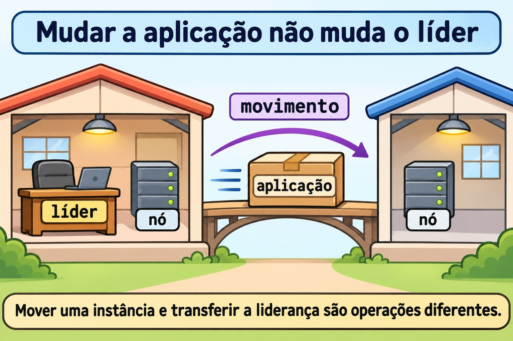

# Aula 20.7 · Atualizar, mover e falhar com prova

## Antes de começar

Você precisa do estado final da 20.6: cluster de um nó na `240`, Wiki com TLS do M20, CA na `202`, backup concluído e página `m20_restore` com marcador conferido. Prepare uma vez os snapshots `m20a6-backup` na 240 e na 202; se já existem, confira a data e o inventário antes de restaurar. Nenhum serviço do M19 é necessário.

A `241` ainda não deve existir como nó NS8. Ela será uma instalação nova nesta aula. Depois do Join, não faça rollback unilateral de um nó; o snapshot de entrada é uma base anterior à expansão do cluster.

> **O coração desta aula:** mover a Wiki entre nós e recuperar uma falha controlada sem prometer HA automática.

| Ficha | Plano de trabalho |
| --- | --- |
| Módulo | M20 · NethServer 8 por dentro, aula 7 de 7 |
| Quando | Semana 29 |
| Ao final | Mover a instância e comprovar seu retorno após falha do worker |
| Pré-requisitos | Estado da 20.6, console e inventário de gestão |
| Duração | 90–120 minutos, além dos downloads |
| Snapshot | `m20a6-backup`, antes do segundo nó |

Use o [guia da bancada](../GUIA_BANCADA_M20_PT.md): 201/202 existentes, 240 NS8 e, somente agora, 241. Os dois nós usam apenas a rede de gestão, com IPs reais reservados. Nenhum comando desta aula foi executado nas VMs durante a elaboração.

## 1 · Aquecimento

1. Mover uma aplicação promove outro líder?

2. Dois nós no mesmo host físico provam tolerância à perda desse host?

3. Desligar um worker obriga a Wiki a reaparecer no líder?

## 2 · Por que importa

Manutenção precisa de backup, janela, caminho de retorno e uma prova do conteúdo. A tarefa concluída no painel não substitui a resposta da aplicação. A falha desta aula afeta somente a VM que executa a Wiki, preservando o líder e o destino de backup na 202.

### Ponte Windows

Mudar uma pasta para outra mesa não muda a chefia. Duas mesas no mesmo prédio também não protegem contra a perda do prédio.

## 3 · Modelo mental



*Mover uma instância e transferir a liderança são operações diferentes.*

O líder coordena o cluster. O nó executa a instância e seu proxy local. Move transfere dados e localização; promoção de líder é outra operação. Uma falha do worker não significa migração automática da aplicação.

## 4 · O essencial

| Operação | Evidência necessária |
| --- | --- |
| Atualizar | Versão core compatível e prova funcional após a ação |
| Ingressar | Instalação limpa, nome resolvido, TLS confiável e VPN alcançável |
| Mover | Destino, ID, UUID observado, conteúdo, nome e certificado |
| Recuperar | Mesmo serviço volta a responder com o marcador esperado |

### Rocky × Debian

Os nós NS8 usam Rocky Linux 9. A 202 Debian continua sendo cliente, emissora da CA do lab e destino SMB. Ela não entra no cluster.

### Decida 1 · Uma atualização está disponível

A. Atualizar módulos core separadamente por tentativa. B. Instalar versão de teste para facilitar. C. Ler a mudança, confirmar backup e usar a ação de atualização core.

## 5 · Lab guiado

### Passo 1 · Registrar a prova antes da mudança

**Palpite:** Qual dado vai distinguir a página correta de uma página vazia?

Na 202, como `student`, repita as variáveis reais do guia; confira o marcador salvo e a resposta atual. Nenhuma senha aparece no comando: somente `m20_restore` tem leitura anônima de teste.

```bash
cat "$HOME/m20-lab/wiki-marker.txt"
curl --retry 10 --retry-delay 1 --retry-all-errors --max-time 10 --fail --cacert "$HOME/m20-pki/ca.crt" --resolve "wiki.lab.test:443:$NS8_IP" 'https://wiki.lab.test/doku.php?id=m20_restore' --output "$HOME/m20-lab/wiki-before-move.html" &&
grep -F -f "$HOME/m20-lab/wiki-marker.txt" "$HOME/m20-lab/wiki-before-move.html"
```

No líder 240, como root, carregue o registro privado da 20.6 e anote a identidade anterior. Não copie o ambiente inteiro nem o join code para evidências.

```bash
. /root/m20-lab/operador.env
OLD_MODULE_ID=$MODULE_ID
OLD_MODULE_UUID=$MODULE_UUID
redis-cli --raw HGET cluster/module_node "$MODULE_ID"
redis-cli --raw HGET cluster/module_uuid "$MODULE_ID"
```

**Saída esperada:** Página conhecida, marcador presente e identidade anterior registrada.

**Verifique:** Backup concluído na 20.6 e marcador legível antes de qualquer atualização.

### Passo 2 · Atualizar com escopo conhecido

**Palpite:** Core e aplicação são a mesma atualização?

No painel, leia as notas da versão e faça a atualização core suportada, se existir. Espere a tarefa terminar e repita a prova do Passo 1. Registre a versão core real do líder; instale a 241 nessa mesma versão. Se não há atualização, registre que a conferência foi feita sem fabricar uma mudança. Não use versões de teste para forçar o exercício.

**Saída esperada:** Controle e aplicação funcionais na versão registrada.

**Verifique:** A resposta continua contendo o mesmo marcador; um ícone verde sozinho não basta.

### Passo 3 · Instalar a 241 do zero

**Palpite:** Por que um clone da 240 não é um atalho seguro?

No Proxmox, confirme que o VMID `241` está livre no cluster. Crie uma VM nova `ns8-2`: 2 CPU, 4 GiB RAM, disco de 40 GiB em `vm-hdd`, q35, OVMF, CPU `x86-64-v2-AES`, SCSI VirtIO e somente `net0` em `vmbr0`. Use a ISO Rocky 9 já conferida da 20.1. Instale o sistema mínimo, usuário `student`, sudo, nome curto `ns8-2` e o IP estático real reservado em `NS8_2_IP`, com gateway e DNS externos do lab.

Preencha o segundo IP e repita o bloco de nomes do guia nos dois nós e na 202. Confira `getent ahostsv4` para os dois FQDNs. Instale o NS8 como na 20.1; o bloco abaixo baixa um arquivo para inspeção, não executa uma resposta remota diretamente.

```bash
m20_preparar_instalador() {
  if [ "$(id -u)" -ne 0 ] || [ "$(hostname -s)" != ns8-2 ]; then printf '%s\n' 'Pare: use root na 241.'; return 1; fi
  if [ -e /root/m20-install-241.sh ]; then printf '%s\n' 'Pare: confira o instalador existente antes de repetir.'; return 1; fi
  dnf install -y curl less openssl || return 1
  curl --proto '=https' --tlsv1.2 --fail --location --output /root/m20-install-241.sh https://raw.githubusercontent.com/NethServer/ns8-core/ns8-stable/core/install.sh || return 1
  bash -n /root/m20-install-241.sh && sha256sum /root/m20-install-241.sh
}
m20_preparar_instalador &&
less /root/m20-install-241.sh
```

Confira origem, conteúdo e versão antes de rodar `bash /root/m20-install-241.sh` e reiniciar a 241. O SHA calculado é um registro local, não uma autenticação independente. Pare na tela inicial do painel: não crie outro cluster.

**Saída esperada:** NS8 novo na 241, acessível pela gestão, ainda fora do cluster.

**Verifique:** Mesma distribuição e versão core do líder, relógio correto e nomes locais coerentes.

### Passo 4 · Confiar, ingressar e preparar o certificado

**Palpite:** Confiar no líder e apresentar o certificado da Wiki são a mesma ação?

Antes do Join, copie somente a CA pública da 202 para a 241 por SSH autenticado, após conferir a chave SSH do destino no console. A chave privada da CA nunca sai da 202. Na 202, como `student`:

```bash
scp "$HOME/m20-pki/ca.crt" "student@$NS8_2_IP:~/m20-ca.crt"
openssl x509 -in "$HOME/m20-pki/ca.crt" -noout -fingerprint -sha256
```

Na 241, como root, leia primeiro a impressão da cópia recebida:

```bash
openssl x509 -in /home/student/m20-ca.crt -noout -fingerprint -sha256
```

Compare com a impressão obtida na 202 por canal independente. Se divergir, pare. Somente depois de conferir a igualdade, execute o próximo bloco: ele instala a âncora uma única vez e testa o certificado do líder pelo nome antes do Join.

```bash
m20_confiar_ca() {
  if [ "$(id -u)" -ne 0 ] || [ "$(hostname -s)" != ns8-2 ]; then printf '%s\n' 'Pare: use root na 241.'; return 1; fi
  install -d -m 0700 /root/m20-lab
  install -m 0644 /home/student/m20-ca.crt /root/m20-lab/ca.crt
  install -m 0644 /root/m20-lab/ca.crt /etc/pki/ca-trust/source/anchors/m20-lab-ca.crt
  update-ca-trust
}
m20_confiar_ca
curl --fail --head https://ns8-1.lab.test/cluster-admin/
```

No líder, em Nodes, gere o join code. No painel inicial da 241, escolha Join cluster, confirme `ns8-2.lab.test` e cole o código no formulário. Mantenha a validação TLS habilitada. Não grave o código no inventário e não mude o CIDR VPN do cluster. HTTPS 443 e a VPN UDP 55820 precisam ser alcançáveis entre os nós.

Depois do Join, emita na 202 uma chave e um certificado novos para a 241, pelo procedimento da 20.4: arquivos `node241.key` e `node241.crt`, SAN `ns8-2.lab.test` e `wiki.lab.test`. Faça upload no nó 241, pelo navegador da 202, junto à CA pública. Não repita a instalação da âncora na 241. Confira a impressão do certificado apresentado e sua validação pelo nome antes do Move.

Para emitir sem depender de outro terminal, use este bloco na 202, como `student`, antes do upload descrito acima:

```bash
m20_emitir_241() {
  if [ "$(hostname -s)" != debian-lab ] || [ "$(id -un)" != student ]; then printf '%s\n' 'Pare: use student na 202.'; return 1; fi
  if [ -e "$HOME/m20-pki/node241.key" ] || [ -e "$HOME/m20-pki/node241.crt" ]; then printf '%s\n' 'Pare: confira a identidade existente da 241.'; return 1; fi
  umask 077
  openssl req -new -newkey rsa:3072 -nodes -keyout "$HOME/m20-pki/node241.key" -out "$HOME/m20-pki/node241.csr" -subj /CN=ns8-2.lab.test || return 1
  printf 'basicConstraints=critical,CA:FALSE\nkeyUsage=critical,digitalSignature,keyEncipherment\nextendedKeyUsage=serverAuth\nsubjectAltName=DNS:ns8-2.lab.test,DNS:wiki.lab.test\n' > "$HOME/m20-pki/node241.ext"
  openssl x509 -req -in "$HOME/m20-pki/node241.csr" -CA "$HOME/m20-pki/ca.crt" -CAkey "$HOME/m20-pki/ca.key" -CAcreateserial -days 90 -sha256 -extfile "$HOME/m20-pki/node241.ext" -out "$HOME/m20-pki/node241.crt" || return 1
  openssl verify -CAfile "$HOME/m20-pki/ca.crt" -verify_hostname ns8-2.lab.test "$HOME/m20-pki/node241.crt"
}
m20_emitir_241
```

Depois do upload, o teste é na 202, como `student`:

```bash
curl --fail --head --cacert "$HOME/m20-pki/ca.crt" --resolve "ns8-2.lab.test:443:$NS8_2_IP" https://ns8-2.lab.test/cluster-admin/
```

**Saída esperada:** Um líder existente e um worker novo, com identidades próprias e TLS conferido.

**Verifique:** Registre o ID NS8 real da 241 no painel; ele não é o VMID.

### Passo 5 · Mover e conferir os dois lados

**Palpite:** Uma resposta TLS válida garante que o conteúdo chegou?


*Confirme onde roda e o que responde depois da mudança.*

Primeiro, permita que a 241 alcance o destino SMB. Na 202, faça um candidato a partir da configuração criada na 20.6. No candidato, acrescente somente o IP real da 241 à única linha global `hosts allow`, que já autoriza a 240. Preserve a restrição de interfaces, o compartilhamento `m20backup`, o caminho e o usuário. Confira o diff antes de instalar.

```bash
cp -n /etc/samba/smb.conf "$HOME/m20-lab/smb-before-241.conf"
cp -n "$HOME/m20-lab/smb-before-241.conf" "$HOME/m20-lab/smb-241.conf"
chmod 0600 "$HOME/m20-lab/smb-before-241.conf" "$HOME/m20-lab/smb-241.conf"
```

Edite o candidato no seu editor. Após conferir a única mudança de autorização, aplique como `student` na 202:

```bash
m20_aplicar_smb() {
  if [ "$(hostname -s)" != debian-lab ] || [ -z "$NS8_2_IP" ]; then printf '%s\n' 'Pare: use a 202 e preencha o IP da 241.'; return 1; fi
  cmp /etc/samba/smb.conf "$HOME/m20-lab/smb-before-241.conf" || return 1
  awk -v extra="$NS8_2_IP" 'BEGIN {global=1} /^[[:space:]]*\[/ {global=($0 ~ /^[[:space:]]*\[global\][[:space:]]*$/)} global && /^[[:space:]]*hosts allow[[:space:]]*=/ {print $0 " " extra; n++; next} {print} END {if(n!=1) exit 1}' "$HOME/m20-lab/smb-before-241.conf" > "$HOME/m20-lab/smb-241-expected.conf" || return 1
  cmp "$HOME/m20-lab/smb-241.conf" "$HOME/m20-lab/smb-241-expected.conf" || return 1
  sudo testparm -s "$HOME/m20-lab/smb-241.conf" || return 1
  sudo cp -an /etc/samba/smb.conf /etc/samba/smb.conf.before-m20-241
  sudo install -m 0644 -o root -g root "$HOME/m20-lab/smb-241.conf" /etc/samba/smb.conf || return 1
  sudo systemctl reload smbd.service
}
diff -u /etc/samba/smb.conf "$HOME/m20-lab/smb-241.conf"
m20_aplicar_smb
```

A sintaxe válida não prova que só o IP mudou: leia o diff e não chame a função se houver outra alteração. No painel, confirme o acesso do nó 241 ao destino de backup existente, sem criar uma segunda conta nem expor a porta SMB à Internet.

No menu da instância correta, escolha Move para o nó 241, confirme capacidade e acompanhe a tarefa. Espere terminar; não rode uma cópia paralela da mesma Wiki. Na 241, como root, descubra o ID atual com `runagent -l` e confirme no painel o ID/nó de destino. No líder, preencha o ID descoberto, sem presumir que seja igual ao anterior:

```bash
NEW_MODULE_ID=''
redis-cli --raw HGET cluster/module_node "$NEW_MODULE_ID"
redis-cli --raw HGET cluster/module_uuid "$NEW_MODULE_ID"
```

Compare UUID e conteúdo com o registro anterior. Se o UUID divergir, registre a ocorrência e interrompa a conclusão para investigar: não normalize a diferença como perda aceitável de identidade. Um rótulo igual no painel não resolve essa divergência.

Na 202 e nos dois nós, preencha `WIKI_IP` com o IP real da 241 e repita somente o bloco de nomes do guia. Mantenha `ns8-1.lab.test` no IP da 240 e `ns8-2.lab.test` no IP da 241. Feche a conexão antiga do navegador antes de testar de novo pelo nome.

```bash
WIKI_IP=$NS8_2_IP
getent ahostsv4 wiki.lab.test
curl --retry 10 --retry-delay 1 --retry-all-errors --max-time 10 --fail --cacert "$HOME/m20-pki/ca.crt" --resolve "wiki.lab.test:443:$NS8_2_IP" 'https://wiki.lab.test/doku.php?id=m20_restore' --output "$HOME/m20-lab/wiki-after-move.html" &&
grep -F -f "$HOME/m20-lab/wiki-marker.txt" "$HOME/m20-lab/wiki-after-move.html"
curl --fail --cacert "$HOME/m20-pki/ca.crt" 'https://wiki.lab.test/doku.php?id=m20_restore' --output "$HOME/m20-lab/wiki-by-name.html" &&
grep -F -f "$HOME/m20-lab/wiki-marker.txt" "$HOME/m20-lab/wiki-by-name.html"
```

O primeiro curl isola o destino mantendo nome e TLS; o segundo também exercita a resolução local. Na 240, atualize o registro privado com os IDs observados, preservando o `NODE_ID` do líder e o `VPN_CIDR`:

```bash
m20_registrar_move() {
  if [ "$(id -u)" -ne 0 ] || [ "$(hostname -s)" != ns8-1 ] || [ -z "$NEW_MODULE_ID" ] || [ -z "$NS8_2_IP" ]; then printf '%s\n' 'Pare: confira o líder e o ID descoberto.'; return 1; fi
  local uuid node
  uuid=$(redis-cli --raw HGET cluster/module_uuid "$NEW_MODULE_ID")
  node=$(redis-cli --raw HGET cluster/module_node "$NEW_MODULE_ID")
  if [ -z "$uuid" ] || [ -z "$node" ] || [ "$uuid" != "$OLD_MODULE_UUID" ]; then printf '%s\n' 'Pare: identidade divergente; investigue antes de registrar.'; return 1; fi
  cp -an /root/m20-lab/operador.env /root/m20-lab/operador.before-move.env
  umask 077
  printf 'MODULE_ID=%q\nMODULE_UUID=%q\nMODULE_NODE_ID=%q\nWIKI_IP=%q\nNS8_2_IP=%q\n' "$NEW_MODULE_ID" "$uuid" "$node" "$NS8_2_IP" "$NS8_2_IP" >> /root/m20-lab/operador.env
}
m20_registrar_move
```

**Saída esperada:** Wiki na 241, certificado correto e mesmo marcador, com identidade reconciliada.

**Verifique:** Origem removida pelo Move, destino ativo e backup acessível a partir do novo nó.

### Passo 6 · Interromper e recuperar o worker

**Palpite:** A aplicação deve reaparecer sozinha no líder?


*Planeje a recuperação; não suponha migração automática após a falha.*

No Proxmox, confirme a VM 241 e faça um desligamento normal pelo botão Shutdown. Esse é um ensaio de indisponibilidade, não de corrupção por corte de energia. Na 202, anote o horário e faça uma tentativa com timeout curto:

```bash
date --iso-8601=seconds
curl --max-time 5 --fail --cacert "$HOME/m20-pki/ca.crt" --resolve "wiki.lab.test:443:$NS8_2_IP" 'https://wiki.lab.test/doku.php?id=m20_restore'
```

Registre a falha observada; confira no painel da 240 que o líder continua disponível. Ligue novamente somente a 241 pelo Proxmox. Aguarde seus serviços e repita os dois testes do Passo 5, com e sem `--resolve`, conferindo o marcador.

**Saída esperada:** Indisponibilidade enquanto o worker está desligado e retorno funcional depois de ligá-lo.

**Verifique:** Nó, identidade, certificado e conteúdo correspondem ao estado posterior ao Move; não restaure snapshot de um nó isoladamente.

### Decida 2 · O líder também ficou fora

A. Aplicar o procedimento documentado de recuperação do líder, com backup e escopo conferidos. B. Presumir que Move promoveu a 241. C. Reverter apenas a 240 ao snapshot anterior ao Join.

## 6 · Quebre e conserte

### Quebra 1 · Destino sem capacidade

**Sintoma:** O painel recusa a preparação do Move.

**Investigação:** Leia o espaço e os requisitos observados, sem apagar dados para fazer caber.

**Causa:** A capacidade do destino não atende à instância.

**Conserto:** Cancele a mudança e planeje capacidade antes de tentar novamente.

**Prevenção:** Confira disco, memória e backup antes da janela.

**Verifique:** A origem continua funcional e nenhuma cópia parcial foi publicada.

### Quebra 2 · Nome local antigo

**Sintoma:** O teste com destino forçado passa, mas o teste pelo nome falha.

**Investigação:** Compare getent no cliente com o IP real da 241.

**Causa:** O bloco M20 do hosts ainda aponta a Wiki para a 240.

**Conserto:** Atualize somente o alias wiki no bloco do guia e feche conexões antigas.

**Prevenção:** Inclua cliente e ambos os nós na lista de atualização dos nomes.

**Verifique:** Nome, certificado e marcador passam no teste sem destino forçado.

### Quebra 3 · Certificado da 241 ausente

**Sintoma:** A conexão à 241 apresenta um certificado inesperado.

**Investigação:** Confira SNI, SAN, impressão e nó escolhido no upload.

**Causa:** A confiança na CA não instalou automaticamente a identidade TLS no proxy.

**Conserto:** Carregue o certificado e a chave próprios da 241 e reteste antes do Move.

**Prevenção:** Separe a âncora antes do Join do upload depois do Join.

**Verifique:** O cliente valida a 241 pelo nome, sem ignorar erros TLS.

## 7 · Armadilhas

1. Dois nós que compartilham host ou Ceph não eliminam a falha dessa infraestrutura.

2. Hosts resolve nomes locais, não distribui DNS aos contêineres.

3. Certificado Uploaded exige renovação planejada e configuração no nó de destino.

4. Não clone um nó NS8 nem faça rollback unilateral depois do Join.

5. Move, backup e promoção de líder resolvem problemas diferentes.

## 8 · Quiz

1. Qual é a diferença entre Move e promoção de líder?

2. Por que a VM 241 não deve nascer de um clone da 240?

3. O que o teste com --resolve isola depois do Move?

4. Qual falha física este ensaio não cobriu?

5. Um worker online prova conteúdo restaurado?

## 9 · Folha de bolso

```bash
runagent -l
redis-cli --raw HGET cluster/module_uuid "$MODULE_ID"
redis-cli --raw HGET cluster/module_node "$MODULE_ID"
getent ahostsv4 wiki.lab.test
date --iso-8601=seconds
```

**Flashcards:** Líder coordena; nó executa; Move não promove líder.

```bash
!explica Diferencie Move, backup e promocao de lider no NS8.
!feynman Explique por que um certificado confiavel nao comprova o conteudo.
!quiz Proponha tres falhas apos um Move e uma prova distinta para cada uma.
```

## 10 · Checklist e fechamento

- [ ] Backup e marcador conferidos antes da mudança.

- [ ] 241 instalada do zero, core compatível e Join com TLS validado.

- [ ] ID, nó e UUID reconciliados antes de atualizar o inventário.

- [ ] Nomes locais, certificado, conteúdo e destino de backup conferidos na 241.

- [ ] Worker desligado e religado, com falha e recuperação registradas.

**Reboot de conferência:** O retorno da 241 já testa o boot do worker. Não reinicie o líder como parte desse ensaio.

**Último exercício:** Entregue um mapa antes/depois com IPs reais, nomes, ID, UUID, nó e horário das provas. Acrescente onde ficam backup e CA, sem senhas, chaves privadas ou join code.

O M20 encerra o curso. Guarde relatório, cópias conferidas e inventário enquanto revisar o aprendizado. Quando encerrar a bancada, desligue as VMs de lab conscientemente; não apague backups ou a CA como parte de um comando genérico de limpeza.

## 11 · Na vida real

Uma janela termina quando controle, dados e caminho do cliente foram conferidos. A tarefa de Move pode terminar antes de o cliente usar a nova localização; é essa diferença que o seu relatório precisa explicar.

## 12 · Aprofundar quando quiser

- [Instalação e requisitos oficiais](https://docs.nethserver.org/projects/ns8/en/latest/system_requirements.html)

- [Cluster, Join e liderança](https://docs.nethserver.org/projects/ns8/en/latest/cluster.html)

- [Aplicações, Clone e Move](https://docs.nethserver.org/docs/administrator-manual/installation/modules)

- [Certificados por nó](https://docs.nethserver.org/projects/ns8/en/latest/certificates.html)

## Gabarito comentado

Decida 1: C. Core tem componentes coordenados; a atualização é seguida de nova prova funcional.

Decida 2: A. Recuperação e promoção são procedimentos explícitos; o teste do worker não validou perda do líder.

Quiz 1: Move altera a localização da aplicação; promoção muda quem coordena o cluster.

Quiz 2: O clone levaria identidades e estado de um nó existente, em vez de uma instalação limpa para Join.

Quiz 3: Ele separa o caminho de rede até a 241 da resolução local comum, mantendo nome e validação TLS.

Quiz 4: Perda do host físico, do storage Ceph ou da infraestrutura comum.

Quiz 5: Não. Precisa responder pelo nome correto com TLS e conteúdo esperado, no nó e UUID observados.

[← Aula 20.6 · Backup e restauração](20.6-backup-e-restauracao.md) · [Índice das aulas](../01-aulas.md) · [Plano do curso concluído](../00-plano-do-curso.md)

