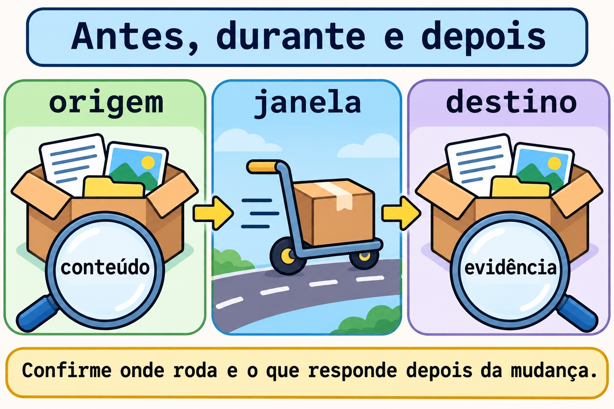
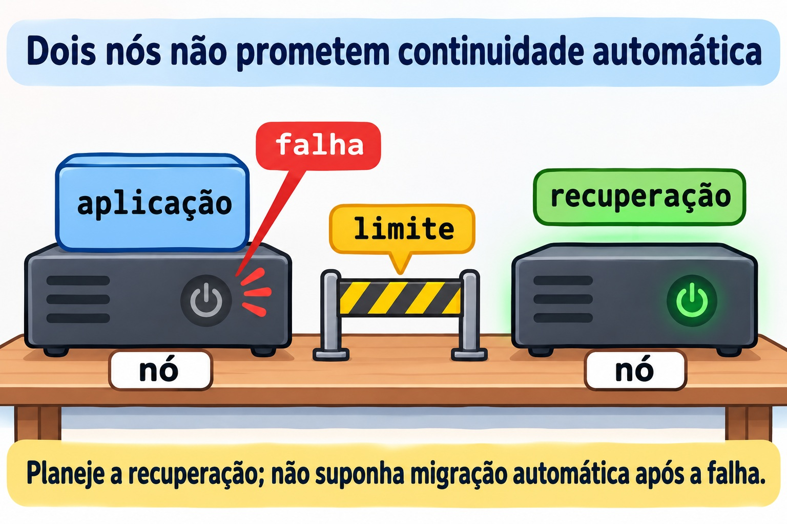

# Aula 20.7 · Atualizar, mover e falhar com prova

> **O coração desta aula:** mover a Wiki entre nós e recuperar uma falha controlada sem prometer HA automática.

| Ficha | Plano de trabalho |
| --- | --- |
| Módulo | M20 · NethServer 8 por dentro, aula 7 de 7 |
| Quando | Semana 29 |
| Ao final | mover a Wiki entre nós e recuperar uma falha controlada sem prometer HA automática. |
| Pré-requisitos | Aulas anteriores do M20; M18 e M19 corrigidos; console e inventário do lab |
| Duração | 100–140 minutos, além de downloads e janelas |
| Snapshot | m20a7-inicio e m20a7-fim, somente nas VMs desta aula |

A bancada principal é a VM `240`, hostname `ns8-1.lab.test`, Rocky Linux 9 com NS8. A VM `241`, `ns8-2.lab.test`, só entra na 20.7.

A gestão em `net0` usa endereço real reservado e acesso à Internet. A `net1` fica na bridge isolada `vmbr17`, sem gateway; a rede de laboratório não fornece Internet.

Use o [guia de bancada M20](../GUIA_BANCADA_M20_PT.md). Todos os comandos do NS8 indicados como root são dentro do nó, após `sudo -i`, e nunca no host Proxmox.

Nenhum laboratório deste material foi executado durante a elaboração. As saídas descritas são critérios para você observar e registrar, não resultados medidos.

## 1 · Aquecimento

1. Mover uma aplicação promove outro líder?

2. Dois nós no mesmo host físico provam tolerância à perda desse host?

3. Desligar um worker obriga a Wiki a reaparecer no líder?

Desenhe quem coordena, onde estão os dados e qual máquina responde à URL. Atualize o desenho depois de cada mudança.

## 2 · Por que importa

Uma manutenção previsível precisa de estado anterior, janela, caminho de retorno e teste funcional. A tela de tarefa concluída é uma evidência de controle, não a resposta da aplicação.

A VM `241` será um worker no mesmo cluster. O ensaio derruba somente essa VM, preservando o líder, o DNS e o destino de backup.

### Ponte Windows

Transferir uma pasta de trabalho entre duas mesas não transfere a chefia do escritório. E duas mesas no mesmo prédio não protegem contra a perda do prédio.

## 3 · Modelo mental


*Mover uma instância e transferir a liderança são operações diferentes.*

O líder recebe o controle do cluster. Cada nó executa suas aplicações. A movimentação altera a localização da instância; a promoção de líder é outra operação, com consequências próprias.

Não existe nesta aula uma promessa de migração automática de aplicação após uma falha. Você mede a indisponibilidade, recupera o worker e verifica o conteúdo no lugar planejado.

A bridge `vmbr17` é local ao host Proxmox. As VMs `240`, `241` e a bancada isolada precisam estar no mesmo nó físico para esse segmento; não migre uma VM a outro host durante o ensaio.

## 4 · O essencial

| Operação | O que conferir |
| --- | --- |
| Atualizar core | Versões compatíveis em todos os nós e controle funcional |
| Adicionar nó | VM nova, mesmo sistema, nome e conectividade corretos |
| Mover instância | Origem, destino, UUID, dados, DNS e TLS |
| Recuperar falha | Escopo observado e retorno do serviço testado |

### Rocky × Debian

Os dois nós NS8 usam Rocky Linux 9. A VM Debian `202` faz o teste de cliente e a `204` continua oferecendo DNS e backup; nenhuma delas ingressa como worker.

Não reutilize o ID 241 se estiver ocupado por VM ou CT. Uma identidade já existente exige reconciliar o inventário, não destruí-la.

### Decida 1 · Uma atualização está disponível

A. Atualizar módulos core separadamente por tentativa. B. Instalar versão de teste para facilitar. C. Ler a mudança, confirmar backup e usar a ação de atualização core.

## 5 · Lab guiado

### Passo 1 · Congelar o estado anterior

**Palpite:** Qual resposta permitirá detectar uma regressão?

```bash
test "$(id -u)" -eq 0 || exit 1
test "$(hostname -f)" = ns8-1.lab.test || exit 1
test -f /root/m20-lab/operador.env && test ! -L /root/m20-lab/operador.env || exit 1
test "$(stat -c '%U:%G:%a' /root/m20-lab/operador.env)" = root:root:600 || exit 1
. /root/m20-lab/operador.env
test -n "$MODULE_ID" && test -n "$MODULE_UUID" || exit 1
runagent -l
```

```bash
install -d -m 0700 /root/m20-lab/evidence-20-7
date --iso-8601=seconds > /root/m20-lab/evidence-20-7/start.txt
redis-cli --raw HGET cluster/module_uuid "$MODULE_ID"
redis-cli --raw HGET cluster/module_node "$MODULE_ID"
runagent -m "$MODULE_ID" podman ps
df -h / /home
```

Na VM 202, repita a requisição da 20.6 e confirme o marcador salvo. No painel, confira o último backup e faça novo backup se houve mudança posterior.

Registre versões do core e da Wiki, nó atual, UUID e localização da cópia de recuperação. Crie snapshots de início apenas depois de identificar cada VM no host.

**Saída esperada:** Inventário e conteúdo anteriores são reproduzíveis antes de modificar o cluster.

**Verifique:** Backup sem snapshot identificável ou marcador ausente impede as próximas etapas de mudança.

### Passo 2 · Atualizar com escopo conhecido

**Palpite:** Atualizar core e atualizar a Wiki são a mesma tarefa?

No Software Center, confira as versões instaladas e as notas das atualizações oferecidas. Atualize core pela ação própria, que mantém seus componentes alinhados.

Depois, trate a Wiki pela ação de atualização da aplicação. A DokuWiki de NethForge não deve ser considerada coberta automaticamente por uma política de assinatura de outro repositório.

Se não houver atualização oferecida, registre versões e ausência de pendência. Não instale uma versão de teste para produzir uma mudança artificial.

Aguarde uma tarefa por vez e repita o teste do marcador após cada uma. Atualizações do sistema operacional seguem a janela e o método suportados para a instalação, não um comando improvisado em paralelo.

**Saída esperada:** Versões e resultado funcional registrados após as ações realmente disponíveis.

**Verifique:** O líder precisa estar atualizado antes de unir um nó novo com a mesma versão core.

### Passo 3 · Criar a VM 241 independente

**Palpite:** Um clone da VM 240 seria um nó novo com identidade própria?

Volte ao host Proxmox proprietário da bancada. Use o diário ISO autenticado da 20.1, sem carregar automaticamente o arquivo; confira volume e SHA256 antes da criação.

```bash
test "$(id -u)" -eq 0 || exit 1
pvesh get /cluster/resources --type vm --output-format json-pretty || exit 1
test "$(pvesh get /cluster/nextid --vmid 241)" = 241 || exit 1
test -f /root/m20-operador.env && test ! -L /root/m20-operador.env || exit 1
test "$(stat -c '%U:%G:%a' /root/m20-operador.env)" = root:root:600 || exit 1
cat /root/m20-operador.env
read -r -p 'ISO_VOLUME Rocky 9 autenticado no diario: ' ISO_VOLUME
read -r -p 'ISO_SHA256 autenticado no diario: ' ISO_SHA256
[[ "$ISO_SHA256" =~ ^[0-9a-fA-F]{64}$ ]] || exit 1
ISO_PATH=$(pvesm path "$ISO_VOLUME") || exit 1
test -f "$ISO_PATH" || exit 1
printf '%s  %s\n' "$ISO_SHA256" "$ISO_PATH" | sha256sum -c - || exit 1
M20_241_RECORD=$(mktemp /root/m20-241-created.XXXXXX.conf) || exit 1
qm create 241 --name ns8-2 --machine q35 --bios ovmf --cpu x86-64-v2-AES --cores 2 --memory 4096 --agent enabled=1 --scsihw virtio-scsi-single --scsi0 vm-hdd:40 --efidisk0 vm-hdd:1,efitype=4m,pre-enrolled-keys=1 --net0 virtio,bridge=vmbr0 --net1 virtio,bridge=vmbr17,link_down=1 --ide2 "$ISO_VOLUME",media=cdrom --boot order=ide2 || exit 1
qm config 241 > "$M20_241_RECORD" || exit 1
test -s "$M20_241_RECORD" || exit 1
printf 'Creation record: %s\n' "$M20_241_RECORD"
qm start 241 || exit 1
```

Instale Rocky Linux 9 mínimo e independente, hostname `ns8-2.lab.test`, conta `student` com sudo e console root de emergência. A gestão usa o endereço real reservado; não clone identidade, chaves SSH ou estado da 240.

Depois de conferir o nome, no host ajuste o boot com `qm set 241 --boot order=scsi0`. No convidado 241, siga o guia M20 para a placa isolada `.241`, DNS e acesso do operador. O bloco abaixo instala somente NS8 na 241: não repete as guardas da 240 nem a criação do cluster.

```bash
test "$(id -u)" -eq 0 || exit 1
test "$(hostname -f)" = ns8-2.lab.test || exit 1
test ! -e /root/m20-install || exit 1
install -d -m 0700 /root/m20-install
dnf install -y curl || exit 1
curl --fail --location --proto '=https' --tlsv1.2 --retry 10 --retry-delay 1 --retry-all-errors https://raw.githubusercontent.com/NethServer/ns8-core/ns8-stable/core/install.sh --output /root/m20-install/install.sh || exit 1
bash -n /root/m20-install/install.sh || exit 1
sha256sum /root/m20-install/install.sh > /root/m20-install/install.sha256
cat /root/m20-install/install.sh
read -r -p 'Digite INSTALAR-NS8-241 apos revisar o script: ' M20_OK
test "$M20_OK" = INSTALAR-NS8-241 || exit 1
bash /root/m20-install/install.sh || exit 1
systemctl reboot
```

O hash local registra o arquivo obtido, mas não é uma assinatura independente do distribuidor. A revisão do conteúdo e a confiança na fonte HTTPS continuam necessárias. Não salve as credenciais iniciais nos relatórios.

**Saída esperada:** VM nova com sistema limpo, rede conferida e NS8 pronto para ingressar.

**Verifique:** Não escolha Create cluster na 241: clusters independentes não são unidos por essa ação.

### Passo 4 · Ingressar sem alterar a liderança

**Palpite:** O nome correto também precisa ser resolvido pelos dois nós?

No líder, confira a versão core. Na 241, confira a mesma versão instalada, FQDN, relógio, resoluções de ambos os nós e ausência de sobreposição da rede com a VPN do cluster registrada.

Na 241, como root, prepare a pasta antes de transferir a CA pública. Se já existir, confira proprietário, permissões e ausência de link simbólico; uma divergência interrompe o procedimento.

```bash
test "$(id -u)" -eq 0 || exit 1
test "$(hostname -f)" = ns8-2.lab.test || exit 1
test ! -L /root/m20-lab || exit 1
if test -e /root/m20-lab; then
  test -d /root/m20-lab || exit 1
  test "$(stat -c '%U:%G:%a' /root/m20-lab)" = root:root:700 || exit 1
else
  install -d -o root -g root -m 0700 /root/m20-lab || exit 1
fi
```

Pela transferência autenticada do guia, copie somente a CA pública já conferida da 204 para `/root/m20-lab/ca.crt` na 241. Execute uma única vez o bloco de confiança do Passo 3 da 20.4, escolhendo `241` e conferindo a impressão digital no console da 204. A conexão ao líder deve validar seu certificado pelo nome; a chave privada da CA permanece na 204.

No líder, abra `Nodes` e `Add node to cluster`. Copie o join code somente para o formulário `Join cluster` da 241. O código é segredo temporário: não vai para prints ou evidências.

Confirme a tarefa e o novo worker no painel do líder. Registre seu ID NS8 real; o VMID `241` não é esse ID. Não mude a VPN escolhida no primeiro nó.

```bash
test "$(id -u)" -eq 0 || exit 1
test "$(hostname -f)" = ns8-2.lab.test || exit 1
runagent -l
runagent -m node printenv NODE_ID
getent ahostsv4 ns8-1.lab.test
getent ahostsv4 ns8-2.lab.test
```

Já dentro do cluster, execute o Passo 2 da 20.4 escolhendo `241` para emitir chave e certificado novos com SAN da 241 e da Wiki. No Passo 3, faça somente o staging e a transferência dos arquivos para a estação operadora: não repita o bloco de confiança no nó, pois a CA já foi instalada antes do Join. Execute o upload do Passo 4 no Traefik do nó 241 antes de mover a aplicação e a limpeza do Passo 6 após a conferência; certificados enviados não são replicados automaticamente.

**Saída esperada:** Um líder existente e um worker novo aparecem com identidades distintas.

**Verifique:** Confirme que `ns8-2.lab.test` apresenta o certificado esperado antes da mudança da Wiki.

### Passo 5 · Mover e acompanhar os dois lados

**Palpite:** Onde a instância estará depois da tarefa?



*Confirme onde roda e o que responde depois da mudança.*

No cartão da Wiki fictícia, compare ID, UUID e nó de origem com o diário. Escolha `Move`, selecione o worker correspondente à VM 241 e confirme a janela.

Aguarde a tarefa inteira. Depois siga a seção do guia M20 que muda o A de `wiki.lab.test` de `.240` para `.241`, incrementa o serial, valida BIND e atualiza o mapeamento do túnel no computador do operador.

Atualize também a eventual entrada `wiki.lab.test` no bloco M20 de `/etc/hosts` da VM 202 pelo guia. Um hosts que ficou em `.240` prevalece sobre o DNS correto; aguardar o TTL não o corrige.

Na VM 202, confira resposta DNS autoritativa e TLS direto ao destino novo; depois teste pelo nome sem forçar o endereço, após expirar ou atualizar o cache do cliente.

```bash
test "$(hostname -s)" = debian-lab || exit 1
dig @192.0.2.204 wiki.lab.test A +short
curl --retry 10 --retry-delay 1 --retry-all-errors --max-time 10 --fail --silent --show-error --cacert /etc/ssl/m19/ca.crt --resolve wiki.lab.test:443:192.0.2.241 'https://wiki.lab.test/doku.php?id=m20_restore' --output "$HOME/m20-lab/wiki-moved.html" || exit 1
M20_MARKER=$(cat "$HOME/m20-lab/wiki-marker.txt") || exit 1
grep -F -- "$M20_MARKER" "$HOME/m20-lab/wiki-moved.html" || exit 1
curl --max-time 10 --fail --cacert /etc/ssl/m19/ca.crt 'https://wiki.lab.test/doku.php?id=m20_restore'
```

No terminal root da 241, encontre a instância real e anote seu ID. No líder, as associações públicas de Redis permitem conferir UUID e nó por leitura. Não escreva diretamente nessas chaves.

```bash
runagent -l
read -r -p 'ID real da Wiki apos Move: ' MOVED_ID
[[ "$MOVED_ID" =~ ^dokuwiki[0-9]+$ ]] || exit 1
runagent -m "$MOVED_ID" podman ps
runagent -m "$MOVED_ID" id
```

Volte agora ao terminal root do líder 240. Compare UUID e associação de nó antes de registrar o novo ID. O candidato preserva `NODE_ID` do líder e `VPN_CIDR`; somente `MODULE_NODE_ID` descreve a localização da Wiki.

```bash
test "$(id -u)" -eq 0 || exit 1
test "$(hostname -f)" = ns8-1.lab.test || exit 1
test -f /root/m20-lab/operador.env && test ! -L /root/m20-lab/operador.env || exit 1
test "$(stat -c '%U:%G:%a' /root/m20-lab/operador.env)" = root:root:600 || exit 1
. /root/m20-lab/operador.env
read -r -p 'ID real da Wiki observado no worker: ' MOVED_ID
[[ "$MOVED_ID" =~ ^dokuwiki[0-9]+$ ]] || exit 1
read -r -p 'NODE_ID do worker observado no passo 4: ' TARGET_NODE_ID
[[ "$TARGET_NODE_ID" =~ ^[1-9][0-9]*$ ]] || exit 1
test "$(redis-cli --raw HGET cluster/module_uuid "$MOVED_ID")" = "$MODULE_UUID" || exit 1
MODULE_NODE_ID=$(redis-cli --raw HGET cluster/module_node "$MOVED_ID") || exit 1
test "$MODULE_NODE_ID" = "$TARGET_NODE_ID" || exit 1
M20_NEXT=$(mktemp /root/m20-lab/operador.env.XXXXXX) || exit 1
awk -v id="$MOVED_ID" -v node="$MODULE_NODE_ID" '/^MODULE_ID=/ {print "MODULE_ID=" id; next} /^MODULE_NODE_ID=/ {next} {print} END {print "MODULE_NODE_ID=" node}' /root/m20-lab/operador.env > "$M20_NEXT" || exit 1
test "$(grep -c '^MODULE_ID=' "$M20_NEXT")" -eq 1 || exit 1
chmod 0600 "$M20_NEXT"
mv -f "$M20_NEXT" /root/m20-lab/operador.env
```

**Saída esperada:** Aplicação responde na 241, com marcador e identidade conferidos.

**Verifique:** O líder continua na 240. Registre o novo ID curto se a operação o alterou; não trate a mudança de ID como perda automática de dados.

### Passo 6 · Interromper e recuperar apenas o worker

**Palpite:** A aplicação migra sozinha quando o worker desliga?



*Planeje a recuperação; não suponha migração automática após a falha.*

Antes de desligar, confirme que a VM 241 foi criada neste ensaio, não é gerenciada por HA do Proxmox e não recebeu outra carga. No host, leia `qm config 241` e `ha-manager config`. Se houver gestão automática ou trabalho extra, pare.

No convidado 241, como root, faça desligamento controlado. Isso testa perda do worker, não perda física do host ou do Ceph.

```bash
test "$(id -u)" -eq 0 || exit 1
test "$(hostname -f)" = ns8-2.lab.test || exit 1
systemctl poweroff
```

Na VM 202, um pedido direto à 241 deve falhar dentro do limite de tempo. O painel do líder permanece acessível. Registre a ausência de retorno automático da Wiki em outro nó.

```bash
if curl --connect-timeout 3 --max-time 5 --fail --cacert /etc/ssl/m19/ca.crt --resolve wiki.lab.test:443:192.0.2.241 'https://wiki.lab.test/doku.php?id=m20_restore'; then
  printf '%s\n' 'STOP: resposta inesperada durante desligamento' >&2
  exit 1
fi
```

No host Proxmox correto, confira nome e estado antes de ligar exclusivamente a VM do ensaio.

```bash
test "$(qm config 241 | sed -n 's/^name: //p')" = ns8-2 || exit 1
test "$(qm status 241)" = 'status: stopped' || exit 1
qm start 241 || exit 1
```

**Saída esperada:** Worker retorna e a Wiki volta a responder no mesmo local planejado.

**Verifique:** Repita a prova completa do marcador; não conclua só porque o painel chama o nó de online.

### Decida 2 · O líder também ficou fora

A. Recuperar o líder ou seguir o procedimento documentado de promoção com plano explícito. B. Escrever manualmente o novo líder no Redis. C. Supor que o painel migrou sozinho.

## 6 · Quebre e conserte

### Quebra 1 · Destino sem capacidade

**Sintoma:** Antes de confirmar Move, encontre no painel um destino sem espaço ou sem requisito suficiente; não confirme a operação.

**Investigação:** Compare espaço, requisitos da aplicação e restrições da operação.

**Causa:** Um nó listado no cluster não é necessariamente destino apto.

**Conserto:** Libere recursos pelo plano ou escolha apenas o destino preparado para o exercício.

**Prevenção:** Inclua capacidade no inventário anterior à janela.

**Verifique:** O destino válido é escolhido antes de copiar dados.

### Quebra 2 · DNS antigo após Move

**Sintoma:** O pedido por nome alcança o endereço antigo; o teste forçado para a 241 funciona.

**Investigação:** Compare consulta autoritativa, cache e mapeamento do túnel.

**Causa:** A localização da aplicação mudou, mas o caminho do cliente ficou antigo.

**Conserto:** Corrija A, serial e mapa pelo guia; aguarde o cache ou atualize-o de forma controlada.

**Prevenção:** Trate DNS e acesso do operador como parte da janela.

**Verifique:** O pedido comum por nome, sem --resolve, retorna o marcador.

### Quebra 3 · Certificado do destino ausente

**Sintoma:** O servidor responde na 241, mas apresenta certificado que não valida a Wiki.

**Investigação:** Confira SAN, nó selecionado no upload e confiança da CA.

**Causa:** O certificado enviado na 240 não foi distribuído automaticamente.

**Conserto:** Importe o certificado próprio da 241 pelo procedimento da 20.4, sem copiar a chave da CA.

**Prevenção:** Prepare TLS do destino antes de mover o serviço.

**Verifique:** Nome, cadeia e marcador passam no mesmo pedido novo.

## 7 · Armadilhas

1. Não remova um nó para simular uma simples interrupção: remoção tem efeitos permanentes e não desliga todas as cargas automaticamente.

2. Não use Clone quando o objetivo é Move; você precisa terminar com uma localização definida.

3. Dois nós no mesmo host continuam dependentes do mesmo host.

4. Uma promoção de líder exige novo cuidado com senha do backup de cluster e logs.

5. Não reverta snapshots independentes de nós como se fossem uma restauração coordenada do cluster.

## 8 · Quiz

1. Qual é a diferença entre Move e promoção de líder?

2. Por que a VM 241 não deve nascer de um clone da 240?

3. O que o teste com --resolve isola depois do Move?

4. Qual falha física este ensaio não cobriu?

5. Um worker online prova conteúdo restaurado?

## 9 · Folha de bolso

```bash
runagent -l
redis-cli --raw HGET cluster/module_uuid "$MODULE_ID"
redis-cli --raw HGET cluster/module_node "$MODULE_ID"
runagent -m "$MODULE_ID" podman ps
date --iso-8601=seconds
```

**Flashcards:** Líder → controle; nó → execução local.

**Flashcards:** Move → dados e localização; DNS/TLS → caminho e identidade do cliente.

**Flashcards:** Nó online → condição necessária, não prova funcional completa.

## 10 · Checklist e fechamento

- [ ] Versões e backup conferidos antes da mudança.

- [ ] VM 241 nova, mesma distribuição e core compatível.

- [ ] Certificado próprio importado no destino.

- [ ] Wiki no worker com UUID e marcador conferidos.

- [ ] DNS e mapa do túnel apontam para a localização atual.

- [ ] Falha limitada à VM, recuperação e limites documentados.

**Reboot de conferência:** a etapa 6 já desligou e ligou o worker. Feche a prova repetindo uma requisição normal da VM 202, sem endereço forçado, e conferindo o marcador.

**Último exercício:** execute o desafio abaixo somente na Wiki fictícia. Preserve os nós 240 e 241, o domínio de teste e o destino de backup para o M21.

### Desafio do módulo · Apagar e recuperar a instância

Com a Wiki saudável na 241, faça novo backup e identifique seu snapshot. Baixe o backup cifrado do cluster e confirme custódia de chave e senha fora dos nós. A limitação de Ceph da 20.6 permanece.

Antes de remover, no líder compare o ID atual e seu UUID com a aplicação fictícia e o snapshot. Se qualquer valor divergir, pare. Não use um ID da documentação.

```bash
test "$(hostname -f)" = ns8-1.lab.test || exit 1
test -f /root/m20-lab/operador.env && test ! -L /root/m20-lab/operador.env || exit 1
test "$(stat -c '%U:%G:%a' /root/m20-lab/operador.env)" = root:root:600 || exit 1
. /root/m20-lab/operador.env
read -r -p 'ID atual da Wiki ficticia: ' MODULE_ID
[[ "$MODULE_ID" =~ ^dokuwiki[0-9]+$ ]] || exit 1
read -r -p 'UUID original conferido no diario externo: ' EXPECTED_UUID
CURRENT_UUID=$(redis-cli --raw HGET cluster/module_uuid "$MODULE_ID") || exit 1
test -n "$CURRENT_UUID" && test "$CURRENT_UUID" = "$EXPECTED_UUID" || exit 1
redis-cli --raw HGET cluster/module_node "$MODULE_ID"
```

No painel, use `Uninstall` apenas nesse cartão conferido. Essa ação remove a instância e seus dados atuais. Aguarde a tarefa e comprove a indisponibilidade; não apague volumes manualmente.

Pela aba `Restore`, escolha o backup da mesma identidade, o snapshot identificado e o nó 241. Não crie outra Wiki vazia no lugar. Aguarde o fim e redescubra ID, UUID e nó.

Na 241, `runagent -l` e o inventário Podman do ID restaurado devem mostrar onde o serviço voltou. No líder, confira UUID e associação de nó. Na 202, prove nome, TLS e marcador por uma requisição nova.

Depois da prova, atualize somente o ID curto no arquivo de operador pelo candidato atômico da 20.6. `NODE_ID` continua identificando o líder 240; `MODULE_NODE_ID` registra a localização da Wiki. Preserve `VPN_CIDR` e todos os demais campos.

No líder, confira os valores reais depois da restauração e só então grave o novo ID.

```bash
read -r -p 'ID real da Wiki restaurada no worker: ' NEW_MODULE
[[ "$NEW_MODULE" =~ ^dokuwiki[0-9]+$ ]] || exit 1
test "$(redis-cli --raw HGET cluster/module_uuid "$NEW_MODULE")" = "$EXPECTED_UUID" || exit 1
test "$(redis-cli --raw HGET cluster/module_node "$NEW_MODULE")" = "$MODULE_NODE_ID" || exit 1
M20_NEXT=$(mktemp /root/m20-lab/operador.env.XXXXXX) || exit 1
sed "s/^MODULE_ID=.*/MODULE_ID=$NEW_MODULE/" /root/m20-lab/operador.env > "$M20_NEXT" || exit 1
test "$(grep -c '^MODULE_ID=' "$M20_NEXT")" -eq 1 || exit 1
grep -qx "MODULE_ID=$NEW_MODULE" "$M20_NEXT" || exit 1
chmod 0600 "$M20_NEXT"
mv -f "$M20_NEXT" /root/m20-lab/operador.env
```

Entregue no diário a cadeia: snapshot escolhido → instância removida → instância restaurada → conteúdo reconhecido. Não limpe o destino de backup para deixar a tela vazia.

## 11 · Na vida real

Em um ambiente autorizado, faça primeiro o inventário de versões, localização e dependências. Uma janela precisa dizer quem decide voltar e qual evidência autoriza encerrar.

O exercício no mesmo host não mede tolerância a falhas físicas. Se a meta for essa, desenhe outro ensaio com nós, rede, armazenamento e backup em domínios de falha coerentes.

## 12 · Aprofundar quando quiser

- [Adicionar e recuperar nós](https://docs.nethserver.org/docs/administrator-manual/configuration/cluster)

- [Atualizações de core e aplicações](https://docs.nethserver.org/docs/administrator-manual/installation/software_center)

- [Aplicações: Clone e Move](https://docs.nethserver.org/docs/administrator-manual/installation/modules)

- [Mapas públicos de identidade e nó](https://nethserver.github.io/ns8-core/core/database/)

!explica Por que mover uma aplicação não promove outro líder?

!feynman Explique o limite de dois nós virtuais no mesmo host físico.

!quiz Crie um incidente após Move em que os dados estão corretos, mas o DNS ficou antigo.

## Gabarito comentado

Decida 1: C. Core tem componentes coordenados; a atualização é seguida de nova prova funcional.

Decida 2: A. Recuperação e promoção são procedimentos explícitos; o teste do worker não validou perda do líder.

Quiz 1: Move altera a localização da aplicação; promoção muda quem coordena o cluster.

Quiz 2: O clone levaria identidades e estado de um nó existente, em vez de uma instalação limpa para Join.

Quiz 3: Ele separa o caminho de rede até a 241 da resolução DNS comum, mantendo nome e validação TLS.

Quiz 4: Perda do host físico, do storage Ceph ou da infraestrutura comum.

Quiz 5: Não. Precisa responder pelo nome correto com TLS e conteúdo esperado, no nó e UUID observados.

[← Aula 20.6 · Backup e restauração](20.6-backup-e-restauracao.md) · [Índice das aulas](../01-aulas.md) · [Plano do curso: M21 →](../00-plano-do-curso.md)
