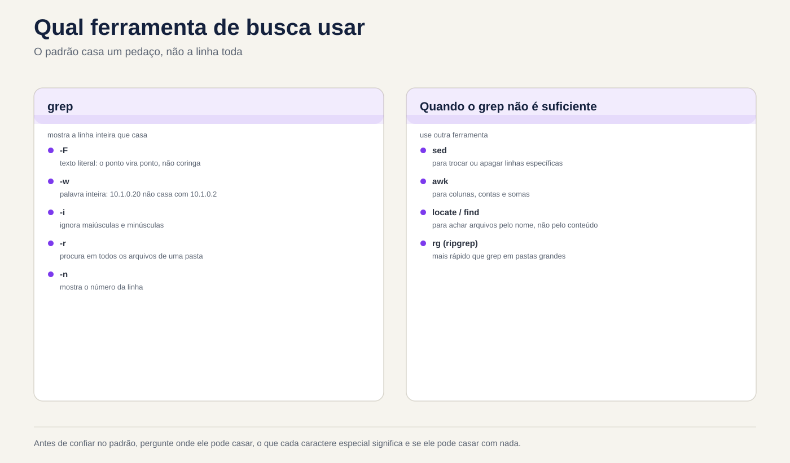

# Aula 3.3 · Regex e grep

Na Aula 3.2 você recortou, ordenou e contou colunas. Mas quase toda pergunta de verdade começa antes disso: **quais linhas** interessam. "As tentativas de senha errada", "as linhas que não são comentário", "os acessos que vieram desse IP, e não de um parecido". Quem escolhe linhas é o `grep`, e a linguagem que ele usa para descrever o que procura é a expressão regular, a regex. Hoje você aprende as duas a fundo: o ponto que casa qualquer coisa, as âncoras, as classes, a repetição, a diferença entre regex básica e estendida, e as opções do `grep` que separam uma busca de um relatório confiável. No fim, um script mostra o que o `sshd` das duas VMs usa de fato, e de qual arquivo veio cada valor.

| Ficha | Aula 3.3 |
| --- | --- |
| Módulo | M3 · Texto e editor, aula 3 de 5 |
| Quando | Semana 7 |
| Ao final você consegue | Escrever regex com âncoras, classes, repetição e grupos, em BRE e em ERE; saber quando o ponto, o asterisco e o colchete fazem o que você não queria; buscar texto fixo com `grep -F` e palavras inteiras com `-w`; usar uma lista de padrões com `-f` sem cair na linha vazia; extrair só o trecho que casou com `-o`; tirar comentários e linhas vazias de um arquivo de configuração; buscar em árvores de diretórios com `-r`; ler o status de saída do `grep` e distinguir "não achei" de "não consegui ler"; filtrar o log de SSH nas duas VMs, em arquivo e no journal |
| Itens de prova | LE 3.2 (procurar e extrair dados de arquivos) · LPIC-1 103.7 (procurar em arquivos de texto usando expressões regulares: `grep`, `egrep`, `fgrep`, regex básica e estendida) · RHCSA (usar `grep` e expressões regulares para analisar texto) |
| Pré-requisitos | Aula 1.5 (`grep` básico); Aula 3.1 (pipes, aspas, status de saída); Aula 3.2 (`cut`, `sort`, `uniq`, `~/lab32/acesso.log`) |
| Tempo | Cerca de 2h30 |
| Snapshots | m3a3-inicio e m3a3-fim nas duas VMs |

## 1 · Aquecimento

Três perguntas, de cabeça. Escreva as respostas; o Gabarito confere no fim.

1. Você procura o IP `10.1.0.2` num log com `grep 10.1.0.2 acesso.log`. Palpite: aparecem só as linhas desse IP?
2. Um arquivo de configuração tem comentários com `#` no começo da linha. Palpite: `grep -v '^#'` deixa só as linhas que valem?
3. Um script faz `if ps aux | grep -q backup; then echo "já está rodando"; fi`. Palpite: o que ele diz quando nenhum backup está rodando?

## 2 · Por que importa

O `grep` é o comando que todo mundo acha que já sabe usar. É exatamente por isso que ele erra calado:

| O chamado | A resposta errada | O que ela causa |
| --- | --- | --- |
| "Bloqueia o IP `10.1.0.2`, ele está atacando" | `grep 10.1.0.2 acesso.log` para conferir | Aparecem também as linhas de `10.1.0.20`, `10.1.0.21` e `10.1.0.254`. O relatório culpa máquinas inocentes, e o firewall bloqueia o servidor de arquivos |
| "Qual é a configuração do SSH de verdade?" | `grep -v '^#' /etc/ssh/sshd_config` | Sobram linhas vazias e comentários com recuo, e somem os arquivos de `/etc/ssh/sshd_config.d/`. Você jura que a senha está desligada, e ela está ligada |
| "Avisa se alguém errar a senha" | `grep -q 'Failed' log 2>/dev/null` num `if` | Na Debian o arquivo nem existe; sem permissão, o `grep` também falha. O script diz "tudo limpo" para sempre |
| "Só começa o backup se não houver outro rodando" | `ps aux \| grep -q backup` | O `grep` acha a si mesmo na lista de processos. O backup nunca mais começa, e ninguém vê, porque não dá erro |
| "Procura quem acessou de algum IP desta lista" | `grep -f lista.txt log` | A lista termina com uma linha vazia, e a linha vazia casa com tudo. O relatório diz que todo mundo está na lista |
| "Acha onde está configurado `PermitRootLogin` no servidor" | Abrir arquivo por arquivo no editor | Um `grep -rn PermitRootLogin /etc/ssh/` responde em um segundo, com o arquivo e o número da linha |

Regex é uma linguagem pequena com poucas regras. Quem conhece as regras escreve o padrão que casa com o que deve, e só com isso.

## 3 · Modelo mental

> O `grep` lê uma linha de cada vez e pergunta: **existe algum trecho desta linha que casa com o padrão?** Se existe, a linha sai inteira. O padrão não precisa casar com a linha toda, só com um pedaço dela, em qualquer lugar. Quase todo susto com `grep` vem de esquecer isso: o padrão casa onde você não estava olhando.

```text
  Padrão: 10.1.0.2          Linha: 10.1.0.20 - - [03/Nov/2026...] "GET / ..." 200 5120

  1 0 . 1 . 0 . 2
  │ │ │ │ │ │ │ │
  1 0 . 1 . 0 . 2 0 - - [03/Nov...      O trecho existe: a linha sai.
                  ↑                     O "0" que sobra não importa.

  O ponto casa com QUALQUER caractere:

  1 0 . 1 . 0 . 2
  │ │ │ │ │ │ │ │
  1 0 a 1 b 0 c 2 0                     Também casa.

  Como dizer exatamente o que você quer:

  -F '10.1.0.2'          o ponto vira ponto: texto fixo, sem regex
  -w                     o trecho tem que ser uma palavra inteira: "10.1.0.20" não serve
  '^10\.1\.0\.2 '        regex: no começo da linha, pontos de verdade, e um espaço depois
```

Três perguntas para cada padrão, antes de rodar: **onde ele pode casar** (no começo, no fim, em qualquer lugar?), **o que cada caractere especial significa aqui** (o ponto é ponto ou é "qualquer"?), e **ele pode casar com nada** (um `*` ou uma linha vazia casam com toda linha)? E uma regra de prática: antes de confiar num padrão, teste com uma linha que **deve** casar e outra que **não deve**.


*O padrão casa um pedaço da linha; o grep imprime a linha inteira.*

## 4 · Conceito em camadas

### Essencial

**O `grep` escolhe linhas.** As opções que você vai usar todo dia:

| Opção | O que faz | Exemplo |
| --- | --- | --- |
| `-i` | Ignora maiúsculas e minúsculas | `grep -i 'error' app.log` |
| `-v` | Inverte: mostra as linhas que **não** casam | `grep -v '^#' arquivo` |
| `-c` | Conta as linhas que casam, em vez de mostrar | `grep -c 'Failed' secure` |
| `-n` | Mostra o número da linha | `grep -n 'Port' sshd_config` |
| `-w` | Só casa palavra inteira | `grep -w 'root' /etc/passwd` |
| `-x` | Só casa a linha inteira | `grep -x 'ana' nomes.txt` |
| `-o` | Mostra só o trecho que casou, um por linha | `grep -o 'from [0-9.]*' secure` |
| `-l` | Mostra só o nome dos arquivos que têm alguma linha | `grep -l 'PermitRootLogin' /etc/ssh/*` |
| `-r` | Procura em todos os arquivos de um diretório | `grep -rn 'PermitRootLogin' /etc/ssh/` |
| `-E` | Regex estendida (ERE) | `grep -E '401\|403'` |
| `-F` | Texto fixo, sem regex | `grep -F '10.1.0.2'` |
| `-q` | Não mostra nada; só o status de saída | `if grep -q ...; then` |

Coloque o padrão sempre entre **aspas simples**. Sem aspas, o shell da Aula 3.1 mexe nele antes: um `*` vira nome de arquivo, um espaço separa o padrão em dois argumentos.

**Os caracteres especiais.** Na regex, quase todo caractere casa com ele mesmo. Os que não casam:

| Caractere | Significa | Exemplo | Casa com |
| --- | --- | --- | --- |
| `.` | Qualquer caractere, exatamente um | `l.g` | `log`, `lag`, `l g`, `l.g` |
| `^` | Começo da linha | `^Port` | `Port 22`, não `#Port 22` |
| `$` | Fim da linha | `bash$` | `/bin/bash`, não `/bin/bash-old` |
| `[abc]` | Um caractere entre os listados | `[Pp]ort` | `Port`, `port` |
| `[a-z]` | Um caractere da faixa | `[0-9]` | um dígito |
| `[^abc]` | Um caractere que **não** está na lista | `[^#]` | qualquer coisa menos `#` |
| `*` | O anterior, **zero** ou mais vezes | `ab*c` | `ac`, `abc`, `abbbc` |
| `\` | Tira o poder especial do próximo | `\.` | só um ponto |

O par de âncoras diz onde o padrão pode casar: `^root` só no começo, `nologin$` só no fim, `^$` é uma linha vazia e `^root$` é uma linha que é só `root`.

**Regex básica e estendida.** O `grep` sem opção usa a regex **básica** (BRE). O `grep -E` usa a **estendida** (ERE), que acrescenta cinco operadores:

| Na ERE (`grep -E`) | Significa | Exemplo |
| --- | --- | --- |
| `+` | O anterior, **uma** ou mais vezes | `[0-9]+` |
| `?` | O anterior, zero ou uma vez | `https?` |
| `{n,m}` | O anterior, de `n` a `m` vezes | `[0-9]{1,3}` |
| `\|` | Ou | `401\|403` |
| `( )` | Agrupa | `(ab)+`, `(GET\|POST) /login` |

Na BRE, esses cinco caracteres são **comuns**: `grep '(401|403)'` procura, literalmente, um parêntese, `401`, uma barra vertical, `403` e outro parêntese. É a confusão número um da aula, e o Passo 3 mostra.

**O status de saída.** O `grep` termina com `0` se achou pelo menos uma linha, `1` se não achou nenhuma e `2` se deu erro: arquivo que não existe, permissão negada, regex inválida. Num `if`, o `1` e o `2` caem os dois no `else`.

### Intermediário

**Texto fixo e palavra inteira.** Um IP, um nome de arquivo com ponto, um caminho: são texto, não regex. O `-F` desliga todos os caracteres especiais, e de quebra é mais rápido. O `-w` exige que o trecho esteja cercado por algo que não seja letra, dígito ou `_`, ou pelo começo e pelo fim da linha:

```bash
grep -F '10.1.0.2' acesso.log      # o ponto é ponto, mas 10.1.0.20 ainda casa
grep -Fw '10.1.0.2' acesso.log     # só o 10.1.0.2, como palavra
grep -w 'root' /etc/passwd         # root, não rootkit nem chroot
```

Para o `-w`, o ponto **separa** palavras: `10.1.0.2` são quatro palavras de dígitos com pontos entre elas, e o `-w` olha o que vem antes do primeiro `1` e depois do último `2`.

**As classes com nome.** Dentro do colchete, `[[:digit:]]`, `[[:alpha:]]`, `[[:space:]]`, `[[:upper:]]`, `[[:lower:]]` e `[[:alnum:]]` funcionam em qualquer idioma. O `[[:space:]]` casa com espaço **e** tabulação, que é o que você quer quase sempre:

```bash
grep -Ev '^[[:space:]]*(#|$)' /etc/ssh/sshd_config    # tira comentários, com ou sem recuo, e linhas em branco
```

Leia esse padrão por partes, porque você vai usá-lo a vida toda: `^` começo, `[[:space:]]*` zero ou mais espaços ou tabulações, e então `#` (um comentário) **ou** `$` (o fim, ou seja, a linha só tinha espaço). O `-v` inverte: sobra o que vale.

**Extrair com `-o`.** O `-o` imprime só o trecho que casou. É a ponte entre o `grep` e os filtros da Aula 3.2:

```bash
grep -oE 'from [0-9.]+' /var/log/secure | cut -d' ' -f2 | sort | uniq -c | sort -rn
```

**Lista de padrões.** O `-f arquivo` lê um padrão por linha; o `-e` acrescenta um padrão na própria linha de comando, e pode se repetir. Os dois servem para listas de IPs, usuários ou palavras:

```bash
grep -Fwf bloqueio.txt acesso.log      # texto fixo, palavra inteira, padrões do arquivo
grep -e 'Failed' -e 'Invalid' secure   # o mesmo que grep -E 'Failed|Invalid'
```

**Contexto.** `-A 2` mostra 2 linhas depois de cada uma que casou, `-B 2` antes e `-C 2` dos dois lados. Num log, o erro raramente está sozinho na linha: a causa está duas linhas antes. O `-m N` para depois de `N` linhas encontradas.

**Busca em diretórios.** O `-r` desce pelos diretórios, sem seguir links simbólicos no caminho; o `-R` segue. Com `--include='*.conf'` você limita os arquivos; com `-l`, mostra só os nomes; com `-h`, esconde o nome de cada linha; com `-H`, força o nome mesmo com um arquivo só:

```bash
grep -rn 'PermitRootLogin' /etc/ssh/
grep -rl --include='*.conf' 'Listen' /etc/
```

As aspas em `'*.conf'` importam: sem elas, o shell troca o `*.conf` pelos arquivos `.conf` da pasta onde você está.

**O `egrep` e o `fgrep`.** São os nomes antigos de `grep -E` e `grep -F`. Ainda caem na prova da LPIC, mas a documentação do GNU os considera obsoletos, e o `grep` mais novo avisa quando você os usa. Escreva `grep -E` e `grep -F`.

### Ponte Windows

| No Windows | No Linux | A diferença que importa |
| --- | --- | --- |
| `findstr` | `grep` | O `findstr` tem uma regex limitada, sem `+`, `?`, `{}` nem `\|`. O `grep -E` tem a regex completa |
| `Select-String -Pattern` | `grep -E` | O `Select-String` **ignora maiúsculas por padrão**; o `grep` diferencia. No Linux, `-i` quando você quiser ignorar |
| `Select-String -SimpleMatch` | `grep -F` | Texto fixo, sem regex |
| `Select-String -NotMatch` | `grep -v` | Igual |
| `Select-String -Context 2` | `grep -C 2` | Igual |
| `Get-ChildItem -Recurse \| Select-String` | `grep -r` | Uma opção, em vez de um pipe |
| `-match` do PowerShell | `[[ $x =~ regex ]]` no `bash` | Os dois usam regex estendida; no `bash`, a regex fica **sem aspas** do lado direito |
| Regex do .NET (`\d`, `\s`, `.*?`) | `grep -P` | O `\d` e o `.*?` não existem na BRE nem na ERE. No `grep -E`, `\d` é só um `d`. Use `[0-9]` ou o `-P` |

### Avançado

**A regex é gulosa.** O `*` e o `+` pegam o trecho **mais longo** possível. Com `-o`, isso aparece:

```bash
echo 'a="1" b="2"' | grep -o '".*"'       # "1" b="2"   (do primeiro " até o último ")
echo 'a="1" b="2"' | grep -o '"[^"]*"'    # "1" e "2"   (qualquer coisa que não seja aspas)
```

O truque do `[^"]*` serve para qualquer delimitador: `[^ ]*` é "até o próximo espaço", `[^]]*` é "até o próximo `]`". O `grep -P` (regex do Perl) tem a versão preguiçosa, `".*?"`, mas o `[^"]*` funciona em qualquer `grep`, no `sed` e no `awk`.

**Retrovisor.** Um grupo `( )` guarda o que casou, e `\1` repete esse mesmo texto mais adiante. Acha palavras repetidas, um erro comum de digitação em documento:

```bash
grep -E '\b([a-z]+) \1\b' texto.txt      # "de de", "o o"
```

O `\b` é a borda de palavra, a mesma ideia do `-w` dentro do padrão. O retrovisor e o `\b` são extensões do GNU: funcionam no `grep` das duas VMs, mas não em todo Unix.

**O idioma muda o que é um caractere.** Num idioma UTF-8, `.` casa com `ç`, que tem dois bytes. Com `LC_ALL=C`, cada byte é um caractere, e `^.$` não casa com uma linha que é só `ç`. Faixas como `[a-z]` também dependem do idioma em sistemas antigos; `[[:lower:]]` é sempre seguro. E `LC_ALL=C grep -F` num log de vários gigabytes é bem mais rápido, porque não precisa decodificar UTF-8.

**A regex fora do `grep`.** A mesma linguagem aparece em muitos lugares, cada um com um sabor:

| Onde | Sabor | Exemplo |
| --- | --- | --- |
| `grep`, `sed` | BRE por padrão; ERE com `-E` | `sed -E 's/[0-9]+/N/'` |
| `awk` | ERE | `awk '/Failed/'` |
| `[[ =~ ]]` no `bash` | ERE | `[[ $ip =~ ^[0-9.]+$ ]]` |
| `vim` | BRE, com extras próprios | `/\<root\>` |
| `journalctl -g` | PCRE2 (estilo Perl) | `journalctl -u ssh -g 'Failed password'` |
| `find -regex` | Casa o caminho **inteiro** | `find /etc -regex '.*\.conf'` |

O `sed` e o `awk` são a Aula 3.4; o `vim`, a 3.5. O que você aprende hoje vale nos três.

**A regex não é parser.** Um IP com `([0-9]{1,3}\.){3}[0-9]{1,3}` também casa com `999.999.999.999`. Para achar IPs num log, isso basta: o log não inventa IP. Para **validar** a entrada de um usuário num script, não basta. A regra geral: regex é para achar; para validar, use a ferramenta que entende o formato.

### O que cai na prova

**Linux Essentials e LPIC-1 (103.7):**

- O significado de `.`, `^`, `$`, `*`, `[ ]`, `[^ ]`, `\` na BRE; de `+`, `?`, `{ }`, `|`, `( )` na ERE; e que, na BRE, esses últimos são literais.
- `grep -E` equivale a `egrep`; `grep -F` equivale a `fgrep`.
- As opções `-i`, `-v`, `-c`, `-n`, `-l`, `-r`, `-w`, `-x`, `-o`, `-e`, `-f`.
- Prever a saída de um `grep` com regex num arquivo pequeno: é o formato preferido das questões.
- O `sed` com regex básica aparece no mesmo item (Aula 3.4).

**RHCSA:**

- "Encontre todas as linhas de um arquivo que contêm uma palavra e salve em `/root/arquivo`, na ordem original": um `grep` com `>`, e nada mais. Não ordene, não mude o formato.
- "Encontre os arquivos de `/etc` que contêm uma palavra": `grep -rl`.
- Na prova, o resultado é conferido por um script. Uma linha a mais ou a menos é questão errada.

## 5 · Rocky × Debian

| O quê | rocky-lab | debian-lab | Como conferir |
| --- | --- | --- | --- |
| Versão do `grep` | GNU grep 3.6 | GNU grep 3.8 | `grep --version \| head -1` |
| `egrep` e `fgrep` | Funcionam sem aviso | Funcionam, mas avisam: `egrep: warning: egrep is obsolescent` | `egrep x /dev/null` |
| Barra invertida sem sentido (`\-`, ` \  `) | Aceita calado | Avisa: `warning: stray \ before -` | `grep '\-' /dev/null` |
| `grep` colorido | Sim: um alias em `/etc/profile.d/colorgrep.sh` | Não, por padrão: o alias está comentado no `~/.bashrc` | `type grep` |
| Log do SSH | `/var/log/secure`, só para o `root` | Só no journal | `sudo ls -l /var/log/secure` |
| Unidade do SSH no systemd | `sshd.service` | `ssh.service` | `systemctl status sshd` ou `ssh` |
| Configuração do SSH | `/etc/ssh/sshd_config` com `Include` de `/etc/ssh/sshd_config.d/*.conf`; a Rocky já traz `50-redhat.conf` | O mesmo `Include`; a pasta costuma vir vazia | `sudo ls /etc/ssh/sshd_config.d/` |
| `grep -P` | Disponível | Disponível | `grep -P '\d' <<< 1` |

A diferença que mais pega no trabalho é a do log do SSH: o mesmo script de alerta, que lê `/var/log/secure`, não acha nada na Debian e não reclama. A Quebra A trata disso.

## 6 · Lab guiado

Você é o `rodrigo`, na rocky-lab, e alcança a debian-lab pelo `ssh deb`. Tudo acontece em `~/lab33`, nas duas VMs. Os arquivos do sistema e os logs reais **só são lidos**: nenhum passo muda a configuração do SSH. O Passo 7 é o desafio da aula.


*Antes de confiar no padrão, pergunte onde ele pode casar, o que cada caractere especial significa e se ele pode casar com nada.*


### Passo 0 · Snapshot, pasta e os arquivos do lab

No Proxmox, tire o snapshot `m3a3-inicio` das duas VMs. Na rocky-lab:

```bash
eval "$(ssh-agent -s)"; ssh-add
ssh -o BatchMode=yes deb hostname
mkdir -p ~/lab33; ssh deb 'mkdir -p ~/lab33'
cd ~/lab33
cp ~/lab32/acesso.log .
grep --version | head -1; ssh deb 'grep --version | head -1'
```

Se o `~/lab32/acesso.log` não existir mais, recrie com o here-doc do Passo 0 da Aula 3.2. Agora um pedaço de log de SSH no formato da Rocky. Os IPs são dos blocos reservados para documentação, então não são de ninguém:

```bash
cat > ssh.amostra <<'EOF'
Nov  3 08:10:01 rocky-lab sshd[2101]: Failed password for root from 203.0.113.9 port 51022 ssh2
Nov  3 08:10:04 rocky-lab sshd[2101]: Failed password for root from 203.0.113.9 port 51022 ssh2
Nov  3 08:11:20 rocky-lab sshd[2140]: Failed password for invalid user admin from 198.51.100.4 port 40110 ssh2
Nov  3 08:11:22 rocky-lab sshd[2140]: Failed password for invalid user admin from 198.51.100.4 port 40110 ssh2
Nov  3 08:12:00 rocky-lab sshd[2177]: Accepted publickey for rodrigo from 10.1.0.20 port 50001 ssh2: ED25519 SHA256:k3Yd9
Nov  3 08:13:15 rocky-lab sshd[2190]: Failed password for invalid user oracle from 203.0.113.9 port 51200 ssh2
Nov  3 08:14:02 rocky-lab sshd[2201]: Invalid user test from 192.0.2.66 port 33000
Nov  3 08:14:05 rocky-lab sshd[2201]: Failed password for invalid user test from 192.0.2.66 port 33000 ssh2
Nov  3 08:15:30 rocky-lab sshd[2230]: Failed password for rodrigo from 10.1.0.31 port 50110 ssh2
Nov  3 08:15:40 rocky-lab sshd[2230]: Accepted password for rodrigo from 10.1.0.31 port 50110 ssh2
Nov  3 08:16:00 rocky-lab sudo[2250]: rodrigo : TTY=pts/0 ; PWD=/home/rodrigo ; USER=root ; COMMAND=/usr/bin/tail -n 20 /var/log/secure
Nov  3 08:17:12 rocky-lab sshd[2266]: Connection closed by authenticating user root 203.0.113.9 port 51300 [preauth]
EOF
```

E um arquivo de configuração no estilo do `sshd_config`, com as armadilhas de propósito. Este vai com `printf`, e não com here-doc, porque a linha 9 começa com uma **tabulação**, e uma tabulação colada no terminal pode virar espaços:

```bash
printf '# Exemplo no estilo do sshd_config\nPort 22\n\n#PermitRootLogin prohibit-password\nPermitRootLogin no\n    # MaxSessions 10\nPasswordAuthentication yes\n   \n\t#ListenAddress 0.0.0.0\nMaxAuthTries 3\n#PasswordAuthentication no\n' > conf.amostra
cat -A conf.amostra
wc -l acesso.log ssh.amostra conf.amostra
```

```text
# Exemplo no estilo do sshd_config$
Port 22$
$
#PermitRootLogin prohibit-password$
PermitRootLogin no$
    # MaxSessions 10$
PasswordAuthentication yes$
   $
^I#ListenAddress 0.0.0.0$
MaxAuthTries 3$
#PasswordAuthentication no$
  15 acesso.log
  12 ssh.amostra
  11 conf.amostra
  38 total
```

O `cat -A`, da Aula 3.2, mostra o `$` no fim de cada linha e o `^I` no lugar da tabulação. Repare na linha 6 (comentário com recuo de espaços), na linha 8 (só espaços) e na linha 9 (comentário com recuo de tabulação). Copie os três arquivos para a Debian:

```bash
scp acesso.log ssh.amostra conf.amostra deb:lab33/
ssh deb 'cd ~/lab33 && wc -l acesso.log ssh.amostra conf.amostra && cat -A conf.amostra | sed -n 9p'
```

A última linha da Debian tem que mostrar `^I#ListenAddress 0.0.0.0$`. Se mostrar espaços, a cópia não é o problema: refaça o `printf`.

### Passo 1 · O ponto que casa qualquer coisa

O firewall avisa que `10.1.0.2` está fazendo coisa estranha. Você confere no log:

**Decida 1 · Você roda `grep -c 10.1.0.2 acesso.log`. Que número sai?**

- **A)** 0
- **B)** 4
- **C)** 15
- **D)** Um erro, porque o padrão tem pontos e não está entre aspas

Escolha a letra antes de olhar a tabela.

```bash
grep -c 10.1.0.2 acesso.log
grep 10.1.0.2 acesso.log | cut -d' ' -f1 | sort | uniq -c
```

```text
4
      4 10.1.0.20
```

| Se você marcou | Resultado | Por quê |
| --- | --- | --- |
| A | ❌ Errada | É o número que você **queria**: o `10.1.0.2` não aparece no log. Mas o `grep` procura um trecho, e `10.1.0.2` é um trecho de `10.1.0.20`. |
| B | ✅ Certa | As quatro linhas de `10.1.0.20` contêm o trecho `10.1.0.2`, seguido de um `0` que o `grep` não pediu para olhar. O relatório culparia a máquina errada. |
| C | ❌ Errada | O ponto casa com qualquer caractere, mas os dígitos do padrão continuam exigidos. Só quatro linhas têm `10`, algo, `1`, algo, `0`, algo e `2` em sequência. |
| D | ❌ Errada | O ponto não é especial para o shell, só para a regex. Sem espaço, `*`, `?` nem `$`, o padrão passa intacto. As aspas simples continuam sendo o hábito certo. |

**Para fixar:** o padrão casa com **um pedaço** da linha. Para o `grep`, "contém" não é "é".

São dois problemas juntos. O primeiro é o da tabela: o trecho no meio de outro. O segundo é o ponto, que casa com qualquer caractere:

```bash
echo '10a1b0c2' | grep 10.1.0.2
```

```text
10a1b0c2
```

Agora as três ferramentas do Modelo mental, uma de cada vez:

```bash
grep -cF '10.1.0.2' acesso.log        # 4: o ponto agora é ponto, mas o 10.1.0.20 continua casando
grep -cw '10.1.0.2' acesso.log        # 0: palavra inteira; depois do 2 vem um 0, não uma borda
grep -cFw '10.1.0.2' acesso.log       # 0: texto fixo E palavra inteira, o certo para IP
grep -cw '10\.1\.0\.20' acesso.log    # 4: o mesmo, em regex, com os pontos escapados
```

Para um IP, um nome de usuário ou um caminho, a combinação do dia a dia é `grep -Fw`. A regex com `\.` é para quando você precisa de regex de verdade em volta do IP.

### Passo 2 · Âncoras e a configuração que vale

Pergunta clássica: "o que está ativo nesse arquivo de configuração?". A resposta que todo mundo dá primeiro é tirar as linhas que começam com `#`.

**Decida 2 · Quantas linhas sobram com `grep -v '^#' conf.amostra`?**

- **A)** 4
- **B)** 8
- **C)** 6
- **D)** 11

Escolha a letra antes de olhar a tabela.

```bash
grep -vn '^#' conf.amostra | cat -A
```

```text
2:Port 22$
3:$
5:PermitRootLogin no$
6:    # MaxSessions 10$
7:PasswordAuthentication yes$
8:   $
9:^I#ListenAddress 0.0.0.0$
10:MaxAuthTries 3$
```

| Se você marcou | Resultado | Por quê |
| --- | --- | --- |
| A | ❌ Errada | Quatro é o número de diretivas ativas. Mas `^#` só tira as linhas cujo **primeiro caractere** é `#`, e nem tudo que é comentário começa assim. |
| B | ✅ Certa | Saem as linhas 1, 4 e 11. Ficam a linha vazia, a linha de espaços e os dois comentários com recuo: na linha 6 o primeiro caractere é espaço; na 9, tabulação. |
| C | ❌ Errada | Seis seria tirar também as linhas em branco, ou também os comentários com recuo. O `^#` não faz nenhuma das duas coisas. |
| D | ❌ Errada | Onze é o arquivo inteiro. O `-v` funcionou: tirou as três linhas cujo primeiro caractere é `#`. |

**Para fixar:** a âncora `^` diz "no começo da linha", e o começo é o primeiro caractere, mesmo que seja um espaço. Um comentário com recuo, comum dentro de blocos `Match` e em arquivos editados à mão, passa pelo `^#`.

A versão que você vai usar a vida toda, da seção 4:

```bash
grep -Ev '^[[:space:]]*(#|$)' conf.amostra
```

```text
Port 22
PermitRootLogin no
PasswordAuthentication yes
MaxAuthTries 3
```

Repare na diferença entre "linha vazia" e "linha em branco":

```bash
grep -c '^$' conf.amostra                # 1: só a linha 3, que não tem nada
grep -c '^[[:space:]]*$' conf.amostra    # 2: a linha 3 e a linha 8, que só tem espaços
```

Agora no arquivo de verdade. Na Rocky, o `sshd_config` só é legível pelo `root`; na Debian, todos leem:

```bash
ls -l /etc/ssh/sshd_config; ssh deb 'ls -l /etc/ssh/sshd_config'
sudo grep -Ev '^[[:space:]]*(#|$)' /etc/ssh/sshd_config
ssh deb "grep -Ev '^[[:space:]]*(#|$)' /etc/ssh/sshd_config"
```

Repare nas aspas do comando da Debian: o padrão tem aspas simples dentro, então o comando inteiro vai em aspas duplas, e o `$` dentro de `(#|$)` não é seguido de um nome, então o shell local não mexe nele. A primeira linha ativa, nas duas VMs, é `Include /etc/ssh/sshd_config.d/*.conf`. Guarde isso para o Passo 7.

### Passo 3 · Regex básica e estendida

O chefe quer as linhas de erro de autenticação e de página inexistente, os códigos `401` e `404`. Você escreve o "ou" que conhece de toda linguagem de programação:

**Decida 3 · Você roda `grep -c ' (401|404) ' acesso.log`. Que número sai?**

- **A)** 6
- **B)** 0
- **C)** 4
- **D)** Um erro de sintaxe, por causa dos parênteses

Escolha a letra antes de olhar a tabela.

```bash
grep -c ' (401|404) ' acesso.log
grep -cE ' (401|404) ' acesso.log
grep -E ' (401|404) ' acesso.log | cut -d' ' -f1,9 | sort | uniq -c
```

```text
0
6
      4 192.168.5.7 401
      2 203.0.113.9 404
```

| Se você marcou | Resultado | Por quê |
| --- | --- | --- |
| A | ❌ Errada | Seis é o que sai com `-E`. Sem ele, o `grep` usa a regex básica, e nela o parêntese e a barra são caracteres comuns. |
| B | ✅ Certa | Na BRE, o padrão procura literalmente `(401\|404)` entre dois espaços. Nenhuma linha tem isso. E o `grep` não avisa: zero é uma resposta válida. |
| C | ❌ Errada | Quatro seria só o `401`. O `grep` não escolhe uma das alternativas; na BRE, ele nem vê alternativas. |
| D | ❌ Errada | Os parênteses estão dentro de aspas simples: o shell não os vê, e para a BRE eles são caracteres comuns. Não há erro, há zero. |

**Para fixar:** sem `-E`, os caracteres `+ ? { } | ( )` são texto. Um `grep` que deveria achar e não acha nada é o pior erro possível: o relatório diz "nenhum ataque".

Três formas de escrever a mesma coisa:

```bash
grep -cE ' (401|404) ' acesso.log       # 6: ERE, a mais legível
grep -c ' \(401\|404\) ' acesso.log     # 6: BRE do GNU, com barras; funciona, mas ninguém lê
grep -c ' 40[14] ' acesso.log           # 6: classe; um caractere entre 1 e 4
grep -c ' 40[134] ' acesso.log          # 7: entra o 403 do /admin
```

O `\|` e o `\(` na BRE são extensões do GNU; num `grep` de outro Unix, não funcionam. A regra prática: precisou de `|`, `+`, `?` ou `{}`, use `-E`.

### Passo 4 · Classes, repetição e o asterisco que casa com nada

Pergunta: quais linhas do `conf.amostra` têm algum número?

**Decida 4 · Você roda `grep -c '[0-9]*' conf.amostra`. Que número sai?**

- **A)** 11
- **B)** 4
- **C)** 0
- **D)** Um erro, porque o `*` sozinho vira nome de arquivo

Escolha a letra antes de olhar a tabela.

```bash
grep -c '[0-9]*' conf.amostra
grep -c '[0-9]' conf.amostra
grep -cE '[0-9]+' conf.amostra
grep -n '[0-9]' conf.amostra
```

```text
11
4
4
2:Port 22
6:    # MaxSessions 10
9:	#ListenAddress 0.0.0.0
10:MaxAuthTries 3
```

| Se você marcou | Resultado | Por quê |
| --- | --- | --- |
| A | ✅ Certa | O `*` aceita **zero** repetições. Toda linha tem, em algum lugar, zero dígitos seguidos, até a linha vazia. O padrão casa com o nada, e o nada está em toda linha. |
| B | ❌ Errada | Quatro é a resposta da pergunta, e sai com `'[0-9]'` ou `-E '[0-9]+'`. Com o `*`, o padrão não exige nenhum dígito. |
| C | ❌ Errada | Casar com nada é casar. O `grep` não exige que o trecho tenha tamanho. |
| D | ❌ Errada | O padrão está entre aspas simples: o shell não troca o `*` por nomes de arquivo. Sem aspas, aí sim, o resultado dependeria da pasta. |

**Para fixar:** um padrão que pode casar com o vazio casa com toda linha. Antes de rodar, pergunte: "isto aceita zero caracteres?". Se aceita, tem bug. O `*` quase nunca vem sozinho: `ab*c`, `.*`, `[^"]*`, sempre entre coisas que exigem algo.

Agora a utilidade de verdade: tirar só o trecho. Com `-o`, cada pedaço que casou sai numa linha:

```bash
grep -oE '([0-9]{1,3}\.){3}[0-9]{1,3}' ssh.amostra | sort -u
```

```text
10.1.0.20
10.1.0.31
192.0.2.66
198.51.100.4
203.0.113.9
```

Leia o padrão por partes: `[0-9]{1,3}` são de um a três dígitos, `\.` um ponto de verdade, o grupo `( ){3}` repete esses dois três vezes, e no fim mais um número. Os números de porta não entram, porque não têm pontos; o `SHA256:k3Yd9` também não.

### Passo 5 · O log do SSH

Agora as perguntas de verdade. Quantas tentativas de senha falharam?

```bash
grep -c 'Failed password' ssh.amostra
```

```text
7
```

Você quer separar o usuário de cada tentativa e escreve um padrão mais preciso:

**Decida 5 · Quantas linhas casam com `grep -c 'Failed password for [a-z]* from' ssh.amostra`?**

- **A)** 7
- **B)** 3
- **C)** 4
- **D)** 0

Escolha a letra antes de olhar a tabela.

```bash
grep -c 'Failed password for [a-z]* from' ssh.amostra
grep 'Failed password for [a-z]* from' ssh.amostra | cut -d' ' -f10-12
```

```text
3
root from 203.0.113.9
root from 203.0.113.9
rodrigo from 10.1.0.31
```

| Se você marcou | Resultado | Por quê |
| --- | --- | --- |
| A | ❌ Errada | Sete é o total de falhas. Mas quatro delas dizem `for invalid user admin from`, e o `[a-z]*` não casa com espaço. |
| B | ✅ Certa | Só casam as linhas em que, entre ` for  ` e `  from `, há só letras minúsculas: `root`, `root` e `rodrigo`. As quatro tentativas com usuário inexistente, as mais perigosas, sumiram do relatório. |
| C | ❌ Errada | Quatro são justamente as que **não** casam: as de `invalid user`. |
| D | ❌ Errada | O `[a-z]*` casa com `root` e `rodrigo`. O padrão não está errado para essas linhas; está errado para as outras. |

**Para fixar:** um padrão preciso demais esconde linhas sem avisar. Depois de escrever um filtro, compare a contagem com a do filtro largo (`Failed password`): se o número caiu, descubra quais linhas saíram e por quê.

O padrão que cobre os dois formatos usa o `?` da ERE, "o grupo, zero ou uma vez":

```bash
grep -cE 'Failed password for (invalid user )?[a-z]+ from' ssh.amostra
```

```text
7
```

Agora a pergunta que chega no seu e-mail toda segunda-feira: **quais IPs mais erraram a senha?** É a ponte entre o `grep -o` e a Aula 3.2:

```bash
grep 'Failed password' ssh.amostra | grep -oE 'from [0-9.]+' | cut -d' ' -f2 | sort | uniq -c | sort -rn
```

```text
      3 203.0.113.9
      2 198.51.100.4
      1 192.0.2.66
      1 10.1.0.31
```

O `from` no padrão é a âncora de contexto: o IP que interessa é o que vem depois de `from`, e não um número qualquer da linha. E quais usuários inexistentes tentaram entrar?

```bash
grep -oE 'invalid user [a-z]+' ssh.amostra | cut -d' ' -f3 | sort | uniq -c
grep -oiE 'invalid user [a-z]+' ssh.amostra | cut -d' ' -f3 | sort | uniq -c
```

```text
      2 admin
      1 oracle
      1 test
      2 admin
      1 oracle
      2 test
```

O `test` aparece duas vezes com `-i`, porque a linha 7 diz `Invalid user`, com maiúscula. Qual está certo depende da pergunta: o primeiro conta tentativas de senha com usuário inexistente; o segundo conta todas as menções.

**Os logs reais, só leitura.** Na Rocky, o log está em arquivo, só para o `root`. Na Debian, só no journal, e a unidade se chama `ssh`:

```bash
sudo grep -c 'Failed password' /var/log/secure
sudo grep 'Failed password' /var/log/secure | grep -oE 'from [0-9.]+' | cut -d' ' -f2 | sort | uniq -c | sort -rn | head
ssh -t deb "sudo journalctl -u ssh -o short --no-pager | grep -c 'Failed password'"
ssh -t deb "sudo journalctl -u ssh --no-pager -g 'Failed password' | tail -n 3"
```

Num lab que só fala com a rede local, é normal dar zero. Para ver uma linha de verdade, erre de propósito. Da Rocky, tente entrar na Debian com um usuário que não existe e digite qualquer coisa na senha, duas vezes, e depois `Ctrl+C`:

```bash
ssh -o PubkeyAuthentication=no -o PreferredAuthentications=password nao-existe@10.1.0.52
ssh -t deb "sudo journalctl -u ssh --since '-5min' --no-pager | grep -E 'Invalid user|Failed password'"
```

Se o SSH da Debian responder `Permission denied (publickey)` sem pedir senha, a autenticação por senha está desligada nela, e nenhuma linha `Failed password` vai aparecer. Não é defeito: o Passo 7 mostra como confirmar isso sem adivinhar.

O journal pode intercalar linhas que começam com ` --  ` (a marca de um reboot, por exemplo). Num relatório, filtre com `grep -v '^-- '`. E o `journalctl -g` já filtra sozinho, com regex no estilo Perl, sem pipe.

**Onde está configurado?** Na rocky-lab:

```bash
sudo grep -rn 'PermitRootLogin' /etc/ssh/
sudo grep -rn --include='*.conf' 'PermitRootLogin' /etc/ssh/
grep -rn 'PermitRootLogin' /etc/ssh/; echo "status: $?"
```

O primeiro mostra cada arquivo e linha onde a palavra aparece, comentada ou não. O segundo esconde o próprio `sshd_config`, porque o nome dele não termina em `.conf`: o `--include` filtra **todos** os arquivos, inclusive o principal. O terceiro, sem `sudo`, mostra `Permission denied` para os arquivos que só o `root` lê, e termina com status `2`, mesmo que tenha achado algo em outro arquivo. Guarde esse `2` para a Quebra A.

### Passo 6 · Lista de padrões e a linha vazia

Na Aula 3.2, ficou a promessa: comparar um log com uma lista de IPs bloqueados. A lista chegou por e-mail, colada de uma planilha, e foi salva assim:

```bash
printf '203.0.113.9\n198.51.100.4\n\n' > bloqueio.txt
cat -A bloqueio.txt
```

```text
203.0.113.9$
198.51.100.4$
$
```

Três linhas, a última vazia. Acontece toda vez que alguém aperta Enter depois do último item.

**Decida 6 · Quantas linhas do `acesso.log` casam com `grep -cFf bloqueio.txt acesso.log`?**

- **A)** 3
- **B)** 15
- **C)** 0
- **D)** 4

Escolha a letra antes de olhar a tabela.

```bash
grep -cFf bloqueio.txt acesso.log
grep -cFwf bloqueio.txt acesso.log
grep -cFwf <(grep . bloqueio.txt) acesso.log
grep -Fwf <(grep . bloqueio.txt) acesso.log | cut -d' ' -f1 | uniq -c
```

```text
15
15
3
      3 203.0.113.9
```

| Se você marcou | Resultado | Por quê |
| --- | --- | --- |
| A | ❌ Errada | Três é a resposta certa para a pergunta, e sai com a lista limpa. Com a linha vazia, o arquivo tem três padrões, e um deles é o vazio. |
| B | ✅ Certa | Cada linha de `bloqueio.txt` é um padrão, e o padrão vazio casa com toda linha, como o `*` do Passo 4. O relatório diria que os 15 acessos vieram de IPs bloqueados. Nem o `-w` salva. |
| C | ❌ Errada | O `198.51.100.4` não aparece no `acesso.log`, mas o `203.0.113.9` aparece três vezes. E a linha vazia casa com tudo. |
| D | ❌ Errada | Não há quatro linhas de IPs da lista no `acesso.log`: o `203.0.113.9` aparece três vezes, e o `198.51.100.4`, nenhuma. E a linha vazia casa com tudo. |

**Para fixar:** antes de usar um arquivo como lista de padrões, limpe-o. O `grep .` deixa só as linhas que têm pelo menos um caractere, e o `<( )` da Aula 3.1 entrega o resultado ao `-f` como se fosse um arquivo. Conte antes: `grep -c . bloqueio.txt` dá 2; `grep -c '' bloqueio.txt` dá 3.

E o `-F` importa tanto quanto a linha vazia. Uma lista com `10.1.0.2`, sem `-F` e sem `-w`, casa com o `10.1.0.20`, como no Passo 1:

```bash
printf '203.0.113.9\n10.1.0.2\n' > b2.txt
grep -cf b2.txt acesso.log       # 7: os 3 de 203.0.113.9 e os 4 de 10.1.0.20
grep -cFwf b2.txt acesso.log     # 3: só o 203.0.113.9
```

A mesma lista, no log de SSH. Duas formas de contar, e elas não concordam:

```bash
grep -Fwf <(grep . bloqueio.txt) ssh.amostra | grep -oE 'from [0-9.]+' | sort | uniq -c
grep -oFwf <(grep . bloqueio.txt) ssh.amostra | sort | uniq -c
```

```text
      2 from 198.51.100.4
      3 from 203.0.113.9
      2 198.51.100.4
      4 203.0.113.9
```

A diferença é a linha 12: `Connection closed by authenticating user root 203.0.113.9 port 51300`. Ela não tem `from`. A primeira forma conta "tentativas com `from`"; a segunda, com `-o` direto na lista, conta "linhas em que o IP aparece". As duas estão certas para perguntas diferentes, e é você quem precisa saber qual pergunta está respondendo.

### Passo 7 · Desafio: o que o `sshd` usa de verdade

O chamado: "o acesso por senha está desligado nos servidores?". Você já viu que o `grep` mostra o que está **escrito** nos arquivos, e que pode haver vários arquivos. Mas quem decide é o `sshd`, e ele tem uma regra que surpreende quase todo mundo. Primeiro, a regra, num arquivo de teste na sua pasta. O here-doc vai **sem aspas** no `EOF`, de propósito, para o shell trocar o `$HOME` pelo caminho de verdade, porque o `sshd` não entende variáveis:

```bash
mkdir -p ~/lab33/teste.d
cat > ~/lab33/sshd_teste <<EOF
Include $HOME/lab33/teste.d/*.conf
PasswordAuthentication no
PermitRootLogin no
EOF
printf 'PasswordAuthentication yes\n' > ~/lab33/teste.d/50-cloud.conf
cat ~/lab33/sshd_teste
grep -rn 'PasswordAuthentication' ~/lab33/sshd_teste ~/lab33/teste.d/
```

O `cat` mostra `Include /home/rodrigo/lab33/teste.d/*.conf`, com o caminho já trocado. O `grep` mostra as duas linhas, uma dizendo `no` e outra dizendo `yes`. Qual vale?

**Decida 7 · Você roda `sudo sshd -T -f ~/lab33/sshd_teste | grep -i '^passwordauthentication'`. O que sai?**

- **A)** `passwordauthentication no`, porque é a linha do arquivo principal
- **B)** `passwordauthentication yes`
- **C)** Um erro, porque a mesma opção aparece duas vezes
- **D)** As duas linhas, `yes` e `no`

Escolha a letra antes de olhar a tabela.

```bash
sudo sshd -T -f ~/lab33/sshd_teste | grep -iE '^(passwordauthentication|permitrootlogin) ' | sort
```

```text
passwordauthentication yes
permitrootlogin no
```

Rode nas duas VMs (copie o `sshd_teste` e a pasta `teste.d` com `scp -r`, e refaça o `cat > sshd_teste` na Debian, para o `$HOME` de lá). Se na Rocky o `sshd -T` reclamar que não consegue ler um arquivo da sua pasta, a causa provável é o SELinux, assunto de um módulo futuro: faça a Decida na Debian e siga.

| Se você marcou | Resultado | Por quê |
| --- | --- | --- |
| A | ❌ Errada | É o que quase todo mundo supõe: "o arquivo principal manda". No `sshd`, quem manda é a **primeira** linha lida, e o `Include` no topo é lido antes. |
| B | ✅ Certa | Para cada opção, o `sshd` usa o primeiro valor que encontra. O `Include` traz o `yes` antes do `no`, e o `no` é ignorado. É por isso que o `Include` fica no topo do `sshd_config` nas duas distribuições: os arquivos de `sshd_config.d/` vencem o principal. |
| C | ❌ Errada | Repetir uma opção não é erro de sintaxe; o `sshd -T` só reclama de opção inexistente ou valor inválido. Por isso o problema passa calado. |
| D | ❌ Errada | O `sshd -T` mostra a configuração **resolvida**: uma linha por opção, já com o valor que ganhou, em minúsculas. |

**Para fixar:** o `grep` nos arquivos mostra os candidatos; o `sshd -T` mostra o vencedor. Um `PasswordAuthentication no` no `sshd_config` não vale nada se um arquivo em `sshd_config.d/` disser `yes`, e alguns instaladores e imagens de nuvem colocam um arquivo desses lá. Na vida real, confira sempre os dois.

A mesma ideia vale para quase todo serviço que tem arquivo de configuração: `nginx -T`, `postconf -n` no Postfix, `testparm -s` no Samba, `named-checkconf -p` no BIND. Todos imprimem a configuração como o programa entendeu.

Agora o script do desafio. Ele mostra, para as opções que importam numa auditoria de SSH, onde cada uma está escrita e o valor que o `sshd` usa:

```bash
cat > ~/lab33/sshd-efetivo.sh <<'EOF'
#!/bin/sh
# sshd-efetivo.sh: onde as opções do SSH estão escritas e o que o sshd usa de fato
set -u
opcoes='port|permitrootlogin|passwordauthentication|pubkeyauthentication|maxauthtries|x11forwarding'

echo "== $(hostname): linhas ativas nos arquivos =="
sudo grep -rHnEv '^[[:space:]]*(#|$)' /etc/ssh/sshd_config /etc/ssh/sshd_config.d/ \
    | grep -iE ":[0-9]+:[[:space:]]*($opcoes)[[:space:]]"

echo "== $(hostname): o que o sshd usa (sshd -T) =="
if ! efetivo=$(sudo sshd -T 2>&1); then
    echo "ERRO: o sshd -T falhou; a configuração tem erro:" >&2
    printf '%s\n' "$efetivo" >&2
    exit 2
fi
printf '%s\n' "$efetivo" | grep -E "^($opcoes) " | sort
EOF
chmod +x ~/lab33/sshd-efetivo.sh
~/lab33/sshd-efetivo.sh
```

Leia as duas linhas de `grep` do script. A primeira é o filtro do Passo 2, em várias pastas, com `-H` (o nome do arquivo) e `-n` (a linha): cada linha sai como `arquivo:número:texto`. A segunda deixa só as opções da lista, e o `:[0-9]+:` no começo do padrão pula o nome do arquivo e o número, para que o `^` da opção comece no texto. O `-i` é necessário porque no arquivo está `PermitRootLogin`, e no `sshd -T`, `permitrootlogin`.

O script começa com `#!/bin/sh` e não usa nada que seja só do `bash`. Rode na Debian com o `sh`, que lá é o `dash`:

```bash
scp ~/lab33/sshd-efetivo.sh deb:lab33/
ssh -t deb 'sh ~/lab33/sshd-efetivo.sh'
```

Compare as duas VMs. Para cada opção da segunda parte, a pergunta é: **ela aparece na primeira?** Se não aparece, o valor é o padrão do OpenSSH, e você sabe que ninguém o escreveu. Se aparece em mais de um arquivo, o que vale é o que o `sshd -T` diz, e o primeiro lido explica o porquê. Na Rocky, procure o `50-redhat.conf`: ele tem, entre outras, a linha do `X11Forwarding`. Se no instalador da Rocky você deixou o `root` entrar por senha, pode existir também um `01-permitrootlogin.conf`.

**Bônus.** Conte, por VM, quantas linhas ativas existem em cada arquivo de configuração do SSH:

```bash
sudo grep -rcEv '^[[:space:]]*(#|$)' /etc/ssh/sshd_config /etc/ssh/sshd_config.d/
ssh -t deb "sudo grep -rcEv '^[[:space:]]*(#|\$)' /etc/ssh/sshd_config /etc/ssh/sshd_config.d/"
```

No segundo comando, o `\$` protege o `$` dentro das aspas duplas, por garantia. O `-c` com `-r` dá um número por arquivo, no formato `arquivo:contagem`.

## 7 · Quebre e conserte

### Quebra A · O alerta que nunca dispara

O cenário: um script de monitoramento roda de hora em hora e avisa se alguém errou a senha do SSH. Ele foi escrito na Rocky, testado com um arquivo de exemplo, e copiado para todos os servidores. Faz meses que ele diz "tudo limpo". Monte o script, na rocky-lab:

```bash
cd ~/lab33
cat > alerta.sh <<'EOF'
#!/bin/bash
# alerta.sh: avisa se houve senha errada no SSH
log=${1:-/var/log/secure}
if grep -q 'Failed password' "$log" 2>/dev/null; then
    echo "ALERTA: tentativas de senha errada em $log"
else
    echo "tudo limpo"
fi
EOF
chmod +x alerta.sh
./alerta.sh ~/lab33/ssh.amostra
```

```text
ALERTA: tentativas de senha errada em /home/rodrigo/lab33/ssh.amostra
```

O teste passou. Agora como ele roda de verdade, sem argumento, com o usuário do monitoramento, que não é `root`:

```bash
./alerta.sh
scp alerta.sh deb:lab33/
ssh deb 'lab33/alerta.sh'
```

**Observe.** As duas VMs respondem `tudo limpo`. Na Debian, você mesmo errou a senha no Passo 5, e a linha está no journal. Na Rocky, nem dá para saber, porque o script nunca leu o log.

**Diagnostique.** Tire o `2>/dev/null` e olhe o status:

```bash
grep -q 'Failed password' /var/log/secure; echo "status: $?"
ssh deb 'grep -q "Failed password" /var/log/secure; echo "status: $?"'
```

```text
grep: /var/log/secure: Permission denied
status: 2
grep: /var/log/secure: No such file or directory
status: 2
```

Status `2`: o `grep` **não conseguiu** procurar. Na Rocky, por permissão; na Debian, porque o arquivo nem existe. Mas o `if` só pergunta "zero ou não zero", e o `2` cai no `else`, junto com o `1`, que é o "procurei e não achei". O `2>/dev/null` escondeu a única pista.

**Decida A · O conserto.** O que você muda no script?

- **A)** Rodar o `grep -q` sozinho e tratar o status com `case $? in 0) ... ;; 1) ... ;; *) ... ;; esac`
- **B)** Tirar o `2>/dev/null`
- **C)** Trocar o `2>/dev/null` pela opção `-s` do `grep`
- **D)** Antes do `grep`, conferir com `[ -r "$log" ]` se o arquivo pode ser lido

Escolha a letra antes de olhar a tabela.

| Se você marcou | Resultado | Por quê |
| --- | --- | --- |
| A | ✅ Certa | Separa os três casos que o `grep` já informa: achei, não achei, não consegui. O "não consegui" vira erro, com mensagem e status próprio, e o monitoramento passa a ver o problema. |
| B | ⚠️ Funciona, mas | A mensagem de erro passa a aparecer, o que já ajuda quem roda à mão. Mas o script continua dizendo `tudo limpo` logo depois, e num `cron` a mensagem vai para um e-mail que ninguém lê. O status `2` continua caindo no `else`. |
| C | ❌ Errada | O `-s` é exatamente o que o `2>/dev/null` já faz: esconde as mensagens de arquivo inexistente ou ilegível. Troca seis por meia dúzia. |
| D | ⚠️ Funciona, mas | Pega os dois casos de hoje, permissão e arquivo inexistente. Mas há outros erros que o `[ -r ]` não vê (o caminho é uma pasta, o disco dá erro de leitura), e o `grep` já sabe dizer tudo isso. Ler o status é mais simples e mais completo. |

**Para fixar:** num `if grep`, o "não consegui ler" vira "não achei". Sempre que o `grep` decide alguma coisa, trate o status `2` à parte, e nunca jogue o erro dele no `/dev/null` sem tratar.

**Conserte.**

```bash
cat > alerta.sh <<'EOF'
#!/bin/bash
# alerta.sh: avisa se houve senha errada no SSH
# status: 0 = rodou (com ou sem alerta), 2 = não conseguiu ler o log
log=${1:-/var/log/secure}
grep -q 'Failed password' "$log"
case $? in
    0) echo "ALERTA: tentativas de senha errada em $log" ;;
    1) echo "tudo limpo em $log" ;;
    *) echo "ERRO: não consegui ler $log" >&2; exit 2 ;;
esac
EOF
./alerta.sh ~/lab33/ssh.amostra
./alerta.sh; echo "status: $?"
sudo ./alerta.sh
scp alerta.sh deb:lab33/; ssh deb 'lab33/alerta.sh; echo "status: $?"'
```

```text
ALERTA: tentativas de senha errada em /home/rodrigo/lab33/ssh.amostra
grep: /var/log/secure: Permission denied
ERRO: não consegui ler /var/log/secure
status: 2
...
grep: /var/log/secure: No such file or directory
ERRO: não consegui ler /var/log/secure
status: 2
```

Com `sudo`, na Rocky, o script lê o log e diz o que há nele. Na Debian, o erro agora é honesto: o arquivo não existe, porque lá o log do SSH está no journal. O script certo para a Debian lê de outra fonte:

```bash
ssh -t deb "sudo journalctl -u ssh --since today --no-pager | grep -c 'Failed password'"
```

Uma pegadinha a mais na Debian: o `journalctl` sem `sudo`, e sem o usuário estar no grupo `adm` ou `systemd-journal`, **não falha**. Ele mostra só o journal do próprio usuário, avisa com um `Hint:` e termina com status `0`. O `grep` não acha nada e responde `1`, "tudo limpo". O mesmo erro calado, por outro caminho. Script de monitoramento de log roda como `root` ou com um grupo de leitura, e você confere qual, com `id`, antes de confiar no resultado.

### Quebra B · O backup que nunca começa

O cenário: um backup demora horas, e o `cron` o chama de hora em hora. Para não rodar dois ao mesmo tempo, alguém escreveu uma checagem no começo. Desde então, os backups pararam. Monte a checagem, na rocky-lab:

```bash
cat > ~/lab33/checa.sh <<'EOF'
#!/bin/bash
# checa.sh: só começa o backup se não houver outro rodando
if ps aux | grep -q 'backup-noturno'; then
    echo "já existe um backup-noturno rodando; saindo"
    exit 0
fi
echo "começando o backup-noturno"
EOF
chmod +x ~/lab33/checa.sh
pgrep -a backup-noturno; echo "pgrep: $?"
~/lab33/checa.sh
```

**Observe.** O `pgrep` não acha nenhum `backup-noturno` e termina com `1`. Mesmo assim, o script diz `já existe um backup-noturno rodando; saindo`. Rode mais algumas vezes: quase sempre a mesma resposta.

**Diagnostique.** Rode o pedaço do `if` sem o `-q`, para ver o que o `grep` achou:

```bash
ps aux | grep 'backup-noturno'
```

```text
rodrigo     3412  0.0  0.1 221680  2304 pts/0    S+   10:20   0:00 grep --color=auto backup-noturno
```

O `grep` achou **ele mesmo**. O `ps` e o `grep` do pipe começam juntos, e quando o `ps` lista os processos, o `grep backup-noturno` já está na lista, com a palavra no comando. Dentro do script não há o alias de cor, e a linha mostra só `grep backup-noturno`, mas o efeito é o mesmo. O "quase sempre" é a corrida entre os dois: às vezes o `ps` termina antes de o `grep` aparecer, e o teste passa por sorte.

Agora um backup de verdade rodando, para testar os consertos. Uma cópia do `sleep` com outro nome faz o papel:

```bash
cp /usr/bin/sleep ~/lab33/backup-noturno
~/lab33/backup-noturno 300 &
pgrep -a backup-noturno
```

**Decida B · O conserto.** Como o script deve perguntar se o backup está rodando?

- **A)** `pgrep -x backup-noturno > /dev/null`
- **B)** `ps aux | grep -v grep | grep -q backup-noturno`
- **C)** `ps aux | grep -q '[b]ackup-noturno'`
- **D)** `ps aux | grep -c backup-noturno`

Escolha a letra antes de olhar a tabela.

| Se você marcou | Resultado | Por quê |
| --- | --- | --- |
| A | ✅ Certa | O `pgrep` procura nos nomes dos processos, não num texto que ele mesmo gera, e nunca se acha. O `-x` exige o nome exato: um `vim backup-noturno.conf` não conta. O status responde direto: `0` rodando, `1` não. |
| B | ⚠️ Funciona, mas | Tira a linha do `grep`, mas também qualquer outra que tenha `grep` no texto. E casa com qualquer linha que mencione o nome: um `tail -f /var/log/backup-noturno.log` aberto por alguém impede o backup. |
| C | ⚠️ Funciona, mas | O truque clássico: o `[b]` casa com `b`, então o padrão acha `backup-noturno`; mas na linha do `grep` o texto é `[b]ackup-noturno`, que o padrão não casa. Funciona, ninguém entende na primeira leitura, e o problema do `tail -f` continua. |
| D | ❌ Errada | O `-c` conta, e a linha do próprio `grep` entra na conta. Sem backup rodando, a resposta é `1`, não `0`. E num `if`, o `grep -c` termina com status `0` sempre que conta algo. |

**Para fixar:** procurar um processo com `ps | grep` é procurar num texto que inclui o próprio `grep`. Para processos, use `pgrep`: `-x` para o nome exato, `-f` para procurar na linha de comando inteira, `-u` para um usuário.

**Conserte.**

```bash
cat > ~/lab33/checa.sh <<'EOF'
#!/bin/bash
# checa.sh: só começa o backup se não houver outro rodando
if pgrep -x backup-noturno > /dev/null; then
    echo "já existe um backup-noturno rodando; saindo"
    exit 0
fi
echo "começando o backup-noturno"
EOF
~/lab33/checa.sh
pkill -x backup-noturno; sleep 1
~/lab33/checa.sh
rm ~/lab33/backup-noturno
```

```text
já existe um backup-noturno rodando; saindo
começando o backup-noturno
```

Com o processo rodando, a checagem o vê; sem ele, o backup começa. Copie o `checa.sh` para a Debian e confira o mesmo comportamento. Um detalhe do `-x`: o nome que o `pgrep` compara é o nome curto do processo, que o kernel corta em 15 caracteres. Um programa chamado `backup-noturno-completo` aparece como `backup-noturno-`, e o `pgrep -x backup-noturno-completo` não o acha. Nesses casos, `pgrep -f`, com um padrão ancorado no caminho do programa.

### A lição

As duas quebras são o `grep` respondendo, com toda a correção, a uma pergunta diferente da que você fez. Na Quebra A, a pergunta era "houve falha?", e o `grep` respondeu "não consegui ler", que o `if` traduziu como "não". Na Quebra B, a pergunta era "o backup está rodando?", e o `grep` respondeu "a palavra aparece na lista de processos", e aparece, no próprio `grep`. Os instrumentos são os de sempre: o **status de saída** com os três valores, `0`, `1` e `2`, tratados à parte; um teste com o caso que **deve** dar não, e não só com o que deve dar sim; e, para processos, a ferramenta feita para isso. Na vida real, a checagem do backup vai ainda mais longe: `flock -n /run/lock/backup.lock comando` garante um só ao mesmo tempo, sem corrida nenhuma, e para um serviço do systemd a pergunta certa é `systemctl is-active --quiet nome`.

## 8 · Armadilhas

| Você digita ou vê | O que acontece | O certo |
| --- | --- | --- |
| `grep 10.1.0.2 log` | Casa também `10.1.0.20`, `10.1.0.21` e `10a1b0c2` | `grep -Fw '10.1.0.2' log` |
| `grep -v '^#' arquivo.conf` | Sobram linhas em branco e comentários com recuo | `grep -Ev '^[[:space:]]*(#\|$)' arquivo.conf` |
| `grep '(GET\|POST) /login'` | Zero linhas, sem erro: na BRE, parêntese e barra são texto | `grep -E '(GET\|POST) /login'` |
| `grep '[0-9]*'` | Casa com toda linha, porque o `*` aceita zero | `grep '[0-9]'` ou `grep -E '[0-9]+'` |
| `grep -E '\d+'` | O `\d` não existe na ERE: procura a letra `d` | `grep -E '[0-9]+'`, ou `grep -P '\d+'` |
| `grep -o '".*"'` | Pega do primeiro ao **último** `"` da linha | `grep -o '"[^"]*"'` |
| `grep -f lista.txt` com linha vazia no fim | Casa com todas as linhas do arquivo | `grep -Fwf <(grep . lista.txt)` |
| `grep padrão *.log` sem aspas no padrão | O shell pode trocar um `*` ou `?` do padrão por nomes de arquivo | Padrão sempre em aspas simples |
| `grep -r --include=*.conf` sem aspas | O shell troca o `*.conf` pelos arquivos da pasta atual | `--include='*.conf'`, e lembre que ele esconde arquivos sem `.conf`, como o `sshd_config` |
| `if grep -q ... 2>/dev/null` | Erro de leitura vira "não achei" | `grep -q ...; case $? in 0) ;; 1) ;; *) erro ;; esac` |
| `ps aux \| grep nome` | O `grep` acha a si mesmo | `pgrep -x nome`, ou `pgrep -a nome` para ver |
| `grep -v padrão` para "tirar" linhas de um arquivo | Mostra na tela, o arquivo continua igual | `grep -v padrão arq > arq.novo`, conferir, e só então trocar |
| `grep PasswordAuthentication sshd_config` para responder "a senha está ligada?" | Mostra o que está escrito, não o que vale | `sudo sshd -T \| grep -i passwordauthentication` |
| `egrep` e `fgrep` em script novo | Aviso de obsoleto no `grep` 3.8 da Debian | `grep -E` e `grep -F` |

## 9 · Quiz

Dez perguntas, sem consultar. Escreva a letra ou a resposta de cada uma e só depois abra o Gabarito.

**1.** O que `grep -c 'a*' arquivo.txt` conta, e por quê?

**2.** Qual comando mostra só as linhas ativas de `/etc/ssh/sshd_config`, sem comentários (com ou sem recuo) e sem linhas em branco?

- **A)** `grep -v '^#' /etc/ssh/sshd_config`
- **B)** `grep -Ev '^[[:space:]]*(#|$)' /etc/ssh/sshd_config`
- **C)** `grep -v '#' /etc/ssh/sshd_config`
- **D)** `grep '^[^#]' /etc/ssh/sshd_config`

**3.** Na regex básica, o que significam `+`, `?` e `|`? Escreva "401 ou 403 entre espaços" em ERE e em BRE com classe.

**4.** Qual comando mostra as linhas de `/etc/group` que contêm a palavra `wheel` inteira, ignorando maiúsculas?

- **A)** `grep -iw wheel /etc/group`
- **B)** `grep -i '^wheel$' /etc/group`
- **C)** `grep -wv wheel /etc/group`
- **D)** `grep -x wheel /etc/group`

**5.** Quais são os três status de saída do `grep` e o que cada um significa? O que `grep -q root /nao/existe; echo $?` mostra?

**6.** O que `echo 'id="7" nome="ana"' | grep -o '".*"'` mostra? Como mostrar `"7"` e `"ana"`, cada um numa linha?

**7.** Você tem `lista.txt`, um IP por linha, com uma linha vazia no fim. Qual comando conta corretamente as linhas do `acesso.log` com algum desses IPs?

- **A)** `grep -cf lista.txt acesso.log`
- **B)** `grep -cFwf lista.txt acesso.log`
- **C)** `grep -cFwf <(grep . lista.txt) acesso.log`
- **D)** `grep -cvf lista.txt acesso.log`

**8.** Por que `ps aux | grep sshd` mostra uma linha a mais do que o número de processos `sshd`? Que comando responde sem esse problema?

**9.** O `sshd_config` diz `PasswordAuthentication no`. O `sshd_config.d/50-cloud.conf` diz `PasswordAuthentication yes`. O `Include` está no topo do `sshd_config`. Qual valor o `sshd` usa, e qual comando confirma?

**10.** *Which command lists the names of all files under `/etc` that contain the string `PermitRootLogin`?*

- ***A)*** *`grep -l PermitRootLogin /etc`*
- ***B)*** *`grep -rl PermitRootLogin /etc`*
- ***C)*** *`find /etc -name PermitRootLogin`*
- ***D)*** *`grep -rc PermitRootLogin /etc`*

## 10 · Flashcards e cola

### Para saber de cor

- O `grep` mostra a linha inteira quando **um trecho** dela casa com o padrão. "Contém" não é "é".
- Padrão sempre entre aspas simples.
- `.` qualquer caractere · `^` começo · `$` fim · `[abc]` um da lista · `[^abc]` um fora da lista · `*` o anterior zero ou mais vezes · `\` tira o poder especial.
- Na ERE (`grep -E`): `+` uma ou mais · `?` zero ou uma · `{n,m}` de n a m · `|` ou · `( )` grupo. Na BRE, esses cinco são texto.
- Um padrão que aceita o vazio (`x*`, uma linha vazia num `-f`) casa com toda linha.
- IP, nome, caminho: `grep -Fw`. Regex só quando precisa de regex.
- Linhas ativas de configuração: `grep -Ev '^[[:space:]]*(#|$)'`.
- `[[:space:]]` é espaço **e** tabulação.
- `-o` mostra só o trecho; é a ponte para `cut`, `sort` e `uniq -c`.
- A regex é gulosa: `".*"` vai até o último `"`. Use `"[^"]*"`.
- Status do `grep`: `0` achou, `1` não achou, `2` não conseguiu. Trate o `2` à parte.
- `ps | grep nome` acha o próprio `grep`. Use `pgrep -x nome`.
- `--include='*.conf'` com aspas, e ele também esconde arquivos sem `.conf`.
- O `grep` nos arquivos mostra o que está escrito; o `sshd -T` mostra o que vale. No `sshd`, o primeiro valor lido vence.
- `egrep` e `fgrep` são obsoletos: `grep -E` e `grep -F`.

### Para consultar

| Pergunta | Comando |
| --- | --- |
| Linhas com um texto | `grep 'texto' arquivo` |
| Ignorando maiúsculas | `grep -i 'texto' arquivo` |
| Linhas sem o texto | `grep -v 'texto' arquivo` |
| Quantas linhas | `grep -c 'texto' arquivo` |
| Com o número da linha | `grep -n 'texto' arquivo` |
| Palavra inteira | `grep -w 'root' /etc/passwd` |
| Linha inteira igual | `grep -x 'ana' nomes.txt` |
| Texto fixo, sem regex | `grep -F '10.1.0.2' log` |
| IP exato | `grep -Fw '10.1.0.2' log` |
| Várias alternativas | `grep -E 'Failed\|Invalid'` ou `grep -e Failed -e Invalid` |
| Lista de padrões | `grep -Fwf <(grep . lista.txt) log` |
| Só o trecho que casou | `grep -oE 'from [0-9.]+' secure` |
| IPs de um log | `grep -oE '([0-9]{1,3}\.){3}[0-9]{1,3}' log \| sort -u` |
| Linhas ativas de um `.conf` | `grep -Ev '^[[:space:]]*(#\|$)' arquivo` |
| Linhas em branco | `grep -c '^[[:space:]]*$' arquivo` |
| Em todos os arquivos de uma pasta | `grep -rn 'texto' /etc/ssh/` |
| Só os nomes dos arquivos | `grep -rl 'texto' /etc` |
| Arquivos que **não** têm | `grep -rL 'texto' /etc/cron.d` |
| Só um tipo de arquivo | `grep -rn --include='*.conf' 'texto' /etc` |
| Contexto em volta | `grep -C 2 'erro' log` (ou `-A`, `-B`) |
| Parar depois de N | `grep -m 5 'erro' log` |
| Só o status, num `if` | `grep -q ...; case $? in 0) ;; 1) ;; *) ;; esac` |
| Palavras repetidas | `grep -E '\b([a-z]+) \1\b' texto` |
| Regex do Perl | `grep -P '\d+'`, `grep -oP '".*?"'` |
| Log em arquivo, Rocky | `sudo grep 'Failed password' /var/log/secure` |
| Log no journal, Debian | `sudo journalctl -u ssh --no-pager -g 'Failed password'` |
| Top IPs com senha errada | `... \| grep 'Failed password' \| grep -oE 'from [0-9.]+' \| cut -d' ' -f2 \| sort \| uniq -c \| sort -rn \| head` |
| Configuração que o SSH usa | `sudo sshd -T \| grep -i passwordauthentication` |
| Processo rodando | `pgrep -x nome`; para ver: `pgrep -a nome` |
| Busca rápida em log grande | `LC_ALL=C grep -F 'texto' log` |

### Flashcards

| Frente | Verso |
| --- | --- |
| `grep 10.1.0.2` no log com `10.1.0.20` | Casa: o padrão é um trecho, e o ponto é "qualquer" |
| `grep -F` | Texto fixo: nenhum caractere é especial |
| `grep -w` | Palavra inteira: antes e depois, algo que não é letra, dígito ou `_` |
| `grep -x` | A linha inteira tem que casar |
| `^#` e `     # x ` | Não casa: o primeiro caractere é espaço |
| `[[:space:]]` | Espaço e tabulação |
| `grep ' (401\|404) '` sem `-E` | Zero: na BRE, parêntese e barra são texto |
| `grep -c '[0-9]*'` | Toda linha: o `*` aceita zero |
| `[0-9]{1,3}` | De um a três dígitos (ERE) |
| `(invalid user )?` | O grupo, zero ou uma vez |
| `".*"` em `a="1" b="2"` | `"1" b="2"`: a regex é gulosa |
| `"[^"]*"` | Do `"` até o próximo `"` |
| `\1` | Repete o texto que o grupo 1 casou |
| `\d` no `grep -E` | A letra `d`. Dígito: `[0-9]` ou `grep -P` |
| `-f lista` com linha vazia | Casa com tudo |
| `grep .` | Só as linhas com pelo menos um caractere |
| Status `2` do `grep` | Não conseguiu: arquivo inexistente, sem permissão, regex inválida |
| `grep -s` | Esconde as mensagens de arquivo inexistente ou ilegível |
| `ps aux \| grep x` | Mostra também o próprio `grep x` |
| `pgrep -x` | Nome exato do processo, até 15 caracteres |
| `--include='*.conf'` em `/etc/ssh` | Esconde o `sshd_config` |
| `sshd -T` | A configuração resolvida, em minúsculas, uma linha por opção |
| Duas linhas da mesma opção no `sshd` | Vale a primeira lida |
| `/var/log/secure` | Log de autenticação da Rocky, só do `root`. Na Debian, não existe |
| `journalctl -g` | Filtra o journal com regex, sem pipe |

## 11 · Checklist de saída

- [ ] Explico por que `grep 10.1.0.2` acha `10.1.0.20`, e busco um IP exato com `grep -Fw`.
- [ ] Escrevo padrões com âncoras, classes e repetição, e sei quando um padrão casa com o vazio.
- [ ] Uso a ERE com `-E` para `+`, `?`, `{}`, `|` e `( )`, e reconheço quando um padrão de ERE foi rodado sem `-E`.
- [ ] Tiro comentários e linhas em branco de qualquer arquivo de configuração com um só `grep`.
- [ ] Extraio IPs e usuários de um log de SSH com `-o`, e conto com `sort | uniq -c`, na Rocky e na Debian.
- [ ] Uso listas de padrões com `-Fwf`, limpando a linha vazia antes, e trato os três status do `grep` num script.
- [ ] Confiro o que o `sshd` usa de fato com `sshd -T`, e procuro processos com `pgrep`, não com `ps | grep`.

**Último exercício, sem olhar.** Tudo na debian-lab: entre com `ssh deb` e trabalhe em `~/lab33`. Sem abrir esta aula:

1. Mostre só as linhas ativas do `/etc/ssh/ssh_config`, o arquivo do **cliente** SSH, sem comentários e sem linhas em branco.
2. Do `conf.amostra`, mostre os nomes das diretivas que aparecem **comentadas** (com ou sem recuo), só o nome, uma por linha, sem repetição. A frase `Exemplo` da primeira linha não conta.
3. Com `sudo`, mostre os IPs que tentaram entrar com usuário inexistente hoje, pelo journal, com a contagem, do maior para o menor.
4. Escreva `~/lab33/tem-usuario.sh`: recebe um nome e, opcionalmente, um arquivo (o padrão é `/etc/passwd`), e diz `existe`, `não existe` ou `erro`, com status `0`, `1` e `2`. Teste com `root`, com `nao-existe` e com `root /nao/existe`.
5. Mostre o PID e a linha de comando de cada processo `sshd`, sem que o seu próprio comando apareça na resposta.

Só abra o Gabarito depois disso, ou depois de três tentativas.

**Reboot e conferência.** Antes de reiniciar, grave a resposta do desafio nas duas VMs, para comparar depois:

```bash
cd ~/lab33
./sshd-efetivo.sh > efetivo-rocky-lab.txt 2>&1
ssh -t deb 'cd ~/lab33 && sh sshd-efetivo.sh > efetivo-debian-lab.txt 2>&1'
ssh -t deb 'sudo reboot'
sudo reboot
```

Depois de voltar, na rocky-lab:

```bash
eval "$(ssh-agent -s)"; ssh-add
cd ~/lab33
./sshd-efetivo.sh 2>&1 | diff - efetivo-rocky-lab.txt && echo "Rocky: igual"
ssh -t deb 'cd ~/lab33 && sh sshd-efetivo.sh 2>&1 | diff - efetivo-debian-lab.txt && echo "Debian: igual"'
./alerta.sh ssh.amostra; ./alerta.sh; echo "status: $?"
./checa.sh
```

As duas configurações iguais ao que você gravou antes, porque o `sshd` lê os mesmos arquivos a cada boot. O `alerta.sh` com os três comportamentos certos, e o `checa.sh` dizendo `começando o backup-noturno`, porque depois do reboot nenhum backup está rodando. Se o `diff` mostrar alguma diferença no `sshd -T`, leia com atenção: alguma coisa mudou um arquivo do SSH, e essa é exatamente a pergunta que o script existe para responder.

**Snapshots de fechamento.** Ficam nas duas VMs: a pasta `~/lab33`, com as amostras, os scripts e as respostas do desafio; a Aula 3.4 usa o `ssh.amostra` e o `acesso.log`. Os arquivos das aulas anteriores continuam lá, e a `/srv/equipe` segue em `3770 root:equipe`:

```bash
sudo find /srv/equipe -maxdepth 0 -printf '%M %m %u:%g %p\n'
ssh -t deb "sudo find /srv/equipe -maxdepth 0 -printf '%M %m %u:%g %p\n'"
```

No nó Proxmox:

```bash
qm snapshot 201 m3a3-fim
qm snapshot 202 m3a3-fim
```

## 12 · Na vida real

**Missão da semana, só leitura.** Três servidores reais que você administra. Em cada um, sem mudar nada:

1. A configuração do SSH que vale: `sudo sshd -T | grep -E '^(port|permitrootlogin|passwordauthentication|pubkeyauthentication|maxauthtries|x11forwarding) ' | sort`. Algum servidor aceita senha ou o `root` direto pela internet? Compare com o que está escrito: `sudo grep -rHnEv '^[[:space:]]*(#|$)' /etc/ssh/sshd_config /etc/ssh/sshd_config.d/`.
2. As senhas erradas no SSH desde ontem. Num servidor com arquivo: `sudo grep 'Failed password' /var/log/secure` (ou `/var/log/auth.log`). Num com journal: `sudo journalctl -u ssh --since yesterday --no-pager -g 'Failed password'` (a unidade pode ser `sshd`). Quantas linhas?
3. Os dez IPs que mais erraram: o pipeline do Passo 5 sobre a fonte do item 2. Algum é da sua própria rede? Um IP interno que erra a senha muitas vezes pode ser um script com senha antiga.
4. Os usuários inexistentes tentados: `... | grep -oiE 'invalid user [^ ]+' | cut -d' ' -f3 | sort | uniq -c | sort -rn | head`. Os nomes contam a história: `admin`, `oracle`, `test` e `postgres` são robôs; o nome de um ex-funcionário é outra conversa.
5. Os erros do sistema na última hora, com contexto: `sudo journalctl -p err --since '-1h' --no-pager | tail -n 20`. Se algum se repete, `grep -c` nele para ver quantas vezes.
6. Os scripts que procuram processo do jeito errado: `sudo grep -rnE 'ps (aux|-ef) *\| *grep' /usr/local/bin /usr/local/sbin /etc/cron.d /etc/cron.daily 2>/dev/null`. Cada linha é um candidato à Quebra B.
7. Os scripts que escondem o erro do `grep`: `sudo grep -rnE 'grep [^|]*-q[^|]*2> */dev/null' /usr/local/bin /usr/local/sbin /etc/cron.d 2>/dev/null`. Cada linha é um candidato à Quebra A.

**Para o diário.** Uma linha por servidor: `nome · senha e root no SSH (valor do sshd -T) · falhas de senha desde ontem · top 3 IPs · IPs internos entre eles · usuários inexistentes mais tentados · scripts com ps|grep · scripts com grep -q 2>/dev/null`. Ao lado de cada achado, o que você **faria** e quem precisaria aprovar. Não corrija nada nesta semana: a missão é ver.

**Desafio da semana.** Rode o `sshd-efetivo.sh` em todos os servidores Linux que você administra, um por vez, e grave a saída de cada um em `~/auditoria-ssh/NOME.txt` na sua estação. Depois, com `grep` nos arquivos gravados, responda: quais aceitam senha? (`grep -l '^passwordauthentication yes' ~/auditoria-ssh/*.txt`) Em quais o `root` entra? Em quais o valor que vale **não** é o que está no `sshd_config` principal? Essa última pergunta é a que ninguém faz, e é a que pega.

**Amanhã, sem olhar.** Antes de abrir o terminal, responda de cabeça: por que `grep 10.1.0.2` não basta para achar um IP, e o que basta? Por que `grep -v '^#'` não deixa só as linhas ativas? O que muda entre `grep '(a|b)'` e `grep -E '(a|b)'`? O que `[0-9]*` casa numa linha sem dígitos? Quais são os três status do `grep`, e por que o `if` os confunde? Depois, numa das VMs, rode `echo abc | grep -c 'x*'` e `ps aux | grep -c sshd; pgrep -c sshd`, e explique cada resultado em voz alta, dizendo em qual VM você está.

## 13 · Com o DeepTutor

Use o DeepTutor da sua rede local depois do lab, não no lugar dele. Os comandos começam com `!`:

- `!quiz Aula 3.3`: dez perguntas novas sobre regex básica e estendida, opções do `grep` e status de saída.
- `!explica regex gulosa`: por que `".*"` vai até o último `"`, com o `[^"]*` e o `-P` lado a lado.
- `!feynman BRE e ERE`: você explica a diferença, e ele aponta onde ficou vago.
- `!quebra grep que não acha`: ele descreve um `grep` que responde zero ou responde tudo, e te entrega, uma por vez, as saídas de `cat -A`, `echo $?` e `grep -c` até você achar a causa.
- `!simulado LPIC-1 103.7`: perguntas no estilo da prova, com padrões e arquivos pequenos para prever a saída.
- `!cartoes Aula 3.3`: os flashcards da seção 10, em ordem de revisão.
- `!erro`: cole o `grep` que deu resultado estranho, com duas ou três linhas da entrada, e ele diz a causa provável e o que testar.
- `!revisao Aula 3.3`: o que rever antes da Aula 3.4, pelo que você errou até agora.

## Gabarito comentado

### Aquecimento

1. Não. Aparecem também as linhas de `10.1.0.20`, `10.1.0.21` e qualquer outro IP que **comece** com `10.1.0.2`, porque o `grep` procura um trecho. E o ponto casa com qualquer caractere. O certo é `grep -Fw '10.1.0.2'`. É o Passo 1.
2. Não. Sobram as linhas em branco e os comentários com recuo, cujo primeiro caractere é espaço ou tabulação. O certo é `grep -Ev '^[[:space:]]*(#|$)'`. É o Passo 2.
3. Ele diz "já está rodando" quase sempre, porque o `grep backup` aparece na lista do `ps` e acha a si mesmo. O certo é `pgrep -x`. É a Quebra B.

### Quiz

1. Todas as linhas do arquivo. O `a*` aceita zero `a`, e zero `a` existe em qualquer linha, até na vazia.
2. **B.** O A deixa linhas em branco e comentários com recuo. O C tira também as linhas com `#` no meio, como um valor que contenha `#`, e é rígido demais. O D tira as linhas vazias e as que começam com `#`, mas mantém os comentários com recuo e as linhas só de espaços, porque o espaço é um `[^#]`.
3. Na BRE, `+`, `?` e `|` são caracteres comuns. Em ERE: `grep -E ' (401|403) '`. Com classe, que funciona nas duas: `grep ' 40[13] '`.
4. **A.** O B só casa uma linha que seja exatamente `wheel`, e as linhas do `/etc/group` são `wheel:x:10:rodrigo`. O C mostra as linhas **sem** a palavra. O D exige a linha inteira igual a `wheel`, como o B, e ainda diferencia maiúsculas.
5. `0` achou pelo menos uma linha; `1` não achou nenhuma; `2` erro (arquivo inexistente, sem permissão, regex inválida). O comando mostra `grep: /nao/existe: No such file or directory` e depois `2`.
6. Mostra `"7" nome="ana"`, do primeiro ao último `"`, porque o `.*` é guloso. Para cada um numa linha: `grep -o '"[^"]*"'`.
7. **C.** O A e o B casam com todas as linhas por causa da linha vazia, e o A ainda trata os pontos como "qualquer caractere". O D mostra o contrário do pedido, e com a linha vazia na lista não sobra nenhuma linha.
8. Porque o `grep sshd` também está rodando quando o `ps` lista os processos, e a linha dele contém `sshd`. O `pgrep -a sshd` mostra só os processos `sshd`; o `pgrep -c sshd` conta.
9. `yes`. O `Include` no topo é lido primeiro, e no `sshd` o primeiro valor obtido de cada opção é o que vale. Confirma com `sudo sshd -T | grep -i passwordauthentication`.
10. Tabela abaixo.

| Se você marcou | Resultado | Por quê |
| --- | --- | --- |
| A | ❌ Errada | Sem `-r`, o `grep` não entra em diretórios: responde `grep: /etc: Is a directory` e não procura nada. |
| B | ✅ Certa | O `-r` desce por todos os subdiretórios de `/etc`, e o `-l` mostra só o nome de cada arquivo que tem pelo menos uma linha com o texto. |
| C | ❌ Errada | O `find -name` procura arquivos **chamados** `PermitRootLogin`, não arquivos que contêm o texto. |
| D | ❌ Errada | O `-c` com `-r` mostra **todos** os arquivos, cada um com a contagem, inclusive os com `0`. A lista pedida são só os nomes dos que contêm. |

### Último exercício

Na debian-lab, em `~/lab33`:

```bash
grep -Ev '^[[:space:]]*(#|$)' /etc/ssh/ssh_config
grep -E '^[[:space:]]*#' conf.amostra | grep -oE '[A-Z][a-z]+[A-Z][A-Za-z]*' | sort -u
```

O primeiro mostra o `Include`, o `Host *` e as linhas recuadas embaixo dele, como `SendEnv` e `HashKnownHosts`, conforme a versão. O segundo mostra `ListenAddress`, `MaxSessions`, `PasswordAuthentication` e `PermitRootLogin`. O primeiro `grep` escolhe as linhas comentadas, com ou sem recuo; o segundo tira só as palavras com duas maiúsculas, o formato dos nomes de diretiva, e por isso o `Exemplo` fica de fora. Outra solução que você tenha escrito vale, se der as mesmas quatro.

```bash
sudo journalctl -u ssh --since today --no-pager | grep 'Invalid user' | grep -oE 'from [0-9.]+' | cut -d' ' -f2 | sort | uniq -c | sort -rn
```

Se você errou a senha no Passo 5, aparece o `10.1.0.51`, o IP da rocky-lab. A linha `Invalid user` é gravada mesmo com a senha desligada no SSH, porque ela sai antes da autenticação.

```bash
cat > ~/lab33/tem-usuario.sh <<'EOF'
#!/bin/bash
# tem-usuario.sh NOME [ARQUIVO]: existe (0), não existe (1) ou erro (2)
arq=${2:-/etc/passwd}
grep -q "^$1:" "$arq"
case $? in
    0) echo "existe" ;;
    1) echo "não existe"; exit 1 ;;
    *) echo "erro: não consegui ler $arq" >&2; exit 2 ;;
esac
EOF
chmod +x ~/lab33/tem-usuario.sh
cd ~/lab33
./tem-usuario.sh root; echo $?
./tem-usuario.sh nao-existe; echo $?
./tem-usuario.sh root /nao/existe; echo $?
```

`existe` e `0`; `não existe` e `1`; a mensagem do `grep`, o `erro` e `2`. O `^` e o `:` no padrão garantem o nome inteiro, no começo da linha: sem eles, `tem-usuario.sh oot` diria `existe`, por causa do `root`.

```bash
pgrep -a sshd
```

Uma linha por processo `sshd`, com o PID e a linha de comando: pelo menos o processo principal e um por sessão aberta, a sua inclusive. Nenhum `grep` na resposta, porque não há `grep`.

---

<!-- navegacao -->
[← Aula 3.2 · Filtros de texto](3.2-filtros-de-texto.md) · [Índice de aulas](../01-aulas.md) · [Aula 3.4 · sed e awk →](3.4-sed-e-awk.md)
