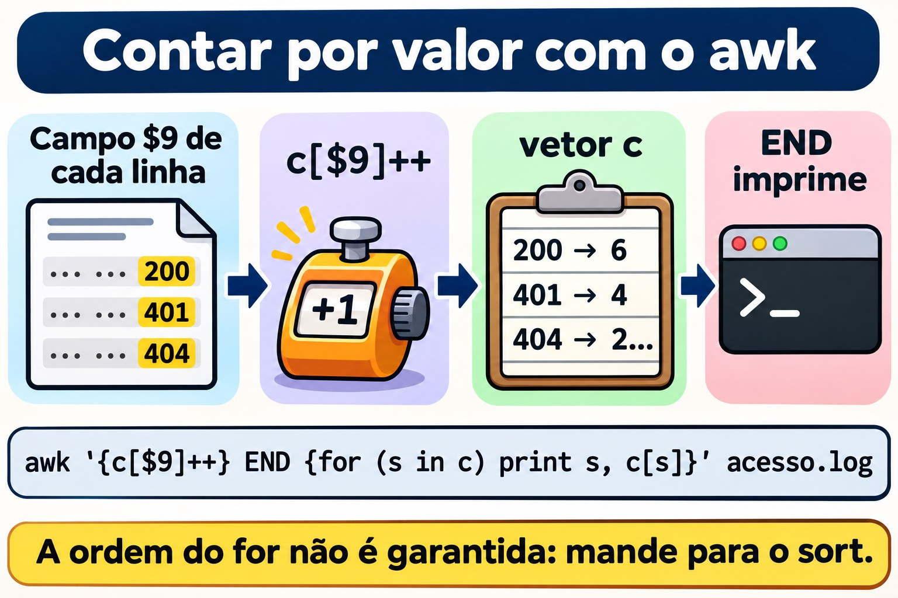

# Aula 3.4 · sed e awk

Na Aula 3.3 você escolheu linhas com o `grep`. Hoje você faz as outras duas coisas que todo administrador faz com texto: **mudar** linhas e **calcular** com colunas. O `sed` troca, apaga e insere linhas, na tela ou dentro do arquivo. O `awk` separa cada linha em campos, filtra por valor, soma, conta e formata. Os dois são pequenos, estão em toda máquina Linux, e são exatamente o que um script de produção usa quando precisa mexer num arquivo de configuração ou tirar um número de um log. No fim, você fecha o desafio do Módulo 3: os dez IPs que mais erraram a senha no SSH, numa linha de comando, nas duas VMs.

| Ficha | Aula 3.4 |
| --- | --- |
| Módulo | M3 · Texto e editor, aula 4 de 5 |
| Quando | Semana 8 |
| Ao final você consegue | Mostrar, apagar e trocar linhas com o `sed`, por número, por intervalo e por regex; usar grupos, `&` e outro delimitador no `s///`; editar um arquivo no lugar com `sed -i` sem perder nada, com cópia e conferência; separar campos com o `awk`, com o separador padrão e com `-F`; filtrar por valor, somar, contar com vetores e formatar com `printf`; cruzar dois arquivos com `NR == FNR`; passar variáveis do shell para o `awk` sem brigar com as aspas; saber quando um script de `awk` da Rocky (gawk) não roda igual na Debian (mawk); listar os IPs que mais erraram a senha no SSH, em arquivo e no journal |
| Pré-requisitos | Aula 3.1 (aspas, pipes, `<( )`); Aula 3.2 (`cut`, `sort`, `uniq -c`, `~/lab32/acesso.log`); Aula 3.3 (BRE e ERE, `~/lab33` com as amostras) |
| Tempo | Cerca de 2h30 |
| Snapshots | m3a4-inicio e m3a4-fim nas duas VMs |

## 1 · Aquecimento

Três perguntas, de cabeça. Escreva as respostas; o Gabarito confere no fim.

1. Você roda `sed 's/yes/no/' app.conf` e a tela mostra o arquivo com a troca feita. Palpite: o `app.conf` mudou?
2. Num log de SSH, a data é `Nov  3`, com dois espaços, porque o dia tem um dígito só. Palpite: o que `cut -d' ' -f2` mostra nessa linha? E `awk '{print $2}'`?
3. Um script de `awk` funciona na Rocky. Você copia o mesmo arquivo para a Debian, roda, e ele não dá erro nenhum. Palpite: pode sair um resultado diferente?

## 2 · Por que importa

Quase todo desastre com `sed` e `awk` acontece numa linha só, sem mensagem de erro:

| O chamado | A resposta errada | O que ela causa |
| --- | --- | --- |
| "Troca o servidor de banco de `10.1.0.40` para `10.1.0.41` no `app.conf`" | `sed 's/10.1.0.40/10.1.0.41/' app.conf` | A tela mostra a troca, mas o arquivo continua igual: sem `-i`, o `sed` só escreve na saída. E o ponto da regex ainda casaria com `10a1b0c40` |
| "Descomenta o `PermitRootLogin` do `sshd_config`" | `sed -i 's/^#//' /etc/ssh/sshd_config` | Descomenta **todas** as linhas que começam com `#`, inclusive as frases de explicação. O `sshd` não aceita a configuração e não sobe no próximo restart. Se você estava conectado por SSH, foi a última vez |
| "Desliga a senha no SSH e mostra o que mudou" | `sed -n -i 's/yes/no/p' arquivo` | O `-n` com o `-i` grava no arquivo **só** as linhas impressas. O arquivo de configuração vira uma linha só. Rodando de novo, vira um arquivo vazio |
| "Quantos bytes cada IP baixou hoje?" | `cut` para tirar as colunas e a soma numa planilha | Meia hora de copiar e colar. Um `awk '{b[$1] += $10} END {...}'` responde em um segundo, e roda de novo amanhã |
| "Tira o dia de cada linha do log de SSH" | `cut -d' ' -f2` | Funciona do dia 10 ao 31 e devolve uma linha em branco do dia 1 ao 9, porque os dias de um dígito vêm com dois espaços. O script passa no teste e falha na primeira semana do mês |
| "O relatório funciona na Rocky; na Debian sai vazio" | Copiar o mesmo script de `awk` para as duas | A Rocky tem o `gawk`; a Debian, o `mawk`. Um recurso só do `gawk` pode simplesmente não funcionar no `mawk`, sem erro nenhum |

O `sed` e o `awk` não são difíceis. São **literais**: fazem exatamente o que está escrito, na linha inteira, em todas as linhas. Quem sabe disso testa antes, na tela, e só depois grava no arquivo.

## 3 · Modelo mental

> O `sed` e o `awk` são **um laço sobre as linhas**. O `sed` lê uma linha, aplica os comandos, em ordem, e imprime o resultado. O `awk` lê uma linha, separa em campos, testa cada padrão e roda a ação dos que casaram. Nenhum dos dois volta atrás nem olha a linha seguinte (a não ser que você peça). Pense sempre "o que acontece com **cada** linha?", e não "o que acontece com o arquivo?".

```text
  sed 's/yes/no/' app.conf

  ┌─────────────┐   lê uma linha    ┌──────────────────┐   aplica s/yes/no/   ┌──────────────┐
  │ app.conf    │ ────────────────► │ espaço de padrão │ ───────────────────► │ imprime      │
  │ (só leitura)│                   │ "Password... yes"│   (só a 1ª vez,      │ na saída     │
  └─────────────┘                   └──────────────────┘    sem o g)          └──────────────┘
                     e repete para a próxima linha. Com -n, só imprime quando você manda (p).
                     Com -i, a "saída" é um arquivo novo que, no fim, toma o lugar do original.

  awk '$9 >= 400 {print $1, $9}' acesso.log

  linha: 192.168.5.7 - - [03/Nov/2026:08:02:30 +0100] "POST /login HTTP/1.1" 401 128
         └── $1 ───┘ $2 $3 └──────── $4 ────────┘ └$5─┘ └─$6─┘ └─$7─┘ └─ $8 ──┘ $9  $10
                                                                                NF = 10, $NF = $10

  BEGIN { ... }              roda uma vez, antes da primeira linha
  padrão { ação }            para cada linha: se o padrão é verdadeiro, roda a ação
  END { ... }                roda uma vez, depois da última linha (NR = total de linhas)
```

Duas consequências práticas. Primeira: o `sed` sem `-i` **nunca** muda o arquivo, então dá para testar à vontade. Segunda: o `awk` separa os campos por **qualquer sequência** de espaços e tabulações, e ignora os espaços do começo da linha. É por isso que ele não tropeça no `Nov  3`, e o `cut -d' '` tropeça.


*Pergunte o que acontece com cada linha, não com o arquivo.*

## 4 · Conceito em camadas

### Essencial

**O `sed`, o editor de fluxo.** O nome vem de *stream editor*. Ele recebe texto de um arquivo ou de um pipe e escreve o resultado na saída. A forma de quase todo uso é:

```bash
sed [opções] 'endereço comando' arquivo
```

O **endereço** diz em quais linhas o comando age; sem endereço, age em todas. O **comando** diz o que fazer:

| Comando | Faz | Exemplo |
| --- | --- | --- |
| `p` | Imprime a linha (de novo, se você não usou `-n`) | `sed -n '3p' arq` mostra só a linha 3 |
| `d` | Apaga a linha da saída | `sed '1d' arq` mostra tudo menos a linha 1 |
| `s/regex/troca/` | Troca o primeiro trecho que casa | `sed 's/yes/no/' arq` |
| `s/regex/troca/g` | Troca todos os trechos que casam, na linha | `sed 's/:/ /g' arq` |
| `q` | Para de ler | `sed '5q' arq` é um `head -n 5` |

| Endereço | Quais linhas | Exemplo |
| --- | --- | --- |
| `N` | A linha número N | `sed -n '3p'` |
| `$` | A última | `sed -n '$p'` é um `tail -n 1` |
| `N,M` | Da N até a M | `sed -n '2,4p'` |
| `/regex/` | As que casam com a regex | `sed -n '/401/p'` é um `grep 401` |
| `/a/,/b/` | Da primeira que casa com `a` até a próxima que casa com `b` | `sed -n '/^Port/,/^Password/p'` |
| `endereço!` | As que **não** são do endereço | `sed '/^#/!d'` deixa só os comentários |

E as três opções que você usa todo dia:

| Opção | Faz |
| --- | --- |
| `-n` | Não imprime nada sozinho; só o que você mandar com `p` |
| `-E` | Regex estendida, como o `grep -E` da Aula 3.3: `+`, `?`, `{}`, `\|` e `( )` sem barra |
| `-i` | Grava o resultado no próprio arquivo. `-i.bak` guarda antes uma cópia com o sufixo `.bak` |

**O `awk`, a linguagem das colunas.** O `awk` lê cada linha, separa em campos e roda um pequeno programa. A forma é:

```bash
awk 'padrão { ação }' arquivo
```

Sem padrão, a ação roda em toda linha. Sem ação, a linha que casou é impressa inteira. Os nomes que você precisa saber:

| Nome | É | Exemplo |
| --- | --- | --- |
| `$0` | A linha inteira | `awk '{print $0}'` é um `cat` |
| `$1`, `$2`... | O primeiro, o segundo campo... | `awk '{print $1}'` |
| `NF` | Quantos campos a linha tem | `$NF` é o último campo; `$(NF-1)`, o penúltimo |
| `NR` | O número da linha atual (no fim, o total) | `awk 'NR == 3'` é o `sed -n '3p'` |
| `-F` | O separador de campos | `awk -F: '{print $1}' /etc/passwd` |
| `BEGIN`, `END` | Antes da primeira linha, depois da última | `awk 'END {print NR}'` é um `wc -l` |

Padrões são comparações (`$9 >= 400`, `$1 == "10.1.0.20"`), regex (`/Failed password/`, `$7 ~ /^\/api/`) ou as duas coisas com `&&`, `||` e `!`. Variáveis não precisam ser declaradas: começam valendo zero, ou texto vazio. Por isso `{n++}` conta, e `{soma += $10}` soma.

**As aspas.** O programa do `awk` e do `sed` vai **sempre** entre aspas simples. O `$1` do `awk` é o primeiro campo; o `$1` do shell é o primeiro argumento do script. Entre aspas duplas, o shell troca o `$1` dele antes de o `awk` ver.

### Intermediário

**O `s///` por dentro.**

| Parte | Faz | Exemplo e resultado |
| --- | --- | --- |
| `&` | O trecho inteiro que casou | `echo 'Port 22' \| sed 's/[0-9][0-9]*/[&]/'` mostra `Port [22]` |
| `\(...\)` e `\1` | Grupo na BRE e a referência a ele | `sed 's/^\([^ ]*\) .*/\1/'` deixa só a primeira palavra |
| `(...)` e `\1` com `-E` | O mesmo, na ERE | `sed -E 's/^([^ ]+) .*/\1/'` |
| `g` | Todas as ocorrências da linha | `s/\//_/g` |
| Um número | Só a N-ésima ocorrência | `s/\//_/2` troca só a segunda barra |
| `I` (GNU) | Ignora maiúsculas | `s/passwordauthentication/PA/I` |
| `p` com `-n` | Imprime só as linhas em que houve troca | `sed -n 's/^Port /porta: /p'` |
| Outro delimitador | Qualquer caractere logo depois do `s` vira o separador | `s\|/home/rodrigo\|~\|` em vez de `s/\/home\/rodrigo/~/` |

O delimitador é a primeira coisa que salva um `sed` com caminhos. Com barra, cada `/` do caminho precisa de `\/`, e o comando vira cerca de madeira. Com `|`, `#` ou `,`, fica legível.

**Vários comandos.** Separe com `;` ou use vários `-e`. Os comandos rodam **em ordem**, na mesma linha:

```bash
sed '/^[[:space:]]*#/d; /^[[:space:]]*$/d' conf.amostra
sed -e 's/yes/no/' -e '/^#/d' conf.amostra
```

O primeiro é o `grep -Ev '^[[:space:]]*(#|$)'` da Aula 3.3, escrito em `sed`. A ordem importa: se a primeira troca transformasse uma linha em comentário, a segunda já a veria comentada.

**Inserir, acrescentar, trocar a linha inteira.** No GNU sed, numa linha só:

| Comando | Faz | Exemplo |
| --- | --- | --- |
| `i texto` | Insere uma linha **antes** | `sed '1i # gerado pelo lab' arq` |
| `a texto` | Acrescenta uma linha **depois** | `sed '/^Port/a # porta padrão' arq` |
| `c texto` | Troca a linha inteira | `sed '/^MaxAuthTries/c MaxAuthTries 4' arq` |
| `y/abc/xyz/` | Troca caractere por caractere, como o `tr` | `sed 'y/abc/ABC/'` |
| `l` | Mostra a linha com os invisíveis, como o `cat -A` | `sed -n '9l' conf.amostra` mostra `\t#ListenAddress 0.0.0.0$` |

**O `awk` que calcula.**

| Você quer | Programa |
| --- | --- |
| Contar as linhas que casam | `'$9 >= 400 {n++} END {print n+0}'` |
| Somar uma coluna | `'{soma += $10} END {print soma}'` |
| Contar por valor (o `sort \| uniq -c` do `awk`) | `'{c[$9]++} END {for (s in c) print s, c[s]}'` |
| Somar por valor | `'{b[$1] += $10} END {for (ip in b) print b[ip], ip}'` |
| Formatar | `printf "%-15s %10d\n", ip, b[ip]`: texto alinhado à esquerda em 15 posições, número à direita em 10 |
| Receber um valor do shell | `awk -v lim="$LIMITE" '$10 > lim'` |
| Regex num campo | `'$7 ~ /^\/api/'` e `'$6 !~ /GET/'` |
| Funções de texto | `length($1)`, `substr($4, 2, 11)`, `tolower($0)`, `split($4, p, ":")` |
| Trocar dentro do campo | `sub(/regex/, "troca", $7)` troca o primeiro; `gsub` troca todos |
| Pular para a próxima linha | `next` |

O `c[$9]++` é um **vetor associativo**: o índice é o próprio texto, `"200"`, `"401"`, `"10.1.0.20"`. É o que torna o `awk` tão útil para relatório. Um cuidado: o `for (x in v)` percorre os índices numa ordem que **não é garantida**, e que muda entre o `gawk` e o `mawk`. Sempre que a ordem importar, mande a saída para o `sort`.

**O separador de saída.** No `print $1, $2`, a vírgula vira o `OFS`, que vale um espaço. Com `-v OFS=';'`, vira ponto e vírgula. Mas `print` sozinho, ou `print $0`, mostra a linha como ela entrou. Para remontar a linha inteira com o `OFS` novo, mexa num campo: `{$1 = $1; print}`.



*O c[$9]++ guarda uma contagem por valor; o for percorre o vetor sem ordem garantida.*

### Ponte Windows

| No Windows | No Linux | Cuidado |
| --- | --- | --- |
| `(Get-Content app.conf) -replace '^PasswordAuthentication yes$', 'PasswordAuthentication no'` | `sed 's/^PasswordAuthentication yes$/PasswordAuthentication no/' app.conf` | O `-replace` do PowerShell ignora maiúsculas por padrão; o `sed`, não. O equivalente exato é o `-creplace` |
| `(Get-Content app.conf) -replace 'a', 'b' \| Set-Content app.conf` | `sed -i 's/a/b/' app.conf` | Os parênteses fazem o PowerShell ler o arquivo inteiro antes de gravar. Sem eles, o `Set-Content` tenta escrever no arquivo que ainda está aberto para leitura, e dá erro. O `sed -i` resolve isso gravando num arquivo temporário |
| `$1`, `$2` no `-replace` | `\1`, `\2` no `sed` | Mesma ideia de grupo, sintaxe diferente. No Notepad++, também é `\1` |
| `Get-Content acesso.log \| ForEach-Object { ($_ -split '\s+')[0] }` | `awk '{print $1}' acesso.log` | O PowerShell conta do zero; o `awk`, do um |
| `Import-Csv -Delimiter ':' -Header nome,x,uid ...` | `awk -F: '{print $1, $3}'` | O `Import-Csv` entende aspas em CSV; o `awk -F,` não entende |
| `Group-Object` e `Sort-Object Count -Descending` | `awk '{c[$1]++} END {...}' \| sort -rn` |  |
| `Measure-Object -Property Bytes -Sum` | `awk '{s += $10} END {print s}'` |  |

### Avançado

**O `sed -i` cria um arquivo novo.** Ele escreve o resultado num arquivo temporário, na mesma pasta, e no fim troca o original por ele. O GNU sed copia as permissões, mas o arquivo é **outro**, com outro número de inode. Isso tem três consequências reais:

- Um **link simbólico** editado com `sed -i` vira um arquivo comum, e o arquivo para onde ele apontava fica intacto. Para seguir o link: `sed -i --follow-symlinks`.
- Um **link físico** (Aula 2.8) deixa de ser compartilhado: o outro nome continua apontando para o conteúdo antigo.
- Um **log que está sendo escrito** não deve ser editado com `sed -i`. O programa continua escrevendo no inode antigo, já sem nome, e as linhas novas se perdem, ocupando disco até o programa reiniciar.

**`-i.bak` e o `-ie` que engana.** O sufixo da cópia vem **colado** no `-i`. Por isso `sed -ie 's/...//' arq` não é "`-i` e `-e`": é `-i` com sufixo `e`, e você ganha um arquivo `arqe` ao lado. No macOS e nos BSD, o `-i` exige o sufixo sempre (`sed -i '' ...`). Num script que precisa rodar nos dois, prefira gravar num arquivo novo e trocar com `mv`.

**O espaço de reserva.** O `sed` tem um segundo espaço, o *hold space*, com os comandos `h`, `H`, `g`, `G` e `x`. Com ele se escrevem truques como `sed -n '1!G;h;$p'`, que inverte o arquivo como o `tac`. Saiba reconhecer; para escrever coisas assim, use o `awk`, que é legível.

**Separadores com regex.** O `-F` do `awk` aceita regex: `-F'[ :]+'` separa por qualquer sequência de espaços e dois-pontos. Mas `-F,` não entende CSV de verdade: um campo `"Rossi, Ana"` vira dois. Para CSV com aspas, o `gawk` tem `FPAT`, e há ferramentas próprias, como o `csvtool`.

**Número ou texto.** Um campo que parece número é comparado como número: `$9 >= 400` funciona. Mas `"80%"` não parece número. O `+0` força a conversão e para no primeiro caractere que não é dígito: `$5+0` de `80%` é `80`. É assim que se lê o `df`: `df -P | awk 'NR > 1 && $5+0 >= 80 {print $6, $5}'`.

**Dois arquivos.** `NR` conta as linhas de todos os arquivos juntos; `FNR`, só as do arquivo atual. Enquanto os dois são iguais, o `awk` está lendo o **primeiro** arquivo. É o jeito clássico de carregar uma lista e usá-la no segundo, o `join` que a Aula 3.2 prometeu:

```bash
awk 'NR == FNR {bloq[$1]; next} $1 in bloq' bloqueio.txt acesso.log
```

**gawk e mawk.** O `gawk` tem extensões que o `mawk` não tem: `gensub()`, `asort()`, `asorti()`, `IGNORECASE`, `PROCINFO["sorted_in"]`, `FPAT`, o `-i inplace` e o `\y` de borda de palavra. Uma função que não existe dá erro na hora. Uma **variável** especial que não existe, como `IGNORECASE`, vira uma variável comum, e o script roda calado, com outro resultado. Na Rocky, o `gawk --posix` desliga as extensões, e o `gawk --lint` avisa quais você usou: os dois testam a portabilidade antes de o script chegar na Debian.

**O `awk` também roda comandos.** `system("...")` e `"comando" | getline` executam coisas no shell. Num script de `awk` que você não escreveu, procure por esses dois antes de rodar com `sudo`.

## 5 · Rocky × Debian

| Item | rocky-lab (Rocky 9) | debian-lab (Debian 13) | Como conferir |
| --- | --- | --- | --- |
| `sed` | GNU sed 4.8 | GNU sed 4.9 | `sed --version \| head -1` |
| `awk` | `gawk` 5.1 | `mawk` 1.3.4 | `readlink -f "$(command -v awk)"` |
| Versão do `awk` | `awk --version` ou `awk -W version` | `awk -W version` | O `-W version` funciona nos dois |
| Extensões do `gawk` | Funcionam | `gensub()` dá erro; `IGNORECASE` é ignorado, calado | `gawk --lint -f script.awk` na Rocky |
| Testar portabilidade | `gawk --posix -f script.awk` | `mawk -f script.awk` | Rode nos dois e compare a saída com `diff` |
| `gawk` disponível | Já vem | Só se alguém instalou (`apt install gawk`) | `command -v gawk` |
| Log de senha errada no SSH | `/var/log/secure`, gravado pelo rsyslog, com rotação semanal | Só no journal, unidade `ssh` | `ls -l /var/log/secure*`; `journalctl -u ssh -n 3` |
| Journal | Volátil, a não ser que você tenha mudado na Aula 2.3 | Permanente | `ls -ld /var/log/journal` |
| Nome do processo no log | `sshd[PID]` | Pode aparecer `sshd-session[PID]`, porque o OpenSSH 10 separou o processo da sessão | `journalctl -u ssh -n 5 -o short` |
| `sed -i` em link simbólico | Quebra o link | Quebra o link | `ls -l` antes e depois |

A linha que mais pega é a do `awk`. Os dois são `awk` de verdade, seguem o POSIX e rodam 95% dos programas igual. É nos outros 5% que um script copiado de um servidor para outro dá resultado diferente sem avisar. Na Quebra B você vê isso acontecer.

A do processo também. Um `grep 'sshd\['` acha as linhas da Rocky e pode não achar nenhuma na Debian 13. Por isso o lab filtra pela **unidade** (`journalctl -u ssh`) e pelo **texto** (`Failed password`), e nunca pelo nome do processo.

## 6 · Lab guiado

Você é o `rodrigo`, na rocky-lab, e alcança a debian-lab pelo `ssh deb`. Tudo acontece em `~/lab34`, nas duas VMs. O `sed -i` só é usado em **cópias** dentro da pasta do lab. Os arquivos do sistema e os logs reais **só são lidos**. O Passo 7 é o desafio do Módulo 3.


*Pergunte o que acontece com cada linha, não o que acontece com o arquivo.*


### Passo 0 · Snapshot, pasta e os arquivos do lab

No Proxmox, tire o snapshot `m3a4-inicio` das duas VMs. Na rocky-lab:

```bash
eval "$(ssh-agent -s)"; ssh-add
ssh -o BatchMode=yes deb hostname
mkdir -p ~/lab34; ssh deb 'mkdir -p ~/lab34'
cd ~/lab34
cp ~/lab33/acesso.log ~/lab33/ssh.amostra ~/lab33/conf.amostra ~/lab33/bloqueio.txt .
wc -l acesso.log ssh.amostra conf.amostra bloqueio.txt
```

```text
  15 acesso.log
  12 ssh.amostra
  11 conf.amostra
   3 bloqueio.txt
  41 total
```

Se faltar algum, recrie com o Passo 0 da Aula 3.3 (o `acesso.log` vem da Aula 3.2). O `bloqueio.txt` tem `203.0.113.9`, `198.51.100.4` e uma linha vazia no fim, de propósito. Agora as versões, nas duas VMs:

```bash
sed --version | head -1; readlink -f "$(command -v awk)"; awk -W version 2>/dev/null | head -1
ssh deb 'sed --version | head -1; readlink -f "$(command -v awk)"; awk -W version 2>/dev/null | head -1'
```

Na Rocky você deve ver o GNU sed 4.8 e o `awk` apontando para o `gawk`, versão 5.1. Na Debian, o GNU sed 4.9 e o `awk` apontando para o `mawk`, versão 1.3.4. Anote o que saiu: a Quebra B depende disso. Copie os arquivos para a Debian:

```bash
scp acesso.log ssh.amostra conf.amostra bloqueio.txt deb:lab34/
ssh deb 'cd ~/lab34 && wc -l acesso.log ssh.amostra conf.amostra bloqueio.txt'
```

### Passo 1 · Mostrar e apagar

Primeiro, o `sed` como um `head`, um `tail` e um `grep`:

```bash
sed -n '3p' acesso.log
sed -n '$p' acesso.log
sed -n '2,4p' acesso.log | cut -d' ' -f1
```

```text
10.1.0.20 - - [03/Nov/2026:08:01:02 +0100] "GET /docs HTTP/1.1" 200 2048
10.1.0.20 - - [03/Nov/2026:08:07:30 +0100] "GET / HTTP/1.1" 200 5120
10.1.0.31
10.1.0.20
192.168.5.7
```

Agora você quer ver as tentativas de login que falharam, as linhas com `401`. E esquece o `-n`.

**Decida 1 · Quantas linhas mostra `sed '/401/p' acesso.log | wc -l`?**

- **A)** 4
- **B)** 15
- **C)** 19
- **D)** 11

Escolha a letra antes de olhar a tabela.

```bash
sed '/401/p' acesso.log | wc -l
sed -n '/401/p' acesso.log | wc -l
```

```text
19
4
```

| Se você marcou | Resultado | Por quê |
| --- | --- | --- |
| A | ❌ Errada | É o resultado **com** `-n`. Sem ele, o `sed` imprime toda linha no fim do ciclo, e o `p` imprime de novo as que casaram. |
| B | ❌ Errada | Seria verdade se o `p` não fizesse nada. Ele faz: imprime a linha **mais uma vez**. |
| C | ✅ Certa | As 15 linhas, uma vez cada, mais as 4 com `401` repetidas: 15 + 4 = 19. |
| D | ❌ Errada | Seriam as linhas **sem** `401` (15 − 4). Isso é o `sed '/401/d'`. |

**Para fixar:** o `p` quase sempre anda com o `-n`. Sem o `-n`, o `p` duplica as linhas.

O `d` faz o contrário: tira a linha da saída. Este é o `grep -Ev '^[[:space:]]*(#|$)'` da Aula 3.3, em `sed`:

```bash
sed '/^[[:space:]]*#/d; /^[[:space:]]*$/d' conf.amostra
```

```text
Port 22
PermitRootLogin no
PasswordAuthentication yes
MaxAuthTries 3
```

Os dois comandos rodam em ordem na mesma linha. Uma linha apagada pelo primeiro não chega ao segundo: o `d` encerra o ciclo daquela linha na hora.

### Passo 2 · A troca: `s`, `g` e o delimitador

Você quer trocar as barras de um caminho por sublinhados, para virar nome de arquivo.

**Decida 2 · O que mostra `echo 'GET /a/b/c HTTP/1.1' | sed 's/\//_/'`?**

- **A)** `GET _a_b_c HTTP_1.1`
- **B)** `GET _a/b/c HTTP/1.1`
- **C)** `GET /a/b/c HTTP/1.1`, sem mudança
- **D)** Um erro, por causa da barra dentro do padrão

Escolha a letra antes de olhar a tabela.

```bash
echo 'GET /a/b/c HTTP/1.1' | sed 's/\//_/'
echo 'GET /a/b/c HTTP/1.1' | sed 's/\//_/g'
echo 'GET /a/b/c HTTP/1.1' | sed 's|/|_|g'
echo 'GET /a/b/c HTTP/1.1' | sed 's|/|_|2'
```

```text
GET _a/b/c HTTP/1.1
GET _a_b_c HTTP_1.1
GET _a_b_c HTTP_1.1
GET /a_b/c HTTP/1.1
```

| Se você marcou | Resultado | Por quê |
| --- | --- | --- |
| A | ❌ Errada | É o resultado com o `g`. Sem ele, o `s` troca só a **primeira** ocorrência de cada linha. |
| B | ✅ Certa | O `\/` é uma barra literal. A primeira barra da linha vira `_`, e o resto fica como estava. |
| C | ❌ Errada | Casou, e trocou. O `s` só não muda nada quando a regex não casa em lugar nenhum da linha. |
| D | ❌ Errada | Com `\`, a barra deixa de ser delimitador. Sem a `\`, aí sim: `s///_/` dá `unknown option to 's'`. |

**Para fixar:** sem `g`, só a primeira ocorrência de cada linha. Com caminhos, troque o delimitador: `s|/|_|g` se lê de primeira.

O número no lugar do `g` escolhe **qual** ocorrência: o `2` trocou só a segunda barra. Dois usos que você vai repetir muito: o `p` com `-n`, que mostra só as linhas trocadas, e o `I`, que ignora maiúsculas.

```bash
sed -n 's/^Port /porta: /p' conf.amostra
sed -n 's/passwordauthentication/PA/Ip' conf.amostra
```

```text
porta: 22
PA yes
#PA no
```

### Passo 3 · Grupos, `&` e a regex gulosa

Do `acesso.log`, você quer só o IP e o código de status. Com `-E`, os parênteses guardam o trecho, e o `\1` e o `\2` o devolvem:

```bash
sed -E 's/^([^ ]+) .*" ([0-9]{3}) .*/\1 \2/' acesso.log | head -4
```

```text
10.1.0.20 200
10.1.0.31 200
10.1.0.20 200
192.168.5.7 401
```

O `[^ ]+` é "um ou mais caracteres que não são espaço": o IP inteiro e nada mais. O ` .*"  ` engole tudo até a última aspa seguida de espaço, e o `([0-9]{3})` pega os três dígitos que vêm logo depois. Para mandar um log para um fornecedor sem expor as máquinas, zere o último octeto:

```bash
sed -E 's/^([0-9]+\.[0-9]+\.[0-9]+)\.[0-9]+/\1.0/' acesso.log | cut -d' ' -f1 | sort -u
echo 'Port 22' | sed 's/[0-9][0-9]*/[&]/'
```

```text
10.1.0.0
192.168.5.0
203.0.113.0
Port [22]
```

O `&` é o trecho inteiro que casou, sem precisar de grupo. Agora o erro que todo mundo comete uma vez. Você quer tirar as aspas dos valores de uma linha de configuração:

**Decida 3 · O que mostra `echo 'id="7" nome="ana"' | sed 's/"\(.*\)"/\1/'`?**

- **A)** `id=7 nome=ana`
- **B)** `id=7" nome="ana`
- **C)** `id="7" nome=ana`
- **D)** `7`

Escolha a letra antes de olhar a tabela.

```bash
echo 'id="7" nome="ana"' | sed 's/"\(.*\)"/\1/'
echo 'id="7" nome="ana"' | sed 's/"\([^"]*\)"/\1/g'
```

```text
id=7" nome="ana
id=7 nome=ana
```

| Se você marcou | Resultado | Por quê |
| --- | --- | --- |
| A | ❌ Errada | É o que você queria. Para isso, o grupo não pode atravessar aspas: `[^"]*`, com o `g`. |
| B | ✅ Certa | O `.*` é **guloso**: casa com o trecho mais longo possível. Vai da primeira aspa da linha até a **última**, e só essas duas somem. |
| C | ❌ Errada | Seria uma regex que começa a casar pelo fim. A regex começa pelo primeiro ponto possível da linha, a primeira aspa. |
| D | ❌ Errada | O `s` só troca o trecho que casou. O `id=`, antes da primeira aspa, fica. |

**Para fixar:** `.*` vai o mais longe que puder. Para parar no próximo delimitador, use "tudo menos ele": `[^"]*`, `[^ ]*`, `[^:]*`.


*O .* vai até a última aspa; o [^"]* para na próxima.*

### Passo 4 · `sed -i` sem susto

Agora o `sed` vai gravar em arquivo. Trabalhe numa cópia. O roteiro seguro tem três passos: ver a diferença na tela, gravar com cópia, conferir.

```bash
cp conf.amostra app.conf
sed 's/^PasswordAuthentication yes/PasswordAuthentication no/' app.conf | diff app.conf -; echo "diff saiu com $?"
```

```text
7c7
< PasswordAuthentication yes
---
> PasswordAuthentication no
diff saiu com 1
```

O `-` diz ao `diff` para ler a entrada do pipe. A saída mostra exatamente uma linha mudada, a 7. O `1` do `diff` quer dizer "são diferentes", e não é erro. Se a saída mostrasse vinte linhas, você teria descoberto o problema **antes** de estragar o arquivo. Agora grave, com cópia, e confira:

```bash
ls -i app.conf
sed -i.bak 's/^PasswordAuthentication yes/PasswordAuthentication no/' app.conf
ls -i app.conf; ls app.conf*
diff app.conf.bak app.conf
```

O número de inode muda: o `sed -i` escreveu um arquivo novo e trocou o antigo por ele. O `app.conf.bak` é o original, e o `diff` mostra as mesmas linhas da prévia. Agora um link simbólico, para ver o que acontece com ele:

```bash
ln -s app.conf link.conf; ls -l link.conf
sed -i 's/^Port 22/Port 2222/' link.conf
ls -l link.conf app.conf; grep -H '^Port' link.conf app.conf
```

Antes, o `ls -l` mostra `link.conf -> app.conf`. Depois, o `link.conf` é um arquivo comum, sem a seta, com `Port 2222`. O `app.conf` continua com `Port 22`. Num servidor em que `/etc/algo.conf` é um link para um arquivo gerenciado, essa troca passa despercebida até alguém editar o arquivo de verdade e nada mudar. Com `sed -i --follow-symlinks`, o `sed` edita o arquivo para onde o link aponta. Limpe e recomece do original:

```bash
rm link.conf; cp conf.amostra app.conf; rm -f app.conf.bak
```

Seu colega manda um comando com "as opções juntas, que é mais rápido":

**Decida 4 · O que acontece com `sed -ie 's/^PasswordAuthentication yes/PasswordAuthentication no/' app.conf`?**

- **A)** O `app.conf` é alterado, e nada mais
- **B)** O `app.conf` é alterado, e aparece um `app.confe` com o conteúdo antigo
- **C)** Erro: opção inválida
- **D)** Nada muda, porque o `e` executa a troca como um comando do shell

Escolha a letra antes de olhar a tabela.

```bash
sed -ie 's/^PasswordAuthentication yes/PasswordAuthentication no/' app.conf
ls app.conf*
grep -c '^PasswordAuthentication no' app.conf app.confe
```

```text
app.conf  app.confe
app.conf:1
app.confe:0
```

| Se você marcou | Resultado | Por quê |
| --- | --- | --- |
| A | ❌ Errada | Seria o caso de `sed -i -e`, com as opções separadas. Juntas, o `e` vira outra coisa. |
| B | ✅ Certa | O sufixo da cópia vem colado no `-i`. `-ie` é "`-i` com sufixo `e`". A troca foi feita, e a cópia se chama `app.confe`. |
| C | ❌ Errada | A sintaxe é válida, e é por isso que engana: nenhum aviso. |
| D | ❌ Errada | O `e` como **flag** do `s` (no fim, `s/.../.../e`) executa comandos no GNU sed. Como opção colada no `-i`, é só um sufixo. |

**Para fixar:** escreva `-i.bak` ou `-i -e`, nunca `-ie`. Um `ls` depois do `sed -i` mostra as cópias com nome estranho.

Limpe a sobra: `rm app.confe`.

### Passo 5 · Campos com o `awk`

Agora as colunas. O `awk` separa cada linha pelos espaços e numera os pedaços:

```bash
awk '{print $1, $9}' acesso.log | head -3
awk 'END {print NR}' acesso.log
head -1 ssh.amostra | awk '{print $2, $NF, NF}'
head -1 ssh.amostra | cut -d' ' -f2 | cat -A
```

```text
10.1.0.20 200
10.1.0.31 200
10.1.0.20 200
15
3 ssh2 14
$
```

O `Nov  3` tem dois espaços. Para o `cut -d' '`, isso é um campo **vazio** entre eles, e o `-f2` sai em branco, como o `cat -A` mostra. Para o `awk`, qualquer sequência de espaços é um separador só: o `$2` é o `3`. O `NF` diz que a linha tem 14 campos, e o `$NF` é o último, `ssh2`.

Você coloca o programa entre aspas duplas, "para variar":

**Decida 5 · O que mostra `awk "{print $1}" acesso.log | head -1`?**

- **A)** `10.1.0.20`
- **B)** A linha inteira
- **C)** Um erro de sintaxe do `awk`
- **D)** Uma linha vazia

Escolha a letra antes de olhar a tabela.

```bash
awk "{print $1}" acesso.log | head -1
echo "{print $1}"
```

```text
10.1.0.20 - - [03/Nov/2026:08:00:01 +0100] "GET / HTTP/1.1" 200 5120
{print }
```

| Se você marcou | Resultado | Por quê |
| --- | --- | --- |
| A | ❌ Errada | Seria com aspas simples. Entre aspas duplas, o shell troca o `$1` antes de o `awk` ver. |
| B | ✅ Certa | No terminal, o `$1` do shell está vazio. O `awk` recebe `{print }`, e o `print` sem nada imprime a linha inteira. |
| C | ❌ Errada | `{print }` é um programa válido. Por isso o erro é traiçoeiro: nada avisa. |
| D | ❌ Errada | O `print` sem argumento não imprime vazio; imprime o `$0`. Dentro de um script que recebeu argumentos, o `$1` seria o primeiro argumento, e o resultado mudaria de novo. |

**Para fixar:** o programa do `awk` vai entre aspas simples, sempre. Valor do shell entra por `-v`.

O `-F` muda o separador. No `/etc/passwd`, são dois-pontos. Usuários de gente têm UID a partir de 1000:

```bash
awk -F: '$3 >= 1000 {print $1, $3}' /etc/passwd
awk -F: '$3 >= 1000 && $3 < 65534 {print $1, $3}' /etc/passwd
```

O primeiro lista também o `nobody`, com UID 65534, que é uma conta de sistema, nas duas distribuições. O segundo deixa só as pessoas. Na Rocky, deve sair o `rodrigo` e os usuários que você criou no Módulo 2.

### Passo 6 · Filtrar, somar e contar

Um padrão sem ação imprime a linha. Uma comparação é um padrão:

```bash
awk '$9 >= 400' acesso.log | wc -l
awk '$9 >= 400 {print $1, $9, $7}' acesso.log | head -3
awk '$7 ~ /^\/api/ {print $1, $7, $9}' acesso.log
awk '$6 !~ /GET/' acesso.log | wc -l
```

```text
9
192.168.5.7 401 /login
192.168.5.7 401 /login
203.0.113.9 403 /admin
10.1.0.20 /api/status 500
10.1.0.31 /api/status 500
5
```

Agora o que o `cut` não faz: contas. A soma dos bytes, os bytes por IP e os pedidos por status:

```bash
awk '{s += $10} END {print s}' acesso.log
awk '{b[$1] += $10} END {for (ip in b) printf "%-15s %10d\n", ip, b[ip]}' acesso.log | sort -k2,2nr
awk '{c[$9]++} END {for (s in c) print s, c[s]}' acesso.log | sort
```

```text
1068928
10.1.0.45          1048576
10.1.0.20            12352
192.168.5.7           4608
10.1.0.31             2112
203.0.113.9           1280
200 6
401 4
403 1
404 2
500 2
```

O `b[$1] += $10` soma os bytes num vetor cujo índice é o IP. O `printf` alinha, e o `sort -k2,2nr` ordena pelo segundo campo, como número, do maior para o menor. O `sort` no fim é obrigatório: o `for (ip in b)` não promete ordem nenhuma, e o `mawk` da Debian devolve outra ordem que a do `gawk`. Rode o mesmo na Debian e compare.

Um valor do shell entra com `-v`:

```bash
LIMITE=1000
awk -v lim="$LIMITE" '$10 > lim {print $1, $10}' acesso.log | wc -l
```

```text
6
```

Seu script de alerta conta os erros 999, que não existem, e manda o número por e-mail:

**Decida 6 · O que mostra `awk '$9 == 999 {n++} END {print n}' acesso.log`?**

- **A)** `0`
- **B)** Uma linha vazia
- **C)** Nada: nenhuma linha casou, então o `END` não roda
- **D)** Um erro, porque `n` nunca foi definido

Escolha a letra antes de olhar a tabela.

```bash
awk '$9 == 999 {n++} END {print n}' acesso.log | cat -A
awk '$9 == 999 {n++} END {print n+0}' acesso.log
```

```text
$
0
```

| Se você marcou | Resultado | Por quê |
| --- | --- | --- |
| A | ❌ Errada | É o que o `n+0` mostra. Sem a conta, a variável nunca tocada vale texto vazio. |
| B | ✅ Certa | O `n++` nunca rodou. O `n` é vazio, e o `print` imprime vazio e a quebra de linha: o `cat -A` mostra só o `$`. |
| C | ❌ Errada | O `END` roda sempre, depois da última linha, tenha algo casado ou não. |
| D | ❌ Errada | No `awk`, variável não precisa de declaração. Ela existe, valendo zero ou vazio conforme o uso. |

**Para fixar:** num `END` que imprime uma contagem, escreva `n+0`. O e-mail com "0 erros" é diferente do e-mail com "  erros".


*O END roda sempre; sem n+0, a contagem de zero ocorrências sai vazia.*

Por fim, dois arquivos. O `bloqueio.txt` tem a lista de IPs bloqueados no firewall. Quais pedidos do log vieram deles?

```bash
awk 'NR == FNR {bloq[$1]; next} $1 in bloq' bloqueio.txt acesso.log
```

```text
203.0.113.9 - - [03/Nov/2026:08:03:10 +0100] "GET /admin HTTP/1.1" 403 256
203.0.113.9 - - [03/Nov/2026:08:04:20 +0100] "GET /wp-login.php HTTP/1.1" 404 512
203.0.113.9 - - [03/Nov/2026:08:06:30 +0100] "GET /.env HTTP/1.1" 404 512
```

Enquanto `NR == FNR`, o `awk` está no primeiro arquivo: guarda cada IP como índice do vetor e pula para a próxima linha com `next`. No segundo arquivo, o `$1 in bloq` é verdadeiro para os IPs da lista. A linha vazia do `bloqueio.txt` vira um índice vazio, que nenhuma linha do log tem, e não atrapalha. É o `join` da Aula 3.2, sem precisar ordenar nada antes.

### Passo 7 · Desafio do módulo: os dez IPs que mais erraram a senha

O pedido é o de todo começo de incidente: "quem está tentando entrar no SSH?". Primeiro na amostra, onde você sabe a resposta. As linhas de senha errada têm dois formatos:

```text
... Failed password for root from 203.0.113.9 port 51022 ssh2
... Failed password for invalid user admin from 198.51.100.4 port 40110 ssh2
```

**Decida 7 · Qual expressão do `awk` pega o IP nos dois formatos?**

- **A)** `$11`
- **B)** `$13`
- **C)** `$(NF-3)`
- **D)** `$NF-3`

Escolha a letra antes de olhar a tabela.

```bash
awk '/Failed password/ {print $11}' ssh.amostra | sort | uniq -c | sort -rn
awk '/Failed password/ {print $(NF-3)}' ssh.amostra | sort | uniq -c | sort -rn | head -10
awk '/Failed password/ {print $NF-3}' ssh.amostra | head -1
```

```text
      2 admin
      2 203.0.113.9
      1 test
      1 oracle
      1 10.1.0.31
      3 203.0.113.9
      2 198.51.100.4
      1 192.0.2.66
      1 10.1.0.31
-3
```

| Se você marcou | Resultado | Por quê |
| --- | --- | --- |
| A | ❌ Errada | Funciona na linha normal. Na de `invalid user`, há duas palavras a mais, e o `$11` vira o nome do usuário: `admin`, `oracle` e `test` aparecem como se fossem IPs. |
| B | ❌ Errada | É o contrário: acerta o `invalid user` e, na linha normal, pega a porta. |
| C | ✅ Certa | Contando do fim, o formato é o mesmo: IP, `port`, número, `ssh2`. O IP é sempre o quarto de trás para frente. |
| D | ❌ Errada | Sem parênteses, é `($NF) - 3`: o texto `ssh2` vale 0 como número, e sai `-3`. |

**Para fixar:** quando o começo da linha varia e o fim não, conte do fim: `$NF`, `$(NF-1)`, `$(NF-3)`.

Os empates (`2 admin` e `2 203.0.113.9`) podem sair em outra ordem, conforme o idioma configurado na VM; os números não mudam. Quando o formato pode variar mais, por exemplo com um nome de usuário que tem espaço, procure a palavra em vez de contar:

```bash
awk '/Failed password/ {for (i = 1; i <= NF; i++) if ($i == "from") print $(i+1)}' ssh.amostra | sort | uniq -c | sort -rn
```

O resultado é o mesmo. As duas formas pegam também o IPv6, coisa que o `grep -oE 'from [0-9.]+'` da Aula 3.3 corta no primeiro `:`.

Agora o log real. Na Rocky, o `/var/log/secure` e as rotações da semana:

```bash
sudo cat /var/log/secure-* /var/log/secure 2>/dev/null | awk '/Failed password/ {print $(NF-3)}' | sort | uniq -c | sort -rn | head -10
```

Na Debian, só o journal, unidade `ssh`. O `-o cat` tira a data e o nome do processo, mas o fim da linha é o mesmo:

```bash
ssh -t deb "sudo journalctl -u ssh --no-pager -o cat | awk '/Failed password/ {print \$(NF-3)}' | sort | uniq -c | sort -rn | head -10"
```

Repare no `\$(NF-3)`. O comando inteiro está entre aspas duplas, e o shell **local** veria `$(NF-3)` como substituição de comando: tentaria rodar um programa chamado `NF-3`, daria erro, e o `awk` receberia ` print  ` sem nada. A barra protege o `$`. Escapar à mão em cada comando não escala. O jeito profissional é um script, com o programa do `awk` entre aspas simples, que roda igual nas duas VMs:

```bash
cat > top10.sh <<'EOF'
#!/bin/bash
# top10.sh: os 10 IPs com mais senhas erradas no SSH (Rocky: arquivo; Debian: journal)
{ sudo cat /var/log/secure 2>/dev/null || sudo journalctl -u ssh -u sshd --no-pager -o cat; } |
  awk '/Failed password/ {print $(NF-3)}' | sort | uniq -c | sort -rn | head -10
EOF
chmod +x top10.sh
./top10.sh
scp top10.sh deb:lab34/
ssh -t deb 'bash ~/lab34/top10.sh'
```

O `'EOF'` com aspas impede o shell de mexer no conteúdo do here-doc (Aula 3.1). O `||` usa o journal quando o arquivo não existe. O `-t` dá um terminal ao `ssh` para o `sudo` pedir a senha. O script conta **só** as linhas `Failed password`. As linhas `authentication failure` do PAM descrevem a mesma tentativa, e contar as duas dobraria o número.

Se a saída vier vazia, seu lab não sofreu ataque nenhum, o que é bom. Para ver o script trabalhar, erre a senha de propósito: da rocky-lab, rode `ssh -o PubkeyAuthentication=no naoexiste@10.1.0.52` e digite qualquer coisa três vezes. Rode `ssh -t deb 'bash ~/lab34/top10.sh'` de novo: o IP da rocky-lab aparece com 3.

Se você tornou o journal da Rocky permanente na Aula 2.3, ele também tem essas linhas: `sudo journalctl -u sshd --no-pager -o cat | awk ...` dá o mesmo resultado que o arquivo. Se o journal ainda for volátil, ele só tem o que aconteceu depois do último boot, e o `/var/log/secure` é a fonte certa.

## 7 · Quebre e conserte

### Quebra A · O script que apaga a configuração

O cenário: um colega escreveu um script para desligar o login por senha nos servidores. Ele queria que o script "mostrasse a linha que mudou", e por isso usou `-n` e `p`. Como queria gravar no arquivo, juntou o `-i`. Monte o script, na rocky-lab, sobre uma cópia:

```bash
cd ~/lab34
cat > desliga-senha.sh <<'EOF'
#!/bin/bash
# desliga-senha.sh: desliga o login por senha e mostra a linha que mudou
arq=${1:-app.conf}
sed -n -i 's/^PasswordAuthentication yes/PasswordAuthentication no/p' "$arq"
echo "feito em $arq"
EOF
chmod +x desliga-senha.sh
cp conf.amostra app.conf
./desliga-senha.sh app.conf
```

```text
feito em app.conf
```

**Observe.** O script não mostrou linha nenhuma, só o `feito`. Não deu erro, e o status é `0`.

**Decida 8 · O que o `app.conf` tem agora?**

- **A)** As 11 linhas, com a troca feita
- **B)** Uma linha só: `PasswordAuthentication no`
- **C)** Nada: o arquivo está vazio
- **D)** As 11 linhas, sem a troca, porque o `-n` impediu a gravação

Escolha a letra antes de olhar a tabela.

```bash
wc -l app.conf; cat app.conf
./desliga-senha.sh app.conf
wc -c app.conf
```

```text
1 app.conf
PasswordAuthentication no
feito em app.conf
0 app.conf
```

| Se você marcou | Resultado | Por quê |
| --- | --- | --- |
| A | ❌ Errada | É o que o colega queria. Mas, com `-i`, a "saída" do `sed` é o arquivo novo, e o `-n` manda não escrever nada além do que o `p` imprimir. |
| B | ✅ Certa | Só a linha trocada foi impressa, e foi impressa **dentro** do arquivo. Por isso a tela ficou vazia: a linha que deveria aparecer foi para o `app.conf`. |
| C | ⚠️ Ainda não | É o que acontece na **segunda** vez. Não há mais `yes` para trocar, o `p` não imprime nada, e o arquivo fica com 0 bytes. |
| D | ❌ Errada | O `-n` não impede a gravação. Ele decide **o que** é gravado. |

**Para fixar:** com `-i`, tudo o que o `sed` imprimiria vai para o arquivo. `-n` junto com `-i` só faz sentido se você quer que o arquivo fique **apenas** com as linhas do `p`.

**Diagnostique.** Num servidor de verdade, esse script deixa o `sshd_config` com uma linha. O `sshd` sobe com os valores padrão, o que pode até funcionar, e ninguém percebe até alguém procurar o `AllowGroups` ou o `Port` que estavam lá. A segunda execução, pelo `cron` ou por engano, deixa o arquivo vazio. E não há cópia.


*Com -i, tudo o que o sed imprimiria vai para o arquivo; com -n e p, sobra uma linha.*

**Conserte.** O script certo grava com cópia, sem `-n`, e mostra a diferença comparando o antes com o depois:

```bash
cat > desliga-senha.sh <<'EOF'
#!/bin/bash
# desliga-senha.sh: desliga o login por senha, com cópia e conferência
arq=${1:-app.conf}
sed -i.bak 's/^PasswordAuthentication yes/PasswordAuthentication no/' "$arq" || exit 2
if cmp -s "$arq.bak" "$arq"; then
    echo "nada a mudar em $arq"
else
    diff "$arq.bak" "$arq" || true
fi
EOF
cp conf.amostra app.conf
./desliga-senha.sh app.conf
./desliga-senha.sh app.conf
wc -l app.conf
```

```text
7c7
< PasswordAuthentication yes
---
> PasswordAuthentication no
nada a mudar em app.conf
11 app.conf
```

O `cmp -s` não mostra nada e só responde pelo status: `0` se os arquivos são iguais. Agora o script pode rodar dez vezes que o resultado é o mesmo, e cada execução diz o que fez. Um detalhe: a segunda execução sobrescreve o `.bak` com o arquivo já trocado. Num servidor, um sufixo com data, como `-i".$(date +%F-%H%M%S).bak"`, guarda todas as versões.

### Quebra B · O relatório que some na Debian

O cenário: um relatório conta, por IP, as falhas de login no formulário do site. Quem o escreveu, na Rocky, sabia que alguns clientes mandam `post` em minúsculas, e usou `IGNORECASE` para não depender disso. O relatório foi para todos os servidores. Nos da Debian, ele sempre diz que não houve falha nenhuma. Monte, na rocky-lab:

```bash
cat > relatorio.awk <<'EOF'
# relatorio.awk: logins que falharam no formulário, por IP
BEGIN { IGNORECASE = 1 }
/post \/login/ && $9 == 401 { falhas[$1]++ }
END { for (ip in falhas) printf "%-15s %d\n", ip, falhas[ip] }
EOF
awk -f relatorio.awk acesso.log
scp relatorio.awk deb:lab34/
ssh deb 'cd ~/lab34 && awk -f relatorio.awk acesso.log; echo "status: $?"'
```

```text
192.168.5.7     4
status: 0
```

**Observe.** Na Rocky, as quatro falhas de `192.168.5.7`. Na Debian, nada, com status `0`. Nenhum aviso.

**Diagnostique.** Na Rocky, peça ao `gawk` para se comportar como um `awk` POSIX e para apontar o que não é padrão:

```bash
gawk --posix -f relatorio.awk acesso.log; echo "status: $?"
gawk --lint -f relatorio.awk acesso.log
```

O `--posix` reproduz a Debian: nenhuma linha, status `0`. A primeira linha do `--lint` diz que `` `IGNORECASE' is a gawk extension ``. No `mawk`, e no `gawk --posix`, o `IGNORECASE` é uma variável qualquer, que você criou e pôs em 1 sem efeito nenhum. A regex `/post \/login/` continua diferenciando maiúsculas, o log tem `POST`, e nada casa. O `--lint` também pode reclamar do `falhas[$1]++` num elemento ainda vazio; esse aviso é inofensivo, porque um elemento vazio vale zero na soma.

Compare com uma função que só o `gawk` tem: `gawk --posix 'BEGIN {print gensub(/a/, "b", "g", "aaa")}'` termina com ``fatal: function `gensub' not defined`` e status `2`. Função que falta dá erro alto. Variável especial que falta não dá erro nenhum.

**Decida 9 · Qual conserto faz o relatório funcionar igual nas duas VMs?**

- **A)** Instalar o `gawk` na Debian
- **B)** Trocar o padrão por `tolower($0) ~ /post \/login/ && $9 == 401`
- **C)** Rodar na Debian com `awk -v IGNORECASE=1 -f relatorio.awk`
- **D)** Pôr `#!/usr/bin/gawk -f` na primeira linha do script

Escolha a letra antes de olhar a tabela.

```bash
sed -i.bak 's/^BEGIN.*//; s|^/post|tolower($0) ~ /post|' relatorio.awk
cat relatorio.awk
gawk --posix -f relatorio.awk acesso.log
scp relatorio.awk deb:lab34/; ssh deb 'cd ~/lab34 && awk -f relatorio.awk acesso.log'
```

```text
# relatorio.awk: logins que falharam no formulário, por IP

tolower($0) ~ /post \/login/ && $9 == 401 { falhas[$1]++ }
END { for (ip in falhas) printf "%-15s %d\n", ip, falhas[ip] }
192.168.5.7     4
192.168.5.7     4
```

| Se você marcou | Resultado | Por quê |
| --- | --- | --- |
| A | ⚠️ Funciona, com custo | Resolve neste servidor, mas o script continua quebrado em todo servidor onde ninguém instalou o `gawk`. E agora o `awk` de cada Debian depende do que foi instalado nela. |
| B | ✅ Certa | O `tolower()` é POSIX e existe nos dois. A linha vira minúscula só para a comparação; o `$1` e o resto não mudam. |
| C | ❌ Errada | O `-v` só cria a variável mais cedo. No `mawk`, ela continua sendo uma variável comum, sem efeito na regex. |
| D | ⚠️ Funciona, com custo | Deixa claro que o script precisa do `gawk`, e dá erro honesto (`No such file`) onde ele não existe. É uma boa escolha quando você **precisa** de uma extensão; aqui, não precisa. |

**Para fixar:** um script de `awk` que vai rodar em mais de uma distribuição passa pelo `gawk --posix` e pelo `gawk --lint` antes. Se precisar de uma extensão, declare o `gawk` na primeira linha.

### A lição

As duas quebras são o mesmo erro de fundo: confiar que "rodou sem erro" quer dizer "fez o que eu queria". O `sed -n -i` fez exatamente o que está escrito: gravou só as linhas impressas. O `IGNORECASE` no `mawk` também: criou uma variável. Os instrumentos são os de hoje: **prévia** na tela, com `diff`, antes de qualquer `-i`; **cópia** com `-i.bak`; **conferência** depois, com `cmp` ou `diff`; e, para `awk` que viaja, o teste com `--posix` e `--lint`. Na vida real, num `sshd_config` de verdade, ainda há mais duas camadas. Antes de recarregar, `sudo sshd -t` confere a sintaxe e não mexe em nada. E, em vez de editar o arquivo principal com `sed`, crie um arquivo seu em `/etc/ssh/sshd_config.d/`, com um nome que venha antes dos outros, como `00-senha.conf`: no `sshd`, a primeira definição vale (Aula 3.3), o arquivo do pacote fica intacto, e desfazer é apagar um arquivo. Mantenha uma sessão SSH aberta enquanto testa a nova.

## 8 · Armadilhas

| Você digita ou vê | O que acontece | O certo |
| --- | --- | --- |
| `sed 's/a/b/' arq` e o arquivo "não mudou" | Sem `-i`, o `sed` só escreve na saída | Prévia com `\| diff arq -`; depois `sed -i.bak` |
| `sed -n -i 's/.../.../p' arq` | O arquivo fica só com as linhas trocadas; na segunda vez, vazio | Nunca `-n` com `-i`; mostre a mudança com `diff arq.bak arq` |
| `sed -ie '...' arq` | Cria uma cópia chamada `arqe` | `sed -i.bak '...'` ou `sed -i -e '...'` |
| `sed -i` num link simbólico | O link vira arquivo comum; o arquivo original não muda | `sed -i --follow-symlinks`, ou edite o destino (`readlink -f`) |
| `sed -i` num log que está sendo escrito | O programa continua escrevendo no arquivo antigo, sem nome | Não edite log ao vivo; filtre para outro arquivo |
| `sed 's/\/home\/rodrigo/~/'` | Funciona, mas ninguém lê | `sed 's\|/home/rodrigo\|~\|'` |
| `sed 's/10.1.0.40/10.1.0.41/'` | O ponto casa com qualquer caractere | `sed 's/10\.1\.0\.40/10.1.0.41/'` |
| `sed 's/"\(.*\)"/\1/'` | O `.*` vai até a última aspa | `sed 's/"\([^"]*\)"/\1/g'` |
| `sed '/401/p'` sem `-n` | As linhas com `401` saem duas vezes | `sed -n '/401/p'` |
| `cut -d' ' -f2` em log com `Nov  3` | Campo vazio nos dias 1 a 9 | `awk '{print $2}'` |
| `awk "{print $1}"` | O shell troca o `$1`; o `awk` imprime a linha inteira | Aspas simples; valores do shell por `-v` |
| `awk '{print $NF-3}'` | Faz a conta: último campo menos 3 | `$(NF-3)` |
| `END {print n}` sem nenhuma linha contada | Imprime uma linha vazia | `END {print n+0}` |
| `for (k in v)` para um relatório ordenado | A ordem não é garantida, e muda entre `gawk` e `mawk` | `... \| sort` |
| `IGNORECASE`, `gensub`, `asort` em script para várias distros | Na Debian, o `mawk` ignora calado ou dá erro | `tolower()`, `sub`/`gsub`; teste com `gawk --posix` e `--lint` |
| `awk -F,` em CSV com `"Rossi, Ana"` | O campo com vírgula vira dois | `gawk` com `FPAT`, ou uma ferramenta de CSV |
| `ssh deb "awk '{print $(NF-3)}'"` | O shell local tenta rodar o comando `NF-3` | Script com aspas simples dentro, ou `\$` |

## 9 · Quiz

Dez perguntas, sem consultar. Escreva a letra ou a resposta de cada uma e só depois abra o Gabarito.

**1.** O que muda no arquivo `app.conf` depois de `sed 's/yes/no/g' app.conf`? E depois de `sed -i 's/yes/no/' app.conf`, numa linha que tem `yes` duas vezes?

**2.** Qual comando mostra só da linha 5 até a 10 do arquivo `log.txt`?

- **A)** `sed '5,10p' log.txt`
- **B)** `sed -n '5,10p' log.txt`
- **C)** `sed -n '5p;10p' log.txt`
- **D)** `sed '5,10d' log.txt`

**3.** Escreva um `sed` que troque, no fim de cada linha, `.log` por `.log.old`, usando o `&`.

**4.** O que `echo '2026-11-03' | sed -E 's/([0-9]{4})-([0-9]{2})-([0-9]{2})/\3\/\2\/\1/'` mostra? Reescreva com outro delimitador, sem as barras invertidas na troca.

**5.** Você roda `sed -ie 's/80/8080/' site.conf`. Quais arquivos existem na pasta depois, e o que tem em cada um?

**6.** Qual comando mostra o nome e o diretório pessoal (campos 1 e 6) dos usuários com shell `/bin/bash` no `/etc/passwd`?

- **A)** `awk '{print $1, $6}' /etc/passwd`
- **B)** `awk -F: '$7 == "/bin/bash" {print $1, $6}' /etc/passwd`
- **C)** `cut -d: -f1,6 /etc/passwd | grep bash`
- **D)** `awk -F: '/bash/ {print $1 $6}' /etc/passwd`

**7.** Escreva um `awk` que mostre a média de bytes (campo 10) do `acesso.log`. O que o seu programa mostra num arquivo vazio?

**8.** O que é `NR == FNR` e para que serve num `awk` com dois arquivos?

**9.** Um script de `awk` com `IGNORECASE = 1` funciona na Rocky e não acha nada na Debian, sem erro. Por quê? Como você teria descoberto isso na própria Rocky?

**10.** *Which command replaces every occurrence of `http://` with `https://` in `site.conf`, editing the file in place and keeping a backup copy?*

- ***A)*** *`sed 's/http:\/\//https:\/\//g' site.conf > site.conf`*
- ***B)*** *`sed -i.orig 's|http://|https://|g' site.conf`*
- ***C)*** *`sed -n -i 's|http://|https://|gp' site.conf`*
- ***D)*** *`sed -i 's|http://|https://|' site.conf`*

## 10 · Flashcards e cola

### Para saber de cor

- O `sed` e o `awk` são um laço sobre as linhas: o que você escreve acontece com **cada** linha.
- Sem `-i`, o `sed` nunca muda o arquivo. Teste à vontade.
- `p` anda com `-n`. `-n` nunca anda com `-i`.
- `s/a/b/` troca a primeira ocorrência da linha; `s/a/b/g`, todas; `s/a/b/2`, só a segunda.
- `&` é o trecho que casou; `\1` é o primeiro grupo. Com `-E`, os grupos são `( )` sem barra.
- Caminho no padrão: troque o delimitador, `s|/a/b|/c/d|`.
- `.*` é guloso. Para parar no delimitador: `[^"]*`, `[^ ]*`.
- O roteiro do `-i`: prévia com `| diff arq -`, gravação com `-i.bak`, conferência com `diff arq.bak arq`.
- `-ie` é `-i` com sufixo `e`. Escreva `-i.bak` ou `-i -e`.
- O `sed -i` cria um arquivo novo: link simbólico vira arquivo comum; use `--follow-symlinks`.
- No `awk`: `$0` a linha, `$1` o primeiro campo, `NF` quantos campos, `$NF` o último, `NR` o número da linha.
- O `awk` separa por qualquer sequência de espaços; o `cut -d' '`, por cada espaço.
- O programa do `awk` vai entre aspas simples. Valor do shell entra com `-v`.
- `$(NF-3)` é o quarto campo do fim; `$NF-3` é uma conta.
- `END {print n+0}` mostra `0` quando nada foi contado.
- `for (k in v)` não tem ordem: termine com `sort`.
- `NR == FNR` é "ainda estou no primeiro arquivo".
- Rocky: `gawk`. Debian: `mawk`. Script que viaja passa por `gawk --posix` e `gawk --lint`.

### Para consultar

| Pergunta | Comando |
| --- | --- |
| Uma linha pelo número | `sed -n '3p' arq` |
| Um intervalo de linhas | `sed -n '5,10p' arq` |
| Da linha que casa com A até a que casa com B | `sed -n '/A/,/B/p' arq` |
| Apagar comentários e linhas em branco | `sed '/^[[:space:]]*#/d; /^[[:space:]]*$/d' arq` |
| Trocar todas as ocorrências | `sed 's/velho/novo/g' arq` |
| Trocar só nas linhas com "x" | `sed '/x/s/velho/novo/' arq` |
| Mostrar só as linhas trocadas | `sed -n 's/velho/novo/p' arq` |
| Prévia de uma troca | `sed 's/velho/novo/' arq \| diff arq -` |
| Editar no lugar, com cópia | `sed -i.bak 's/velho/novo/' arq` |
| Inserir antes, acrescentar depois, trocar a linha | `sed '/x/i texto'`, `sed '/x/a texto'`, `sed '/x/c texto'` |
| Ver tabulações e o fim da linha | `sed -n 'l' arq` |
| Alguns campos | `awk '{print $1, $9}' arq` |
| Outro separador | `awk -F: '{print $1, $7}' /etc/passwd` |
| Linhas por valor de campo | `awk '$9 >= 400' arq` |
| Regex num campo | `awk '$7 ~ /^\/api/' arq` |
| Somar uma coluna | `awk '{s += $10} END {print s+0}' arq` |
| Contar por valor | `awk '{c[$9]++} END {for (k in c) print k, c[k]}' arq \| sort` |
| Somar por valor | `awk '{b[$1] += $10} END {for (k in b) print b[k], k}' arq \| sort -rn` |
| Colunas alinhadas | `printf "%-15s %10d\n", $1, $10` |
| Linhas do arquivo 2 cujo campo 1 está na lista | `awk 'NR == FNR {l[$1]; next} $1 in l' lista arq` |
| Disco acima de 80% | `df -P \| awk 'NR > 1 && $5+0 >= 80 {print $6, $5}'` |
| Qual `awk` é este | `readlink -f "$(command -v awk)"` |
| Os 10 IPs com mais senhas erradas | `awk '/Failed password/ {print $(NF-3)}' \| sort \| uniq -c \| sort -rn \| head -10` |

### Flashcards

| Frente | Verso |
| --- | --- |
| `sed 's/a/b/' arq` mudou o arquivo? | Não: sem `-i`, só a saída |
| `sed '/x/p'` sem `-n` | As linhas com `x` saem duas vezes |
| `s/\//_/` em `/a/b` | `_a/b`: só a primeira |
| `s\|/\|_\|2` | Troca só a segunda ocorrência |
| `&` na troca | O trecho inteiro que casou |
| `\1` | O primeiro grupo: `\( \)` na BRE, `( )` com `-E` |
| `s/"\(.*\)"/\1/` em `a="1" b="2"` | `a=1" b="2`: o `.*` foi até a última aspa |
| `sed -ie` | Cópia com sufixo `e`: `arqe` |
| `sed -n -i '...p'` | O arquivo fica só com as linhas impressas |
| `sed -i` num link simbólico | O link vira arquivo comum |
| `sed -i` e o inode | Muda: é um arquivo novo |
| `y/abc/ABC/` | Troca caractere por caractere, como o `tr` |
| `$NF` e `$(NF-1)` | O último e o penúltimo campo |
| `NR` e `FNR` | Linha no total; linha no arquivo atual |
| `awk "{print $1}"` no terminal | A linha inteira: o shell comeu o `$1` |
| `$NF-3` | Último campo menos 3, como número |
| `END {print n}` sem nada contado | Linha vazia; use `n+0` |
| `-v OFS=';'` e `print` sozinho | A linha sai como entrou; use `$1 = $1` para remontar |
| `$5+0` de `80%` | `80` |
| `IGNORECASE` no `mawk` | Variável comum, sem efeito, sem erro |
| `gensub` no `mawk` | Erro: a função não existe |
| `gawk --posix` e `gawk --lint` | Testar, na Rocky, se o script roda no `mawk` |

## 11 · Checklist de saída

- [ ] Mostro, apago e troco linhas com o `sed`, por número, intervalo e regex, e explico por que `p` sem `-n` duplica.
- [ ] Uso `g`, número, `I`, `&`, grupos com `\1` e outro delimitador no `s///`, e evito a regex gulosa com `[^x]*`.
- [ ] Edito um arquivo no lugar com prévia, `-i.bak` e conferência, e explico o `-ie`, o `-n -i` e o link simbólico.
- [ ] Separo campos com o `awk`, com e sem `-F`, e explico por que ele não tropeça em espaços repetidos.
- [ ] Filtro por valor, somo, conto com vetor e formato com `printf`, terminando com `sort` quando a ordem importa.
- [ ] Cruzo dois arquivos com `NR == FNR` e passo valores do shell com `-v`.
- [ ] Testo um script de `awk` com `gawk --posix` e `--lint` antes de levá-lo para a Debian.
- [ ] Listo os 10 IPs com mais senhas erradas no SSH, com um só script, nas duas VMs.

**Último exercício, sem olhar.** Tudo na debian-lab: entre com `ssh deb` e trabalhe em `~/lab34`. Lá o `awk` é o `mawk`. Sem abrir esta aula:

1. Do `/etc/passwd`, mostre o nome e o shell dos usuários cujo shell **não** termina em `nologin` nem em `false`, em duas colunas alinhadas.
2. Num só `sed`, sem mexer no `conf.amostra`, gere o `ativo.conf`: sem comentários (com ou sem recuo), sem linhas em branco, e com `MaxAuthTries 3` trocado por `MaxAuthTries 4`.
3. Do `acesso.log`, mostre para cada código de status o número de pedidos e o total de bytes, ordenado pelo código.
4. Do `ssh.amostra`, mostre cada usuário tentado nas linhas `Failed password`, marcado como `existente` ou `inexistente`, com a contagem.
5. Copie o `/etc/ssh/sshd_config` para `~/lab34/sshd.copia`. Na cópia, troque a linha `#MaxAuthTries 6` por `MaxAuthTries 3`, com cópia de segurança, e mostre a diferença. O arquivo de verdade não é tocado.

Só abra o Gabarito depois disso, ou depois de três tentativas.

**Reboot e conferência.** Antes de reiniciar, grave as respostas que não podem mudar, nas duas VMs:

```bash
cd ~/lab34
awk -f relatorio.awk acesso.log > rel-antes.txt
ssh deb 'cd ~/lab34 && awk -f relatorio.awk acesso.log > rel-antes.txt'
ssh -t deb 'sudo reboot'
sudo reboot
```

Depois de voltar, na rocky-lab:

```bash
eval "$(ssh-agent -s)"; ssh-add
cd ~/lab34
awk -f relatorio.awk acesso.log | diff - rel-antes.txt && echo "Rocky: igual"
ssh deb 'cd ~/lab34 && awk -f relatorio.awk acesso.log | diff - rel-antes.txt && echo "Debian: igual"'
cp conf.amostra app.conf; ./desliga-senha.sh app.conf; ./desliga-senha.sh app.conf
./top10.sh
ssh -t deb 'bash ~/lab34/top10.sh'
```

Os dois relatórios iguais, nas duas VMs. O `desliga-senha.sh` mostrando a diferença na primeira vez e `nada a mudar` na segunda. E o `top10.sh` com os mesmos IPs de antes. Na Debian, o journal é permanente, e as tentativas do Passo 7 continuam lá. Na Rocky, o script lê o `/var/log/secure`, que sobrevive ao reboot. Se o journal da Rocky ainda for volátil, um `sudo journalctl -u sshd -g 'Failed password' --no-pager` agora não mostra as tentativas de antes do boot. Esse é o motivo de o script preferir o arquivo.

**Snapshots de fechamento.** Ficam nas duas VMs: a pasta `~/lab34`, com as amostras, o `top10.sh`, o `desliga-senha.sh` e o `relatorio.awk` consertados. A Aula 3.5 usa o `conf.amostra` e o `acesso.log` no `vim`. Os arquivos das aulas anteriores continuam lá, e a `/srv/equipe` segue em `3770 root:equipe`:

```bash
sudo find /srv/equipe -maxdepth 0 -printf '%M %m %u:%g %p\n'
ssh -t deb "sudo find /srv/equipe -maxdepth 0 -printf '%M %m %u:%g %p\n'"
```

No nó Proxmox:

```bash
qm snapshot 201 m3a4-fim
qm snapshot 202 m3a4-fim
```

## 12 · Na vida real

**Missão da semana, só leitura.** Três servidores reais que você administra. Em cada um, sem mudar nada. O `sed` desta missão nunca leva `-i`:

1. Qual `awk` e qual `sed` cada servidor tem: `readlink -f "$(command -v awk)"; awk -W version 2>/dev/null | head -1; sed --version | head -1`. Anote onde é `gawk` e onde é `mawk`.
2. Os dez IPs que mais erraram a senha no SSH, com o seu script, sem copiá-lo para o servidor: `ssh -t servidor 'bash -s' < ~/lab34/top10.sh`. Se o servidor usa `/var/log/auth.log`, troque o caminho numa cópia do script. Algum IP é da sua rede?
3. Os discos acima de 80%: `df -P | awk 'NR > 1 && $5+0 >= 80 {print $6, $5}'`. Nenhuma linha é a melhor resposta.
4. Os usuários que podem entrar com shell: `awk -F: '$7 !~ /(nologin|false)$/ {print $1, $3, $7}' /etc/passwd`. Algum nome que você não reconhece?
5. Num servidor web, os IPs que mais baixaram: `sudo awk '{b[$1] += $10} END {for (ip in b) print b[ip], ip}' /var/log/httpd/access_log | sort -rn | head` (no Debian, `/var/log/apache2/access.log` ou `/var/log/nginx/access.log`). Confira antes, com `head -1`, que o campo 10 é mesmo o dos bytes.
6. Os scripts que usam `sed -i` sem cópia: `sudo grep -rnE 'sed .*-[a-zA-Z]*i' /usr/local/bin /usr/local/sbin /etc/cron.d /etc/cron.daily 2>/dev/null`. Em cada linha, procure o `-n` junto, o `-ie`, e a falta de `.bak`. Cada um é um candidato à Quebra A.
7. Nos servidores Debian, os scripts de `awk` que dependem do `gawk`: `sudo grep -rnlE 'IGNORECASE|gensub|asorti?|PROCINFO|FPAT' /usr/local/bin /usr/local/sbin /etc/cron.d 2>/dev/null`. Cada arquivo é um candidato à Quebra B.

**Para o diário.** Uma linha por servidor: `nome · awk (gawk ou mawk) · sed · top 3 IPs com senha errada · IPs internos entre eles · discos acima de 80% · usuários com shell que você não reconhece · scripts com sed -i perigoso · scripts que dependem do gawk`. Ao lado de cada achado, o que você **faria** e quem precisaria aprovar. Não corrija nada nesta semana: a missão é ver.

**Desafio da semana.** Escreva, na sua estação, um `relatorio-ssh.awk` que receba a saída do journal ou do `/var/log/secure` e mostre, numa tabela alinhada com `printf`, os IPs, o total de senhas erradas, quantos usuários diferentes cada IP tentou e se algum deles existe. Teste com `gawk --posix` e com `--lint` antes de rodar nos servidores Debian. Um IP que tenta muitos usuários diferentes é um robô; um que tenta sempre o mesmo usuário existente é outra história, e merece uma conversa com o dono da conta.

**Amanhã, sem olhar.** Antes de abrir o terminal, responda de cabeça: por que `sed 's/a/b/' arq` não muda o arquivo? O que acontece com `sed -n -i '...p'`, na primeira e na segunda vez? O que é o `e` em `sed -ie`? Por que o `awk` acerta o `$2` de `Nov  3` e o `cut -d' '` erra? O que é `$(NF-3)` e por que não `$NF-3`? Por que um script com `IGNORECASE` some na Debian sem erro? Depois, numa das VMs, rode `echo 'a/b/c' | sed 's|/|-|2'` e `printf 'x\n' | awk '$1 == "y" {n++} END {print n; print n+0}' | cat -A`, e explique cada resultado em voz alta, dizendo em qual VM você está.

## 13 · Com o DeepTutor

Use o DeepTutor da sua rede local depois do lab, não no lugar dele. Os comandos começam com `!`:

- `!quiz Aula 3.4`: dez perguntas novas sobre `sed`, `awk`, `-i` e as diferenças entre `gawk` e `mawk`.
- `!explica sed -i`: o arquivo temporário, o inode novo, o link simbólico e o `-i.bak`, passo a passo.
- `!feynman padrão e ação no awk`: você explica como o `awk` lê cada linha, e ele aponta onde ficou vago.
- `!quebra sed que apaga`: ele descreve um `sed -i` que estragou um arquivo e te entrega, uma por vez, as saídas de `wc -l`, `ls -li` e `diff` até você achar a causa.
- `!quiz 3.4`: perguntas com `sed` pequenos para prever a saída.
- `!cartoes Aula 3.4`: os flashcards da seção 10, em ordem de revisão.
- `!erro`: cole o `sed` ou o `awk` que deu resultado estranho, com duas ou três linhas da entrada, e ele diz a causa provável e o que testar.
- `!revisao Aula 3.4`: o que rever antes da Aula 3.5, pelo que você errou até agora.

## Gabarito comentado

### Aquecimento

1. Não. Sem `-i`, o `sed` lê o arquivo e escreve o resultado na saída; o arquivo continua igual. É o Passo 4.
2. O `cut -d' ' -f2` mostra uma linha em branco: entre os dois espaços há um campo vazio. O `awk '{print $2}'` mostra `3`, porque trata qualquer sequência de espaços como um separador só. É o Passo 5.
3. Sim. A Rocky tem o `gawk` e a Debian, o `mawk`. Uma variável especial do `gawk`, como `IGNORECASE`, vira uma variável comum no `mawk`, e o script roda sem erro com outro resultado. É a Quebra B.

### Quiz

1. Depois do primeiro, nada muda no arquivo: a tela mostra todas as ocorrências trocadas, mas sem `-i` o `sed` não grava. Depois do segundo, o arquivo muda, mas só a **primeira** ocorrência de cada linha: a linha com dois `yes` fica com `no` e `yes`, porque falta o `g`.
2. **B.**

| Opção | Resultado | Por quê |
| --- | --- | --- |
| A | ❌ Errada | Sem `-n`, mostra o arquivo inteiro e repete as linhas 5 a 10. |
| B | ✅ Certa | `-n` cala a impressão automática, e o `p` imprime só o intervalo. |
| C | ❌ Errada | Mostra só a linha 5 e a linha 10, não o que está entre elas. |
| D | ❌ Errada | Mostra tudo **menos** as linhas 5 a 10. |

3. `sed 's/\.log$/&.old/' arquivo`. O `\.` é um ponto de verdade, o `$` prende no fim da linha, e o `&` devolve o `.log` que casou, com o `.old` depois. `a.log` vira `a.log.old`; `b.log.x` não muda, porque o `.log` dela não está no fim.
4. Mostra `03/11/2026`. Com `#` como delimitador, as barras da troca não precisam de `\`: `sed -E 's#([0-9]{4})-([0-9]{2})-([0-9]{2})#\3/\2/\1#'`.
5. Dois arquivos: o `site.conf`, alterado, e o `site.confe`, com o conteúdo original. O `-ie` é `-i` com sufixo `e`. E, sem o `g`, só o primeiro `80` de cada linha virou `8080`: uma linha `x 80 80` vira `x 8080 80`.
6. **B.**

| Opção | Resultado | Por quê |
| --- | --- | --- |
| A | ❌ Errada | Sem `-F:`, o `awk` separa por espaços. Quase toda linha do `/etc/passwd` é um campo só, e o `$6` sai vazio. |
| B | ✅ Certa | Separa por dois-pontos, compara o shell, campo 7, com o texto exato, e mostra os campos 1 e 6. |
| C | ❌ Errada | O `cut` já tirou o campo do shell. O `grep bash` só acharia quem tem `bash` no nome ou no diretório pessoal. |
| D | ❌ Errada | Casa `bash` em qualquer lugar da linha, e `$1 $6` sem vírgula cola os dois campos, sem espaço. |

7. `awk '{s += $10} END {if (NR > 0) print s/NR; else print "sem dados"}' acesso.log` mostra `71261.9`. Sem o `if`, num arquivo vazio, o `gawk` para com `division by zero attempted` e status `2`; o `mawk` pode imprimir algo como `nan` em vez de parar. Com o `if`, os dois dizem `sem dados`.
8. `NR` conta as linhas de todos os arquivos; `FNR`, só as do arquivo atual. Os dois são iguais apenas enquanto o `awk` lê o primeiro arquivo. Com `NR == FNR {lista[$1]; next}`, você guarda o primeiro arquivo num vetor, e no segundo usa `$1 in lista` para filtrar. É o `join` sem ordenar.
9. O `IGNORECASE` é uma extensão do `gawk`. No `mawk`, é uma variável qualquer, sem efeito; a regex continua diferenciando maiúsculas e não casa com `POST`. Nada dá erro. Na Rocky, `gawk --posix -f script.awk` reproduz o resultado vazio, e `gawk --lint -f script.awk` avisa que `IGNORECASE` é extensão.
10. **B.**

| Opção | Resultado | Por quê |
| --- | --- | --- |
| A | ❌ Errada | O `>` do shell esvazia o `site.conf` **antes** de o `sed` ler. Você fica com um arquivo vazio. |
| B | ✅ Certa | Edita no lugar, guarda o original em `site.conf.orig`, troca todas as ocorrências com o `g`, e o `\|` como delimitador evita escapar as barras. |
| C | ❌ Errada | Com `-n` e `-i`, o arquivo fica só com as linhas trocadas. |
| D | ❌ Errada | Sem cópia e sem `g`: troca só a primeira ocorrência de cada linha. |

### Último exercício

Na debian-lab, em `~/lab34`:

```bash
awk -F: '$7 !~ /(nologin|false)$/ {printf "%-12s %s\n", $1, $7}' /etc/passwd
```

Aparecem o `root` e o `rodrigo` com `/bin/bash`, os usuários que você criou com shell, e o `sync`, com `/bin/sync`, uma conta de sistema antiga que só roda o comando `sync`. Na Debian, o `nologin` fica em `/usr/sbin/nologin`, e a regex com `$` pega os dois caminhos.

```bash
sed -e '/^[[:space:]]*#/d' -e '/^[[:space:]]*$/d' -e 's/^MaxAuthTries 3$/MaxAuthTries 4/' conf.amostra > ativo.conf
cat ativo.conf
```

```text
Port 22
PermitRootLogin no
PasswordAuthentication yes
MaxAuthTries 4
```

O redirecionamento vai para **outro** arquivo; o `conf.amostra` não muda. A ordem dos `-e` não altera o resultado aqui, porque a linha do `MaxAuthTries` não é comentário.

```bash
awk '{n[$9]++; b[$9] += $10} END {for (s in n) print s, n[s], b[s]}' acesso.log | sort
```

```text
200 6 1067008
401 4 512
403 1 256
404 2 1024
500 2 128
```

A soma dos bytes dá os mesmos `1068928` do Passo 6. Dois vetores com o mesmo índice, e o `sort` no fim, porque o `mawk` devolve os índices em outra ordem.

```bash
awk '/Failed password/ {print ($9 == "invalid" ? "inexistente: " $11 : "existente: " $9)}' ssh.amostra | sort | uniq -c
```

```text
      1 existente: rodrigo
      2 existente: root
      2 inexistente: admin
      1 inexistente: oracle
      1 inexistente: test
```

O `? :` escolhe entre dois valores: se o campo 9 é `invalid`, o usuário está no 11; se não, está no 9. Qualquer solução que dê as mesmas cinco linhas vale, por exemplo com `if` e `else`.

```bash
cp /etc/ssh/sshd_config ~/lab34/sshd.copia
sed 's/^#MaxAuthTries 6$/MaxAuthTries 3/' sshd.copia | diff sshd.copia -
sed -i.bak 's/^#MaxAuthTries 6$/MaxAuthTries 3/' sshd.copia
diff sshd.copia.bak sshd.copia
```

A prévia e o `diff` final mostram a mesma linha, com `< #MaxAuthTries 6` e `> MaxAuthTries 3`. Se não mostrarem nada, a linha na sua Debian está escrita de outro jeito: `grep -n MaxAuthTries sshd.copia` mostra como, e você ajusta o padrão. O `/etc/ssh/sshd_config` não foi tocado: confira com `diff /etc/ssh/sshd_config sshd.copia.bak`, que não deve mostrar nada.

---

<!-- navegacao -->
[← Aula 3.3 · Regex e grep](3.3-regex-e-grep.md) · [Índice de aulas](../01-aulas.md) · [Aula 3.5 · vi e vim de verdade →](3.5-vi-e-vim-de-verdade.md)
