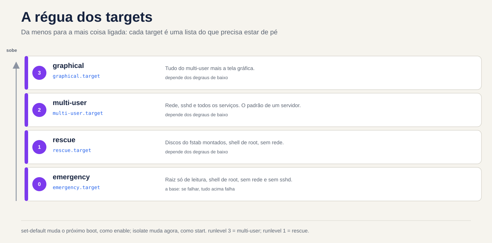
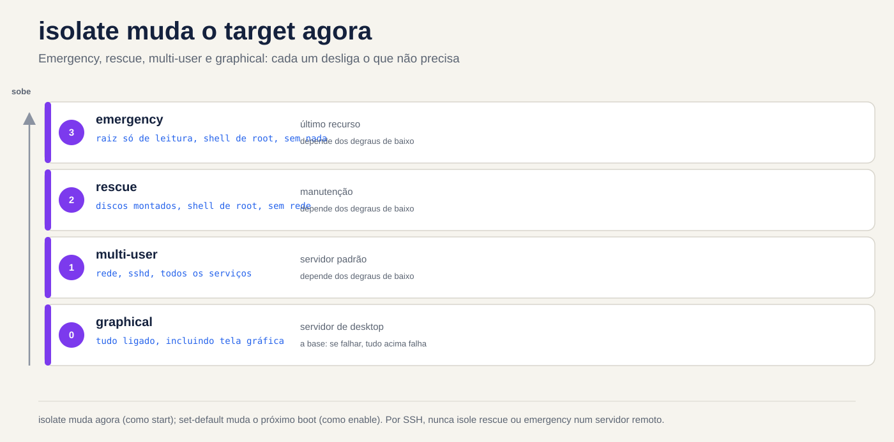

# Aula 4.3 · Targets, desligar e reiniciar

Na 4.2 você ligou e desligou serviços um por um. Hoje você troca a máquina inteira de modo: do modo normal para o modo de manutenção, e de volta. Também aprende a desligar e reiniciar um servidor sem pegar ninguém de surpresa.

> **Núcleo desta aula:** um target é um modo de operação da máquina, um pacote de units. `get-default` e `set-default` mexem no modo do próximo boot; `isolate` muda o modo agora. `rescue` e `emergency` são os modos de manutenção, e os dois pedem a senha de root. Para desligar ou reiniciar: `systemctl poweroff` e `systemctl reboot`, ou `shutdown` quando você quer horário e aviso.

| Ficha |  |
| --- | --- |
| Módulo | M4 · Boot e systemd, aula 3 de 4 |
| Quando | Semana 9 |
| Tempo | cerca de 1h30 |
| Pré-requisito | Aulas 4.1 e 4.2 |
| Prova | LPIC-1 101.3 · RHCSA (boot em targets, target padrão) |
| Lab | rocky-lab (201) e debian-lab (202), com o **console do Proxmox aberto** |
| Snapshots | `m4a3-inicio` e `m4a3-fim` |

## 1 Aquecimento

Responda de cabeça, sem consultar. As respostas estão no Gabarito, no fim da aula.

1. Você roda `sudo systemctl isolate rescue.target` numa sessão SSH. O que acontece com a sua sessão?
2. Qual a diferença entre `systemctl set-default` e `systemctl isolate`?
3. O que faz `shutdown -r +10`, e como você cancela?

## 2 Por que importa

| Situação real | O que resolve |
| --- | --- |
| Você mexeu no `/etc/fstab`, reiniciou e o servidor não sobe | Entrar em `emergency.target` pelo console |
| Manutenção que exige a máquina sem serviços rodando e sem usuários | `rescue.target` |
| Reiniciar o servidor de um cliente às 23h, avisando quem estiver logado | `shutdown -r 23:00 "mensagem"` |
| Alguém instalou interface gráfica num servidor e ele passou a subir em modo gráfico | `systemctl set-default multi-user.target` |

## 3 Modelo mental

Um target é uma lista do que precisa estar ligado para a máquina estar num certo modo. Pense numa régua, da menos para a mais coisa ligada:

```
emergency   →   rescue    →   multi-user    →   graphical
raiz só        discos do     rede, sshd,       multi-user
leitura,       fstab,        todos os          + tela
shell root     shell root    serviços          gráfica
```

O `multi-user.target` é o servidor normal: rede, `sshd` e os seus serviços, sem tela gráfica. É o padrão de qualquer servidor. O `graphical.target` é tudo isso mais a tela gráfica. Os dois da esquerda são modos de manutenção: não têm rede nem `sshd`, só um shell de root no console.

Você tem duas alavancas, iguais às da 4.2:

| Alavanca | Muda quando | Comando | Parente na 4.2 |
| --- | --- | --- | --- |
| Modo do próximo boot | No próximo boot | `systemctl set-default` | `enable` |
| Modo de agora | Agora, sem reiniciar | `systemctl isolate` | `start` |

Os runlevels antigos (0 a 6) que você viu na tabela da 4.1 são só nomes velhos para estes targets. O `runlevel 3` é o `multi-user.target`, e o `runlevel 1` é o `rescue.target`.



*Cada target é uma lista do que precisa estar de pé.*

## 4 O essencial

### Ver e mudar o target padrão

```bash
systemctl get-default
sudo systemctl set-default multi-user.target
ls -l /etc/systemd/system/default.target
```

O `set-default` não faz mágica: ele só troca um link simbólico, `default.target`, para apontar para o target que você escolheu. No boot, o systemd procura o `default.target` e segue o link.

### Ver o que um target puxa

```bash
systemctl list-units --type=target
systemctl list-dependencies multi-user.target | head -20
```

### Mudar agora: isolate

```bash
sudo systemctl isolate multi-user.target
```

O `isolate` liga o que o novo target pede e **para tudo o que não faz parte dele**. Por isso ele só aceita targets marcados com `AllowIsolate=yes`, como multi-user, graphical, rescue, emergency, reboot e poweroff. Em outros targets ele recusa com *Operation refused, unit may not be isolated*.

Atalhos que você vai usar mais do que o `isolate`:

| Atalho | Equivale a |
| --- | --- |
| `systemctl rescue` | `isolate rescue.target` |
| `systemctl emergency` | `isolate emergency.target` |
| `systemctl default` | `isolate default.target` (volta ao modo padrão) |

### rescue × emergency

|  | rescue.target | emergency.target |
| --- | --- | --- |
| Raiz (`/`), num boot direto | montada para leitura e escrita | montada **só leitura** |
| Outros discos do fstab | montados | não montados |
| Rede e `sshd` | não | não |
| Pede senha de root | sim | sim |
| Quando usar | manutenção com o sistema quase de pé | fstab quebrado, ou quando o rescue não sobe |
| Nome antigo | runlevel 1, `single` | sem equivalente |

A linha da senha é a que pega gente experiente. Os dois modos chamam o `sulogin`, que exige a senha de **root**: a sua senha de sudo não serve. Se a conta root estiver bloqueada, o modo de manutenção não abre e aparece *Cannot open access to console, the root account is locked*. Confira antes de precisar:

```bash
sudo passwd -S root
```

Se a segunda coluna for `L` ou `LK`, a conta está bloqueada (*locked*). `P` ou `PS` quer dizer que tem senha. Esqueceu a senha de root? Isso é a 4.4.

### Entrar num target só neste boot

No GRUB, você acrescenta `systemd.unit=rescue.target` ou `systemd.unit=emergency.target` na linha do kernel. Vale só para aquele boot. Os nomes antigos `1`, `s` e `single` também levam ao rescue. Você faz isso na prática na 4.4; por enquanto, saiba que existe.

### Desligar e reiniciar

```bash
sudo systemctl poweroff          # desliga
sudo systemctl reboot            # reinicia
sudo systemctl halt              # para a CPU, mas pode não cortar a energia
sudo shutdown -h now             # desliga agora
sudo shutdown -r +10 "Reinício para atualização"   # daqui a 10 min, com aviso
sudo shutdown -r 23:00           # num horário
sudo shutdown -c                 # cancela o agendado
wall "Servidor reinicia às 23h"  # mensagem para todos os terminais
```

Três detalhes do `shutdown`:

- Sem horário, ele espera **1 minuto**, ou seja, não é imediato. Para ser imediato, use `now`.
- Quando faltam 5 minutos, ele cria o arquivo `/run/nologin`, e a partir daí usuários comuns não conseguem mais entrar.
- Para ver o que está agendado, use `shutdown --show`. Se a sua versão do systemd não tiver essa opção, leia `/run/systemd/shutdown/scheduled`.

Os comandos antigos ainda funcionam e caem na LPIC: `init 0` desliga, `init 6` reinicia, `telinit 1` vai para o rescue, e `runlevel` mostra o anterior e o atual (por exemplo, `N 3`).

Para saber quando a máquina reiniciou: `who -b`, `last -x reboot shutdown | head` e `journalctl --list-boots`.

### Rocky × Debian

|  | Rocky 9 | Debian 12 |
| --- | --- | --- |
| Target padrão de servidor sem GUI | `multi-user.target` | `multi-user.target` |
| Conta root após a instalação | bloqueada, se você não deu senha de root no instalador | bloqueada, se você deixou a senha de root em branco |
| Comandos de target e shutdown | iguais (systemd 252) | iguais (systemd 252) |

As duas usam a mesma versão do systemd, então os comandos são os mesmos. Na prática, a diferença está na conta root, e isso decide se você consegue entrar em modo de manutenção.

### O que cai na prova

Na RHCSA: iniciar o sistema num target diferente e definir o target padrão. A tarefa irmã, interromper o boot para recuperar acesso, é a 4.4. Na LPIC-1 101.3: targets e runlevels, `shutdown` e `reboot` pela linha de comando, avisar usuários antes (`wall` e a mensagem do `shutdown`), e `init`/`telinit`. Saiba também que o `acpid` e o `systemd-logind` tratam o botão de energia.

## 5 Lab guiado

### Passo 0 · Snapshot e console

No shell do nó Proxmox:

```bash
qm snapshot 201 m4a3-inicio
qm snapshot 202 m4a3-inicio
```

Abra o **console** (noVNC) das duas VMs na interface do Proxmox e deixe aberto. Nesta aula a rede vai cair de propósito, e o console é o seu único caminho de volta. Em cada VM:

```bash
mkdir -p ~/lab43 && cd ~/lab43
```

### Passo 1 · Onde a máquina está agora

Nas duas VMs:

```bash
systemctl get-default
ls -l /etc/systemd/system/default.target
systemctl list-units --type=target --state=active
runlevel
```

Anote as respostas em `~/lab43/notas.txt`. O esperado: `multi-user.target`, um link apontando para `/usr/lib/systemd/system/multi-user.target` e `N 3` no `runlevel`.

### Passo 2 · Conferir a conta root

```bash
sudo passwd -S root
```

Se aparecer `L` ou `LK`, defina uma senha de root **só no lab**, digitando você mesmo, e guarde-a no seu gerenciador de senhas:

```bash
sudo passwd root
```

Sem isso, os passos 3 e 6 travam na mensagem *the root account is locked*.

### Decida 1

Você está na rocky-lab **por SSH**, não pelo console, e vai rodar `sudo systemctl isolate rescue.target`. O que acontece?

- A) Nada muda, e a sessão SSH continua normal.
- B) A sessão SSH cai ou congela, e o console fica pedindo a senha de root.
- C) A máquina reinicia e volta em modo rescue.

Marque uma opção antes de rodar. Depois rode e veja o que acontece.

| Se você marcou | Resultado | Por quê |
| --- | --- | --- |
| A | Errou | O `isolate` para tudo o que não faz parte do rescue, e isso inclui o `sshd` e a rede |
| B | Acertou | Sem `sshd` e sem rede, a sua sessão perde o caminho. O rescue abre um shell de root só no console |
| C | Errou | O `isolate` não reinicia: ele troca de modo com a máquina ligada |

**Para fixar:** nunca isole rescue ou emergency por SSH num servidor remoto, a menos que você tenha console fora de banda (iLO, IPMI ou o console do Proxmox). No lab você tem, por isso pode testar.

### Passo 3 · Dentro do rescue e do emergency

No **console** da rocky-lab, digite a senha de root e confira:

```bash
systemctl is-system-running      # esperado: maintenance
systemctl list-units --type=service --state=running
ip -br addr
findmnt /
```

Repare como sobra pouca coisa rodando. Para sair, volte ao modo padrão e entre de novo por SSH:

```bash
systemctl default
```

Agora a debian-lab. Direto no **console**, entre com o seu usuário e rode:

```bash
sudo systemctl emergency
```

Digite a senha de root e compare com o rescue:

```bash
systemctl list-units --state=active | wc -l
findmnt /
```

Repare numa coisa: como você entrou com a máquina já ligada, a raiz continua como estava, montada para leitura e escrita. A raiz só leitura aparece quando você inicia a máquina direto no emergency, pelo GRUB, e isso fica para a 4.4. Saia com `systemctl default`.

### Decida 2

Na debian-lab, por SSH, agende um reinício e veja a agenda:

```bash
sudo shutdown -r +6 "Teste da aula 4.3"
shutdown --show || cat /run/systemd/shutdown/scheduled
```

**Não feche esta sessão.** Espere uns 2 minutos, até faltarem menos de 5, e abra uma **segunda** sessão SSH com o seu usuário. Ela entra?

- A) Entra normalmente.
- B) É recusada, com uma mensagem de que o sistema está sendo desligado.
- C) Entra, mas cai na mesma hora.

| Se você marcou | Resultado | Por quê |
| --- | --- | --- |
| A | Errou | Faltando 5 minutos, o `shutdown` cria `/run/nologin` |
| B | Acertou | Com esse arquivo presente, o `pam_nologin` recusa o login de qualquer usuário que não seja root |
| C | Errou | A recusa acontece antes de abrir a sessão |

Na primeira sessão, que continua aberta, cancele e confira:

```bash
sudo shutdown -c
ls -l /run/nologin
```

Se o arquivo não sumiu, apague-o com `sudo rm /run/nologin`.

**Para fixar:** é por isso que você mantém uma sessão aberta depois de agendar. Se precisar cancelar faltando menos de 5 minutos, você não consegue mais entrar com o seu usuário. Agendar com aviso é `shutdown`; reiniciar agora é `systemctl reboot`.

### Passo 4 · Mudar o target padrão

Na rocky-lab, que não tem interface gráfica instalada:

```bash
sudo systemctl set-default graphical.target
ls -l /etc/systemd/system/default.target
sudo systemctl reboot
```

Entre de novo por SSH e confira:

```bash
systemctl get-default
systemctl is-system-running
```

A máquina sobe normalmente. O `graphical.target` exige o multi-user e só *quer* o gerenciador de tela, e um `Wants=` que não existe é ignorado (isso é da 4.2). Funciona, mas confunde quem vier depois. Volte ao padrão de servidor:

```bash
sudo systemctl set-default multi-user.target
```

### Passo 5 · Quem reiniciou e quando

Nas duas VMs:

```bash
who -b
last -x reboot shutdown | head -6
journalctl --list-boots | tail -5
```

Você deve ver os reinícios desta aula. Um `reboot` sem um `shutdown` logo antes indica que a máquina caiu, em vez de ser desligada direito.

## 6 Quebre e conserte

Na rocky-lab, por SSH:


*isolate muda agora; set-default muda o próximo boot. Nunca isole rescue ou emergency por SSH num servidor remoto.*


```bash
sudo systemctl set-default rescue.target
sudo systemctl reboot
```

O SSH não volta. Investigue só pelo **console**: o que aparece na tela? Qual modo está ativo? Por que a rede não subiu?

Depois de investigar, conserte e confira com mais um reinício:

```bash
systemctl get-default
systemctl set-default multi-user.target
systemctl default
```

A lição: quando um servidor "não volta na rede" depois de uma mudança, a primeira pergunta é *em que modo ele subiu?*. O console responde em segundos.

## 7 Armadilhas

- **`isolate rescue` por SSH num servidor remoto.** Você fica de fora, e só entra de novo com console fora de banda ou com alguém na frente da máquina.
- **Root bloqueado.** O rescue e o emergency não abrem. Confira com `passwd -S root` antes do dia em que precisar.
- **`halt` em vez de `poweroff`.** Dependendo do hardware, a máquina para mas continua ligada na energia.
- **`shutdown` sem horário.** Ele espera 1 minuto: não é imediato.
- **Agendou e esqueceu.** O servidor reinicia no horário marcado, em pleno expediente. Confira com `shutdown --show` e cancele com `shutdown -c`.
- **`isolate` num target qualquer.** Sem `AllowIsolate=yes`, ele recusa.
- **`graphical.target` em servidor.** Não quebra nada, mas o padrão de servidor é o `multi-user.target`.

## 8 Quiz

1. Qual comando mostra o target padrão?
2. Você quer que, a partir do próximo boot, a máquina suba em `multi-user.target`. Qual é o comando?
3. Num boot direto, qual a diferença entre rescue e emergency quanto à raiz e aos discos do fstab?
4. Você rodou `shutdown -r 22:30 "Atualização"`. O que muda para os usuários às 22:25?
5. Quais são os equivalentes no systemd de `init 6` e de `telinit 1`?
6. *You are logged in over SSH to a remote server with no out-of-band console. Why is `systemctl isolate emergency.target` a bad idea?*

## 9 Cola

### Para saber de cor

| Comando | Faz |
| --- | --- |
| `systemctl get-default` | Mostra o modo do próximo boot |
| `systemctl set-default multi-user.target` | Muda o modo do próximo boot |
| `systemctl isolate X.target` | Muda o modo agora |
| `systemctl rescue` / `emergency` / `default` | Atalhos de modo |
| `systemctl poweroff` / `reboot` | Desliga ou reinicia agora |
| `shutdown -r +10 "msg"` / `shutdown -c` | Agenda com aviso / cancela |
| `passwd -S root` | Mostra se a conta root está bloqueada |

### Para consultar

`systemctl list-dependencies X.target`, `AllowIsolate=`, `/run/nologin`, `shutdown --show` ou `/run/systemd/shutdown/scheduled`, `wall`, `runlevel`, `init`, `telinit`, `who -b`, `last -x`.

### Flashcards

| Pergunta | Resposta |
| --- | --- |
| Qual o modo normal de servidor? | `multi-user.target` |
| `set-default` está para `isolate` assim como `enable` está para...? | `start` |
| O que é o `default.target` por dentro? | Um link simbólico |
| Qual senha o rescue pede? | A de root |
| O que acontece faltando 5 minutos para um `shutdown`? | É criado o `/run/nologin`, e usuários comuns não entram mais |

## 10 Checklist e fechamento

- [ ] Sei ver e mudar o target padrão
- [ ] Entrei em rescue e em emergency pelo console e voltei com `systemctl default`
- [ ] Sei por que não se isola rescue por SSH
- [ ] Agendei, conferi e cancelei um `shutdown`
- [ ] Consertei uma máquina que subiu em rescue
- [ ] As duas VMs têm senha de root conhecida

**Último exercício, sem olhar a aula:** na debian-lab, agende um reinício para daqui a 15 minutos com uma mensagem, mostre a agenda, cancele e confirme que não existe `/run/nologin`. Na rocky-lab, confirme que o padrão é `multi-user.target`.

**Reboot e conferência:** reinicie as duas VMs e confira:

```bash
systemctl get-default            # multi-user.target
systemctl is-system-running      # running
ls ~/lab43
```

**Snapshot de fim**, no nó Proxmox:

```bash
qm snapshot 201 m4a3-fim
qm snapshot 202 m4a3-fim
```

## 11 Na vida real

**Missão, só leitura.** Num servidor real que você administra, rode apenas estes comandos, que não mudam nada:

```bash
systemctl get-default
who -b
last -x reboot shutdown | head -6
journalctl --list-boots | tail -5
sudo passwd -S root
```

Responda: quando foi o último reinício? Foi um desligamento limpo ou uma queda? Se esse servidor não subisse amanhã, você conseguiria entrar em rescue? Tem senha de root? Tem console fora de banda?

**Diário:** escreva três linhas sobre o que você aprendeu hoje e uma dúvida que ficou.

**Amanhã, sem olhar:**

1. Diga de cabeça os quatro targets da régua, em ordem.
2. Escreva o comando que agenda um reinício para as 23h com aviso.
3. Explique em uma frase por que o rescue pode não abrir.

## 12 Aprofundar quando quiser

- `systemctl list-dependencies --reverse`: quem puxa um target.
- Criar o seu próprio target, por exemplo um `manutencao.target` com `AllowIsolate=yes`.
- `systemd-inhibit`: programas que seguram o desligamento.
- O botão de energia: `HandlePowerKey=` em `/etc/systemd/logind.conf`.
- `systemctl soft-reboot`, que reinicia só o espaço do usuário. É do systemd 254 em diante, então não existe no Rocky 9 nem no Debian 12.

No DeepTutor: `!explica isolate e set-default`, `!feynman rescue e emergency`, `!quiz targets e shutdown`.

## Gabarito comentado

### Aquecimento

1. A sessão cai ou congela. O rescue para o `sshd` e a rede, e só deixa um shell de root no console.
2. O `set-default` muda o modo do próximo boot, trocando o link `default.target`. O `isolate` muda o modo agora, sem reiniciar.
3. Agenda um reinício para daqui a 10 minutos e avisa os usuários logados. Cancela-se com `shutdown -c`.

### Quiz

1. `systemctl get-default`.
2. `sudo systemctl set-default multi-user.target`. Lembre que isso não muda nada agora: para mudar já, use `isolate`.
3. No rescue, a raiz é montada para leitura e escrita e os discos do fstab são montados. No emergency, a raiz fica só leitura e nada do fstab é montado. Por isso o emergency é a saída quando o fstab está quebrado.
4. Faltam 5 minutos, então o `/run/nologin` é criado: usuários comuns não conseguem mais entrar. Quem já está logado continua e recebe os avisos.
5. `init 6` é `systemctl reboot`. `telinit 1` é `systemctl isolate rescue.target`, ou `systemctl rescue`.
6. *Emergency mode stops networking and sshd, so the SSH session dies and nothing is left to log back in through. Without a console, someone has to go to the machine physically.*

---

<!-- navegacao -->
[← Aula 4.2 · systemd: serviços e units](4.2-systemd-servicos-e-units.md) · [Índice de aulas](../01-aulas.md) · [Aula 4.4 · GRUB e acesso de emergência →](4.4-grub-e-acesso-de-emergencia.md)
