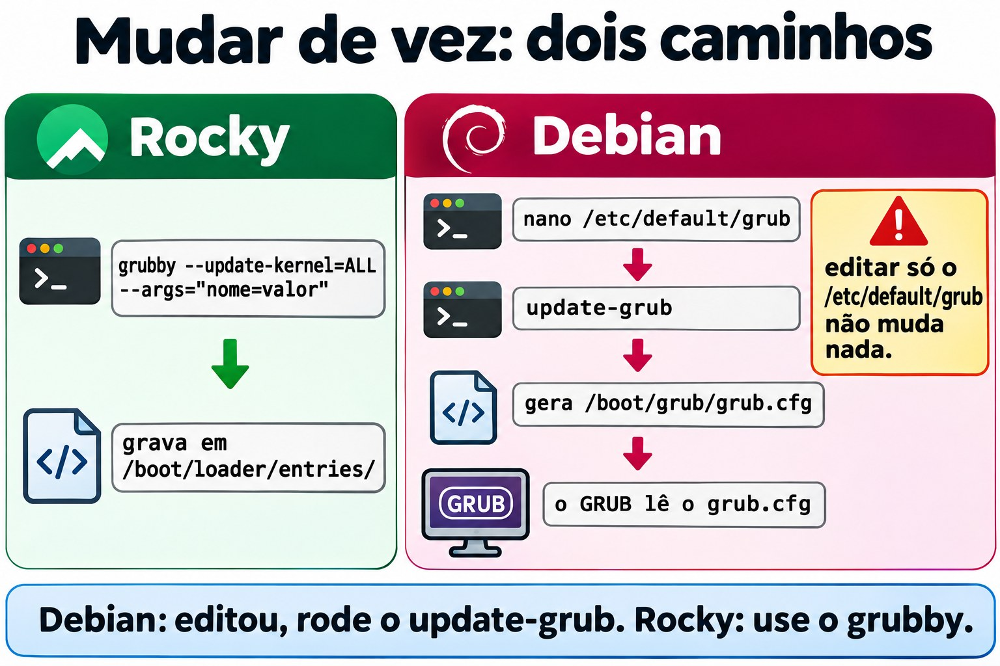
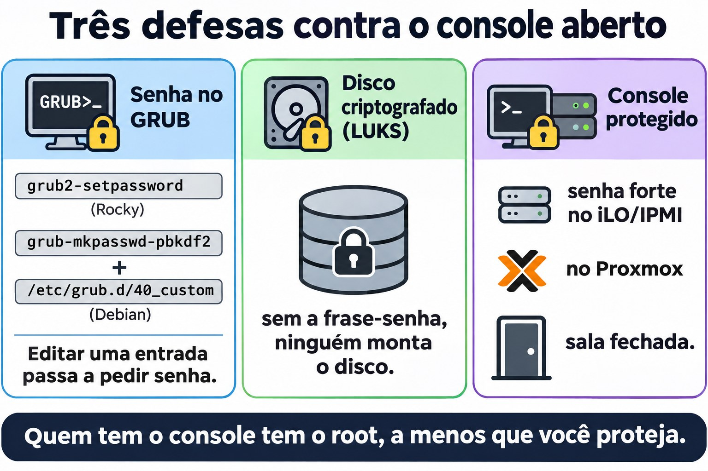
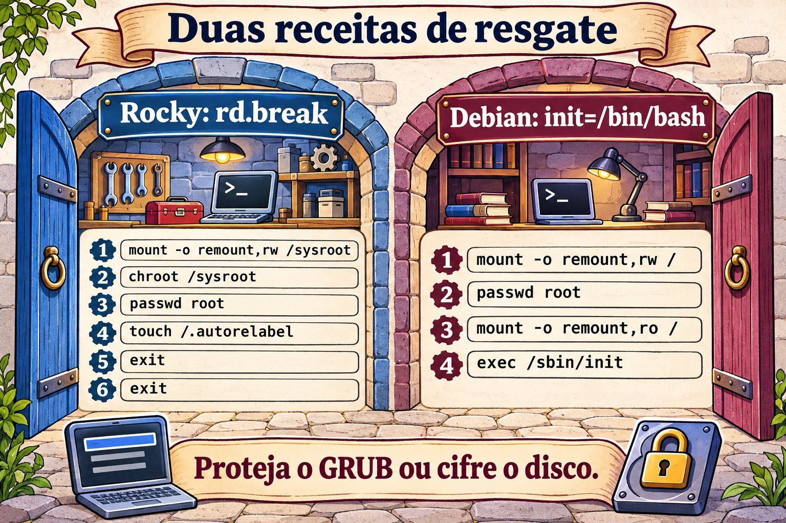

# Aula 4.4 · GRUB e acesso de emergência

É a última aula do módulo 4. Você já sabe que o GRUB é o segundo corredor do revezamento (4.1) e que dá para iniciar a máquina num target diferente (4.3). Hoje você mexe no GRUB de verdade: muda parâmetros do kernel só para um boot ou para sempre, e recupera a senha de root de uma máquina em que ninguém consegue entrar.

> **Núcleo desta aula:** no menu do GRUB, `e` edita a entrada e `Ctrl+X` inicia com a edição, que vale só para aquele boot. Para mudar de vez: na Rocky, `grubby`; na Debian, `/etc/default/grub` seguido de `update-grub`. Para recuperar a senha de root: na Rocky, `rd.break`, depois remount, chroot, passwd e **`touch /.autorelabel`**; na Debian, `init=/bin/bash`, depois remount e passwd. E a lição de segurança: quem tem o console tem o root, a menos que você proteja o GRUB ou criptografe o disco.

| Ficha |  |
| --- | --- |
| Módulo | M4 · Boot e systemd, aula 4 de 4, que fecha o módulo |
| Quando | Semana 9 |
| Tempo | cerca de 1h30, mais o desafio do módulo |
| Pré-requisito | Aulas 4.1 a 4.3 |
| Lab | rocky-lab (201) e debian-lab (202), com o **console do Proxmox aberto** |
| Antes de começar | **backup no PBS** das duas VMs, além do snapshot |
| Snapshots | `m4a4-inicio` e `m4a4-fim` |

## 1 Aquecimento

Responda de cabeça, sem consultar. As respostas estão no Gabarito, no fim da aula.

1. Qual programa carrega o kernel e o initramfs na memória?
2. Um parâmetro que você digita na tela do GRUB vale para quantos boots?
3. Alguém com acesso ao console de um servidor Linux sem proteção nenhuma consegue virar root sem saber a senha?

## 2 Por que importa

| Situação real | O que resolve |
| --- | --- |
| Você assumiu um servidor e ninguém sabe a senha de root | Recuperação pelo GRUB |
| Um kernel novo não sobe depois da atualização | Escolher o kernel anterior no menu, e depois tornar esse o padrão |
| O fornecedor pede para desligar uma opção do kernel em todos os boots | `grubby --args` ou `/etc/default/grub` |
| Auditoria pergunta se qualquer um com acesso à sala vira root | Senha no GRUB e disco criptografado |

## 3 Modelo mental

O GRUB é um cardápio. Cada entrada do menu é uma receita: qual kernel, qual initramfs e quais parâmetros passar ao kernel (a linha que começa com `linux`). O kernel lê esses parâmetros e os repassa ao systemd. Foi assim que o `systemd.unit=rescue.target` da 4.3 funcionou.

Você pode mexer na receita de dois jeitos:

| Jeito | Onde | Dura |
| --- | --- | --- |
| Na hora | Tecla `e` no menu, depois `Ctrl+X` | Só este boot |
| De vez | Arquivos no disco, e depois regerar a configuração | Todos os boots |

E por que dá para recuperar a senha de root? Porque, se você manda o kernel parar **antes** do sistema normal subir, não existe ainda ninguém pedindo senha: você cai num shell que já é root. Na Rocky, o `rd.break` para no fim do initramfs, antes de entregar o controle ao disco de verdade. Na Debian, o `init=/bin/bash` troca o systemd por um bash como primeiro processo.


*Editar no menu vale só para este boot; grubby e update-grub mudam de vez.*

## 4 O essencial

### O menu do GRUB

Logo depois do BIOS/UEFI, o menu aparece por alguns segundos. Se não aparecer, aperte `Esc` ou segure `Shift` logo no começo do boot. No menu:

| Tecla | Faz |
| --- | --- |
| Setas | Escolhem a entrada (outro kernel, por exemplo) |
| `e` | Edita a entrada selecionada |
| `Ctrl+X` (ou `F10`) | Inicia com a edição |
| `Esc` | Descarta a edição e volta ao menu |
| `c` | Abre a linha de comando do GRUB |

Na edição, procure a linha que começa com `linux` e acrescente o parâmetro **no fim dela**. Ela costuma ser longa e quebrar em várias linhas na tela, mas é uma linha só. Use `End` ou `Ctrl+E` para ir ao fim.

**Teclado:** o GRUB e os shells de emergência costumam usar o layout americano. Se o caractere sair errado num teclado italiano, o `=` fica na tecla `ì` (a segunda à direita do `0`), o `-` na tecla `'`, e a `/` na tecla `-`. Pelo mesmo motivo, use uma senha temporária só com letras e números, e troque-a depois, com o sistema normal.

### Mudar de vez na Rocky: grubby

A Rocky guarda uma entrada por kernel em `/boot/loader/entries/` (o formato BLS), e o `grubby` é a ferramenta para mexer nelas:

```bash
sudo grubby --default-kernel
sudo grubby --info=DEFAULT
sudo grubby --info=ALL | grep -E '^(kernel|args)'
sudo grubby --update-kernel=ALL --args="nome=valor"
sudo grubby --update-kernel=ALL --remove-args="rhgb quiet"
sudo grubby --set-default /boot/vmlinuz-VERSÃO
```

Você até pode editar `/etc/default/grub` e rodar `grub2-mkconfig -o /boot/grub2/grub.cfg`, mas nas versões atuais da Rocky 9 isso não atualiza os parâmetros dos kernels já instalados (para isso existe a opção `--update-bls-cmdline`). Por isso, na Rocky, use o `grubby`.

### Mudar de vez na Debian: /etc/default/grub

```bash
sudo nano /etc/default/grub      # GRUB_TIMEOUT, GRUB_CMDLINE_LINUX_DEFAULT, GRUB_CMDLINE_LINUX
sudo update-grub                 # regera /boot/grub/grub.cfg
```

O `update-grub` é só um atalho para `grub-mkconfig -o /boot/grub/grub.cfg`. **Nunca edite o `grub.cfg` à mão**: ele é gerado, e a próxima atualização de kernel sobrescreve a sua edição. A diferença entre as duas variáveis: o `GRUB_CMDLINE_LINUX` vale para todas as entradas, inclusive a de recuperação, e o `GRUB_CMDLINE_LINUX_DEFAULT` vale só para as entradas normais.



*Na Debian o GRUB lê o grub.cfg gerado, não o /etc/default/grub; na Rocky o grubby grava direto nas entradas.*

### Recuperar a senha de root na Rocky

1. No menu, aperte `e` e acrescente `rd.break` no fim da linha `linux`. Depois, `Ctrl+X`.
2. Você cai num shell `switch_root:/#`. O disco de verdade está montado em `/sysroot`, **só leitura**.
3. Rode:

```bash
mount -o remount,rw /sysroot
chroot /sysroot
passwd root
touch /.autorelabel
exit
exit
```

O primeiro `exit` sai do chroot e o segundo continua o boot. Como o arquivo `/.autorelabel` existe, a máquina reetiqueta o disco todo para o SELinux (leva alguns minutos) e reinicia sozinha uma vez.

O `touch /.autorelabel` existe porque o `passwd` regrava o `/etc/shadow`. Como ele rodou fora do sistema normal, sem o SELinux carregado, o arquivo novo nasce sem a etiqueta certa. Com o SELinux em modo *enforcing*, nenhum login com senha consegue ler o `shadow`: nem o do root, nem o do seu usuário. A reetiquetagem conserta isso. O SELinux tem módulo próprio, mais adiante; por enquanto, decore a linha.

### Recuperar a senha de root na Debian

1. No menu, aperte `e` e acrescente `init=/bin/bash` no fim da linha `linux`. Depois, `Ctrl+X`.
2. Você cai num `root@(none):/#`. A raiz está montada **só leitura**.
3. Rode:

```bash
mount -o remount,rw /
passwd root
sync
mount -o remount,ro /
exec /sbin/init
```

O `exec /sbin/init` troca o bash pelo systemd e continua o boot normal. Aqui o `systemctl reboot` não funciona, porque o systemd não está rodando. A Debian não usa SELinux por padrão, então não precisa de reetiquetagem.

### Proteger contra isso

Você acabou de ver que o console dá o root. As defesas são três:

- **Senha no GRUB:** `grub2-setpassword` na Rocky. Na Debian, `grub-mkpasswd-pbkdf2` mais uma entrada em `/etc/grub.d/40_custom`. Com isso, editar uma entrada passa a pedir senha.
- **Disco criptografado (LUKS):** sem a frase-senha, ninguém monta o disco, nem pelo GRUB nem tirando o disco da máquina.
- **Proteger o console:** senha forte no iLO/IPMI e no Proxmox, e a sala fechada.

No lab, não ponha senha no GRUB: você vai precisar dele aberto no desafio.



*Quem tem o console tem o root; três defesas fecham essa porta.*

### Rocky × Debian

|  | Rocky 9 | Debian 12 |
| --- | --- | --- |
| Configuração que você edita | `/etc/default/grub` e as entradas em `/boot/loader/entries/` | `/etc/default/grub` |
| Arquivo gerado | `/boot/grub2/grub.cfg` | `/boot/grub/grub.cfg` |
| Ferramenta do dia a dia | `grubby` | `update-grub` |
| Recuperar root | `rd.break` + remount `/sysroot` + chroot + `passwd` + `touch /.autorelabel` | `init=/bin/bash` + remount `/` + `passwd` + `exec /sbin/init` |
| Senha no GRUB | `grub2-setpassword` | `grub-mkpasswd-pbkdf2` + `40_custom` |

## 5 Lab guiado

### Passo 0 · Backup, snapshot e console

Hoje você mexe no que faz a máquina ligar. Por isso, além do snapshot, faça um backup no PBS. No shell do nó Proxmox:

```bash
pvesm status                                         # ache o nome do storage do PBS
vzdump 201 --storage NOME_DO_PBS --mode snapshot
vzdump 202 --storage NOME_DO_PBS --mode snapshot
qm snapshot 201 m4a4-inicio
qm snapshot 202 m4a4-inicio
```

Se preferir, faça o backup pela interface: VM, depois Backup, depois *Backup now*, escolhendo o storage do PBS. Depois, abra o **console** (noVNC) das duas VMs e deixe aberto. Em cada VM:

```bash
mkdir -p ~/lab44 && cd ~/lab44
```

### Passo 1 · Conhecer o GRUB de cada uma

Na rocky-lab:

```bash
cat /proc/cmdline
sudo grubby --default-kernel
sudo grubby --info=DEFAULT
ls /boot/loader/entries/
grep -v '^#' /etc/default/grub
```

Na debian-lab:

```bash
cat /proc/cmdline
grep -v '^#' /etc/default/grub | grep .
ls -l /boot/grub/grub.cfg
```

Anote em `~/lab44/notas.txt`: quantos kernels cada uma tem, qual é o padrão, e o timeout do menu.

### Passo 2 · Editar só para um boot

Reinicie a rocky-lab e fique olhando o console. No menu, aperte `e`, vá ao fim da linha `linux`, acrescente `systemd.unit=rescue.target` e aperte `Ctrl+X`.

A máquina sobe em rescue, como na 4.3, mas desta vez sem você ter mudado nada no disco. Entre com a senha de root e confira:

```bash
cat /proc/cmdline
systemctl get-default
```

O padrão continua `multi-user.target`: o parâmetro do boot venceu. Reinicie com `systemctl reboot`, sem tocar em nada no menu. A máquina volta ao normal, e o `cat /proc/cmdline` não mostra mais o parâmetro: a edição valeu um boot só.

### Passo 3 · Mudar de vez

**Rocky:** tire o `rhgb quiet` para enxergar as mensagens do boot. É o que você vai querer num servidor que não sobe.

```bash
sudo grubby --update-kernel=ALL --remove-args="rhgb quiet"
sudo grubby --info=ALL | grep -E '^(kernel|args)'
sudo systemctl reboot
```

No console, agora você vê as mensagens do kernel e do systemd passando.

**Debian:** aumente o tempo do menu. Em `/etc/default/grub`, troque `GRUB_TIMEOUT=5` por `GRUB_TIMEOUT=10` e salve. **Ainda não rode o `update-grub`.**

### Decida 1

Você salvou `/etc/default/grub` com `GRUB_TIMEOUT=10` e vai reiniciar a debian-lab sem rodar o `update-grub`. Quanto tempo o menu espera?

- A) 10 segundos, porque o arquivo foi salvo.
- B) 5 segundos, porque nada mudou no que o GRUB lê.
- C) O menu nem aparece, porque a configuração ficou inconsistente.

Marque uma opção antes. Depois reinicie e cronometre no console.

| Se você marcou | Resultado | Por quê |
| --- | --- | --- |
| A | Errou | O GRUB não lê o `/etc/default/grub`. Ele lê o `/boot/grub/grub.cfg`, que ainda é o antigo |
| B | Acertou | O `/etc/default/grub` é só a receita para gerar o `grub.cfg`, e quem gera é o `update-grub` |
| C | Errou | Não há inconsistência nenhuma: o `grub.cfg` antigo continua válido |

Agora aplique e confira:

```bash
sudo update-grub
grep -m1 'timeout=' /boot/grub/grub.cfg
sudo systemctl reboot
```

**Para fixar:** na Debian, editou o `/etc/default/grub`, rode o `update-grub`. Na Rocky, prefira o `grubby`, que grava direto nas entradas.

### Passo 4 · Recuperar a senha de root na Rocky

Finja que ninguém sabe a senha de root da rocky-lab. Pelo console, reinicie. No menu, aperte `e` e acrescente `rd.break` no fim da linha `linux`. Depois, `Ctrl+X`. Você cai no `switch_root:/#`.

### Decida 2

Antes de qualquer outra coisa, você roda `chroot /sysroot` e, em seguida, `passwd root`. O que acontece?

- A) A senha muda normalmente.
- B) O `passwd` falha com um erro do tipo *Authentication token manipulation error*.
- C) A máquina trava com um *kernel panic*.

Marque uma opção antes. Depois rode e veja o que acontece.

| Se você marcou | Resultado | Por quê |
| --- | --- | --- |
| A | Errou | O `/sysroot` está montado só leitura, e o `passwd` precisa gravar o `/etc/shadow` |
| B | Acertou | Sem o remount para leitura e escrita, nenhuma gravação no disco funciona |
| C | Errou | Um erro de gravação é só um erro: o kernel continua de pé |

Saia do chroot com `exit` e faça a sequência certa:

```bash
mount -o remount,rw /sysroot
chroot /sysroot
passwd root
touch /.autorelabel
exit
exit
```

Espere a reetiquetagem e o reinício automático. Depois, no console, entre como root com a senha nova e confira:

```bash
getenforce                 # Enforcing
ls -Z /etc/shadow          # deve aparecer shadow_t
```

Por fim, troque a senha temporária por uma definitiva com `passwd root`. Agora o teclado já está no layout certo.

**Para fixar:** a ordem é remount, chroot, passwd, autorelabel, exit e exit. Se pular o remount, o `passwd` falha. Se pular o autorelabel, o login não funciona depois do boot.

## 6 Quebre e conserte

Na rocky-lab, por SSH:


*Ainda não existe ninguém pedindo senha: o shell já é root. Quem tem o console tem o root.*


```bash
sudo grubby --update-kernel=ALL --args="systemd.unit=emergency.target"
sudo systemctl reboot
```

A máquina sobe em emergency em todo boot. Investigue pelo **console**: o `systemctl get-default` mostra o quê? Onde está a causa? O `/boot` está montado? A raiz aceita gravação?

Você tem dois caminhos de conserto. Escolha um e depois teste o outro:

- **Pelo GRUB:** no menu, `e`, apague o `systemd.unit=emergency.target` da linha `linux` e `Ctrl+X`. A máquina sobe normal, só desta vez. Aí, por SSH, rode `sudo grubby --update-kernel=ALL --remove-args="systemd.unit=emergency.target"`.
- **De dentro do emergency:** a raiz está só leitura e o `/boot` não está montado, então o `grubby` não tem onde gravar. Rode:

```bash
mount -o remount,rw /
mount /boot
grubby --update-kernel=ALL --remove-args="systemd.unit=emergency.target"
systemctl reboot
```

A lição: quando o `get-default` diz uma coisa e a máquina faz outra, olhe o `/proc/cmdline`. Um parâmetro de boot vence o target padrão.

## 7 Armadilhas

- **Esquecer o `touch /.autorelabel` na Rocky.** Depois do reinício, nenhum login com senha funciona. Conserto: `rd.break` de novo, e desta vez com o autorelabel.
- **Esquecer o remount.** Tanto o `/sysroot` na Rocky quanto o `/` na Debian começam só leitura.
- **Editar o `grub.cfg` à mão.** A próxima atualização de kernel apaga a sua mudança.
- **Editar o `/etc/default/grub` e não rodar o `update-grub`.** Não muda nada.
- **Na Rocky, mudar só o `/etc/default/grub`.** Os kernels já instalados não recebem a mudança. Use o `grubby`.
- **Teclado americano no GRUB e nos shells de emergência.** A senha que você digitou ali pode não ser a que você pensa. Use uma senha temporária simples e troque depois.
- **`systemctl reboot` no `init=/bin/bash`.** Não funciona, porque o systemd não está rodando. Use `exec /sbin/init`.
- **Mexer no GRUB e não reiniciar para testar.** Teste enquanto você tem console e tempo, não no dia da queda.

## 8 Quiz

1. Na Debian, onde se muda o tempo do menu do GRUB, e qual comando aplica a mudança?
2. Na Rocky, como se acrescenta um parâmetro do kernel em todos os kernels instalados?
3. Por que a Rocky precisa do `touch /.autorelabel` e a Debian não?
4. Depois do `rd.break`, por que é preciso remontar o `/sysroot`?
5. No menu do GRUB, qual tecla edita a entrada, e qual inicia com a edição?
6. *Name two measures that stop someone with console access from resetting the root password through GRUB.*

## 9 Cola

### Para saber de cor

| Comando ou tecla | Faz |
| --- | --- |
| `e` / `Ctrl+X` | Edita a entrada / inicia com a edição |
| `cat /proc/cmdline` | Mostra com que parâmetros o kernel subiu |
| `grubby --info=DEFAULT` | Mostra o kernel padrão e os parâmetros (Rocky) |
| `grubby --update-kernel=ALL --args=` / `--remove-args=` | Acrescenta ou tira parâmetros (Rocky) |
| `/etc/default/grub` + `update-grub` | Muda de vez (Debian) |
| `rd.break` → remount `/sysroot` → chroot → passwd → `touch /.autorelabel` | Recupera o root (Rocky) |
| `init=/bin/bash` → remount `/` → passwd → `exec /sbin/init` | Recupera o root (Debian) |

### Para consultar

`grubby --set-default`, `grub2-mkconfig -o /boot/grub2/grub.cfg`, `--update-bls-cmdline`, `GRUB_CMDLINE_LINUX` e `GRUB_CMDLINE_LINUX_DEFAULT`, `/boot/loader/entries/`, `grub2-setpassword`, `grub-mkpasswd-pbkdf2`, `/etc/grub.d/40_custom`, `grub-install`, `ls -Z`, `getenforce`.

### Flashcards

| Pergunta | Resposta |
| --- | --- |
| O GRUB lê o `/etc/default/grub`? | Não: ele lê o `grub.cfg` gerado a partir dele |
| Onde está o disco de verdade depois do `rd.break`? | Em `/sysroot`, só leitura |
| O que o `.autorelabel` conserta? | A etiqueta SELinux do `/etc/shadow` e do resto do disco |
| Quem vence: o target padrão ou o `systemd.unit=` do boot? | O parâmetro do boot |
| Qual a defesa contra o reset de senha pelo console? | Senha no GRUB e disco criptografado |

## 10 Checklist e fechamento

- [ ] Editei uma entrada no menu só para um boot
- [ ] Mudei parâmetros de vez com o `grubby` na Rocky
- [ ] Mudei o timeout na Debian e entendi por que o `update-grub` é obrigatório
- [ ] Recuperei a senha de root da Rocky, e o SELinux continua *Enforcing*
- [ ] Consertei uma máquina presa em emergency pelos dois caminhos
- [ ] Sei as três defesas contra o reset de senha pelo console

**Último exercício, sem olhar a aula:** na debian-lab, volte o `GRUB_TIMEOUT` para 5, aplique e confirme no `grub.cfg`. Na rocky-lab, decida se quer o `rhgb quiet` de volta. Muitos administradores preferem servidor sem ele. Se quiser de volta, use o `grubby`.

**Reboot e conferência:** reinicie as duas VMs e confira:

```bash
cat /proc/cmdline
systemctl is-system-running      # running
ls ~/lab44
```

**Snapshot de fim**, no nó Proxmox:

```bash
qm snapshot 201 m4a4-fim
qm snapshot 202 m4a4-fim
```

## 11 Na vida real

**Missão, só leitura.** Num servidor real que você administra, rode apenas estes comandos, que não mudam nada.

Na Rocky ou no RHEL:

```bash
cat /proc/cmdline
sudo grubby --info=DEFAULT
sudo test -f /boot/grub2/user.cfg && echo "GRUB com senha" || echo "GRUB sem senha"
lsblk -f | grep -i crypto
```

Na Debian:

```bash
cat /proc/cmdline
grep -v '^#' /etc/default/grub | grep .
sudo grep -c password_pbkdf2 /boot/grub/grub.cfg
lsblk -f | grep -i crypto
```

Responda: o GRUB tem senha? O disco é criptografado? Quem tem acesso ao console desse servidor (iLO, Proxmox, a sala)? Se a resposta for "qualquer um com a senha do Proxmox vira root aqui", anote isso como um risco para conversar com o responsável. Não mude nada sozinho.

**Diário:** escreva três linhas sobre o que você aprendeu hoje e uma dúvida que ficou.

**Amanhã, sem olhar:**

1. Escreva a sequência completa de recuperação de root da Rocky.
2. Diga qual arquivo o GRUB lê de verdade, na Rocky e na Debian.
3. Explique em uma frase por que o `rd.break` dá um shell de root sem pedir senha.

## 12 Aprofundar quando quiser

- A linha de comando do GRUB (`c`): `ls`, `set root=`, `linux`, `initrd` e `boot`, para iniciar à mão uma máquina com o menu quebrado.
- Reinstalar o GRUB a partir de uma ISO, com `grub-install` e `grub2-mkconfig` dentro de um chroot.
- UEFI e Secure Boot: o `shim`, o `mokutil --sb-state` e o `efibootmgr` da 4.1.
- Voltar ao kernel anterior automaticamente: `GRUB_DEFAULT=saved`, `grub2-set-default` e `grub2-editenv list`.
- Proteger o GRUB com senha numa VM de teste, para sentir como fica o menu.

No DeepTutor: `!explica rd.break e init=/bin/bash`, `!feynman por que o autorelabel existe`, `!quiz GRUB e recuperação de root`.

## Desafio do módulo 4

O módulo 4 fecha com a tarefa que mais salva servidor na vida real: **recuperar a senha de root das duas VMs, sem olhar a aula.**

**Antes:** no nó Proxmox, rode `qm snapshot 201 m4-desafio` e `qm snapshot 202 m4-desafio`.

**Regras:**

- Use só o console do Proxmox, nada de SSH.
- Não consulte a aula, a Cola nem o DeepTutor. Se travar, há dicas no Gabarito.
- Tempo-alvo: 15 minutos por VM, sem contar a reetiquetagem.

**Está pronto quando:**

| VM | Critério |
| --- | --- |
| rocky-lab | O root entra no console com a senha nova |
| rocky-lab | `getenforce` mostra `Enforcing`, e `ls -Z /etc/shadow` mostra `shadow_t` |
| rocky-lab | O seu usuário comum também entra com senha |
| debian-lab | O root entra no console com a senha nova |
| debian-lab | `systemctl is-system-running` mostra `running` |

**Bônus:** escreva em cinco linhas, no seu Diário, por que isso funciona e como impedir que um estranho faça o mesmo.

**Se der errado:** `qm rollback 201 m4-desafio` (ou 202) volta a VM ao estado de antes, e você tenta de novo. Errar aqui é barato: errar no servidor de um cliente, não é.

Com isso, o **Módulo 4 está concluído**: você sabe como o Linux liga, manda nos serviços, troca de modo e entra numa máquina trancada.

## Gabarito comentado

### Aquecimento

1. O GRUB, o segundo corredor do revezamento da 4.1.
2. Um boot só. No próximo boot, vale de novo o que está no disco.
3. Sim. Pelo GRUB, com `rd.break` ou `init=/bin/bash`. Só não consegue se o GRUB tiver senha ou o disco for criptografado.

### Quiz

1. Na variável `GRUB_TIMEOUT` de `/etc/default/grub`, e aplica-se com `sudo update-grub`.
2. `sudo grubby --update-kernel=ALL --args="nome=valor"`.
3. A Rocky usa SELinux em modo *enforcing*. O `passwd` rodou sem a política carregada, então o novo `/etc/shadow` ficou sem a etiqueta certa, e o SELinux bloqueia a leitura dele no login. A Debian não usa SELinux por padrão, e o AppArmor dela não depende de etiquetas nos arquivos.
4. Porque o initramfs monta o disco de verdade em `/sysroot` só leitura, e o `passwd` precisa gravar o `/etc/shadow`.
5. `e` edita, e `Ctrl+X` (ou `F10`) inicia com a edição.
6. *A GRUB password, so boot entries cannot be edited, and full-disk encryption with LUKS, so the disk cannot be read without the passphrase. Physically securing the console (iLO/IPMI, hypervisor access, the server room) is the third layer.*

### Dicas do desafio

Leia só se travar.

- **O `passwd` falhou:** você esqueceu o remount para leitura e escrita.
- **Na Rocky, não entra ninguém depois do reinício:** faltou o `touch /.autorelabel`. Repita o processo inteiro.
- **Na Debian, o `systemctl reboot` não funciona:** o systemd não está rodando. Use `exec /sbin/init`.
- **A senha nova não funciona depois:** foi o teclado americano. Repita com uma senha só de letras e números.

---

<!-- navegacao -->
[← Aula 4.3 · Targets, desligar e reiniciar](4.3-targets-desligar-e-reiniciar.md) · [Índice de aulas](../01-aulas.md) · [Aula 5.1 · Hardware pelo kernel →](5.1-hardware-pelo-kernel.md)
