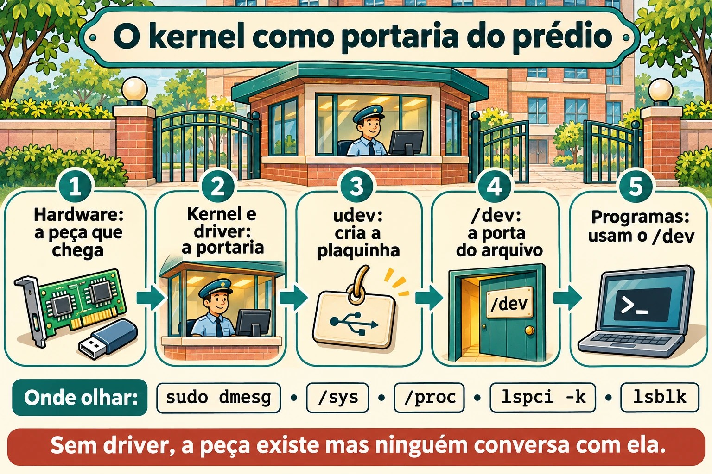
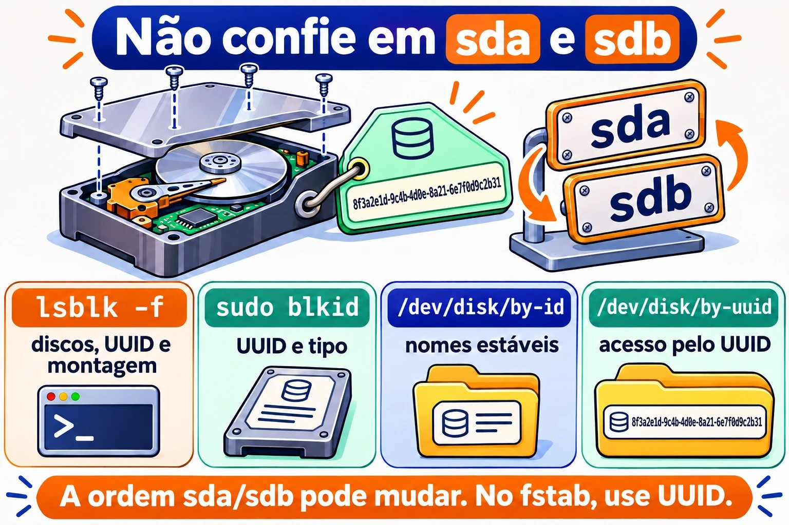

# Aula 5.1 · Hardware pelo kernel

O kernel é quem conversa com o hardware. Tudo o que ele vê, ele mostra em dois lugares: o `/proc` e o `/sys`. Nesta aula você aprende a perguntar ao kernel que hardware existe, qual driver cuida de cada peça e o que aconteceu quando algo foi conectado. Numa VM, também vai ver que o "hardware" é o que o Proxmox inventou para ela.

> **Núcleo desta aula:** `lspci -k`, `lsblk`, `lsusb`, `dmesg` (ou `journalctl -k`), `/proc/cpuinfo` e `/proc/meminfo`, a ideia de driver, e o udev criando os arquivos em `/dev`. O resto é aprofundamento.

| Ficha |  |
| --- | --- |
| Módulo | M5 · Hardware, kernel e virtualização, aula 1 de 3 |
| Quando | Semana 9 |
| Semana | 9 |
| Tempo | 2 h a 2 h 30 |
| VMs | rocky-lab (201) e debian-lab (202) |
| Antes | Snapshot `m5a1-inicio` nas duas |

## 1 Aquecimento

Responda sem pesquisar. As respostas estão no Gabarito.

1. Se você plugar um disco novo num servidor ligado, precisa reiniciar para o Linux enxergar?
2. O que é um driver, em uma frase?
3. Onde o kernel anota o que aconteceu desde o boot: num arquivo de log comum ou em outro lugar?

## 2 Por que importa

| Situação real | O que você faz com esta aula |
| --- | --- |
| O cliente diz que "a placa de rede sumiu" depois de uma atualização | `lspci -k` mostra se a placa existe e se algum driver a assumiu |
| Você acrescentou um disco no Proxmox e quer saber o nome dele | `lsblk` e `dmesg` mostram o disco novo, sem reiniciar |
| Um servidor físico está lento e você suspeita do disco | `dmesg` mostra erros de I/O, reset de controladora e setores ruins |
| Você precisa inventariar memória e CPU de 20 máquinas | `/proc/meminfo`, `/proc/cpuinfo` e `lscpu` dão a resposta por script |

## 3 Modelo mental

Pense no kernel como a **portaria de um prédio**:

- Cada peça de hardware é um **morador**. Quando ele chega, a portaria registra a chegada no **livro de ocorrências**, que é o `dmesg`.
- Para cada morador, a portaria escala um **funcionário** que sabe falar com ele: o **driver**. Sem funcionário, o morador existe, mas ninguém conversa com ele.
- O `/sys` é o **cadastro organizado** de todos os moradores, por andar e por tipo. O `/proc` é o **quadro de avisos** com números do dia: memória, CPU e processos.
- O **udev** é o funcionário que, a cada chegada, coloca uma **plaquinha na porta**, ou seja, cria o arquivo em `/dev`, como `/dev/sdb`, e dá a ele nomes estáveis em `/dev/disk/by-id`.

Os comandos `lspci`, `lsusb` e `lsblk` são só jeitos bonitos de ler esse cadastro.



*Sem driver, a peça existe mas ninguém conversa com ela.*

## 4 O essencial

### /proc e /sys

Os dois são sistemas de arquivos **virtuais**: não ocupam disco, e o kernel gera o conteúdo na hora em que você lê.

| Caminho | Mostra |
| --- | --- |
| `/proc/cpuinfo` | Cada CPU, o modelo e as flags, como `vmx` ou `svm` para virtualização |
| `/proc/meminfo` | Memória total, livre, disponível, cache e swap |
| `/proc/cmdline` | Os parâmetros com que o kernel subiu (4.4) |
| `/proc/partitions` | Os discos e partições que o kernel conhece |
| `/proc/interrupts` e `/proc/ioports` | Interrupções e portas de I/O |
| `/sys/class/net/` | Uma pasta por placa de rede |
| `/sys/block/` | Uma pasta por disco |
| `/sys/bus/pci/devices/` | Um item por dispositivo PCI |

Atalhos que leem esses arquivos por você: `lscpu`, `free -h` e `lsmem`.

### Os comandos ls\*

| Comando | Lista | Opção que mais vale |
| --- | --- | --- |
| `lspci` | Dispositivos PCI: rede, disco, vídeo | `-k` mostra o driver em uso; `-nn` mostra os IDs de fabricante e modelo |
| `lsusb` | Dispositivos USB | `-t` mostra em árvore |
| `lsblk` | Discos e partições | `-f` mostra o sistema de arquivos e o UUID |
| `lscpu` | CPU | sem opção |
| `lshw` | Tudo | `-short` dá um resumo; precisa de root e, às vezes, de instalação |

Se o `lspci` ou o `lsusb` não existirem, instale os pacotes `pciutils` e `usbutils`.

### O que é um driver

Um driver é o código do kernel que sabe falar com um tipo de hardware. Ele pode estar **embutido** no kernel ou ser um **módulo** carregado quando o hardware aparece. A 5.2 trata dos módulos. No `lspci -k`, a linha *Kernel driver in use* diz quem assumiu o dispositivo. Se ela não aparece, nenhum driver assumiu, e o dispositivo não funciona.

### dmesg e journalctl -k

O kernel guarda as mensagens num **anel de memória** (*ring buffer*). Quando o anel enche, as mais antigas somem.

```bash
sudo dmesg -T | less          # -T: horário legível
sudo dmesg -w                 # acompanha ao vivo
sudo dmesg -l err,warn        # só erros e avisos
journalctl -k -b              # mensagens do kernel deste boot, via journal
journalctl -k -b -1           # do boot anterior, se o journal for persistente
```

O `journalctl -k` tem uma vantagem: ele guarda as mensagens de boots anteriores, coisa que o `dmesg` não faz.

### udev e /dev

Quando o kernel detecta um dispositivo, ele avisa o **systemd-udevd**. O udev cria o arquivo em `/dev`, ajusta as permissões e cria os links estáveis:

```bash
ls -l /dev/disk/by-id/ /dev/disk/by-uuid/ /dev/disk/by-path/
udevadm info /dev/sda          # tudo o que o udev sabe sobre o disco
sudo udevadm monitor           # mostra os eventos ao vivo
```

**Regra de ouro:** nomes como `sda` e `sdb` dependem da ordem em que os discos aparecem e podem mudar no próximo boot. Em `/etc/fstab` e em scripts, use o UUID ou o `by-id`.

### Rocky × Debian

| Item | Rocky | Debian |
| --- | --- | --- |
| `dmesg` sem sudo | Normalmente funciona | Recusado: `kernel.dmesg_restrict = 1` |
| `lspci` na instalação mínima | Pode faltar: `dnf install pciutils` | Pode faltar: `apt install pciutils` |
| Regras do udev | `/usr/lib/udev/rules.d/` (do sistema) e `/etc/udev/rules.d/` (suas) | Iguais |

## 5 Lab guiado

### Passo 0 · Snapshot e pasta

No nó Proxmox:

```bash
qm snapshot 201 m5a1-inicio
qm snapshot 202 m5a1-inicio
```

Em cada VM:

```bash
mkdir -p ~/lab51 && cd ~/lab51
```

### Passo 1 · Inventário pelo /proc

Nas duas VMs:

```bash
lscpu | head -20
grep -c ^processor /proc/cpuinfo
grep -m1 'model name' /proc/cpuinfo
free -h
grep -E 'MemTotal|MemAvailable|SwapTotal' /proc/meminfo
cat /proc/partitions
lsblk -f
```

Compare o modelo de CPU das duas com o do nó Proxmox. Com o tipo de CPU `host`, a VM enxerga o mesmo modelo do processador físico. Anote em `~/lab51/inventario.txt`: CPUs, memória total, discos e partições.

### Passo 2 · Quem é quem no PCI e no USB

```bash
lspci
lspci -k | grep -A3 -iE 'ethernet|scsi|sata|virtio'
lsusb
lsusb -t
```

Você vai ver dispositivos com o nome *Red Hat, Inc. Virtio*: são as peças virtuais que o Proxmox (QEMU) oferece, com drivers *virtio* do lado do Linux. No `lsusb`, aparece um *QEMU USB Tablet*: é o mouse do console noVNC.

Anote: qual driver cuida da placa de rede, e qual cuida da controladora de disco?

### Decida 1

No próximo passo você vai acrescentar um disco de 1 GB na debian-lab, com ela ligada. Antes, responda: o que o `lsblk` mostra logo depois?

- A) Nada novo: o disco só aparece depois de reiniciar.
- B) Um disco novo, `sdb` por exemplo, sem partições.
- C) Um disco novo, já com uma partição formatada.

Marque uma opção antes de seguir.

### Passo 3 · Hotplug ao vivo

Na debian-lab, abra **duas sessões SSH**. Na primeira:

```bash
sudo udevadm monitor --udev --subsystem-match=block
```

Na segunda:

```bash
sudo dmesg -wT
```

Agora acrescente o disco. Pela interface do Proxmox: VM 202, depois *Hardware*, *Add* e *Hard Disk*, com barramento **SCSI**, storage `vm-hdd` e tamanho 1 GB. Ou, no shell do nó:

```bash
qm set 202 --scsi2 vm-hdd:1
```

Olhe as duas sessões: o `dmesg` mostra o kernel achando o disco, e o `udevadm monitor` mostra o evento `add` para o udev. Pare os dois com `Ctrl+C` e confira:

| Se você marcou | Resultado | Por quê |
| --- | --- | --- |
| A | Errou | O barramento SCSI virtual avisa o kernel na hora: isso é hotplug |
| B | Acertou | O kernel vê o disco, e o udev cria o `/dev/sdb`. Disco novo vem vazio |
| C | Errou | Ninguém particiona nem formata sozinho. Isso é com você, no M9 |

```bash
lsblk
ls -l /dev/disk/by-id/ | grep -v part
udevadm info /dev/sdb | head -30
```

**Confirme pelo tamanho** qual nome o disco de 1 GB ganhou. O disco de 2 GB da Aula 2.2 já está no `scsi1` e costuma ser o `sdb`; aí o novo vira o `sdc`. Use o nome que você viu no resto da aula, no lugar de `sdb`, e não mexa no disco de 2 GB: ele é do M9.

**Para fixar:** disco novo aparece sem reiniciar, e o nome `sdX` é só a ordem de chegada. O nome estável está em `/dev/disk/by-id`.

### Decida 2

Nas duas VMs, como **usuário comum e sem sudo**, você vai rodar `dmesg | tail -3`. O que acontece?

- A) As duas mostram as mensagens.
- B) As duas recusam.
- C) Uma mostra, e a outra recusa.

Marque uma opção antes. Depois rode nas duas, e também `sysctl kernel.dmesg_restrict`.

| Se você marcou | Resultado | Por quê |
| --- | --- | --- |
| A | Errou | A Debian protege o anel do kernel de usuários comuns |
| B | Errou, na maioria das instalações | A Rocky costuma vir com `dmesg_restrict = 0` |
| C | Acertou | A Debian vem com `kernel.dmesg_restrict = 1`, e a Rocky normalmente com 0. Confira o valor real nas suas VMs |

**Para fixar:** o `dmesg` pode revelar endereços e detalhes úteis a um atacante. Por isso a Debian o restringe. Em script de monitoração, rode com sudo ou use `journalctl -k` num grupo com acesso ao journal.

### Passo 4 · Passear pelo /sys

```bash
ls /sys/class/net/
cat /sys/class/net/*/address
cat /sys/class/net/*/operstate
cat /sys/block/sdb/size              # em setores de 512 bytes
echo $(( $(cat /sys/block/sdb/size) * 512 / 1024 / 1024 )) MiB
cat /sys/block/sdb/queue/rotational  # 1 = disco girando, 0 = SSD ou virtual sem dizer
readlink -f /sys/class/net/*/device/driver
```

Repare: o `lsblk` e o `ip link` que você já usa leem exatamente esses arquivos.

## 6 Quebre e conserte

Você vai fazer o kernel "esquecer" o disco de teste e depois fazê-lo procurar de novo, sem reiniciar. Isso é o que se faz num servidor físico quando um disco novo não aparece.


*A ordem sda/sdb muda se você adicionar ou remover um disco. No fstab, use UUID ou by-id.*


**Antes, confira de novo** com `lsblk` que o `sdb` é o disco de 1 GB e que ele não tem nada montado. Nunca faça isto no disco do sistema.

```bash
lsblk /dev/sdb
echo 1 | sudo tee /sys/block/sdb/device/delete
lsblk
sudo dmesg | tail -5
```

O disco sumiu para o Linux, embora continue ligado na VM. Agora, sem olhar a resposta abaixo, tente descobrir como mandá-lo procurar de novo. Dica: o caminho fica em `/sys/class/scsi_host/`.

O conserto:

```bash
for h in /sys/class/scsi_host/host*/scan; do echo "- - -" | sudo tee "$h" >/dev/null; done
lsblk
```

Os três traços querem dizer "qualquer canal, qualquer alvo, qualquer LUN". O disco volta, às vezes com outro nome. Por isso, mais uma vez, scripts e fstab usam UUID ou `by-id`.

## 7 Armadilhas

- **Confiar em `sda` e `sdb`.** A ordem pode mudar num boot com um disco a mais ou a menos. Use UUID ou `by-id`.
- **Achar que o `dmesg` guarda tudo.** O anel tem tamanho fixo e se apaga no boot. Para o histórico, use `journalctl -k`, com o journal persistente da 3.x.
- **Esquecer o `-k` no `lspci`.** Sem ele, você vê o hardware mas não o driver, que é justamente o que importa num "a placa sumiu".
- **Rodar o `device/delete` no disco errado.** O sistema perde o disco com tudo montado nele. Confirme pelo tamanho e pelo `lsblk` antes.
- **Editar arquivos em `/usr/lib/udev/rules.d/`.** A próxima atualização sobrescreve. As suas regras vão em `/etc/udev/rules.d/`.
- **Esperar ver o hardware físico numa VM.** Dentro da VM, você vê o hardware virtual que o Proxmox oferece. A saúde dos discos físicos se olha no nó, e não na VM.

## 8 Quiz

1. Qual a diferença entre o `/proc` e o `/sys`, em uma frase cada?
2. Qual comando mostra qual driver assumiu a placa de rede?
3. Por que não se usa `/dev/sdb` no `/etc/fstab`?
4. Em que arquivo estão as interrupções em uso?
5. Como ver as mensagens do kernel do boot anterior?
6. *What does udev do when the kernel detects a new device?*

## 9 Cola

### Para saber de cor

| Comando | Faz |
| --- | --- |
| `lspci -k` | Dispositivos PCI e o driver de cada um |
| `lsusb` / `lsusb -t` | Dispositivos USB, em lista ou em árvore |
| `lsblk -f` | Discos, partições, sistema de arquivos e UUID |
| `lscpu` / `free -h` | CPU e memória |
| `sudo dmesg -T` / `-w` | Mensagens do kernel, com hora, ou ao vivo |
| `journalctl -k -b` / `-b -1` | Mensagens do kernel deste boot ou do anterior |
| `udevadm info /dev/X` / `udevadm monitor` | O que o udev sabe de um dispositivo / eventos ao vivo |
| `/dev/disk/by-id`, `by-uuid` | Nomes estáveis dos discos |

### Para consultar

`lspci -nn`, `lspci -v`, `lshw -short`, `lsmem`, `/proc/interrupts`, `/proc/ioports`, `/proc/dma`, `/sys/class/`, `/sys/bus/pci/devices/`, `/sys/block/*/queue/rotational`, `/sys/class/scsi_host/host*/scan`, `/sys/block/*/device/delete`, `/etc/udev/rules.d/`, `udevadm trigger`, `kernel.dmesg_restrict`.

### Flashcards

| Pergunta | Resposta |
| --- | --- |
| `/proc` e `/sys` ocupam disco? | Não: o kernel gera o conteúdo na hora |
| Quem cria os arquivos em `/dev`? | O udev (`systemd-udevd`) |
| Disco novo numa VM ligada exige reboot? | Não: é hotplug |
| Onde ficam as regras de udev do administrador? | `/etc/udev/rules.d/` |
| Por que o `dmesg` falha sem sudo na Debian? | `kernel.dmesg_restrict = 1` |

## 10 Checklist e fechamento

- [ ] Fiz o inventário de CPU, memória e discos pelo `/proc` e pelos comandos `ls*`
- [ ] Achei o driver da placa de rede e da controladora de disco
- [ ] Vi um disco entrar ao vivo no `dmesg` e no `udevadm monitor`
- [ ] Entendi por que o `dmesg` se comporta diferente nas duas distros
- [ ] Fiz o kernel esquecer um disco e procurar de novo
- [ ] Sei por que nomes `sdX` não servem para o fstab

**Último exercício, sem olhar a aula:** tire o disco de teste do jeito limpo. Primeiro, dentro da debian-lab, faça o kernel soltá-lo:

```bash
echo 1 | sudo tee /sys/block/sdb/device/delete
```

Depois, na interface do Proxmox, vá em VM 202, depois *Hardware*, selecione o disco `scsi2`, clique em *Detach* e, em seguida, em *Remove* no *Unused Disk*. Isso apaga o disco de teste de 1 GB, que não tem nada.

**Reboot e conferência:** reinicie as duas VMs e confira:

```bash
lsblk                            # só os discos originais
systemctl is-system-running      # running
ls ~/lab51
```

**Snapshot de fim**, no nó Proxmox:

```bash
qm snapshot 201 m5a1-fim
qm snapshot 202 m5a1-fim
```

## 11 Na vida real

**Missão, só leitura.** Num servidor real que você administra, de preferência um físico, rode apenas estes comandos, que não mudam nada:

```bash
lscpu | grep -E 'Model name|^CPU\(s\)'
free -h
lsblk -o NAME,SIZE,TYPE,MODEL,ROTA,MOUNTPOINTS
lspci -k | grep -A3 -iE 'ethernet|raid|sas|nvme'
sudo dmesg -T -l err,warn | tail -20
journalctl -k -p warning -b --no-pager | tail -20
```

Responda: os discos são girando ou SSD? A placa de rede tem driver em uso? Os erros e avisos do kernel falam de disco, memória ou rede? Num servidor físico, mensagens com `I/O error`, `reset` ou `Machine Check` merecem uma conversa com o responsável. Não mude nada sozinho.

**Diário:** escreva três linhas sobre o que você aprendeu hoje e uma dúvida que ficou.

**Amanhã, sem olhar:**

1. Diga três arquivos do `/proc` e o que cada um mostra.
2. Escreva o comando que mostra o driver de cada dispositivo PCI.
3. Explique, em uma frase, o que o udev faz quando chega um disco.

## 12 Aprofundar quando quiser

- Escrever uma regra de udev em `/etc/udev/rules.d/` que dá um nome fixo a um disco ou a uma placa de rede.
- `udevadm test` e `udevadm trigger` para testar regras sem plugar nada.
- Saúde de hardware físico: `smartctl` (pacote `smartmontools`), `rasdaemon` e as mensagens EDAC de memória.
- `lshw -html` para um inventário completo em página.
- *Coldplug*: como o udev reprocessa, no boot, os dispositivos que já estavam lá.

No DeepTutor: `!explica /proc, /sys e /dev`, `!feynman o que o udev faz`, `!quiz hardware pelo kernel`.

## Gabarito comentado

### Aquecimento

1. Em geral, não. Discos SAS, SATA com hotplug, NVMe com suporte e discos virtuais aparecem com a máquina ligada. Se não aparecerem, dá para pedir uma nova varredura pelo `/sys`.
2. Um driver é o código do kernel que sabe conversar com um tipo de hardware.
3. Num anel de memória do kernel, lido pelo `dmesg`. O journal também guarda uma cópia, que o `journalctl -k` lê.

### Quiz

1. O `/proc` mostra processos e números do kernel, como memória e CPU. O `/sys` mostra os dispositivos e drivers de forma organizada, por barramento e por classe.
2. `lspci -k`, na linha *Kernel driver in use*.
3. Porque o nome `sdX` depende da ordem em que os discos aparecem e pode mudar. O UUID e o `by-id` não mudam.
4. Em `/proc/interrupts`.
5. `journalctl -k -b -1`, desde que o journal seja persistente.
6. *udev receives the kernel event, creates the device file in /dev with the right permissions, adds stable symlinks such as /dev/disk/by-id, and runs any matching rules.*

---

<!-- navegacao -->
[← Aula 4.4 · GRUB e acesso de emergência](4.4-grub-e-acesso-de-emergencia.md) · [Índice de aulas](../01-aulas.md) · [Aula 5.2 · Módulos e parâmetros →](5.2-modulos-e-parametros.md)
