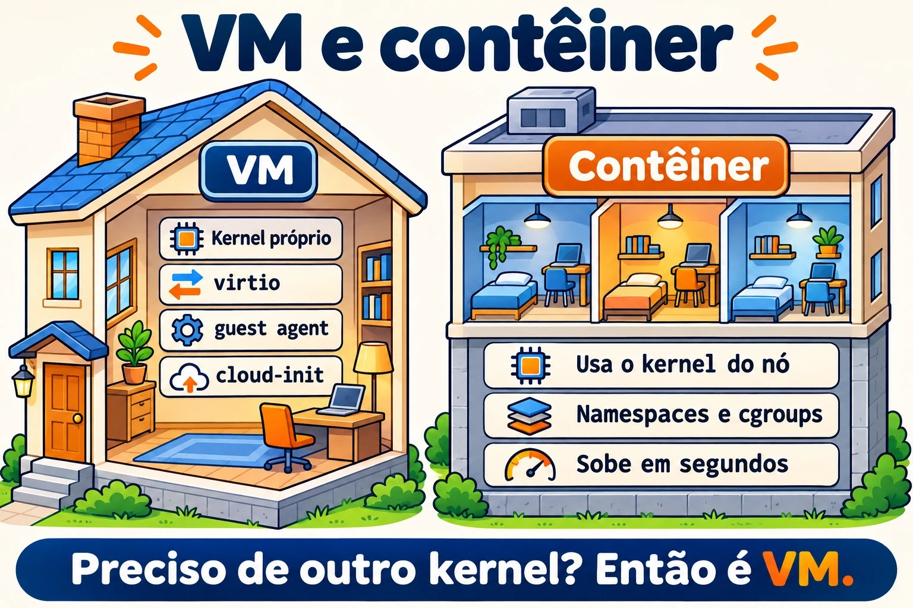
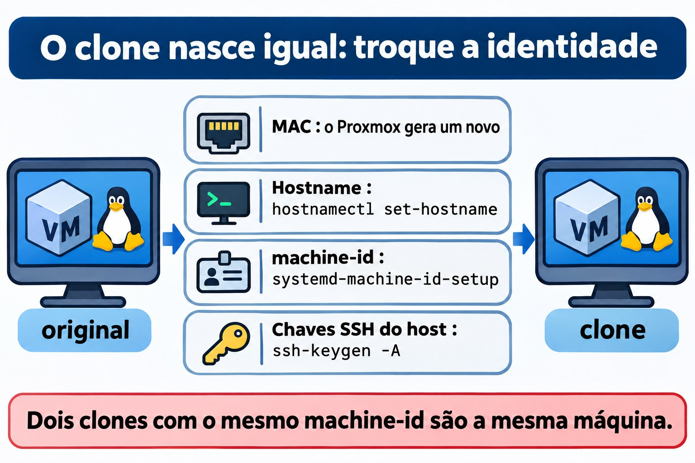

# Aula 5.3 · Linux como convidado

Nas Aulas 5.1 e 5.2 você viu o kernel falar com o hardware. Só que, nas suas duas VMs, esse hardware não existe: quem responde é o QEMU, rodando no nó Proxmox. Hoje você vê o Linux do lado de dentro da VM. Como ele sabe que é convidado, que drivers usa para andar mais rápido, como conversa com o hipervisor pelo guest agent e como é configurado sozinho no primeiro boot pelo cloud-init. Você também vai ver o que acontece quando alguém clona uma VM e esquece que algumas coisas precisam ser únicas. No fim, você compara uma VM com um contêiner, que parece uma máquina mas usa o kernel de outra.

> **Núcleo desta aula:** `systemd-detect-virt` e `hostnamectl` para saber onde você está; os dispositivos `virtio`; o `qemu-guest-agent`, dos dois lados (pacote na VM, opção no Proxmox); o que o cloud-init faz no primeiro boot; o que precisa ser único num clone: hostname, `/etc/machine-id` e as chaves SSH do host; e a diferença entre VM e contêiner: o kernel. O resto é aprofundamento.

| Ficha | Aula 5.3 |
| --- | --- |
| Módulo | M5 · Hardware, kernel e virtualização, aula 3 de 3 |
| Quando | Semana 9 |
| Ao final você consegue | Dizer se o Linux roda em VM, em contêiner ou em máquina física, e com qual hipervisor; reconhecer os dispositivos `virtio` e os seus módulos; instalar e ligar o guest agent na VM e no Proxmox, e usá-lo com `qm agent` e `qm guest cmd`; explicar o que o cloud-init faz e quando ele roda; listar o que deve ser único num clone e trocar hostname, `machine-id` e chaves SSH do host; ver na prática que um contêiner usa o kernel do hospedeiro |
| Pré-requisitos | Aula 5.1 (`lspci -k`, `/sys`, `dmesg`); Aula 5.2 (`lsmod`, `modinfo`); Aula 4.2 (systemd e unidades); o SSH entre o seu computador e as VMs |
| Tempo | Cerca de 2h30, mais o Desafio do módulo |
| Snapshots | m5a3-inicio e m5a3-fim nas duas VMs; m5-desafio antes do Desafio |

## 1 · Aquecimento

Três perguntas, de cabeça. Escreva as respostas; o Gabarito confere no fim.

1. Você entra por SSH numa máquina desconhecida. Palpite: com um só comando, dá para saber se ela é uma VM?
2. Você clona uma VM Linux no Proxmox e liga as duas. Palpite: elas vão ter o mesmo `/etc/machine-id`? E isso importa?
3. Um contêiner Debian roda dentro da sua rocky-lab. Palpite: o que o `uname -r` mostra dentro dele, o kernel da Debian ou o da Rocky?

## 2 · Por que importa

| O chamado | A resposta errada | O que ela causa |
| --- | --- | --- |
| "O Proxmox não mostra o IP da VM, e o desligar pela GUI não funciona" | Desligar no botão Stop | O Stop é tirar da tomada. O que faltava era o guest agent: com ele, o Proxmox vê o IP, pede um desligamento limpo e congela o sistema de arquivos durante o backup |
| "Clonei a VM e agora as duas brigam pelo mesmo IP do DHCP, e o monitoramento só vê uma" | Trocar o hostname e achar que acabou | O `machine-id` e as chaves SSH continuam iguais. Dependendo da rede, o DHCP identifica as duas como a mesma máquina; o journal, o monitoramento e muitos agentes também usam o `machine-id` |
| "O SSH diz que a identificação do servidor mudou: `REMOTE HOST IDENTIFICATION HAS CHANGED`" | Apagar o `known_hosts` inteiro, ou ignorar o aviso | Às vezes é só um clone com chaves novas. Às vezes é ataque. Quem sabe quando as chaves mudaram e por quê, decide com calma e remove só a linha certa |
| "Vamos rodar isso num contêiner, que é mais leve" | Tratar o contêiner como uma VM menor | O contêiner usa o kernel do hospedeiro. Não carrega módulo próprio, não escolhe a versão do kernel e, se o kernel do hospedeiro cair, cai junto |

## 3 · Modelo mental

> Pense num **prédio comercial**, como na Aula 5.1. Uma **VM** é uma sala alugada com portaria própria: o kernel dela é seu, com os seus drivers, e o hipervisor finge ser o hardware. Os drivers `virtio` são o interfone direto com o síndico: em vez de fingir um hardware antigo, o convidado sabe que está numa VM e fala a língua do hipervisor, que é mais rápida. O **guest agent** é o zelador da sala, que atende o síndico (o Proxmox) quando ele pergunta o IP ou pede para fechar tudo. O **cloud-init** é o kit de mudança: no primeiro dia, ele monta a sala com o nome, os usuários e as chaves que vieram no pacote. Um **contêiner** não é uma sala com portaria: é uma divisória dentro de outra sala, que usa a mesma portaria (o mesmo kernel).

```text
  MÁQUINA FÍSICA (nó Proxmox)
  ┌───────────────────────────────────────────────────────────────┐
  │ kernel do nó (KVM)                                            │
  │  ┌────────────── QEMU ─────────────┐   ┌──── LXC ───────────┐ │
  │  │ VM rocky-lab                    │   │ contêiner           │ │
  │  │  kernel PRÓPRIO                 │   │  processos isolados │ │
  │  │  virtio_net, virtio_scsi        │   │  SEM kernel próprio │ │
  │  │  qemu-guest-agent ◄── canal ────┼─► │  usa o kernel do nó │ │
  │  │  cloud-init (1º boot)  virtio-serial │                     │ │
  │  └─────────────────────────────────┘   └─────────────────────┘ │
  └───────────────────────────────────────────────────────────────┘
```



*A VM tem kernel próprio; o contêiner usa o kernel do nó.*

## 4 · O essencial

### Onde estou?

| Comando | O que mostra |
| --- | --- |
| `systemd-detect-virt` | `kvm`, `qemu`, `vmware`, `microsoft`, `oracle`... numa VM; `lxc`, `podman`, `docker`... num contêiner; `none` na máquina física |
| `systemd-detect-virt -c` / `-v` | Só contêiner / só VM |
| `hostnamectl` | Linha `Virtualization:` e `Chassis: vm`, além do hostname e do kernel |
| `lscpu \| grep -i hypervisor` | `Hypervisor vendor: KVM` |
| `sudo dmidecode -s system-product-name` | O "modelo" que o hipervisor inventou, como `Standard PC (Q35 + ICH9, 2009)` |

### Os drivers virtio

O hipervisor pode imitar um hardware real e antigo, como a placa de rede e1000 ou um disco IDE. Funciona em qualquer sistema, mas é lento, porque cada acesso é traduzido. O **virtio** é um hardware que só existe em VM: o convidado sabe disso e conversa direto com o hipervisor. No Linux, os drivers virtio já vêm no kernel.

| Dispositivo no Proxmox | Driver no convidado | Como aparece |
| --- | --- | --- |
| VirtIO SCSI (controladora) | `virtio_scsi` | Discos `sda`, `sdb`... |
| VirtIO Block | `virtio_blk` | Discos `vda`, `vdb`... |
| Placa VirtIO | `virtio_net` | `ens18` ou `eth0` |
| Balloon | `virtio_balloon` | O hipervisor pode pegar RAM de volta |
| RNG VirtIO | `virtio_rng` | Fonte de aleatoriedade |
| Serial VirtIO | `virtio_console` | O canal do guest agent |

### O guest agent

O `qemu-guest-agent` é um serviço que roda **dentro** da VM e responde ao Proxmox por um canal serial virtual. Ele precisa de duas metades, e esquecer uma é o erro clássico:

1. **No Proxmox:** a opção `QEMU Guest Agent` ligada (`qm set ID --agent enabled=1`). Ela cria o dispositivo serial, e só vale depois de desligar e ligar a VM pelo Proxmox.
2. **Na VM:** o pacote `qemu-guest-agent` instalado e o serviço rodando.

Com as duas metades, o Proxmox mostra os IPs na GUI, faz um desligamento limpo, congela o sistema de arquivos (`fsfreeze`) durante o backup para a cópia sair consistente, e deixa você perguntar coisas com `qm agent` e `qm guest cmd`.

### cloud-init

O cloud-init roda no **primeiro boot** de uma imagem de nuvem e configura a máquina com dados que vêm de fora: hostname, usuários, chaves SSH autorizadas, rede e pacotes. Esses dados vêm de uma **datasource**: um serviço de metadados na AWS ou no OpenStack, ou um CD virtual no Proxmox (a aba Cloud-Init). O cloud-init guarda um `instance-id`: enquanto ele não muda, a máquina não se considera nova e não refaz a configuração de primeiro boot.

| Comando ou arquivo | Para quê |
| --- | --- |
| `cloud-init status --long` | Rodou? Terminou? Deu erro? |
| `/var/log/cloud-init.log` e `cloud-init-output.log` | O que ele fez, passo a passo |
| `/etc/cloud/cloud.cfg` e `/etc/cloud/cloud.cfg.d/` | O que ele está autorizado a mudar |
| `sudo cloud-init clean --logs` | Apaga o estado. No próximo boot, ele age como se fosse a primeira vez. É o que se faz antes de transformar a VM em template |

### Clones e o que precisa ser único

Um **clone completo** copia o disco inteiro. Um **clone ligado** (linked clone) usa o disco do template como base e grava só as diferenças. Nos dois casos, o disco do clone começa igual ao original, com tudo o que está dentro dele:

| Identificador | Onde fica | Quem troca |
| --- | --- | --- |
| Endereço MAC | Configuração da VM | O Proxmox gera um novo no clone |
| Hostname | `/etc/hostname` e `/etc/hosts` | Você, com `hostnamectl set-hostname`, ou o cloud-init |
| `machine-id` | `/etc/machine-id` (na Debian, também `/var/lib/dbus/machine-id`) | Você, com `systemd-machine-id-setup`, ou a imagem já vem com o arquivo vazio |
| Chaves SSH do host | `/etc/ssh/ssh_host_*` | Você, com `ssh-keygen -A`, ou o cloud-init |
| IP fixo | Configuração de rede | Você, ou o cloud-init |

O `machine-id` é o "CPF" da instalação: 32 caracteres hexadecimais criados na instalação. O journal guarda os logs numa pasta com esse nome, o `systemd-networkd` usa esse ID para se identificar no DHCP, e muito agente de monitoramento ou de backup também. Dois clones com o mesmo `machine-id` são, para essas ferramentas, a mesma máquina.

As **chaves SSH do host** provam ao cliente que o servidor é o mesmo da última vez. Dois clones com as mesmas chaves são indistinguíveis para o SSH: se um deles for comprometido, a chave privada dele serve para se passar pelo outro.



*O clone nasce igual ao original: troque o que identifica a máquina.*

### VM e contêiner lado a lado

|  | VM (QEMU/KVM, `qm`) | Contêiner (LXC com `pct`, Podman, Docker) |
| --- | --- | --- |
| Kernel | Próprio | O do hospedeiro |
| Boot | GRUB, initramfs, systemd | Começa direto no processo principal, às vezes um systemd |
| Módulos e `sysctl` | Carrega e muda os seus | Não carrega módulo; muitos `sysctl` são só leitura ou do hospedeiro |
| Outro sistema operacional | Qualquer um, até Windows | Só Linux, com o kernel de quem hospeda |
| Isolamento | Forte: o hipervisor separa | Mais fraco: tudo depende do kernel compartilhado |
| Custo | Mais RAM e mais disco | Leve: sobe em segundos |

### Rocky × Debian

| Tema | Rocky | Debian |
| --- | --- | --- |
| Guest agent | `dnf install qemu-guest-agent` | `apt install qemu-guest-agent` |
| Ligar o serviço | O pacote não liga sozinho em toda versão: confira com `systemctl status` e ligue com `systemctl enable --now` | O serviço sobe quando o dispositivo serial aparece; sem a opção ligada no Proxmox, ele fica parado esperando |
| Chave SSH do host ausente | O `sshd-keygen@.service` gera as que faltam quando o `sshd` sobe | O `ssh` não sobe. É preciso rodar `ssh-keygen -A` ou `dpkg-reconfigure openssh-server` |
| `/var/lib/dbus/machine-id` | Costuma não existir; o D-Bus lê o `/etc/machine-id` | Costuma ser um link para o `/etc/machine-id`; confira com `ls -l` |
| Imagens de nuvem | Vêm com cloud-init | Vêm com cloud-init |

## 5 · Lab guiado

### Passo 0 · Snapshot e pasta

No nó Proxmox:

```bash
qm snapshot 201 m5a3-inicio
qm snapshot 202 m5a3-inicio
```

Em cada VM:

```bash
mkdir -p ~/lab53 && cd ~/lab53
```

### Passo 1 · Onde estou?

Nas duas VMs:

```bash
systemd-detect-virt
hostnamectl
lscpu | grep -i hypervisor
sudo dmidecode -s system-product-name
lspci | grep -i virtio
lsmod | grep virtio
```

No nó Proxmox, rode `systemd-detect-virt` também. Ele deve responder `none`: o nó é a máquina física.

Anote em `~/lab53/notas.txt` o que o `systemd-detect-virt` respondeu em cada lugar e quais módulos `virtio` cada VM carrega. Compare com o que a aba Hardware da VM mostra no Proxmox: a controladora de disco e o modelo da placa de rede.

### Passo 2 · O guest agent, as duas metades

Primeiro, a metade da VM. Na rocky-lab:

```bash
sudo dnf -y install qemu-guest-agent
sudo systemctl enable --now qemu-guest-agent
systemctl status qemu-guest-agent --no-pager
```

Na debian-lab:

```bash
sudo apt -y install qemu-guest-agent
systemctl status qemu-guest-agent --no-pager
```

Na Debian, o serviço pode aparecer parado, esperando o dispositivo `virtio-ports/org.qemu.guest_agent.0`. Isso é normal enquanto a outra metade não estiver ligada.

Agora, a metade do Proxmox. No nó:

```bash
qm config 201 | grep agent
qm set 201 --agent enabled=1
qm set 202 --agent enabled=1
```

### Decida 1

Você ligou a opção do agent. Na debian-lab, você roda `sudo systemctl reboot`. Depois que ela volta, você roda `qm agent 202 ping` no nó. O que acontece?

- A) Responde sem erro, porque a VM reiniciou.
- B) Dá erro, porque o reboot de dentro da VM não aplica a mudança de hardware.
- C) Dá erro, porque o serviço da Debian precisa de `enable` manual.

Marque uma opção antes. Depois faça o teste.

| Se você marcou | Resultado | Por quê |
| --- | --- | --- |
| A | Errou | O reboot de dentro reinicia o sistema, mas o processo QEMU continua o mesmo, com o hardware antigo. A GUI mostra a opção como mudança pendente |
| B | Acertou | Mudança de hardware só vale quando o Proxmox desliga e liga a VM: `qm shutdown` e `qm start`, ou `qm reboot`, ou o Reboot da GUI |
| C | Errou | Na Debian, o serviço sobe sozinho quando o dispositivo aparece. O problema é que o dispositivo ainda não existe |

Agora aplique de verdade e converse com o agente:

```bash
qm reboot 201
qm reboot 202
# espere as VMs voltarem
qm agent 201 ping && echo ok
qm agent 202 ping && echo ok
qm guest cmd 202 get-osinfo
qm guest cmd 202 network-get-interfaces | grep -E '"name"|ip-address"'
qm guest cmd 201 get-fsinfo | grep -E 'mountpoint|type'
```

Na GUI, a página Summary das duas VMs agora mostra os IPs.

**Para fixar:** o guest agent só funciona com as duas metades: o pacote dentro da VM e a opção no Proxmox, aplicada com um desliga e liga feito pelo Proxmox.

### Passo 3 · cloud-init, só olhando

Suas VMs foram instaladas pelo ISO, então o cloud-init provavelmente não está lá. Confira:

```bash
command -v cloud-init || echo "cloud-init não instalado"
```

Se estiver instalado, olhe sem mudar nada:

```bash
cloud-init status --long
sudo tail -20 /var/log/cloud-init.log
ls /etc/cloud/cloud.cfg.d/
```

No nó, veja como o Proxmox entrega os dados ao cloud-init de uma VM que use uma imagem de nuvem:

```bash
man qm | grep -A2 -E '^ +--(ciuser|sshkeys|ipconfig0)'
```

As opções `--ciuser`, `--sshkeys` e `--ipconfig0` vão para um CD virtual que o cloud-init lê no boot. Você não vai montar um template agora. Ele aparece de novo no módulo de automação.

### Passo 4 · A identidade da VM

Na debian-lab:

```bash
hostnamectl hostname
cat /etc/machine-id
ls -l /var/lib/dbus/machine-id
ls /var/log/journal/
ls -l /etc/ssh/ssh_host_*
for k in /etc/ssh/ssh_host_*_key.pub; do ssh-keygen -lf "$k"; done
```

No seu computador, compare a impressão digital com a que o cliente SSH guardou:

```bash
ssh-keygen -F IP_DA_DEBIAN -l
```

O nome da pasta em `/var/log/journal/` é o `machine-id`. Guarde as três coisas em `~/lab53/identidade.txt`: hostname, `machine-id` e a impressão da chave `ed25519`. Você vai precisar delas no Desafio.

### Decida 2

Você clona a debian-lab sem mexer em nada e liga o clone. Quais destas coisas o clone tem **igual** à original?

- A) Só o hostname.
- B) Hostname, `machine-id` e chaves SSH do host. O MAC é novo.
- C) Tudo, inclusive o MAC.

Marque uma opção antes. A conferida fica para o Desafio do módulo.

| Se você marcou | Resultado | Por quê |
| --- | --- | --- |
| A | Errou | O disco é copiado inteiro, e com ele os arquivos `/etc/machine-id` e `/etc/ssh/ssh_host_*` |
| B | Acertou | O MAC fica na configuração da VM, e o Proxmox gera outro no clone. Tudo o que está no disco vem igual |
| C | Errou | O Proxmox troca o MAC justamente para as duas poderem ficar na mesma rede |

**Para fixar:** clone copia o disco. Tudo o que identifica a máquina e mora no disco precisa ser trocado à mão, por uma ferramenta como o `virt-sysprep`, ou pelo cloud-init.

### Passo 5 · Um contêiner ao lado

Na rocky-lab, com internet:

```bash
sudo dnf -y install podman
uname -r
podman run --rm docker.io/library/debian:12 cat /etc/os-release
podman run --rm docker.io/library/debian:12 uname -r
podman run --rm docker.io/library/debian:12 ls /boot /lib/modules
```

O contêiner diz que é Debian 12, mas o `uname -r` mostra o kernel da Rocky, com `el9` no nome. E não há `/boot` nem módulos: não há kernel para carregar. É a resposta da pergunta 3 do Aquecimento, ao vivo.

Para terminar, tente mudar um parâmetro do kernel de dentro do contêiner:

```bash
podman run --rm docker.io/library/debian:12 sh -c 'echo 10 > /proc/sys/vm/swappiness'
```

O kernel recusa, porque o `/proc/sys` aparece só para leitura no contêiner: o kernel é do hospedeiro, e quem manda nele é o hospedeiro.

## 6 · Quebre e conserte

Nesta quebra você apaga as chaves SSH do host nas duas VMs e vê que cada distro reage de um jeito. **Faça pelo console do Proxmox**, não pelo SSH. Uma sessão SSH aberta não cai quando o serviço reinicia, mas você não consegue abrir outra.


*Todo clone precisa de identidade nova: hostname, machine-id e chaves SSH.*


Nas duas VMs:

```bash
sudo cp -a /etc/ssh ~/lab53/ssh-antes
sudo rm /etc/ssh/ssh_host_*
```

Na rocky-lab, `sudo systemctl restart sshd`. Na debian-lab, `sudo systemctl restart ssh`. Depois, investigue sem olhar o conserto:

```bash
systemctl status sshd --no-pager      # Rocky
systemctl status ssh --no-pager       # Debian
journalctl -b -u ssh --no-pager | tail -5
ls /etc/ssh/ssh_host_*
```

Na Rocky, o `sshd` sobe: o `sshd-keygen@` gerou chaves novas antes. Na Debian, o `ssh` falha, com algo como `no hostkeys available`. Do seu computador, tente entrar nas duas. A Rocky responde com o aviso `REMOTE HOST IDENTIFICATION HAS CHANGED`, porque as chaves mudaram. A Debian recusa a conexão.

O conserto na Debian:

```bash
sudo ssh-keygen -A
sudo systemctl restart ssh
systemctl status ssh --no-pager
```

No seu computador, remova só a linha antiga de cada VM e entre de novo, conferindo a impressão digital nova com a que o console mostra:

```bash
ssh-keygen -R IP_DA_ROCKY
ssh-keygen -R IP_DA_DEBIAN
```

A lição: o aviso de chave mudada não se ignora e não se resolve apagando o `known_hosts` inteiro. Você descobre **por que** a chave mudou, confere a impressão nova por outro caminho (aqui, o console) e só então tira a linha velha.

## 7 · Armadilhas

- **Ligar o agent só de um lado.** O pacote sem a opção no Proxmox, ou a opção sem o pacote, dão o mesmo resultado: nada.
- **Reiniciar por dentro e esperar mudança de hardware.** Só o desliga e liga feito pelo Proxmox aplica.
- **Apagar o `/etc/machine-id`.** O caminho certo é esvaziar ou remover e recriar com `systemd-machine-id-setup`, e conferir o `/var/lib/dbus/machine-id` na Debian. Um sistema sem o arquivo pode não subir direito.
- **Fazer template sem limpar.** Se você transforma uma VM em template sem limpar `machine-id`, chaves SSH e o estado do cloud-init, todos os clones nascem gêmeos.
- **Esquecer o `/etc/hosts`.** O `hostnamectl set-hostname` muda o `/etc/hostname`, mas o nome antigo continua no `/etc/hosts`, e o `sudo` pode ficar lento ou reclamar.
- **Tratar o contêiner como VM.** Ele não tem kernel próprio: módulos, muitos `sysctl` e a versão do kernel vêm do hospedeiro.
- **Clone com IP fixo ligado na rede.** Dois IPs iguais na mesma rede derrubam as duas máquinas aos poucos. Ligue o clone com a placa desconectada até trocar o IP.

## 8 · Quiz

1. Que comando diz se você está numa VM, num contêiner ou numa máquina física?
2. Quais são as duas metades do guest agent, e como se aplica a metade do Proxmox?
3. O que o cloud-init faz, e quando?
4. Cite três coisas que precisam ser únicas num clone e diga onde cada uma fica.
5. Por que um contêiner Debian dentro da Rocky mostra o kernel da Rocky?
6. *Which file holds the systemd machine ID, and which command creates a new one?*

## 9 · Cola

### Para saber de cor

| Comando ou arquivo | Faz |
| --- | --- |
| `systemd-detect-virt` / `hostnamectl` | Onde estou / hostname, chassis e virtualização |
| `qm set ID --agent enabled=1` + `qm reboot ID` | Liga o agent no Proxmox e aplica |
| `qm agent ID ping` / `qm guest cmd ID network-get-interfaces` | Testa o agent / pergunta os IPs |
| `hostnamectl set-hostname nome` | Troca o hostname (e depois o `/etc/hosts`) |
| `/etc/machine-id` + `systemd-machine-id-setup` | O ID da instalação e quem o recria |
| `/etc/ssh/ssh_host_*` + `ssh-keygen -A` | As chaves do host e quem gera as que faltam |
| `ssh-keygen -R host` | Remove só aquele host do `known_hosts` |

### Para consultar

`systemd-detect-virt -c` e `-v`, `lscpu`, `dmidecode`, `virtio_scsi`, `virtio_blk`, `virtio_net`, `virtio_balloon`, `qm guest cmd ID get-osinfo`, `get-fsinfo`, `fsfreeze-status`, `cloud-init status --long`, `cloud-init clean --logs`, `/var/log/cloud-init.log`, `/etc/cloud/cloud.cfg.d/`, `qm set --ciuser --sshkeys --ipconfig0`, `qm clone --full`, `qm template`, `virt-sysprep`, `sshd-keygen@.service`, `dpkg-reconfigure openssh-server`, `ssh-keygen -lf`, `ssh-keygen -F`, `podman run --rm`, `pct list`.

### Flashcards

| Pergunta | Resposta |
| --- | --- |
| `systemd-detect-virt` na máquina física responde... | `none` |
| Reboot de dentro da VM aplica mudança de hardware? | Não; só o desliga e liga do Proxmox |
| O clone do Proxmox troca o MAC? | Sim; o que está no disco, não |
| Debian sem chave SSH do host... | O `ssh` não sobe; a Rocky gera chaves novas sozinha |
| Contêiner tem kernel próprio? | Não; usa o do hospedeiro |

## 10 · Checklist e fechamento

- [ ] Descobri onde cada máquina roda com `systemd-detect-virt` e `hostnamectl`
- [ ] Reconheci os dispositivos e módulos `virtio` das duas VMs
- [ ] Liguei o guest agent dos dois lados e vi os IPs com `qm guest cmd`
- [ ] Expliquei o que o cloud-init faz, mesmo sem ele instalado
- [ ] Anotei hostname, `machine-id` e chave SSH da debian-lab
- [ ] Vi um contêiner Debian rodar no kernel da Rocky
- [ ] Apaguei as chaves SSH do host, vi a diferença entre as distros e consertei

**Último exercício, sem olhar a aula:** de dentro de cada VM, sem usar a GUI, diga o IP dela e confirme pelo nó com `qm guest cmd`. Depois, na rocky-lab, apague a imagem que o Podman baixou (`podman images`, depois `podman rmi` com o nome que aparecer).

**Reboot e conferência:** reinicie as duas VMs pelo Proxmox (`qm reboot`) e confira:

```bash
systemctl status qemu-guest-agent --no-pager   # active (running)
systemctl --failed                              # vazio
ls ~/lab53
```

No nó, `qm agent 201 ping` e `qm agent 202 ping` sem erro.

**Snapshot de fim**, no nó Proxmox:

```bash
qm snapshot 201 m5a3-fim
qm snapshot 202 m5a3-fim
```

O guest agent fica ligado daqui em diante. Ele vai ajudar nos backups e nos próximos módulos.

## 11 · Na vida real

**Missão, só leitura.** Num servidor real que você administra, rode apenas estes comandos, que não mudam nada:

```bash
systemd-detect-virt
hostnamectl
systemctl is-active qemu-guest-agent 2>/dev/null || echo "sem guest agent"
cat /etc/machine-id
command -v cloud-init && cloud-init status
```

Se for uma VM do Proxmox, olhe também, no nó, só lendo: `qm config ID | grep agent`.

Responda: as VMs que você administra têm o guest agent dos dois lados? Se não têm, o backup delas está saindo sem congelar o sistema de arquivos. Duas máquinas suas têm o mesmo `machine-id`? Isso denuncia um clone mal feito. Anote o que achou. Não mude nada sozinho.

**Diário:** escreva três linhas sobre o que você aprendeu hoje e uma dúvida que ficou.

**Amanhã, sem olhar:**

1. Liste, em ordem, o que você faria num clone recém-criado antes de ligá-lo na rede.
2. Explique por que o reboot de dentro da VM não liga o guest agent.
3. Diga uma vantagem e uma desvantagem do contêiner em relação à VM.

## 12 · Aprofundar quando quiser

- `virt-sysprep` (pacote `guestfs-tools` ou `libguestfs-tools`): limpa `machine-id`, chaves SSH, logs e histórico de um disco de VM desligada.
- Templates no Proxmox com imagens de nuvem da Rocky e da Debian: `qm importdisk`, a aba Cloud-Init e `qm template`.
- Os arquivos `user-data`, `meta-data` e `network-config` do cloud-init, e a datasource NoCloud.
- Clone ligado versus clone completo: espaço, desempenho e por que não se apaga o template de um clone ligado.
- `systemd-firstboot` e `ConditionFirstBoot=`: como o systemd sabe que é o primeiro boot.
- Contêineres LXC no Proxmox (`pct`), privilegiados e não privilegiados.
- Namespaces e cgroups: as peças do kernel que fazem um contêiner existir.

No DeepTutor: `!explica guest agent do QEMU`, `!feynman diferença entre VM e contêiner`, `!quiz Linux como convidado`.

## Desafio do módulo 5

**Missão:** clonar a debian-lab e dar ao clone identidade própria: hostname, `machine-id` e chaves SSH do host. No fim, as duas VMs ficam ligadas ao mesmo tempo, na mesma rede, sem conflito. Sem olhar a aula; o Gabarito tem dicas, se travar.

**Antes de começar**, no nó Proxmox:

```bash
qm snapshot 202 m5-desafio
qm list          # escolha um VMID livre, por exemplo 902
```

**Regras:**

- Clone completo, no storage `vm-hdd`, com o nome `debian-clone`.
- Ligue o clone com a placa de rede **desconectada** e faça tudo pelo console, até a identidade estar trocada. Se a debian-lab usar IP fixo, troque o IP também.
- A debian-lab original não muda em nada.
- Tempo-alvo: 30 minutos.

**Critérios de sucesso:**

| Conferir | Como | Esperado |
| --- | --- | --- |
| Hostname | `hostnamectl hostname` no clone | `debian-clone`, e o `/etc/hosts` sem o nome antigo |
| `machine-id` | `cat /etc/machine-id` nas duas | Diferentes; o do clone com 32 caracteres hexadecimais |
| D-Bus | `ls -l /var/lib/dbus/machine-id` no clone | Link para o `/etc/machine-id`, ou o mesmo conteúdo |
| Chaves SSH | `ssh-keygen -lf /etc/ssh/ssh_host_ed25519_key.pub` nas duas | Impressões diferentes; compare com o `identidade.txt` |
| Rede | `ip -br a` nas duas, com o clone já conectado | IPs diferentes, e os dois respondem ao `ping` |
| SSH | Do seu computador, `ssh` para as duas | As duas entram; o clone aparece como host novo no `known_hosts` |
| Agent | `qm agent 902 ping` no nó | Sem erro |

**Rollback**, se algo der errado na original: `qm rollback 202 m5-desafio`.

**Limpeza**, quando você terminar e conferir tudo: no nó, `qm stop 902` e depois `qm destroy 902 --purge`. Confira o número duas vezes antes de apertar Enter. No seu computador, tire o clone do `known_hosts` com `ssh-keygen -R IP_DO_CLONE`.

## Gabarito comentado

### Aquecimento

1. Sim. `systemd-detect-virt` responde `kvm`, `vmware`, `lxc`... ou `none`. O `hostnamectl` também mostra, na linha `Virtualization`.
2. Sim, vão ter o mesmo, porque o arquivo está no disco e o disco foi copiado. E importa: o journal, o DHCP do `systemd-networkd` e vários agentes usam o `machine-id` para saber quem é quem.
3. O da Rocky. O contêiner traz os arquivos da Debian, mas roda no kernel do hospedeiro.

### Quiz

1. `systemd-detect-virt`. O `hostnamectl` também serve.
2. O pacote `qemu-guest-agent` rodando dentro da VM, e a opção `--agent enabled=1` no Proxmox. A opção cria um dispositivo serial e só vale depois de o Proxmox desligar e ligar a VM, por exemplo com `qm reboot`.
3. Configura a máquina no primeiro boot com dados de uma datasource: hostname, usuários, chaves SSH, rede, pacotes. Ele só refaz isso se o `instance-id` mudar ou se alguém rodar `cloud-init clean`.
4. Hostname, em `/etc/hostname` e `/etc/hosts`; `machine-id`, em `/etc/machine-id` (e `/var/lib/dbus/machine-id`); chaves SSH do host, em `/etc/ssh/ssh_host_*`. Também vale o IP fixo, na configuração de rede. O MAC o Proxmox já troca.
5. Porque o contêiner não tem kernel próprio. Ele é um grupo de processos isolados que roda no kernel do hospedeiro.
6. *`/etc/machine-id`. Empty or remove it, then run `systemd-machine-id-setup`; on Debian, check that `/var/lib/dbus/machine-id` matches or links to it.*

### Dicas do Desafio

Tente sozinho primeiro. Se travar, leia uma dica de cada vez.

1. **Clone e placa desconectada:** `qm clone 202 902 --name debian-clone --full --storage vm-hdd`. Depois, `qm config 902 | grep net0`, e repita a linha com `,link_down=1` no fim: `qm set 902 --net0 virtio=MAC_DO_CLONE,bridge=vmbr0,link_down=1`. Use o MAC que o clone ganhou, para não gerar outro. Só então `qm start 902` e abra o console.
2. **Hostname:** `sudo hostnamectl set-hostname debian-clone`, e troque o nome antigo no `/etc/hosts` com `sudoedit /etc/hosts` ou com o `sed -i` da Aula 3.4.
3. **machine-id:** `sudo rm /etc/machine-id`, depois `sudo systemd-machine-id-setup`. Confira o `/var/lib/dbus/machine-id`: se for link, já está certo; se for um arquivo comum, `sudo rm /var/lib/dbus/machine-id` e `sudo ln -s /etc/machine-id /var/lib/dbus/machine-id`.
4. **Chaves SSH:** `sudo rm /etc/ssh/ssh_host_*`, depois `sudo ssh-keygen -A` e `sudo systemctl restart ssh`. Se esquecer o `ssh-keygen -A`, você já sabe o que acontece: a Quebre desta aula.
5. **Reboot e rede:** reinicie o clone para que tudo passe a usar o `machine-id` novo. A pasta nova aparece em `/var/log/journal/`, e a velha pode ser apagada. Troque o IP se for fixo, e só então reconecte: `qm set 902 --net0 virtio=MAC_DO_CLONE,bridge=vmbr0` (sem o `link_down`).
6. **Conferir:** rode a tabela de critérios. Se o `machine-id` do clone ainda for igual ao da original, confira se você não editou a VM errada. O prompt mostra o hostname, e é por isso que ele vem primeiro.

---

<!-- navegacao -->
[← Aula 5.2 · Módulos e parâmetros](5.2-modulos-e-parametros.md) · [Índice de aulas](../01-aulas.md) · [Aula 6.1 · Pacotes no Debian →](6.1-pacotes-no-debian.md)
