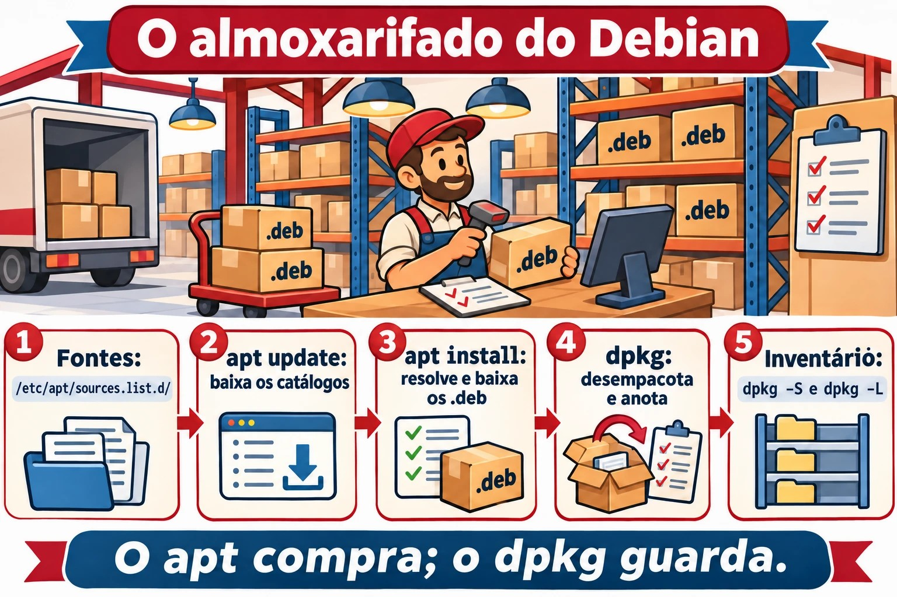
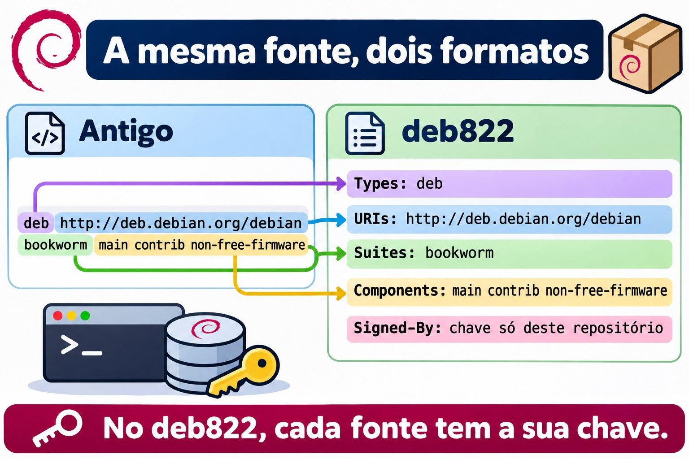
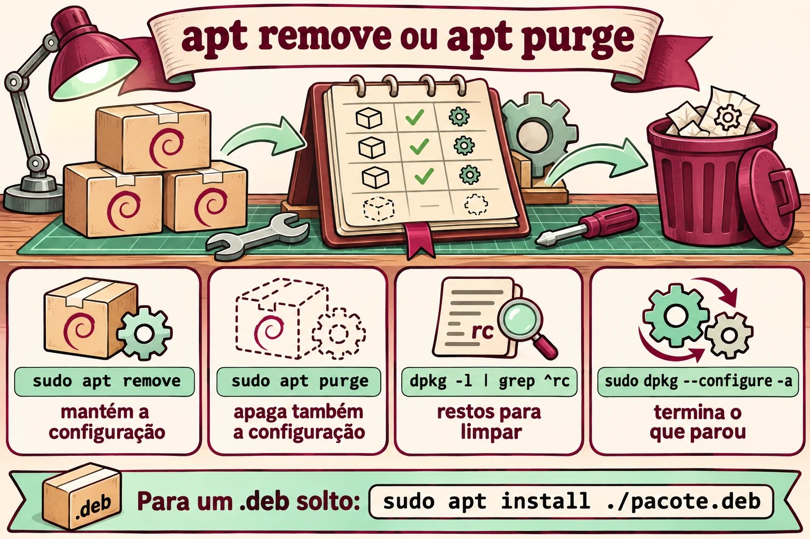

# Aula 6.1 · Pacotes no Debian

Até aqui você instalou programas com um `apt install` aqui e outro ali, sem pensar muito. Hoje você olha por dentro. O que é um pacote, quem o desempacota, quem busca na internet e resolve as dependências, o que sobra no disco quando você remove, e como descobrir de que pacote veio um arquivo qualquer. Você também lê as fontes de onde o apt baixa tudo, no formato novo, o deb822. Esta é a primeira de cinco aulas sobre software. A próxima faz o mesmo na Rocky, e você vai ver que a ideia é a mesma, só com outros nomes.

> **Núcleo desta aula:** `apt update`, `apt install`, `apt remove`, `apt purge` e `apt autoremove`; `apt search` e `apt show`; `dpkg -l`, `dpkg -L pacote` e `dpkg -S arquivo`; a diferença entre `dpkg` (instala o arquivo `.deb`) e `apt` (busca, resolve dependências e chama o `dpkg`); e onde ficam as fontes: `/etc/apt/sources.list.d/`. O resto é aprofundamento.

| Ficha | Aula 6.1 |
| --- | --- |
| Módulo | M6 · Software, aula 1 de 5 |
| Quando | Semana 10 |
| Ao final você consegue | Explicar o que há dentro de um `.deb` e quem faz o quê entre `dpkg` e `apt`; atualizar os índices, procurar, ver detalhes, instalar, remover e purgar; ler o estado de um pacote no `dpkg -l` (`ii`, `rc`, `iU`); listar os arquivos de um pacote e achar o pacote de um arquivo, instalado ou não; entender pacotes manuais e automáticos e o `autoremove`; ler e escrever uma fonte no formato deb822; instalar um `.deb` solto e consertar as dependências que faltarem |
| Pré-requisitos | Aula 3.3 (`grep`); Aula 4.2 (systemd); internet na debian-lab |
| Tempo | Cerca de 2h30 |
| Snapshots | m6a1-inicio e m6a1-fim na debian-lab. A rocky-lab descansa hoje |

## 1 · Aquecimento

Três perguntas, de cabeça. Escreva as respostas; o Gabarito confere no fim.

1. Você roda `apt remove` num pacote. Palpite: o arquivo de configuração dele, em `/etc`, vai embora junto?
2. Alguém te manda um arquivo `programa.deb`, e você roda `sudo dpkg -i programa.deb`. Palpite: se faltar uma biblioteca, o `dpkg` vai baixá-la?
3. Você acha um arquivo estranho em `/usr/bin`. Palpite: dá para saber de que pacote ele veio, com um comando só?

## 2 · Por que importa

| O chamado | A resposta errada | O que ela causa |
| --- | --- | --- |
| "Remove o Apache e instala o Nginx" | `apt remove apache2` e pronto | A configuração antiga fica em `/etc/apache2`, e as dependências que vieram com ele continuam instaladas. Meses depois, ninguém sabe se aquilo é lixo ou se alguma coisa usa |
| "O `apt` diz `unmet dependencies` e não instala mais nada" | Apagar arquivos em `/var/lib/dpkg` ou forçar com `--force-all` | O banco de pacotes fica inconsistente, e a próxima atualização pode quebrar o sistema. Quase sempre, `apt --fix-broken install` resolve |
| "Esse arquivo em `/usr/local/bin` é de quê?" | Apagar para ver o que acontece | O `dpkg -S` diz na hora se algum pacote é dono do arquivo. Se nenhum for, alguém instalou à mão, e isso já é uma informação |
| "Adiciona esse repositório do Ubuntu que eu achei num blog" | Colar a linha no `sources.list` | Pacotes de outra distro, ou de outra versão, misturados com os seus. Funciona até a próxima atualização, e aí as dependências brigam |

## 3 · Modelo mental

> Pense num **almoxarifado**. Um **pacote** `.deb` é uma caixa lacrada: dentro há os arquivos, uma etiqueta com nome, versão e **dependências** ("para funcionar, precisa da caixa X"), e instruções para antes e depois de abrir (os scripts). O **`dpkg`** é o almoxarife: recebe uma caixa, guarda cada coisa no lugar, anota tudo no inventário (`/var/lib/dpkg/`) e sabe dizer de que caixa veio cada objeto. Ele **não** sai para comprar nada: se a caixa pede outra que não está no estoque, ele reclama e para. O **`apt`** é o comprador: lê os catálogos dos fornecedores (os **repositórios** listados nas **fontes**), descobre todas as caixas necessárias, baixa e entrega ao almoxarife na ordem certa. O `apt update` só atualiza os catálogos: não compra nada.

```text
  /etc/apt/sources.list.d/*.sources        (os fornecedores)
             │
             │  apt update: baixa os catálogos
             ▼
  /var/lib/apt/lists/                      (os catálogos: quem tem o quê, em que versão)
             │
             │  apt install X: resolve dependências e baixa
             ▼
  /var/cache/apt/archives/*.deb            (as caixas baixadas)
             │
             │  o apt chama o dpkg
             ▼
  dpkg: desempacota, roda os scripts e anota em /var/lib/dpkg/status
```



*O apt compra e resolve; o dpkg guarda, desempacota e anota no inventário.*

## 4 · O essencial

### apt, o dia a dia

| Comando | Faz |
| --- | --- |
| `sudo apt update` | Baixa os catálogos novos. Rode antes de instalar ou atualizar |
| `apt search palavra` / `apt show pacote` | Procura nos catálogos / mostra versão, tamanho, dependências e descrição |
| `sudo apt install pacote` | Instala com as dependências |
| `sudo apt install ./arquivo.deb` | Instala um `.deb` solto **e** busca as dependências. O `./` é obrigatório |
| `sudo apt remove pacote` | Remove os arquivos, mas mantém a configuração em `/etc` |
| `sudo apt purge pacote` | Remove tudo, inclusive a configuração |
| `sudo apt autoremove` | Remove as dependências que ninguém mais usa |
| `sudo apt upgrade` | Atualiza o que der sem remover nada |
| `sudo apt full-upgrade` | Atualiza tudo, removendo pacotes se for preciso |
| `apt list --installed` / `--upgradable` | Lista instalados / com atualização pendente |
| `apt policy pacote` | Versão instalada, versão candidata e de que repositório cada uma vem |

O `apt` foi feito para pessoas, e a saída dele pode mudar entre versões. Em **script**, use `apt-get` e `apt-cache`, que têm a saída estável. Por isso o `apt` avisa `WARNING: apt does not have a stable CLI interface` quando a saída vai para um pipe. Saiba os dois.

### dpkg, o inventário

| Comando | Faz |
| --- | --- |
| `dpkg -l` / `dpkg -l 'padrão*'` | Lista os pacotes e o estado de cada um |
| `dpkg -L pacote` | Arquivos que um pacote instalado colocou no disco |
| `dpkg -S /caminho/arquivo` | Que pacote instalado é dono do arquivo |
| `dpkg -s pacote` | Estado e detalhes de um pacote instalado |
| `dpkg -I arquivo.deb` / `dpkg -c arquivo.deb` | Etiqueta / conteúdo de um `.deb` que ainda não foi instalado |
| `sudo dpkg -i arquivo.deb` | Instala o `.deb`, mas **não** busca dependências |
| `sudo dpkg -r pacote` / `sudo dpkg -P pacote` | Remove / purga |
| `sudo dpkg --configure -a` | Termina instalações interrompidas |
| `sudo dpkg-reconfigure pacote` | Refaz as perguntas de configuração do pacote |

As duas primeiras letras do `dpkg -l` são o estado. A primeira é o que se **pediu**, e a segunda é o que **está**:

| Código | Quer dizer |
| --- | --- |
| `ii` | Pediu para instalar, está instalado. O normal |
| `rc` | Foi removido, mas a configuração ficou. Some com `purge` |
| `iU` | Desempacotado, mas não configurado: falta dependência ou a instalação foi interrompida |
| `hi` | Instalado e travado (`hold`): não é atualizado |

### Configuração e purge

Os arquivos de configuração que o pacote declara (os **conffiles**, quase sempre em `/etc`) têm tratamento especial. Num `remove`, ficam no disco, para você não perder o que ajustou. Numa atualização, se você tiver mudado o arquivo e o pacote também, o `dpkg` pergunta o que fazer. Você pode manter o seu, aceitar o novo ou ver a diferença. A lista de conffiles de um pacote sai com `dpkg-query -W -f='${Conffiles}\n' pacote`.

### Manual e automático

O apt lembra **por que** cada pacote está instalado. Se você pediu, ele é **manual**. Se veio como dependência, é **automático**. Quando nenhum pacote manual precisa mais de um automático, o `apt autoremove` o leva embora.

| Comando | Faz |
| --- | --- |
| `apt-mark showmanual` / `showauto` | Lista os manuais / os automáticos |
| `sudo apt-mark manual pacote` | Marca como manual: o `autoremove` não leva mais |
| `sudo apt-mark hold pacote` / `unhold` | Trava / destrava a versão |
| `apt-cache depends pacote` / `rdepends pacote` | Do que ele depende / quem depende dele |

### Achar o pacote de um arquivo

O `dpkg -S` só conhece os pacotes **instalados**. Para procurar em todos os pacotes do repositório, use o `apt-file`, que tem um catálogo próprio: `sudo apt install apt-file`, `sudo apt-file update` e `apt-file search bin/dig`.

### As fontes, no formato deb822

As fontes dizem ao apt de onde baixar. Há dois formatos, e você vai encontrar os dois:

```text
# Formato antigo, uma linha por fonte (/etc/apt/sources.list)
deb http://deb.debian.org/debian bookworm main contrib non-free-firmware

# Formato deb822 (/etc/apt/sources.list.d/debian.sources)
Types: deb
URIs: http://deb.debian.org/debian
Suites: bookworm bookworm-updates
Components: main contrib non-free-firmware
Signed-By: /usr/share/keyrings/debian-archive-keyring.gpg
```

| Campo | O que é |
| --- | --- |
| `Types` | `deb` para pacotes prontos; `deb-src` para o código-fonte |
| `URIs` | O endereço do espelho |
| `Suites` | A versão pelo codinome: `bookworm` é a Debian 12 e `trixie` é a 13. Mais as atualizações, como `bookworm-updates` e `bookworm-security` |
| `Components` | `main` (livre), `contrib`, `non-free` e `non-free-firmware` |
| `Signed-By` | A chave GPG que assina esse repositório, e só ele |

Cada fonte num arquivo `.sources` em `/etc/apt/sources.list.d/`, com a chave própria no `Signed-By`, é o jeito moderno. O antigo `apt-key` está obsoleto, porque confiava em qualquer chave para qualquer repositório. O formato depende da versão e de como a máquina foi instalada. Uma Debian 12 costuma vir com o `sources.list` de uma linha. Na Debian 13, o `apt modernize-sources` converte para deb822.



*A mesma fonte nos dois formatos: uma linha no antigo, um campo por linha no deb822.*

### Rocky × Debian

A próxima aula é a Rocky, mas vale ver o mapa agora:

| Tarefa | Debian | Rocky |
| --- | --- | --- |
| Almoxarife (arquivo local) | `dpkg` | `rpm` |
| Comprador (repositório e dependências) | `apt` | `dnf` |
| Arquivos de um pacote | `dpkg -L` | `rpm -ql` |
| Dono de um arquivo | `dpkg -S` | `rpm -qf` |
| Pacote de um arquivo não instalado | `apt-file search` | `dnf provides` |
| Remover a configuração também | `purge` | Não existe; o `rpm` guarda cópias `.rpmsave` |
| Fontes | `/etc/apt/sources.list.d/*.sources` | `/etc/yum.repos.d/*.repo` |

## 5 · Lab guiado

Tudo na **debian-lab (202)**. A rocky-lab descansa hoje. Você vai precisar de internet na VM.

**Passo 0 · Snapshot e pasta.** No Proxmox:

```bash
qm snapshot 202 m6a1-inicio
```

Na VM:

```bash
mkdir -p ~/lab61 && cd ~/lab61
```

**Passo 1 · De onde vêm os pacotes.**

```bash
ls -l /etc/apt/sources.list /etc/apt/sources.list.d/
cat /etc/apt/sources.list.d/*.sources
```

Resultado esperado: no Debian 13 você vê um `debian.sources` no formato deb822 (Types / URIs / Suites / Components / Signed-By). O `sources.list` pode nem existir, ou estar vazio. Anote quais *Suites* aparecem (por exemplo `trixie`, `trixie-updates`, `trixie-security`).

**Passo 2 · Atualizar o catálogo.**

```bash
sudo apt update
ls /var/lib/apt/lists/ | head
apt list --upgradable
```

O `apt update` não instala nada. Ele só baixa os catálogos para `/var/lib/apt/lists/`. Quem atualiza pacotes é o `apt upgrade`; hoje não rode esse.

**Passo 3 · Procurar antes de instalar.**

```bash
apt search --names-only '^tree$'
apt show tree
apt policy tree
```

O `apt policy` mostra a versão instalada, a candidata e de qual repositório ela viria. É o comando que responde "por que ele quer instalar essa versão?".

**Passo 4 · Instalar e investigar.**

```bash
sudo apt install -y tree
dpkg -l tree
dpkg -L tree
dpkg -S $(command -v tree)
dpkg -s tree | grep -E '^(Status|Version)'
```

Resultado esperado: `ii` no `dpkg -l`, a lista de arquivos no `-L`, e `tree: /usr/bin/tree` no `-S`.

**Passo 5 · Um pacote com configuração: nginx.**

```bash
sudo apt install -y nginx
dpkg -S /etc/nginx/nginx.conf
dpkg -l 'nginx*'
systemctl is-active nginx
```

Repare: o `nginx.conf` pertence ao **nginx-common**, não ao `nginx`. Pacotes grandes costumam se dividir assim (binário de um lado, configuração e arquivos comuns do outro).

**Passo 6 · remove × purge, ao vivo.**

```bash
sudo apt remove -y nginx nginx-common
dpkg -l 'nginx*' | grep -E '^(ii|rc)'
ls /etc/nginx/
```

Resultado esperado: o `nginx-common` aparece como `rc` (removido, configuração ficou), e `/etc/nginx/` continua lá. Agora:

```bash
sudo apt purge -y nginx-common
ls /etc/nginx/ 2>&1
sudo apt autoremove -y
```

Depois do purge, o `/etc/nginx/` some e o `rc` desaparece da lista. O `autoremove` leva as dependências que só estavam lá por causa do nginx, se houver alguma.

**Passo 7 · Um .deb na mão, sem dependência.**

```bash
apt download nginx
ls -l *.deb
dpkg -I nginx_*.deb | grep -E '^ (Package|Version|Depends)'
dpkg -c nginx_*.deb | head
sudo dpkg -i nginx_*.deb
```

Resultado esperado: o `dpkg -i` reclama que falta o `nginx-common` (você deu purge nele no passo 6). O pacote fica meio instalado:

```bash
dpkg -l nginx | tail -1
sudo apt install -y tree
```

O `dpkg -l` mostra `iU` (unpacked, não configurado). E o `apt` passa a se recusar a fazer qualquer outra coisa e manda rodar `--fix-broken`. É isso que você faz:

```bash
sudo apt --fix-broken install -y
dpkg -l nginx nginx-common | tail -2
```

Agora os dois estão `ii`. **Moral:** um `.deb` solto se instala com `sudo apt install ./arquivo.deb` (com o `./`), que já resolve as dependências. O `dpkg -i` não busca nada.

**Passo 8 · Manual, automático e hold.**

```bash
apt-mark showmanual | grep -E '^(tree|nginx)'
apt-mark showauto | grep nginx
sudo apt-mark hold nginx
apt-mark showhold
sudo apt-mark unhold nginx
```

O `nginx-common` aparece como **auto**: entrou como dependência. Se um dia o `nginx` sair, o `autoremove` leva o `nginx-common` junto.

**Passo 9 · O histórico.**

```bash
grep -E ' (install|remove|purge) ' /var/log/dpkg.log | tail
tail -n 30 /var/log/apt/history.log
```

O `history.log` diz **quem** pediu o quê (a linha `Commandline:` e o `Requested-By:`). O `dpkg.log` diz o que de fato mudou, pacote por pacote. Em um chamado "quem mexeu nesse servidor ontem?", você começa por aqui.

**Passo 10 · (opcional) apt-file.**

```bash
sudo apt install -y apt-file && sudo apt-file update
apt-file search bin/dig
```

O `dpkg -S` só procura o que já está instalado. O `apt-file` procura em todo o repositório: "qual pacote me dá o comando `dig`?" (resposta: `bind9-dnsutils`).

**Limpeza:**

```bash
sudo apt purge -y nginx nginx-common tree
sudo apt autoremove -y
cd ~ && rm -r ~/lab61
```

### Decida 1 · O nginx.conf está todo errado

Alguém editou o `/etc/nginx/nginx.conf` até não sobrar nada aproveitável. Você quer o arquivo original do pacote de volta. Marque uma opção antes.

- **A)** `sudo apt remove nginx nginx-common && sudo apt install nginx`
- **B)** `sudo apt purge nginx nginx-common && sudo apt install nginx`
- **C)** `sudo apt install --reinstall nginx-common`

| Se você marcou | Resultado | Por quê |
| --- | --- | --- |
| A | O arquivo quebrado continua lá | O remove deixa os conffiles. Na reinstalação, o dpkg vê que o arquivo foi modificado por você e não sobrescreve |
| **B** | **Arquivo original de volta** | O purge apaga os conffiles. A instalação nova encontra o lugar vazio e coloca o original |
| C | O arquivo quebrado continua lá | O dpkg respeita conffile modificado, mesmo em reinstalação |

**Para fixar:** o dpkg protege sua configuração de propósito. Para ter o original de volta, ou você dá purge, ou apaga o arquivo e reinstala forçando (veja a seção 6). Antes de qualquer um dos dois, faça uma cópia: `sudo cp -a /etc/nginx /root/nginx.bak`.

### Decida 2 · O fornecedor mandou um .deb

Você recebeu `agente_2.1_amd64.deb`. O `sudo dpkg -i` falhou com `dependency problems`. Marque uma opção antes.

- **A)** `sudo dpkg -i --force-depends agente_2.1_amd64.deb`
- **B)** `sudo apt --fix-broken install`
- **C)** Editar `/var/lib/dpkg/status` e tirar a linha `Depends:` do pacote

| Se você marcou | Resultado | Por quê |
| --- | --- | --- |
| A | Instala, mas quebrado | O pacote fica sem a biblioteca de que precisa. Ele falha depois, longe de você, e o apt continua reclamando |
| **B** | **Dependências instaladas, pacote configurado** | O apt busca o que falta no repositório e termina a configuração que o dpkg deixou pela metade |
| C | Banco do dpkg corrompido | Esse arquivo é o banco de dados do sistema. Editar na mão é o caminho mais curto para um servidor que ninguém consegue atualizar |

**Para fixar:** da próxima vez, `sudo apt install ./agente_2.1_amd64.deb` desde o começo. Se a dependência não existir em nenhum repositório seu, o problema é do fornecedor, não do seu servidor.

## 6 · Quebre e conserte

**Quebra 1 · "Could not get lock".** Abra duas sessões SSH na debian-lab.


*Quer recomeçar do zero? Use purge. Só remove? Use remove. dpkg -i sem dependências trava o apt.*


Na sessão 1:

```bash
sudo apt install nginx
```

Pare no `Do you want to continue? [Y/n]`. Não responda. Na sessão 2:

```bash
sudo apt install tree
```

**Sintoma:** `Could not get lock /var/lib/dpkg/lock-frontend. It is held by process NNNN (apt)`.

**Diagnóstico:** o próprio erro diz o PID. Confira quem é:

```bash
ps -fp NNNN
```

**Conserto:** volte à sessão 1 e responda `n` (ou termine a instalação). A sessão 2 passa a funcionar.

**Na vida real:** quase sempre é o `unattended-upgrades` rodando, ou outro admin. **Nunca** apague o arquivo de lock: você deixa dois processos mexendo no mesmo banco. Espere, ou descubra o processo e fale com quem o rodou.

**Quebra 2 · Conffile apagado.** Instale o nginx e apague o arquivo principal:

```bash
sudo apt install -y nginx
sudo rm /etc/nginx/nginx.conf
sudo nginx -t
```

**Sintoma:** o `nginx -t` falha, porque não acha a configuração.

Tente o conserto óbvio:

```bash
sudo apt install --reinstall -y nginx-common
ls -l /etc/nginx/nginx.conf
```

O arquivo **não volta**. O dpkg entende que você apagou de propósito e respeita isso.

**Conserto:**

```bash
sudo apt install --reinstall -y -o Dpkg::Options::=--force-confmiss nginx-common
sudo nginx -t
```

Agora o arquivo volta e o teste passa. O `--force-confmiss` diz "conffile que sumiu, coloque de volta".

**Quebra 3 · "dpkg was interrupted".** Esta você não precisa provocar, mas vai ver na vida real: uma queda de luz ou um SSH que caiu no meio de um `apt upgrade`. O apt para tudo com:

`E: dpkg was interrupted, you must manually run 'sudo dpkg --configure -a' to correct the problem.`

**Conserto, nesta ordem:**

```bash
sudo dpkg --configure -a
sudo apt --fix-broken install
sudo apt update && sudo apt upgrade
```

Por isso, atualização longa em servidor se roda dentro de `tmux` (Aula 3.x): se o SSH cair, o processo continua.

**Limpeza:** `sudo apt purge -y nginx nginx-common && sudo apt autoremove -y`

## 7 · Armadilhas

| Armadilha | O que acontece | Como evitar |
| --- | --- | --- |
| `apt remove` achando que limpou tudo | A configuração velha volta na próxima instalação e você não entende o comportamento | Para recomeçar do zero, `purge`. Para achar restos: `dpkg -l \| grep ^rc` |
| `dpkg -i` em `.deb` com dependências | Pacote `iU` e o apt bloqueado | `apt install ./arquivo.deb` |
| `apt` em script ou cron | Aviso de "interface instável" e saída que muda entre versões | `apt-get` e `apt-cache` em scripts |
| `apt upgrade` sem `apt update` antes | Nada atualiza: o catálogo é o de ontem | Sempre `update` primeiro |
| `autoremove` no automático | Remove um pacote que você usava, mas que tinha entrado como dependência | Olhe a lista antes do `y`. O que você usa de verdade, `apt-mark manual` |
| Repositório de Ubuntu ou de outra versão no Debian | Mistura de bibliotecas, dependências impossíveis (o famoso FrankenDebian) | Só repositórios da sua versão. Terceiros só com `Signed-By` e de fonte oficial |
| Apagar `/var/lib/dpkg/lock*` | Dois processos escrevendo no banco ao mesmo tempo | Descobrir quem segura o lock e esperar |
| `apt-key add` copiado de um tutorial antigo | Comando obsoleto; a chave passa a valer para todos os repositórios | Chave em `/etc/apt/keyrings/` e `Signed-By:` no `.sources` |
| `hold` esquecido | Aquele pacote fica anos sem correção de segurança | `apt-mark showhold` no seu checklist mensal |

## 8 · Quiz

Responda sem olhar. O gabarito está no fim da aula.

1. No `dpkg -l`, qual a diferença entre um pacote `ii` e um `rc`? Qual comando some com o `rc`?
2. Você encontrou `/usr/sbin/nginx` no servidor. Qual comando diz de que pacote ele veio? E se o arquivo **não** estiver instalado, como você descobre que pacote o fornece?
3. Qual a diferença prática entre `sudo dpkg -i agente.deb` e `sudo apt install ./agente.deb`?
4. Você vai escrever um script que roda no cron e instala pacotes. Por que não usar `apt` nele, e o que usar no lugar?
5. O `apt autoremove` quer remover o `curl`, que seus scripts usam. Por que isso acontece, e qual comando impede?
6. *Which command lists the files installed by an already-installed Debian package? a) `dpkg -c` b) `dpkg -L` c) `dpkg -S` d) `apt-cache show`*

## 9 · Cola

**Para saber de cor:**

| Quero... | Comando |
| --- | --- |
| Atualizar o catálogo | `sudo apt update` |
| Instalar / remover / remover com config | `sudo apt install X` / `remove X` / `purge X` |
| Limpar dependências órfãs | `sudo apt autoremove` |
| Procurar e ler sobre um pacote | `apt search X` / `apt show X` |
| Instalar um .deb solto | `sudo apt install ./arquivo.deb` |
| Consertar instalação pela metade | `sudo dpkg --configure -a` e `sudo apt --fix-broken install` |
| Está instalado? | `dpkg -l X` |
| Quais arquivos o pacote instalou | `dpkg -L X` |
| De que pacote é este arquivo | `dpkg -S /caminho` |

**Para consultar:**

| Quero... | Comando |
| --- | --- |
| De onde viria a versão | `apt policy X` |
| O que tem dentro de um .deb | `dpkg -I arquivo.deb` / `dpkg -c arquivo.deb` |
| Pacote que fornece um arquivo não instalado | `apt-file search caminho` |
| Congelar a versão | `sudo apt-mark hold X` / `unhold X` / `apt-mark showhold` |
| Manual × automático | `apt-mark showmanual` / `sudo apt-mark manual X` |
| Restos de configuração | `dpkg -l \| grep ^rc` |
| Reinstalar recolocando conffile apagado | `sudo apt install --reinstall -o Dpkg::Options::=--force-confmiss X` |
| Reconfigurar pelas perguntas do pacote | `sudo dpkg-reconfigure X` |
| Histórico | `/var/log/apt/history.log` e `/var/log/dpkg.log` |
| Fontes | `/etc/apt/sources.list.d/*.sources` (deb822) |
| Chaves de repositório | `/etc/apt/keyrings/` + `Signed-By:` |

**Flashcards:**

- `apt` é o comprador, `dpkg` é o almoxarife → quem resolve dependências? *O apt.*
- `remove` × `purge` → *purge também apaga os conffiles em /etc.*
- `iU` no dpkg -l → *desempacotado, não configurado: rode `apt --fix-broken install`.*
- `-L` × `-S` × `-c` → *-L: arquivos de um pacote instalado; -S: dono de um arquivo; -c: conteúdo de um .deb.*
- "Could not get lock" → *outro apt rodando; descubra quem, nunca apague o lock.*

## 10 · Checklist e fechamento

- [ ] Sei onde ficam as fontes e leio um `.sources` deb822
- [ ] Instalo, removo e dou purge, e sei o que sobra em cada caso
- [ ] Descubro o dono de um arquivo e os arquivos de um pacote
- [ ] Instalo um .deb solto sem quebrar dependências
- [ ] Conserto um `iU` e um "dpkg was interrupted"
- [ ] Sei por que `apt` não vai em script
- [ ] Acho no log quem instalou o quê

**Último exercício, sem olhar a aula:** na debian-lab, instale o `htop`, descubra de que pacote vem o `/usr/bin/htop`, liste os arquivos que ele instalou, remova com purge e prove com `dpkg -l` que não sobrou `rc`. Depois ache as duas linhas no `history.log`.

**Reboot e conferência:**

```bash
sudo reboot
# depois de voltar:
dpkg -l | grep -vE '^(ii|rc)' | tail -n +6
sudo apt update && apt list --upgradable
```

A primeira linha não pode mostrar pacote nenhum (nada pela metade). A segunda deve rodar sem erro de repositório.

**Snapshot de fim** (no Proxmox):

```bash
qm snapshot 202 m6a1-fim
```

## 11 · Na vida real

**Missão, só leitura.** Num servidor Debian ou Ubuntu que você já administra, rode **apenas** estes comandos. Nada de `apt update`, `install` ou `upgrade`: o `update` já altera o catálogo.

```bash
cat /etc/os-release | head -3
ls /etc/apt/sources.list.d/; cat /etc/apt/sources.list 2>/dev/null | grep -v '^#'
apt-mark showhold
dpkg -l | grep -vE '^(ii|rc)' | tail -n +6
dpkg -l | grep -c ^rc
tail -n 40 /var/log/apt/history.log
```

Perguntas para responder:

1. Tem algum repositório de terceiro? Ele usa `Signed-By` ou chave global antiga?
2. Tem pacote em hold? Alguém sabe por quê?
3. Tem algo pela metade (fora de `ii`/`rc`)?
4. Quantos restos `rc`? (É normal ter alguns; dúzias contam uma história.)
5. Qual foi a última vez que alguém instalou ou atualizou algo, e o quê?

**Diário:** anote no seu caderno de servidores as fontes de cada máquina e os holds com o motivo. Daqui a seis meses isso vale ouro.

**Amanhã, sem olhar:** escreva num papel os 5 comandos de dpkg que você mais usou hoje e o que cada um responde.

## 12 · Aprofundar quando quiser

Nada disso é obrigatório agora. Volte aqui quando o dia a dia pedir.

- **unattended-upgrades:** atualizações de segurança automáticas no Debian. Você vai configurar isso de verdade no módulo de manutenção.
- **Pinning** (`/etc/apt/preferences.d/`): trazer um pacote de `backports` sem puxar o resto.
- **debconf:** as perguntas que alguns pacotes fazem na instalação; `debconf-show X` e `debconf-set-selections` para instalar sem perguntas.
- **dpkg-divert:** fazer o dpkg instalar o arquivo de um pacote em outro caminho, para proteger o seu.
- **equivs:** criar um pacote vazio que "satisfaz" uma dependência.
- **Cache local:** `apt-cacher-ng` para muitas máquinas Debian baixarem uma vez só.

**DeepTutor** (http://10.1.0.149:3782, KB "Curso Linux Sysadmin"):

- `!explica conffiles e por que o dpkg não sobrescreve um arquivo que eu editei`
- `!feynman a diferença entre apt e dpkg`
- `!quiz Aula 6.1, 5 perguntas sobre remove, purge, dpkg -L e -S`

## Gabarito comentado

### Aquecimento

1. **Não.** O `apt remove` tira os binários, mas deixa os conffiles em `/etc`, e o pacote fica `rc`. Quem apaga a configuração é o `purge`.
2. **Não.** O `dpkg -i` instala só aquele arquivo. Se faltar dependência, ele para e deixa o pacote `iU`. Quem busca dependências é o apt (`apt install ./arquivo.deb`).
3. **Sim:** `dpkg -S /usr/bin/arquivo`. Se não aparecer dono nenhum, o arquivo não veio de pacote: alguém copiou na mão (o que é normal em `/usr/local/bin`, e suspeito em `/usr/bin`).

### Quiz

1. `ii` = instalado e configurado. `rc` = removido, mas os arquivos de configuração ficaram. `sudo apt purge X` (ou `sudo dpkg -P X`) some com o `rc`.
2. `dpkg -S /usr/sbin/nginx` responde `nginx: /usr/sbin/nginx`. Se o arquivo não estiver instalado, o dpkg não sabe; use `apt-file search /usr/sbin/nginx` (depois de `apt-file update`).
3. O `dpkg -i` não resolve dependências: falta algo, ele falha e deixa o pacote pela metade. O `apt install ./agente.deb` lê as dependências do .deb e baixa o que falta dos repositórios. O `./` é o que diz ao apt que é um arquivo, e não um nome de pacote.
4. A saída do `apt` é feita para humanos e pode mudar entre versões (ele mesmo avisa: *does not have a stable CLI interface*). Em script, use `apt-get` e `apt-cache`, de preferência com `-y` e `DEBIAN_FRONTEND=noninteractive`.
5. O `curl` entrou como dependência de outro pacote (marcado **auto**). Quando esse outro saiu, o `curl` virou órfão. `sudo apt-mark manual curl` diz ao apt "esse eu quero", e o autoremove não toca mais nele.
6. **b) `dpkg -L`.** O `-c` lista o conteúdo de um arquivo `.deb` (não instalado), o `-S` faz o caminho inverso (arquivo → pacote) e o `apt-cache show` mostra a descrição do pacote, não os arquivos.

---

<!-- navegacao -->
[← Aula 5.3 · Linux como convidado](5.3-linux-como-convidado.md) · [Índice de aulas](../01-aulas.md) · [Aula 6.2 · Pacotes na Rocky →](6.2-pacotes-na-rocky.md)
