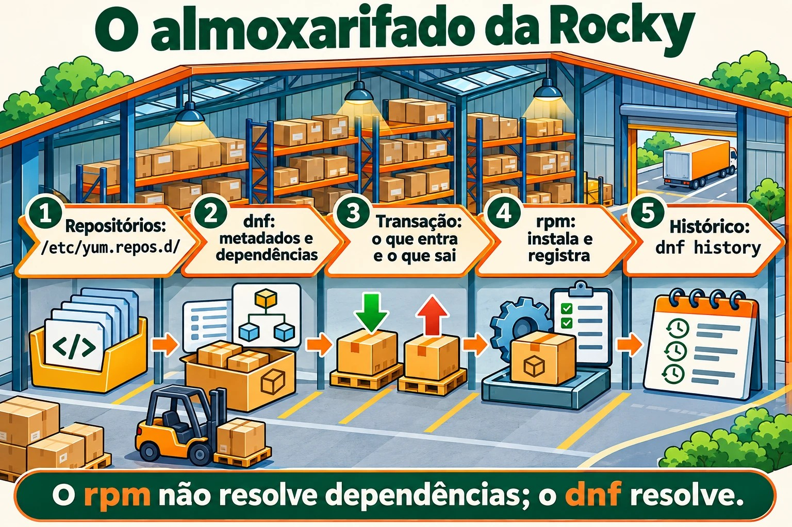
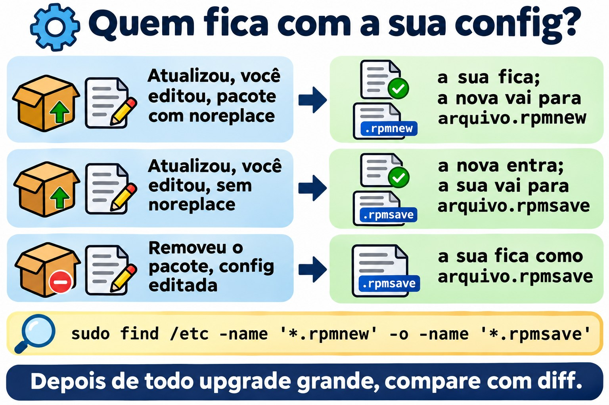

# Aula 6.2 · Pacotes na Rocky

Na aula passada você aprendeu o mundo Debian: apt compra, dpkg guarda. Hoje é o mesmo almoxarifado com outros nomes: **dnf** compra, **rpm** guarda. A lógica é igual, então esta aula anda mais rápido. O que a Rocky tem de diferente, e muito bom, é o **histórico com desfazer** (`dnf history undo`) e a **verificação de integridade** (`rpm -V`). Os dois salvam servidor em produção.

> **Núcleo desta aula:** `dnf install/remove/upgrade/search/info/provides`, `dnf install ./arquivo.rpm`, `rpm -qa/-qi/-ql/-qc/-qf`, `rpm -V`, `dnf history` e `dnf history undo`, `.rpmnew` e `.rpmsave`. O resto é aprofundamento.

| Ficha |  |
| --- | --- |
| **Módulo** | M6 · Software, aula 2 de 5 |
| **Quando** | Semana 10 |
| **Ao final você consegue** | Instalar, remover e atualizar pacotes com dnf; descobrir dono e conteúdo de pacotes com rpm; verificar se alguém alterou arquivos de um pacote; desfazer uma transação pelo histórico |
| **Pré-requisitos** | Aula 6.1 · rocky-lab com internet |
| **Tempo** | \~2h30 |
| **Snapshots** | `m6a2-inicio` e `m6a2-fim`, só na rocky-lab (201). A debian-lab descansa |

## 1 · Aquecimento

Responda antes de ler. O gabarito está no fim da aula.

1. O `rpm -i pacote.rpm` busca as dependências que faltam?
2. Você instalou um pacote ontem e ele quebrou um serviço. Na Rocky, dá para desfazer aquela instalação inteira, dependências inclusas, com um comando só?
3. Você desconfia que alguém alterou o `/etc/ssh/sshd_config` e o binário do `sshd`. Existe um jeito de perguntar ao sistema "o que mudou desde que o pacote foi instalado?"

## 2 · Por que importa

| O chamado | A resposta errada | O que ela causa |
| --- | --- | --- |
| "Instala o agente de backup no servidor" | Baixar um `.rpm` de um site qualquer e rodar `rpm -ivh --nodeps` | Pacote sem as bibliotecas de que precisa, que falha depois, e um banco rpm que o dnf passa a reclamar |
| "Atualizaram ontem e o serviço parou" | Reinstalar pacotes no chute, ou `rpm -e --nodeps` no que parecer culpado | Horas de tentativa e erro. O `dnf history` mostraria a transação exata, e o `undo` a desfaria |
| "O sshd está estranho, alguém mexeu?" | Abrir os arquivos e olhar "no olho" | Você não vê um binário trocado nem uma permissão alterada. O `rpm -V openssh-server` mostra em segundos |
| "O comando `semanage` não existe aqui" | Pesquisar no Google e instalar o primeiro pacote sugerido | Pacote errado, ou de outra versão. O `dnf provides` responde com o pacote certo do seu repositório |

## 3 · Modelo mental

> É o mesmo almoxarifado da aula 6.1. O **rpm** é o almoxarife: instala um pacote por vez, guarda o registro de tudo e confere se nada foi mexido. O **dnf** é o comprador: lê os catálogos dos repositórios, calcula as dependências, baixa tudo e entrega ao rpm. A diferença é que este comprador anota cada compra num livro numerado. E qualquer compra do livro pode ser devolvida.

```
/etc/yum.repos.d/*.repo        (de onde comprar)
          |
          v
   dnf  --- baixa metadados ---> /var/cache/dnf/        (catálogos e .rpm baixados)
    |
    |  resolve dependências, monta a transação
    v
   rpm  --- instala ---> banco rpm (/var/lib/rpm)       (o que está instalado, arquivo por arquivo)
    |
    v
/var/lib/dnf/history.sqlite    (o livro: transação 1, 2, 3... com undo)
/var/log/dnf.log, /var/log/dnf.rpm.log
```

Nas versões mais novas da família RHEL, o banco rpm mora em `/usr/lib/sysimage/rpm` e `/var/lib/rpm` aponta para lá. Para você, tanto faz: quem conversa com o banco é sempre o `rpm`.



*O dnf compra, resolve e anota a transação; o rpm instala e confere o que mudou.*

## 4 · O essencial

### dnf: o dia a dia

| Comando | O que faz |
| --- | --- |
| `dnf check-update` | Lista o que tem atualização (não instala nada) |
| `sudo dnf upgrade` | Atualiza tudo (`dnf update` é o mesmo comando, nome antigo) |
| `sudo dnf upgrade X` | Atualiza só o pacote X |
| `dnf search termo` | Procura no nome e no resumo |
| `dnf info X` | Versão, repositório, tamanho, descrição |
| `dnf provides /caminho` ou `dnf provides '*/semanage'` | Qual pacote fornece esse arquivo (instalado ou não) |
| `sudo dnf install X` | Instala com dependências |
| `sudo dnf install ./arquivo.rpm` | Instala um .rpm local resolvendo dependências |
| `sudo dnf remove X` | Remove X e as dependências que só ele usava |
| `sudo dnf reinstall X` | Reinstala a mesma versão |
| `sudo dnf downgrade X` | Volta para uma versão anterior, se o repositório tiver |
| `sudo dnf autoremove` | Remove dependências órfãs |
| `dnf list installed` / `dnf list available` | Instalados / disponíveis |
| `dnf repolist` | Repositórios ativos |
| `sudo dnf clean all` / `sudo dnf makecache` | Limpa o cache / baixa os metadados de novo |

Diferença importante para o Debian: **o dnf não tem um passo `update` separado**. Ele confere os metadados sozinho quando estão velhos. E o `dnf remove` já leva as dependências órfãs daquele pacote, sem esperar um `autoremove`.

**Grupos**: `dnf group list` mostra conjuntos prontos, e `sudo dnf group install "Development Tools"` instala um conjunto inteiro.

**Segurança:** `dnf updateinfo list --security` lista os avisos de segurança pendentes, e `sudo dnf upgrade --security` aplica só esses.

### rpm: as perguntas ao almoxarife

Tudo que começa com `-q` (query) é só leitura e não precisa de sudo.

| Comando | Pergunta que responde |
| --- | --- |
| `rpm -qa` | Tudo que está instalado (com `\| grep`, é o seu `dpkg -l`) |
| `rpm -q X` | X está instalado? Qual versão? |
| `rpm -qi X` | Ficha do pacote: versão, data de instalação, origem |
| `rpm -ql X` | Arquivos que X instalou (o `dpkg -L`) |
| `rpm -qc X` | Só os arquivos de configuração de X |
| `rpm -qd X` | Só a documentação |
| `rpm -qf /caminho` | De que pacote é esse arquivo (o `dpkg -S`) |
| `rpm -qR X` | Do que X depende |
| `rpm -q --changelog X \| head` | Histórico de mudanças do pacote (ótimo para achar CVE corrigida) |
| `rpm -q --scripts X` | Scripts que rodam na instalação e na remoção |
| `rpm -qpi arq.rpm` / `rpm -qpl arq.rpm` | Ficha e arquivos de um .rpm **não instalado** (o `p` é de package file) |

E as operações, que você deve conhecer, mas quase não usar no dia a dia:

| Comando | O que faz |
| --- | --- |
| `rpm -ivh arq.rpm` | Instala (i), verboso (v), com barra de progresso (h). Não resolve dependências |
| `rpm -Uvh arq.rpm` | Atualiza, ou instala se não existir |
| `rpm -Fvh arq.rpm` | Atualiza só se já existir (freshen) |
| `rpm -e X` | Remove (erase) |
| `--nodeps`, `--force` | Ignoram as proteções. Em servidor, quase sempre são um erro |
| `rpm --import chave.asc` | Importa uma chave GPG de repositório (mais na aula 6.3) |
| `rpm -K arq.rpm` | Confere a assinatura e a integridade de um .rpm |

### rpm -V: "o que mudou?"

O rpm guarda o tamanho, o hash, as permissões, o dono e a data de cada arquivo instalado. O `rpm -V X` compara tudo isso com o disco e só mostra o que mudou. Sem saída = nada mudou.

```
S.5....T.  c /etc/ssh/sshd_config
```

| Letra | Mudou o quê |
| --- | --- |
| `S` | Tamanho |
| `M` | Modo (permissões ou tipo) |
| `5` | Conteúdo (hash) |
| `D` | Dispositivo |
| `L` | Destino do link simbólico |
| `U` / `G` | Dono / grupo |
| `T` | Data de modificação |
| `c` antes do caminho | É arquivo de configuração: mudar é normal |
| `missing` | O arquivo sumiu |

Leitura de admin: `5` num arquivo `c` é alguém que editou a config, normal. `5` num binário em `/usr/sbin` é alarme. `rpm -Va` verifica o sistema inteiro (demora, e mostra muita config editada; filtre o que não tem `c`).

### .rpmnew e .rpmsave

O Debian pergunta o que fazer quando você editou uma config e o pacote traz uma nova. O rpm **não pergunta**: ele decide pela regra do pacote e deixa um arquivo ao lado.

| Situação | O que o rpm faz |
| --- | --- |
| Atualização, você editou a config, pacote marcou `noreplace` (o mais comum) | Mantém a sua. A nova vai para `arquivo.rpmnew` |
| Atualização, você editou, pacote **não** marcou `noreplace` | Instala a nova. A sua vai para `arquivo.rpmsave` |
| Remoção de um pacote cuja config você editou | Apaga o pacote, e a sua config fica como `arquivo.rpmsave` |

Tarefa de manutenção depois de todo upgrade grande:

```bash
sudo find /etc -name '*.rpmnew' -o -name '*.rpmsave'
```

Cada `.rpmnew` é uma config nova que ninguém comparou com a sua (`diff` entre os dois).



*O rpm não pergunta: decide pela regra do pacote e deixa um arquivo ao lado.*

### dnf history: o livro de compras

| Comando | O que faz |
| --- | --- |
| `sudo dnf history` | Lista as transações: ID, comando, data, ação, quantidade |
| `sudo dnf history info N` | Detalhe da transação N: quem, quando, cada pacote |
| `sudo dnf history list X` | Só as transações que mexeram no pacote X |
| `sudo dnf history undo N` | Desfaz a transação N (o que instalou, remove; o que removeu, reinstala) |
| `sudo dnf history rollback N` | Volta o sistema ao estado logo depois da transação N, desfazendo todas as posteriores |
| `sudo dnf history redo N` | Repete a transação N |
| `dnf repoquery --userinstalled` | O que foi pedido por alguém, não puxado como dependência (o `apt-mark showmanual`) |

Limite do `undo`: para reinstalar a versão antiga, ela precisa ainda existir no repositório. Para desfazer uma **instalação**, funciona sempre.

### Congelar versão

O equivalente do `apt-mark hold`:

```bash
sudo dnf install -y python3-dnf-plugin-versionlock
sudo dnf versionlock add X
dnf versionlock list
sudo dnf versionlock delete X
```

Alternativa grosseira: `exclude=X*` em `/etc/dnf/dnf.conf`, que esconde o pacote de todas as operações.

### Rocky × Debian

| Tarefa | Rocky | Debian |
| --- | --- | --- |
| Atualizar catálogo | automático (ou `dnf makecache`) | `apt update` |
| Atualizar pacotes | `dnf upgrade` | `apt upgrade` |
| Instalar / remover | `dnf install` / `dnf remove` | `apt install` / `apt remove` |
| Arquivo local resolvendo dependências | `dnf install ./x.rpm` | `apt install ./x.deb` |
| Ferramenta de baixo nível | `rpm` | `dpkg` |
| Listar instalados | `rpm -qa` | `dpkg -l` |
| Arquivos do pacote | `rpm -ql` | `dpkg -L` |
| Dono do arquivo | `rpm -qf` | `dpkg -S` |
| Quem fornece arquivo não instalado | `dnf provides` | `apt-file search` |
| Config preservada | `.rpmnew` / `.rpmsave` | pergunta interativa e `rc` |
| Verificar integridade | `rpm -V` | `debsums` (pacote extra) |
| Histórico com desfazer | `dnf history undo` | não tem (só log) |
| Congelar | `dnf versionlock` | `apt-mark hold` |
| Repositórios | `/etc/yum.repos.d/*.repo` | `/etc/apt/sources.list.d/` |

### E o zypper?

O zypper é o gerenciador do openSUSE e do SLES. Você não vai ter VM dele. Basta reconhecer: `zypper refresh` (catálogo), `zypper install X`, `zypper remove X`, `zypper search X`, `zypper update`, `zypper repos`. Por baixo, é rpm igual.

## 5 · Lab guiado

Tudo na **rocky-lab (201)**. A debian-lab descansa hoje. Você vai precisar de internet na VM.

**Passo 0 · Snapshot e pasta.** No Proxmox:

```bash
qm snapshot 201 m6a2-inicio
```

Na VM:

```bash
mkdir -p ~/lab62 && cd ~/lab62
```

**Passo 1 · De onde vêm os pacotes.**

```bash
dnf repolist
ls /etc/yum.repos.d/
grep -E '^(name|enabled|gpgcheck)=' /etc/yum.repos.d/*.repo | head -20
```

Resultado esperado: os repositórios **BaseOS**, **AppStream** e **extras** ativos (`enabled=1`), todos com `gpgcheck=1`. BaseOS é o núcleo do sistema; AppStream, as aplicações. Você vai abrir esses arquivos de verdade na aula 6.3.

**Passo 2 · Procurar antes de instalar.**

```bash
dnf check-update | head
dnf search tree | head
dnf info tree
dnf provides '*/semanage'
```

O `dnf provides` responde algo como `policycoreutils-python-utils`. É assim que você acha o pacote de um comando que não existe na máquina.

**Passo 3 · Instalar e perguntar ao rpm.**

```bash
sudo dnf install -y tree httpd
rpm -q tree httpd
rpm -qi tree | head -12
rpm -ql tree
rpm -qf /usr/sbin/httpd
rpm -qf /etc/httpd/conf/httpd.conf
```

Repare nas duas últimas linhas: na Rocky, o binário e a config do Apache ficam num pacote **httpd-core**, e o `httpd` é quase só um "guarda-chuva". É a mesma ideia do nginx-common no Debian. Guarde o nome real numa variável:

```bash
PKG=$(rpm -qf --qf '%{NAME}' /etc/httpd/conf/httpd.conf)
echo $PKG
rpm -qc $PKG
```

**Passo 4 · rpm -V ao vivo.**

```bash
rpm -V $PKG
```

Sem saída: nada mudou desde a instalação. Agora altere a config e veja:

```bash
echo '# teste lab62' | sudo tee -a /etc/httpd/conf/httpd.conf
rpm -V $PKG
```

Resultado esperado: `S.5....T.  c /etc/httpd/conf/httpd.conf`. Tamanho, conteúdo e data mudaram, e o `c` diz que é config. Isso é normal: todo admin edita config.

**Passo 5 · O livro e o desfazer.**

```bash
sudo dnf history | head
sudo dnf history info last
```

Anote o **ID** da transação do passo 3 (a que tem `install -y tree httpd`). Agora desfaça:

```bash
sudo dnf history undo ID -y
rpm -q tree httpd
ls /etc/httpd/conf/
```

Resultado esperado: `tree` e `httpd` não estão mais instalados, e as dependências que vieram com eles também saíram. Em `/etc/httpd/conf/` sobrou um **`httpd.conf.rpmsave`**: o rpm não apaga uma config que você editou, ele guarda ao lado.

**Passo 6 · Um .rpm na mão.**

```bash
dnf download httpd
ls -l *.rpm
rpm -qpi httpd-2*.rpm | head -8
rpm -qpR httpd-2*.rpm | head
rpm -K httpd-2*.rpm
sudo rpm -ivh httpd-2*.rpm
```

Resultado esperado: o `rpm -K` diz `digests signatures OK` (o pacote veio assinado e está íntegro). O `rpm -ivh` falha com `Failed dependencies`. Note a diferença para o Debian: **o rpm não instala pela metade**. Ele recusa tudo, e o banco continua limpo. Agora do jeito certo:

```bash
sudo dnf install -y ./httpd-2*.rpm
rpm -q httpd
```

Se o `dnf download` não existir, falta o `dnf-plugins-core`: `sudo dnf install -y dnf-plugins-core`.

**Passo 7 · Abrir um .rpm sem instalar.**

```bash
dnf download tree
mkdir extraido && cd extraido
rpm2cpio ../tree-*.rpm | cpio -idmv
find . -type f | head
cd ..
```

O `rpm2cpio` transforma o .rpm num arquivo cpio, e o `cpio -idmv` extrai na pasta atual. Serve para pegar um arquivo de dentro do pacote sem instalar nada. (Se faltar o `cpio`: `sudo dnf install -y cpio`.)

**Passo 8 · O que foi pedido, o que é dependência, e segurança.**

```bash
dnf repoquery --userinstalled | grep -E '^(httpd|tree)'
dnf updateinfo list --security | head
rpm -qa --last | head
```

O `rpm -qa --last` ordena os pacotes pela data de instalação: o mais recente primeiro. É a resposta rápida para "o que mudou nesta máquina?".

**Passo 9 · Os logs.**

```bash
sudo dnf history list httpd
sudo tail -n 20 /var/log/dnf.rpm.log
```

**Limpeza:**

```bash
sudo dnf remove -y httpd
sudo rm -f /etc/httpd/conf/httpd.conf.rpmsave
cd ~ && rm -r ~/lab62
```

### Decida 1 · Apareceu um .rpmnew

Depois de um `dnf upgrade`, você encontra `/etc/httpd/conf/httpd.conf.rpmnew` ao lado do `httpd.conf` que você tinha editado. Marque uma opção antes.

- **A)** A atualização falhou no meio. Reinstale o pacote.
- **B)** Sua config foi mantida, e a config padrão nova está ao lado. Compare as duas e traga o que importa.
- **C)** O rpm trocou sua config pela nova, e a sua antiga está no `.rpmnew`.

| Se você marcou | Resultado | Por quê |
| --- | --- | --- |
| A | Trabalho à toa | Nada falhou. O `.rpmnew` é o comportamento normal de um `%config(noreplace)` |
| **B** | **Correto** | O rpm protegeu sua edição e deixou a versão nova para você comparar com `diff -u httpd.conf httpd.conf.rpmnew` |
| C | Você confunde os sufixos | Quando a sua é que sai do lugar, ela vira `.rpmsave`. **new** = o que chegou; **save** = o que foi guardado |

**Para fixar:** `.rpmnew` = a nova ficou ao lado; `.rpmsave` = a sua foi guardada ao lado. Depois de comparar, apague o que sobrou, senão daqui a um ano ninguém sabe qual é qual.

### Decida 2 · A atualização de ontem quebrou o serviço

No `dnf history`, a transação **42** de ontem instalou o pacote `agente` e **atualizou** três bibliotecas. Depois dela, a 43 e a 44 instalaram coisas que outro admin precisa. O serviço parou desde a 42. Marque uma opção antes.

- **A)** `sudo dnf remove agente`
- **B)** `sudo dnf history undo 42`
- **C)** `sudo dnf history rollback 41`

| Se você marcou | Resultado | Por quê |
| --- | --- | --- |
| A | Pela metade | O `agente` sai, mas as três bibliotecas continuam na versão nova, que pode ser a culpada |
| **B** | **Desfaz exatamente a 42** | Remove o `agente` e volta as três bibliotecas à versão anterior (se ela ainda estiver no repositório). A 43 e a 44 ficam |
| C | Estraga o trabalho do colega | O `rollback` volta o sistema ao estado depois da 41, desfazendo a 42, a 43 e a 44 |

**Para fixar:** `undo N` desfaz **uma** transação; `rollback N` desfaz **tudo depois** de N. Antes de qualquer um, `sudo dnf history info 42` para ver o que ela fez de verdade.

## 6 · Quebre e conserte

**Quebra 1 · Permissão de binário alterada.**


*O rpm instala um pacote por vez e não resolve dependências. Quem resolve é o dnf. Para desfazer, use o número da transação.*


```bash
sudo dnf install -y tree
sudo chmod 0644 /usr/bin/tree
tree /etc/yum.repos.d
```

**Sintoma:** `Permission denied`, mesmo o arquivo existindo e sendo seu sistema.

**Diagnóstico:**

```bash
ls -l /usr/bin/tree
rpm -V tree
```

Resultado esperado: `.M.......    /usr/bin/tree`. O `M` diz que o **modo** mudou, e sem `c`: é um binário, não uma config. Isso não é normal.

**Conserto:**

```bash
sudo rpm --restore tree
rpm -V tree && tree -L 1 /etc/yum.repos.d
```

O `rpm --restore` devolve dono, grupo e permissões ao que o pacote registrou, sem reinstalar. Se o **conteúdo** tivesse mudado (`5`), aí sim `sudo dnf reinstall tree`.

**Na vida real:** um `5` em binário de `/usr/bin` ou `/usr/sbin` sem nenhuma atualização que explique é sinal de invasão. Não reinstale correndo: isso apaga a evidência. Isole a máquina e chame quem cuida de segurança.

**Quebra 2 · Instalação forçada.**

```bash
mkdir -p ~/lab62q && cd ~/lab62q
dnf download httpd
sudo rpm -ivh --nodeps httpd-2*.rpm
rpm -q httpd
sudo dnf check
```

**Sintoma:** o `rpm -q` diz que o httpd está instalado, mas o `dnf check` lista dependências faltando. Um `systemctl start httpd` falharia. E toda operação de dnf a partir de agora vai lembrar do problema.

**Conserto:** deixe o dnf completar o que falta.

```bash
sudo dnf install -y httpd
sudo dnf check
```

O `dnf check` sem saída quer dizer que o banco está coerente de novo. (Se o dnf não resolver, `sudo rpm -e --nodeps httpd` e instale de novo pelo dnf.)

**Limpeza:** `sudo dnf remove -y httpd tree && cd ~ && rm -r ~/lab62q`

**Quebra 3 · Banco rpm corrompido.** Não provoque esta. Ela aparece depois de disco cheio ou desligamento brusco: `rpm -qa` dá erro, o dnf para com `error: rpmdb open failed`. Conserto:

```bash
sudo cp -a /var/lib/rpm /root/rpm-backup-$(date +%F)
sudo rpmdb --rebuilddb
rpm -qa | wc -l
```

Primeiro a cópia, depois a reconstrução. Sempre.

## 7 · Armadilhas

| Armadilha | O que acontece | Como evitar |
| --- | --- | --- |
| `rpm -ivh` em vez de `dnf install ./` | Falha por dependência, e o próximo passo vira `--nodeps` | Para instalar, sempre dnf. O rpm é para perguntas |
| `--nodeps` e `--force` "só para passar" | Banco incoerente, serviço que não sobe, upgrade futuro quebrando | Se precisa forçar, o pacote está errado para esse sistema |
| `rollback` quando queria `undo` | Desfaz o trabalho de outras pessoas | `history info` antes, e `undo` para uma transação só |
| Ignorar `.rpmnew` | Config velha que perde opções novas, ou parâmetro que mudou de nome | `find /etc -name '*.rpmnew'` depois de todo upgrade grande |
| Confundir `.rpmnew` e `.rpmsave` | Apagar a sua config achando que era a padrão | new = chegou; save = guardado |
| `rpm -qf` em comando, não em caminho | `rpm -qf tree` responde "arquivo não existe" | `rpm -qf $(command -v tree)` |
| `rpm -Va` em servidor carregado | Muito disco e muita saída de config editada | Verifique os pacotes que importam: `rpm -V openssh-server sudo` |
| `dnf upgrade` sem olhar o que vem | Kernel novo, serviço reiniciado no horário errado | `dnf check-update` antes, e janela de manutenção |
| `exclude=` esquecido no `dnf.conf` | Pacote que nunca mais recebe correção de segurança | `versionlock` (que tem `list`) e revisão mensal |

## 8 · Quiz

Responda sem olhar. O gabarito está no fim da aula.

1. Qual a diferença entre `rpm -ql httpd` e `rpm -qpl httpd-2.4.rpm`?
2. O `rpm -V sudo` mostra `..5....T.    /usr/bin/sudo`. O que isso significa, e qual o seu primeiro passo?
3. Você editou o `/etc/httpd/conf/httpd.conf`. O que acontece com ele quando você **remove** o pacote? E quando **atualiza**, se o pacote marca a config como `noreplace`?
4. Qual a diferença entre `dnf history undo 42` e `dnf history rollback 42`?
5. Numa Rocky sem o `dig` instalado, como você descobre qual pacote instalar?
6. *Which rpm query option works on a package file that is not installed? a) `-qa` b) `-qf` c) `-qp` d) `-V`*

## 9 · Cola

**Para saber de cor:**

| Quero... | Comando |
| --- | --- |
| Ver se há atualização / atualizar | `dnf check-update` / `sudo dnf upgrade` |
| Instalar / remover | `sudo dnf install X` / `sudo dnf remove X` |
| Instalar .rpm local | `sudo dnf install ./arquivo.rpm` |
| Procurar / ler sobre | `dnf search X` / `dnf info X` |
| Quem fornece este arquivo/comando | `dnf provides '*/comando'` |
| Está instalado? | `rpm -q X` |
| Arquivos / configs do pacote | `rpm -ql X` / `rpm -qc X` |
| De quem é este arquivo | `rpm -qf /caminho` |
| O que mudou no pacote | `rpm -V X` |
| Histórico / desfazer | `sudo dnf history` / `sudo dnf history undo N` |

**Para consultar:**

| Quero... | Comando |
| --- | --- |
| Detalhe de uma transação | `sudo dnf history info N` |
| Voltar tudo até um ponto | `sudo dnf history rollback N` |
| Ficha / arquivos de um .rpm não instalado | `rpm -qpi arq.rpm` / `rpm -qpl arq.rpm` |
| Dependências | `rpm -qR X` |
| Changelog (CVE corrigida?) | `rpm -q --changelog X \| head` |
| Instalados por data | `rpm -qa --last \| head` |
| Pedidos por alguém | `dnf repoquery --userinstalled` |
| Conferir assinatura de .rpm | `rpm -K arq.rpm` |
| Extrair sem instalar | `rpm2cpio arq.rpm \| cpio -idmv` |
| Restaurar permissões | `sudo rpm --restore X` |
| Banco coerente? | `sudo dnf check` |
| Só atualizações de segurança | `sudo dnf upgrade --security` |
| Congelar versão | `sudo dnf versionlock add X` |
| Grupos | `dnf group list` / `sudo dnf group install "Nome"` |
| Configs pendentes | `sudo find /etc -name '*.rpmnew' -o -name '*.rpmsave'` |
| Logs | `/var/log/dnf.log`, `/var/log/dnf.rpm.log` |

**Flashcards:**

- `rpm -i` com dependência faltando → *recusa tudo, não instala pela metade (diferente do dpkg).*
- Letras do `rpm -V` → *S tamanho, M modo, 5 conteúdo, L link, U dono, G grupo, T data; `c` = config.*
- `.rpmnew` × `.rpmsave` → *new: a nova chegou ao lado; save: a sua foi guardada ao lado.*
- `undo` × `rollback` → *undo desfaz uma transação; rollback desfaz tudo depois de N.*
- `-qf` × `-qp` → *-qf: dono de um arquivo; -qp: perguntar a um .rpm não instalado.*

## 10 · Checklist e fechamento

- [ ] Instalo, removo e atualizo com dnf, inclusive .rpm local
- [ ] Acho o pacote de um comando que não existe (`dnf provides`)
- [ ] Respondo "de quem é este arquivo?" e "que arquivos este pacote tem?"
- [ ] Leio a saída do `rpm -V` e sei quando é alarme
- [ ] Sei o que são `.rpmnew` e `.rpmsave` e onde procurar
- [ ] Desfaço uma transação com `dnf history undo`
- [ ] Sei por que `--nodeps` é quase sempre erro

**Último exercício, sem olhar a aula:** na rocky-lab, instale o `htop` (se não achar, procure com `dnf search`; ele pode estar no EPEL, assunto da aula 6.3, então use o `tmux` no lugar). Descubra de que pacote vem o binário, mude a permissão dele, prove a mudança com `rpm -V`, conserte com `rpm --restore` e, no fim, desfaça a instalação pelo `dnf history`.

**Reboot e conferência:**

```bash
sudo reboot
# depois de voltar:
sudo dnf check
sudo dnf history | head -5
rpm -V openssh-server sudo
```

O `dnf check` não pode mostrar nada. O `rpm -V` pode mostrar só configs (`c`) que você editou em aulas anteriores.

**Snapshot de fim** (no Proxmox):

```bash
qm snapshot 201 m6a2-fim
```

## 11 · Na vida real

**Missão, só leitura.** Num servidor Rocky, Alma ou RHEL que você já administra, rode **apenas** estes comandos. Nada de `install`, `upgrade`, `remove` ou `undo`.

```bash
cat /etc/os-release | head -3
dnf repolist
sudo dnf history | head -15
rpm -qa --last | head -15
rpm -V openssh-server sudo
sudo find /etc -name '*.rpmnew' -o -name '*.rpmsave'
grep -i exclude /etc/dnf/dnf.conf
```

Perguntas para responder:

1. Quais repositórios estão ativos? Algum fora do padrão (EPEL, de fornecedor)?
2. Qual foi a última transação, quando e quem fez?
3. O `rpm -V` mostrou algo sem `c`? (Se mostrou `5` em binário, pare e avise quem cuida de segurança.)
4. Tem `.rpmnew` ou `.rpmsave` esquecido? De quando?
5. Tem `exclude=` no `dnf.conf`? Alguém sabe por quê?

**Diário:** anote para cada servidor RHEL-like os repositórios extras e os pacotes congelados, com o motivo.

**Amanhã, sem olhar:** escreva num papel as letras do `rpm -V` e o que cada uma quer dizer.

## 12 · Aprofundar quando quiser

- **dnf-automatic:** atualizações automáticas na família RHEL (o par do `unattended-upgrades`). Vem no módulo de manutenção.
- **`dnf needs-restarting -r`:** diz se o servidor precisa de reboot depois das atualizações (kernel, glibc, systemd).
- **Módulos do AppStream** (`dnf module list`): versões alternativas de PHP, Node, PostgreSQL na Rocky 8 e 9. Na família RHEL 10 essa forma foi abandonada em favor de pacotes com a versão no nome.
- **dnf5:** a nova geração do dnf, já padrão no Fedora. Os comandos do dia a dia são os mesmos.
- **rpmbuild e arquivos .spec:** como um .rpm é feito. Útil para empacotar os seus scripts e distribuir com dnf.
- **`rpm --querytags` e `--qf`:** saída formatada do rpm, ótima para relatórios (`rpm -qa --qf '%{NAME} %{INSTALLTIME:date}\n'`).

**DeepTutor** (http://10.1.0.149:3782, KB "Curso Linux Sysadmin"):

- `!explica a saída do rpm -V e quando ela indica invasão`
- `!feynman a diferença entre .rpmnew e .rpmsave`
- `!quiz Aula 6.2, 5 perguntas comparando dnf/rpm com apt/dpkg`

## Gabarito comentado

### Aquecimento

1. **Não.** O `rpm -i` instala só aquele arquivo. Se faltar dependência, ele para com `Failed dependencies` e **não instala nada** (o dpkg, ao contrário, deixa o pacote pela metade). Quem resolve dependências é o `dnf install ./arquivo.rpm`.
2. **Sim.** `sudo dnf history` mostra a transação, e `sudo dnf history undo N` desfaz tudo o que ela fez, dependências inclusas. Para reverter uma **atualização**, a versão antiga precisa ainda estar no repositório.
3. **Sim:** `rpm -V openssh-server`. Ele compara tamanho, hash, permissões, dono e data de cada arquivo com o que foi registrado na instalação. Config editada aparece com `c`; binário alterado aparece sem.

### Quiz

1. `rpm -ql httpd` pergunta ao **banco** sobre um pacote **instalado**. `rpm -qpl arquivo.rpm` pergunta ao **arquivo** .rpm, instalado ou não. O `p` é de package file.
2. O conteúdo (`5`) e a data (`T`) do binário `/usr/bin/sudo` mudaram, e não é config (não tem `c`). Primeiro passo: `sudo dnf history list sudo` e `rpm -qi sudo` para ver se houve atualização legítima incompleta. Se não houver explicação, trate como possível invasão: isole a máquina e **não** reinstale antes de preservar a evidência.
3. Na **remoção**, o pacote sai e a sua config editada fica como `httpd.conf.rpmsave`. Na **atualização** com `noreplace`, a sua config fica no lugar e a nova vem como `httpd.conf.rpmnew`.
4. `undo 42` desfaz **só** a transação 42. `rollback 42` volta o sistema ao estado logo depois da 42, desfazendo **todas** as posteriores (43, 44...).
5. `dnf provides '*/bin/dig'` (ou `dnf provides dig`). A resposta é o pacote `bind-utils`. O equivalente do Debian seria o `apt-file search bin/dig`.
6. **c) `-qp`.** O `-qa` lista os instalados, o `-qf` acha o dono de um arquivo instalado, e o `-V` verifica pacotes instalados. Só o `p` faz a pergunta a um arquivo .rpm.

---

<!-- navegacao -->
[← Aula 6.1 · Pacotes no Debian](6.1-pacotes-no-debian.md) · [Índice de aulas](../01-aulas.md) · [Aula 6.3 · Repositórios →](6.3-repositorios.md)
