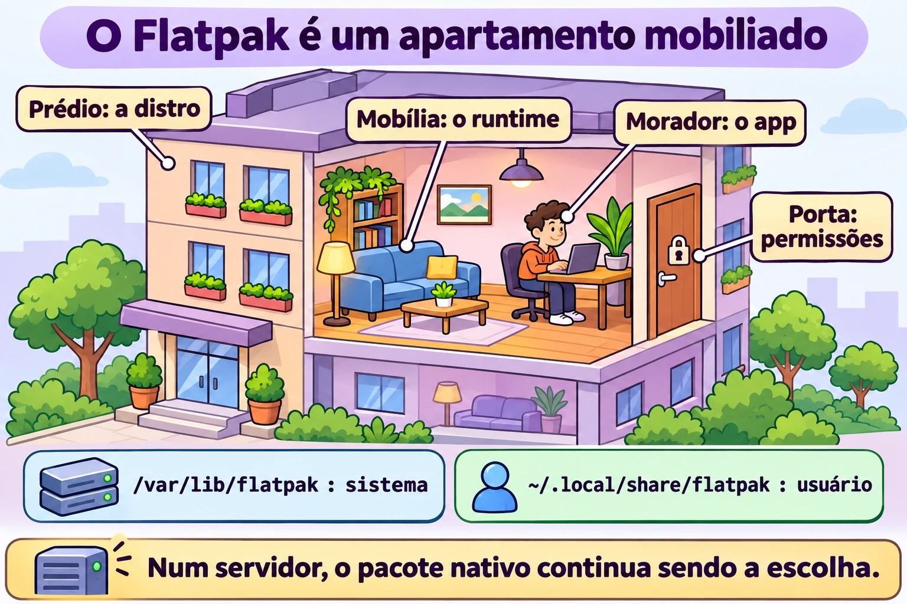
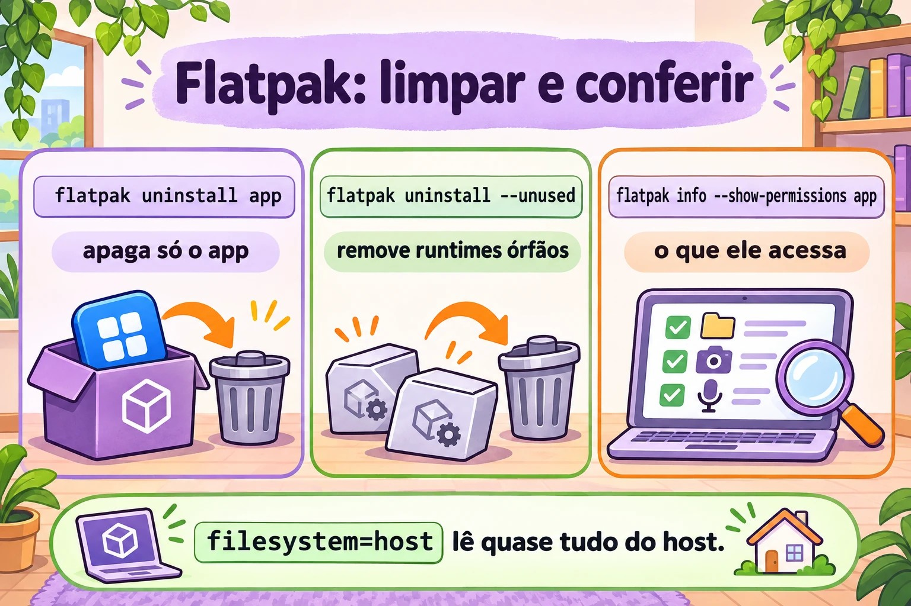

# Aula 6.4 · Flatpak

Até aqui, todo pacote que você instalou foi feito **para aquela distribuição**: o `.rpm` da Rocky não roda no Debian e vice-versa. O Flatpak faz o contrário: o mesmo aplicativo roda em qualquer distribuição, levando junto as bibliotecas de que precisa e rodando numa caixa isolada. É coisa de desktop, mas aparece em estações de trabalho Linux de clientes, então você precisa saber operar. Aula curta.

> **Núcleo desta aula:** saber o que são remote, app e runtime; adicionar o Flathub; procurar, instalar, atualizar e remover; entender a diferença entre instalação de sistema e de usuário; e ver e restringir permissões de um app. O resto é aprofundamento.

| Ficha |  |
| --- | --- |
| **Módulo** | M6 · Software, aula 4 de 5 |
| **Quando** | Semana 11 |
| **Ao final** | Você opera Flatpak pela linha de comando e sabe quando ele é (e quando não é) a ferramenta certa |
| **Pré-requisitos** | Aula 6.3 |
| **Tempo** | cerca de 1h30 |
| **Snapshots** | `m6a4-inicio` e `m6a4-fim` na rocky-lab (a parte Debian é opcional) |

## 1 · Aquecimento

Responda antes de ler.

1. Um app Flatpak usa a `glibc` da sua Rocky ou leva a própria?
2. Precisa ser root para instalar um Flatpak?
3. Num servidor sem interface gráfica, Flatpak faz sentido?

## 2 · Por que importa

| O chamado | A resposta errada | O que ela causa |
| --- | --- | --- |
| "Preciso da versão nova do app X na estação RHEL, o dnf só tem a antiga" | Adicionar repositório do Fedora na RHEL | Mistura de versões e um `dnf upgrade` que quebra o sistema |
| "Desinstalei o app e o disco não liberou" | "Flatpak é assim mesmo" | Runtimes órfãos ocupando gigas |
| "O usuário instalou um app e eu não vejo na lista" | Achar que não está instalado | Ele instalou com `--user`, na pasta dele |
| "O app consegue ler o meu home inteiro?" | "É sandbox, não lê nada" | Depende das permissões que o próprio app pede. Tem que conferir |

## 3 · Modelo mental

> O Flatpak é um **apartamento mobiliado dentro do prédio**. O prédio é a sua distribuição (kernel, rede, usuários). O **runtime** é a mobília padrão (bibliotecas básicas), compartilhada por vários apartamentos. O **app** é o morador, que traz só o que é dele. O **remote** é a imobiliária. As **permissões** dizem por quais portas o morador pode sair.

```
            remote (ex.: flathub)
                   │  baixa (OSTree, só o que mudou)
                   ▼
  /var/lib/flatpak  (sistema)     ~/.local/share/flatpak  (--user)
        │
        ├── runtime  org.gnome.Platform//47     ← bibliotecas, compartilhado
        └── app      org.gnome.Calculator         ← o programa
                   │
                   ▼  flatpak run
        ┌───── sandbox ───────────────────────────┐
        │ /usr = runtime   /app = o app        │
        │ rede, home, X11/Wayland... só se     │
        │ a permissão deixar                   │
        └──────────────────────────────────────┘
              kernel e usuários: os do host
```

A resposta da primeira pergunta está no desenho: dentro da caixa, o `/usr` é o do runtime. O app nunca enxerga as bibliotecas da Rocky.



*O app nunca enxerga o /usr da distro; o runtime traz a mobília compartilhada.*

## 4 · O essencial

### Vocabulário

| Termo | O que é |
| --- | --- |
| **Remote** | Repositório Flatpak. O mais comum é o Flathub. No RHEL vem o remote `rhel`, da Red Hat |
| **App ID** | Nome em DNS invertido: `org.gnome.Calculator`, `org.mozilla.firefox` |
| **Runtime** | Conjunto de bibliotecas base (`org.freedesktop.Platform`, `org.gnome.Platform`, `org.kde.Platform`), com versão. Vários apps usam o mesmo |
| **Ref** | Endereço completo: `app/org.gnome.Calculator/x86_64/stable` |
| **Instalação de sistema** | `/var/lib/flatpak`, para todos os usuários, exige root (ou polkit) |
| **Instalação de usuário** | `--user`, em `~/.local/share/flatpak`, só para você, sem root |
| **Dados do app** | `~/.var/app/<App ID>/`: configuração e cache de cada usuário |

### Comandos

| Quero... | Comando |
| --- | --- |
| Instalar o Flatpak | `sudo dnf install flatpak` / `sudo apt install flatpak` |
| Adicionar o Flathub | `sudo flatpak remote-add --if-not-exists flathub https://dl.flathub.org/repo/flathub.flatpakrepo` |
| Ver remotes | `flatpak remotes` |
| Procurar | `flatpak search calculadora` (busca em inglês funciona melhor) |
| Listar o que um remote tem | `flatpak remote-ls flathub --app` |
| Instalar | `sudo flatpak install flathub org.gnome.Calculator` |
| Listar instalados | `flatpak list --app` / `flatpak list --runtime` |
| Detalhes | `flatpak info org.gnome.Calculator` |
| Executar | `flatpak run org.gnome.Calculator` |
| Atualizar tudo | `sudo flatpak update` |
| Remover | `sudo flatpak uninstall org.gnome.Calculator` |
| Remover runtimes órfãos | `sudo flatpak uninstall --unused` |
| Histórico | `flatpak history` |
| Ver permissões | `flatpak info --show-permissions APP` |
| Restringir permissão | `flatpak override --user --nofilesystem=home APP` |
| Desligar um remote | `sudo flatpak remote-modify --disable flathub` |

Sem `--user` e sem `--system`, o padrão é **sistema**. Para usar `--user`, o remote também tem que existir no escopo do usuário (`flatpak remote-add --user ...`).

### Permissões (o "sandbox")

O app declara o que quer: rede (`network`), tela (`x11`, `wayland`), som (`pulseaudio`), arquivos (`filesystem=home`, `filesystem=host`), dispositivos (`devices=all`). O Flatpak concede o que está declarado. O sandbox só protege tanto quanto essa lista. Um app com `filesystem=host` lê quase tudo o que você lê.

O `flatpak override` muda isso por app, para você (`--user`) ou para todos (`sudo flatpak override`). `flatpak override --show APP` mostra o que foi alterado, e `--reset` desfaz. Na interface gráfica, o app **Flatseal** faz o mesmo.

### Flatpak, Snap e AppImage

|  | Flatpak | Snap | AppImage |
| --- | --- | --- | --- |
| Quem empurra | Comunidade, Red Hat, GNOME, KDE | Canonical (Ubuntu) | Ninguém em especial |
| Loja | Vários remotes (Flathub o maior) | Uma só, da Canonical | Nenhuma, é um arquivo |
| Instalação | `flatpak install` | `snap install` | Baixa, `chmod +x`, executa |
| Isolamento | Sim, por permissões | Sim, AppArmor | Não |
| Atualização | `flatpak update` | Automática | Manual |
| Foco | Desktop | Desktop e servidor | Desktop |

### Rocky × Debian

O Flatpak é igual nas duas: mesmos comandos, mesmos caminhos, mesmo Flathub. Muda só a instalação do próprio `flatpak` (dnf ou apt) e o remote que vem pronto: nenhum na Rocky e no Debian, o `rhel` no RHEL. No Ubuntu, quem vem pronto é o Snap.

## 5 · Lab guiado

**Passo 0 · Snapshot e pasta.** No Proxmox: `qm snapshot 201 m6a4-inicio`. Na rocky-lab: `mkdir -p ~/lab64 && cd ~/lab64`.

**Passo 1 · Instalar o Flatpak e ver que não há remote.**

```bash
sudo dnf install -y flatpak
flatpak --version
flatpak remotes
```

A lista vem vazia (ou só com remotes do fornecedor). Sem remote, não há de onde instalar.

**Passo 2 · Adicionar o Flathub e olhar o catálogo.**

```bash
sudo flatpak remote-add --if-not-exists flathub https://dl.flathub.org/repo/flathub.flatpakrepo
flatpak remotes -d
flatpak remote-ls flathub --app | wc -l
flatpak search calculator | head
```

O `.flatpakrepo` é um arquivo pequeno com a URL e a chave GPG do remote. É o equivalente ao `epel-release` da aula passada.

**Passo 3 · Instalar e ver o runtime chegando.**

```bash
sudo flatpak install -y flathub org.gnome.Calculator
flatpak list --app
flatpak list --runtime
flatpak info org.gnome.Calculator
```

Repare que vieram dois ou mais itens: o app e o runtime (e extensões, como traduções). Na primeira vez o runtime é a parte grande do download. O próximo app que usar o mesmo runtime vem leve. Na linha `Runtime:` do `flatpak info` está qual ele usa.

**Passo 4 · Entrar na caixa.** A rocky-lab não tem tela, então o `flatpak run` normal falharia por falta de display. Em vez disso, abra um shell **dentro** do sandbox do app:

```bash
flatpak run --command=sh org.gnome.Calculator
```

Já dentro:

```bash
cat /etc/os-release | head -3
ls /app/bin
ls /usr/lib64 2>/dev/null | head -3; ls /usr/lib | head -3
id
ls ~
exit
```

O `os-release` não é o da Rocky: é o do runtime. O `/app` é o app. O `id` mostra o seu usuário de verdade (o sandbox não é outra máquina, o kernel e os usuários são do host). O `ls ~` mostra só o que a permissão deixa ver.

**Passo 5 · Permissões e override.**

```bash
flatpak info --show-permissions org.gnome.Calculator
flatpak override --user --unshare=network org.gnome.Calculator
flatpak override --user --show org.gnome.Calculator
ls ~/.local/share/flatpak/overrides/
flatpak override --user --reset org.gnome.Calculator
```

O override é só um arquivo de texto na sua pasta. O `--reset` apaga as mudanças.

**Passo 6 · Instalação de usuário, sem root.**

```bash
flatpak remote-add --user --if-not-exists flathub https://dl.flathub.org/repo/flathub.flatpakrepo
flatpak remotes
flatpak install --user -y flathub org.gnome.Calculator
flatpak list --app
ls ~/.local/share/flatpak/app/
```

Agora a coluna `Installation` mostra o mesmo app duas vezes: `system` e `user`. São cópias independentes.

**Passo 7 · Histórico, atualização e remoção limpa.**

```bash
flatpak history | tail
sudo flatpak update -y
flatpak uninstall --user -y org.gnome.Calculator
sudo flatpak uninstall -y org.gnome.Calculator
flatpak list --runtime
sudo flatpak uninstall --unused -y
flatpak uninstall --user --unused -y
flatpak list --runtime
ls ~/.var/app/ 2>/dev/null
```

Depois de remover o app, o runtime **continua** lá até o `--unused`. E os dados do usuário em `~/.var/app/` também ficam (para isso existe o `--delete-data`).

**Passo 8 (opcional) · debian-lab.** Rode `sudo apt install -y flatpak`, depois o mesmo `remote-add` do Passo 2 e o `flatpak remote-ls flathub --app | wc -l`. O número é o mesmo: o catálogo não depende da distribuição.

### Limpeza

O Flathub pode ficar configurado nos dois escopos. Remova só o remote de usuário, que não tem mais uso: `flatpak remote-delete --user flathub`.

### Decida 1

Um colega quer o `jq` num servidor Rocky de produção, sem interface gráfica, e propõe instalar via Flatpak "porque é isolado". O que você faz?

A) Flatpak, é mais seguro. B) `dnf install jq`, que está no repositório da Rocky. C) Baixa o binário do GitHub e coloca em `/usr/local/bin`.

Marque uma opção antes.

| Se você marcou | Resultado | Por quê |
| --- | --- | --- |
| A | Pode nem existir assim, e se existir traz um runtime inteiro | Flatpak é feito para apps de desktop. Num servidor, você ganha um segundo sistema de pacotes para manter e auditar |
| B | Certo | Pacote da distribuição, assinado, atualizado com o resto pelo `dnf upgrade` |
| C | Funciona, sem atualização | Ninguém lembra de atualizar o binário solto quando sair uma correção |

**Para fixar:** em servidor, pacote da distribuição primeiro. Flatpak é para app gráfico em estação de trabalho.

### Decida 2

Numa estação RHEL compartilhada, uma usuária sem sudo precisa de um editor de imagem que só existe no Flathub. Ninguém mais vai usar. O que você faz?

A) Instala com `sudo flatpak install` para todos. B) Deixa ela instalar com `--user`, na pasta dela. C) Dá sudo para ela poder instalar.

Marque uma opção antes.

| Se você marcou | Resultado | Por quê |
| --- | --- | --- |
| A | Funciona, e você vira o responsável por atualizar | O app aparece para todo mundo, sem necessidade |
| B | Certo | É para isso que existe a instalação de usuário: sem root e sem tocar no sistema. O remote de usuário precisa ser adicionado antes |
| C | Pior de todas | Root inteiro para instalar um app |

**Para fixar:** `--user` é o jeito de dar autonomia sem dar sudo.

## 6 · Quebre e conserte

### Quebra 1 · "Não acho o app" no escopo de usuário

Na rocky-lab, sem remote de usuário (você removeu na Limpeza):


*App com filesystem=host lê quase tudo. Antes de confiar, rode flatpak info --show-permissions.*


```bash
flatpak install --user flathub org.gnome.Calculator
```

**Sintoma:** erro dizendo que o remote `flathub` não existe ou que nada corresponde ao nome, embora `sudo flatpak install` funcione.

**Diagnóstico:** `flatpak remotes` mostra a coluna de escopo: o `flathub` está só em `system`.

**Conserto:** `flatpak remote-add --user --if-not-exists flathub <url>`, ou instalar no sistema. Depois do teste, remova de novo.

**Na vida real:** é a dúvida número um de quem começa com `--user`. Os dois escopos são mundos separados: remotes, apps e runtimes.

### Quebra 2 · Disco que não libera

Instale e remova um app sem o `--unused`:

```bash
sudo flatpak install -y flathub org.gnome.Calculator
sudo flatpak uninstall -y org.gnome.Calculator
du -sh /var/lib/flatpak
```

**Sintoma:** o app sumiu, mas a pasta continua grande.

**Diagnóstico:** `flatpak list --runtime` mostra os runtimes que ninguém usa mais.

**Conserto:** `sudo flatpak uninstall --unused`, e confira de novo com `du -sh`.

**Na vida real:** em estações antigas, runtimes velhos (versões anteriores do GNOME ou KDE) somam muitos gigas. O `flatpak update` costuma avisar quando um runtime chega ao fim de vida.

### Quebra 3 · Remote desligado (narrativa)

Alguém rodou `flatpak remote-modify --disable flathub` durante uma manutenção e esqueceu. Semanas depois, o `flatpak update` diz que não há nada a atualizar e o `install` não acha nada.

**Diagnóstico:** `flatpak remotes -d` mostra o remote com a opção `disabled`.

**Conserto:** `sudo flatpak remote-modify --enable flathub`. É o mesmo padrão do `enabled=0` da aula 6.3: desligado não dá erro, só fica quieto.

## 7 · Armadilhas

| Armadilha | O que acontece | Como evitar |
| --- | --- | --- |
| Achar que sandbox é proteção total | App com `filesystem=host` lê quase tudo | `flatpak info --show-permissions` antes de confiar |
| Remover app e esquecer runtime | Disco cheio de runtime órfão | `flatpak uninstall --unused` |
| Misturar `--user` e sistema | App "some", "duplica" ou não atualiza | Veja a coluna `Installation` no `flatpak list` |
| `flatpak update` só como usuário | Atualiza o escopo de usuário e não o de sistema (ou o contrário) | `sudo flatpak update` para o sistema, `flatpak update --user` para o seu |
| `dnf upgrade` não atualiza Flatpak | Apps desatualizados meses a fio | O Flatpak tem atualização própria. Inclua no procedimento de manutenção |
| Flatpak em servidor | Segundo sistema de pacotes para manter | Pacote da distribuição ou container |
| Errar o App ID | `install` não acha ou pergunta qual | Copie o ID do `flatpak search` |

## 8 · Quiz

Responda sem olhar. O gabarito está no fim da aula.

1. O que é um runtime e por que ele não some quando você remove o app?
2. Onde fica um app instalado com `--user`? E com `sudo`?
3. Você removeu um app com `flatpak uninstall`. Onde ficaram as configurações do usuário, e como teria apagado junto?
4. Como você descobre se um app pode acessar a rede e o seu home?
5. Por que `dnf upgrade` não basta numa estação com apps Flatpak?
6. *Which command adds the Flathub remote system-wide? a) `flatpak add flathub URL` b) `flatpak remote-add flathub URL` c) `dnf config-manager --add-repo URL` d) `flatpak install flathub`*

## 9 · Cola

**Para saber de cor:**

| Quero... | Comando |
| --- | --- |
| Ver remotes | `flatpak remotes` |
| Adicionar remote | `sudo flatpak remote-add --if-not-exists NOME URL.flatpakrepo` |
| Procurar | `flatpak search TERMO` |
| Instalar / remover | `sudo flatpak install REMOTE APPID` / `sudo flatpak uninstall APPID` |
| Listar | `flatpak list --app` |
| Atualizar | `sudo flatpak update` |
| Limpar órfãos | `sudo flatpak uninstall --unused` |

**Para consultar:**

| Quero... | Comando |
| --- | --- |
| Catálogo do remote | `flatpak remote-ls REMOTE --app` |
| Detalhes e runtime | `flatpak info APPID` |
| Permissões | `flatpak info --show-permissions APPID` |
| Restringir / ver / desfazer | `flatpak override --user --nofilesystem=home APPID` / `--show` / `--reset` |
| Shell dentro do sandbox | `flatpak run --command=sh APPID` |
| Histórico | `flatpak history` |
| Ligar / desligar remote | `sudo flatpak remote-modify --enable` / `--disable REMOTE` |
| Remover remote | `sudo flatpak remote-delete REMOTE` |
| Remover com dados | `flatpak uninstall --delete-data APPID` |
| Consertar instalação | `sudo flatpak repair` |
| Caminhos | `/var/lib/flatpak`, `~/.local/share/flatpak`, `~/.var/app/` |

**Flashcards:**

- Remote, app, runtime → *imobiliária, morador, mobília compartilhada.*
- Escopo padrão → *sistema. `--user` precisa de remote de usuário.*
- Sandbox protege tudo? → *Só o que as permissões não liberam.*
- Removeu o app, o disco não liberou → *`flatpak uninstall --unused`.*
- Servidor sem tela → *pacote da distribuição, não Flatpak.*

## 10 · Checklist e fechamento

- [ ] Explico remote, app, runtime e ref
- [ ] Adiciono o Flathub e instalo, listo, atualizo e removo um app
- [ ] Diferencio instalação de sistema e de usuário
- [ ] Vejo e restrinjo permissões com `info --show-permissions` e `override`
- [ ] Limpo runtimes órfãos
- [ ] Sei quando **não** usar Flatpak

**Último exercício, sem olhar a aula:** na rocky-lab, instale como usuário (sem sudo) qualquer app pequeno do Flathub, mostre que runtime ele usa, abra um shell dentro dele e diga de qual distribuição é o `/usr`. Depois remova o app, o runtime órfão e o remote de usuário.

**Reboot e conferência:**

```bash
sudo reboot
flatpak remotes
flatpak list
sudo flatpak update
sudo dnf check
```

O `flatpak list` deve vir vazio ou só com o que você decidiu manter. O `dnf check` continua limpo: o Flatpak não mexe no banco do rpm.

**Snapshot de fim** (no Proxmox):

```bash
qm snapshot 201 m6a4-fim
```

## 11 · Na vida real

**Missão, só leitura.** Numa estação Linux (sua ou de alguém que autorize) que use Flatpak, rode **apenas**:

```bash
flatpak remotes -d
flatpak list --columns=application,version,installation,origin
flatpak list --runtime --columns=application,branch
flatpak history | tail -20
du -sh /var/lib/flatpak ~/.local/share/flatpak 2>/dev/null
```

Perguntas para responder:

1. Quais remotes existem e em que escopo?
2. Quantos apps de sistema e quantos de usuário?
3. Algum runtime com versão (branch) antiga que talvez já não tenha app usando?
4. Quando foi a última atualização no `history`?
5. Escolha um app e rode `flatpak info --show-permissions` nele. Ele pede `filesystem=host`?

**Diário:** anote se a estação tem algum procedimento que atualiza o Flatpak, ou se só o `dnf`/`apt` roda.

**Amanhã, sem olhar:** escreva os seis comandos essenciais: `remotes`, `remote-add`, `search`, `install`, `list`, `uninstall`.

## 12 · Aprofundar quando quiser

- **OSTree:** o "git para binários" por baixo do Flatpak. Explica por que só se baixa o que mudou e por que dois apps com o mesmo runtime não duplicam disco. O mesmo OSTree está no Fedora Silverblue e no RHEL for Edge.
- **Remotes privados:** uma empresa pode publicar os próprios apps num remote interno, ou usar o remote `rhel` da Red Hat com registro.
- **`flatpak-builder` e manifestos:** como um app Flatpak é empacotado.
- **Portais (xdg-desktop-portal):** como o app pede para abrir um arquivo sem ter acesso ao home inteiro.
- **Snap a fundo:** `snap list`, `snap refresh --hold`, os montes `squashfs` que aparecem no `lsblk` do Ubuntu.
- **Atualização automática:** GNOME Software e KDE Discover atualizam Flatpak sozinhos. Em frota, um timer do systemd com `flatpak update -y`.

**DeepTutor** (http://10.1.0.149:3782, KB "Curso Linux Sysadmin"):

- `!explica a diferença entre runtime e app no Flatpak`
- `!feynman por que o sandbox do Flatpak não é proteção total`
- `!quiz Aula 6.4, 5 perguntas sobre Flatpak`

## Gabarito comentado

### Aquecimento

1. **Leva a própria.** Dentro do sandbox, o `/usr` é o do runtime, com a `glibc` dele. Por isso o mesmo app roda em qualquer distribuição. O kernel, esse sim, é o do host.
2. **Não necessariamente.** A instalação de sistema exige root (ou autorização pelo polkit numa sessão gráfica). Com `--user`, qualquer usuário instala na própria pasta.
3. **Quase nunca.** O Flatpak foi feito para apps gráficos. Em servidor, use pacote da distribuição ou container. A exceção é uma estação de trabalho, como nesta aula.

### Quiz

1. Runtime é o conjunto de bibliotecas base que o app usa (por exemplo `org.gnome.Platform`). Ele é compartilhado: outro app pode depender dele. Por isso a remoção do app não leva o runtime, e quem limpa é o `flatpak uninstall --unused`.
2. Com `--user`: `~/.local/share/flatpak/`. Com `sudo` (escopo de sistema, o padrão): `/var/lib/flatpak/`.
3. Em `~/.var/app/<App ID>/`, na pasta de cada usuário que usou o app. Para apagar junto: `flatpak uninstall --delete-data APPID`.
4. `flatpak info --show-permissions APPID`. Procure `network` em `shared` e `home` ou `host` em `filesystems`. Overrides aplicados aparecem com `flatpak override --show APPID`.
5. Porque os apps Flatpak não estão no banco do rpm nem nos repositórios do dnf. Eles têm o próprio remote e a própria atualização: `flatpak update`.
6. **b) `flatpak remote-add flathub URL`** (com `sudo` e, na prática, `--if-not-exists`). O a) não existe. O c) é para repositório RPM. O d) instala, mas só funciona se o remote já existir.

---

<!-- navegacao -->
[← Aula 6.3 · Repositórios](6.3-repositorios.md) · [Índice de aulas](../01-aulas.md) · [Aula 6.5 · Bibliotecas compartilhadas →](6.5-bibliotecas-compartilhadas.md)
